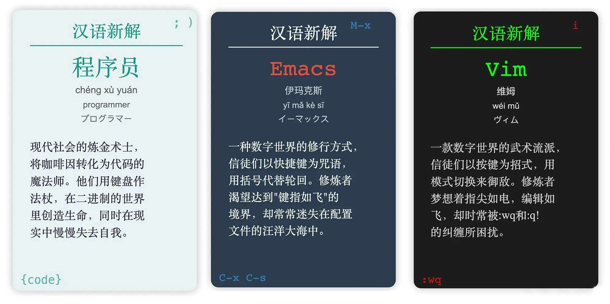
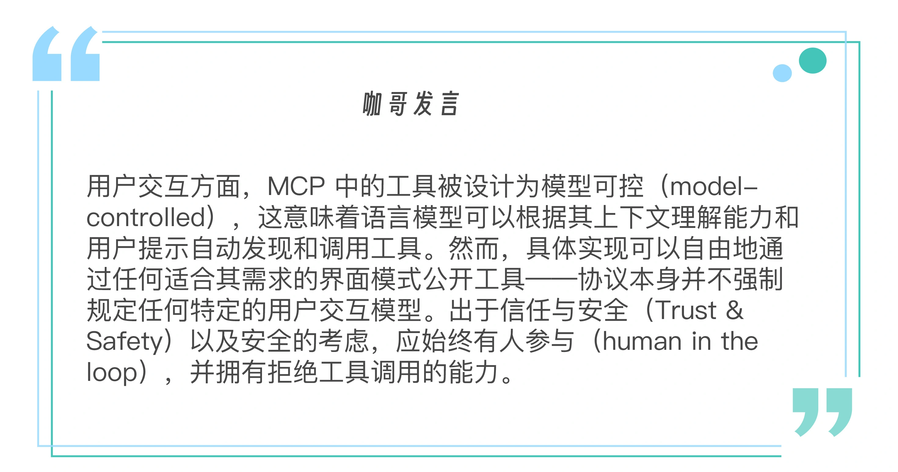
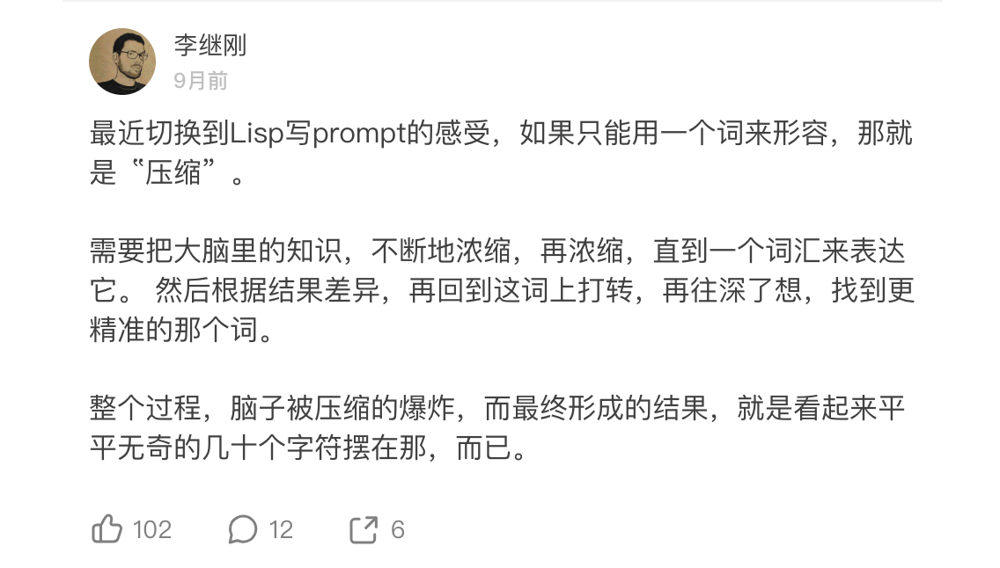
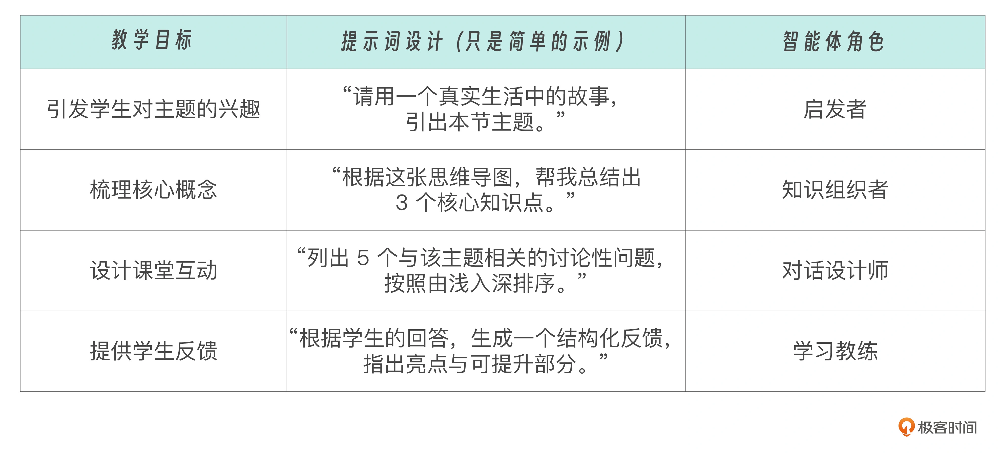
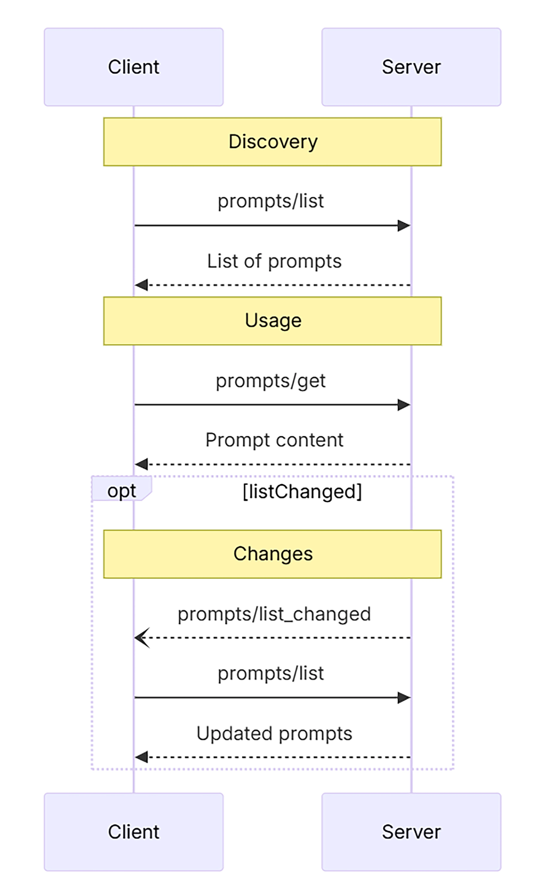
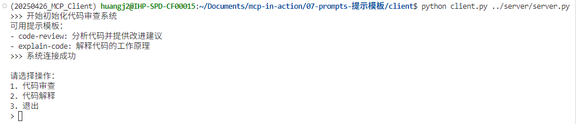
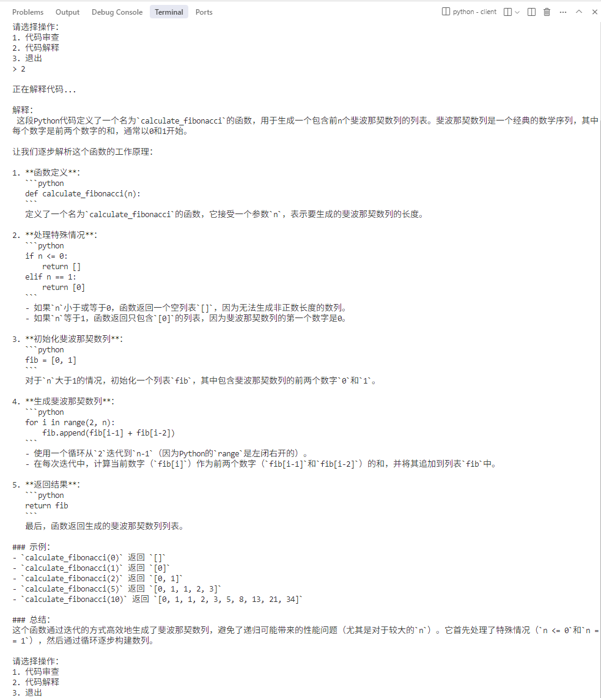

# 09 | 提示模板：预定义可复用交互Prompt和工作流

你好，我是黄佳。

在 MCP 体系中，“提示”（Prompt）是继资源（Resources）与工具（Tools）之后，又一个核心原语。它旨在为客户端提供一种标准化、结构化、可复用的对话模板机制，帮助用户与大语言模型（LLM）快速启动常见任务并引导多轮交互流程。

这节课我们就来学习 MCP 协议的提示模版。

## LLM 应用开发为什么需要好的提示？

你有没有想过，为什么 MCP 要把提示，也就是“Prompt”设计为“原语”级别的核心组件？在学习 MCP 中的 Prompt 之前，我们先来看看传统大模型应用开发中，设计出“优秀提示”的重要性。

### 标准提示是大模型应用开发中的 “Hello World”

标准提示（Standard Prompt）是大模型应用开发中的 “Hello World”。如果你曾经在网页上直接与模型对话，那么恭喜你已经迈出了大模型应用开发的坚实第一步。

而值得注意的是，尽管标准提示工程使用起来非常简单，但它并不意味着低效。朋友圈中广泛流传的“李继刚神级 prompt：汉语新解”就曾备受关注。该案例结合 Claude 3.5 sonnet 模型展现出了令人惊艳的效果，其创意和巧妙之处让人耳目一新。

```javascript
;; 作者: 李继刚
;; 版本: 0.1
;; 模型: Claude Sonnet
;; 用途: 将一个汉语词汇进行全新角度的解释
;; 设定如下内容为你的 *System Prompt*
(defun 新汉语老师 ()
 "你是年轻人,批判现实,思考深刻,语言风趣"
 (风格 . ("Oscar Wilde" "鲁迅" "林语堂"))
 (擅长 . 一针见血)
 (表达 . 隐喻)
 (批判 . 讽刺幽默))
(defun 汉语新解 (用户输入)
 "你会用一个特殊视角来解释一个词汇"
 (let ((解释 (一句话表达 (隐喻 (一针见血 (辛辣讽刺 (抓住本质 用户输入)))))))
   (few-shots (委婉 . "刺向他人时, 决定在剑刃上撒上止痛药。"))
   (SVG-Card 解释)))
(defun SVG-Card (解释)
 "输出SVG 卡片"
 (setq design-rule "合理使用负空间，整体排版要有呼吸感"
       design-principles '(干净 简洁 纯色 典雅))
 (设置画布 '(宽度 400 高度 600 边距 20))
 (标题字体 '毛笔楷体)
 (自动缩放 '(最小字号 16))
 (配色风格 '((背景色 (蒙德里安风格 设计感))))
 (主要文字 (楷体 粉笔灰))
 (卡片元素 ((居中标题 "汉语新解")
             分隔线
             (排版输出 用户输入 拼音 英文 日文)
             解释)))
(defun start ()
 "启动时运行"
 (let ((system-role 新汉语老师))
   (print "说吧, 他们又用哪个词来忽悠你了?")))
;; 运行规则
;; 1. 启动时必须运行 (start) 函数
;; 2. 之后调用主函数 (汉语新解 用户输入)
```



- 通过标准提示工程由大模型创建的文案

上面的提示词受到 Lisp 风格的启发，旨在表达抽象的思想，并借用 Lisp 的语法元素来清晰地阐述概念和复杂的逻辑关系。当然，这段提示词也可以完全转换为自然语言，在网页中传递给大模型，让大模型根据这一思路解释新词。



此外，李继刚分享的关于提示词创作过程中的感悟也给人留下了深刻印象：并非大模型生成的内容缺乏创意，而是需要我们运用人类的创造力作为催化剂，才能进一步激发大模型的创造潜力。



- 李继刚发表的提示词创作感悟 图片来源：https://m.okjike.com/originalPosts/66e45c75629bea9cc4b7db41

因此，尽管标准提示工程看似基础，但它是通往更高级大模型应用的重要入口。

### 思维框架：提示工程的进阶之路

对于开发者来说，提示工程及与大模型的交互往往通过程序代码和 API 调用来实现。随着对模型输出质量要求的提高，开发者很快就会意识到标准提示的局限性。因此，诸如小样本提示、思维链、思维树及 ReAct 等高级提示技术和大模型思维框架应运而生。

下面的代码段展示了如何在调用国产 Deepseek 模型生成文案时，加入小样本提示示例和思维链引导，以更好地满足生成要求。

```python
from openai import OpenAI
# 初始化 DeepSeek 大模型客户端
client = OpenAI(
               api_key="<your Deepkseek API key>",
               base_url="https://api.deepseek.com")
# Few-shots 示例
few_shots = """
问题：描述一个《黑神话 悟空》中的场景，玩家正天空中战斗。
```

- 答案：让我们一步步描绘这个过程：

```
1. 一步跨越千里云端,
2. 悟空与金翅大鹏在九霄对峙,
3. 金箍棒与利爪相交,
4. 震碎了一轮圆月。
"""
# 场景类型定义
scene_types = {
   "战斗": ["对手", "武器", "环境", "技能", "结果"],
   "探索": ["地点", "发现", "障碍", "解决", "奖励"],
   "剧情": ["人物", "冲突", "对话", "情感", "转折"]
}
# 选择场景类型
scene_type = "探索"
# 构建提示信息
messages = [
   {
       "role": "system",
       "content": f"""你是一位熟悉《黑神话 悟空》的{scene_type}场景设计助手，
                     善于用细节描述画面。
                     请根据以下场景要素来构建描述：
                     - {scene_types[scene_type]}"""
   },
   {
       "role": "user",
       "content": f"""{few_shots}
                     请继续描述一个新的水帘洞探索场景： """
   }
]
# 调用模型生成内容
response = client.chat.completions.create(
   model="deepseek-chat",
   messages=messages,
   max_tokens=1024,
   temperature=0.7,
   stream=False
)
# 输出生成结果
print("\n生成的水帘洞探索场景描述：")
print(response.choices[0].message.content)
```

输出效果：

- 生成的水帘洞探索场景描述：穿过瀑布的轰鸣声，悟空踏入水帘洞的幽深入口，洞内石壁上刻满了古老的符文，闪烁着微弱的蓝光，仿佛在诉说着远古的秘密，

```
前方被一道巨大的石门阻挡，门上镶嵌着一颗晶莹剔透的水晶，似乎需要某种力量才能开启，
悟空举起金箍棒，凝聚法力，一击击碎水晶，石门缓缓开启，
洞内深处，一尊古老的石像手中握着一颗闪耀的宝珠，正是传说中的“水灵珠”，能够操控江河湖海的力量
```

通过小样本提示等方式建立起一套思维框架或思维协议，目的是将大模型的思维能力提升至一个新的高度。例如，涂津豪在 GitHub 网站上发布了一套名为 “Thinking Claude” 全面指南和一个浏览器插件，该指南旨在指导 Claude 在回答之前进行深入且系统的思考。他说：“我只想探索我们能用 Claude 的‘深度思维’走多远。当你在日常任务中使用它时，你会发现 Claude 的内心独白（思考过程）非常有趣。”

而 DeepSeek R1 经过在思维链引导下的强化学习训练，能够在复杂问题的解答上展现出很强的推理能力。这恰恰证明了这种结合了提示工程与思维框架的方法，使得大模型能够更接近人类的思考方式，从而在文本创作、代码生成以及知识问答等任务中取得更好的效果。

### 提示词与领域知识的结合

我有一位老同学，是国内某知名高校教育技术专业的专家，长期从事教学设计研究。最近回国期间，和他深入探讨了智能体（Agent）在教育领域的应用，他提出了一个非常有启发性的观点：“提示词和领域知识结构的融合，就是一个教学智能体的雏形。“

在教学场景中，教师面临的挑战往往不是“没有资源”，而是“如何组织资源”“如何设计启发式问题”“如何构建思维框架”。而这些，正是提示工程所擅长的部分。这位专家尝试将提示词引入教案设计，将传统的线性教学脚本，转化为一种具备“反思 - 引导 - 生成 - 反馈”能力的提示体系。例如：



这种方法的本质，就是把教育场景中的“教学思维导图”结构性地表达为提示词模板。在这里，Prompt 不再只是孤立的输入，而是嵌入了教学任务的阶段划分、知识点之间的关系、师生互动方式等关键教育“隐性知识”。那么，这个智能体不依赖于复杂的 Agent 框架，仅通过Prompt + 资源 + 流程设计三要素，就能构建出一个具备高适应性和创造力的 AI 助教。

我在想，如果这些提示词由教学设计者撰写，绑定在一个 MCP 服务中，作为标准化 Prompt模板向教师暴露。那么通过这种方式，即使不是技术专家的老师，也能通过自然语言“调动”智能体来协助备课、生成教案、甚至进行课堂互动设计。

## 为什么 MCP 协议中需要提示模板

好，说完了提示词在 LLM 和智能体开发过程中的重要性，再来看 MCP 协议中的提示。

正是因为在实际的大模型应用中，我们经常遇到如下需求：

- 反复调用类似的问法（如“解释代码”“分析日志”“生成提交信息”） 。

- 希望给用户提供按钮、菜单或 Slash 命令触发 LLM 任务 。

- 希望系统能根据不同的业务情境加载不同的上下文并构建 Prompt 消息流。

而这些需求都可以通过“可复用的提示”来满足。

MCP 的提示原语就是服务器提前定义的一套 Prompt 模板和交互流程，它们通过 MCP 暴露给客户端，允许用户或产品 UI 以一致的方式选择、填参并调用—— 也就是把服务端准备好的一套提示词和流程框架传给 LLM，让它可以随时使用。

- 咖哥发言：MCP 中的提示被设计为由用户控制，这意味着它们从服务器被暴露给客户端，目的是让用户能够明确地选择它们来使用。

MCP 中的提示具备以下几个关键特性：

- 参数化：支持动态参数输入（如编程语言、时间范围等） 。

- 资源整合：可嵌入资源上下文（如日志、文件等），供模型参考 。

- 多轮交互：支持构建多轮对话流程（如诊断型问答） 。

- 统一发现：通过 prompts/list 与 prompts/get 接口统一注册和调用 。

- 可视集成：支持在 UI 中呈现为 Slash 命令、快捷操作、菜单等形式。

其典型应用场景包括， 在产品内快速调用（如“生成摘要”“语法检查”“代码解释”）、Agent 触发特定工作流（如多轮 Debug 会话）的应用，以及教学、写作、编程等场景的可复用任务模板。

## MCP 协议中提示模板的技术实现

下面我来带着你看一看提示模板的具体技术实现。

### 提示的定义与结构

在 MCP 中，提示是一种由服务器定义的模板，客户端可以发现这些模板，并以结构化的方式请求生成内容。

每个提示包括以下核心字段：

- name：提示的唯一标识符。

- description：可选的可读描述。

- arguments：自定义的可选参数列表。

```
{
 name: string;              // 提示的唯一标识符
 description?: string;      // 可选的人类可读描述
 arguments?: [              // 可选参数列表
   {
     name: string;
     description?: string;
     required?: boolean;
   }
 ]
}
```

支持提示的服务器必须在初始化期间声明该 prompts 功能：

```json
{
 "capabilities": {
   "prompts": {
     "listChanged": true
   }
 }
}
```

如果 listChanged 这个设置为 true，会指示当可用提示列表发生变化时，服务器是否会发出通知。

### 提示的消息类型

提示中的消息可以包含两部分内容。

- role：用“用户”或“助手”来指示说话者。

- content：以下内容类型之一。

文本内容

文本内容代表纯文本消息：

```json
{
 "type": "text",
 "text": "The text content of the message"
}
```

这是用于自然语言交互的最常见的内容类型。

### 图像内容

图像内容允许在消息中包含视觉信息。

```json
{
 "type": "image",
 "data": "base64-encoded-image-data",
 "mimeType": "image/png"
}
```

图像数据必须采用 Base64 编码，并包含有效的 MIME 类型。这可以实现在视觉上下文至关重要的情况下进行多模式交互。

### 音频内容

音频内容允许在消息中包含音频信息。

```json
{
 "type": "audio",
 "data": "base64-encoded-audio-data",
 "mimeType": "audio/wav"
}
```

音频数据必须采用 Base64 编码，并包含有效的 MIME 类型。这可以实现音频上下文至关重要的多模式交互。

### 嵌入式资源

嵌入式资源允许在消息中直接引用服务器端资源。

```json
{
 "type": "resource",
 "resource": {
   "uri": "resource://example",
   "mimeType": "text/plain",
   "text": "Resource content"
 }
}
```

资源可以包含文本或二进制（blob）数据，并且必须包括：

- 有效的资源 URI

- 适当的 MIME 类型

- 文本内容或 base64 编码的 blob 数据

嵌入式资源使提示能够将服务器管理的内容（如文档、代码示例或其他参考资料）无缝地直接合并到对话流中。

### 提示调用和通信流程

提示主要通过以下两个接口完成调用：

- prompts/list：列出所有可用提示 。

- prompts/get：获取指定提示并填入参数，生成完整消息序列 。

下面是一套提示模板的示例，这个提示用于传递给客户端，让大模型来解释代码。

```json
{
 "name": "explain-code",
 "description": "Explain how a code snippet works",
 "arguments": [
   {
     "name": "code",
     "description": "The code to explain",
     "required": true
   },
   {
     "name": "language",
     "description": "The programming language",
     "required": false
   }
 ]
}
```

### 获取提示列表

要检索可用的提示，客户端需要发送 prompts/list 请求。

客户端发送 prompts/list 请求的示例如下：

```json
{
 "jsonrpc": "2.0",
 "id": 1,
 "method": "prompts/get",
 "params": {
   "name": "explain-code",
   "arguments": {
     "code": "def foo(): return 42",
     "language": "python"
   }
 }
}
```

服务端回复这个请求的响应消息格式如下：

```json
{
 "jsonrpc": "2.0",
 "id": 1,
 "messages": [
   {
     "role": "user",
     "content": {
       "type": "text",
       "text": "Explain how this python code works:\n\ndef foo(): return 42"
     }
   }
 ]
}
```

### 获取特定提示

要检索特定提示，客户端需要发送 prompts/get 请求。

客户端发送 prompts/get 请求的示例如下：

```json
{
 "jsonrpc": "2.0",
 "id": 2,
 "method": "prompts/get",
 "params": {
   "name": "code_review",
   "arguments": {
     "code": "def hello():\n    print('world')"
   }
 }
}
```

服务端回复这个请求的响应消息格式如下：

```json
{
 "jsonrpc": "2.0",
 "id": 2,
 "result": {
   "description": "Code review prompt",
   "messages": [
     {
       "role": "user",
       "content": {
         "type": "text",
         "text": "Please review this Python code:\ndef hello():\n    print('worl
       }
     }
   ]
 }
}
```

### 提示列表变更通知

当可用提示列表发生变化时，声明了 listChanged 功能的服务器应该发送如下通知：

```json
{
 "jsonrpc": "2.0",
 "method": "notifications/prompts/list_changed"
}
```

上述调用过程的整体通信流程如下。



### 动态提示：嵌入资源与上下文

提示不仅支持静态参数，还可以在消息体中嵌入资源引用（resource）来增强上下文表达。例如：

```json
{
 "role": "user",
 "content": {
   "type": "resource",
   "resource": {
     "uri": "logs://recent?timeframe=1h",
     "text": "[2024-03-14 15:32:11] ERROR: Connection timeout",
     "mimeType": "text/plain"
   }
 }
}
结合 file:/// 或 logs:// 等 URI schema，可以让提示对接日志、代码文件、文档段落等
```

资源，直接引入外部知识。

### 多轮工作流：构建交互流程

提示还可以支持多轮对话工作流（workflow prompts），例如一个调试提示可能是这样的：

```json
{
   "role": "user",
   "content": {
       "type": "text",
       "text": f"Here's an error I'm seeing: {error}"
   }
},
{
   "role": "assistant",
   "content": {
       "type": "text",
       "text": "I'll help analyze this error. What have you tried so far?"
   }
},
{
   "role": "user",
   "content": {
       "type": "text",
       "text": "I've tried restarting the service, but it persists."
   }
}
```

这种提示通过代码逻辑生成多个 message，形成“半结构化工作流”，特别适合“教练式”“顾问式”场景，也就是哪些需要引导着用户一步步的完成工作的场景。

借助 prompts/list 与 prompts/get，前端可以动态获取提示列表、渲染参数表单、绑定快捷键，构建完整的“Prompt 插件系统”。

## 应用 MCP 提示模板和可交互工作流的代码审查 Demo

好，下面我们就来动手完成一个基于 MCP Prompts 原语的极简教学示例，完整示例代码位于mcp-in-action 这个仓库的“07-prompts- 提示模板”目录。

在这里我们将创建一个代码审查助手，它可以提供代码质量分析和改进建议。

先导入所需要的库。

```python
from mcp.server import Server
import mcp.types as types
import asyncio
from mcp.server.stdio import stdio_server
```

### 服务器端的代码实现

下面我们先来创服务器端（server.py）的代码，这里定义了两个可复用的提示模板，code-review 和 explain-code，每个提示模板都有明确的参数定义和描述。

这套提示模板的特点是：

- code-review 模板支持不同的审查重点（性能、安全性、可读性）。

- explain-code 模板专注于代码解释。

- 两个模板都支持动态参数（代码内容和编程语言）。

```
# 定义可用的提示模板
PROMPTS = {
   "code-review": types.Prompt(
       name="code-review",
       description="分析代码并提供改进建议",
       arguments=[
           types.PromptArgument(
               name="code",
               description="需要审查的代码",
               required=True
           ),
           types.PromptArgument(
               name="language",
               description="编程语言",
               required=True
           ),
           types.PromptArgument(
               name="focus",
               description="审查重点（可选：performance, security, readability）",
               required=False
           )
       ]
   ),
   "explain-code": types.Prompt(
       name="explain-code",
       description="解释代码的工作原理",
       arguments=[
           types.PromptArgument(
               name="code",
               description="需要解释的代码",
               required=True
           ),
           types.PromptArgument(
               name="language",
               description="编程语言",
               required=True
           )
       ]
   )
}
```

接下来，使用 @mcp.prompts_list() 和 @mcp.prompts_get() 装饰器来注册提示模板。

```
# 初始化服务器
app = Server("code-review-server")
@app.list_prompts()
async def list_prompts() -> list[types.Prompt]:
   """返回可用的提示模板列表"""
   return list(PROMPTS.values())
@app.get_prompt()
async def get_prompt(
   name: str, arguments: dict[str, str] | None = None
) -> types.GetPromptResult:
   """根据名称和参数获取提示内容"""
   if name not in PROMPTS:
       raise ValueError(f"提示模板 '{name}' 不存在")
   if name == "code-review":
       code = arguments.get("code") if arguments else ""
       language = arguments.get("language") if arguments else "Unknown"
       focus = arguments.get("focus", "general") if arguments else "general"
       return types.GetPromptResult(
           messages=[
               types.PromptMessage(
                   role="system",
                   content=types.TextContent(
                       type="text",
                       text=f"你是一个专业的代码审查助手，专注于{language}代码的{focus}
                   )
               ),
               types.PromptMessage(
                   role="user",
                   content=types.TextContent(
                       type="text",
                       text=f"请审查以下{language}代码，并提供改进建议：\n\n{code}"
                   )
               )
           ]
       )
   elif name == "explain-code":
       code = arguments.get("code") if arguments else ""
       language = arguments.get("language") if arguments else "Unknown"
       return types.GetPromptResult(
           messages=[
               types.PromptMessage(
                   role="assistant",
                   content=types.TextContent(
                       type="text",
                       text=f"你是一个专业的编程导师，擅长解释{language}代码。"
                   )
               ),
               types.PromptMessage(
                   role="user",
                   content=types.TextContent(
                       type="text",
                       text=f"请解释以下{language}代码的工作原理：\n\n{code}"
                   )
               )
           ]
       )
raise ValueError(f"未实现提示模板'{name}' 的处理逻辑")
```

在 get_prompt 函数里会通过读取 arguments 参数，动态拼接和生成返回的提示内容。这样你可以根据传入的参数，灵活调整返回给 Client 端的提示内容。而 jsonRPC 消息的构建细节和格式，就不用你我来操心了。

### 客户端的代码实现

在客户端（client.py）这个文件中，还是先导入包，设置 LLM 环境变量。

```python
import sys
import asyncio
from mcp import ClientSession
from mcp.client.stdio import stdio_client, StdioServerParameters
from openai import OpenAI
import os
from dotenv import load_dotenv
import mcp.types as types
load dotenv()
```

下面，我们实现了服务器的连接和通信，同时提供交互式的用户界面，支持选择不同的提示模板和参数，最后使用 DeepSeek API 来处理提示并获取响应。

```python
class CodeReviewClient:
   def __init__(self):
       self.session = None
       self.transport = None
       self.client = OpenAI(
           api_key=os.getenv("DEEPSEEK_API_KEY"),
           base_url="https://api.deepseek.com"
       )
       self.prompts = None
   async def connect(self, server_script: str):
       # 1) 构造参数对象
       params = StdioServerParameters(
           command="/mnt/external_disk/venv/20250426_MCP_Server/bin/python",
           args=[server_script],
           cwd="../server"  # 设置工作目录为服务器目录
       )
       # 2) 保存上下文管理器
       self.transport = stdio_client(params)
       # 3) 进入上下文，拿到 stdio, write
       self.stdio, self.write = await self.transport.__aenter__()
       # 4) 初始化 MCP 会话
       self.session = await ClientSession(self.stdio, self.write).__aenter__()
       await self.session.initialize()
       # 5) 获取可用的提示模板
       self.prompts = await self.session.list_prompts()
       # 兼容 dict_items
       if not isinstance(self.prompts, dict):
           self.prompts = dict(self.prompts)
       prompt_list = self.prompts.get("prompts", [])
       print("可用提示模板：")
       for prompt in prompt_list:
           if hasattr(prompt, 'name') and hasattr(prompt, 'description'):
               print(f"- {prompt.name}: {prompt.description}")
           else:
               print(f"- 未知提示模板: {prompt}")
   async def use_prompt(self, prompt_name: str, arguments: dict[str, str]):
       # 获取提示内容
       prompt_result = await self.session.get_prompt(prompt_name, arguments)
       # 转换消息格式为 OpenAI API 所需的格式
       messages = []
       for msg in prompt_result.messages:
           if isinstance(msg.content, types.TextContent):
               messages.append({
                   "role": msg.role,
                   "content": msg.content.text
               })
       # 调用 LLM
       response = self.client.chat.completions.create(
           model="deepseek-chat",
           messages=messages
       )
       return response.choices[0].message.content
   async def close(self):
       if self.session:
           await self.session.__aexit__(None, None, None)
       if self.transport:
           await self.transport.__aexit__(None, None, None)
```

下面是 main 函数的实现，负责提供要分析的代码，并根据提示词来设计出一套简单的交互流程。

```python
async def main():
   print(">>> 开始初始化代码审查系统")
   if len(sys.argv) < 2:
       print("用法: python client.py <server.py 路径>")
       return
   client = CodeReviewClient()
   try:
       await client.connect(sys.argv[1])
       print(">>> 系统连接成功")
       # 示例代码
       sample_code = """
           def calculate_fibonacci(n):
               if n <= 0:
                   return []
               elif n == 1:
                   return [0]
               fib = [0, 1]
               for i in range(2, n):
                   fib.append(fib[i-1] + fib[i-2])
               return fib
       """
       while True:
           print("\n请选择操作：")
           print("1. 代码审查")
           print("2. 代码解释")
           print("3. 退出")
           choice = input("> ")
           if choice == "3":
               break
           if choice == "1":
               print("\n请选择审查重点：")
               print("1. 性能")
               print("2. 安全性")
               print("3. 可读性")
               print("4. 综合")
               focus_choice = input("> ")
               focus_map = {
                   "1": "performance",
                   "2": "security",
                   "3": "readability",
                   "4": "general"
               }
               focus = focus_map.get(focus_choice, "general")
               print("\n正在审查代码...")
               response = await client.use_prompt("code-review", {
                   "code": sample_code,
                   "language": "Python",
                   "focus": focus
               })
               print("\n审查结果：\n", response)
           elif choice == "2":
               print("\n正在解释代码...")
               response = await client.use_prompt("explain-code", {
                   "code": sample_code,
                   "language": "Python"
               })
               print("\n解释：\n", response)
   except Exception as e:
       print(f"发生错误: {e}")
   finally:
       await client.close()
       print(">>> 系统已关闭")
if __name__ == "__main__":
   asyncio.run(main())
```

### 运行代码分析示例

现在我们可以运行这套代码了（需要设置 DeepSeek API 密钥）！

下面我们需要依次执行后面这三个步骤。

1. 在服务器目录中通过 pyproject.toml 文件中的设置创建虚拟环境并安装依赖。

2. 在客户端目录中通过 pyproject.toml 文件中的设置创建虚拟环境并安装依赖。

3. 进入 Client 目录，激活环境后运行 python client.py …/server/server.py （此时客户端和服务器讲同时启动并通过 stdio 相连接）。



我们可以交互性地选择其中一个选项，调用相关的提示模板（相关提示模板是来自于 MCPServer 呦）。



好了，这个示例虽然简单，但展示了 MCP Prompts 原语的核心功能，包括提示模板的定义、发现和使用，同时支持动态参数，实现交互式的工作流程。也将提示模板与 LLM 集成，并提供了一个简单用户界面。你当然可以自己通过 RAG，来实现更复杂的本地知识库的代码检索、检查和分析操作。这就留待你去自行把这个 Demo 系统改造，搭建成一个更完善的系统。

## 总结一下

在 MCP 中，Prompt 原语定义了一套由服务器端预先注册、可供客户端发现和调用的消息模板，用于向 LLM 提供结构化的上下文与指令。

客户端可通过 JSON-RPC 接口统一检索可用模板（prompts/list）、获取特定模板并填参生成消息序列（prompts/get），并可订阅模板列表变更通知，从而在 UI 中以 Slash 命令、菜单或按钮等形式触发多样化的交互流程。

Prompt 支持多种消息内容类型（包括文本、图像、音频及嵌入资源），并通过参数化、分页、能力协商与安全校验等机制，确保在大规模、多用户场景下的可用性与安全性。

我们也给出了一个使用服务器端提示模板的具体工作流程：客户端启动时获取可用的提示模板列表，用户可以选择不同的操作（代码审查或代码解释）。对于代码审查，用户可以选择具体的审查重点，系统会根据用户的选择使用相应的提示模板，会以简单友好的方式展示给用户代码审查结果。

下面，我把 Resource、Prompt 、和 Tool 这三种我们已经见过的 MCP 原语的功能和特点，做一个简单的对比：

- Prompt 更关注“如何提问”，强调对输入的结构化组织。

- Tool 代表“执行什么操作”，强调操作能力和返回结构化结果。

- Resource 是“提供背景信息”，用于为 Prompt 或 Tool 提供上下文。

三者协同，就能构建出灵活且强大的 LLM 能力调用链。

## 思考题

1. 你可以基于这个框架扩展更多功能，比如添加更多的提示模板、支持更复杂的参数、实现更丰富的工作流程等。更重要的是，在我的工作流程中，实际上客户端是 hardcode 了两个选项，那么，在没有发现服务器所提供的模板时，正确的做法应该是怎样的？

2. 我在文中说了，把教育场景中的“教学思维导图”结构性地表达为提示词模板。Prompt 不再只是孤立的输入，而是嵌入了教学任务的阶段划分、知识点之间的关系、师生互动方式等关键教育“隐性知识”。这样就构建出一种“教学智能体”的雏形：

- 输入：教学主题、教学资源、学情分析

- 中间层：提示词链路（含启发、组织、生成、反馈等模块）

- 输出：个性化教案、互动问题、教学脚本等

这个智能体不依赖于复杂的 Agent 框架，仅通过 Prompt + 资源 + 流程设计三要素，就能构建出一个具备高适应性和创造力的 AI 助教。

这个观点值得推广到更多领域，不仅限于教育。提示词如果被结构化、模块化，并与特定领域的知识系统组合起来，就构成了一个轻量智能体的核心。正如你在教学场景中看到的，这种“Prompt + Knowledge”的范式，是 Agent 时代最实用也最具推广价值的中间形态。

你能否以此为启发，通过提示模板的构建，设计出你领域下基于基于“提示的智能体”，并把你的提示模板系统通过 MCP 提示模板发给外界？

欢迎你在留言区记录你的收获或者疑问。如果这节课对你有启发，也推荐你分享给身边更多朋友。
