# 10 | 工具调用：Tools让你的大模型长出三头六臂

你好，我是黄佳。

今天我们来继续聊一聊 MCP 中的“工具（Tools）”原语。这节课的重要性怎么强调都不为过，因为我觉得让“工具调用”流线化（就是更高效顺畅）、自动化，这应该是 MCP 协议的最核心价值所在。

## 工具调用在大模型时代的价值

李建忠老师在 2024 年的全球产品经理大会上，提到大模型为计算产业带来三大范式的转换。他的概括我认为很精辟，这里也分享给你。

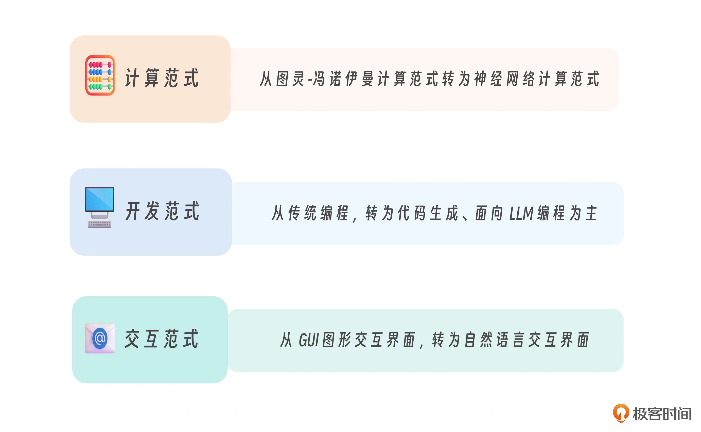

先看开发范式，从人类手写代码、调试程序为核心的传统人工编程（Coding by Human），转向通过提示词与大语言模型（LLM）协同开发，逐渐实现自动化或半自动化编程，未来发展的趋势——面向 LLM 的编程范式（Coding by Prompts）初现端倪。

再来看人机交互，从 GUI 图形界面发展到自然语言交互界面（NUI） 交互。前一种范式里，人们通过点击图标、菜单等图形元素进行人机交互，而后者因为接入了大模型，人们就可以用自然语言（比如中文或这英文）直接和系统交流，交互体验更直观、智能。

最为重要的是计算范式的转变，也就是从以图灵机和冯·诺伊曼体系结构为基础，强调确定性和离散的符号推理，逐步转向至以深度学习为代表的神经网络范式，侧重概率性、分布式、向量化的“类脑”计算。 这个转变是本质上的变化，它也直接驱动了开发范式和人机交互范式的变化。

我们发现，计算 1.0（1946-1994）是生物神经网络与数字逻辑电路的交互，基于“与或非”的0-1 确定性思维，要求人适应机器的结构化逻辑。而计算 2.0（2020 至今）是生物神经网络与数字神经网络的交互，双方运算逻辑高度相似，基于概率的不确定性思维，实现了机器适应人的自然交互。

正如 OpenAI 首席科学家 Llya 所言：“除了生物有机体的生存方式不同外，两种神经网络的运算逻辑已经没有本质区别。”

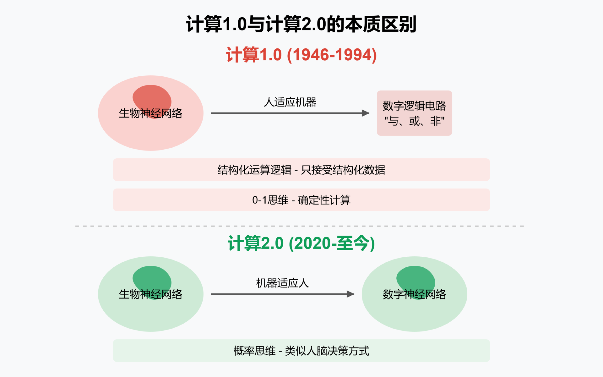

大模型驱动着我们从数字电路时代来到了数字神经网络时代。

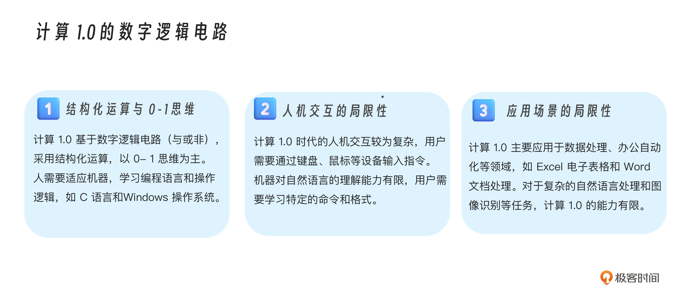

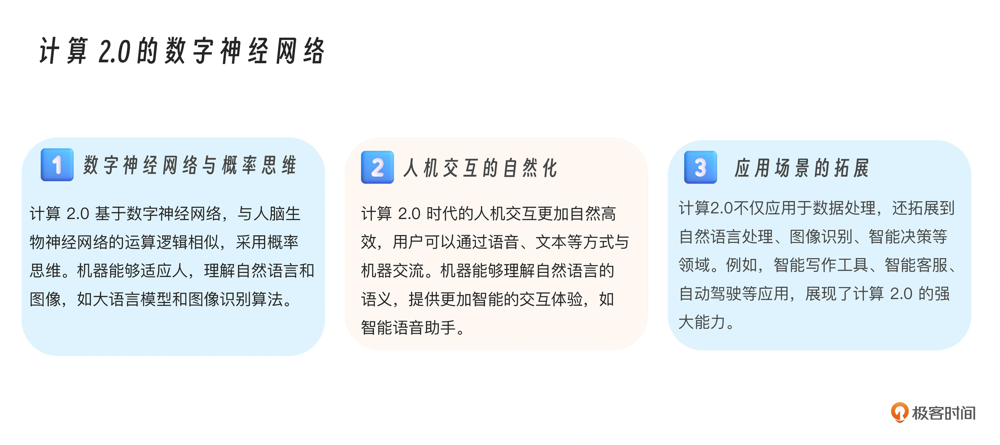

然而，计算 2.0 时代的概率计算并不是万能的。大模型恰似人脑，能够做推理，做决策，能够成为智能体。但是，并不能够完成所有的任务。这恰似再优秀的数学家也不一定能够纯靠大脑神经元算出三位数的乘除法，而计算器则可以轻松胜任。要使大模型能够完成复杂工程任务，必须结合计算 2.0 的概率逻辑和计算 1.0 时代的结构化逻辑—— 这就是 LLM+ 工具调用在大模型时代的价值所在。

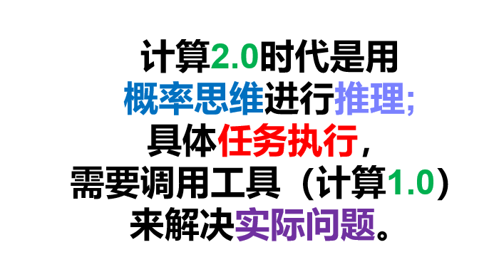

而 MCP 的工具原语的整体设计原则，就是为了让计算 2.0 时代的工具调用变得更加顺畅。借助 MCP 的“工具发现能力”，让模型“看到”自己能干啥，然后由模型主动决定“要用哪个工具、什么时候调用”，同时底层由客户端发起实际调用。

好，现在我们理解了工具调用的价值，接下来我们就来看看 MCP 中的工具原语设计和实现细节。

### MCP 中的工具原语设计与实现

Model Context Protocol (MCP) 允许服务器公开可供语言模型调用的工具。工具使模型能够与外部系统交互，例如查询数据库、调用 API 或执行计算。每个工具通过唯一的名称进行标识，并包含描述其模式的元数据。

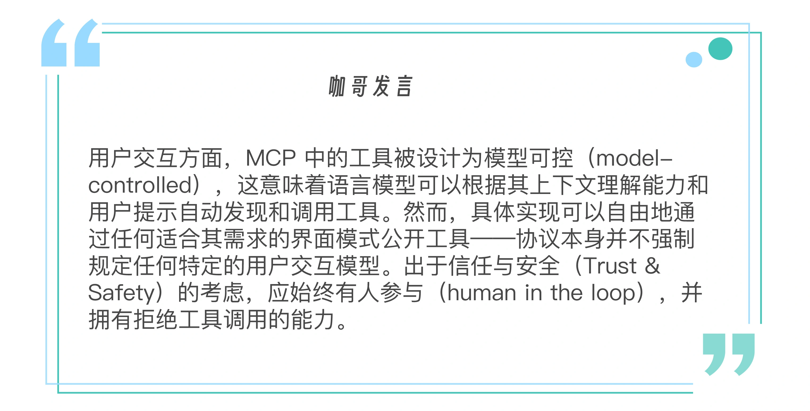

下面我们来看看在 MCP 协议中，服务端是如何定义工具的，客户端又是如何探测（发现）并访问这些资源的。

### 服务器的工具定义

要提供工具给客户端调用，服务器首先必须声明 tools 能力：

```json
{
 "capabilities": {
   "tools": {
     "listChanged": true
   }
 }
}
```

listChanged 参数指示服务器在可用工具列表发生变化时是否会发出通知。

工具定义包含以下要素。

- name：工具的唯一标识符。

- description：人类可读的功能描述。

- inputSchema：定义预期参数的 JSON Schema。

- annotations（可选）：描述工具行为的扩展属性。

```json
{
 "name": "get_weather",
 "description": "Get current weather information for a location",
 "inputSchema": {
   "type": "object",
   "properties": {
     "location": {
       "type": "string",
       "description": "City name or zip code"
     }
   },
   "required": ["location"]
 }
}
```

### 客户端的工具发现

### 客户端请求工具列表

客户端发送 tools/list 消息请求工具列表。

```json
{
 "jsonrpc": "2.0",
 "id": 1,
 "method": "tools/list",
 "params": {
   "cursor": "optional-cursor-value"
 }
}
```

服务器端响应的示例消息如下：

```json
{
 "jsonrpc": "2.0",
 "id": 1,
 "result": {
   "tools": [
     {
       "name": "get_weather",
       "description": "Get current weather information for a location",
       "inputSchema": {
         "type": "object",
         "properties": {
           "location": {
             "type": "string",
             "description": "City name or zip code"
           }
         },
         "required": ["location"]
       }
     }
   ],
   "nextCursor": "next-page-cursor"
 }
}
```

### 客户端调用工具

客户端通过 Tools/call 请求调用工具。

```json
{
 "jsonrpc": "2.0",
 "id": 2,
 "method": "tools/call",
 "params": {
   "name": "get_weather",
   "arguments": {
     "location": "New York"
   }
 }
}
```

服务器端响应的示例消息如下：

```json
{
 "jsonrpc": "2.0",
 "id": 2,
 "result": {
   "content": [
     {
       "type": "text",
       "text": "Current weather in New York:\nTemperature: 72°F\nConditions: Par
     }
   ],
   "isError": false
 }
}
```

### 工具调用的返回结果

工具调用可能会返回多种类型的结果，包括文本内容、图像内容、音频内容和内嵌资源等，我们来结合示例看一下。

文本内容（Text Content）

```json
{
 "type": "text",
 "text": "Tool result text"
}
```

图片内容 Image Content）

```json
{
 "type": "image",
 "data": "base64-encoded-data",
 "mimeType": "image/png"
}
```

音频内容（Audio Content）

```json
{
 "type": "audio",
 "data": "base64-encoded-audio-data",
 "mimeType": "audio/wav"
}
```

内嵌资源（Embedded Resources）

资源也可以被作为工具调用的一个返回对象，此时被称为“内嵌资源”，这些资源可以被客户端通过 URI 获取。

```json
{
 "type": "resource",
 "resource": {
   "uri": "resource://example",
   "mimeType": "text/plain",
   "text": "Resource content"
 }
}
```

### 工具列表变更通知

如果可用工具列表发生了变更，已经声明了 listChanged 能力的服务器应该发送工具列表变更通知

```json
{
 "jsonrpc": "2.0",
 "method": "notifications/tools/list_changed"
}
```

### 工具的错误处理

MCP 中对工具使用有两种错误报告机制。

- 第一种是协议错误：标准 JSON-RPC 错误，适用于未知工具，无效参数以及服务器错误这几种情况。

- 第二种是工具执行错误：通过结果字段 isError: true 报告，包括：API 调用失败，无效的数据输入，业务逻辑错误。

协议错误示例如下:

```json
{
 "jsonrpc": "2.0",
 "id": 3,
 "error": {
   "code": -32602,
   "message": "Unknown tool: invalid_tool_name"
 }
}
```

工具执行错误如下：

```json
{
 "jsonrpc": "2.0",
 "id": 4,
 "result": {
   "content": [
     {
       "type": "text",
       "text": "Failed to fetch weather data: API rate limit exceeded"
     }
   ],
   "isError": true
 }
}
```

### 调用的安全考量和最佳实践

凡事都有两面性，工具调用让大模型的任务处理能力升级了一个档次，但也要考虑引入后的安全防护。

所以服务端必须验证所有工具输入，实施完善的访问控制，限制工具调用频率同时净化工具输出。客户端应当在敏感操作前让用户进行二次确认，调用服务端前向用户展示工具输入（防止恶意或意外数据窃取），工具结果传入大模型前需验证，设置工具调用超时机制，同时记录工具使用日志（用于审计）。

## 工具的交互流程

下面这张图就清晰地展示了 LLM、客户端和服务器之间，工具调用的全流程。所谓的“LLM 主控”，就是 LLM 收到工具列表之后，负责根据当前的任务和具体状态选择使用什么工具；而“客户端驱动”，就是客户端来发现工具、提供工具列表给 LLM、同时还负责具体调用工具。而LLM 接到工具调用的结果，再返回给客户。

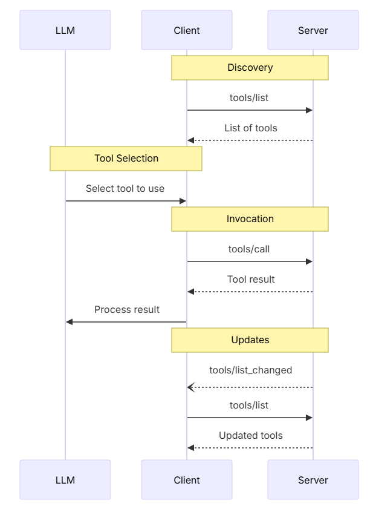

我自己画了一系列更清晰的工具调用流程图，帮助你理解 MCP 协议中，工具调用的全过程细节。

我用橙色、红色、蓝色和绿色四种颜色的消息来代表 MCP 协议中的 4 方，来模拟用户利用智能体订机票的全过程。那么他们的对话现在正式开始了。

第一步，启动 MCP Server，握个手。MCP Server 需要让 Client 知道自己是谁，有什么能力（也就是工具）。（推销自己真的很重要！未来的广告商和搜索引擎针对的将不再是商家，而是日日夜夜寻找机会推销自己的 MCP 和 A2A Server，请大家记住这句话…）

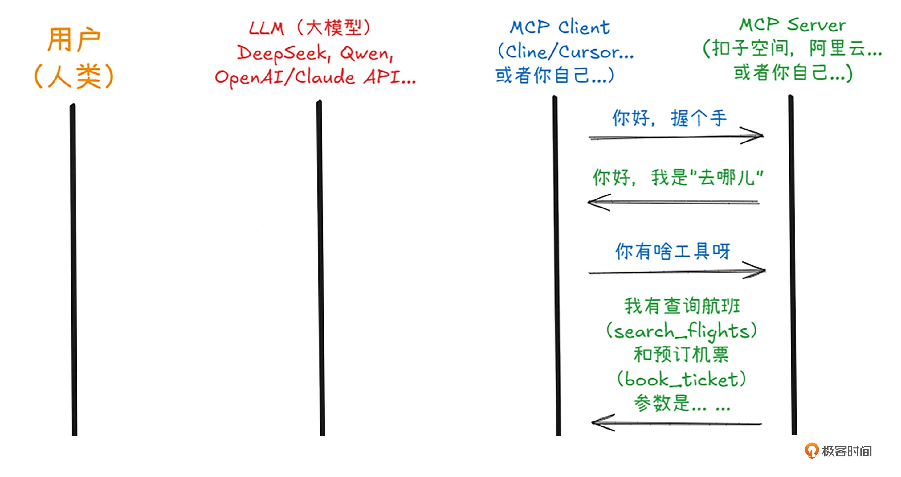

握手成功了之后，客户端向其内部的 LLM 注册了这个 MCP 服务器和它的工具，恰好此时，人类主子给出指示了——帮我订张机票！

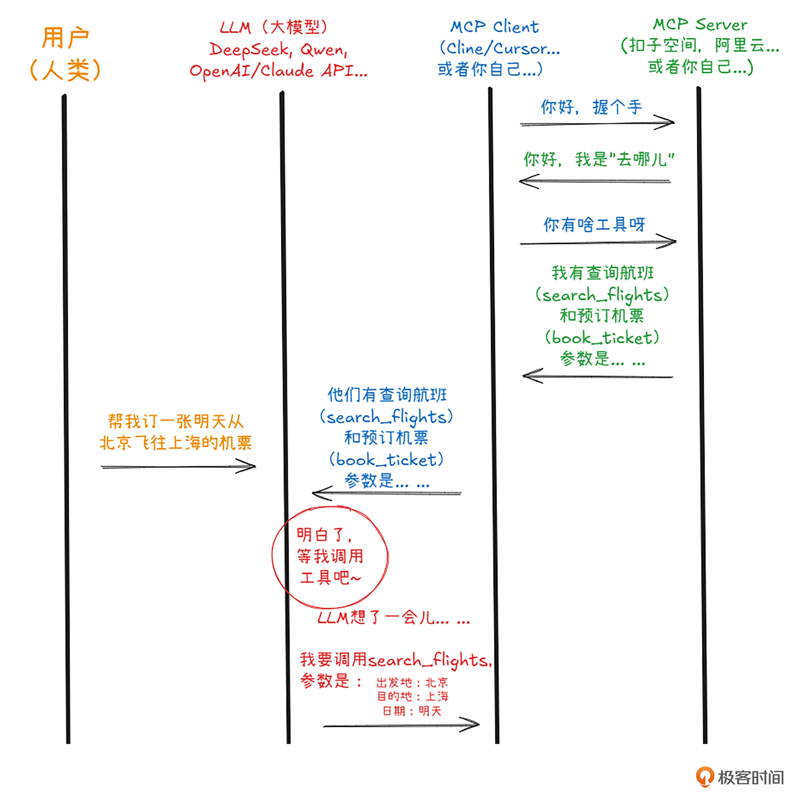

LLM 高兴极了，心想，这事儿我会！其实他不会，但是他刚刚接受了 MCP Server 的能力注册，他知道有人会这个事儿。因此，他马上根据 MCP 协议里面的内容，创建了一个工具调用，告诉 Client，也就是 MCP 客户端，偷偷向 Server 发送正确的工具和参数。（心里暗道：可别告诉人类我是在调用别家的工具，让他们觉得我干啥啥行！）

Client 不敢怠慢，马上原封不动地把大模型的工具调用连工具带参数一起发给 MCP Server，Server 一看，完全正确，果然现代大模型的能力值得信任。二话不说，查阅了自己内部数据库，返回了调用结果，查到了两个航班——至于 MCP Server 内部怎么个操作，那就完全不关咱们的事儿了。

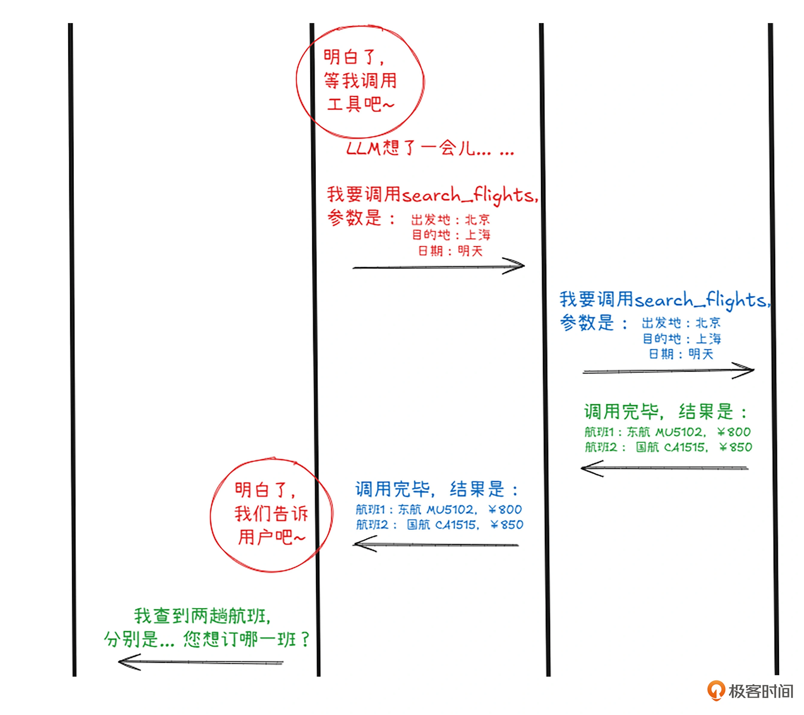

Client 接到了 Server 的结果，马上又把这信息原封不动的传递给大模型。大模型当然不会把这么直白的信息传给人类主子。他重新组织了一下语言，问人类用户两个航班，像怎么选，同时还介绍了两个航班各有优缺点：国航时间好，东航机票价格优。

人类思考了一会，告诉大模型决定坐国航。大模型马上又偷偷发了一个工具调用，这次调用的不同的函数，参数也换了。

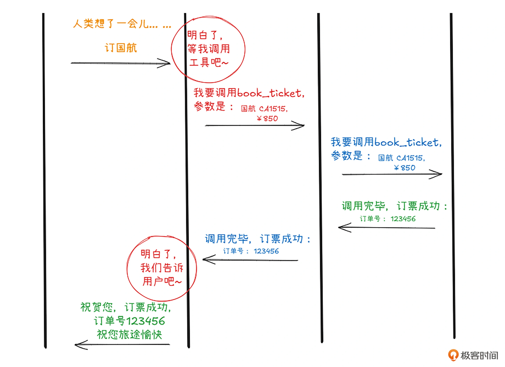

客户端不敢怠慢，立即原封不动地把工具调用和参数一起再次传递给服务器，服务器收到指令，马上执行，一张机票在“去哪儿”网站成功出票。

服务器把出票信息传给了客户端，客户端传给了大模型，大模型开心地把成功的消息包装一下，添油加醋地告诉给了人类主子。一场快乐的订票之旅结束了。你可以看到，整个过程中人类说了两句话，总共没超过 20 个字。

完整流程如下图所示。

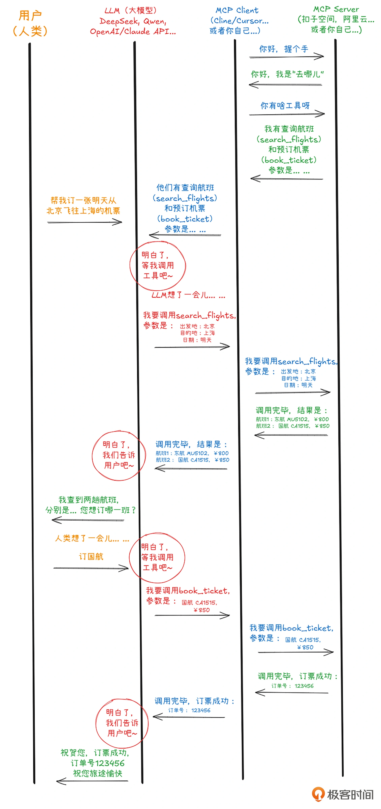

在遵循 MCP 协议后，从技术角度来说，你的客户端与服务器之间的数据交互和输出解析，实际上就是在“JSON-RPC 风格”的消息里传递工具元数据和执行结果。

## 工具使用实战

好，讲完了“工具”相关的协议设计。我们开始用简单的示例实现工具的实战。具体代码位于“MCP-In-Action 仓库的 06-tools- 工具调用” 目录。

这个实战例子会很简单，只涉及两个小工具：

1. 一个计算器工具，可以进行基本的数学运算。

2. 一个文本处理工具，可以统计文本中的字符数和单词数。

不过，工具虽然简单，但是通过这个实战，就可以帮我们详细比较 FastMCP 方式和直接使用协议中的底层功能有什么差异。

### FastMCP 工具服务

我们先看一下 FastMCP 的工具实现代码。FastMCP 是对低级 API（如 Server()）的封装，提供装饰器（@mcp.tool, @mcp.resource, @mcp.prompt），让你只需要运行几行代码即可定义工具、资源与提示等内容。

```python
import asyncio
from mcp.server.fastmcp import FastMCP
# 初始化 FastMCP 服务器
mcp = FastMCP("tools-server")
@mcp.tool()
async def calculator(operation: str, a: float, b: float) -> str:
   """执行基本的数学运算
   Args:
       operation: 运算类型 (add, subtract, multiply, divide)
       a: 第一个数字
       b: 第二个数字
   """
   if operation == "add":
       return f"计算结果: {a + b}"
   elif operation == "subtract":
       return f"计算结果: {a - b}"
   elif operation == "multiply":
       return f"计算结果: {a * b}"
   elif operation == "divide":
       if b == 0:
           return "错误：除数不能为零"
       return f"计算结果: {a / b}"
@mcp.tool()
async def text_analyzer(text: str) -> str:
   """分析文本，统计字符数和单词数
   Args:
       text: 要分析的文本
   """
   char_count = len(text)
   word_count = len(text.split())
   return f"字符数: {char_count}\n单词数: {word_count}"
if __name__ == "__main__":
   mcp.run(transport="stdio")
```

这种通过装饰器 @mcp.tool() 来完成工具定义的方式很简单，通过函数签名和文档字符串就能自动生成工具定义，你只需关注业务函数，FastMCP 自动处理协议、类型验证、文档生成与传输方式。

### 底层协议工具服务

下面，我们要通过 Server(）类和 list_tools()、call_tool() 等底层函数来实现完全相同的功能。

```python
import asyncio
import mcp.types as types
from mcp.server import Server
from mcp.server.stdio import stdio_server
app = Server("tools-server")
@app.list_tools()
async def list_tools() -> list[types.Tool]:
   """
   返回服务器提供的工具列表
   """
   return [
       types.Tool(
           name="calculator",
           description="执行基本的数学运算（加、减、乘、除）",
           inputSchema={
               "type": "object",
               "properties": {
                   "operation": {
                       "type": "string",
                       "enum": ["add", "subtract", "multiply", "divide"]
                   },
                   "a": {"type": "number"},
                   "b": {"type": "number"}
               },
               "required": ["operation", "a", "b"]
           }
       ),
       types.Tool(
           name="text_analyzer",
           description="分析文本，统计字符数和单词数",
           inputSchema={
               "type": "object",
               "properties": {
                   "text": {"type": "string"}
               },
               "required": ["text"]
           }
       )
   ]
@app.call_tool()
async def call_tool(
   name: str,
   arguments: dict
) -> list[types.TextContent]:
   """
   处理工具调用请求
   """
   if name == "calculator":
       operation = arguments["operation"]
       a = arguments["a"]
       b = arguments["b"]
       if operation == "add":
           result = a + b
       elif operation == "subtract":
           result = a - b
       elif operation == "multiply":
           result = a * b
       elif operation == "divide":
           if b == 0:
               return [types.TextContent(type="text", text="错误：除数不能为零")]
           result = a / b
       return [types.TextContent(type="text", text=f"计算结果: {result}")]
   elif name == "text_analyzer":
       text = arguments["text"]
       char_count = len(text)
       word_count = len(text.split())
       return [types.TextContent(
           type="text",
           text=f"字符数: {char_count}\n单词数: {word_count}"
       )]
   return [types.TextContent(type="text", text=f"未知工具: {name}")]
async def main():
   async with stdio_server() as streams:
       await app.run(
           streams[0],
           streams[1],
           app.create_initialization_options()
       )
if __name__ == "__main__":
   asyncio.run(main())
```

这种实现更贴近协议层，因为 Server() 类提供对 MCP 消息传递、生命周期、内容类型、错误处理的精细控制。对于复杂场景来说，Server() 能提供更多灵活度。

### 运行客户端工具调用

通过 cd 06-tools- 工具列表 /client 命令进入客户端的目录之后，

运行后面这两个命令之一（一个是调用服务器的 FastMCP 工具实现，一个是底层协议函数工具实现）。

```
uv run 03-llm-tool-call-dynamic ../server/simple-tools-v1-FastMCP.py
uv run 03-llm-tool-call-dynamic ../server/simple-tools-v2-Protocal.py
```

都将得到一样的工具调用结果。

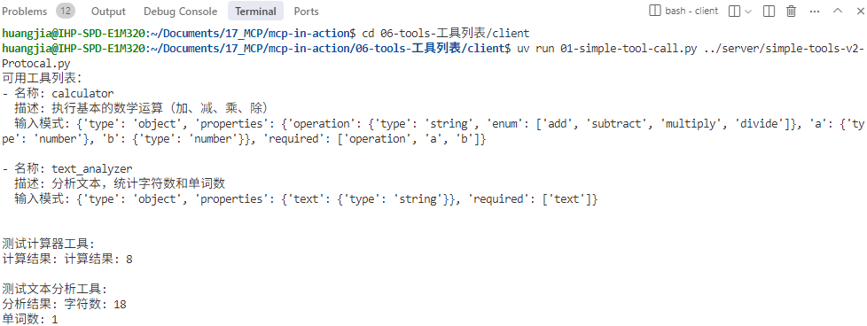

客户端的核心代码如下：

```python
def call_llm_with_tools(messages, tools):
   response = client.chat.completions.create(
       model="deepseek-chat",
       messages=messages,
       tools=tools,
       tool_choice="auto"
   )
   return response.choices[0].message
async with stdio_client(params) as (reader, writer):
   async with ClientSession(reader, writer) as session:
       await session.initialize()
       notification = Notification(
           method="notifications/initialized",
           params={}
       )
       await session.send_notification(notification)
       # 获取工具列表
       response = await session.list_tools()
       tools = response.tools
       print("欢迎使用工具调用系统！\n可用工具列表已加载。\n请输入您的需求（输入'退出'结束）
       # 构造 tools 列表
       tools_list = [{
           "type": "function",
           "function": {
               "name": tool.name,
               "description": tool.description,
               "parameters": tool.inputSchema
           }
       } for tool in tools]
       # 交互主循环
       messages = [
           {"role": "system", "content": "你是一个智能助手，请根据用户输入选择合适的工具
       ]
       while True:
           user_input = input("> ")
           if user_input.lower() == "退出":
               break
           messages.append({"role": "user", "content": user_input})
           message = call_llm_with_tools(messages, tools_list)
           messages.append(message)
           if not message.tool_calls:
               print(message.content)
               continue
           # 工具调用
           for tool_call in message.tool_calls:
               args = json.loads(tool_call.function.arguments)
               result = await session.call_tool(tool_call.function.name, args)
               messages.append({
                   "role": "tool",
                   "content": str(result),
                   "tool_call_id": tool_call.id
               })
           # 再次让 LLM 总结最终回复（这时 messages 里有 “答案” 的内容了）
           message = call_llm_with_tools(messages, tools_list)
           print(message.content)
           messages.append(message)
```

上面的代码完成 LLM 工具调用两部曲：

- 客户端从 MCP 服务器那里获取了 tools 列表，只要把 tools 列表格式和对话历史传给DeepSeek，剩下的 LLM 自动完成（对 tools 的调用由客户端和服务器协作完成，我们不用操心）。

- 再次让 LLM 总结最终回复时，必须把完整的 messages（含工具调用结果）传给 LLM，否则 LLM 无法生成最终答案。

这两部曲的第一部当然是核心所在，是 LLM 对工具的选择。第二部也很重要，因为没有这一步，就无法把最终答案返回给人类。那么，两次 LLM 调用时，选什么工具，选不选工具，都由 LLM 说了算。因为 tool_choice=“auto”，因此 LLM 并不是必须要调用一个工具。比如在第二次调用 LLM 生成自然语言结果（例如”４＋４等于８“），是没有必要再次调用工具的，只输出自然语言就好。

## 总结一下

好的，现在让我们来总结一下，工具调用这个关键原语的关键流程：

- MCP 协议把每一次 “列工具” 和 “调工具” 都变成一次标准的 JSON-RPC 请求 / 响应；

- 客户端读取 list_tools() 返回的工具定义，以及 call_tool() 返回的结果内容；

这就是我们反复提到的——模型主控，客户端驱动。关键在于谁来负责如何管理、发现和调用工具。

传统的 Function Calling ／Tool Calls 的示例代码是像下面这样：

```
if response.tool_calls:
   for call in response.tool_calls:
       name = call["name"]
       args = call["args"]
       #  程序需要知道工具调用的签名 & 参数细节
       result = execute_tool(name, args)
       # 把结果附回 LLM 上下文
       response.add_tool_result(name, result)
```

先由 LLM 产出一个工具调用指令，然后由程序自动执行，并把结果再 tool_calls 里返回， 程序需要知道工具调用的全部参数格式细节。

MCP 则更偏向“客户端驱动”，通过调用 session.call_tool()，工具调用的细节被隐藏在客户端和服务器的协议握手内部。

```
#  细节隐藏在协议内部，调用更简洁
tool_result = await session.call_tool(tool_name, args)
```

理解了以上几个关键环节，就能顺利地将 MCP 协议输出解析到你的业务逻辑里。

好，目前我们讲完了 MCP 协议中服务器端可以实现的三大核心原语（提示、资源和工具），简单列表总结如下：

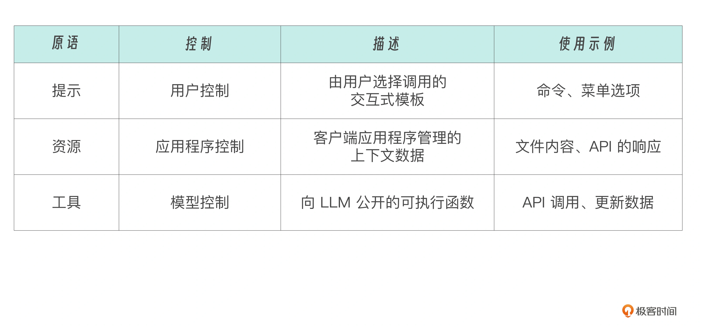

## 思考题

1. 请你把工具的使用放入“05-resource－资源发现”项目中，把对医疗文档的使用封装成工具，完成 RAG 流程。

可以参考我的 Repo 里面的工具 + 资源示例实现。

```
(20250426_MCP_Client) huangj2@IHP-SPD-CF00015:~/Documents/mcp-in-action/05-resour
Processing request of type ListToolsRequest
可用工具： ['index_docs', 'retrieve_docs']
Processing request of type ListResourcesRequest
发现资源： [AnyUrl('file:///home//server/medical_docs/心脏病.txt'), AnyUrl('file:///
Processing request of type ReadResourceRequest
Processing request of type ReadResourceRequest
Processing request of type ReadResourceRequest
Processing request of type CallToolRequest
HTTP Request: POST https://api.openai.com/v1/embeddings "HTTP/1.1 200 OK"
资源文档索引： meta=None content=[TextContent(type='text', text='已索引 3 篇文档，总文档
>>> 系统连接成功，您可以开始提问（输入"退出"结束）
请输入医学问题> 心脏病
Processing request of type CallToolRequest
HTTP Request: POST https://api.openai.com/v1/embeddings "HTTP/1.1 200 OK"
AI 回答：关于心脏病的信息如下：
1. 心脏病是一种常见的慢性疾病。
2. 高血压患者需要长期服药（可能与心脏病相关）。
3. 糖尿病的管理包括饮食和运动（可能与心脏病的预防或管理相关）。
```

- 如果需要更详细的信息，可以进一步查询或提供更具体的问题。

2. 请你多多分享一些你工程实践中的 LLM 工具调用示例，是否用 MCP 都不重要，关键是说说计算 2.０和计算 1.０两个范式在你的工作场景中如何融合。

欢迎你在留言区记录你的收获或者疑问。如果这节课对你有启发，也推荐你分享给身边更多朋友。
