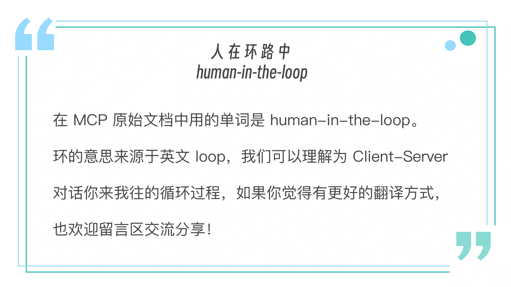
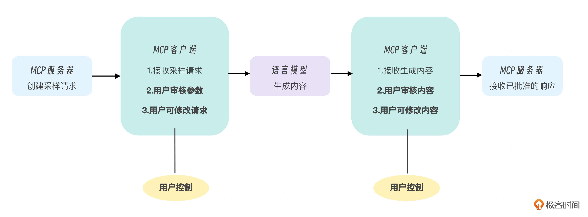
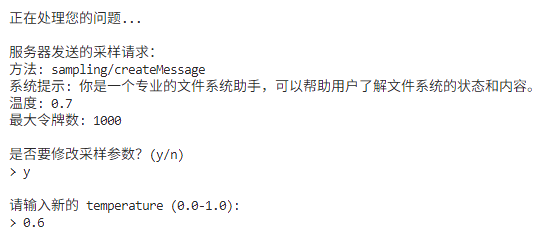
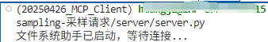
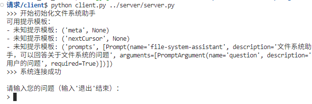
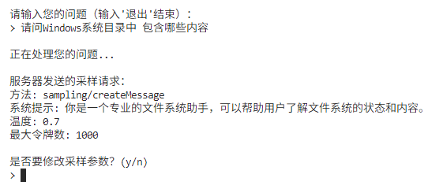
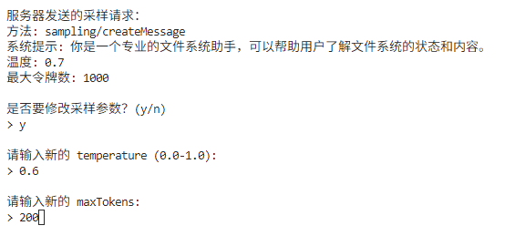
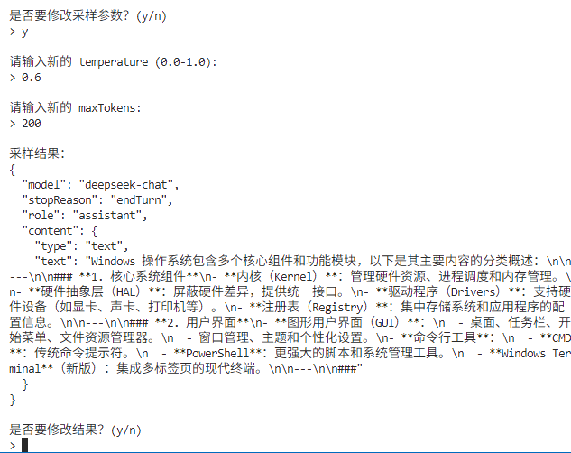
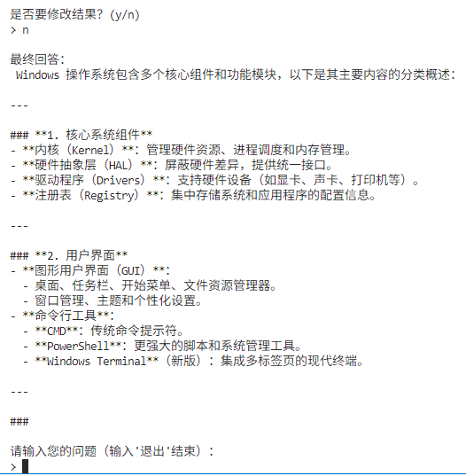
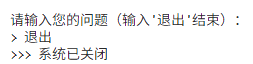

# 11 | 人在环路：通过Sampling机制实现人机互动

你好，我是黄佳。

在 Model Context Protocol（MCP）框架中，采样（Sampling）是一个强大且独特的功能，它允许服务器向客户端请求语言模型（LLM）的生成结果，从而实现复杂的代理行为，同时保持安全性和隐私性。这一功能使得 MCP 服务器可以充当智能中介，协调用户、客户端和语言模型之间的交互。

采样这个原语，乍听起来似乎又有点儿高大上，觉得难以理解。我开始也不懂 MCP 在这里想做什么，但是其实它的机制和作用仍然是相当简单，我们学完了这一课你就会非常清楚了。

## MCP 采样机制的工作流程

MCP 采样的工作流程精心设计了一个“人在环路中”（human-in-the-loop）的模式，确保用户对 LLM 的交互保持控制权。



这个模式包括以下流程。

```
服务器发出请求：服务器发送 sampling/createMessage 请求到客户端。
```

2. 客户端审核：客户端接收请求，并允许用户审核和修改参数。

3. LLM 生成：客户端调用语言模型生成结果，语言模型处理已批准的请求并生成内容。

4. 内容审核：客户端向用户展示生成的内容，供用户审核和可能的修改。

5. 结果返回：已批准的内容被发送回 MCP 服务器。

这种设计确保了用户始终可以维持对 AI 系统的控制，增强了透明度和可信度。实际上就是为交互过程中人类用户或者客户端和服务器之间的互动提供了模板和指南。



- 采样机制的流程

图中黄色的“用户控制”节点突出显示了两个关键干预点，即人类监督被明确地内置到流程中的地方。这种设计确保了整个 AI 交互过程中的透明度，并保持了用户的主导权，这是 MCP 采样机制的基本原则。

## 采样请求的标准结构

采样请求使用标准化的消息格式，包含以下关键元素：

```
json
{
 "method": "sampling/createMessage",
 "params": {
   "messages": [
     {
       "role": "user",
       "content": {
         "type": "text",
         "text": "用户的问题"
       }
     }
   ],
   "modelPreferences": {
     "hints": [{"name": "claude-3"}],
     "costPriority": 0.5,
     "speedPriority": 0.7,
     "intelligencePriority": 0.8
   },
   "systemPrompt": "你是一个助手...",
   "includeContext": "thisServer",
   "temperature": 0.7,
   "maxTokens": 1000,
   "stopSequences": ["\n\n"],
   "metadata": {
     "requestType": "query"
   }
 }
}
```

我们来看看其中的关键参数都有哪些。

消息数组（messages）

- 包含对话历史，每条消息有角色（role）和内容（content）

- 角色可以是“user”或“assistant”

- 内容可以是文本或图像（使用 base64 编码）

模型偏好（modelPreferences）

- 通过 hints 指定推荐的模型（如“claude-3”）

- 优先级参数（0-1 范围）：

1. costPriority: 成本重要性

2. speedPriority: 速度重要性

3. intelligencePriority: 能力重要性

系统提示（systemPrompt）

- 设置语言模型的角色和行为指南

- 客户端可能会修改或忽略此字段

上下文包含（includeContext）

- “none”：不包含额外上下文

- “thisServer”：包含请求服务器的上下文

- “allServers”：包含所有连接的 MCP 服务器上下文

采样参数

- temperature：控制随机性（0.0 至 1.0）

- maxTokens：最大生成令牌数

- stopSequences：停止生成的序列数组

## 用采样机制实现文件系统助手

下面我们通过一个完整的代码实现案例来展示采样机制，帮助你理解采样机制的来龙去脉。

在这个业务案例中，我们将设计一个文件系统助手，它利用 MCP 采样机制来增强用户与文件系统交互的能力。该助手能够回答用户关于文件系统状态和内容的问题，提供直观的文件管理支持。

为什么采用采样机制呢？主要是因为文件系统操作既需要专业知识，又需要安全保障。通过采样，服务器可以将用户的文件系统查询转发给语言模型，获取专业解答，同时通过“人在环路”的设计，确保用户对所有操作保持完全控制，防止潜在的数据安全风险。



- 采样过程中的人机互动

例如，当用户询问“如何找到最近修改的文档”时，服务器构建一个包含此问题的采样请求，客户端允许用户审核系统提示和参数，然后将请求发送给语言模型。语言模型生成的回答经过用户审核后，才最终返回给服务器执行。这种双重审核机制确保了用户对文件系统操作的完全掌控，同时充分利用了 AI 的专业能力。

### 在服务器端实现采样

在 MCP 服务器中实现采样功能通常在处理提示请求时完成。以下是一个简化的实现：

```
@app.get_prompt()
async def get_prompt(
   name: str, arguments: dict[str, str] | None = None
) -> types.GetPromptResult:
   """根据名称和参数获取提示内容"""
   if name == "file-system-assistant":
       question = arguments.get("question") if arguments else ""
       # 构建采样请求
       sampling_request = {
           "method": "sampling/createMessage",
           "params": {
               # 各种参数设置
               # ...
           }
       }
       # 将采样请求作为响应返回
       return types.GetPromptResult(
           messages=[
               types.PromptMessage(
                   role="assistant",
                   content=types.TextContent(
                       type="text",
                       text=json.dumps(sampling_request, ensure_ascii=False)
                   )
               )
           ]
       )
```

这段代码的核心是将用户的问题封装在采样请求中，并将该请求作为提示结果返回给客户端。

### 客户端处理采样请求

客户端收到采样请求后，需要处理请求并调用语言模型。以下是处理流程的关键部分：

```
# 解析服务器发送的采样请求
sampling_request_json = prompt_result.messages[0].content.text
sampling_request = json.loads(sampling_request_json)
# 检查是否是采样请求
if sampling_request.get("method") == "sampling/createMessage":
   params = sampling_request.get("params", {})
   # 处理请求参数
   # ...
   # 构建语言模型请求
   messages = []
   if "systemPrompt" in params and params["systemPrompt"]:
       messages.append({"role": "system", "content": params["systemPrompt"]})
   for msg in params.get("messages", []):
       if msg.get("content", {}).get("type") == "text":
           messages.append({
               "role": msg.get("role", "user"),
               "content": msg.get("content", {}).get("text", "")
           })
   # 调用语言模型
   response = self.client.chat.completions.create(
       model="deepseek-chat",
       messages=messages,
       temperature=params.get("temperature", 0.7),
       max_tokens=params.get("maxTokens", 1000)
   )
```

客户端的关键任务是，首先解析采样请求，然后转换为特定语言模型 API 的格式，调用语言模型获取回答，并给予用户审核答案和修改结果的控制灵活性。

### 人机协作机制

采样功能设计中包含了人机协作机制，确保用户对 AI 保持控制。

```
# 显示采样请求给用户
print("\n服务器发送的采样请求：")
print(f"系统提示: {params.get('systemPrompt', '')}")
print(f"温度: {params.get('temperature', 0.7)}")
print(f"最大令牌数: {params.get('maxTokens', 1000)}")
# 让用户确认或修改采样参数
print("\n是否要修改采样参数？(y/n)")
if input("> ").lower() == 'y':
   # 用户修改参数
   # ...
# 显示采样结果给用户
print("\n采样结果：")
# ...
# 让用户确认或修改结果
print("\n是否要修改结果？(y/n)")
if input("> ").lower() == 'y':
   print("\n请输入修改后的结果：")
   sampling_result["content"]["text"] = input("> ")
```

这种交互设计确保了：

- 用户可以了解 AI 将如何工作

- 用户可以修改生成参数

- 用户可以审核和调整 AI 生成的内容

## 运行文件系统助手

现在，让我来通过下述命令启动这个文件系统助手的服务器。

```
python server.py
```



打开一个新的 Terminal，启动客户端，同时确保使用服务器的环境调用服务。

```
python client.py ../server/server.py
```

客户端和服务器成功连接，此时我们输入一个问题。



这里，MCP Server 收到问题之后，首先将发起采样请求，询问我是否需要调整参数。



此时，我们选择 y，表示需要人工调整采样参数，控制 LLM 的调用过程。



第一轮采样结束，服务器把采样结果传递给客户端，客户端进行 LLM 的调用，并返回结果。此时，服务器开启了第二轮采样，询问是否需要对最终呈现的结果进行修改。



我选择不修改 LLM 的生成的结果，服务器确定返回最终答案。



输入“退出”后，程序结束。



跑完了这个流程，我们可以看到，在采样的“人在环路”过程中，实现了用户控制的两个关键点——参数设置和结果审核。

下面来回顾一下这个例子如何通过 MCP 协议和采样机制实现了人机的互动。

首先，服务器端通过 get_prompt 方法构建并返回一个符合 MCP 协议的采样请求。这个请求使用 sampling/createMessage 方法，包含了模型偏好、温度、最大 token 等参数。最后客户端解析这个请求，并使用 DeepSeek API 执行实际的采样。

具体实现流程是：

- 客户端调用 session.get_prompt()。

- 服务器返回 JSON 格式的采样请求。

- 客户端解析这个请求，调用 DeepSeek API。

- 客户端处理结果并显示给用户。

在这个过程中 MCP 负责定义采样请求的结构和参数，而实际的 API 调用是在客户端执行的。

## 其它采样参数示例

除了上面示例中介绍的温度（temperature）和最大令牌数（maxTokens）参数外，还有多种可能的采样方式可以控制生成内容的特性和行为。

下面给出这些采样方式的说明和简单示例。

1. 停止序列 (stopSequences)

stopSequences 参数允许指定一系列字符串，当模型生成这些字符串时就会停止生成：

```
sampling_request["params"]["stopSequences"] = ["\n\n", "结束", "###"]
```

这在我们希望模型生成特定格式的内容时非常有用，例如当我们希望模型在生成特定分隔符时停止。

2. 模型偏好 (modelPreferences)

通过提供多个模型提示和调整优先级，客户端可以做出更复杂的模型选择决策。

```
sampling_request["params"]["modelPreferences"] = {
   "hints": [
       {"name": "deepseek-chat"},
       {"name": "llama-3"},
       {"name": "claude-3"}
   ],
   "costPriority": 0.3,      # 降低成本优先级
   "speedPriority": 0.8,     # 提高速度优先级
   "intelligencePriority": 0.9  # 提高能力优先级
}
```

3. 包含上下文 (includeContext)

通过 includeContext 参数，可以控制 LLM 能够访问的上下文范围，这在涉及敏感数据的场景中，对于控制模型能够访问的信息范围非常重要。

```
# 不包含任何上下文
sampling_request["params"]["includeContext"] = "none"
# 仅包含当前服务器的上下文
sampling_request["params"]["includeContext"] = "thisServer"
# 包含所有连接服务器的上下文
sampling_request["params"]["includeContext"] = "allServers"
```

4. 元数据 (metadata)

元数据字段可以包含用于进一步定制采样行为的任何附加信息。虽然这些参数不会直接影响模型行为，但客户端可以用它们来作为请求上下文，做出决策。

```
sampling_request["params"]["metadata"] = {
   "requestType": "code_analysis",
   "priority": "high",
   "domain": "financial",
   "customParameter": "value"
}
```

5. 系统提示工程 (System Prompt Engineering)

提示工程是控制模型行为的强大工具，通过精心设计的系统提示，可以指导模型的回答风格、内容限制和行为准则。

```
sampling_request["params"]["systemPrompt"] = """
```

- 你是一个专业的文件系统助手。

```
- 永远不要执行危险操作如删除文件
- 总是先解释操作的后果
- 使用清晰的步骤格式回答问题
- 如果不确定，明确表示你不知道
"""
```

6. 消息上下文设计 (Message Context Design)

可以通过构建消息（也就是对话）历史来引导模型的行为，为模型提供更丰富的上下文，影响其理解问题的方式。

```
sampling_request["params"]["messages"] = [
   {
       "role": "user",
       "content": {
           "type": "text",
           "text": "如何查找大文件？"
       }
   },
   {
       "role": "assistant",
       "content": {
           "type": "text",
           "text": "您可以使用'find'命令来查找大文件。具体来说，您可以..."
       }
   },
   {
       "role": "user",
       "content": {
           "type": "text",
           "text": "如何删除这些文件？"
       }
   }
]
```

7. 客户端实现的用户审核机制

也可以在客户端可以实现更复杂的用户审核机制（这并不是 Sampling 的一部分），为用户提供更多指导。

```sql
# 高级用户审核，提供解释和建议
print("\n采样请求分析：")
print(f"系统提示: {params.get('systemPrompt', '')}")
print(f"温度设置: {params.get('temperature', 0.7)} (较高值会产生更多样化但可能不太准确的
print(f"最大令牌数: {params.get('maxTokens', 1000)} (当前设置约为{params.get('maxToke
# 提供智能建议
if "delete" in question.lower():
   print("\n⚠️ 警告: 检测到删除相关操作，建议降低温度参数以获得更谨慎的回答")
   print("建议: temperature=0.2, maxTokens=500")
# 允许用户使用预设模板
print("\n选择参数配置:")
print("1. 默认")
print("2. 创意模式 (temperature=0.9)")
print("3. 精确模式 (temperature=0.1)")
print("4. 自定义")
```

## 采样机制的应用场景

讲到这里，你应该可以理解采样功能会在多种场景中有广泛应用。比如数据分析与解释：服务器可以读取数据，然后请求 AI 分析和解释这些数据；可以分析代码库，使用 AI 生成代码解释或优化建议；在多步骤工作流中，服务器可以实现复杂的多步骤任务，使用 AI 在各步骤间做决策；交互式文档生成过程中，基于现有资源生成文档，允许用户审核和修改；对于上下文敏感响应，可以根据特定环境生成更相关的回答。

实现采样功能时，安全和隐私是一个需要考虑的考虑因素，实现安全采样的示例代码如下：

```sql
# 安全措施示例
# 1. 验证用户输入
question = arguments.get("question", "")
if len(question) > 1000:  # 防止过长输入
   question = question[:1000]
# 2. 限制敏感操作
if "delete" in question.lower() or "remove" in question.lower():
   return types.GetPromptResult(
       messages=[
           types.PromptMessage(
               role="assistant",
               content=types.TextContent(
                   type="text",
                   text="删除操作需要额外确认，请明确指定要删除的内容。"
               )
           )
       ]
   )
```

关键安全措施包括输入验证和清理、敏感信息保护、适当的速率限制、数据传输加密以及用户确认机制等。

## 本课总结

MCP 采样功能为 AI 系统提供了强大的扩展能力，让 AI 能够与外部世界交互，同时保持安全性和用户控制。通过精心设计的请求结构和处理流程，采样功能使服务器可以利用 AI 的能力，同时确保用户始终掌控系统行为。

无论是构建智能助手、数据分析工具还是代码辅助系统，采样功能都为开发者提供了连接 AI与现实世界的桥梁。

你可以探索如何组合这些控制方法，实现高度精细化的内容生成控制。

## 思考题

1. 假设你要为一个“银行转账助手”实现 MCP 采样功能，需要在发起转账前询问用户并确保操作安全：

- 请给出一份完整的 sampling/createMessage 请求示例，至少包含以下字段：messages、systemPrompt、modelPreferences、includeContext、metadata。

- 简述在客户端审核环节（human-in-the-loop）中，你会如何展示这些参数给用户？又会如何拦截或提示“高风险”操作（例如大额转账、频繁转账等）？

2.MCP 采样请求的 includeContext 参数可设置为“none”“thisServer” 或“allServers”。请针对以下两个场景，分别说明你会选用哪个值，并分析其对隐私与合规的利弊：

- 场景 A：一个医疗问答助手，需要严格保护患者个人信息。

- 场景 B：一个企业内部知识库问答系统，需要跨多个子系统聚合历史对话和工具调用记录。

欢迎在留言区分享你的疑问或者学习收获，如果这节课对你有启发，也欢迎分享给更多朋友。
