# 12 | 风云际会：智能体6大开发框架之选型比较

你好，我是黄佳。

前面我们学习了 MCP 的协议细节，接下来我们进入 A2A 的实战部分。在这一部分中，我们会接触到多种常见的 Agent 开发框架，完成各种不同能力的 Agents。

## 3 分钟复习一下 Agent

我们说过，大模型驱动着我们从计算 1.0 走向了计算 2.0 时代，同时也驱动着我们从“基于连接”的产品逻辑走向了“基于计算”的产品逻辑。

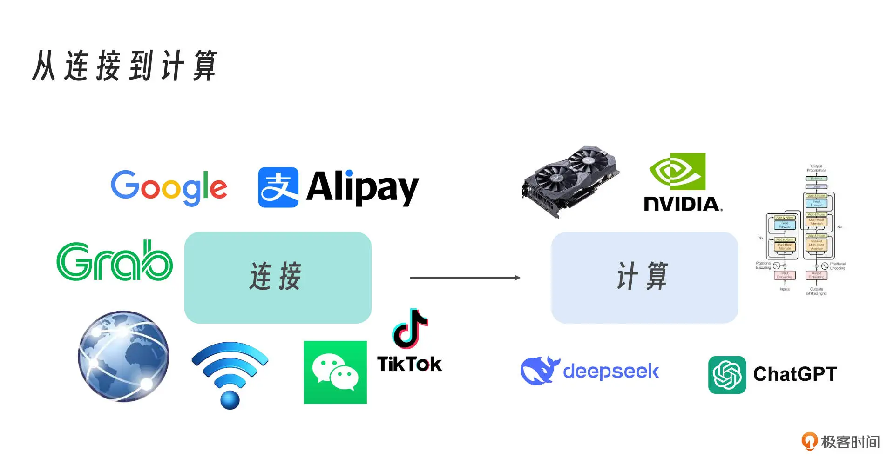

- 大模型驱动了从连接到计算的范式转换

而 Open AI o1/o3，DeepSeek R1 等推理模型的诞生，更是驱动着我们从“单纯的计算”走向了“服务驱动”的产品逻辑。

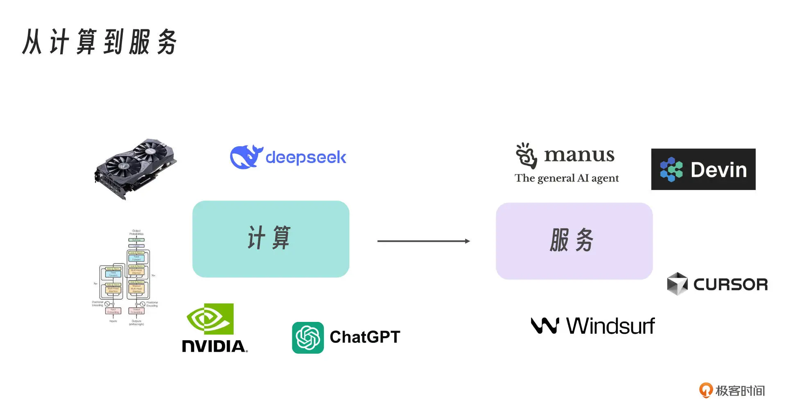

- 推理模型使更智能、更自动化的服务成为可能

新一代的产品设计将从基于信息网络的产品，演进到基于行动网络的产品。

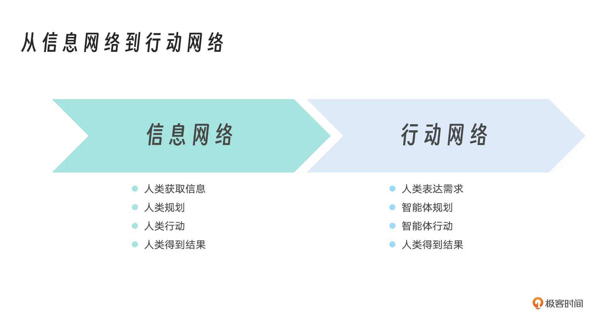

- 从信息网络到行动网络的演进

而在行动网络时代，新一代大模型应用开发的关键点，就是智能体自主驱动自己来完成原本需要由人类才能完成的任务。Manus 就是一个很好的例子。

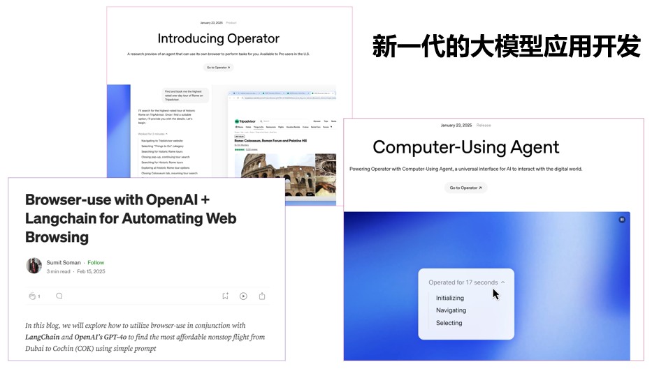

- 新一代的大模型应用开发强调自主自驱型的服务

Agent 并没有一个明确的定义，而在大模型和 AI 的语境下，只要是通过 LLM 自主推理，帮助人类完成任务的智能体就是 Agent。至于在完成任务的过程中，人类是否给予指导，是否遵循一些预先设定的工作流，或者完全由智能体自主推理解决问题，这只是 “Agentic” 程度差异而已。

单体 Agent 的技术框架如下。

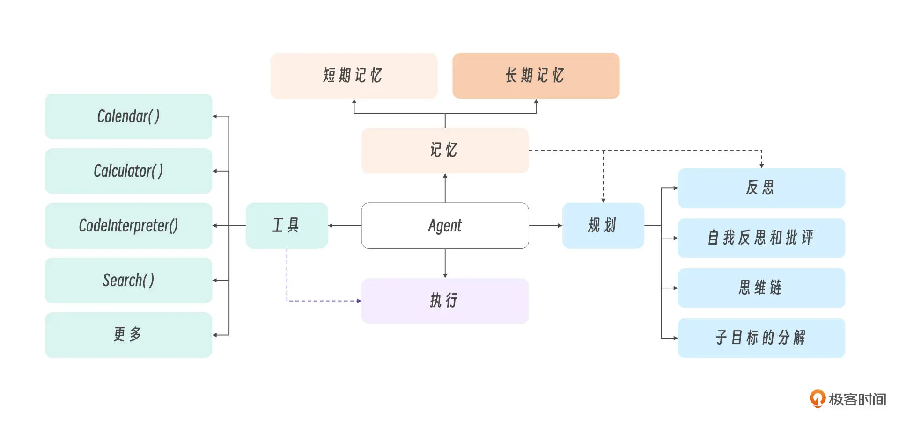

- Agent 的技术框架

这个框架由 Lililan Wong 提出，并且被广泛的引用。我们在这里就不多展开了。总而言之，随着 LLM 推理能力越来越强，可用的工具越来越多，Agent 正在蓬勃的发展。然而，这个所谓蓬勃的发展，具体我们所期待的“说句话它们就得把事情给我干了”，还差得太远太远。

我个人的判断是，通用性 Agent 出现并没有那么容易。后续几年肯定还是只能让 Agent 局部解决企业内部、具体领域的某些具体问题，而且特别精细化的工作仍然需要人类（至少是在人类的指导下完成）—— 因此大多数 Agent 做能做到的，仍然只是企业内部某环节的提效（比如日志的监控、系统问题的预警和自动排查）。

要让它在完全不加干涉的状态下，交出一份令人挑不出毛病的答卷似乎是不大可能的（比如说让 Agent 通过阅读 MCP 和 A2A 文档和源代码，设计出一套实战课程，哪怕是大纲，都不会太完美的）。那么希望 A2A 的出现，能够进一步加速更多实用性的 Agent 的落地。

## Agent 的开发平台（框架）

Agent 的开发平台（或者称为框架，一个意思）非常多，也非常杂乱。下图中所展示的，都可以称得上是 Agent 的开发平台，有些是社区推出的开源框架（如 CrewAI），有些是企业推出的商业产品（如 Coze），当然也有大公司主导的开源框架（如微软的 AutoGen）。

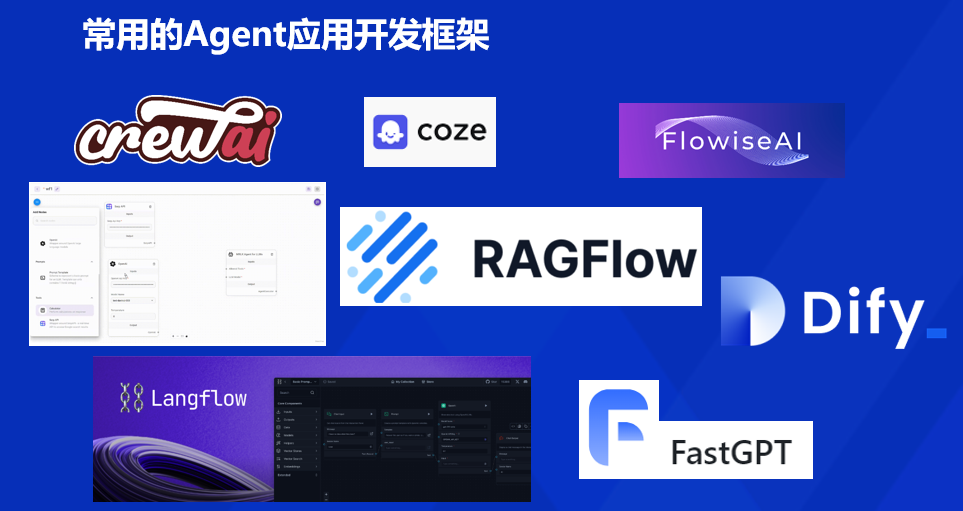

- 各种 Agent 开发平台

这些框架简单来说，有两种，分为高代码平台和低代码平台。低代码平台通过可视化界面和拖拽式操作降低开发门槛，适合非技术用户或快速原型设计。代表性平台为 Coze，这是一个企业商业产品，提供直观的界面，允许用户通过配置构建 Agent，无需深入编码；还有 Dify，是半开源的 Agent 低代码平台，也被很多企业所采用；AutoGen Studio 则是微软推出，集成到AutoGen 框架，提供低代码工具，适合企业用户快速部署多代理工作流。

这些低代码平台的特点是开发周期短，易于上手，适合快速迭代或非开发者使用。局限性是定制性较弱，复杂需求可能受限，依赖平台提供的功能。

我们则主要聚焦于像 LangChain（LangGraph）、AutoGen（AG2）和 CrewAI 等高代码Agent 开发平台来讲解 A2A 的实战，因为高代码平台依赖编程语言（如 Python）和 API，适合有技术背景的开发者，强调灵活性和深度定制，也容易实现协议的标准化需求。

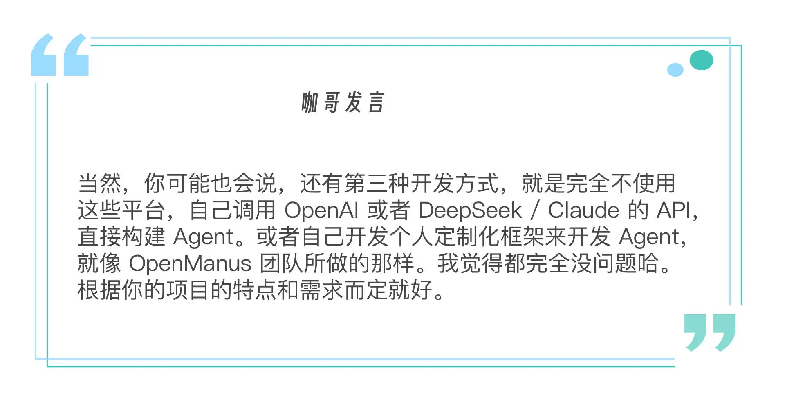

## 6 大 Agent 开发框架

在 A2A 的官方示例目录中，包含了多种不同的 Agent 开发框架示例。让我为你详细介绍其中的 6 种主流框架。

### AG2 / AutoGen

示例库中的第一个 Agent 来自开源框架 AG2。说到 AG2，可能有些同学还不是那么熟悉，但是它的前身你一定听说过，就是大名鼎鼎的 AutoGen。

AutoGen 最初由微软研究院团队开发，于 2023 年 3 月在 FLAML（Fast Library for AutoMLand Tuning）项目中首次亮相，定位为一个多智能体协作框架，旨在通过多个 AI 代理的对话协作解决复杂任务（这也是非常早出现的多智能体框架）。

AutoGen 提供灵活的工具链，支持自定义智能体、任务分解和对话编排，开发者可通过少量代码实现复杂工作流。核心开发者包括 Chi Wang 和 Qingyun Wu 等人，其设计理念受到大型语言模型（LLM）应用需求的驱动，强调模块化、灵活性和易用性，类似“PyTorch 之于深度学习”的定位。

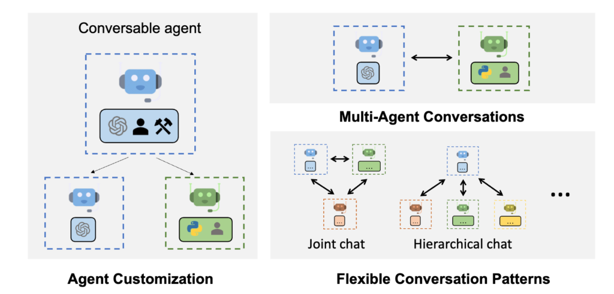

- AutoGen 的核心设计理念：对话形式的多智能体协作

不过，在 2024 年，AutoGen 项目因核心团队与微软的战略分歧而发生重大变化。2024 年 9月，Chi Wang 等核心开发者因对未来发展方向的分歧，宣布从微软的 AutoGen 仓库中分叉，创建独立项目 AG2（AgentOS）。同年 11 月，AG2 正式成立新 GitHub 组织（AG2AI），接管PyPI 上的 autogen 和 pyautogen 包，并以 Apache 2.0 许可证继续社区驱动的开发。

与此同时，微软继续维护 AutoGen，推出重写版 0.4（2024 年 11 月发布），并计划将其多代理运行时整合至 Semantic Kernel（SK），提供生产级支持。此外，微软推出低代码工具AutoGen Studio，主打可视化工作流设计，面向企业用户。

因此，现在我们拥有了两个理念相似且同源的多智能体开发框架，如何选择呢？我们分别来看看它们的适配人群和优劣势，这样能帮你更好地决策。

- 微软 AutoGen，更倾向于企业级解决方案，依托 Semantic Kernel 和 Azure 生态，注重生产支持和商业化。AutoGen Studio 的低代码特性吸引非开发者用户，但 0.4 版本不再兼容0.2，社区需迁移代码。

- AG2 则坚持开源和社区驱动，保持 0.2 的架构连续性，适合研究者和开发者实验。AG2 的灵活性和创新功能（如 Reasoner 代理）使其在开源社区中更具吸引力，但缺乏微软的资金和企业背书。

### CrewAI

CrewAI 于 2023 年由 João Moura 创立，最初作为一个开源项目发布在 GitHub 上，目标是为开发者提供一个直观的多智能体框架，特别适合快速原型开发与中小型项目。CrewAI 的核心理念是“以人为本的自动化”，通过模仿人类团队的分工与协作（如项目经理、研究员、开发者等角色），让 AI 智能体以结构化的方式完成任务。其开源许可证（MIT）与活跃的社区贡献推动了快速发展，截至 2025 年 6 月，CrewAI 已广泛应用于任务自动化、内容生成、数据分析等领域。

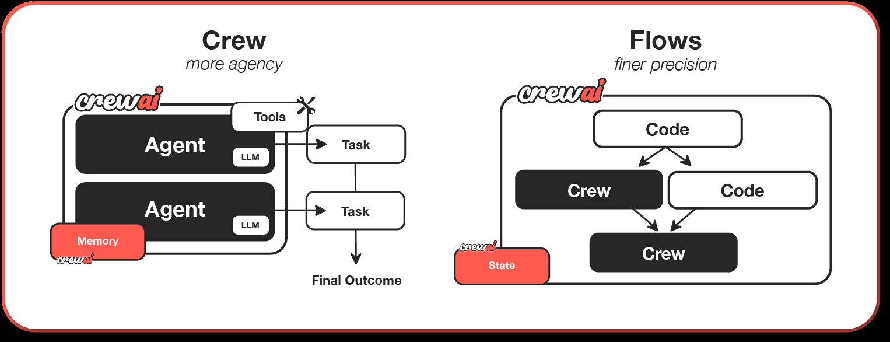

- CrewAI 的工作模式

这张图展示了 CrewAI 框架中两种工作模式—— “Crew”（团队模式）和 “Flows”（流程模式）的架构特点。左侧是 Crew 模式，强调“更多代理”（more agency）；右侧是 Flows 模式，强调“更高精度”（finer precision）。两者都以 CrewAI 为核心框架，目标是产生 Final Outcome（最终输出），但通过不同的方式组织智能体和任务。

正如 CrewAI 在它的 GitHub 上所言，CrewAI 释放了多智能体自动化的真正潜力，通过 AI 智能体团队或事件流提供速度、灵活性和控制力的最佳组合。其特点包括：

- 独立框架：从头构建，独立于 LangChain 或任何其他代理框架。

- 高性能：针对速度和最小资源使用进行优化，实现更快的执行。

- 灵活的低级定制：完全自由地在高级和低级进行定制——从整体工作流程和系统架构到细粒度的代理行为、内部提示和执行逻辑。

- 适合每种用例：经证实，对于简单任务和高度复杂的现实世界企业级场景均有效。

- 强大的社区：由超过 100,000 名认证开发人员组成的快速增长的社区提供全面的支持和资源。

CrewAI 使开发人员和企业能够自信地构建智能自动化，弥合简单性、灵活性和性能之间的差距。

CrewAI 作为一个新兴的多智能体框架，以其直观的“团队协作”理念和易用的 API 在开源社区中占据一席之地。相比微软 AutoGen 的企业化定位和 AG2 的研究导向，CrewAI 更适合中小型项目与快速开发，特别受到初学者与中小企业的青睐。其与 LangChain 等工具的兼容性和社区驱动的生态使其具有长期发展潜力，但与 AutoGen 和 AG2 相比，CrewAI 在复杂推理与大规模生产环境支持方面仍需进一步完善。

### Google ADK (Agent Development Kit)

Google Agent Development Kit (ADK) 是一款由 Google 在 2025 年 Google Cloud NEXT 大会上推出的开源框架，基于 Google 内部工具开发，旨在简化 AI Agent 和多 Agent 系统的开发、评估和部署，帮助开发者创建生产就绪、可扩展的代理式应用程序。

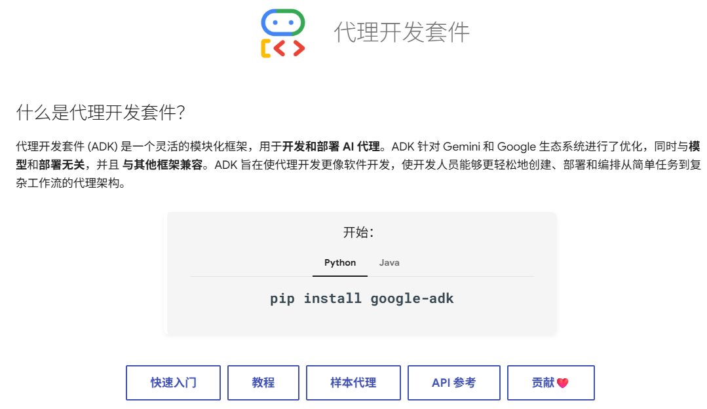

- Google ADK

Google ADK 的主要特点包括：

- 多 Agent 设计：支持模块化、层次化的专业代理组合，适用于复杂的协调和任务委托。

- 丰富的模型生态：兼容 Gemini 模型、Vertex AI 模型库，并通过 LiteLLM 支持 200 多种模型（如 Anthropic、Meta、Mistral AI），提供广泛的模型选择。

- 工具集成：内置工具（如搜索、代码执行），支持外部库（LangChain、LlamaIndex）以及代理间工具（如 LangGraph、CrewAI）。

- 流媒体能力：提供双向音频和视频流，支持人机交互。

- 代码优先开发：允许通过 Python 或 Java 定义代理逻辑、工具和编排，注重可测试性和版本管理。

- 工作流灵活性：支持顺序、并行和循环工作流，以及 LLM 驱动的动态路由。

- 评估与调试：内置测试、调试和性能审计工具。

- 部署选项：与 Vertex AI 集成，提供托管的企业级运行时，也支持本地或 Cloud Run 等其他平台部署。

相对来说，Google ADK 因为发布较晚，并不为很多人所知。但 ADK 充分利用 Google Cloud生态，用 Gemini 模型和 Vertex AI 实现可扩展性和监控。它还支持模型上下文协议（MCP）和 Agent2Agent（A2A）协议，实现跨供应商的代理协作安全性和互操作性，并通过 AgentGarden 提供预构建样本和工具，加速开发。

### LangGraph

接下来要讲的 LangGraph 是 Agent 开发框架的真大佬。它是由 LangChain 团队开发的一个开源框架，专注于构建和优化基于语言模型（LLM）的多代理系统和图状工作流。于 2024 年初发布，LangGraph 旨在为开发者提供一种灵活、可视化且强大的工具，处理复杂任务的代理协作和状态管理，特别适用于需要动态决策和上下文跟踪的场景。目前，LangGraph 已发展成为 AI 开发社区中的重要工具，尤其在多智能体应用中表现出色。

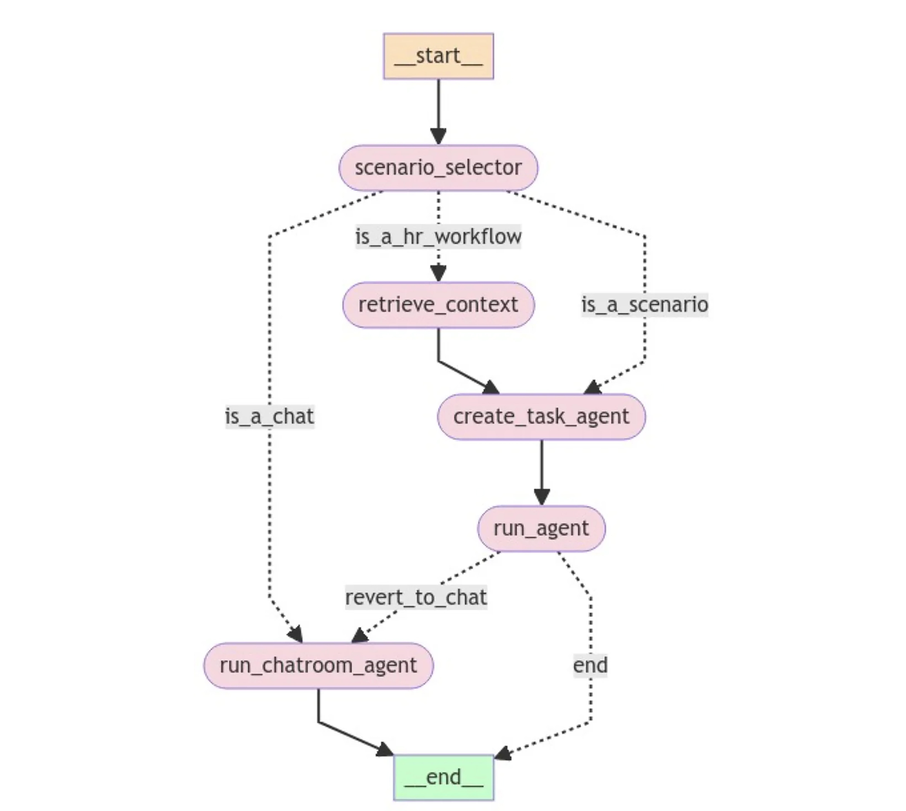

- 一个典型的 LangGraph 编排的 Agent 工作流 图源：https://www.reddit.com/r/LangChain/comments/1dogdy8/multiagent_conversational_graph_designs/

LangGraph 的主要特点如下：

- 图状工作流：通过有向图 (Directed Acyclic Graph, DAG) 设计工作流，允许任务以节点和边的形式定义，方便复杂逻辑的建模。

- 状态管理：内置状态跟踪机制，确保代理间的上下文一致性，支持多轮对话和任务持续性。

- 多代理协作：支持多个智能体按图定义的路径协作，每个智能体可执行特定任务或调用工具。

- 工具集成：无缝对接 LangChain 生态的工具（如 SerpAPI、Wikipedia），以及自定义工具。

- 动态路由：根据 LLM 输出或条件动态调整工作流路径，增强适应性。

- 可视化支持：提供图形界面（如基于 NetworkX 的可视化），便于调试和优化。

- Python 开发：以 Python 为主要开发语言，易于集成现有项目。

LangGraph 深深嵌入 LangChain 生态，与 LangChain 的代理、内存和检索模块高度兼容。它还支持其他框架（如 CrewAI、AutoGen）的部分功能，增强了跨框架的互操作性。开发者可以通过 LangSmith 进行工作流的监控和评估。

LangGraph 以其图状工作流和动态路由能力，成为处理复杂多代理任务的理想选择。它的灵活性和与 LangChain 的深度整合使其在研究和开发中广受欢迎，尤其适合需要可视化和状态管理的场景。

### LlamaIndex Agent

LlamaIndex 从诞生之日起就是 LangChain 的有力竞争者。LlamaIndex Agent 是由LlamaIndex 项目团队开发的一个开源 AI 代理框架，专为增强基于大型语言模型（LLM）的数据索引和检索任务而设计。自 2023 年底首次亮相以来，LlamaIndex Agent 已发展为一个强大的工具，特别适用于需要高效处理结构化和非结构化数据的应用场景，它在知识管理、问答系统和数据驱动的代理协作中表现出色。

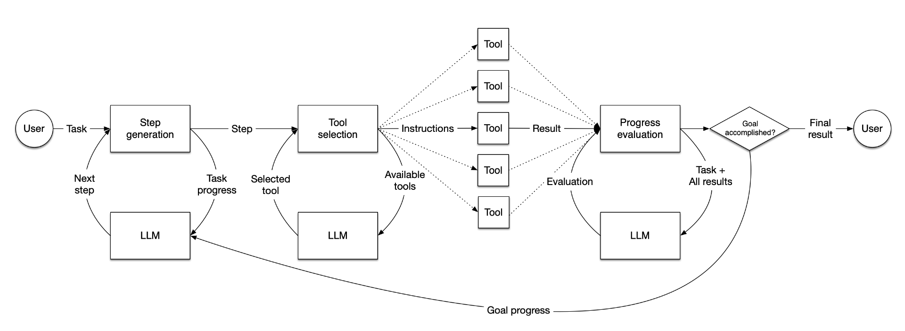

- 通过 LlamaIndex 构建的 Agentic 工作流 图源：https://docs.llamaindex.ai/en/stable/understanding/agent/

LlamaIndex Agent 主要特点如下：

- 数据索引与检索：利用 LlamaIndex 的核心优势，构建高效的索引（如向量存储、文档图），支持快速检索和语义搜索。

- 代理增强：将 LLM 转化为智能代理，具备上下文感知和工具使用能力（如查询数据库、调用 API）。

- 工具集成：支持与 LangChain、OpenAI、Hugging Face 等生态的工具无缝对接，扩展功能。

- 内存与上下文管理：提供短期和长期记忆机制，确保代理在多轮交互中保持一致性。

- 模块化设计：允许开发者自定义代理行为、索引结构和查询策略。

- 多模态支持：除了文本，还支持图像和表格数据，适用于多样化数据源。

- 优化性能：通过缓存和批处理提升查询效率，特别适合大规模数据集。

LlamaIndex Agent 深深嵌入了 LlamaIndex 生态，与其数据连接器（支持 PDF、CSV、SQL等）、索引器和查询引擎紧密协作。它还与 LangChain 和 CrewAI 等框架兼容，增强了多代理系统的互操作性。开发者可以通过 LlamaIndex 的可视化工具（如 Playground）进行调试和优化。

LlamaIndex Agent 以其强大的数据索引和检索能力，成为处理知识密集型任务的理想选择。其模块化设计和多模态支持使其在教育、研究和企业应用中广受欢迎，尤其适合需要深度数据交互的场景。

### Semantic Kernel

Semantic Kernel (SK) 是一种由 Microsoft 开发的轻量级开源软件开发套件 (SDK)，旨在帮助开发者将最新的大型语言模型 (LLM) 轻松集成到 C#、Python 或 Java 代码中。它作为高效的中介层，加速企业级解决方案的交付，受到大型企业的青睐。

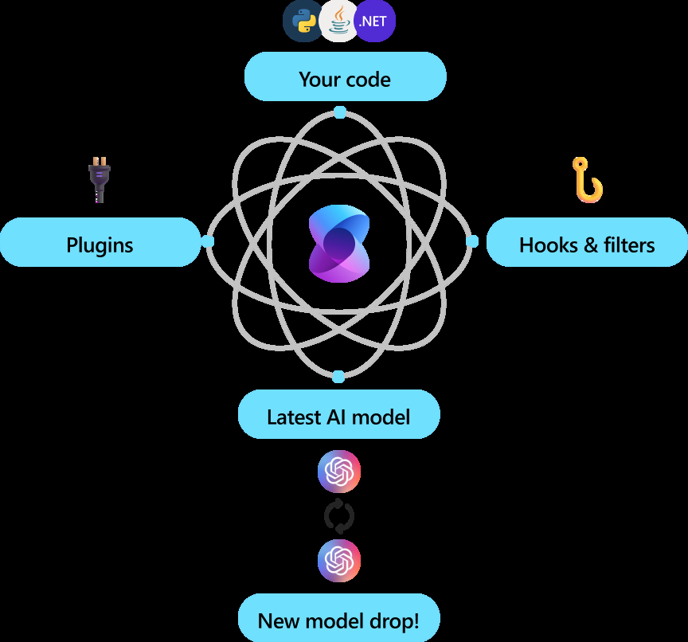

- Semantic Kernel 的核心架构

这张图展示了 Semantic Kernel 的核心架构，通过将用户代码与插件、钩子与过滤器集成，结合最新的 AI 模型，支持灵活扩展和模型更新。其核心特性如下：

- 灵活性与模块化：支持多种 LLM（如 OpenAI、Azure OpenAI、Hugging Face），便于切换模型。

- 代理框架：构建模块化 AI 代理，支持工具 / 插件、记忆和规划功能。

- 多代理系统：协调复杂工作流，允许专业代理协作。

- 插件生态：通过原生代码、提示模板、OpenAPI 规范或模型上下文协议（MCP）扩展功能。

- 多模态支持：处理文本、视觉和音频输入。

- 企业级可靠性：1.0+ 版本在 C#、Python 和 Java 上提供支持，确保非破坏性更新。

- 安全与可观察性：提供遥测支持、钩子与过滤器，确保负责任的 AI 解决方案。

Semantic Kernel 将提示与现有 API 结合，通过描述代码给 AI 模型，模型调用函数，SK 作为中间件翻译请求并返回结果。开发者可将现有代码作为插件，最大化投资回报，并通过开箱即用的连接器集成 AI 服务。

A2A 的示例中还有一些比较小众的 Agent 框架，如 Azure AI Foundry Agent Service 、MindsDB Agent 和 Marvin 等，就不一一罗列了。

## A2A 示例代码库中 Agents 目录分析

前面，我简单重申了自己对 Agent 和其现状的理解，之后介绍了常见的 Agents 开发框架，现在我们一起来看一看 A2A 示例代码库中 Agents 目录架构。

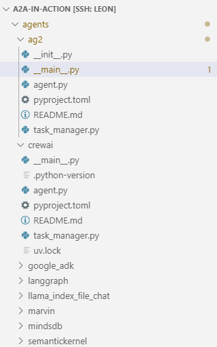

### 整体架构模式

首先，Agents 目录下的所有 Agent 都遵循一个统一的架构模式，主要包括以下几个核心组件：

- agent.py：具体的 Agent 实现逻辑。

- task_manager.py：任务管理器，处理 A2A 协议通信。

- _main_.py：服务器启动入口。

- pyproject.toml：项目依赖配置。

- README.md：使用说明。

其中所有 Agent 都实现了以下通用接口：

```python
class AgentBase:
   SUPPORTED_CONTENT_TYPES = ['text', 'text/plain']  # 支持的内容类型
   def invoke(self, query: str, session_id: str) -> dict[str, Any]:
       """同步调用接口"""
       pass
   async def stream(self, query: str, session_id: str) -> AsyncIterable[dict[str
       """异步流式调用接口"""
       pass
```

所有 Agent 也都返回标准化的响应格式：

```
{
   'is_task_complete': bool,      # 任务是否完成
   'require_user_input': bool,    # 是否需要用户输入
   'content': str,               # 响应内容
   'parts': list,                # 响应部分（可选）
   'data': dict                  # 结构化数据（可选）
}
```

这就为适配 A2A 协议提供了一个通用接口，而整个项目就是通过这个通用接口，以及统一的任务管理机制，把多个异构的、通过完全不同的 Agent 框架开发的智能体，统一起来进行管理，让它们能相互通信，协同完成任务。

### 各 Agent 的专长领域

其中的各个目录中的 Agent 用不同的框架实现，分别具有不同的能力。我整理了一张表格方便你直观看到它们擅长的任务。

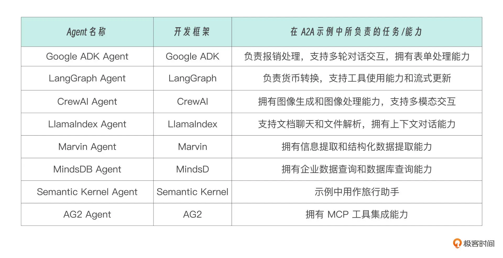

这些 Agent 拥有一系列的通用性特征：

- 协议兼容性：所有 Agent 都通过 A2A（Agent-to-Agent）协议暴露服务，有统一的 JSON-RPC 通信格式，支持同步和异步调用模式。

- 任务管理：所有 Agent 有统一的任务状态管理（WORKING，INPUT_REQUIRED，COMPLETED）机制，支持任务流式更新以及错误处理和恢复机制。

- 会话管理：所有 Agent 都基于 session_id 进行会话隔离，有状态持久化支持和多用户并发支持。

- 扩展性方面，都支持插件化的工具集成、模块化的框架适配以及标准化的配置管理。

项目的这种架构设计使得不同的 AI 框架和工具可以无缝集成到统一的 Agent 生态系统中，同时保持了良好的可维护性和扩展性。

## 总结

这节课，我简单介绍了什么是 Agent，只要通过 LLM 进行推理，并调用工具，自动解决某些问题，就是 Agent。

之后我们了解了 6 种常用 Agent 开发框架，这些框架各有特色：

- LangGraph 和 CrewAI 专注于工作流和多 Agent 协作。

- LlamaIndex 擅长数据处理和分析。

- AG2 提供更灵活的定制化开发体验。

- Google ADK 和 Semantic Kernel 更适合企业级应用。

而我们即将深入剖析的 A2A Sample 中，则具有如下一些设计特点：

1. 框架无关性：可以基于不同的 AI 框架构建 Agent。

2. 协议标准化：统一的 A2A 协议确保互操作性。

3. 功能模块化：每个 Agent 专注于特定领域。

4. 部署灵活性：可以独立部署和扩展。

5. 开发一致性：统一的开发模式和接口规范。

所有这些框架都通过 A2A（Agent-to-Agent）协议进行标准化集成，使得不同框架开发的Agent 可以相互通信和协作。

我们下面几节课会选择几个 Agent 来深入讲解，在介绍 Agent 本身实现的同时，也分析该Agent 是如何被集成到 A2A 框架之中的。

## 思考题

这节的内容相对简单，主要是知识性的内容，没有那么烧脑，来几道思考题吧：

1. 上面介绍的各种 Agent 设计开发框架，你在生产实践中用过哪一种？可否分享一些使用感受？

2. 除了上面介绍的 Agent 设计开发框架，你还了解或者使用过哪些框架？可否说一说它的特色和使用感受？

3. 假设你所在团队准备基于 LLM 构建一个智能体系统，以下是几个典型业务场景，请你从上文介绍的 6 大 Agent 框架中选择一个最适合的，并简要说明理由：

- 一个需要高度灵活定制的企业数据分析助手，要求可访问多种数据库并进行复杂数据处理。

- 一个面向终端用户的多轮对话旅游助手，要求强人机交互和任务管理能力。

- 一个希望通过图状流程处理复杂审批逻辑和动态任务分支的政务智能办公平台。

- 一个要求快速部署图像分析 + 表单处理的 Agent，用于客服文档自动识别与回应。

请结合框架特点，分别给出你认为最优的选择和理由。期待你在留言区参与交流互动！
