# 13 | 智能画师：用CrewAI和A2A创建绘画智能体

你好，我是黄佳。

这一课中，我带着你详细看一看我们在 A2A Demo 系统中的第一个 Agent——用 CrewAI 搭建的“智能画师”Agent（位于 a2a-in-action 代码库的 agents/crewai_zh 目录）。

在这个 Demo 中，A2A 的作用体现在三个层面：

1. 任务协议标准化：Agent 接收的绘图请求被封装为 A2A Task 消息，包含 prompt、session_id、artifact_id 等上下文字段。

2.Agent 接口服务化：CrewAI Agent 被部署为 A2A Server，支持远程 Agent 调用、注册和返回结果。

3. 平台解耦：UI 前端无需了解 CrewAI 内部细节，只需发送标准化 A2A 请求，即可触发图像生成流程。

通过这种方式，“智能画师”就从一个本地 Agent，晋升为一个服务性的智能体，可以被任意支持 A2A 协议的系统访问和复用。

## CrewAI 开发框架简介

先来简单了解一下 CrewAI。

CrewAI 是一个开源的多智能体框架，支持工具集成，用于构建一组协作完成任务的智能体（Agents）。它的设计理念是：每个 Agent 都具备特定角色、工具和目标，通过任务分工与信息共享共同解决复杂问题。

CrewAI 能够提供类人团队的任务执行方式，不但可以构建单智能体助手，更可以构建“项目经理 + 设计师 + 执行者”这样的模拟团队。CrewAI 的另一个优势是可扩展性和生产级部署，因此其实可以广泛应用于你的数据分析、内容创作、自动化流程等场景。

下面是一个简单的单智能体实现。

```python
from crewai import Agent, Crew, Task, LLM
import os
# 设置 DeepSeek API 密钥
os.environ["DEEPSEEK_API_KEY"] = "your_deepseek_api_key"
# 配置 DeepSeek LLM
deepseek_llm = LLM(
   model="deepseek/deepseek-chat",  # 或使用 "deepseek-r1" 等具体模型
   api_key=os.getenv("DEEPSEEK_API_KEY"),
   base_url="https://api.deepseek.com"
)
# 定义一个简单的 Agent
researcher = Agent(
   role="研究员",
   goal="搜索并总结最新 AI 趋势",
   backstory="你是一位热衷于探索 AI 技术的专家",
   llm=deepseek_llm,  # 使用 DeepSeek 模型
   verbose=True
)
# 定义任务
task = Task(
   description="查找并总结 2025 年 AI 领域的最新发展",
   agent=researcher,
   expected_output="一份简短的 AI 趋势总结"
)
# 创建 Crew 并执行
crew = Crew(
   agents=[researcher],
   tasks=[task],
   verbose=True
)
# 运行任务
result = crew.kickoff()
print(result)
```

我们通过命令 cd agents/crewai_zh 进入目录，并运行 uv run01_CrewAI_Simple_Sample.py，就可以得到 Agent 的研究结果。

```
huangjia@IHP-SPD-E1M320:~/Documents/17_MCP/a2a-in-action/agents/crewai_zh$ uv run
╭──────────────────────────────────────────────────────── Crew Execution Started
│  Crew Execution Started
│  Name: crew
│  ID: aa62bb4c-25a7-4e20-b5f0-5232e3d37f35
╰────────────────────────────────────────────────────────────────────────────────
 Crew: crew
└── 📋 Task: 48b43571-00d6-44fb-b3fd-4741f24a6951
      Status: Executing Task...
 Crew: crew
└── 📋 Task: 48b43571-00d6-44fb-b3fd-4741f24a6951
      Status: Executing Task...
   └── 🤖 Agent: 研究员
           Status: In Progress
# Agent: 研究员
## Task: 查找并总结 2025 年 AI 领域的最新发展
🤖 Agent: 研究员
   Status: In Progress
└── 🧠 Thinking...
🤖 Agent: 研究员
   Status: In Progress
 Crew: crew
└── 📋 Task: 48b43571-00d6-44fb-b3fd-4741f24a6951
      Status: Executing Task...
   └── 🤖 Agent: 研究员
           Status: ✅ Completed
 Crew: crew
└── 📋 Task: 48b43571-00d6-44fb-b3fd-4741f24a6951
      Assigned to: 研究员
      Status: ✅ Completed
   └── 🤖 Agent: 研究员
           Status: ✅ Completed
╭──────────────────────────────────────────────────────────── Task Completion ───
│  Task Completed
│  Name: 48b43571-00d6-44fb-b3fd-4741f24a6951
│  Agent: 研究员
╰────────────────────────────────────────────────────────────────────────────────
╭──────────────────────────────────────────────────────────── Crew Completion ───
│  Crew Execution Completed
│  Name: crew
│  ID: aa62bb4c-25a7-4e20-b5f0-5232e3d37f35
╰────────────────────────────────────────────────────────────────────────────────
**2025年AI领域最新发展趋势总结**
1. **通用人工智能（AGI）的突破性进展**
  2025年，AGI研究取得显著进展，多模态模型在推理、规划和自主学习能力上接近人类水平。OpenAI、De
2. **AI与量子计算的融合**
  量子机器学习（QML）成为热点，量子计算加速的AI模型在药物发现、材料科学和密码学中实现商业化应用
3. **边缘AI的爆发式增长**
  轻量化AI模型（如TinyML）在物联网设备中普及，支持实时数据处理。2025年，超过60%的企业部署边缘
4. **AI立法与伦理框架全球化**
  欧盟《AI法案》和美国《AI责任法案》生效，要求AI系统透明化。中国推出“生成式AI备案制”，全球范围
5. **生物启发AI的崛起**
  类脑计算（Neuromorphic Computing）芯片量产，模拟人脑神经元结构的硬件（如Intel Loihi 3）
6. **AI驱动的科学发现（AI4Science）**
  DeepMind的AlphaFold 3破解所有已知蛋白质结构，AI辅助发现超导材料和新能源催化剂，推动气候科学
7. **生成式AI的3D与多感官进化**
  文本/图像生成模型升级为3D内容生成（如OpenAI的Point-E 2），支持触觉/嗅觉模拟的VR应用。影视行
8. **自主智能体（Agent）经济生态**
  AI Agent可独立完成电商交易、投资决策等任务，全球首个由AI代理运营的公司在新加坡注册。
9. **AI安全成为核心议题**
  防御性AI技术（如对抗性训练）被纳入关键基础设施，各国建立AI红色对抗团队，防范模型被恶意滥用。
10. **教育AI个性化革命**
  基于认知科学的AI导师覆盖全球1亿学生，动态调整教学内容，使学习效率提升300%。
（注：以上趋势基于2023-2024年技术路线图及顶级会议（NeurIPS/ICML）的前瞻性研究综合预测。）
```

## CrewAI Agent 画师 - v1.0 本机版

好，上面我们是介绍了 CrewAI，并且给出了一个非常简单的示例。下面我们继续创建一个稍微复杂一点的示例，其实也就是 A2A 示例代码库中，“智能画师”的单机版本。

示例代码如下。

```python
import base64
import logging
import os
import re
from io import BytesIO
from typing import Any
from uuid import uuid4
from PIL import Image
from crewai import LLM, Agent, Crew, Task
from crewai.process import Process
from crewai.tools import tool
from dotenv import load_dotenv
from google import genai
from google.genai import types
from pydantic import BaseModel
# 加载环境变量
load_dotenv()
# 设置日志
logging.basicConfig(level=logging.INFO)
logger = logging.getLogger(__name__)
class ImageData(BaseModel):
   """图像数据模型"""
   id: str | None = None
   name: str | None = None
   mime_type: str | None = None
   bytes: str | None = None
   error: str | None = None
class SimpleImageCache:
   """简单的内存缓存"""
   def __init__(self):
       self._cache = {}
   def get(self, session_id: str):
       return self._cache.get(session_id, {})
   def set(self, session_id: str, data: dict):
       self._cache[session_id] = data
# 全局缓存实例
image_cache = SimpleImageCache()
@tool('ImageGenerationTool')
def generate_image_tool(
   prompt: str,
   session_id: str,
   artifact_file_id: str = ""
) -> str:
   """基于提示词生成图像的工具"""
   if not prompt:
       raise ValueError('提示词不能为空')
   try:
       # 初始化Google GenAI客户端
       client = genai.Client()
       # 准备文本输入
       text_input = (
           prompt,
           '如果输入图像与请求不匹配，请忽略任何输入图像。',
       )
       ref_image = None
       logger.info(f'会话ID: {session_id}')
       print(f'会话ID: {session_id}')
       # 尝试获取参考图像
       try:
           session_image_data = image_cache.get(session_id)
           if session_image_data:
               if artifact_file_id and artifact_file_id.strip() and artifact_fil
                   ref_image_data = session_image_data[artifact_file_id]
                   logger.info('找到参考图像')
               else:
                   # 获取最新的图像
                   latest_image_key = list(session_image_data.keys())[-1]
                   ref_image_data = session_image_data[latest_image_key]
               # 转换为PIL图像
               ref_bytes = base64.b64decode(ref_image_data.bytes)
               ref_image = Image.open(BytesIO(ref_bytes))
       except Exception as e:
           logger.info(f'没有找到参考图像: {e}')
           ref_image = None
       # 准备输入内容
       if ref_image:
           contents = [text_input, ref_image]
       else:
           contents = text_input
       # 调用Google GenAI生成图像
       response = client.models.generate_content(
           model='gemini-2.0-flash-exp',
           contents=contents,
           config=types.GenerateContentConfig(
               response_modalities=['Text', 'Image']
           ),
       )
       # 处理响应
       for part in response.candidates[0].content.parts:
           if part.inline_data is not None:
               # 创建图像数据
               image_data = ImageData(
                   bytes=base64.b64encode(part.inline_data.data).decode('utf-8')
                   mime_type=part.inline_data.mime_type,
                   name='generated_image.png',
                   id=uuid4().hex,
               )
               # 保存到缓存
               session_data = image_cache.get(session_id)
               if session_data is None:
                   session_data = {}
               session_data[image_data.id] = image_data
               image_cache.set(session_id, session_data)
               logger.info(f'成功生成图像: {image_data.id}')
               return image_data.id
       logger.error('没有生成图像')
       return "生成失败"
   except Exception as e:
       logger.error(f'生成图像时出错: {e}')
       print(f'异常: {e}')
       return f"错误: {str(e)}"
class SimpleCrewAIAgent:
   """基于CrewAI的简化图像生成Agent"""
   def __init__(self):
       # 初始化LLM
       if os.getenv('GOOGLE_GENAI_USE_VERTEXAI'):
           self.model = LLM(model='vertex_ai/gemini-2.0-flash')
       elif os.getenv('GOOGLE_API_KEY'):
           self.model = LLM(
               model='gemini/gemini-2.0-flash',
               api_key=os.getenv('GOOGLE_API_KEY'),
           )
       else:
           # 如果没有API密钥，使用默认模型
           self.model = LLM(model='gemini/gemini-2.0-flash')
           logger.warning("未设置GOOGLE_API_KEY，使用默认配置")
       # 创建图像创作Agent
       self.image_creator_agent = Agent(
           role='图像创作专家',
           goal=(
               "基于用户的文本提示词生成图像。如果提示词模糊，请询问澄清问题。"
               "专注于解释用户的请求并有效使用图像生成器工具。"
           ),
           backstory=(
               '你是一个由AI驱动的数字艺术家。你专门从事将文本描述'
               '转换为视觉表示，使用强大的图像生成工具。你的目标'
               '是基于提供的提示词实现准确性和创造性。'
           ),
           verbose=True,  # 开启详细输出以便调试
           allow_delegation=False,
           tools=[generate_image_tool],
           llm=self.model,
       )
       # 创建图像生成任务
       self.image_creation_task = Task(
           description=(
               "接收用户提示词：'{user_prompt}'。\n"
               "分析提示词并识别是否需要创建新图像或编辑现有图像。"
               "在提示词中查找代词如这个、那个等，它们可能提供上下文。"
               "使用图像生成器工具进行图像创建或修改。"
               "工具需要提示词：{user_prompt}，会话ID：{session_id}。"
               "如果提供了artifact_file_id：{artifact_file_id}，请使用它。"
           ),
           expected_output='生成图像的ID',
           agent=self.image_creator_agent,
       )
       # 创建Crew
       self.image_crew = Crew(
           agents=[self.image_creator_agent],
           tasks=[self.image_creation_task],
           process=Process.sequential,
           verbose=True,  # 开启详细输出
       )
   def extract_artifact_file_id(self, query: str) -> str | None:
       """从查询中提取artifact_file_id"""
       try:
           pattern = r'(?:id|artifact-file-id)\s+([0-9a-f]{32})'
           match = re.search(pattern, query)
           return match.group(1) if match else None
       except Exception:
           return None
   def generate_image(self, prompt: str, session_id: str = None) -> str:
       """生成图像的主方法"""
       if not session_id:
           session_id = uuid4().hex
       # 提取artifact_file_id
       artifact_file_id = self.extract_artifact_file_id(prompt)
       # 准备输入
       inputs = {
           'user_prompt': prompt,
           'session_id': session_id,
           'artifact_file_id': artifact_file_id or '',
       }
       logger.info(f'开始生成图像，输入: {inputs}')
       print(f'开始生成图像，输入: {inputs}')
       try:
           # 启动CrewAI
           response = self.image_crew.kickoff(inputs)
           logger.info(f'图像生成完成，响应: {response}')
           return response
       except Exception as e:
           logger.error(f'生成图像时出错: {e}')
           return f"错误: {str(e)}"
   def get_image_data(self, session_id: str, image_id: str) -> ImageData:
       """获取图像数据"""
       try:
           session_data = image_cache.get(session_id)
           if session_data and image_id in session_data:
               return session_data[image_id]
           else:
               return ImageData(error='图像未找到')
       except Exception as e:
           logger.error(f'获取图像数据时出错: {e}')
           return ImageData(error=f'获取图像数据时出错: {str(e)}')
   def save_image_to_file(self, session_id: str, image_id: str, filepath: str =
       """将图像保存到文件"""
       try:
           image_data = self.get_image_data(session_id, image_id)
           if image_data.error:
               return f"错误: {image_data.error}"
           # 如果没有指定文件路径，使用默认路径
           if not filepath:
               import os
               os.makedirs("generated_images", exist_ok=True)
               filepath = f"generated_images/{image_id}.png"
           # 解码Base64数据并保存
           import base64
           image_bytes = base64.b64decode(image_data.bytes)
           with open(filepath, 'wb') as f:
               f.write(image_bytes)
           logger.info(f'图像已保存到: {filepath}')
           return f"图像已保存到: {filepath}"
       except Exception as e:
           logger.error(f'保存图像时出错: {e}')
           return f"保存图像时出错: {str(e)}"
# 使用示例
def main():
   """主函数示例"""
   print("=== CrewAI图像生成Agent示例 ===\n")
   # 创建Agent实例
   agent = SimpleCrewAIAgent()
   # 测试图像生成
   test_prompt = "一只可爱的小猫坐在花园里，阳光明媚"
   session_id = "test_session_123"
   print(f"提示词: {test_prompt}")
   print(f"会话ID: {session_id}")
   print("\n开始生成图像...")
   # 生成图像
   result = agent.generate_image(test_prompt, session_id)
   print(f"\n生成结果: {result}")
   # 处理CrewAI返回的结果
   # CrewAI返回的是CrewOutput对象，需要转换为字符串
   if hasattr(result, 'raw'):
       # 如果是CrewOutput对象，获取原始输出
       result_str = str(result.raw)
   else:
       # 如果是字符串，直接使用
       result_str = str(result)
   print(f"处理后的结果: {result_str}")
   # 如果成功生成，获取图像数据
   if result_str and not result_str.startswith("错误"):
       print(f"\n获取图像数据...")
       image_data = agent.get_image_data(session_id, result_str)
       if image_data.error:
           print(f"获取图像数据失败: {image_data.error}")
       else:
           print(f"图像数据获取成功:")
           print(f"  ID: {image_data.id}")
           print(f"  名称: {image_data.name}")
           print(f"  MIME类型: {image_data.mime_type}")
           print(f"  数据大小: {len(image_data.bytes) if image_data.bytes else 0}
           # 保存图片到文件
           print(f"\n保存图片到文件...")
           save_result = agent.save_image_to_file(session_id, result_str)
           print(f"保存结果: {save_result}")
   else:
       print(f"图像生成失败或返回错误: {result_str}")
if __name__ == "__main__":
main()
```

这段代码看起来很长，但并不难理解，它的内核是主要 Agent 类 (SimpleCrewAIAgent)，这个类中的关键元素包括：

- LLM 模型：Google Gemini 2.0 Flash。

- 图像创作 Agent：专门负责图像生成的 AI 角色。

- 任务定义：描述如何处理用户提示词。

- Crew：协调 Agent 和任务的执行。

此外，ImageData 复杂创建图像的数据模型 ，而 SimpleImageCache 类则创建了一个简单的内存缓存系统，复制存储生成的图像数据，但程序重启后数据会丢失，优点是快速访问，不占用磁盘空间。在聊天机器人的场景中，有这个缓存机制就足够了。如有存盘需要可以通过Agent 的 save_image_to_file 功能保存它。

通过命令 uv run 02_CrewAI_Agent.py，可以得到如下结果。

```
huangjia:~/Documents/a2a-in-action/agents/crewai_zh$ uv run crewai_agent.py
=== CrewAI图像生成Agent示例 ===
提示词: 一只可爱的小猫坐在花园里，阳光明媚
会话ID: test_session_123
开始生成图像...
INFO:__main__:开始生成图像，输入: {'user_prompt': '一只可爱的小猫坐在花园里，阳光明媚', 's
开始生成图像，输入: {'user_prompt': '一只可爱的小猫坐在花园里，阳光明媚', 'session_id': 't
╭───────────────────────────────────────────────── Crew Execution Started ───────
│  Crew Execution Started
│  Name: crew
│  ID: 03dcda70-91b7-4ba3-8484-3d760bae471b
╰────────────────────────────────────────────────────────────────────────────────
 Crew: crew
└── 📋 Task: 5ee772b7-1a3c-4b07-b402-9604956b02e4
      Status: Executing Task...
 Crew: crew
└── 📋 Task: 5ee772b7-1a3c-4b07-b402-9604956b02e4
      Status: Executing Task...
   └── 🤖 Agent: 图像创作专家
           Status: In Progress
# Agent: 图像创作专家
## Task: 接收用户提示词：'一只可爱的小猫坐在花园里，阳光明媚'。
```

- 分析提示词并识别是否需要创建新图像或编辑现有图像。在提示词中查找代词如这个、那个等，它们可能提供上

```
🤖 Agent: 图像创作专家
   Status: In Progress
└── 🧠 Thinking...
01:24:32 - LiteLLM:INFO: utils.py:3100 -
LiteLLM completion() model= gemini-2.0-flash; provider = gemini
INFO:LiteLLM:
LiteLLM completion() model= gemini-2.0-flash; provider = gemini
INFO:httpx:HTTP Request: POST https://generativelanguage.googleapis.com/v1beta/mo
01:24:33 - LiteLLM:INFO: utils.py:1177 - Wrapper: Completed Call, calling success
INFO:LiteLLM:Wrapper: Completed Call, calling success_handler
01:24:33 - LiteLLM:INFO: cost_calculator.py:636 - selected model name for cost ca
INFO:LiteLLM:selected model name for cost calculation: gemini/gemini-2.0-flash
01:24:33 - LiteLLM:INFO: cost_calculator.py:636 - selected model name for cost ca
INFO:LiteLLM:selected model name for cost calculation: gemini/gemini-2.0-flash
🤖 Agent: 图像创作专家
   Status: In Progress
 Crew: crew
└── 📋 Task: 5ee772b7-1a3c-4b07-b402-9604956b02e4
      Status: Executing Task...
   └── 🤖 Agent: 图像创作专家
           Status: In Progress
╭─────────────────────────────────────────────────────── Tool Error ─────────────
│  Tool Usage Failed
│  Name: ImageGenerationTool
│  Error: Arguments validation failed: 1 validation error for Imagegenerationtool
│  artifact_file_id
│    Input should be a valid string [type=string_type, input_value=None, input_ty
│      For further information visit https://errors.pydantic.dev/2.11/v/string_ty
╰────────────────────────────────────────────────────────────────────────────────
I encountered an error while trying to use the tool. This was the error: Argument
artifact_file_id
 Field required [type=missing, input_value={'prompt': '一只可爱...3694', 'metadat
   For further information visit https://errors.pydantic.dev/2.11/v/missing.
Tool ImageGenerationTool accepts these inputs: Tool Name: ImageGenerationTool
Tool Arguments: {'prompt': {'description': None, 'type': 'str'}, 'session_id': {'
Tool Description: 基于提示词生成图像的工具
# Agent: 图像创作专家
## Thought: I encountered an error with the ImageGenerationTool when the `artifac
## Using tool: ImageGenerationTool
## Tool Input:
"{\"prompt\": \"\\u4e00\\u53ea\\u53ef\\u7231\\u7684\\u5c0f\\u732b\\u5750\\u5728\\
## Tool Output:
I encountered an error while trying to use the tool. This was the error: Argument
artifact_file_id
 Field required [type=missing, input_value={'prompt': '一只可爱...3694', 'metadat
   For further information visit https://errors.pydantic.dev/2.11/v/missing.
Tool ImageGenerationTool accepts these inputs: Tool Name: ImageGenerationTool
Tool Arguments: {'prompt': {'description': None, 'type': 'str'}, 'session_id': {'
Tool Description: 基于提示词生成图像的工具.
Moving on then. I MUST either use a tool (use one at time) OR give my best final
``
Thought: you should always think about what to do
Action: the action to take, should be one of [ImageGenerationTool]
Action Input: the input to the action, dictionary enclosed in curly braces
Observation: the result of the action
``
This Thought/Action/Action Input/Result can repeat N times. Once I know the final
``
Thought: I now can give a great answer
Final Answer: Your final answer must be the great and the most complete as possib
``
01:24:35 - LiteLLM:INFO: utils.py:3100 -
LiteLLM completion() model= gemini-2.0-flash; provider = gemini
INFO:LiteLLM:
LiteLLM completion() model= gemini-2.0-flash; provider = gemini
INFO:httpx:HTTP Request: POST https://generativelanguage.googleapis.com/v1beta/mo
01:24:36 - LiteLLM:INFO: utils.py:1177 - Wrapper: Completed Call, calling success
INFO:LiteLLM:Wrapper: Completed Call, calling success_handler
01:24:36 - LiteLLM:INFO: cost_calculator.py:636 - selected model name for cost ca
INFO:LiteLLM:selected model name for cost calculation: gemini/gemini-2.0-flash
01:24:36 - LiteLLM:INFO: cost_calculator.py:636 - selected model name for cost ca
INFO:LiteLLM:selected model name for cost calculation: gemini/gemini-2.0-flash
🤖 Agent: 图像创作专家
   Status: In Progress
INFO:__main__:会话ID: test_session_123
会话ID: test_session_123
INFO:google_genai.models:AFC is enabled with max remote calls: 10.
INFO:httpx:HTTP Request: POST https://generativelanguage.googleapis.com/v1beta/mo
INFO:google_genai.models:AFC remote call 1 is done.
INFO:__main__:成功生成图像: ba95c7c7fc9349d7957763e356d8f277
# Agent: 图像创作专家
## Thought: I am still facing errors. It seems that `artifact_file_id` is a requi
## Using tool: ImageGenerationTool
## Tool Input:
"{\"prompt\": \"\\u4e00\\u53ea\\u53ef\\u7231\\u7684\\u5c0f\\u732b\\u5750\\u5728\\
## Tool Output:
ba95c7c7fc9349d7957763e356d8f277
🤖 Agent: 图像创作专家
   Status: In Progress
└── 🧠 Thinking...
01:24:41 - LiteLLM:INFO: utils.py:3100 -
LiteLLM completion() model= gemini-2.0-flash; provider = gemini
INFO:LiteLLM:
LiteLLM completion() model= gemini-2.0-flash; provider = gemini
INFO:httpx:HTTP Request: POST https://generativelanguage.googleapis.com/v1beta/mo
01:24:42 - LiteLLM:INFO: utils.py:1177 - Wrapper: Completed Call, calling success
INFO:LiteLLM:Wrapper: Completed Call, calling success_handler
01:24:42 - LiteLLM:INFO: cost_calculator.py:636 - selected model name for cost ca
INFO:LiteLLM:selected model name for cost calculation: gemini/gemini-2.0-flash
🤖 Agent: 图像创作专家
   Status: In Progress
# Agent: 图像创作专家01:24:42 - LiteLLM:INFO: cost_calculator.py:636 - selected mod
INFO:LiteLLM:selected model name for cost calculation: gemini/gemini-2.0-flash
## Final Answer:
ba95c7c7fc9349d7957763e356d8f277
 Crew: crew
└── 📋 Task: 5ee772b7-1a3c-4b07-b402-9604956b02e4
      Status: Executing Task...
   └── 🤖 Agent: 图像创作专家
           Status: ✅ Completed
 Crew: crew
└── 📋 Task: 5ee772b7-1a3c-4b07-b402-9604956b02e4
      Assigned to: 图像创作专家
      Status: ✅ Completed
   └── 🤖 Agent: 图像创作专家
           Status: ✅ Completed
╭───────────────────────────────────────────────────── Task Completion ──────────
│  Task Completed
│  Name: 5ee772b7-1a3c-4b07-b402-9604956b02e4
│  Agent: 图像创作专家
╰────────────────────────────────────────────────────────────────────────────────
╭───────────────────────────────────────────────────── Crew Completion ──────────
│  Crew Execution Completed
│  Name: crew
│  ID: 03dcda70-91b7-4ba3-8484-3d760bae471b
╰────────────────────────────────────────────────────────────────────────────────
INFO:__main__:图像生成完成，响应: ba95c7c7fc9349d7957763e356d8f277
生成结果: ba95c7c7fc9349d7957763e356d8f277
处理后的结果: ba95c7c7fc9349d7957763e356d8f277
获取图像数据...
图像数据获取成功:
 ID: ba95c7c7fc9349d7957763e356d8f277
 名称: generated_image.png
 MIME类型: image/png
 数据大小: 1904392 字节
```

因为日志实在太长，我在日志中删除了一些中间的尝试和思考过程。但是仍然可以看得出CrewAI Agent 调用 Gemini 图片生成和修改工具的过程。

设计好提示词之后，CrewAI Agent 开始调用工具（也就是大模型 gemini/gemini-2.0-flash）时就出错了。这个错误是因为 Agent 在第一次尝试调用工具时，传递了 null 值，但工具期望字符串类型。经过几次尝试后，Agent 学会了如何正确的传递空字符串""，最终成功了。

后面就是图像输出效果。

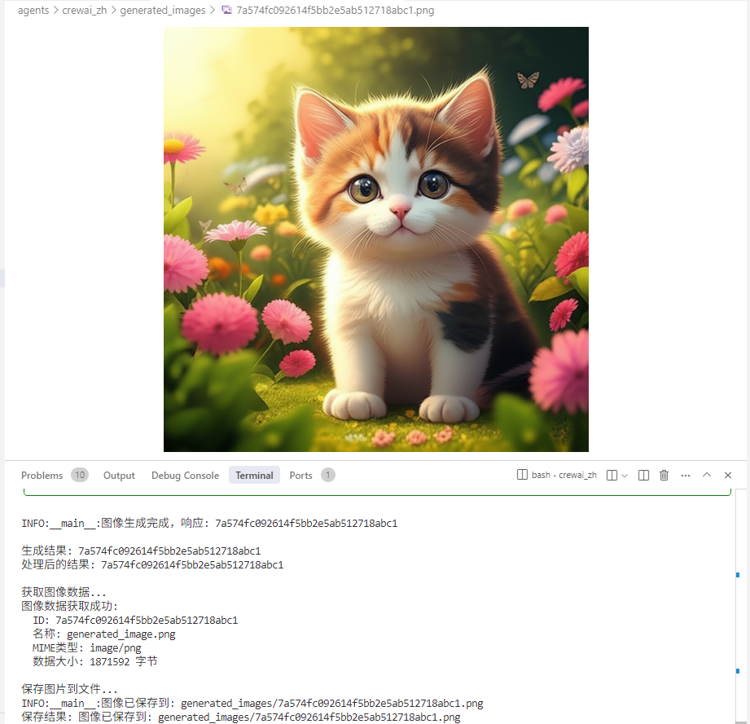

## CrewAI Agent 画师 - v2.0 A2A 版

好，有了这个单机版的智能画师 Agent 为基础，我们就可以进一步迭代，让这个 Agent 能够遵循 A2A 协议，从而连接至支持 A2A 协议的外部平台，让外部平台可以调用 CrewAI Agent的智能绘画功能。

### A2A 版智能画师整体架构

这个 A2A 版的智能画师整体架构可以分为存储层、功能层、AI 框架层、任务管理层和协议层，如图所示。

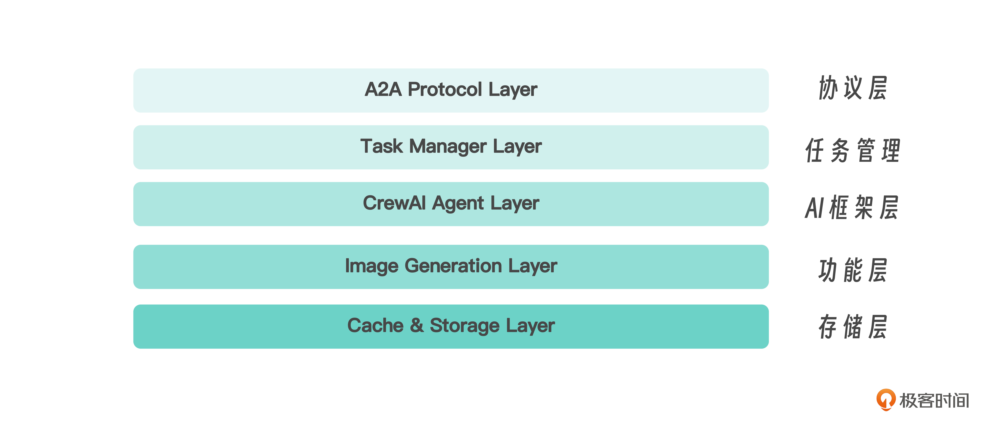

### Agent 的具体实现

架构中的功能层和 AI 框架层，都是 Agent 的具体实现部分，我们在上面的两个例子中已经多次看到，对 CrewAI 框架也已经比较熟悉了（完整代码位于 agent.py）。

下面给出核心代码段。首先是 Agent 定义：

```
self.image_creator_agent = Agent(
   role='Image Creation Expert',
   goal='Generate an image based on the user\'s text prompt...',
   backstory='You are a digital artist powered by AI...',
   tools=[generate_image_tool],
   llm=self.model,
)
```

然后定义 Task：

```
self.image_creation_task = Task(
   description='Receive a user prompt: {user_prompt}...',
   expected_output='The id of the generated image',
   agent=self.image_creator_agent,
)
```

有了 Agent 和 Task，就可以通过 Crew 把 Agent 组装起来：

```
self.image_crew = Crew(
   agents=[self.image_creator_agent],
   tasks=[self.image_creation_task],
   process=Process.sequential,
   verbose=False,
)
```

图像生成工具也和本机版一样，通过 generate_image_tool 函数定义，核心功能是支持文本到图像生成，以及基于参考图像的图像修改。其实现方式是集成 Google Gemini API，并可以自动缓存生成的图像。

```python
@tool('ImageGenerationTool')
def generate_image_tool(
   prompt: str,
   session_id: str,
   artifact_file_id: str = None
) -> str:
   # 1. 验证输入
   # 2. 获取参考图像（如果存在）
   # 3. 调用Gemini API
   # 4. 缓存结果
   # 5. 返回图像ID
```

### Agent 端文件缓存机制

图像文件的缓存方面，是复用了 common.utils.in_memory_cache 工具，这是一个线程安全的单例内存缓存机制。InMemoryCache 全局只有一个实例，任何地方调用都是同一个对象，通过 threading.Lock() 确保在并发环境中也不会创建出多个实例。只需导入一次，所有 Agent、工具、任务都能访问。

```python
from common.utils.in_memory_cache import InMemoryCache
class InMemoryCache:
   _instance: Optional['InMemoryCache'] = None
   _lock: threading.Lock = threading.Lock()
   def __new__(cls):
       # 确保单例实例
       if cls._instance is None:
           with cls._lock:
               if cls._instance is None:
                   cls._instance = super().__new__(cls)
       return cls._instance
```

存储结构如下：

```json
{
   "session_id": {
       "image_id_1": Imagedata(...),
       "image_id_2": Imagedata(...),
       ...
   }
}
```

此时图像保存在内存中，不写入磁盘 ，后续操作（如查看或下载）可以通过 session_id 和image_id 快速取出图像内容。比如用户如果说“基于上一张图再修改”，就可以查缓存。

### UI Server 端文件缓存机制

最后我们看一下 UI 端的文件缓存机制（位于 demo/ui/service/server/server.py）。这不属于Agent 设计的一部分，但也和图像内容的传输和缓存处理相关，因此在此一并介绍。

在 Agent 生成图像并存储到 InMemoryCache，返回图像 ID 后，会通过 A2A 协议传输，并由UI Server 接收 ID，通过 cache_content 转换为 URL 引用。

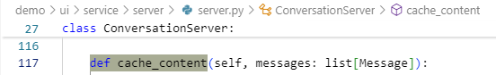

```python
# 处理图像文件
def cache_content(self, messages: list[Message]):
   for m in messages:
       for i, part in enumerate(m.parts):
           if part.type == 'file':
               # 生成缓存ID
               cache_id = str(uuid.uuid4())
               self._file_cache[cache_id] = part
               # 替换为URL引用
               new_parts.append(FilePart(
                   file=FileContent(
                       mimeType=part.file.mimeType,
                       uri=f'/message/file/{cache_id}'
                   )
               ))
```

cache_content 函数是一个智能的文件内容管理器，它将大文件数据从消息中分离出来，创建轻量级的 URL 引用，实现文件内容的去重和缓存以优化前端 UI 的性能表现。这种设计模式在前端应用中很常见，特别是在处理图片、文档等大文件时。

## Agents 之间是怎么交谈的

了解了 CrewAI Agent 的设计之后，我们着重来剖析一下，智能画师 Agent 是如何与 ClientHost Agent 进行交谈的。

### Agent 服务器与 UI 客户端的交互架构

下面的图表是 Agent 服务器与 UI 客户端的交互的整体架构概览。

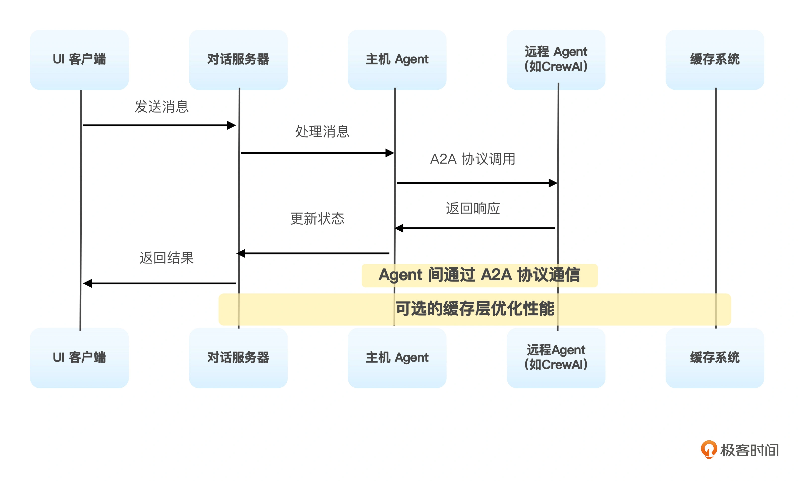

### 交互架构中的核心组件分析

在这个交互架构中，主要有 UI 客户端层、对话服务器层以及主机 Agent 层三个核心组件。

UI 客户端层的具体代码位于 demo/ui/，其中前端框架是使用 Mesop 构建的 Web 界面，并通过 AppState 管理全局应用状态，在服务层，程序 host_agent_service.py 提供与后端的通信接口。

对话服务器层的代码位于 (demo/ui/service/server/)，其中有三个关键元素。

- ConversationServer: 主要的后端服务，处理所有 UI 请求

- ADKHostManager: 管理主机 Agent 和远程 Agent 的交互

- ApplicationManager: 抽象接口，定义应用管理功能

最后来看主机 Agent 层，代码位于 (hosts/multiagent/)，其中 HostAgent 作为中间层，负责协调多个远程 Agent；RemoteAgentConnection 负责处理与远程 Agent 的 A2A 协议通信。

A2A 详细交互流程如下图所示。

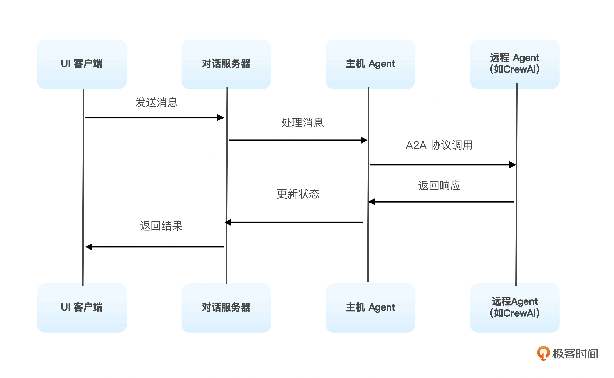

### Agent 的注册过程

协议的具体实现方面，Agent 的注册过程关键代码在 demo/ui/pages/agent_list.py 中，会接收类似于 “localhost:10001” 这样的注册信息。

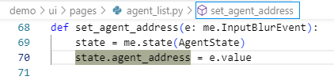

之后，通过 get_agent_card(state.agent_address) 来读取 Agent 的能力信息。

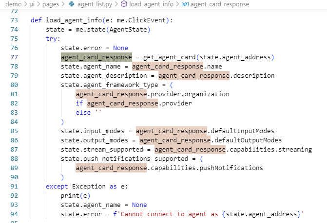

并通过 AddRemoteAgent(state.agent_address) 把 Agent 添加到当前系统。

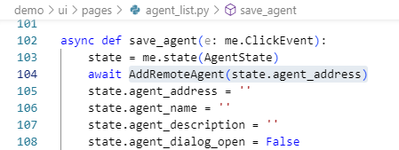

### 消息发送流程

Agent 之间消息发送的关键代码在 demo/ui/components/conversation.py 程序中，UI 用户通过服务层发送消息，并得到响应。

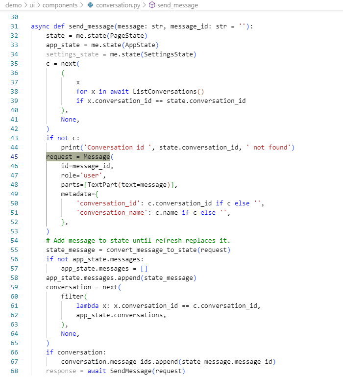

并通过服务层（demo/ui/service/server/server.py）对消息进行处理。

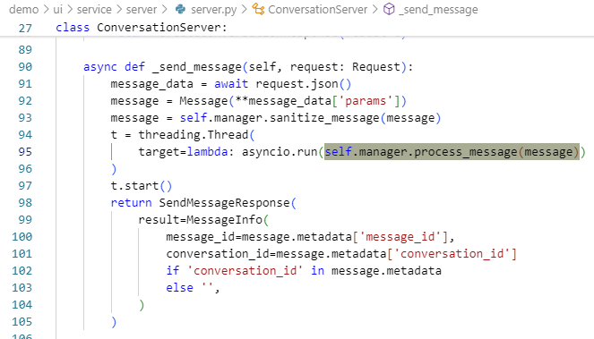

简化的伪代码如下：

```bash
# 1. UI用户发送消息
request = Message(
   role='user',
   parts=[TextPart(text=message)],
   metadata={'conversation_id': conversation_id}
)
# 2. 通过服务层发送
response = await SendMessage(request)
# 3. 服务器处理
async def _send_message(self, request: Request):
   message_data = await request.json()
   message = Message(**message_data['params'])
   # 启动异步处理线程
   t = threading.Thread(
       target=lambda: asyncio.run(self.manager.process_message(message))
   )
   t.start()
```

### A2A 协议是如何实现的

下面，我们在看看在消息处理过程中，A2A 协议是如何实现的。

### 远程 Agent 连接

下一个关键点是远程 Agent 连接，这部分的关键代码（hosts/multiagent/remote_agent_connection.py）如下。

```python
# 通过A2A协议调用远程Agent
class RemoteAgentConnection:
   async def send_task(self, task_request: SendTaskRequest):
       # 使用A2A协议发送任务
       response = await self.client.send_task(task_request)
       return response
```

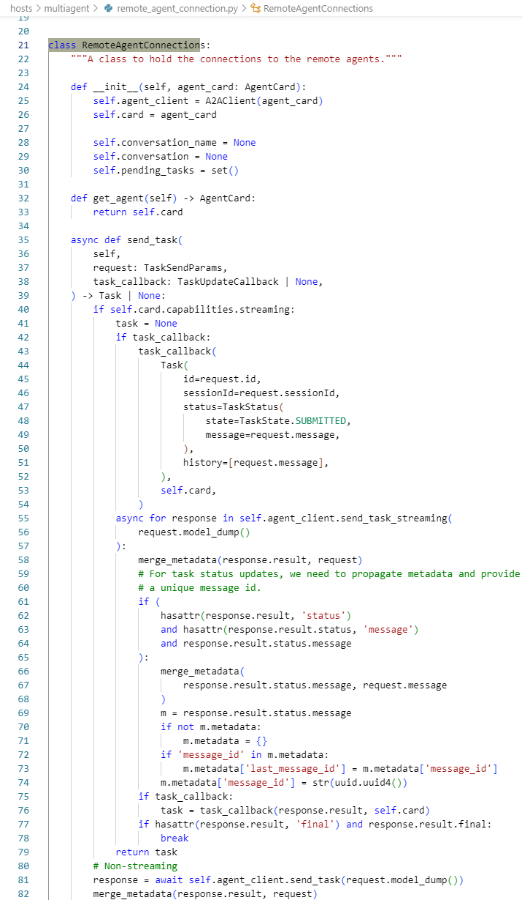

建立连接之后，就可以根据用户消息来发送和接收任务。

### 消息的处理和适配

我们需要把用户消息转换成 A2A 的标准格式。在demo/ui/service/server/adk_host_manager.py 中，通过 process_message 处理消息。

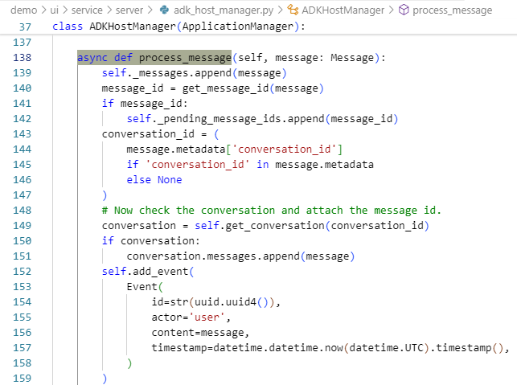

```
# 1. 主机Agent处理消息
async def process_message(self, message: Message):
   # 2. 通过ADK Runner执行
   async for event in self._host_runner.run_async(
       user_id=self.user_id,
       session_id=conversation_id,
       new_message=self.adk_content_from_message(message)
   ):
       # 3. 处理事件和任务
       self.add_event(event)
       if isinstance(event, TaskCallbackArg):
           self.emit_event(event, agent_card)
```

并在其中通过 adk_content_from_message 将 UI 消息转换为 A2A 格式（adk_content_to_message 则反之），进行二者之间的适配。

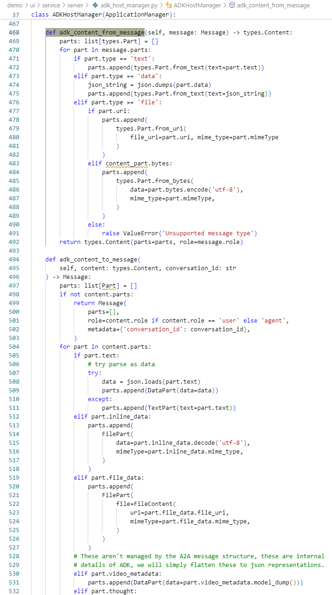

```python
# 将UI消息转换为A2A格式
def adk_content_from_message(self, message: Message) -> types.Content:
   parts = []
   for part in message.parts:
       if part.type == 'text':
           parts.append(types.Part.from_text(part.text))
       elif part.type == 'file':
           parts.append(types.Part.from_data(part.file.bytes))
   return types.Content(role='user', parts=parts)
```

### 状态管理和同步

在任务的处理过程中，需要进行实时状态的更新和事件同步。

实时状态更新

demo/ui/state/host_agent_service.py 中的异步函数负责实时更新应用状态。

```
# 定期更新应用状态
async def UpdateAppState(state: AppState, conversation_id: str):
   # 获取最新消息
   messages = await ListMessages(conversation_id)
   state.messages = [convert_message_to_state(x) for x in messages]
   # 获取任务状态
   tasks = await GetTasks()
   state.task_list = [SessionTask(...) for task in tasks]
   # 获取后台任务
   state.background_tasks = await GetProcessingMessages()
```

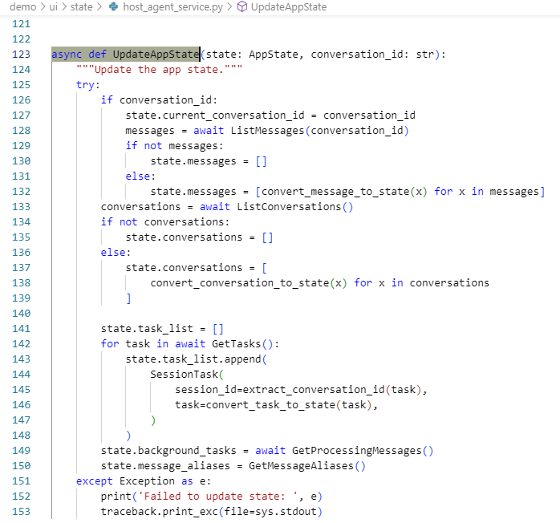

事件处理系统

在 demo/ui/state/host_agent_service.py 中进行事件处理。

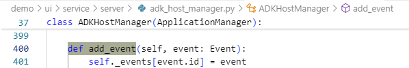

```python
# 事件处理
def add_event(self, event: Event):
   self._events[event.id] = event
def emit_event(self, task: TaskCallbackArg, agent_card: AgentCard):
   # 创建事件并通知UI
   event = Event(
       id=str(uuid.uuid4()),
       actor=agent_card.name,
       content=task,
       timestamp=datetime.now().timestamp()
   )
   self.add_event(event)
```

## 启动智能画师

下面来在 UI 客户端启用这个智能画师。参考这里的说明，先启动 UI 端，

```
huangjia:~/Documents/17_MCP/a2a-in-action$ cd demo/ui
huangjia:~/Documents/17_MCP/a2a-in-action/demo/ui$ uv run main.py
```

进入 agents/crewai_zh 目录，并参考 agents/crewai_zh/README.md 的说明，启动智能画师Agent 服务。

```
uv run .
```

之后，就可以把智能画师 Agent 添加到 UI 应用程序中。

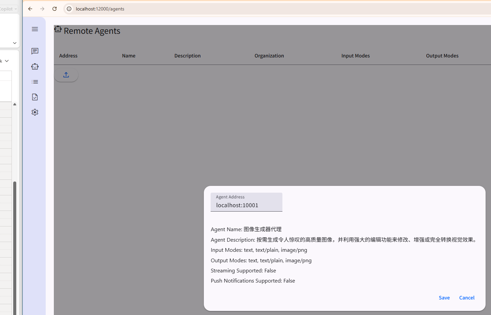

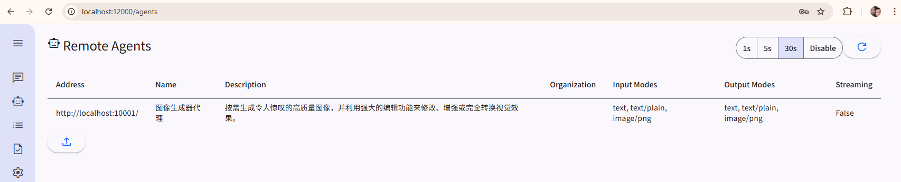

当我向 Host Agent 发出请求，Client 端的 Agent 就会意识到，需要调用 “智能画师” Agent啦。

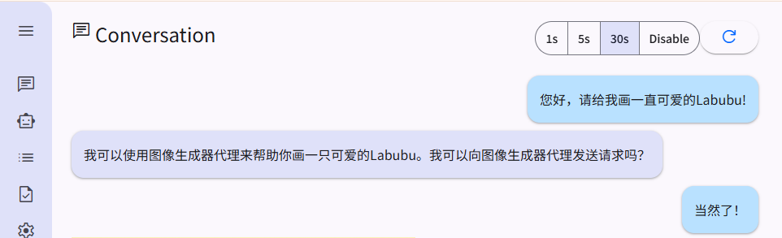

后台开始运作，Gemimi 模型有可能会搜索一下什么是 Labubu（如果它不知道的话），并且作画。

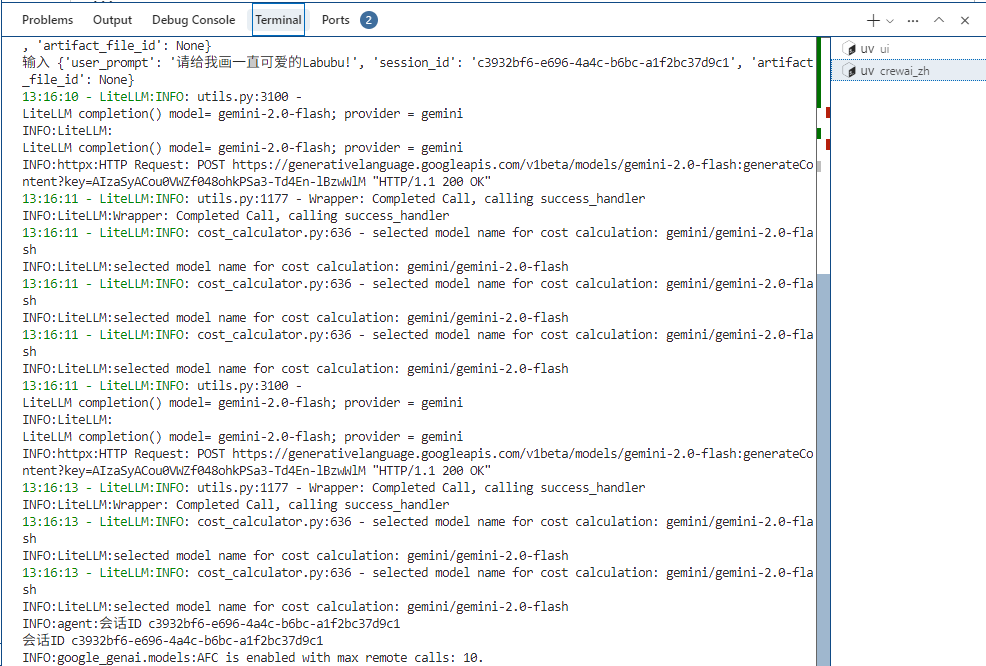

等了一会，一个可爱的 Labubu 就出现啦。

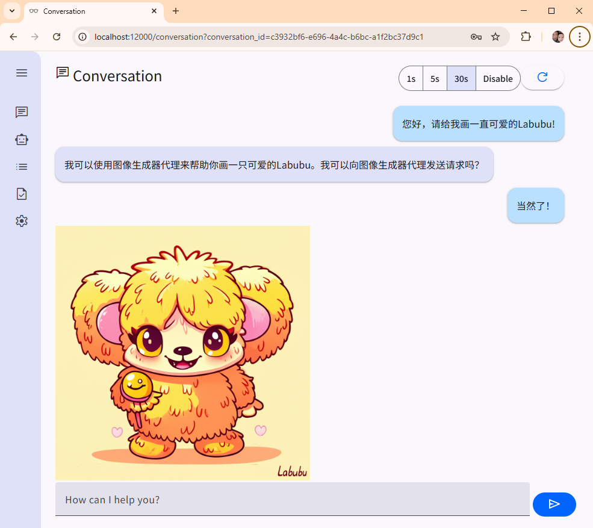

基于这张可爱的 Labubu，你可以随意通过自然语言来调整细节。

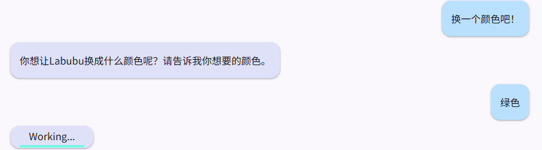

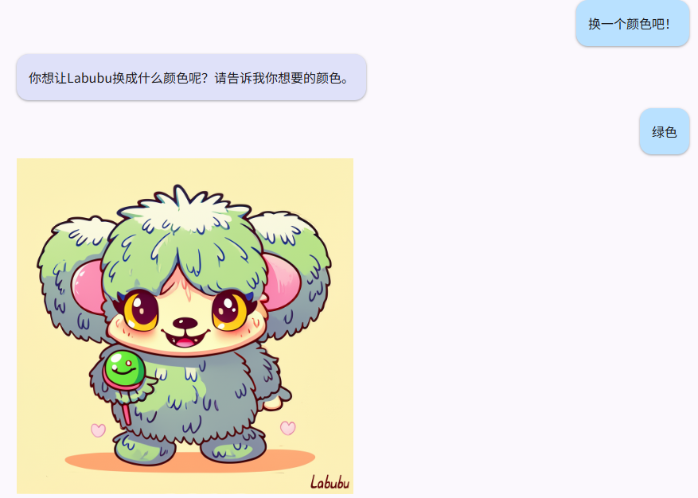

很棒吧？

## 总结一下

让我们用下面的表格来总结一下这节课里涉及的技术栈。

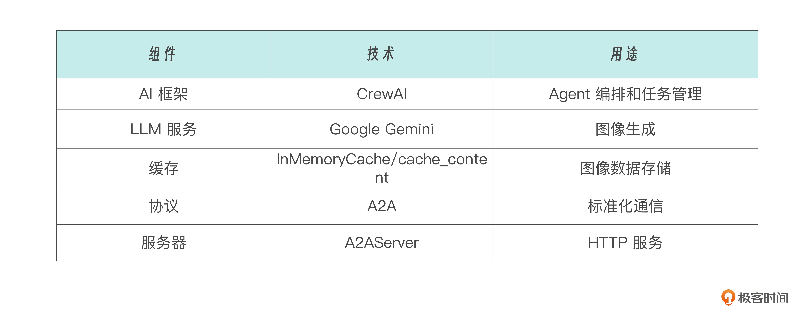

整个流程细节如下图所示。

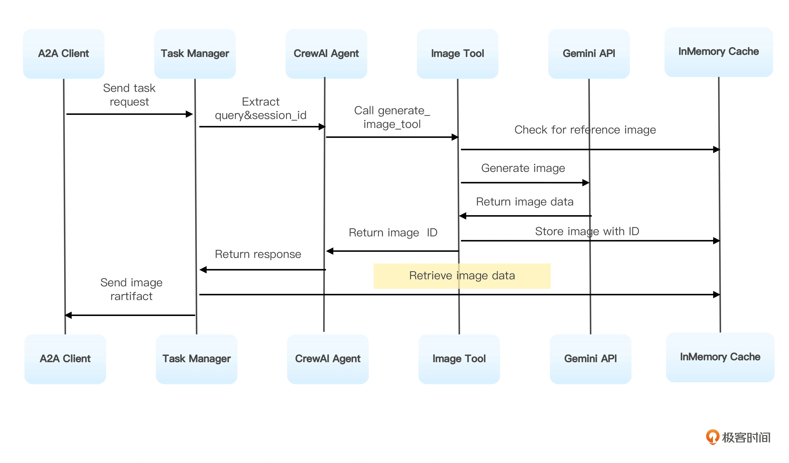

这种设计使得 CrewAI Agent 能够通过 A2A 协议与其他系统集成，也能够基于 CrewAI 框架轻松添加新功能。

此外，这个架构的其它特点包括：

1. 异步处理: 使用线程池处理长时间运行的任务。

2. 实时更新: 通过事件系统实现状态同步。

3. 多 Agent 支持: 可以同时管理多个远程 Agent。

4. 文件处理: 支持图像等文件的缓存和传输。

5. 协议抽象: 统一的 A2A 协议接口。

6. 状态持久化: 会话和任务状态的持久化。

从 UI 客户端的角度看，它可以通过 A2A 服务器来无缝地与各种 Agent（包括 CrewAI Agent）进行交互，同时也保持了良好的可扩展性和可维护性。

## 思考题

1. 在多个 Agent 并发调用图像生成工具的场景中，如何设计缓存机制以避免图像混淆或数据污染？

提示：

```
目前系统通过 session_id 隔离用户会话缓存。
思考是否还需要对 image_id 添加命名策略或过期策略。
```

- 考虑缓存的清理机制或最大容量限制。

2. 如果用户连续发送多轮提示（如“再给它加上一顶帽子”），如何设计智能画师 Agent 以理解上下文并自动复用上一轮生成的图像？

提示：

```
当前版本通过 artifact_file_id 实现图像修改。
```

- 思考如何自动识别“上一张图”。

- 是否需要结合上下文理解（CoT 或对话历史追踪）？

期待你在留言区分享你的思考或者疑问，如果这节课对你有启发，别忘了分享给身边更多朋友！
