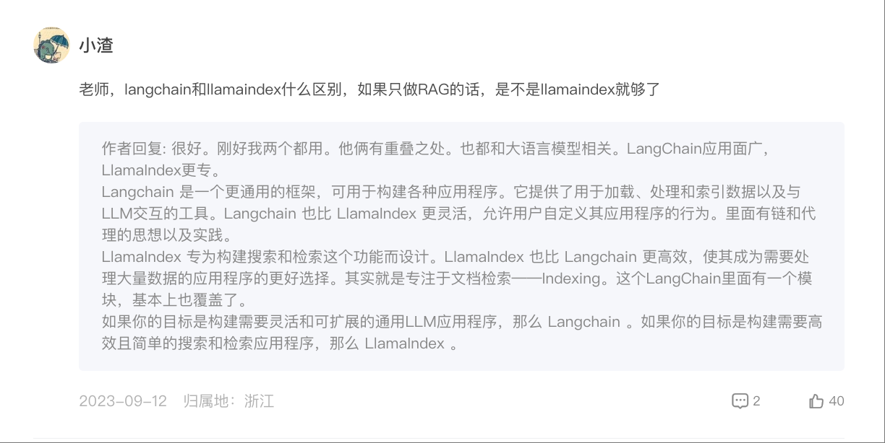
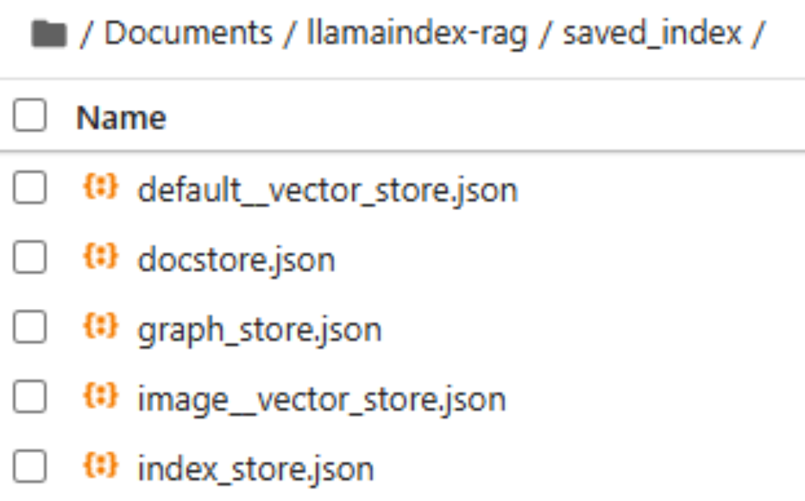
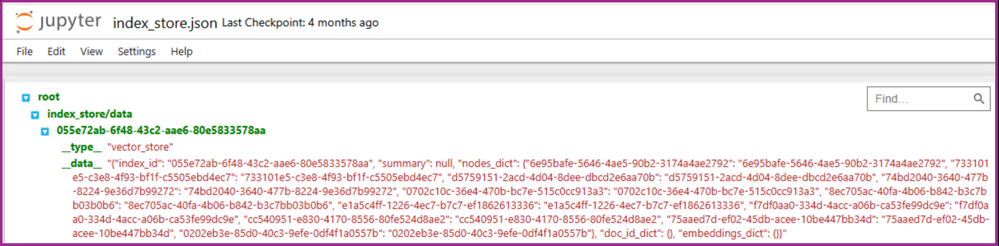
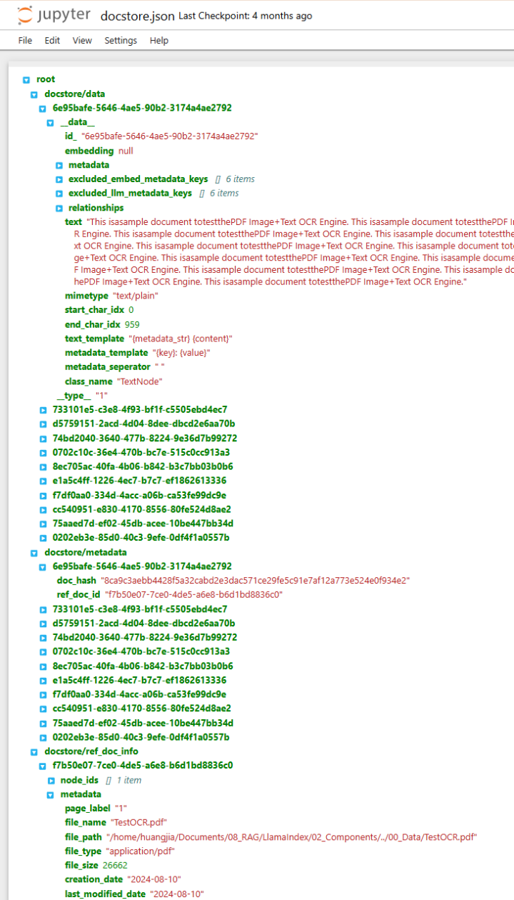
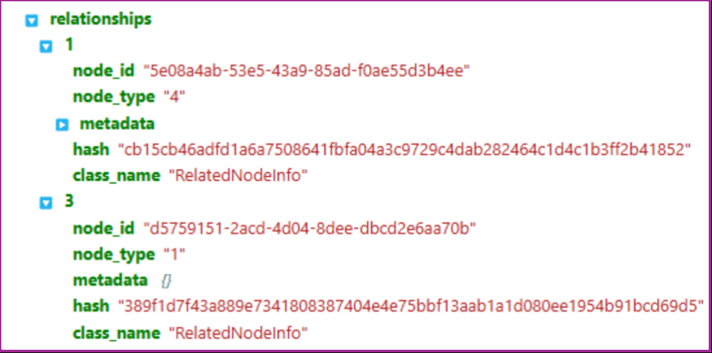
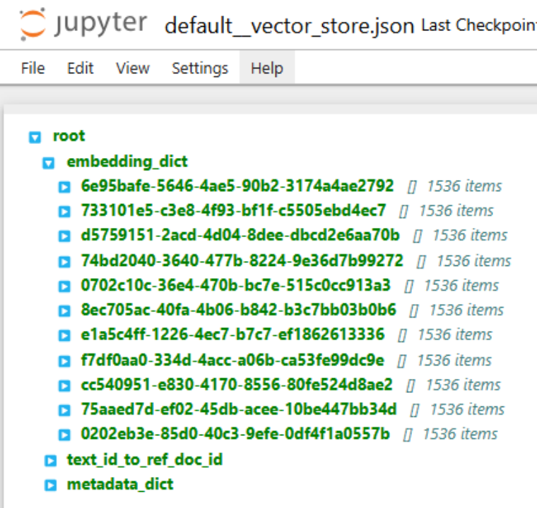
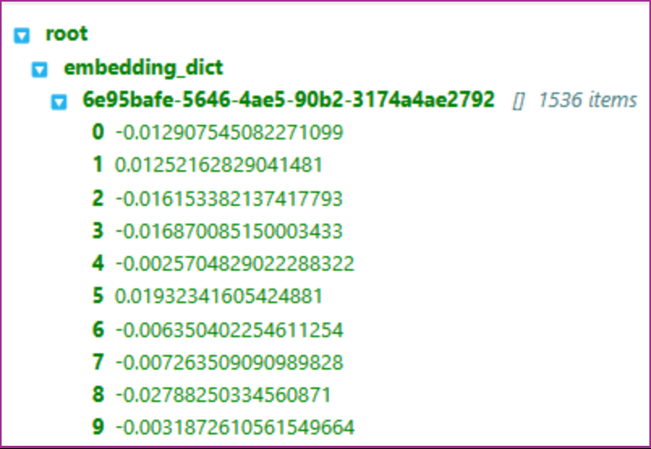
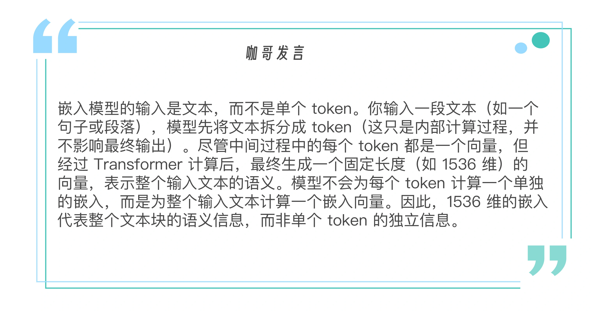
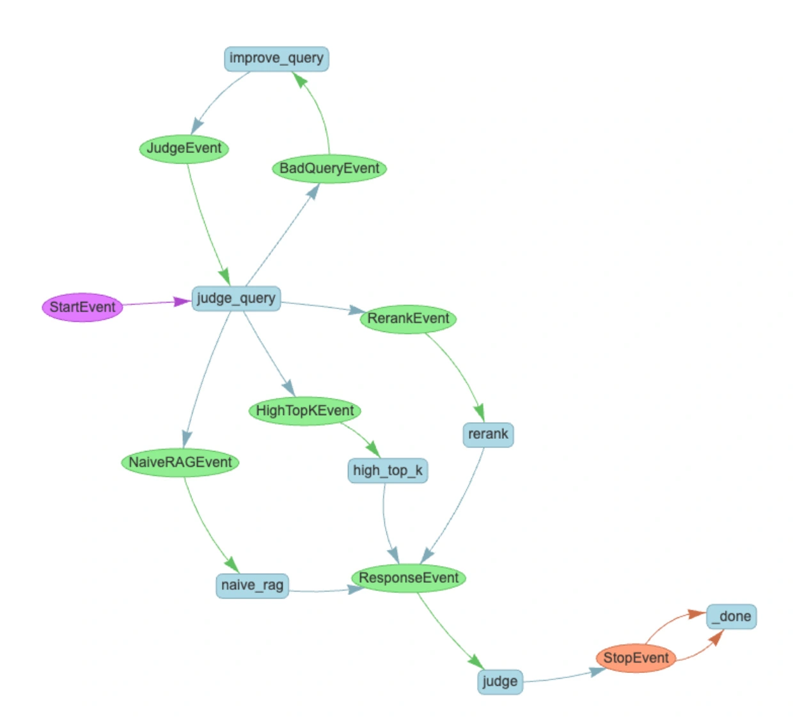

# 15 | 知识检索：通过LlamaIndex和A2A实现文件聊天Agent

你好，我是黄佳。

这节课中，我们将通过 LlamaIndex 构建文档解析和聊天 Agent，我们不仅会了解 LlamaIndex这个框架的基础知识，还将全面解析 A2A 协议如何实现文件上传处理、文档解析和向量化、上下文管理和会话持久化、引用和溯源机制等关键技术点。（代码位于 a2a-in-action 代码库的agents/ llama_index_file_chat_zh 目录）。

## LlamaIndex 极简入门

和 LangChain 一样，LlamaIndex 也是最早就开始流行的大模型应用开发框架之一，我也是它的早期用户。



- 《LangChain实战课》开篇词留言摘录

### LlamaIndex 中的向量索引

利用 LlamaIndex 来实现向量的存储机制非常清晰，我称之为简单向量索引。接下来我们结合一个小例子来理解。

首先，读取目录中的所有文档。然后，生成索引，即存储向量。

```
from llama_index.core import SimpleDirectoryReader
documents = SimpleDirectoryReader("../data").load_data()
len(documents)
from llama_index.core import VectorStoreIndex
index = VectorStoreIndex.from_documents(documents)
vars(index)
```

输出如下：

```
{'_use_async': False,
'_store_nodes_override': False,
'_embed_model': OpenAIEmbedding(model_name='text-embedding-ada-002', embed_batch
'_insert_batch_size': 2048,
'_storage_context': StorageContext(docstore=<llama_index.core.storage.docstore.si
index_store=<llama_index.core.storage.index_store.simple_index_store.SimpleIndexS
vector_stores={'default': SimpleVectorStore(stores_text=False, is_embedding_query
```

上述输出的“索引”信息非常丰富，包含了文档存储（SimpleDocumentStore）、索引存储（SimpleIndexStore）和向量存储（SimpleVectorStore）等数据管理和组织的核心组件，它们各自承担不同的职责，并在数据处理流程中相互配合。

- 文档存储：用于保存读取的文档，这些文档以节点（Node）对象表示。节点是对原始文档进行分块处理的结果，包含文本内容及其相关元数据，便于管理和检索原始文档内容及其分块后的节点。

- 索引存储：包含轻量级的索引元数据，即在构建索引时创建的附加状态信息。它用于存储索引结构和相关的元数据，以支持快速检索和查询操作。

- 向量存储：一种内存中的存储系统，以字典形式保存嵌入，将节点 ID 映射到相应的嵌入。这种结构有助于高效的检索和相似性搜索。

在这个向量索引中，llama_index 会自动将读入的文档内容切分成一个个的节点。LlamaIndex中的节点是向量存储的基本单元，节点之间的关联以及节点与嵌入之间的关系都被详细记录在索引中。

```
nodes = index.index_struct.nodes_dict
for node in nodes:
 print(node)
```
```

- 输出如下：

```
```plain
4a2aedf6-6c9e-4359-9125-786119be2b50
77f2ab3f-4ac0-433d-9b5a-f3fa442587a5
07388425-9662-4690-b0b4-6ede6943561d
```

当然，也可以手动拆分节点。

```
from llama_index.core.node_parser import SentenceSplitter
text_splitter = SentenceSplitter(chunk_size=512, chunk_overlap=10)
nodes = text_splitter.get_nodes_from_documents(documents)
index = VectorStoreIndex(nodes) # 从nodes中生成索引
nodes = index.index_struct.nodes_dict
for node in nodes:
 print(node)
```

此时，节点数量更多，因此我们可以拆分得更细。接下来，我们通过 storage_context（存储上下文）将索引保存到磁盘并查看索引文件的结构。

```
index.storage_context.persist(persist_dir="saved_index") # 保存索引
```

在生成的 saved_index 目录下，可以看到下图所示的内容。



- LlamaIndex 生成的 saved_index 目录

该目录包含多个 JSON 文件，用于存储索引和相关数据。我们挨个看看这五个文件的内容。

- default_vector_store.json：保存默认的向量存储配置或数据。用于存储嵌入后的默认向量数据，例如用户上传的文本、文档或其他资源的向量化表示。它被系统用作检索时的主要向量索引库。

- docstore.json：保存文档存储的元数据或实际内容，存储文档的详细信息，例如文档的原始内容、标题和路径等。在检索过程中，向量索引返回的结果可以通过 docstore 获取具体的文档内容。

- graph_store.json：保存知识图谱或关系图的数据。如果系统支持知识图谱增强检索，这个文件将记录文档或向量之间的关系。需要基于节点关系进行推理时会用到。

- image_vector_store.json：保存与图像相关的向量数据。如果系统支持多模态检索（如文本和图像混合检索），这个文件可能保存了图像嵌入（向量化表示）的数据。通过这个文件，系统可以进行基于图像内容的相似性搜索。

- index_store.json：保存索引本身的结构或元信息。存储所有已创建索引的元数据，例如每个索引对应的文档范围、嵌入模型、参数配置等。用于管理整个索引系统，决定如何调度不同的索引。

index_store.json 的内容如图所示。



- index_store.json 的内容

docstore.json 的内容如图所示。



- docstore.json 的内容

docstore.json 中的数据结构信息特别丰富。例如，展开 relationships 可以看到存储节点之间的关系，如图所示。



- relationships 中存储节点之间的关系

其中，1、3 是 relationships 的类型，用于表示不同节点之间的关联关系，例如，当前节点的文档节点、前节点和后节点等，都通过 node_id 进行连接。而 node_type 用于区分不同类型的节点，后面的 4 表示文档节点，1 代表普通向量节点（文本块）。

default__vector_store.json 的内容如图所示。该文件存储了一个个文本块嵌入向量。



- default__vector_store.json 的内容

其中，embedding_dic 就是每个文本块的嵌入向量，均为 1536 维的 OpenAI 嵌入向量，如图所示。



- 1536 维的 OpenAI 嵌入向量

这些数字是嵌入模型生成的信息精髓，也就是密集嵌入。向量存储或索引，就是把这些数字高效组织起来的方式。

这里你可能会有疑问。embedding_dict 中的内容对应的是一个个的文本块，还是一个个的token？实际上，embedding_dict 中的内容是文本块（也就是 LlamaIndex 中的节点）。其中Key（如 6e95bafe-5646-4ae5-90b2-3174a4ae2792）是文本块的唯一 ID。每个文本块（可能是一个句子、段落，甚至更大的文本片段）都会被转换为一个 1536 维的向量，而不是每个token 生成一个向量。



这里之所以详细展示了 LlamaIndex 的索引构建和存储细节，是为了让你了解向量存储，即小型向量数据库的信息组织过程。

### LlamaIndex Agent / Workflow

前面我们已经完整梳理了如何使用 LlamaIndex 构建一个文档向量索引，并对其底层结构（包括节点划分、向量存储与元数据管理）进行了详细剖析。在这个基础上，我们接下来进一步演化系统架构，引入 LlamaIndex 的高级功能 —— Workflow 和 Agent 系统，实现具备文档加载、内容理解、上下文记忆和多轮问答能力的文件聊天 Agent。

传统的 LlamaIndex 使用 .query_engine() 方式可以轻松实现问答接口，但它通常是“一问一答”的模型调用，不具备上下文感知能力、文件上传能力、事件响应机制，也难以集成到实际平台系统中。而通过 llama_index.core.workflow 提供的 Workflow 流水线机制，我们可以将多个步骤（如文件上传、向量构建、消息处理、结果返回）封装为事件驱动的状态流程，更贴近一个“运行在系统里的 Agent”。



- LlamaIndex构建的Workflow示例 图源：https://docs.llamaindex.ai/en/stable/understanding/workflows/

## Llama Agent 核心设计

在后面的代码中，整个 Llama Agent 的运行逻辑由 VectorFileChatWorkflow 类控制。以下是几个核心设计点。（完整代码参考 agents/llama_index_file_chat_zh/01_LlamaIndex_Simple.py）

### 1. step 装饰器：Agent 执行单元

```python
@step
def route(self, ev: InputEvent) -> LoadDocumentEvent | ChatEvent:
```

LlamaIndex 的 @step 装饰器标志着工作流中的一个执行步骤。这个 route() 方法会根据输入事件判断当前任务是上传文档，还是发起聊天，属于“调度判断节点”，是整个工作流的起点（StartEvent）。

### 2. load_document：支持 base64 上传与文件路径读取

```
if ev.file_path:
   with open(ev.file_path, 'r', encoding='utf-8') as f:
       content = f.read()
elif ev.base64_content:
   content = base64.b64decode(ev.base64_content).decode('utf-8')
```

文档上传成功后会构建一个 Document 对象，添加到文档列表中。

### 3. _build_index：嵌入与索引生成逻辑

```
splitter = SentenceSplitter(chunk_size=512, chunk_overlap=50)
self.index = VectorStoreIndex.from_documents(
   self.documents,
   transformations=[splitter]
)
```

通过 SentenceSplitter 手动控制节点划分方式，实现灵活的文本分块（对大文档尤为重要）。之后调用 from_documents() 构建向量索引。这也是整个文档转语义数据库的核心处理逻辑。

### 4. chat：向量检索 + 多轮记忆

```
query_engine = self.index.as_query_engine(
   similarity_top_k=3,
   response_mode="compact"
)
response = query_engine.query(ev.msg)
```

这里调用了索引的 .as_query_engine() 方法，将索引“转型”为一个可用于问答的查询引擎。在构造查询引擎时，可以配置 similarity_top_k 控制召回数量，response_mode 控制结果组织方式（例如是否压缩内容、是否引用原文）。此外，聊天历史保存在 self.chat_history 中，构成了 Agent 的“上下文记忆”能力。

这个基于 Workflow 的 Llama Agent 可以非常容易地嵌入到 A2A 架构中，例如每次上传文件，

```
触发 load_document 流程；  用户提问时，触发 chat 节点；返回的
ChatResponseEvent 可以通过 SSE 或 Webhook 推送到前端；Agent 本身可以被
```

TaskManager 控制，实现状态转移与异步任务调度。

## LlamaIndex Agent 的 A2A 实现

在完成了基于 LlamaIndex 的向量检索系统之后，我们进一步将其封装为可部署、可调度的智能体（Agent），并接入 A2A（Agent-to-Agent）协议架构，实现文件上传解析、上下文问答、多轮记忆、引用追溯与流式响应的一体化工作流程。这部分展示的是一个具备完整生命周期管理能力的 ParseAndChat Agent，通过 LlamaIndex 的 Workflow 模式构建，辅以 A2A 框架完成调度与交互。

### Agent 架构：Workflow 驱动的任务流程

整个 Agent 以 Workflow 类为基础进行构建，使用 LlamaIndex 的 step 装饰器将各个处理阶段模块化，包括：

- 文档上传判断

- 文件解析（LlamaParse）

- 文档转 Markdown

- 文档行号标注

- 向量生成

- 系统提示注入

- 对话执行与引用抽取

```python
class ParseAndChat(Workflow):
   def __init__(
       self,
       timeout: float | None = None,
       verbose: bool = False,
       **workflow_kwargs: Any,
   ):
       super().__init__(timeout=timeout, verbose=verbose, **workflow_kwargs)
       self._sllm = GoogleGenAI(
           model='gemini-2.0-flash', api_key=os.getenv('GOOGLE_API_KEY')
       ).as_structured_llm(ChatResponse)
       self._parser = LlamaParse(api_key=os.getenv('LLAMA_CLOUD_API_KEY'))
       self._system_prompt_template = """\
```

- 你是一个有用的助手，可以回答关于文档的问题，提供引用，并进行对话。

- 这是带有行号的文档：

```xml
<document_text>
{document_text}
</document_text>
```

- 当引用文档内容时：

```
1. 你的内联引用应该从[1]开始，每个额外的内联引用递增1
2. 每个引用编号应该对应文档中的特定行
3. 如果一个内联引用覆盖多个连续行，请尽量优先使用单个内联引用来覆盖所需的行号
4. 如果一个引用需要覆盖多个不连续的行，可以使用[2, 3, 4]这样的引用格式
5. 例如，如果响应包含"The transformer architecture... [1]."和"Attention mechanisms..
6. 始终从[1]开始你的引用，每个额外的内联引用递增1。不要使用行号作为内联引用编号，否则我会失去工作
"""
```

这里引入了结构化 LLM（Structured LLM），输出必须满足 ChatResponse 格式（包括响应与引用列表） ，还引入了系统提示模板，用来定义引用规范，要求所有引用为编号 + 文档行的组合。

### 事件驱动：输入输出类型显式声明

该 Agent 使用事件机制实现状态控制。所有数据流转均通过事件（Event）传递，如：

- InputEvent：用户输入 / 文件上传

- ParseEven：触发文档解析

- ChatEvent：提交用户查询

- ChatResponseEvent：包含引用的结构化响应

```python
## 工作流事件
class LogEvent(Event):
   msg: str
class InputEvent(StartEvent):
   msg: str
   attachment: str | None = None
   file_name: str | None = None
class ParseEvent(Event):
   attachment: str
   file_name: str
   msg: str
class ChatEvent(Event):
   msg: str
class ChatResponseEvent(StopEvent):
   response: str
   citations: dict[int, list[str]]
```

这使得 Agent 在框架内部处理流程时具备类型安全和流程可控性，便于扩展或接入流式处理。

### 文档解析与引用机制

文档解析由 LlamaParse 完成，输出 Markdown 文档内容，并标注每一行的…，为后续精确引用提供支撑。

```
@step
async def parse(self, ctx: Context, ev: ParseEvent) -> ChatEvent:
   ctx.write_event_to_stream(LogEvent(msg='正在解析文档...'))
   results = await self._parser.aparse(
       base64.b64decode(ev.attachment),
       extra_info={'file_name': ev.file_name},
   )
   ctx.write_event_to_stream(LogEvent(msg='文档解析成功。'))
   documents = await results.aget_markdown_documents(split_by_page=False)
   # 由于我们只有一个文档且不按页分割，我们可以直接使用第一个
   document = documents[0]
   # 将文档分割成行并添加行号
   # 这将用于引用
   document_text = ''
   for idx, line in enumerate(document.text.split('\n')):
       document_text += f"<line idx='{idx}'>{line}</line>\n"
   await ctx.set('document_text', document_text)
   return ChatEvent(msg=ev.msg)
```

此外，系统提示模板中定义了严格的引用规则：

- 所有引用编号从 [1] 开始

- 每条引用编号对应具体行号列表，如 citations = [[10, 11], [45]]

- 非连续行支持 [2, 4, 6] 格式

这使得 Agent 具备精准的内容可追溯能力，输出不仅可信，还可以标明证据来源。

```python
class Citation(BaseModel):
   """对文档中特定行的引用。"""
   citation_number: int = Field(
       description='响应文本中使用的特定内联引用编号。'
   )
   line_numbers: list[int] = Field(
       description='被引用的文档中的行号。'
   )
class ChatResponse(BaseModel):
   """对用户的响应，包含内联引用（如果有的话）。"""
   response: str = Field(
       description='对用户的响应，包括内联引用（如果有的话）。'
   )
   citations: list[Citation] = Field(
       default=list,
       description='引用列表，其中每个引用都是一个对象，用于将引用编号映射到被引用的文档中的
   )
```

此外，LlamaIndex Agent 采用分块处理策略处理大文件：

```
documents = await results.aget_markdown_documents(split_by_page=False)
# 由于我们只有一个文档且不按页分割，我们可以直接使用第一个
document = documents[0]
# 将文档分割成行并添加行号
# 这将用于引用
document_text = ''
for idx, line in enumerate(document.text.split('\n')):
   document_text += f"<line idx='{idx}'>{line}</line>\n"
```

其它优化策略还包括后面这几项。

- 按行分割：将文档按行分割，便于精确引用。

- 索引标记：为每行添加唯一索引。

- 内存管理，避免一次性加载过大的文档。

在上下文窗口管理方面，通过动态注入根据文档内容注入系统提示，通过上下文控制输入到LLM 的上下文大小，同时支持有文档和无文档的对话模式。

```
document_text = await ctx.get('document_text', default='')
if document_text:
   ctx.write_event_to_stream(
       LogEvent(msg='正在插入系统提示...')
   )
   input_messages = [
       ChatMessage(
           role='system',
           content=self._system_prompt_template.format(
               document_text=document_text
           ),
       ),
       *current_messages,
   ]
else:
   input_messages = current_messages
```

### 多轮对话与上下文持久化

LlamaIndex Agent 实现了完整的会话状态管理，每个会话独立的状态存储，通过持久化支持会话状态的保存和恢复，并按需加载和清理状态。

```python
class LlamaIndexTaskManager(InMemoryTaskManager):
   def __init__(
       self,
       agent: ParseAndChat,
       notification_sender_auth: PushNotificationSenderAuth,
   ):
       super().__init__()
       self.agent = agent
       self.notification_sender_auth = notification_sender_auth
       # 按会话ID存储上下文状态
       # 理想情况下，您应该使用数据库或其他kv存储来存储上下文状态
       self.ctx_states: dict[str, dict[str, Any]] = {}
```

上下文的恢复机制如下：

- 状态检查：检查是否存在保存的上下文。

- 上下文重建：从字典重建完整的上下文对象。

- 无缝切换：新会话和恢复会话的无缝处理。

```
async def _run_streaming_agent(self, request: SendTaskStreamingRequest):
   task_send_params: TaskSendParams = request.params
   task_id = task_send_params.id
   session_id = task_send_params.sessionId
   input_event = self._get_input_event(task_send_params)
   try:
       ctx = None
       handler = None
       # 检查我们是否有此会话的保存上下文状态
       print(f'任务数量: {len(self.tasks)}', flush=True)
       print(f'上下文状态数量: {len(self.ctx_states)}', flush=True)
       saved_ctx_state = self.ctx_states.get(session_id, None)
       if saved_ctx_state is not None:
           # 使用现有上下文恢复
           logger.info(f'使用保存的上下文恢复会话 {session_id}')
           ctx = Context.from_dict(self.agent, saved_ctx_state)
           handler = self.agent.run(
               start_event=input_event,
               ctx=ctx,
           )
       else:
           # 新会话！
           logger.info(f'启动新会话 {session_id}')
           handler = self.agent.run(
               start_event=input_event,
           )
```

Agent 的核心对话流程通过 chat 步骤执行，结合上下文对象 ctx 进行持久化。通过 append 函数构建历史消息列表：

```
current_messages = await ctx.get('messages', default=[])
current_messages.append(ChatMessage(role='user', content=event.msg))
await ctx.set('messages', current_messages)
```

Agent 会在有文档的情况下自动插入系统提示，并构造如下输入：

```
[System Prompt with <document_text>] + [user messages]
```

上下文支持跨会话恢复（session_id 为键），通过 Context.from_dict() 进行还原：

```
ctx = Context.from_dict(self.agent, saved_ctx_state)
```

这实现了完整的会话记忆管理与上下文延续性。

### 流式响应与异常处理

为了满足前端流式体验，Agent 的运行采用异步迭代处理，并实时通过 SSE 推送状态。事件流中如遇 LogEvent，将被转换为中间状态返回：

```
# 流式传输更新
async for event in handler.stream_events():
   if isinstance(event, LogEvent):
       # 将日志事件作为中间消息发送
       content = event.msg
       parts = [{'type': 'text', 'text': content}]
       task_status = TaskStatus(
           state=TaskState.WORKING,
           message=Message(role='agent', parts=parts),
       )
       latest_task = await self.update_store(
           task_id, task_status, None
       )
       await self.send_task_notification(latest_task)
       # 发送状态更新事件
       task_update_event = TaskStatusUpdateEvent(
           id=task_id, status=task_status, final=False
       )
       await self.enqueue_events_for_sse(
           task_id, task_update_event
       )
```

流式处理能够在处理过程中提供实时反馈，持续更新任务的执行状态；同时可根据不同类型的事件进行分类处理，实现更精细的响应策略。此外，还能将任务的状态实时同步到客户端，确保前后端信息一致、响应及时。

所有处理过程中的错误被捕捉并回传给前端，若发生致命错误，会自动清除会话上下文，确保资源释放。

```
except Exception as e:
   await self.enqueue_events_for_sse(
       task_id,
       InternalError(message=f'流式响应时发生错误: {e}')
   )
```

## 总结一下

今天我们学习了如何使用 LlamaIndex 构建具备文件上传、向量索引、多轮对话、引用溯源与流式反馈能力的智能 Agent。我们从向量索引的底层结构入手，讲解文档解析、节点拆分、嵌入存储与索引构建等关键流程，并进一步演化为 Workflow 架构下的 ParseAndChat Agent。

这节课核心思路在于将传统“查询引擎”演化为事件驱动的 Agent Workflow，实现从文档处理到用户问答的完整闭环。特别要注意的是，通过 @step 装饰器、Context 持久化机制、系统提示动态注入与结构化输出设计，Agent 才拥有了类人记忆、响应逻辑与可解释性。

我一直很看好 RAG 这种信息检索新范式对未来的 LLM 开发生态的影响，这种设计正是“Agent操作系统”（AgentOS）理念的一个缩影：将 LLM 与感知（上传）、记忆（上下文 / 向量库）、计划（多步流程）、行动（响应调用）紧密集成，迈入更复杂任务协同的新时代。未来的 LLMAgent 不只是一个问答工具，而是一个可托管、可编排、可调用的服务单元，可以嵌入到任何系统中自主运行。

## 思考题

1. 在这个 LlamaIndex Agent 实现中，为什么需要将文档内容按行编号并标注…？还可以设计哪些更粗粒度的引用机制，怎样实现？

2. 为什么 LlamaIndex Agent 要将用户输入和系统提示动态组合为完整上下文，而不是写死在系统 prompt 中？同时，为什么要引入上下文 Context 对象进行状态管理，而不是仅依赖全局变量或缓存机制？

3. LlamaIndex 的向量索引 + A2A 的事件机制是否可迁移到跨模态场景？例如语音问答、图文检索系统？

期待你在留言区分享你的思考或者疑问，如果这节课对你有启发，别忘了分享给身边更多朋友！
