# 16 | 双剑合璧：MCP和A2A联合构建智能Agents系统

你好，我是黄佳。

到目前为止，我们已经演练了很多 MCP 和 A2A 的实战示例。在这节课中，我将带你通过实际操作，使用开源的 python-a2a 库构建一个具备 A2A 通信与 MCP 工具调用能力的智能Agent 系统。我们会从零开始，创建工具服务、实现代理通信，并集成大模型，使 Agent 具备真实的感知与行动能力。

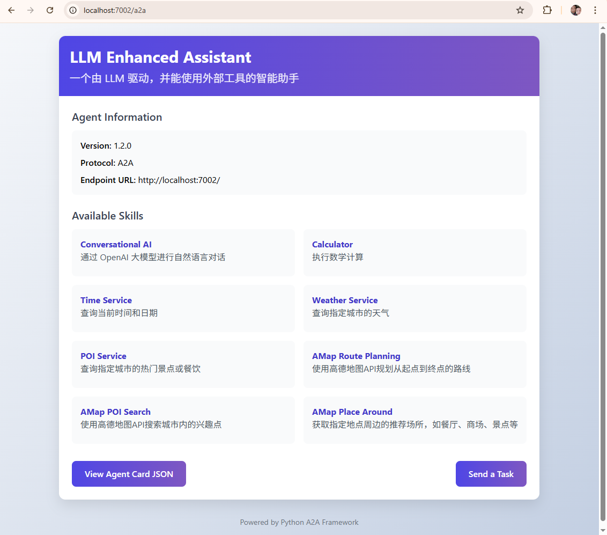

这节课将构建一个完整的 A2A + MCP 智能 Agent 系统

## 3 分钟复习一下 A2A 与 MCP 协议

在未来的多智能体系统中，A2A 和 MCP 将成为两个关键基础协议。

A2A 是 Google 于 2025 年 4 月发布的开放协议，专为 AI 代理之间的协作与互操作设计，特别适用于大规模、多智能体系统。其目标是建立统一通信格式，使不同 AI 代理能够互相发现、理解能力，并实现任务协作、状态共享。

A2A 的关键能力包括：

- 安全协作：企业级认证和权限控制。

- 状态管理：支持任务跟踪、实时通知。

- 能力发现与协商：自动对接功能，提升交互质量。

- 多模态通信：支持文本、音频、视频等信息交换。

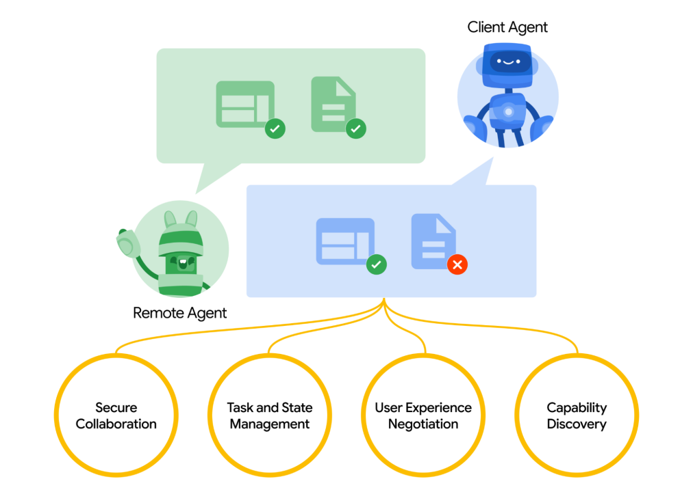

MCP 由 Anthropic 于 2024 年 11 月推出，致力于标准化 AI 模型对外部工具与数据的调用，推动从“会聊天”向“能执行”进化。目标是统一函数调用接口，连接 API、数据库、文件系统等上下文资源，降低 AI 模型与外部系统的集成成本。

A2A 和 MCP 聚焦点不同，却高度互补：

- A2A 关注代理间如何沟通、协作、分工，定义“谁和谁说话，为了什么目标”。

- MCP 关注代理如何调用外部工具，定义“有什么工具、怎么用、返回什么结果”

二者结合，就构成了智能体系统的通信中枢 + 行动引擎。

以旅行规划为例，当用户向“旅行总代理”提出请求（A2A 发起），总代理将任务拆分为子任务并通过 A2A 分配给多个代理：

- 机票代理 → 通过 MCP 调用航班比价工具

- 酒店代理 → 通过 MCP 查询酒店数据库

- 景点代理 → 调用天气工具和用户偏好服务

子代理完成任务后通过 A2A 汇总结果，总代理整合后返回给用户。

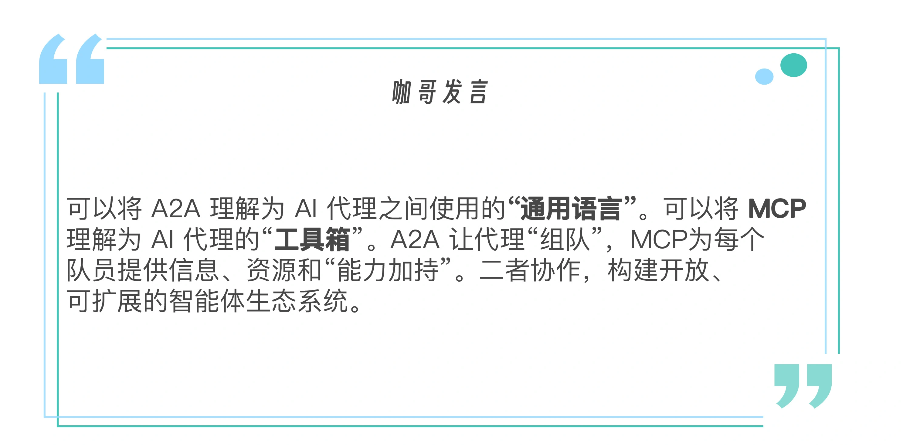

## 第一部分：构建 MCP 工具服务

我们的第一个任务是创建一个 MCP 服务，它将提供一些基础的工具供后续的 A2A 代理调用。

```
首先，进入代码示例库的 A2A-MCP 目录，并在你的终端中运行 uv pip install. 来自动
```

安装环境，也可以通过 requirements.txt 来手动创建环境。此处的关键包是 python-a2a 库。这是一个开源的 A2A 和 MCP 协议的社区实现，适合于协议的学习。

此外，在部署 MCP 工具时涉及第三方 API Key 的创建，需要在这个链接中申请天气 API。

接下来我们创建一个简化版的工具脚本，创建 MCP 工具代码，命名为 mcp_server.py。

```python
# mcp_server.py
from   python_a2a.mcp import FastMCP, text_response, create_fastapi_app
import   uvicorn
from   datetime import datetime
import   time # 用于 get_current_time
import   requests
# 1. 创建 FastMCP 服务实例
# FastMCP   是一个轻量级的 MCP 服务器实现
utility_mcp   = FastMCP(
  name="My Utility Tools",
  description="一些常用的实用MCP工具集合",
  version="1.0.0"
)
# 2. 定义第一个工具：计算器
@utility_mcp.tool(
  name="calculator", # 工具的唯一名称
  description="执行一个简单的数学表达式字符串，例如   '5 * 3 + 2'"
  # 工具的描述，LLM   可以理解这个描述来决定何时使用它
)
def   calculate(expression: str): # 类型提示很重要，MCP 会据此生成工具的 schema
  """
  安全地评估一个数学表达式字符串。
  Args:
      expression: 要评估的数学表达式，例如   "10 + 5*2"
  Returns:
      包含计算结果的文本响应。
  """
  try:
      result = eval(expression,   {"__builtins__": {}}, {"abs": abs, "max": max,
      return text_response(f"计算结果: {expression} = {result}")
  except Exception as e:
      return text_response(f"计算错误 '{expression}': {str(e)}")
# 3. 定义第二个工具：获取当前时间
@utility_mcp.tool(
  name="get_current_time",
  description="获取当前本地的日期和时间信息"
)
def   get_current_time_tool(): # 注意：工具函数名可以和工具名不同
  """
  获取当前的日期和时间。
  Returns:
      包含当前日期和时间的文本响应。
  """
  now = datetime.now()
    response = (
        f"当前日期:   {now.strftime('%Y-%m-%d')}\\n"
        f"当前时间:   {now.strftime('%H:%M:%S')}\\n"
        f"星期几:   {now.strftime('%A')}"
    )
    return text_response(response)
OPENWEATHER_API_KEY="xxxx"
@utility_mcp.tool(
    name="get_current_weather",
    description="获取当前的天气信息，需要提供城市名称"
)
def   get_current_weather_tool(city: str):
    try:
        # 请求 OpenWeatherMap   API
        url =   f"http://api.openweathermap.org/data/2.5/weather"
        params = {
            "q": city,
            "appid":   OPENWEATHER_API_KEY,
            "units":   "metric",
            "lang":   "zh_cn"
        }
        response = requests.get(url,   params=params)
        data = response.json()
        if response.status_code != 200:
            return text_response(f"获取{city}天气失败：{data.get('message', '未知错误
        weather_desc =   data['weather'][0]['description']
        temp = data['main']['temp']
        feels_like =   data['main']['feels_like']
        return text_response(f"{city}当前天气是 {weather_desc}，温度为 {temp}°C，体感
    except Exception as e:
        return text_response(f"获取{city}天气时出错：{str(e)}")
# 运行 MCP 服务
if   __name__ == "__main__":
    port = 7001 # 指定服务端口
    print(f" My Utility MCP 服务即将启动于 http://localhost:{port}")
    # create_fastapi_app 会将   FastMCP 实例转换为一个 FastAPI 应用
    app = create_fastapi_app(utility_mcp)
    # 使用 uvicorn 运行 FastAPI 应用
    # 这部分代码会阻塞，直到服务停止   (例如按 Ctrl+C)
    uvicorn.run(app,   host="0.0.0.0", port=port)
```

这里我们通过 FastMCP(…) 初始化了一个 MCP 服务，name、description、version 是服务的元数据。@utility_mcp.tool(…) 是定义 MCP 工具的关键装饰器。其中，name 是工具的唯一标识符，代理将通过这个名称调用工具；description 是对工具功能的自然语言描述。这个描述非常重要，因为 AI 代理（尤其是 LLM 驱动的代理）会根据这个描述来理解工具的用途，并决定在何时调用它。

### 测试 MCP 工具服务

通过 uv run mcp_server.py 或者 python mcp_server.py 启动刚刚创建的 MCP 工具服务，能看到类似后面的输出：

```
 自定义   MCP 服务即将启动于 http://localhost:7001
INFO:     Started server process   [10040]
INFO:     Waiting for application   startup.
INFO:     Application startup complete.
INFO:     Uvicorn running on http://0.0.0.0:7001
```

这意味着我们的 MCP 工具服务已经在 http://localhost:7001 上成功部署。

你可以打开浏览器访问 http://localhost:7001/tools 来查看已注册工具的列表（JSON 格式），或者访问 http://localhost:7001/openapi.json (或 /docs /redoc) 查看 OpenAPI 文档。

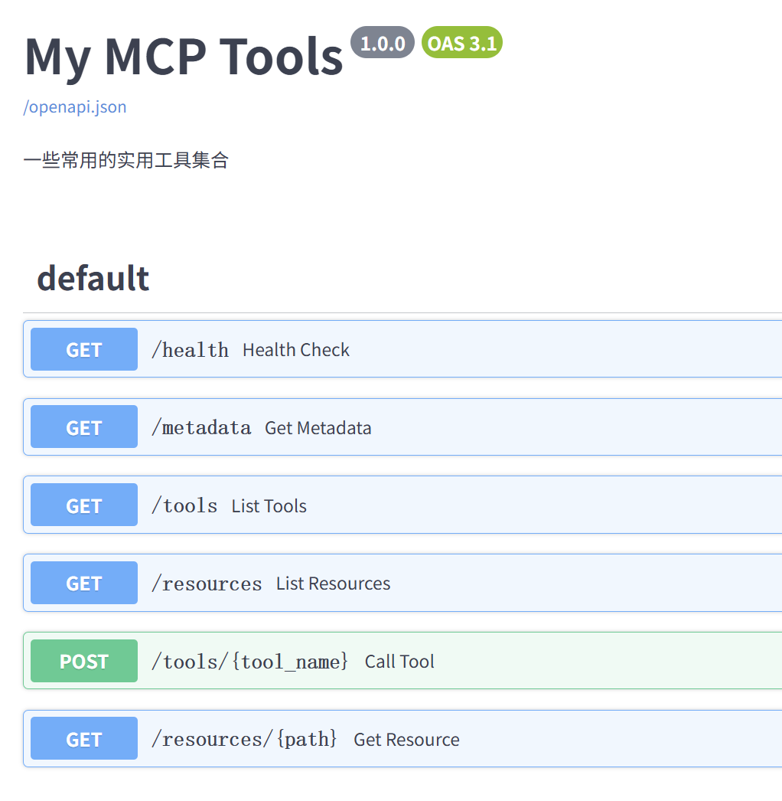

请保持这个终端窗口的运行，因为我们的 A2A 代理稍后需要连接到这个服务。

## 第二部分：构建简单的 A2A 代理

现在我们有了一个正在运行的 MCP 工具服务，接下来我们将创建一个 A2A 代理，让它能够使用这些定义的工具。（参考文件 a2a_agent_simple.py）

```python
# a2a_agent_simple.py
from python_a2a import A2AServer, run_server, TaskStatus, TaskState,   AgentCard
import requests # 用于直接调用 MCP 工具
import re
# A2A 代理的配置
AGENT_PORT = 7000 # A2A 代理监听的端口
MCP_SERVER_URL = "http://localhost:7001" # 我们之前启动的   MCP 工具服务的地址
class MyToolAgent(A2AServer):
    def __init__(self, agent_card,   mcp_url):
          super().__init__(agent_card=agent_card)
        self.mcp_url = mcp_url
        print(f"🛠️   MyToolAgent 初始化完成，将连接到 MCP 服务:   {self.mcp_url}")
    def _call_mcp_tool(self, tool_name,   params):
        """一个辅助方法，用于调用 MCP 工具"""
        if not self.mcp_url:
            return "错误：MCP 服务地址未配置。"
        tool_endpoint =   f"{self.mcp_url}/tools/{tool_name}"
        try:
            print(f"📞 正在调用 MCP 工具: {tool_endpoint}，参数: {params}")
            response =   requests.post(tool_endpoint, json=params, timeout=10)
            response.raise_for_status()   # 如果 HTTP 状态码是 4xx 或 5xx，则抛出异常
            tool_response_json =   response.json()
            print(f"工具响应JSON: {tool_response_json}")
            # 从   MCP 响应中提取文本内容
            # MCP 响应通常在   content -> parts -> text
            if tool_response_json.get("content"):
                parts =   tool_response_json["content"]
                if isinstance(parts,   list) and len(parts) > 0 and "text" in pa
                    return   parts[0]["text"]
            return "工具成功执行，但未找到标准文本输出。"
        except   requests.exceptions.RequestException as e:
            error_msg = f"调用 MCP 工具 {tool_name} 失败: {e}"
            print(f"❌   {error_msg}")
            return error_msg
        except Exception as e_json: #   requests.post 成功，但响应不是期望的json或js
            error_msg = f"解析 MCP 工具 {tool_name} 响应失败: {e_json}"
            print(f"❌   {error_msg}")
            return error_msg
    def handle_task(self, task):
        """处理接收到的任务 (A2A 消息)"""
        message_data = task.message or   {}
        content =   message_data.get("content", {})
        text =   content.get("text", "").lower() # 用户输入的文本，转为小写方便匹配
        print(f"📨 收到任务: {text}")
        response_text = "抱歉，我不太明白您的意思。您可以尝试问我：\\n" \
                        "- '计算 123 + 456'\\n" \
                        "- '现在几点了？'"
        # 1. 尝试匹配计算任务
        expression = None
        # 模式1: 表达式在 "等于多少" 前面, e.g., "5+3等于多少"
        match_equals =   re.search(r"(.+?)\s*等于多少", text)
        if match_equals:
            expression =   match_equals.group(1).strip()
        else:
            # 模式2:   表达式在 "计算" 或 "算一下" 后面,   e.g., "计算 5+3"
            # 使用非捕获组   (?:...) 来匹配关键字，并捕获后面的表达式。
            # re.search 会在字符串中寻找匹配，所以 "帮我计算 5+3" 也能正常工作。
            match_action =   re.search(r"(?:算一下|计算)\s+(.+)",   text)
            if match_action:
                expression =   match_action.group(1).strip()
        if expression:
            # 进一步清理表达式，以处理   "计算 5+3 等于多少" 这样的混合情况
            expression =   expression.split("等于多少")[0].strip()
            if expression: # 确保清理后还有表达式
                print(f"识别到计算任务，表达式: '{expression}'")
                response_text =   self._call_mcp_tool("calculator", {"expression
            else:
                response_text = "请输入要计算的数学表达式，例如：'计算 8*(9+4)'"
        # 2. 尝试匹配时间查询任务
        # 使用更广泛的关键字匹配时间/日期查询
        time_keywords = ["几点", "几点了", "时间", "日期"]
        if any(keyword in text for   keyword in time_keywords):
            print("识别到时间查询任务")
            response_text =   self._call_mcp_tool("get_current_time", {})
        # 3. 匹配天气查询
        weather_keywords = ["天气", "气温"]
        # 正则匹配识别城市，例如   "Shenzhen天气" 中的   "Shenzhen"
        city_match =   re.search(r"([\u4e00-\u9fa5a-zA-Z]+)的?天气", text)
        city = city_match.group(1) if   city_match else None
        if any(keyword in text for   keyword in weather_keywords):
            print("识别到天气查询任务")
            response_text =   self._call_mcp_tool("get_current_weather", {"city"
        # 构建   A2A 响应
        task.artifacts =   [{"parts": [{"type": "text", "text":   str(response_t
        task.status =   TaskStatus(state=TaskState.COMPLETED)
        print(f"📤 回复任务: {response_text}")
        return task
if __name__ == "__main__":
    # 定义代理的   "名片"
    agent_card = AgentCard(
        name="My Tool-Powered   Agent",
        description="一个可以使用计算器和时间查询工具的   A2A 代理",
          url=f"http://localhost:{AGENT_PORT}", # 代理自己的访问地址
        version="1.0.0",
        skills=[ # 列出代理具备的技能
            AgentSkill(
                name="Calculator   Skill",
                description="执行数学计算",
                examples=["计算 20 * 4 + 5", " 13 * (5 + 2) 等于多少？"]
            ),
            AgentSkill(
                name="Time   Skill",
                description="查询当前时间和日期",
                examples=["现在几点了？", "今天是什么日期？"]
            ),
            AgentSkill(
                name="Weather   Skill",
                description="查询当前天气",
                examples=["深圳天气如何？", "北京气温多少？"]
            )
        ]
    )
    my_agent = MyToolAgent(agent_card,   MCP_SERVER_URL)
    print(f" My A2A Agent   即将启动于 http://localhost:{AGENT_PORT}")
    print(f"🔗 它将连接到 MCP 服务于   {MCP_SERVER_URL}")
    # run_server 会启动一个   Flask (默认) 或 FastAPI 服务器来托管 A2A 代理
    # 这部分代码也会阻塞
    run_server(my_agent,   host="0.0.0.0", port=AGENT_PORT)
```

此处 MyToolAgent(A2AServer) 这个代理类继承自 python_a2a.A2AServer。构造函数 init() 接收一个 agent_card（代理的元数据）和 mcp_url （MCP 服务的地址）。

_call_mcp_tool(…) 是一个自定义的辅助方法，封装了通过 HTTP POST 请求调用 MCP 工具的逻辑。它构造了工具的完整 URL （例如 http://localhost:7001/tools/calculator），使用requests.post() 发送 JSON 数据，解析 MCP 服务返回的 JSON 响应，并提取其中的文本内容。

handle_task(self, task) 是 A2A 代理的核心方法，每当代理收到一个任务（通常是一个用户消息），这个方法就会被调用，通过 task.message.content.text 获取用户发送的文本消息，然后判断用户的意图。在 a2a_agent_simple.py 这个例子中，我们通过简单的关键字匹配和正则表达式来判断用户的意图。

- 如果检测到用户意图是计算，就调用 MCP 技能库中的 calculator 工具。

- 如果检测到用户意图是查询时间，就调用 MCP 技能库的 get_current_time 工具。

在 handle_task 方法的最后，通过 task.artifacts = […] 设置任务的产出物，这里是将工具的响应或默认回复包装成 A2A 协议要求的格式。task.status =TaskStatus(state=TaskState.COMPLETED) 则将任务状态标记为已完成。

在主程序中，AgentCard 和 AgentSkill 用于定义代理的元数据，如名称、描述、它提供的技能等。这对于代理发现和服务描述很重要。

### 测试 A2A Agent（Simple）

下面我们来运行并测试这个简单 A2A 代理。

首先确保 mcp_server.py (MCP 工具服务) 仍在 7001 端口运行，然后打开一个新的终端窗口，导航到 a2a_agent_simple.py 文件所在的目录，然后运行 uv run a2a_agent_simple.py或 python a2a_agent_simple.py。

```
🛠️ MyToolAgent 初始化完成，将连接到 MCP 服务:   http://localhost:7001
 My A2A Agent 即将启动于 http://localhost:7000
🔗 它将连接到 MCP 服务于   http://localhost:7001
Starting A2A server on http://0.0.0.0:7000/a2a
Google A2A compatibility: Enabled
* Serving Flask app   'python_a2a.server.http'
* Debug mode: off
INFO:werkzeug:WARNING: This is a development server. Do not use it   in a product
* Running on all addresses (0.0.0.0)
* Running on http://127.0.0.1:7000
* Running on http://【本机在局域网的ip地址】:7000
```

输出显示，我们的 A2A 代理已经在 http://localhost:7000 上成功运行了。我们打开http://localhost:7000，可以看到 A2A 给我们提供了一个 dashboard，Agent Information 是我们定义的 Agent Card，Available Skills 这里是可用工具。

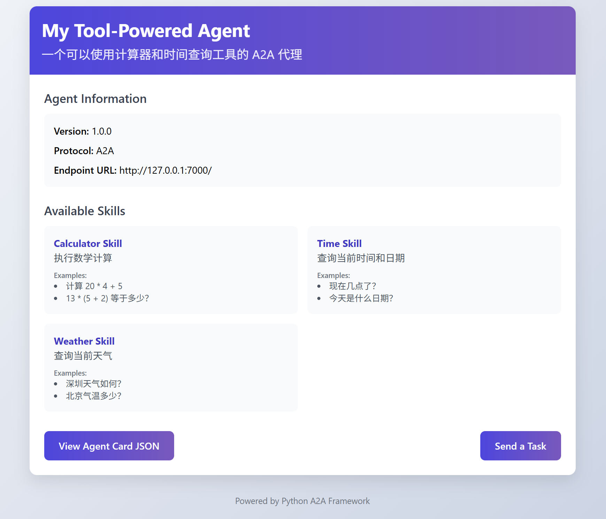

下面创建一个 jupyter notebook，使用 python_a2a 库提供的 A2AClient 功能来测试 A2AAgent。

首先确保我们的虚拟环境支持 Jupyter Notebook 运行。

在 mcp+a2a 目录下，先激活 .venv：

```
source .venv/bin/activate
```

在 .venv 环境下，安装 ipykernel 到当前虚拟环境：

```
install ipykernel
```

注册当前虚拟环境为 Jupyter 内核。

```
python -m ipykernel install --user --name a2a-venv --display-name "Python 3 (a2a-
```

其中：

- –name 是内核的唯一标识（随便取，建议用项目名相关）。

- –display-name 是你在 Jupyter Notebook 里看到的名字。

选择当前虚拟环境来运行 notebook，在新建的 notebook 中定义测试端口：

```
from python_a2a.client import   A2AClient
agent_url = "http://localhost:7000"
# 创建客户端，指向你运行的代理服务地址
client = A2AClient(agent_url)
```

并测试计算器功能：

```
response = client.ask("3*100+20等于多少")
print(response)
```

输出如下：

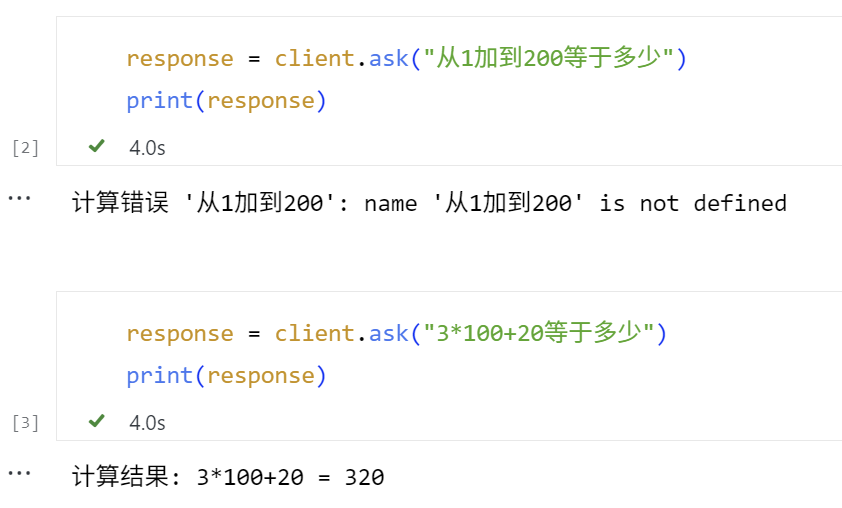

此时可以在部署 MCP 工具的终端看到调用了 calculator 工具的提示。

```
INFO:     127.0.0.1:XXXX - "POST   /tools/calculator HTTP/1.1" 200 OK
```

而在部署 A2A 服务的终端，可以看到中间的过程提示。

```
📨 收到任务:   从1加到100等于多少
  识别到计算任务，表达式: '从1加到100'
  📞 正在调用 MCP 工具:   http://localhost:7001/tools/calculator，参数:   {'expressi
  工具响应JSON: {'content': [{'type': 'text', 'text':   "计算错误 '从1加到100': name
  📤 回复任务: 计算错误 '从1加到100': name '从1加到100' is not defined
  INFO:werkzeug:127.0.0.1 - - [28/Jun/2025 14:37:10] "POST /tasks/send   HTTP/1.
  📨 收到任务: 3*100+20等于多少
  识别到计算任务，表达式: '3*100+20'
  📞 正在调用 MCP 工具:   http://localhost:7001/tools/calculator，参数:   {'expressi
  工具响应JSON: {'content': [{'type': 'text', 'text': '计算结果: 3*100+20 = 320'}],
  📤 回复任务: 计算结果:   3*100+20 = 320
  INFO:werkzeug:127.0.0.1 - - [28/Jun/2025 14:37:16] "POST /tasks/send   HTTP/1.
```

我们继续测试查询时间的功能。

```
response = client.ask("现在是什么时间？")
print(response)
```

输出如下。

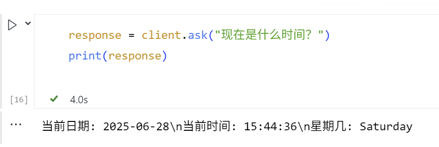

如果一切顺利的话，我们就能在部署 MCP 工具的终端看到调用了定义的 get_current_time 工具并返回当前系统时间。

```
INFO:     127.0.0.1:XXXX - "POST   /tools/get_current_time HTTP/1.1" 200 OK
```

而在部署 A2A 服务的终端，可以看到中间的过程提示。

```
  📨 收到任务:   现在是什么时间？
  识别到时间查询任务
  📞 正在调用 MCP 工具:   http://localhost:7001/tools/get_current_time，参数: {}
  工具响应JSON: {'content': [{'type': 'text', 'text': '当前日期: 2025-06-28\\n当前时
  📤 回复任务: 当前日期:   2025-06-28\n当前时间: 15:44:36\n星期几:   Saturday
  INFO:werkzeug:127.0.0.1 - - [28/Jun/2025 15:44:36] "POST /tasks/send   HTTP/1.
```

继续测试查询天气的功能。这里需要传入城市英文名称。

```
response =   client.ask("Shenzhen天气")
print(response)
```

输出如下。

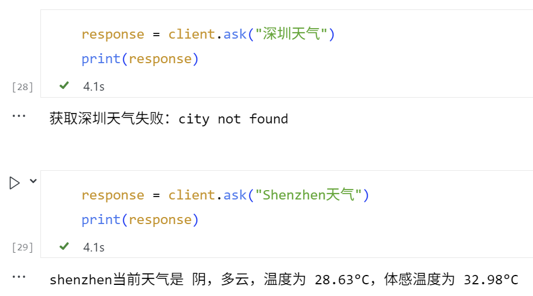

在部署 MCP 工具的终端，我们也会看到调用了定义的 get_current_weather 工具并返回要查询的城市的天气。

```
INFO:     127.0.0.1:XXXXX - "POST   /tools/get_current_weather HTTP/1.1" 200
OK
```

而在部署 A2A 服务的终端，可以看到中间的过程提示。

```
📨 收到任务:   深圳天气
  识别到天气查询任务
  📞 正在调用 MCP 工具:   http://localhost:7001/tools/get_current_weather，参数:   {
  工具响应JSON: {'content': [{'type': 'text', 'text': '获取深圳天气失败：city not fo
  📤 回复任务: 获取深圳天气失败：city   not found
  INFO:werkzeug:127.0.0.1 - - [28/Jun/2025 17:35:26] "POST /tasks/send   HTTP/1.
  📨 收到任务: shenzhen天气
  识别到天气查询任务
  📞 正在调用 MCP 工具:   http://localhost:7001/tools/get_current_weather，参数:   {
  工具响应JSON: {'content': [{'type': 'text', 'text':   'shenzhen当前天气是 阴，多云
  📤 回复任务: shenzhen当前天气是 阴，多云，温度为   28.63°C，体感温度为 32.98°C
  INFO:werkzeug:127.0.0.1 - - [28/Jun/2025 17:35:32] "POST /tasks/send   HTTP/1.
```

至此，通过 A2A 与 MCP 的协同工作机制，建成了可调用外部 MCP 工具的 A2A 代理。

## 第三部分：让 A2A 代理更加智能

尽管上述的简单 A2A 代理已经实现了 A2A+MCP 架构的雏形，但是它依赖于简单的关键字匹配来决定调用哪个工具，并且直接返回工具的结果。但很多情况下，这个程度的智能并不理想，例如：

- 用户倾向于使用自然语言表达需求，仅依赖关键词匹配可能无法准确理解其意图（例如计算“从 1 加到 100”）。

- 当前的参数匹配基于正则表达式，但实际应用中需要更精确的参数提取方法（例如无法提取中文城市名直接用作获取天气的参数）。

- 用户的需求可能涉及多个工具协同工作，或要求对返回结果进行额外处理和语义解释。

这时，就轮到大语言模型出场了！你可以将 LLM 集成到我们的 A2A 代理中，让它充当“翻译官”，来理解用户意图、选择合适的工具（如果需要）、调用工具、传入合适参数（如有），并以更自然、更智能的方式回复用户。—— 此时，LLM 就相当于是一个 A2A 架构中的“调度Agent”。

现在，我们来创建一个新的程序 a2a_agent_advanced.py，它将结合 LLM 和我们之前创建的MCP 工具。

```python
# a2a_agent_advanced.py
from   python_a2a import A2AServer, run_server, TaskStatus, TaskState, AgentCard
import   requests
import re
import os
import   json
import time
from   openai import OpenAI
from   dotenv import load_dotenv
# 加载 .env 文件中的环境变量
load_dotenv()
# --- 配置 ---
AGENT_PORT   = 7002
MCP_SERVER_URL   = "http://localhost:7001" # 我们的 MCP 工具服务
OPENAI_API_KEY   = os.getenv("OPENAI_API_KEY")
OPENAI_BASE_URL   = "https://api.openai.com/v1"
OPENAI_MODEL   = "gpt-4o" # 或者其他模型
# 初始化 OpenAI 客户端
openai_client   = OpenAI(
    api_key=OPENAI_API_KEY,
    base_url=OPENAI_BASE_URL,
)
class   OpenAIEnhancedAgent(A2AServer):
    def __init__(self, agent_card, mcp_url):
        super().__init__(agent_card=agent_card)
        self.mcp_url = mcp_url
        print(f"🤖   OpenAIEnhancedAgent 初始化，MCP 服务:   {self.mcp_url}")
    def _call_mcp_tool(self, tool_name,   params):
        """一个辅助方法，用于调用   MCP 工具"""
        if not self.mcp_url:
            return "错误：MCP   服务地址未配置。"
        tool_endpoint =   f"{self.mcp_url}/tools/{tool_name}"
        try:
            print(f"📞 正在调用 MCP 工具: {tool_endpoint}，参数: {params}")
            response =   requests.post(tool_endpoint, json=params, timeout=10)
            response.raise_for_status() # 如果 HTTP 状态码是 4xx 或   5xx，则抛出异常
            tool_response_json =   response.json()
            print(f"工具响应JSON:   {tool_response_json}")
            # 从 MCP 响应中提取文本内容
            # MCP 响应通常在   content -> parts -> text
            if   tool_response_json.get("content"):
                parts =   tool_response_json["content"]
                if isinstance(parts, list)   and len(parts) > 0 and "text" in pa
                    return   parts[0]["text"]
            return "工具成功执行，但未找到标准文本输出。"
        except   requests.exceptions.RequestException as e:
            error_msg = f"调用 MCP 工具 {tool_name} 失败: {e}"
            print(f"❌ {error_msg}")
            return error_msg
        except Exception as e_json: #   requests.post 成功，但响应不是期望的json或js
            error_msg = f"解析 MCP 工具 {tool_name} 响应失败: {e_json}"
            print(f"❌ {error_msg}")
            return error_msg
    def _get_openai_response(self,   text_prompt, tools=None, max_iterations=5):
        """调用   OpenAI API 获取回复"""
        messages = [{
            "role":   "user",
            "content": text_prompt
        }]
        for i in range(max_iterations):
            try:
                response =   openai_client.chat.completions.create(
                    model=OPENAI_MODEL,
                    messages=messages,
                    max_tokens=1500,
                    tools=tools if tools else   [],
                    tool_choice='auto' if   tools else None
                )
                tool_calls =   response.choices[0].message.tool_calls
                return {
                    "message":   response.choices[0].message.content,
                    "tool_calls":   tool_calls,
                    "usage":   response.usage
                }
            except Exception as e:
                print(f"❌ OpenAI API调用失败: {e}")
                time.sleep(0.1)
                if i == max_iterations - 1:
                    raise   Exception("OpenAI API调用多次失败")
    def handle_task(self, task):
        message_data = task.message or {}
        content =   message_data.get("content", {})
        user_text =   content.get("text", "") # 用户原始输入
        print(f"📨 (OpenAI Agent)   收到任务: '{user_text}'")
        # 定义可用的工具
        tools = [
            {
                "type":   "function",
                "function": {
                    "name":   "calculator",
                    "description":   "执行数学计算",
                    "parameters": {
                        "type":   "object",
                          "properties": {
                              "expression": {
                                  "type": "string",
                                  "description": "要计算的数学表达式"
                            }
                        },
                        "required":   ["expression"]
                    }
                }
            },
            {
                "type":   "function",
                "function": {
                    "name":   "get_current_time",
                    "description":   "获取的当前本地的时间",
                    "parameters": {
                        "type":   "object",
                          "properties": {}
                    }
                }
            },
            {
                "type":   "function",
                "function": {
                    "name":   "get_current_weather",
                    "description":   "获取指定城市的天气信息（请使用英文城市名）",
                    "parameters": {
                        "type":   "object",
                          "properties": {
                            "city":   {
                                  "type": "string",
                                  "description": "要查询天气的城市名称（必须使用英文，
                            }
                        },
                        "required":   ["city"]
                    }
                }
            }
        ]
        # 让OpenAI选择工具和补全参数
        try:
            response = self._get_openai_response(
                text_prompt=user_text,
                tools=tools
            )
            tool_calls =   response.get("tool_calls")
            final_response = ""
            tool_result_for_openai =   ""
            if tool_calls:
                # 执行工具调用
                for tool_call in tool_calls:
                    function_name =   tool_call.function.name
                    function_args =   json.loads(tool_call.function.arguments)
                    tool_result =   self._call_mcp_tool(function_name, function_
                    tool_result_for_openai +=   f"使用{function_name}工具，参数是{f
                # 让OpenAI基于工具结果生成最终回复
                prompt_for_openai = f"用户问：'{user_text}'。\n我已经调用了工具，结果如
                final_response =   self._get_openai_response(prompt_for_openai,
            else:
                # 如果OpenAI认为不需要使用工具，直接生成回复
                final_response =   response.get("message")
        except Exception as e:
            print(f"❌ OpenAI API调用失败: {e}")
            # 如果OpenAI调用失败，退回到直接对话模式
            final_response =   self._get_openai_response(user_text, tools=None).
        task.artifacts = [{"parts":   [{"type": "text", "text": final_response}]
        task.status =   TaskStatus(state=TaskState.COMPLETED)
        print(f"📤 (OpenAI Agent)   回复任务: '{final_response}'")
        return task
if   __name__ == "__main__":
    agent_card = AgentCard(
        name="LLM Enhanced   Assistant",
        description="一个由   LLM 驱动，并能使用外部工具的智能助手",
          url=f"http://localhost:{AGENT_PORT}",
        version="1.1.0",
        skills=[
              AgentSkill(name="Conversational AI", description="通过 OpenAI 大模型
              AgentSkill(name="Calculator", description="执行数学计算"),
            AgentSkill(name="Time   Service", description="查询当前时间和日期"),
            AgentSkill(name="Weather   Service", description="查询指定城市的天气")
        ]
    )
    openai_agent =   OpenAIEnhancedAgent(agent_card, MCP_SERVER_URL)
    print(f" OpenAI Enhanced   A2A Agent 即将启动于 http://localhost:{AGENT_PORT}
    print(f"🔗 它将连接到   MCP 服务于 {MCP_SERVER_URL}")
    print(f"🧠 它将使用   OpenAI 模型: {OPENAI_MODEL}")
    # 启动服务，这会阻塞当前终端
    # 建议在实际部署时，MCP 服务和 A2A Agent 服务分别在不同的进程或服务器上运行
run server(openai agent,
host="0.0.0.0", port=AGENT PORT)
```

代码稍微长了一点，但其实很好理解。核心的改进位于 handle_task(…) 中，通过意图识别与工具触发，我们不再依赖固定关键字匹配，而是借助 gpt-4o 的函数调用能力，根据用户输入自动判断是否需要调用工具。gpt-4o 会解析输入内容，自主选择合适的工具（如计算器、时间查询、天气服务）并提取参数。

若触发工具调用，系统会将用户原始问题与工具返回结果拼接为增强提示（prompt_for_openai），再发送给 gpt-4o 生成最终回答。gpt-4o 会结合上下文与数据，生成自然、连贯、具备语义理解的响应（如：“北京今天多云，气温 25°C，建议带伞。”）。

### 测试 A2A Agent（Advanced）

下面运行 A2A 代理（advanced），并进行测试。

首先确保 mcp_server.py（MCP 工具服务）仍在运行（监听在 http://localhost:7001）。

打开一个新的终端，导航到 a2a_agent_advanced.py 文件所在的目录，然后运行 pythona2a_agent_advanced.py。

代理启动，并监听 http://localhost:7002 端口。

```
🤖 OpenAIEnhancedAgent 初始化，MCP 服务: http://localhost:7001
 OpenAI Enhanced A2A Agent 即将启动于   http://localhost:7002
🔗 它将连接到 MCP 服务于 http://localhost:7001
🧠 它将使用 OpenAI 模型:   gpt-4o
Starting A2A server on http://0.0.0.0:7002/a2a
Google A2A compatibility: Enabled
 * Serving Flask app   'python_a2a.server.http'
 * Debug mode: off
INFO:werkzeug:WARNING: This is a development server. Do not use it in a   produc
 * Running on all addresses (0.0.0.0)
 * Running on http://127.0.0.1:7002
 * Running on http://192.168.1.1:7002
INFO:werkzeug:Press CTRL+C to quit
```

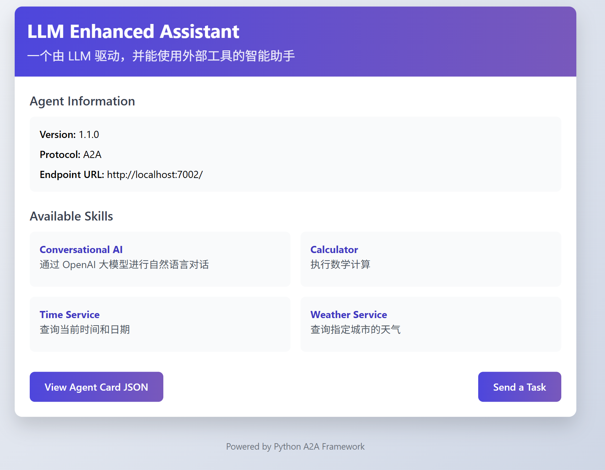

保持 MCP 端口监听。我们继续通过 notebook，使用 A2AClient 测试，现在我们连接到 7002端口。

```
from python_a2a.client import   A2AClient
agent_url = "http://localhost:7002"
# 创建客户端，指向你运行的代理服务地址
client = A2AClient(agent_url)
```

输出如下：

```
INFO:werkzeug:127.0.0.1 - -   [28/Jun/2025 18:09:46] "GET /.well-known/agent.jso
```

测试计算器功能：

```
response =   client.ask("3*100+20等于多少")
print(response)
```

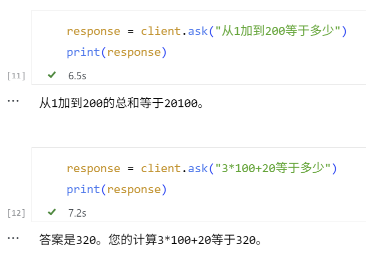

在部署 MCP 工具的终端可以看到调用了 calculator 工具的提示。

```
INFO:     127.0.0.1:XXXX - "POST   /tools/calculator HTTP/1.1" 200 OK
INFO:     127.0.0.1:YYYY - "POST /tools/calculator   HTTP/1.1" 200 OK
```

在部署 A2A 服务的终端看到中间的过程提示如下。

```
📨 (OpenAI Agent) 收到任务: '从1加到200等于多少'
INFO:httpx:HTTP Request: POST https://api.openai.com/v1/chat/completions   "HTTP
📞 正在调用 MCP 工具:   http://localhost:7001/tools/calculator，参数:   {'expression
工具响应JSON: {'content': [{'type': 'text', 'text': '计算结果: 200*(200+1)/2 = 2010
INFO:httpx:HTTP Request: POST https://api.openai.com/v1/chat/completions   "HTTP
📤 (OpenAI Agent) 回复任务: '从1加到200的总和等于20100。'
INFO:werkzeug:127.0.0.1 - - [28/Jun/2025 18:23:30] "POST /tasks/send   HTTP/1.1"
📨 (OpenAI Agent) 收到任务: '3*100+20等于多少'
INFO:httpx:HTTP Request: POST https://api.openai.com/v1/chat/completions   "HTTP
📞 正在调用 MCP 工具:   http://localhost:7001/tools/calculator，参数:   {'expression
工具响应JSON: {'content': [{'type': 'text', 'text': '计算结果: 3*100+20 = 320'}], '
INFO:httpx:HTTP Request: POST https://api.openai.com/v1/chat/completions   "HTTP
📤 (OpenAI Agent) 回复任务: '答案是320。您的计算3*100+20等于320。'
INFO:werkzeug:127.0.0.1 - - [28/Jun/2025 18:28:56] "POST /tasks/send   HTTP/1.1"
```

这里 GPT 大模型理解了用户意图，并且调用 MCP 工具，传入等差数列的计算公式来计算 1到 200 的加和。在输出时的回复也不同于之前简单测试 A2A 时模板化的定义。

继续测试查询时间的功能：

```
response = client.ask("现在是什么时间？")
print(response)
```

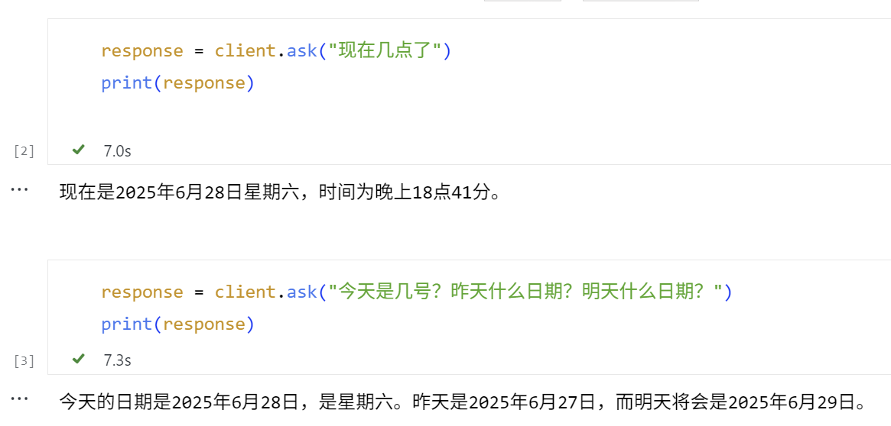

终端调用了定义的 get_current_time 工具并返回当前系统时间。

```
Bash
  📨 (OpenAI Agent) 收到任务: '现在几点了'
  INFO:httpx:HTTP Request: POST https://api.openai.com/v1/chat/completions   "HT
  📞 正在调用 MCP 工具:   http://localhost:7001/tools/get_current_time，参数: {}
  工具响应JSON: {'content': [{'type': 'text', 'text': '当前日期: 2025-06-28\\n当前时
  INFO:httpx:HTTP Request: POST https://api.openai.com/v1/chat/completions   "HT
  📤 (OpenAI Agent) 回复任务: '现在是2025年6月28日星期六，时间为晚上18点41分。'
  INFO:werkzeug:127.0.0.1 - - [28/Jun/2025 18:41:52] "POST /tasks/send   HTTP/1.
  📨 (OpenAI Agent) 收到任务: '今天是几号？昨天什么日期？明天什么日期？'
  INFO:httpx:HTTP Request: POST https://api.openai.com/v1/chat/completions   "HT
  📞 正在调用 MCP 工具:   http://localhost:7001/tools/get_current_time，参数: {}
  工具响应JSON: {'content': [{'type': 'text', 'text': '当前日期: 2025-06-28\\n当前时
  INFO:httpx:HTTP Request: POST https://api.openai.com/v1/chat/completions   "HT
  📤 (OpenAI Agent) 回复任务: '今天的日期是2025年6月28日，是星期六。昨天是2025年6月27日，而
  INFO:werkzeug:127.0.0.1 - - [28/Jun/2025 18:42:02] "POST /tasks/send   HTTP/1.
```

继续测试查询天气的功能。这里 GPT 正确地从用户输入中，识别到了需要作为参数传入的城市名称。

```
# Test Case 1
response = client.ask("帮我查东京的温度")
print(response)
# Test Case 2
response = client.ask("深圳现在多少度？")
print(response)
```

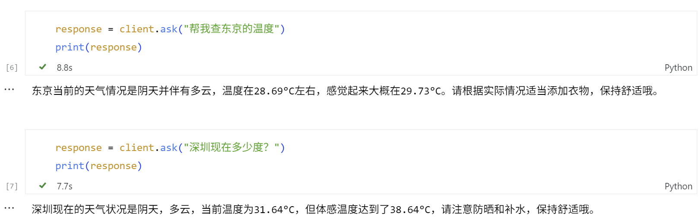

Agent 调用了定义的 get_current_weather 工具，传入了正确形式的参数，并返回要查询的城市的天气。最后，它还额外给出了适当的出行建议。

```
📨 (OpenAI Agent) 收到任务: '帮我查东京的温度'
  INFO:httpx:HTTP Request: POST https://api.openai.com/v1/chat/completions   "HT
  📞 正在调用 MCP 工具:   http://localhost:7001/tools/get_current_weather，参数:   {
  工具响应JSON: {'content': [{'type': 'text', 'text':   'Tokyo当前天气是 阴，多云，温
  INFO:httpx:HTTP Request: POST https://api.openai.com/v1/chat/completions   "HT
  📤 (OpenAI Agent) 回复任务: '东京当前的天气情况是阴天并伴有多云，温度在28.69°C左右，感觉起
  INFO:werkzeug:127.0.0.1 - - [28/Jun/2025 18:44:49] "POST /tasks/send   HTTP/1.
  📨 (OpenAI Agent) 收到任务: '深圳现在多少度？'
  INFO:httpx:HTTP Request: POST https://api.openai.com/v1/chat/completions   "HT
  📞 正在调用 MCP 工具:   http://localhost:7001/tools/get_current_weather，参数:   {
  工具响应JSON: {'content': [{'type': 'text', 'text':   'Shenzhen当前天气是 阴，多云
  INFO:httpx:HTTP Request: POST https://api.openai.com/v1/chat/completions   "HT
  📤 (OpenAI Agent) 回复任务: '深圳现在的天气状况是阴天，多云，当前温度为31.64°C，但体感温度
  INFO:werkzeug:127.0.0.1 - - [28/Jun/2025 18:46:23] "POST /tasks/send   HTTP/1.
```

## 总结一下

今天又是一节实操性极强的动手实践课，我们学习并实践了：

- A2A 与 MCP 的核心概念及协作方式：A2A 负责多智能体协作通信，MCP 提供工具调用能力，二者结合实现感知与行动闭环。

- 使用 python-a2a 开源包构建了 MCP 工具服务（如计算与时间查询）和可调用这些工具的A2A 代理。

- 集成大语言模型，使代理具备理解意图、智能调用工具、自然生成回复的能力。

其中，A2A + MCP + LLM 的组合，是构建具备执行力与协作能力智能体系统的关键。

## 思考题

1. 把 OpenAI 模型改成 DeepSeek 等国内模型，并添加其它的实用工具。

2. 添加多轮对话的上下文管理和控制机制，实现支持长对话与状态管理、流式响应与错误容错等机制。

3. 这个示例中我们使用的是开源社区的 python-a2a 包，你能否用 A2A 和 MCP 官方包来实现类似的应用程序框架。

期待你在留言区分享你的思考或者疑问，如果这节课对你有启发，别忘了分享给身边更多朋友！
