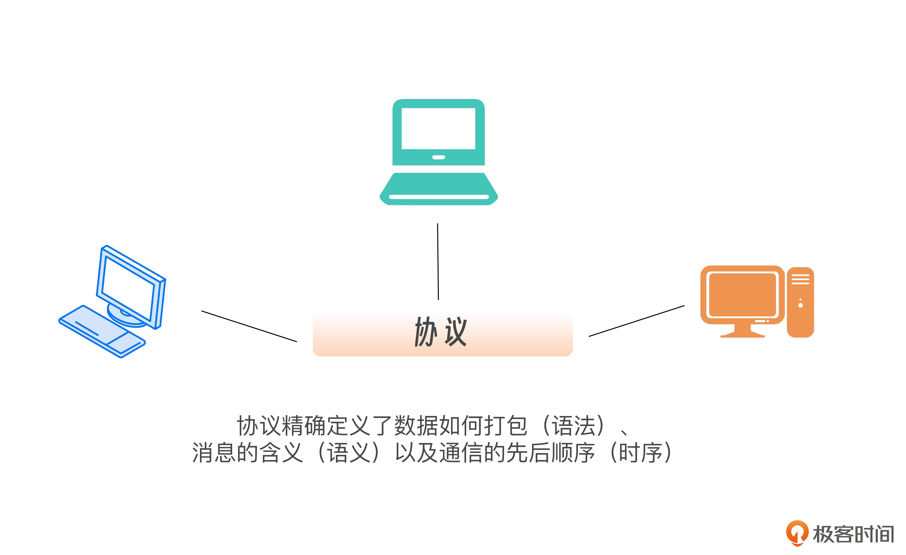
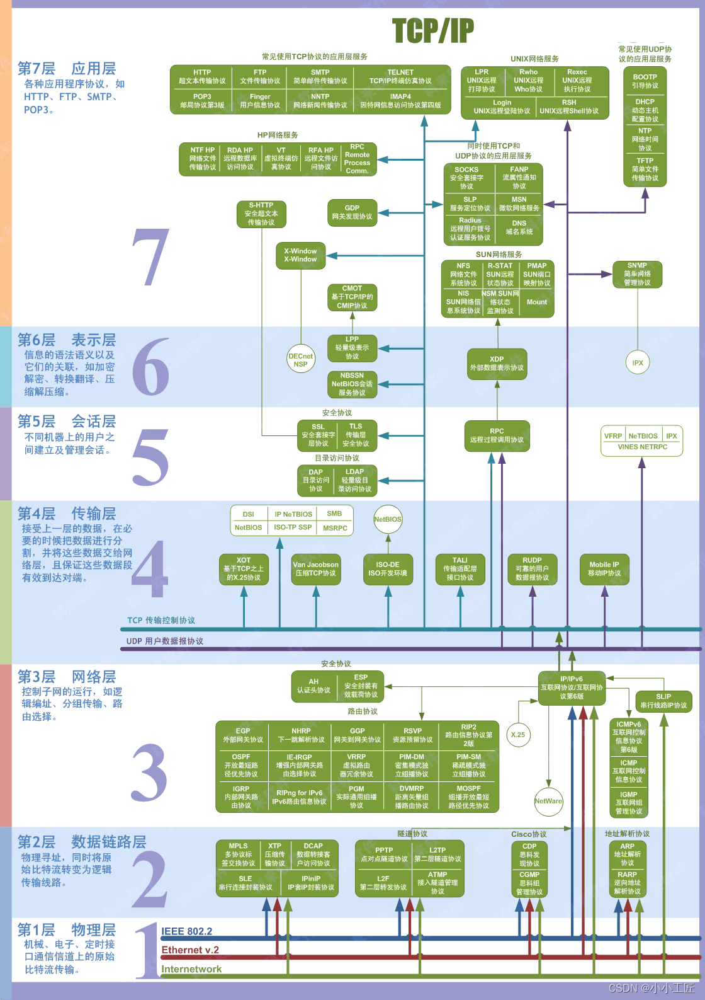
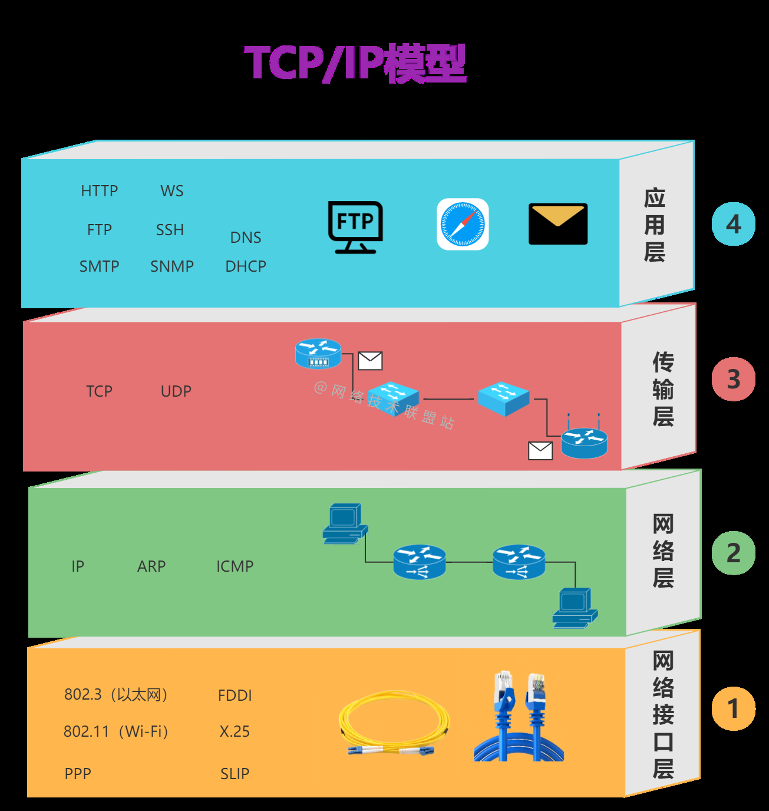
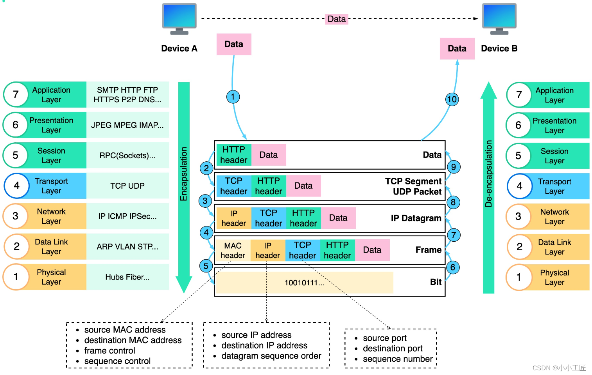
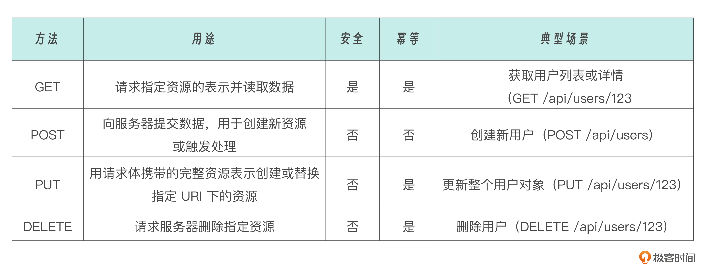
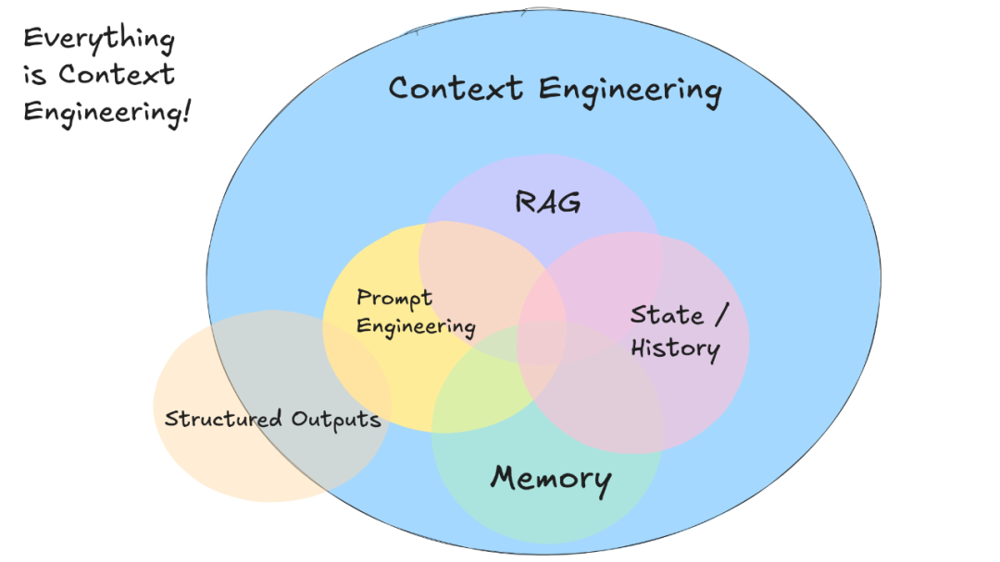
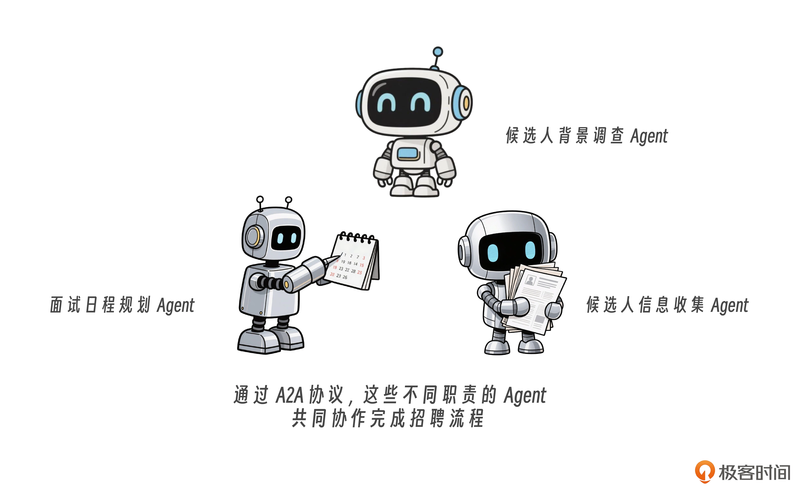

# 17 | 协议演进简史：从TCP-IP、HTTP到MCP与A2A

你好，我是黄佳。

现在我们重启 MCP 和 A2A 学习之旅。首先感谢你一路坚持下来，持续学习，并积极动手实践和讨论，这让我也在讨论的过程中受益良多。

课程里同学们问得最多的，也是我感受最深的一点，就是：“MCP（或 A2A）这东西到底有什么价值？MCP 内部不就是个 Function Call 吗？A2A 不就是把 Agent 能力看做个微服务吗？”

的确，从技术的角度，我们不能说 MCP 和 A2A 有什么突破性的创新。那么，“FunctionalCall”“Agent 调度”这些最基本的 LLM 设计模式，升级为“协议”之后，为啥就突然成了“热点”？为啥一下子就引起更多关注了？如果我们从本源上去思考，从互联网的初始到智能仪器的协同，协议终究是为了让不同系统能够同步、通信、协作。

因此，在重启更新的第一篇中，我将从协议的本质谈起，寻根问源，以古鉴今，借助互联网进化的路径，和你一起探讨后面的几个问题：

- 过去的互联网是如何借助一套套标准化协议改变了我们每一个人的生活？

- MCP 和 A2A 这样一套新协议将怎样转变成智能时代的培育器？

- 如何把大模型从一个“孤立的大脑”演变为能够与数字世界无缝交互的“智慧生命体”？

## 协议的基石：什么是协议，为何它至关重要？

在最根本的层面上，协议（Protocol）从词求解，是“协商议定”，是一套对话双方都必须遵守的规则和约定。

想象一下两位外交官会晤，他们需要就语言（中文还是英文）、开场白（握手还是鞠躬）、议题顺序、文件格式等达成一致，才能有效沟通。

协议在计算机世界里扮演的也正是“外交礼仪”的角色。它精确定义了数据如何打包（语法）、消息的含义（语义）以及通信的先后顺序（时序）。没有协议，互联网将是一片混乱的“巴别塔”，设备之间无法理解彼此。



如果把数据比做信息，那协议就是数据能否被理解的利器。比如：

- 你把一个数字传给我，是 16 进制还是十进制？

- 我写一个名字给你，是 utf-8 编码还是 gb2312？

尽管简单，但一旦没有统一的协议，通信就无从论起。网络中的协议也是尽量除弃“猜”，让数据有规律地流动。

所以，协议不是技术组件，而是一种认知单元：同一个网络上的组织、设备、软件，第一次进行“最小单位合作”时，就必须有共同认知。这种认知，就是协议。

在计算机科学中，协议是一套规定了数据如何在网络中传输的规则和约定。它就像是不同语言间的“翻译官”，让原本无法直接对话的系统能够相互理解、协作。

协议的重要性体现在三个层面，我们分别来看看。

首先是标准化。协议为分布式系统提供统一的"语言"，确保不同厂商、不同技术栈的系统能够无缝对接。来自不同制造商的设备、用不同语言编写的软件，只要遵循同一套协议，就能顺畅通信。这是全球互联网得以形成的基础。想象一下，如果没有 TCP/IP 和 HTTP 协议，每个局域网和网站都有各自的通信方式，那么整个互联网生态将无法建立。

其次是可扩展性。标准化的协议确保了技术能够被广泛采纳和复制，为大规模系统的构建提供了坚实基础。同时，良好的协议设计也为未来的功能扩展预留了空间。良好的协议设计能够适应未来的技术发展。HTTP/1.1 到 HTTP/2 再到 HTTP/3 的演进，正是协议适应性能需求变化的典型例证。

最后还有抽象层次。协议将复杂的底层实现抽象为简单的接口，开发者只需关注业务逻辑，而无需深入网络传输的细节。像经典的 OSI 七层模型或 TCP/IP 四层模型一样，协议将复杂的网络通信问题分解成多个独立的层次。应用开发者无需关心电信号如何传输（物理层），只需关注应用层的逻辑（如 HTTP），极大地降低了开发门槛。



- OSI 七层模型 图源：https://cloud.tencent.com/developer/article/2329898

## 互联网核心协议群：TCP/IP、HTTP 到 gRPC

为了理解 AI 时代的协议，我们先回顾那些构建了今天互联网的“重要协议群体”。

### TCP/IP：互联网的“快递系统”

TCP/IP 协议族是互联网的基石。我们可以将其理解为一个高度可靠的全球快递系统。

IP（Internet Protocol）负责“寻址和路由”，就像给每个包裹（数据包）写上唯一的地址，并由网络中的路由器决定最佳投递路线。但 IP 本身不保证包裹一定能送达，也不保证顺序。

TCP（Transmission Control Protocol）在 IP 之上提供“可靠的、面向连接的”服务。它会像一个负责任的快递员，先与收件人“电话确认”（三次握手建立连接），然后将大文件拆分成带编号的小包裹，对方收到后按编号组装，如果发现有丢失或损坏的包裹（丢包），会主动要求重发，最后再“确认收货”（四次挥手断开连接）。



- TCP/IP 四层模型 图源：https://cloud.tencent.com/developer/article/2329898

OSI 模型没有指定具体的协议，只是提供了一种通用的框架；而 TCP/IP 模型则在每个层次上定义了特定的协议，如 IP、TCP、UDP，因此在实际网络工程和互联网通信中，TCP/IP 模型更为常见和实际。TCP/IP 的分层设计，完美诠释了协议如何将复杂问题简单化，是后续所有应用层协议的载体。

### HTTP：Web 的“世界语”

如果说 TCP/IP 是路，那么 HTTP（HyperText Transfer Protocol）就是路上跑的汽车所遵循的交通规则。而且，它本身就位于 TCP/IP 四层架构的最上层，直接对互联网具体应用负责。它定义了浏览器（客户端）如何向服务器请求网页、图片等资源，以及服务器如何响应这些请求。一个简单的 GET 请求，就开启了我们丰富多彩的网页浏览体验。



- HTTP协议位于7层架构的最上层 图源：https://cloud.tencent.com/developer/article/2329898

HTTP（HyperText Transfer Protocol）诞生于 1989 年，最初只是为了在万维网上传输超文本文档。但它简洁的设计哲学——无状态、请求 - 响应模型——使其成为了整个互联网的通信基础。

```sql
# HTTP请求的基本结构
class HTTPRequest:
   def __init__(self, method, url, headers=None, body=None):
       self.method = method      # GET, POST, PUT, DELETE
       self.url = url           # 资源标识符
       self.headers = headers or {}  # 元数据
       self.body = body         # 请求载荷
   def serialize(self):
       lines = [f"{self.method} {self.url} HTTP/1.1"]
       for key, value in self.headers.items():
           lines.append(f"{key}: {value}")
       lines.append("")  # 空行分隔头部和正文
       if self.body:
           lines.append(self.body)
       return "\r\n".join(lines)
```

下表是 HTTP 最基本、最常见的 4 种方法的列表说明，相信你即使没有专门学习过 HTTP 协议，对这些标准方法也不会特别陌生。因为我们在前后端交互、微服务调用、脚本化运维等场景中，几乎每天都会用到这四种方法来操作资源。



```
# 示例：一个简单的API调用
request = HTTPRequest(
   method="POST",
   url="/api/users",
   headers={"Content-Type": "application/json"},
   body='{"name": "Alice", "email": "alice@example.com"}'
)
```

HTTP 的成功在于它简单且通用。它不关心传输的具体内容，只定义了如何包装和传递信息。这种设计让 HTTP 成为了 RESTful API、Web 服务、甚至现代微服务架构的基础（你可以思考一下为什么说 HTTP 是现代微服务架构的基础）。

### JSON-RPC：从“人机对话”到“机机对话”

随着 Web 应用越来越复杂，前端需要更频繁地与后端进行数据交换，而不再是简单地请求整个页面。这催生了 API（应用程序接口）的繁荣。JSON-RPC（JSON Remote ProcedureCall） 就是一套极简的、为“机器间对话”设计的协议。

它的核心思想是——一个程序可以像调用本地函数一样，去调用另一台服务器上的函数。其消息格式非常直观。

客户端请求示例：

```json
{
 "jsonrpc": "2.0",
 "method": "subtract",
 "params": [42, 23],
 "id": 1
}
```

其中“method“是要调用的函数名。“params”表示传递给函数的参数。“id”是请求的唯一标识，用于匹配响应。非常简单清晰。

服务器成功响应示例：

```json
{
 "jsonrpc": "2.0",
 "result": 19,
 "id": 1
}
```

其中“result”是函数执行的返回结果。“id”是对应请求的 ID。

JSON-RPC 的轻量、无状态和可读性，使其成为现代微服务和前后端分离架构的宠儿。而它定义的 Request-Response（请求 - 响应） 和 Notification（通知，即无需响应的请求） 模式，为我们接下来要讲的 MCP 奠定了坚实的基础。

### gRPC：高性能 RPC 的现代实践

随着微服务架构的兴起，传统 HTTP+JSON 的组合在性能和类型安全方面暴露出局限性。而Google 在 2015 年开源的 gRPC（Google Remote Procedure Call）提供了一个更高效的解决方案。

gRPC 服务定义示例：

```protobuf
# gRPC服务定义（Protocol Buffers）
# user_service.proto
syntax = "proto3";
service UserService {
   rpc GetUser(GetUserRequest) returns (User);
   rpc CreateUser(CreateUserRequest) returns (User);
   rpc ListUsers(ListUsersRequest) returns (ListUsersResponse);
}
message User {
   int32 id = 1;
   string name = 2;
   string email = 3;
   int64 created_at = 4;
}
message GetUserRequest {
   int32 user_id = 1;
}
```

gRPC 服务实现示例：

```python
# gRPC服务实现
import grpc
from concurrent import futures
import user_service_pb2_grpc as user_pb2_grpc
import user_service_pb2 as user_pb2
class UserServiceImpl(user_pb2_grpc.UserServiceServicer):
   def __init__(self):
       self.users = {}
       self.next_id = 1
   def GetUser(self, request, context):
       """获取用户信息"""
       user_id = request.user_id
       if user_id not in self.users:
           context.set_code(grpc.StatusCode.NOT_FOUND)
           context.set_details(f"User {user_id} not found")
           return user_pb2.User()
       return self.users[user_id]
   def CreateUser(self, request, context):
       """创建新用户"""
       user = user_pb2.User(
           id=self.next_id,
           name=request.name,
           email=request.email,
           created_at=int(time.time())
       )
       self.users[self.next_id] = user
       self.next_id += 1
       return user
# 启动gRPC服务器
def serve():
   server = grpc.server(futures.ThreadPoolExecutor(max_workers=10))
   user_pb2_grpc.add_UserServiceServicer_to_server(
       UserServiceImpl(), server
   )
   listen_addr = '[::]:50051'
   server.add_insecure_port(listen_addr)
   server.start()
   server.wait_for_termination()
```

相比 HTTP+JSON，gRPC 的优势体现在后面这几方面。它基于 HTTP/2 的多路复用和Protocol Buffers 的二进制序列化，显著提升了传输效率。 通过 IDL（接口定义语言）生成强类型的客户端和服务端代码，减少了运行时错误。同时也支持客户端流、服务端流和双向流，适应更复杂的交互模式。

## 为 AI 而生：MCP 和 A2A

传统的 HTTP 和 gRPC 协议在设计时主要面向确定性的、结构化的数据交换。但 AI 和大模型时代，带给我们一个全新的挑战：模型本身是一个强大的“计算核心”，但它被困在“黑箱”里，无法直接与外部世界交互，比如读取本地文件、调用专业 API、或访问数据库。传统的胶水代码方式繁琐且脆弱。

Andrej Karpathy 2025 年创造了一个新名词——Context Engineering，正是围绕着这个挑战而生。Context Engineering，即“上下文工程”所揭示出的真正内涵，其实就是大语言模型需要访问动态变化的上下文信息——文件系统、数据库、实时 API 等。



Context Engineering 的内涵，其实就是大语言模型需要访问动态变化的上下文信息 图源：Andrej Karpathy

传统协议很难优雅地处理这种“上下文即服务”的需求，而 MCP 则借鉴了 JSON-RPC 的精髓，并将其扩展为一个专为“大模型 - 工具”交互设计的标准化通信框架。

### MCP：建立在 JSON-RPC 基础上的 LLM 标准工具 / 资源调用接口

MCP 定义了三个核心角色。

- Host：承载大模型和用户界面的应用，比如一个 IDE 插件或一个聊天机器人后端。

- Client：Host 内部的 MCP 客户端实例，负责将 Host 的意图（如“调用天气工具”）打包成MCP 消息。

- Server：真正提供工具和上下文能力的服务进程，负责执行具体的调用并返回结果。

这种分层解耦的设计，让 Host 只需关注“我需要什么能力”，而 Server 则负责“如何实现这些能力”，极大地提升了系统的模块化和可维护性。

如果说 JSON-RPC 是通用的“函数调用”协议，那么 MCP 就是一个在此基础上增加了“语义层”的领域特定协议。MCP 沿用了 JSON-RPC 的 Request、Result、Error、Notification 等消息类型，但为其赋予了特定于大模型交互的含义。

例如，一个 MCP 请求不再是简单的 {“method”: “subtract”}，而是：

```json
{
 "jsonrpc": "2.0",
 "method": "tools/run",
 "params": {
   "tool_name": "get_current_weather",
   "tool_input": {
     "location": "Beijing",
     "unit": "celsius"
   }
 },
 "id": "req-123"
}
```

这个消息明确地表达了“调用一个工具”的意图，并结构化地定义了工具名称和输入参数。

在 MCP Server 中，开发者通常只需要使用装饰器来声明一个工具，而无需关心底层的JSON-RPC 消息处理。

```python
# server.py
# 导入 MCP 服务端库
from fastmcp import McpServer, tool
# 创建一个 MCP Server 实例
mcp_server = McpServer()
@tool(
   name="get_current_weather",
   description="获取指定城市的当前天气",
   # 定义输入参数的 schema
   input_schema={
       "type": "object",
       "properties": {
           "location": {"type": "string", "description": "城市名, e.g., San Franc
           "unit": {"type": "string", "enum": ["celsius", "fahrenheit"]}
       },
       "required": ["location"]
   }
)
def weather_tool(location: str, unit: str = "celsius") -> dict:
   """这是一个实际执行工具逻辑的 Python 函数"""
   # ... 此处调用真实的天气 API ...
   print(f"正在查询 {location} 的天气 ({unit})")
   return {"temperature": 25, "condition": "晴朗"}
# 将工具注册到 Server
mcp_server.add_tool(weather_tool)
# 启动 Server，开始监听来自 Client 的请求
mcp_server.run()
```

Client 端（通常由 Host 应用驱动）会向 Server 发起调用。

```python
# client.py
import asyncio
from mcp_client import McpClient # 假设有一个 MCP 客户端库
async def main():
   # Client 连接到 Server (可以通过 stdio, HTTP 等方式)
   async with McpClient.connect("path/to/server/process") as client:
       # 1. 握手和初始化已在 connect 内部自动完成
       # 2. 客户端可以向服务器请求可用的工具列表
       available_tools = await client.list_tools()
       print("可用的工具:", [t.name for t in available_tools])
       # 3. 像调用本地异步函数一样调用远程工具
       print("\n正在调用天气工具...")
       result = await client.run_tool(
           "get_current_weather",
           {"location": "北京", "unit": "celsius"}
       )
       print("工具调用结果:", result)
asyncio.run(main())
```

让我们快速复习一下这背后发生了什么？

1. client.run_tool(…) 这个高层调用，在 McpClient 内部被转换成了一个上文所示的 JSON-RPC 请求。

2. 这个请求通过底层的传输通道（如 stdio）发送给 McpServer。

3. McpServer 的 BaseSession 接收到消息，解析后发现 method 是 tools/run，于是将请求分发给工具处理逻辑。

4. weather_tool 函数被执行，其返回值 {“temperature”: 25, “condition”: “晴朗”} 被打包成一个JSON-RPC 的 Result 消息。

5. 该 Result 消息被发回给 McpClient。

6. client.run_tool 的 await 结束，并返回最终结果。

通过这种方式，BaseSession、ClientSession 和 ServerSession 像一个精密的引擎，将复杂的异步通信、消息序列化、请求响应匹配等工作全部隐藏，为上层应用提供了极其简洁和强大的编程接口。

### A2A：迈向智能体自主协作标准协议的未来

MCP 完美地解决了“中心化的大模型”如何与“外部工具”对话的问题。但 AI 的终极形态之一是多智能体系统（Multi-Agent System），即多个独立的、具备自主决策能力的 AI Agent 协同工作，共同完成一个复杂的任务。

企业中部署的自主 Agent 越来越多，互相孤立的智能体各做各的，显然无法发挥最大效能。所以新一代软件工程师要解决的问题就是让分布在不同系统、由不同厂商构建的 Agent 可以互相发现对方、交换信息、协同完成跨系统的复杂流程。

举个例子，在一个人力资源场景里，可能有一个 Agent 专门负责从招聘网站搜集候选人信息，另一个 Agent 负责安排面试日程，另一个负责背景调查。



通过 A2A 协议，这些不同职责的 Agent 可以在一个工作流中相互交谈，分享目标、划分子任务，甚至讨论最佳方案，最终共同完成整套招聘流程。对于最终用户而言，仿佛是面对一个无所不包的超级助手，但背后其实是一群协同工作的子代理。这就引出了对下一代协议的需求，A2A（Agent-to-Agent）协议。

如果说 MCP 是一种“主仆协议”（Host/Model 是主，Server/Tool 是仆），那么 A2A 就是一种“对等协议”（Peer-to-Peer）。如果说 MCP 是赋予单个智能体一个可靠的工具腰带，那么 A2A则是为多个智能体搭建一个共同语言的交流平台。

A2A 需要解决比 MCP 更复杂的问题：

1. 服务发现（Discovery）：在一个开放网络中，一个 Agent 如何找到能够帮助它完成特定子任务的另一个 Agent？

2. 能力协商（Negotiation）：两个 Agent 如何就任务目标、交付成果、甚至“报酬”（如果涉及经济模型）达成一致？

3. 任务委托与监督（Delegation & Supervision）：一个 Agent 如何将任务安全地委托给另一个Agent，并能追踪其进度、处理其可能遇到的失败？

4. 组合性（Compositionality）：一个 Agent B 的能力，如何能被 Agent A 当作一个“超级工具”来使用，形成复杂的调用链？

A2A（Agent-to-Agent）协议由 Google Cloud 主导，并于 2025 年在众多合作伙伴支持下发布。正如其名，A2A 定义了一种开放标准，旨在让不同的 AI 智能体彼此通信与协作，即让智能体之间能像人一样交流、合作完成任务。

从技术上看，A2A 架构有几个核心概念：

- 客户端代理（Client Agent）：在一次会话中主动发起请求的智能体，通常代表用户或充当协调者的角色。它把用户的高层意图分解成具体任务，与其他 Agent 协商或委派工作。

- 远程代理（Remote Agent）：接收任务请求并执行具体操作的智能体。远程代理公开自己的能力，并等待处理来自其他 Agent 的任务请求。

- Agent Card（智能体卡片）：每个 Agent 用一个 JSON 文件来描述自己的能力说明和接口端点。可以理解为智能体的“名片”或“服务说明书”。通过 Agent Card，客户端代理可以发现有哪些代理可用，以及它们能干什么，从而选择合适的合作伙伴。

- 任务管理：A2A 协议围绕 Task（任务）概念进行通信。一个任务从产生到完成有生命周期，各 Agent 通过状态更新来跟踪任务进展。对于简单任务，远程代理可能立即完成并返

- 回结果（称为 Artifact 工件，例如生成的答案或文件）。对于长时间运行的任务，双方会持续通过消息交流进度、部分结果，直到任务完成。

- 消息与多模态：智能体之间交换的基本单位是消息。每条消息可以包含一个或多个内容片段（parts），每个部分有自己的内容类型标识。例如，一个消息可以包含文本说明、再附带一个图像或表格作为部分。这种设计允许 Agent 在交流时进行用户体验协商：如果一个Agent 只能处理文本，但另一个 Agent 希望发送图像，它们可以通过内容类型协商达成兼容方式。A2A 致力于模态无关，支持文本、图像、音频、视频等各种类型的数据交换。

和 MCP 协议一样，A2A 在实现上也是充分利用现有成熟标准——它建立于 HTTP 之上，通过JSON 结构封装消息内容，并使用 Server-Sent Events (SSE) 实现推送和流式更新。换言之，MCP 和 A2A 都没有重复发明低层通信技术，而是指定了如何在 HTTP/JSON 基础上定义智能体间消息格式、流程和安全机制。这使得它容易被集成到现有企业基础设施中。

当然，另一个广泛的共识是，A2A 协议目前还处于非常早期的探索阶段，但它代表了 AI 应用架构的未来方向——从中心化的“大脑 - 工具”模式，走向分布式的、自组织的“社会化协作”模式。

### MCP 与 A2A：各司其职，优势互补

一个自然的问题是：这两个协议有什么区别？会不会互相竞争？实际上，MCP 和 A2A 的定位截然不同，恰恰形成互补。

首先，它们作用焦点不同。MCP 面向单个 AI 智能体与工具 / 数据的连接，侧重“纵向”扩展单个 Agent 的能力。A2A 面向多个智能体之间的沟通协作，专注“横向”连接分布式的 Agent 生态。MCP 关注“一个 AI 能做什么”，A2A 关注“很多 AI 如何一起做事”。

其次，交互方式也不一样。MCP 基于函数调用风格的请求 - 响应模式，更底层、更直接——客户端发出明确的操作请求（比如调用某工具函数），服务端返回具体结果。A2A 则采用更类似对话的交互模式，支持长时会话和动态协商——Agent 之间通过一系列消息往复来逐步完成任务，可以中途交换信息、更新状态，流程相对灵活开放。

然后我们来看抽象层级。 MCP 提供的是一种较低层的接口（模型需要知道调用哪个工具方法、传哪些参数），而 A2A 提供的是高层协作框架（Agent 传递的是任务意图和内容，具体如何实现由对方决定）。因此 MCP 信息交换粒度细、频次高，一次调用干一件小事；A2A 信息粒度粗，可能一句话包含较复杂的指令或上下文。

最后我想说说协议共生的问题。MCP 与 A2A 并非孤立存在，而是可以在同一个 AI 系统中结合使用。它们解决不同问题，因此并不是替代关系，而是相辅相成。

例如，在一个由多个 Agent 协作的体系中，每个 Agent 自己可以通过 MCP 去获取所需工具或数据（例如某 Agent 需要查询数据库，就用 MCP 从相应 Server 取数据），然后再通过 A2A把结果分享给其它 Agent。

反过来，一个功能强大的单 Agent（比如具有 MCP 工具能力的 Agent）也可以在需要时通过A2A 临时调用另一个 Agent 来处理自己不擅长的子任务。因此未来我们会看到两种协议同时出现在一个复杂 AI 应用中，各自发挥作用——MCP 扩展每个智能体的“触手”，A2A 则连接起这些智能体的“大脑”。

MCP 和 A2A 分别针对“AI + 工具”和“AI + AI”这两大场景提供了解决方案。前者让单个 AI 更强大，后者让多个 AI 能合作。

## 总结一下

希望今天的学习旅程让你不虚此行，让我们回顾一下这节课的重点。

首先，我们一起梳理了驱动我们数字世界和智能未来的核心脉络——通信协议。我们从最基础的“什么是协议”出发，回顾了互联网的基石 TCP/IP 和 HTTP，见证了协议如何支撑起整个互联网（TCP/IP, HTTP），如何让程序间沟通变得轻而易举（JSON-RPC），又如何为大模型插上与世界交互的翅膀（MCP），并最终展望了一个由 AI 自主协作的未来（A2A）。

通信协议（communication protocol）简单来说就是一套规则，规定了数据在网络中传输的方式和格式。就像人与人交流需要共同遵守语法和词义，计算机之间交换数据也必须遵循统一的协议标准。协议确保不同设备和系统之间兼容且互操作：只有大家都按照同样的规则“说话”，它们才能顺畅地“对话”。

协议的重要性体现在许多方面，例如：它定义数据格式、同步方式、传输步骤、错误检测机制等，从而保证数据传输的可靠性和效率。许多协议还包含安全措施（如加密、认证），以保护数据在传输过程中的机密性和完整性。正因为有了标准化的通信协议，不同厂商和平台的设备才能无缝协同工作，支撑起互联网和现代软件生态的庞大体系。

我希望能带给你的核心启示是：协议的演进，始终伴随着应用复杂度的提升。它不仅仅是技术规范，更是构建下一代复杂系统的“思想钢印”和“架构蓝图”。

如果你是一位应用开发者，理解这些协议能让你构建更健壮、更可扩展的系统；理解了 MCP协议的底层构造，你就能明白为什么它能如此优雅地解耦模型与工具。即使日常开发中你只使用高层的 SDK，这份认知也会让你在面对复杂问题时，拥有洞察其本质的能力。如果你是一位 AI 从业者，这趟重新认识 MCP 和 A2A 的旅程将揭示大模型如何从一个“孤立的大脑”演变为能够与数字世界无缝交互的“智慧生命体”。

这两种协议都还在早期发展阶段。社区对于安全、隐私、可控性等方面仍在讨论如何完善（后面我们也将开辟专题进行探讨）。例如，有人关注多 Agent 互联时如何防止潜在的对抗行为或错误传播，有人关心标准是否会分裂为不同版本等。

但总体来看，MCP 和 A2A 的出现标志着 AI 软件开发范式的一个转变——从过去写定程序去调用 AI，逐步走向让 AI 通过标准协议自主调配程序、甚至互相通信协同。这种转变好比从单机版软件走向网络生态，标准协议让不同组件解耦，却又能动态组合。

未来，我们很可能会看到更多此类协议（例如用于模型间内存共享的协议，或者人类监督干预的协议等）涌现，共同构筑起自主智能体的协作网络。

## 思考题

因为经过上一阶段的学习，我们对 MCP 和 A2A 协议的细节其实已经非常清晰了，因此我这里多给出几个比较有难度思考题目，欢迎一起探讨。

1. 许多应用场景中我们都可以实现“某种工具调用”或“某种 Agent 调度”，但并不意味着这些就是“协议”。那么你认为：一组通信规则要具备哪些关键特征，才配称为‘协议’？ MCP 和 A2A又是如何满足这些标准的？

2. 为什么 MCP 和 A2A 这两个协议都是基于 JSON-RPC 来构建，而不是更晚出现的 gRPC？——这个我们下一节课：架构演进会给出一些思路和答案。

3. 假设你需要为一个长耗时工具（如“视频分析”）在 MCP 中增加流式响应（StreamingResponse）能力，即工具可以持续返回中间进度，而不是等待任务全部完成后才返回一个最终结果。你会考虑在 MCP 的哪个层面进行扩展？是新增一种 Notification 类型（如ToolProgressNotification）还是修改 Request-Response 模型？为什么？

希望通过这些问题，你能进一步思考协议设计中的权衡与创新。在下一节课中，我们将类似的回顾计算机从单机到网络时代架构演进的历史，并探讨大模型时代的架构体系。欢迎在留言区分享你的见解与困惑，共同探索！
