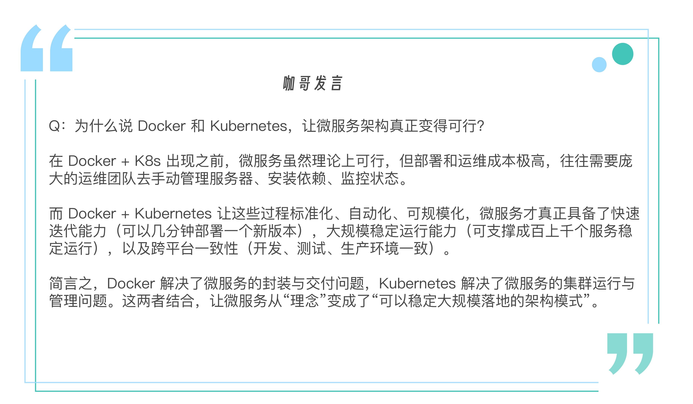
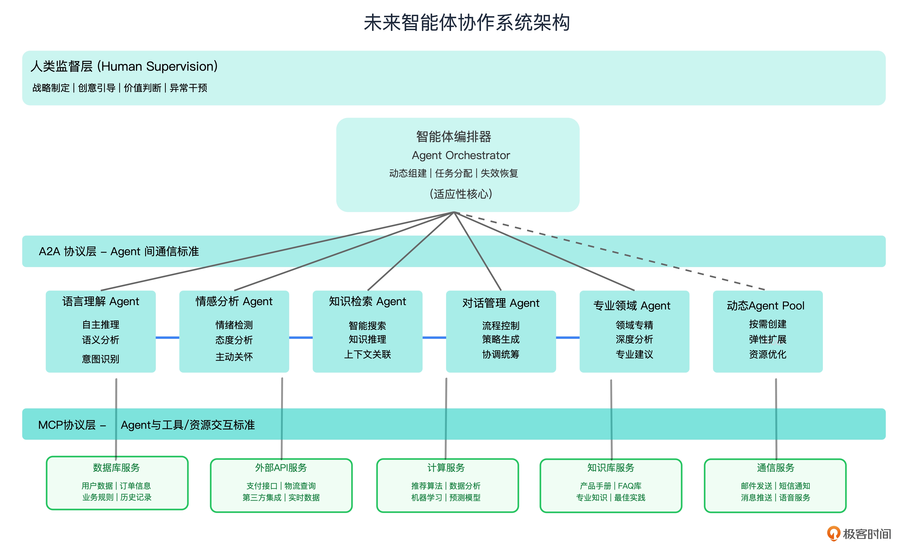
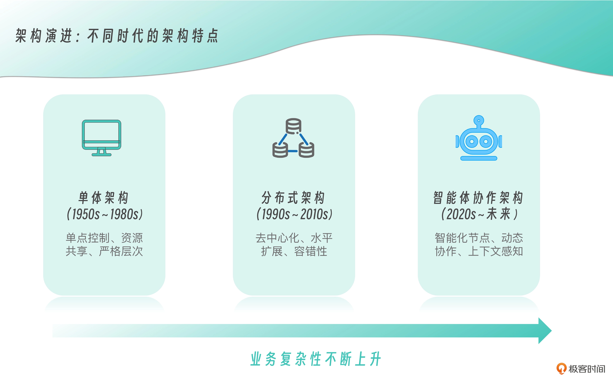

# 18 | 架构进化之路：从单机到分布式，再到智能体协作的未来

你好，我是黄佳。

上节课，我们探讨了协议如何作为“数字世界的外交礼仪”，推动了从 TCP/IP 到 MCP、A2A 的演进历程，看清了“标准化语言”如何改变整个数字世界的连接方式。今天，我们将视角转向架构。

所谓架构，就是系统的大脑和神经系统如何布局，也就是系统是如何组织、分层以及组件之间的通信方式——它决定了数据怎么流动、资源怎么分配、功能怎么协作、扩展性有多强、以及能否适应未来的不确定性。

回顾计算机的发展，你会发现，每一次架构变革的背后，几乎都伴随着协议的升级。协议像语言，而架构是这门语言的语法和文法。语言越成熟，语法越严谨，能表达的思想就越复杂。

从大型机时代的集中式架构，到微服务时代的分布式架构，再到今天 AI 驱动的智能体协作架构——每一次架构演进，都伴随着计算范式的根本性变革。而 MCP 和 A2A 协议的出现，正预示着我们即将迎来架构史上的又一次重大转折。

## 单机时代的集中式架构（1950s-1980s）

在计算机发展的早期，所有的代码、数据和计算资源都集中在一台大型机上。这种集中式架构（也称为单体架构）的特点是：

- 单点控制：所有的计算、存储、I/O 都由中央处理器统一管理。

- 资源共享：多个用户通过终端共享同一套计算资源。

- 严格层次：从操作系统到应用程序，呈现清晰的层次结构。

```
┌─────────────────────────────────────┐
│            应用程序层                │
├─────────────────────────────────────┤
│            操作系统层                │
├─────────────────────────────────────┤
│            硬件抽象层                │
├─────────────────────────────────────┤
│            物理硬件层                │
└─────────────────────────────────────┘
```

这种架构的优势在于简单可控——所有资源和数据都在一个地方，便于管理和维护。但缺点也很明显，可扩展性差、单点故障风险高、资源利用效率低，更严重的是协作能力几乎为零。

有趣的是，早期的 AI 系统（如专家系统）也采用了类似的集中式架构。所有的知识库、推理引擎、用户接口都打包在一个程序中，就像一个“数字大脑”独自思考。

你可以把此时的 IT 架构想成一个小作坊：木匠一个人做设计、切木、组装、上漆，全靠一双手。

## 网络时代的分布式架构（1990s-2010s）

随着网络的出现，客户端 - 服务器模式也就是 Client/Server 架构登场。数据和核心逻辑放在服务器上，客户端只负责展示和基本交互。 这相当于工厂生产的过程中原材料集中存放（数据库），工人分批领取加工。

在 C/S 架构下，TCP/IP 协议负责“送货”，HTTP 协议作为轻量级传输规则实现不同系统之间的数据交换。

互联网的风起云涌彻底改变了计算架构的面貌。分布式架构成为主流，其核心思想是：

- 去中心化：计算任务分散到多个节点。

- 水平扩展：通过增加节点数量来提升整体性能。

- 容错性：单个节点失效不会影响整个系统。

```
       ┌──────────┐    ┌──────────┐    ┌──────────┐
       │  Node A  │────│  Node B  │────│  Node C  │
       └──────────┘    └──────────┘    └──────────┘
            │               │               │
       ┌──────────┐    ┌──────────┐    ┌──────────┐
       │  Node D  │────│  Node E  │────│  Node F  │
       └──────────┘    └──────────┘    └──────────┘
```

这一时期，我们见证了从单体应用到 SOA（面向服务架构），再到微服务架构的演进。

- SOA 时代（2000s）：面向服务的架构将大型应用拆解为多个可重用的服务，通过标准化的接口（如 SOAP、Web Services）进行通信。但 SOA 往往还是相对“重量级”的，服务粒度较大，部署和管理仍然复杂。

- 微服务时代（2010s）：微服务将 SOA 的思想推向极致——每个服务都是一个独立的、可独立部署的小型应用，有自己的数据库和生命周期。容器技术（Docker）和编排系统（Kubernetes）的出现，让微服务架构真正变得可行。

```
┌─────────────┐  ┌─────────────┐  ┌─────────────┐
│   用户服务   │  │   订单服务   │  │   支付服务   │
├─────────────┤  ├─────────────┤  ├─────────────┤
│   用户数据   │  │   订单数据   │  │   支付数据   │
└─────────────┘  └─────────────┘  └─────────────┘
      │                │                │
      └────────────────┼────────────────┘
                       │
             ┌─────────────┐
             │   API网关   │
             └─────────────┘
```



微服务架构的核心价值在于模块化和可组合性。每个服务专注于一个业务领域，团队可以独立开发、部署和扩展自己负责的服务。这种分而治之的思想，为我们理解 AI 时代的架构演进提供了重要启示。

SOA（面向服务架构）和微服务模式，把大型系统拆成自治的“小服务”，每个服务有自己的数据库、代码库、部署周期。这就像公司里的不同部门：人事、财务、研发各司其职，由REST/HTTP 提供简单接口，gRPC 提供高性能调用。通过标准化 API 协作。而其瓶颈在于，虽然内部很灵活，但跨组织的 API 依然标准不统一，集成成本高。

## AI 时代的智能体协作架构（2020s- 未来）

随着大模型和 AI Agent 技术的成熟，我们正在进入一个全新的架构时代——智能体协作架构。

那么，从硬编码调用链到 LLM 驱动的架构本质上有和不同呢？答案是：传统系统的调用顺序是人写死的，开发者明确告诉系统“先干这个，再干那个”。

而大模型出现后，调用链的设计开始由模型的推理能力动态决定，模型可以根据上下文选择调用哪个 API ，模型可以临时组合调用顺序。问题是，传统 API 调用对模型来说没有统一语义，每接入一个新工具都需要大量“胶水代码”适配。

这种架构有什么特点呢？我总结了三条。

- 智能化节点：每个节点不再是简单的数据处理器，而是具备推理和决策能力的智能体。

- 动态协作：智能体之间能够自主发现、协商和协作。

- 上下文感知：系统能够理解和适应复杂的业务上下文。

新的架构模型呼唤新的协议和新的技术来驱动，而 MCP 与 A2A 协议正是架构演进的催化剂。

## MCP：重新定义单智能体架构

传统的 AI 应用往往是“黑盒”式的——输入 prompt，输出结果，中间过程无法干预。MCP 的出现，让我们重新思考智能体的架构设计。

MCP（Model Context Protocol）出现的意义，是给大模型一条垂直方向的能力扩展总线。Host 作为宿主，承载模型与用户界面；而 Client 将调用需求打包成标准化 MCP 消息；MCPServer 则真正提供工具或数据能力的服务进程。好处是模型不需要知道底层实现，只要会调用这个“工具名字”，就能像插 USB 一样获得新能力。它解决的是单个 Agent 怎么拥有更多“手”和“眼”的问题。

```
┌─────────────────────────────────────────────────────┐
│                   Host应用                          │
│  ┌─────────────┐                                   │
│  │  大模型核心  │                                   │
│  └─────────────┘                                   │
│         │                                          │
│  ┌─────────────┐     MCP协议      ┌──────────────┐  │
│  │ MCP Client  │◄────────────────►│ MCP Server 1 │  │
│  └─────────────┘                  └──────────────┘  │
│         │                                          │
│         │              MCP协议      ┌──────────────┐  │
│         └─────────────────────────►│ MCP Server 2 │  │
│                                    └──────────────┘  │
│                                           │          │
│                          MCP协议      ┌──────────────┐  │
│                        ◄─────────────►│ MCP Server N │  │
│                                    └──────────────┘  │
└─────────────────────────────────────────────────────┘
```

- MCP 的单智能体架构

这种架构的革命性在于能力的动态扩展。通过 MCP 协议，一个 AI 应用可以在运行时发现工具，不需要预先编程所有可能的工具调用；通过 JSON Schema 确保工具调用的正确性，进行类型安全的交互；文件、数据库、API 都可以作为“资源”被统一访问，实现资源的统一抽象。

这让 AI 应用从静态的程序变成了动态的智能体——它能够根据需要动态获取新能力，就像人类学习新技能一样。

## A2A：开启多智能体协作新纪元

如果说 MCP 解决了“如何让单个智能体更强大”的问题，那么 A2A 则回答了“如何让多个智能体协同工作”。

当系统中不止一个 Agent，每个 Agent 都能独立工作时，就需要一种方式让它们彼此沟通、协作、分工。A2A（Agent-to-Agent）提供的就是这种水平方向的协作总线：Agent Card（智能体名片）负责说明自己能干什么 ，协议的服务发现与协商机制负责组织多个 Agent，而任务生命周期管理解决的是多个 Agent 如何组成一个“团队”，协同完成任务的问题。

```
┌──────────────┐     A2A协议     ┌──────────────┐
│  研发Agent   │◄──────────────►│  测试Agent   │
│              │                │              │
│ - 代码生成   │                │ - 自动测试   │
│ - 架构设计   │                │ - 问题发现   │
└──────────────┘                └──────────────┘
       │                              │
       │           A2A协议             │
       ▼                              ▼
┌──────────────┐     A2A协议     ┌──────────────┐
│  产品Agent   │◄──────────────►│  运维Agent   │
│              │                │              │
│ - 需求分析   │                │ - 部署管理   │
│ - 产品设计   │                │ - 监控报警   │
└──────────────┘                └──────────────┘
```

- A2A 的多智能体架构

在这种架构中，每个 Agent 都是一个独立的“微智能体”，具有特定的专业能力，并进行协作。

协作方式是这样的：

- 通过 A2A 协议发布能力描述，通过 Agent Card 声明自己能做什么，并找到能够帮助完成任务的其他 Agent。

- 通过动态任务分配将复杂任务分解并委派给最适合的 Agent。

- 能实时状态同步，跟踪任务进度，处理异常情况。

通过 A2A，一个复杂任务可以被拆解给多个专精不同领域的智能体，各司其职又同步协作，最终完成统一的目标。这种架构让 AI 系统更具模块化和灵活性：企业可以挑选最适合某项工作的 Agent 服务并把它们组装起来，而且随着需求变化可以随时增减 Agent，而无需推倒重来，构建单体的庞大模型。

## 智能体协作架构的 3 个核心特征

未来的智能体协作系统不再是静态的程序集合，而是一个能够自我组织、自我修复、自我演进的智能生态系统。就像一个优秀的团队，能够根据项目需要灵活调整人员配置，在成员离开时快速补充，在面临新挑战时主动学习新技能。



- AI 时代双总线：MCP（垂直能力）× A2A（水平协作）

未来的智能体协作架构，将具备自主性、涌现性和适应性三个核心特征。

### 1. 自主性（Autonomy）

传统架构中，每个组件都是被动的——等待调用，执行指令，返回结果。

```python
# 传统微服务：被动响应
@app.route('/api/users', methods=['POST'])
def create_user(request):
   # 严格按照预定义逻辑执行
   user_data = validate_input(request.json)
   user = User.create(user_data)
   return jsonify(user.to_dict())
```

如上面代码展示的那样，传统微服务是纯粹的执行者，只有收到 HTTP 请求才会响应，严格按照预编程的步骤执行。而且每次请求都是独立的，无上下文信息，不会记住之前的交互，而且职责单一，只能处理特定类型的请求。

而在智能体协作架构中，每个 Agent 都具有主动性和自主决策能力。

```python
# 智能体：主动推理
class UserManagementAgent:
   async def handle_request(self, task: Task):
       # 基于上下文和目标进行推理
       context = await self.analyze_context(task)
       strategy = await self.plan_execution(context)
       if strategy.needs_collaboration:
           # 主动寻求其他Agent的帮助
           partners = await self.discover_agents(strategy.required_capabilities)
           result = await self.coordinate_execution(partners, strategy)
       else:
           result = await self.execute_locally(strategy)
       return result
```

智能体作为主动的思考者，通过上下文分析 analyze_context() 考虑当前任务的背景、历史记录、用户偏好等；通过策略规划 plan_execution() 基于分析结果制定最优的执行策略；同时，还能判断是否需要协作，并主动寻找合适的合作伙伴，基于动态适应根据实际情况选择不同的执行路径。

这种自主性让智能体能够像人类员工一样独立思考和判断，而不仅仅是执行预定的程序。

### 2. 涌现性（Emergence）

在智能体协作架构中，系统的整体能力往往超过各个 Agent 能力的简单叠加。这种涌现性来源于 Agent 之间的复杂交互。

举个例子，在一个智能客服系统中语言理解 Agent 专注于自然语言处理；知识检索 Agent 擅长从知识库中查找信息；情感分析 Agent 能够识别用户情绪；对话管理 Agent 负责整体对话流程控制。

```
用户问题："我的订单怎么还没发货？我很着急！"
┌─────────────────┐    ┌─────────────────┐
│  语言理解Agent  │───▶│  情感分析Agent  │
│                 │    │                 │
│ 识别：订单查询   │    │ 检测：焦虑情绪   │
└─────────────────┘    └─────────────────┘
        │                      │
        ▼                      ▼
┌─────────────────┐    ┌─────────────────┐
│  知识检索Agent  │───▶│  对话管理Agent  │
│                 │    │                 │
│ 查找：订单状态   │    │ 生成：安抚+解答 │
└─────────────────┘    └─────────────────┘
```

一旦智能客服系统中的 Agent 协作起来，当用户询问“我的订单怎么还没发货？我很着急！”时，系统展现的处理能力远超任何单个 Agent。

涌现的智能首先表现在多维度理解——语言理解 Agent 识别出这是订单查询，情感分析 Agent同时检测到用户的焦虑情绪，而单独任何一个 Agent 都无法提供这种复合理解。

通过智能信息融合，知识检索 Agent 不只是简单查找订单状态，它会结合情感分析的结果，优先查找可能让用户安心的信息，比如物流更新、预计到达时间、补偿政策等。

最后，对话管理 Agent 将综合所有信息，生成既解决问题又安抚情绪的回复，实现个性化响应生成。 可能的回复：“我理解您的着急心情，您的订单已在昨天发货，预计明天下午送达。我们还为您准备了 5 元配送延迟补偿……”

### 3. 适应性（Adaptability）

智能体协作架构的另一个重要特征是强适应性。系统能够实现动态重组，即根据任务需要临时组建 Agent 团队；同时动态能力扩展，因为新的 Agent 可以随时加入系统，当某个 Agent 失效时，其他 Agent 可以接管其职责。

```python
class AgentOrchestrator:
   def __init__(self):
       self.agent_registry = {}
       self.capability_map = {}
   async def handle_complex_task(self, task: ComplexTask):
       # 动态分析任务需求
       required_capabilities = await self.analyze_requirements(task)
       # 动态组建团队
       team = await self.assemble_team(required_capabilities)
       # 自适应执行策略
       if len(team) == 1:
           return await self.single_agent_execution(team[0], task)
       else:
           return await self.multi_agent_collaboration(team, task)
   async def assemble_team(self, capabilities):
       team = []
       for capability in capabilities:
           # 寻找最适合的Agent
           best_agent = await self.find_best_agent(capability)
           if best_agent:
               team.append(best_agent)
           else:
               # 如果没有现成的Agent，可以动态创建或请求外部帮助
               new_agent = await self.create_or_request_agent(capability)
               team.append(new_agent)
       return team
```

未来 Agent 协作系统适应性的实际效果包括任务复杂度自适应，简单任务由单 Agent 处理完成，中等任务则 2-3 个 Agent 协作，复杂任务则需要动态组建 Agent 团队来完成。

同时，通过资源利用优化，闲时 Agent 进入休眠状态，忙时自动扩展 Agent 数量，突发情况临时调用外部 Agent。

自适应系统架构中的学习型 Agent 从历史任务中学习，能力持续演进，也通过能力发现自动识别新的 Agent 能力，通过无缝集成新的 Agent 类型进行生态扩展。

## 总结一下

从单机时代的集中式架构到网络时代的分布式架构，再到 AI 时代的智能体协作架构。架构演进的关键驱动力从技术到业务呈现孪生式的成长。

技术驱动的背后是硬件能力指数级增长。每一次架构演进的背后，都有技术能力的飞跃。单机时代大型机的出现让集中式计算成为可能，分布式时代网络技术和个人计算机的普及推动了分布式架构。而智能体时代：GPU 算力、大模型技术和边缘计算的成熟，特别是 GPU 算力的爆炸式增长，让我们首次拥有了在消费级硬件上运行复杂 AI 模型的能力。这为智能体协作架构的普及奠定了硬件基础。

而业务驱动则是源自于复杂性管理的需求。如果说技术演进提供了可能性，那么业务演进则不断提出新的需求，倒逼架构去应对更高层次的复杂性。



单机时代业务相对单一，主要是批处理计算、会计记账、科学计算。架构的目标是“集中管理、确保正确”，因此单体架构足够支撑。

分布式时代业务规模扩大，用户从几十、几百增长到成千上万；同时跨地域协作、电子商务、社交网络等新场景涌现，单机根本无法承载。于是分布式架构成为必然，它带来了水平扩展和容错机制。

微服务时代中的业务本身开始碎片化和高速变化。电商需要订单、支付、库存、推荐各自独立演进；金融需要风控、清算、报表各自迭代。需求是“快速迭代、灵活组合”，于是 SOA 和微服务就有了发挥的空间。

当下的智能体时代，业务复杂性进一步升级，传统的 CRUD 和流程编排已经不够了。今天我们面对的是数据形态急剧多样化（文本、图像、音视频、传感器流）， 用户交互从单轮操作走向多轮对话、跨渠道长时协作，而决策过程越来越依赖自动化和推理，而不仅仅是固定规则。

智能体协作架构通过专业化分工和智能协作，为这些挑战提供了新的解决方案。MCP 抽象出模型与外部资源交互的统一接口，让 AI 应用通过标准化请求来获取所需信息或操作，由 MCP服务端执行细节。它基于 JSON-RPC 消息和客户端 - 服务端架构，实现了上下文管理与工具调用的解耦。 而 A2A 让异构的 AI 智能体可以编队协作，规定了智能体如何发现彼此、描述能力、围绕任务交换多轮消息，从而实现跨平台的 AI 代理互操作。它关注任务协作与对话，强调安全和标准化。

MCP 和 A2A 分别侧重单体能力扩展和多体协调，定位不同，但可相互配合。在一个复杂 AI系统中，一个 Agent 既可能通过 MCP 用工具，又通过 A2A 同其他 Agent 协作，各协议模块化地增强了系统整体的灵活性与智能化水平。

展望未来，智能体协作架构的发展趋势的重点将是标准化与生态建设，就像 HTTP 协议催生了标准而有序的 Web 生态一样，MCP 和 A2A 等协议将推动智能体生态的形成，这是一个从无序到有序的熵减过程，标准化的协议将在这个过程中起到重要作用。

与此同时，尽管未来的智能体将具备更复杂的认知能力（Agent 能够通过元认知反思自己的思考过程，从交互中持续学习和改进，能够产生新的解决方案），但智能体协作架构不会取代人类，在新的智能体协作架构中，智能体负责具体的执行和协调工作，人类判断仍然会居于主控地位。

在新的人机协作模式下，人类将更多地扮演战略制定者、创意引导者和价值判断者的角色。为此我们应该如何准备？你可以基于这样的趋势推演，思考一下，AI 时代人类架构师需要加强哪些方面的核心能力？

## 思考题

这节课的思考题仍然比较有挑战性，但建议你能一起思考和探讨，这样学习效果会更好。

1. MCP 和 A2A 都是建立在 HTTP/JSON 之上的抽象协议。如果从“抽象层次”的角度看，MCP更接近函数调用语义，A2A 更接近任务协作语义。请思考:

- 为什么说“抽象层次”越高，越容易推动生态发展？

- 在什么场景下，低层协议（如 MCP）会比高层协议（如 A2A）更合适？

- 为什么现阶段 A2A 协议还给人一种缺乏应用场景的状况？

2. 在一个去中心化的 A2A 网络中，信任是一个核心问题。请构思一种协议机制，让一个Agent A 能够验证另一个 Agent B 的身份和历史“信誉”，然后再决定是否将任务委托给它。这可能需要借鉴哪些现有技术（比如数字签名、去中心化身份 DID，或者区块链）？

3. 请设想一个具体应用场景，其中既需要 MCP 又需要 A2A 协议的配合。例如在企业办公自动化中，一个负责日程安排的 Agent 需要调用日历 API（通过 MCP）获取会议室空闲时间表，同时它还要与另一个负责通知的 Agent 沟通协调（通过 A2A）共同完成会议安排。画出或描述该场景下消息如何在 MCP 和 A2A 两种通道中流转，各自承担哪部分功能？这样的体系在设计时需要注意哪些问题（比如数据格式转换、一致性、错误处理等）？

期待你的思考或者问题，让我们一起交流，共同进步！
