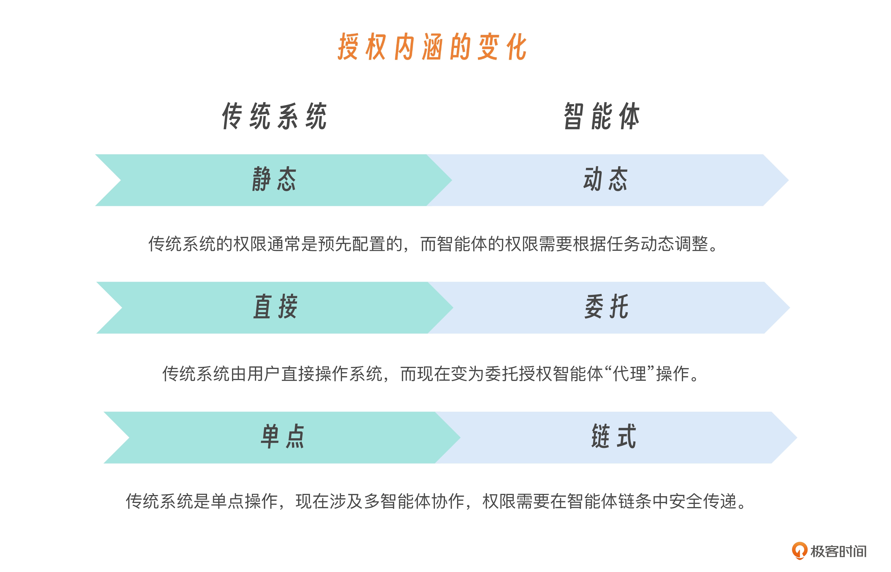
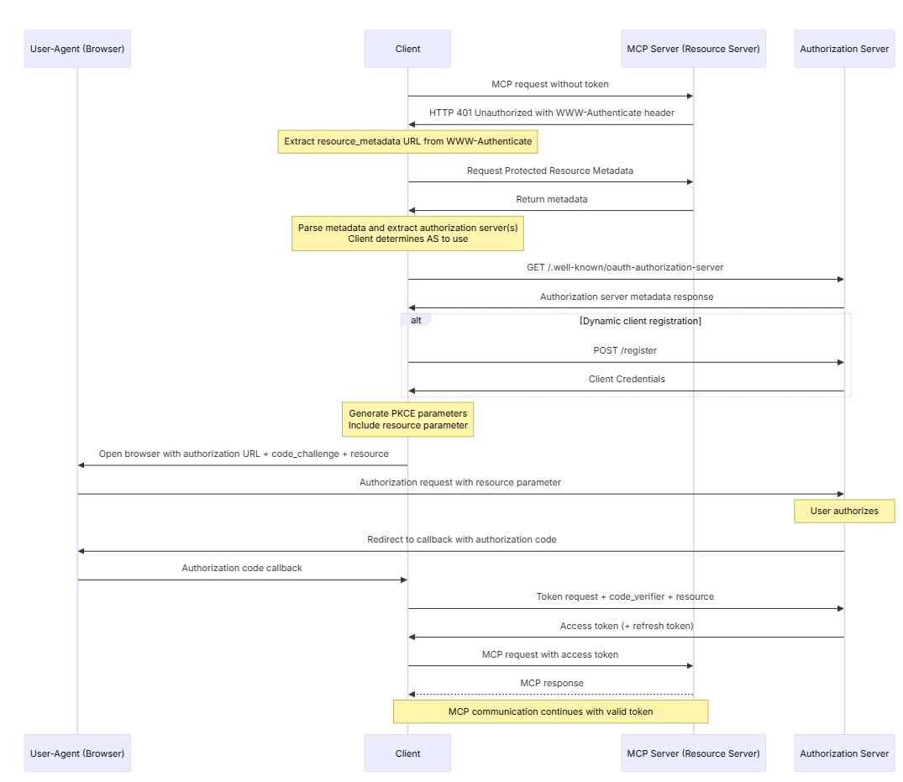

# 19 | 授权机制变革：如何为AI时代的智能体协作保驾护航？

你好，我是黄佳。

前面的课程留言中，好几位同学提到能否详细说说 MCP 和 A2A 这两个协议的授权（鉴权）机制，这节课我就来回应这个问题。

先抛出问题：“MCP 和 A2A 不就是调用工具和 Agent 协作吗？为什么还需要专门的授权机制？”

想象一下，未来智能管家能够控制咱们所有家电、房门、设备，但没有权限管理，那么任何人都可以通过它打开咱家的门窗，冰箱，保险柜——这显然是不可接受的。同样，当 AI 系统获得了访问外部资源的能力，安全性就成为了重中之重。

在前两节课里，我们把“协议”比作外交礼仪、“架构”比作政府组织。如果说协议是让系统能够“说话”，架构是让系统能够协作，那么授权机制就是确保系统能够安全地协作。

当你的 AI 助手能够访问你的邮箱、文档、数据库时，如何确保它只能做该做的事？当多个智能体相互协作时，如何验证彼此的身份并控制权限？这就是授权机制要解决的核心问题。

因此，今天我们将一起探讨下列话题。

- 授权机制是如何从简单的用户名密码演进到今天的 OAuth 2.0？

- MCP 如何在保持简洁的同时实现企业级的安全控制？

- A2A 如何解决多智能体之间的信任和权限问题？

- 这两种协议的授权机制如何相互补充，共同构建安全的 AI 生态？

在深入 MCP 和 A2A 的授权机制之前，我们需要先理解什么是授权（Authorization）以及它与认证（Authentication）的区别。

## 认证 vs 授权：你是谁 vs 你能做什么

认证回答的是你是谁（身份鉴别）的问题，就像门卫检查你的身份证。

而授权回答的是你能做什么（权限判断）的问题，这就像进入政府大楼，认证相当于检查你的工作证，授权就好比根据你的身份允许你进入哪些区域。

```
认证（Authentication）："请证明你是张三"
授权（Authorization）："张三可以访问A、B资源，但不能访问C资源"
```

这个区别非常重要。在传统的 Web 应用中，我们通常是先认证（登录），再授权（检查权限）。根据主体（用户、服务或代理）的身份和权限，将其对受保护资源的访问能力进行授予和控制的过程。但在 AI 系统中，情况变得更加复杂——不仅要验证用户身份，还要控制 AI 代理能代表用户做什么。

授权过程中包含下面 4 个要素。

- 主体（Subject）：请求访问资源的一方，如用户或客户端。

- 客体（Object）/ 资源（Resource）：待访问或操作的数据、接口、服务等。

- 权限（Permission）：对资源可执行的操作集合，如读、写、删除。

- 策略（Policy）：定义哪些主体可以以何种条件、执行何种权限访问哪些资源。

在智能体时代，授权的内涵发生了根本性变化，我总结了三个特点。



- 从静态到动态：传统系统的权限通常是预先配置的，而智能体的权限需要根据任务动态调整。

- 从直接到委托：用户不再直接操作系统，而是委托智能体代为执行，这引入了委托授权的复杂性。

- 从单点到链式：一个任务可能涉及多个智能体的协作，权限需要在智能体链条中安全传递。

举个例子，扮演不同角色的 AI 助手，权限范围就有所不同。

- 普通员工的 AI 助手：可以读取财务记录，但不能创建付款。

- 经理的 AI 助手：可以发起采购订单，但金额有限制。

- 管理员的 AI 助手：拥有完整权限。

在 MCP 和 A2A 的世界里，AI 代理可能代表具有不同权限的人类用户行事。这意味着我们需要确保代理只能做用户被允许做的事——或者更安全地说，是用户权限的一个衰减子集，这要求细粒度的权限控制。因为现在的模型或 Agent 不止需要“看”数据，还会“代表用户去行动”；它们常常是跨主语、跨系统、跨组织的。于是我们不只要“能连”，更要回答：替谁连、连到哪、凭什么连、连多长时间、连完算谁的账。

这种转变带来了新的挑战：如何确保智能体只能访问完成任务所必需的资源？如何防止权限在智能体之间的传递中被放大或滥用？如何在保证安全的同时不影响用户体验？

## 授权机制的演进史：从密码到 OAuth

详细剖析 MCP 和 A2A 的授权实现之前，我们还是先来看一看授权机制的发展历程，从中找找灵感。

### 早期访问控制模型：DAC/MAC/RBAC

最早的授权机制就是简单的用户名和密码。这就像给每个人发一把钥匙，有钥匙就能开门。

```
Password: dXNlcm5hbWU6cGFzc3dvcmQ=
```

这种方式的问题显而易见——密码明文传输，每次请求都要发送密码，也无法细粒度控制权限。所以，早期访问控制经过进化，发展出 DAC、MAC 和 RBAC 等访问控制模型。

基于自主访问控制（DAC）中，资源所有者拥有资源的完全控制权，可授予或撤销其他主体的访问权限。它的特点是灵活易用，但缺乏集中管理和审计，不适合大型或安全要求高的系统。

基于强制访问控制（MAC）系统依据预定义的安全标签（如机密、秘密、公开）来控制访问，且由中央安全机构统一管理。其特点是安全性高，但灵活性不足，难以适应动态场景。

基于角色的访问控制（RBAC）通过将主体映射到角色（Role），并将角色与权限关联，简化权限管理。这样能够简化大规模用户与权限管理，因此这个方案广泛应用于企业系统。

### Session 机制：最早的“房卡”模式

随着 Web 应用的兴起，Session 机制应运而生。用户登录后，服务器创建一个 Session，客户端只需要携带 Session ID。

```
Cookie: JSESSIONID=1234567890ABCDEF
```

这就像酒店的房卡系统——你在前台（登录）验证身份后，得到一张房卡（Session ID），之后刷卡就能进房间，不需要每次都出示身份证。当你退房之后，这张房卡也就失效了。

### HTTP 基础认证与摘要认证

在 Session 机制之前或同时期，HTTP 协议本身提供了两种简易认证方式：

- HTTP Basic Auth：通过 HTTP 头部 Authorization: Basic发送用户名 / 密码。

- HTTP Digest Auth：对密码进行摘要（hash）后传输，安全性比 Basic 更好，但仍存在重放攻击风险。

这些方法只解决了最基本的身份传输问题，却缺乏灵活性和安全性。

### API Key 与 Token：静态密钥到短期令牌

随着 API 的流行，出现了更通用的认证手段。

一种方法是 API Key，这是一段静态字符串，客户端在每次请求时携带。实现简单，但难以精细化管理，也容易泄露。

另一种方法是 Bearer Token。它的形式类似 API Key，但通常设定为短期有效，且需配合HTTPS 使用，降低了被窃取的风险。

### Token 认证时代：无状态和 JWT

随着前后端分离和移动应用的普及，无状态的 Token 认证成为主流。JWT（JSON WebToken）是其中的代表。

JWT（JSON Web Token）内部包含 Header、Payload、Signature 三部分。Payload 里存放用户身份信息与过期时间。Signature 起到防伪标记的作用。

```
// JWT的结构
{
 "header": {
   "alg": "HS256",
   "typ": "JWT"
 },
 "payload": {
   "sub": "1234567890",
   "name": "John Doe",
   "iat": 1516239022,
   "exp": 1516242622
 },
 "signature": "SflKxwRJSMeKKF2QT4fwpMeJf36POk6yJV_adQssw5c"
}
```

JWT 就像一张临时通行证，上面写着身份、有效期，还有防伪签名，服务器无需保存会话状态。

### OAuth：授权机制的一次革命

OAuth 的出现是授权机制的又一次革命。它解决了一个关键问题，如何让第三方应用安全地访问用户资源，而不需要用户提供密码。

想象这个场景：你想让一个照片打印服务访问你 Google Photos 里的照片。在 OAuth 之前，你需要把 Google 密码告诉打印服务——这显然很危险。

有了 OAuth，流程变成了后面这样。

1. 打印服务引导你到 Google 登录

2. Google 询问：“是否允许打印服务访问你的照片？”

3. 你同意后，Google 给打印服务一个“访问令牌”。

4. 打印服务用这个令牌访问你的照片。

再打个比喻，这就像你请搬家公司帮你搬家，但不想给他们家里的钥匙。于是你请物业（Google）开具一个临时通行证，只允许搬家公司在特定时间进入特定区域。

### 更细粒度与动态化的访问控制

随着云计算、微服务和零信任架构的普及，安全需求也越来越复杂，于是在访问控制领域，除了刚在提到的 MAC、RBAC 之外，产生了一系列更细粒度和动态化的访问控制模型。

- ABAC（基于属性的访问控制）通过用户属性（职位 = 经理）、资源属性（文档 = 机密）、环境属性（时间 = 工作日）等综合判断是否授权。灵活，但策略复杂。

- PBAC（基于策略的访问控制） 使用统一的策略语言（如 XACML、OPA Rego），在企业和云环境中集中管理和审计规则。AWS IAM、Kubernetes OPA 都属于这一类。

- ReBAC（基于关系的访问控制） 根据用户和资源之间的关系（朋友、同事、项目成员）决定权限，非常适合社交网络和协作平台。

- CBAC（基于上下文的访问控制） 结合实时上下文（IP、设备、位置、时间），动态决定访问是否放行，是零信任安全体系的核心。

- CapBAC（基于能力的访问控制） 给用户一张“能力凭证”，凭证本身定义了可操作范围，适合 IoT、区块链和分布式场景。

在现代企业架构里，逐渐形成了一种“混合授权模式”——底层用 RBAC 简化角色与权限管理，叠加 ABAC/CBAC 提供细粒度和动态决策， 统一由 PBAC 策略引擎集中控制与审计， 对外服务依然依赖 OAuth/OpenID Connect 作为第三方授权协议。

这就是所谓的零信任架构（Zero Trust），默认不信任任何请求，每一次访问都需要经过严格验证和上下文判断。

## MCP 的授权机制：为 AI 工具访问把关

MCP 的授权机制建立在 OAuth 2.1 之上，专门为 HTTP 传输设计，让 MCP 客户端能够代表资源所有者向受限的 MCP 服务器发起请求。

### MCP 授权的核心设计理念

MCP 在设计授权机制时，面临着独特的挑战。

1. 工具的危险性：工具代表着任意代码执行，必须谨慎对待。特别是工具行为的描述（如注释）应被视为不可信的，除非来自可信服务器。

2. 用户同意的必要性：主机必须在调用任何工具之前获得明确的用户同意，用户应该在授权使用之前了解每个工具的功能。

3. 灵活性需求：不同场景需要不同的授权流程。

因此，MCP 在其授权页面开宗明义地提出下面的核心设计理念：

- The Model Context Protocol provides authorization capabilities at the transport level,enabling MCP clients to make requests to restricted MCP servers on behalf of resourceowners. This specification defines the authorization flow for HTTP-based transports.

别小看了这短短几行字，让我逐个关键点来解释。

第一个关键点是 at the transport level（在传输层级别），意思是授权机制不是在应用逻辑层面，而是在网络传输层面实现。

```
应用层：MCP协议的工具调用、资源读取等业务逻辑
传输层：HTTP、STDIO等底层通信协议
```

- 授权层：在传输层之上，应用层之下的中间层

为什么这样设计？有三个考量。

- 协议无关性： 无论使用 HTTP、WebSocket 还是其他传输方式，都能统一处理授权。

- 透明性： 应用层的 MCP 工具不需要关心授权细节。

- 安全性： 在数据传输之前就完成权限验证。

第二个关键点是 MCP clients to make requests to restricted MCP servers，此处restricted 的含义为不是所有人都能访问，需要授权的 MCP 服务器。

举例来说：

```
MCP Client（客户端）
├── Claude、GPT等AI模型
├── AI应用或Agent
└── 开发者工具
MCP Server（服务器）
├── 文件系统访问服务
├── 数据库查询服务
├── API集成服务
└── 其他受保护的资源服务
```

第三个关键点是 on behalf of resource owners（代表资源所有者）。这是 OAuth 核心概念的体现。

在传统 Web 场景中：

```
用户（资源所有者）→ 授权给第三方应用 → 访问Google Drive
```

在 MCP 场景中：

```
用户（资源所有者）→ 授权给AI模型 → 访问用户的文件/数据库/API
```

举例来说，比如当 AI（如 Claude Code）要访问用户文件系统：

- 参与者：

```
- 资源所有者：用户张三
- MCP Client：Claude AI
- MCP Server：文件系统服务
```

- 流程：

```
1. Claude想帮张三整理文档
2. 张三授权Claude访问自己的文件夹
3. Claude通过MCP协议，代表张三访问文件系统服务
4. 文件系统服务验证：这个访问确实是张三授权的
```

或者 AI 查询企业数据库的场景：

- 参与者：

```
- 资源所有者：企业员工李四
- MCP Client：企业AI助手
- MCP Server：CRM数据库服务
```

- 流程：

```
1. 李四请AI助手分析销售数据
2. 李四通过OAuth流程授权AI助手
3. AI助手代表李四向CRM数据库发起查询
4. 数据库服务验证权限后返回李四有权查看的数据
```

上述设计从技术架构意义上，成功实现了授权与业务分离。也就是说，没有 MCP 授权时，AI模型直接调用各种 API，每个 API 都要单独处理权限；有了 MCP 授权时，AI 模型先通过MCP 传输层（统一授权），然后通过 MCP 服务器访问底层资源。

这样就形成了标准化的安全边界——不管是文件、数据库还是 API，都采用同一套授权机制，以及中心化的授权管理，用户可以在一个地方管理所有 AI 访问权限。而且还有可审计的访问记录，所有 AI 代表用户的行为都有完整日志，可以支持复杂的委托场景。

MCP 建立了一个标准化的“代理授权”框架，让 AI 能够安全地、可控地代表用户访问各种受保护的资源，而授权验证发生在网络传输层面，确保了安全性和透明性。这种设计特别适合 AI时代的需求——AI 需要访问很多用户资源，但用户必须能够精确控制 AI 能做什么、不能做什么。

### MCP 的 OAuth 实现

MCP 选择了 OAuth 2.1 作为其授权框架的基础，这不是偶然的。OAuth 2.1 完美地解决了“客户端代表资源所有者访问受保护资源”的场景，这正是 MCP 中“Host/Client 代表用户访问Server 提供的工具”的核心需求。

下面是 MCP 授权流程的代码实现示例。

```python
# MCP授权流程示例
class MCPAuthFlow:
   async def connect_to_server(self, server_url: str):
       # 1. 服务器返回401，附带资源元数据URL
       response = await self.initial_request(server_url)
       if response.status == 401:
           metadata_url = self.extract_metadata_url(response.headers['WWW-Authen
       # 2. 获取资源服务器元数据
       resource_metadata = await self.fetch_metadata(metadata_url)
       auth_servers = resource_metadata['authorization_servers']
       # 3. 发现授权服务器配置
       auth_server = auth_servers[0]  # 选择第一个授权服务器
       auth_config = await self.fetch_auth_server_metadata(auth_server)
       # 4. 动态客户端注册（如果需要）
       if not self.has_client_id:
           client_info = await self.dynamic_registration(
               auth_config['registration_endpoint'],
               {
                   "client_name": "MCP Client",
                   "redirect_uris": ["http://localhost:8080/callback"],
                   "grant_types": ["authorization_code"],
                   "response_types": ["code"]
               }
           )
           self.client_id = client_info['client_id']
       # 5. 启动授权码流程（使用PKCE）
       code_verifier = self.generate_code_verifier()
       code_challenge = self.generate_code_challenge(code_verifier)
       auth_url = self.build_auth_url(
           auth_config['authorization_endpoint'],
           client_id=self.client_id,
           redirect_uri="http://localhost:8080/callback",
           code_challenge=code_challenge,
           resource=server_url  # 关键：指定目标资源
       )
       # 6. 用户授权后，交换访问令牌
       authorization_code = await self.wait_for_callback()
       token = await self.exchange_token(
           auth_config['token_endpoint'],
           code=authorization_code,
           code_verifier=code_verifier,
           resource=server_url  # 再次指定资源
       )
       # 7. 使用令牌访问MCP服务器
       return await self.connect_with_token(server_url, token)
```

MCP 强制要求客户端在授权请求和令牌请求中都包含 resource 参数，明确指定令牌的使用目标。这个看似简单的要求，实际上建立了一道重要的安全防线。

```
# 错误的做法：令牌可以被用于任何服务
token = get_generic_token()
call_any_service(token)  # 危险！
# MCP的做法：令牌绑定到特定资源
token = get_token_for_resource("https://mcp.example.com/weather")
# 这个令牌只能用于weather服务，不能用于其他服务
```

MCP 的安全不仅依赖客户端的正确行为，服务器端也必须进行严格的验证。你可以参考后面的这个例子来看看如何实现双向的信任验证。

```python
class MCPServer:
   async def validate_request(self, request: Request):
       # 1. 提取令牌
       auth_header = request.headers.get('Authorization')
       if not auth_header or not auth_header.startswith('Bearer '):
           return Response(status=401, headers={'WWW-Authenticate': 'Bearer'})
       token = auth_header[7:]
       # 2. 验证令牌有效性
       try:
           claims = await self.verify_token(token)
       except TokenInvalidError:
           return Response(status=401)
       # 3. 关键：验证受众（audience）
       if self.server_url not in claims.get('aud', []):
           # 令牌不是为本服务器颁发的
           return Response(status=403, body="Token not intended for this resourc
       # 4. 验证权限范围
       required_scope = self.get_required_scope(request.path)
       if not self.has_scope(claims.get('scope', ''), required_scope):
           return Response(status=403, body="Insufficient scope")
       # 5. 执行请求
       return await self.process_request(request, claims)
```

### 完整的 MCP 授权流程

MCP 官方给出了完整的 MCP 授权流程，如下图所示。



- 图源：https://modelcontextprotocol.io/specification/2025-06-18/basic/authorization#resource-parameter-implementation

1. 客户端发起请求（MCP request without token），但没有携带有效 Token。 MCP 服务器返回 401 Unauthorized，并带上 WWW-Authenticate 头，告诉客户端去哪里获取授权。这就好比你去大楼刷卡进门，但没带门禁卡，保安拦下你，并告诉你，请去前台（授权服务器）登记。

2. 获取授权服务器信息。客户端根据 WWW-Authenticate 提供的 resource_metadata URL，去请求受保护的元数据。元数据里包含可用的授权服务器（Authorization Server） 信息。客户端决定用哪个授权服务器。 这相当于你去前台，前台告诉你“这栋楼的门禁由某个安保部门负责”。

3. 客户端注册，这步是可选的。如果客户端是“新来”的，会进行动态注册（POST /register），拿到一份 client credentials。这是客户端向授权服务器说明自己身份的过程。这相当于你第一次来大楼，要在前台登记，留下注册信息，然后拿到一张临时访客卡。

4. 接着是生成 PKCE 参数 & 用户授权。客户端生成 PKCE 参数（code_challenge/code_verifier）增强安全性，然后通过浏览器重定向到授权服务器，发起授权请求。用户在浏览器端确认授权。也就是你把访客申请表交给前台，前台再询问真正的业主（用户），“要不要允许这位访客进入？”

5. 随后是授权码回调 & 换取 Token 环节。 用户同意后，授权服务器返回授权码（Authorization Code）给客户端。客户端再用授权码 + PKCE 参数，去换取 AccessToken（访问令牌） 和可选的 Refresh Token。这相当于业主同意后，前台给你一张有效的临时门禁卡（（Access Token）。

6. 最后就是携带 Token 访问资源，客户端带着 Access Token 再次访问 MCP 服务器。这次验证通过，正常返回数据。之后的通信都会带上有效 Token，直到 Token 过期。这好比你拿到门禁卡后，就能顺利刷卡进出大楼，，直到卡过期失效。

### MCP 的核心安全原则

MCP 明确禁止令牌透传（Token Passthrough），即 MCP 服务器绝不能将收到的令牌转发给上游 API。这是为了防止“混淆代理人”（Confused Deputy）问题：

```python
# 危险的做法：令牌透传
class BadMCPServer:
   async def handle_request(self, request, user_token):
       # 错误：直接使用用户令牌调用上游API
       upstream_response = await call_upstream_api(
           headers={'Authorization': f'Bearer {user_token}'}
       )
       return upstream_response
# 正确的做法：令牌交换
class SecureMCPServer:
   async def handle_request(self, request, user_token):
       # 验证用户令牌
       user_claims = await self.verify_token(user_token)
       # 使用服务器自己的凭据获取新令牌
       upstream_token = await self.get_upstream_token(
           scope=self.map_to_upstream_scope(user_claims)
       )
       # 使用新令牌调用上游API
       upstream_response = await call_upstream_api(
           headers={'Authorization': f'Bearer {upstream_token}'}
       )
```

此外，MCP 客户端必须使用 Authorization 请求头字段，并且授权必须包含在每个 HTTP 请求中，即使它们是同一逻辑会话的一部分。访问令牌绝不能包含在 URI 查询字符串中。

```
# 正确的方式
GET /tools/weather HTTP/1.1
Authorization: ls/weather?token=eyJhbGciOiJSUzI1NiIs... HTTP/1.1
```

- 咖哥发言：为什么不能把 Token 放在 URL 里？URL 会被记录在各种地方——浏览器历史、服务器日志、代理服务器、CDN 等。如果Token 在 URL 里，就相当于把你家钥匙到处乱放，任何能看到这些日志的人都能获得访问权限。而放在 Header 里的 Token 相对安全，因为 Header 通常不会被随意记录。

### MCP 的第三方授权

MCP 服务器可以支持通过第三方授权服务器进行委托授权。在这个流程中，MCP 服务器既充当 OAuth 客户端（对第三方认证服务器），又充当 OAuth 授权服务器（对 MCP 客户端）。

这种设计非常巧妙，让我们看一个实际例子。

```
用户 --> Claude Desktop --> MCP Server (Gmail) --> Google OAuth
        (MCP Client)       (OAuth Server+Client)   (Third-party Auth)
```

1. 用户在 Claude Desktop 中说：“帮我查看邮件”。

2. Claude Desktop（MCP Client）向 Gmail MCP Server 发送请求。

3. Gmail MCP Server 发现需要 Google 授权，引导用户到 Google 登录。

4. 用户在 Google 完成授权。

5. Gmail MCP Server 获得 Google 的访问令牌。

6. Gmail MCP Server 向 Claude Desktop 颁发 MCP 令牌。

7. Claude Desktop 使用 MCP 令牌访问邮件。

好，MCP 的授权机制已经介绍透彻，我们接着再来聊聊 A2A 的授权机制。

## A2A 的授权机制：智能体间的信任网络

如果说 MCP 的授权是垂直的（用户 ->AI-> 工具），那么 A2A 的授权就是水平的（AI<->AI）。A2A 从设计之初就支持企业级的认证和授权，与 OpenAPI 的认证方案保持一致。

### A2A 授权的独特挑战

A2A 面临的授权挑战更加复杂。

1. 身份的多样性：不仅有人类用户，还有 AI 代理本身的身份

2. 权限的传递性：Agent A 委托 Agent B 执行任务时，权限如何传递？

3. 信任的建立：陌生的 Agent 之间如何建立信任？

### Agent Card 中的安全声明

与 MCP 的集中式授权不同，A2A 采用了更加分布式的授权模型。Agent 通过 Agent Cards 公开其操作方式，包括它们能做什么、如何通信（例如是否支持流式传输），以及客户端应如何按照 OpenAPI 规范进行身份验证，同时支持与 OpenAPI 兼容的多种认证方案。

```json
{
 "name": "ScheduleAgent",
 "version": "1.0.0",
 "url": "https://calendar.example.com/a2a",
 "description": "负责日程查询与会议安排的智能体",
 "capabilities": {
   "streaming": true,
   "pushNotifications": true
 },
 "authentication": {
   "schemes": [
     {
       "type": "oauth2",
       "flows": {
         "authorizationCode": {
           "authorizationUrl": "https://auth.example.com/authorize",
           "tokenUrl": "https://auth.example.com/token",
           "scopes": {
             "read:calendar": "查看用户日程",
             "write:calendar": "修改用户日程"
           }
         }
       }
     },
     {
       "type": "http",
       "scheme": "bearer",
       "bearerFormat": "JWT"
     }
   ]
 },
 "skills": [
   {
     "id": "check_availability",
     "name": "查询会议室空闲时间",
     "description": "返回指定日期的可用会议室",
     "requiredScopes": ["read:calendar"]
   },
   {
     "id": "book_meeting",
     "name": "预订会议室",
     "description": "在指定时间预订会议室并写入日程",
     "requiredScopes": ["write:calendar"]
   }
 ]
}
```

这段示例的 capabilities 说明是否支持流式传输（streaming）、推送通知等；authentication 则声明兼容 OpenAPI 的多种认证方式（OAuth2 + Bearer）；skills 中则列出具体可调用的“技能”，并指明调用所需的授权范围（scopes）。

### CIBA：无重定向的认证流程

对于某些场景，A2A 采用了 Client Initiated Backchannel Authentication（CIBA）流程，这是一种不依赖浏览器重定向的 OpenID Connect 流程。Agent 可以通过推送通知、邮件、短信等方式联系用户进行身份验证。

```python
# CIBA流程示例
class CIBAAu；hFlow:
中则    async def authenticate_user(self, user_hint):
       # 1. 发起后台认证请求
       auth_request = await self.initiate_auth(user_hint)
       # 2. 通过推送通知联系用户
       await self.send_push_notification(
           user_hint,
           "Bank Agent需要验证您的身份"
       )
       # 3. 轮询等待用户确认
       while True:
           status = await self.check_auth_status(auth_request.id)
           if status == "approved":
               return await self.get_access_token(auth_request.id)
           elif status == "denied":
               raise AuthenticationError("用户拒绝认证")
           await asyncio.sleep(2)  # 等待2秒后重试
```

在这个场景中，你通过聊天机器人说：“我要开一个银行账户”，银行 Agent 需要验证你是某公司员工，银行 Agent 联系 HR Agent，HR Agent 通过推送通知要求你确认，你在手机上确认身份。整个流程完成，没有任何浏览器跳转。

### A2A 里的细粒度授权与多层身份

在传统系统里，权限控制通常只关注“用户能不能做这件事”。但在 A2A 世界里，情况更复杂。代理（Agent）往往并不是直接的“用户”，而是“代表用户去行动”的数字代理人。这就意味着我们需要明确三方面内容。

1. 用户身份（End User Identity） —— 谁在背后？是普通员工、经理，还是管理员？

2. 代理身份（Client Agent Identity） —— 哪个 Agent 发起请求？它是不是一个可信的Agent？

3. 委托权限（Delegated Permissions） —— 用户授权给该 Agent 的权限子集是什么？

A2A 的安全模型要求 Agent 不能越过用户本身的权限，甚至还要在其之下进一步衰减。

举个例子：

- 普通员工的 AI 助手，可以查财务记录，但不能发起付款。

- 经理的 AI 助手，可以发起采购订单，但金额有限（例如 < 10,000 元）。

- 管理员的 AI 助手，则拥有完整操作权限。

而一旦进入多 Agent 协作的 A2A 网络，情况就更微妙了。比如，你通过聊天机器人说，“我要开一个银行账户”。银行 Agent 需要验证你是否是某公司员工，之后它会向 HR Agent 发起请求；HR Agent 再通过手机推送要求你确认身份；之后等你在移动端点击“同意”，才会返回一个带有限制 scope 的授权。

下面的代码是 A2A 中的多层授权的示例。

```python
class A2APermissionManager:
   def __init__(self):
       self.user_roles = {}
       self.agent_restrictions = {}
   def check_permission(self, end_user, client_agent, action, resource):
       # 获取用户角色
       roles = self.user_roles.get(end_user, [])
       # 获取Agent限制（子集）
       restrictions = self.agent_restrictions.get(client_agent, {})
       if action == "approve_expense":
           if "manager" in roles:
               max_amount = restrictions.get("max_approval_amount", 10000)
               return resource.amount <= max_amount
       if action == "delete_expense":
           return "admin" in roles
       return False
class A2AAuthContext:
   def __init__(self, end_user_identity, client_agent_identity, delegated_permis
       self.end_user_identity = end_user_identity
       self.client_agent_identity = client_agent_identity
       self.delegated_permissions = delegated_permissions
   async def establish_trust(self, remote_agent_card):
       # 1. 验证Agent身份（证书/Agent Card）
       await self.verify_agent_certificate(remote_agent_card.url)
       # 2. 根据Agent Card里的authentication选择合适方案
       scheme = self.select_auth_scheme(remote_agent_card.authentication)
       # 3. 携带用户委托的scope发起OAuth请求
       if scheme.type == "oauth2":
           return await self.oauth_with_delegation(
               scheme, self.end_user_identity, self.delegated_permissions
           )
```

## MCP 与 A2A 授权机制的协同

在实际应用中，MCP 和 A2A 的授权机制往往需要协同工作。假设有这样一个跨部门协作的智能办公场景：销售 Agent 需要为客户准备一份提案，它需要从财务 Agent 获取预算数据，财务 Agent 需要通过 MCP 访问公司的 ERP 系统。

```
用户 --> 销售Agent --A2A--> 财务Agent --MCP--> ERP系统
        (OAuth)            (委托授权)        (工具授权)
```

整个授权流程是这样的：

```python
class CrossDepartmentCollaboration:
   async def prepare_proposal(self, user_token, customer_id):
       # 1. 销售Agent使用用户的OAuth token
       sales_agent = SalesAgent(user_token)
       # 2. 通过A2A协议请求财务Agent的帮助
       # 使用委托授权，传递受限的权限
       finance_request = {
           "task": "get_budget_data",
           "customer_id": customer_id,
           "delegated_token": self.create_delegated_token(
               user_token,
               scopes=["read:budgets"],  # 只授予读取预算的权限
               expires_in=3600  # 1小时有效期
           )
       }
       # 3. 财务Agent收到请求后，验证委托token
       finance_agent = FinanceAgent()
       if not finance_agent.verify_delegation(finance_request["delegated_token"]
           raise AuthorizationError("Invalid delegation")
       # 4. 财务Agent通过MCP访问ERP
       # 使用自己的服务账号，但记录是代表谁执行的
       mcp_client = MCPClient(
           server_url="erp.company.com",
           auth_token=finance_agent.service_token,
           audit_context={
               "on_behalf_of": user_token.subject,
               "requested_by": "sales_agent",
               "purpose": "customer_proposal"
           }
       )
       budget_data = await mcp_client.call_tool(
           "get_budget",
           {"customer_id": customer_id}
       )
       return budget_data
```

在这个例子中，我们可以看到多层安全控制安全边界的层层把关。在用户层中，用户通过OAuth 登录，获得初始权限；Agent 层中销售 Agent 只能请求与销售相关的操作，委托层的财务 Agent 收到的是受限的委托权限；工具层中 MCP 确保只有授权的工具被调用，在审计层每一步都需要被记录，确保可追溯。

## 总结

今天我们一起探讨了 MCP 和 A2A 的授权机制。让我们回顾一下关键要点。

1. 授权的演进：从简单的密码到 OAuth，授权机制不断演进以适应新的应用场景。

2. MCP 的垂直授权：基于 OAuth 2.1，专注于控制 AI 对工具和资源的访问。

3. A2A 的水平授权：支持 Agent 之间的身份验证和权限委托。

4. 协同工作：两种机制相辅相成，共同构建安全的 AI 生态。

从基础的认证概念到复杂的多 Agent 协作场景，智能体时代的信任网络将比传统网络时代的授权模型更为复杂。

- 传统授权模型：

```
用户 → 认证 → 授权 → 访问资源
```

- 智能体授权模型：

```
用户 → 认证 → 委托授权给Agent → Agent获得令牌 →
     → Agent调用工具（MCP）
     → Agent协作（A2A）→ 其他Agent → 下游资源
```

正因为有了 MCP 和 A2A 这样的协议，AI 代理现在可以直接与外部工具、数据库和 API 交互——本质上是采取行动而不仅仅是返回文本。

这种新能力解锁了强大的用例，但也带来了关键挑战。我们需要明确这些 MCP 连接的工具的管理与使用者身份与权限，以及每种工具的授权范围。此外，还要确定每一个 Agent 都应该具有哪些权限。

授权机制并不是无关轻重的技术细节，而是 AI 系统能否被信任和大规模部署的关键。没有完善的授权机制，再强大的 AI 系统也只能是实验室里的玩具。

## 思考题

1. 在金融或医疗等强监管行业，每个 AI 决策都需要被审计。请设计一个审计系统，能够：

- 1.记录完整的授权链（谁授权了谁做什么）

- 2.保证审计日志不可篡改

- 3.支持事后的合规性检查

2. 假设一个 Agent 被发现有恶意行为，如何快速撤销它在整个系统中的所有权限？考虑到Agent 可能已经获得了多个长期 Token，设计一个全局撤销机制。

3. 在 A2A 的多 Agent 协作中，如果 Agent A 委托 Agent B，Agent B 又委托 Agent C，如何确保权限不会被放大？设计一个权限衰减机制，确保每次委托权限只能减少不能增加。

4. 能否设计一个授权系统，让 Agent 能够证明自己有某个权限，但不需要暴露具体的身份信息？这在隐私保护场景中会很有价值。

这些题目都是开放性的，并没有标准答案。希望大家积极探讨，激发出彼此的思维火花。期待您在留言区和我交流讨论，如果这节课对你有启发，别忘了分享给身边更多朋友。
