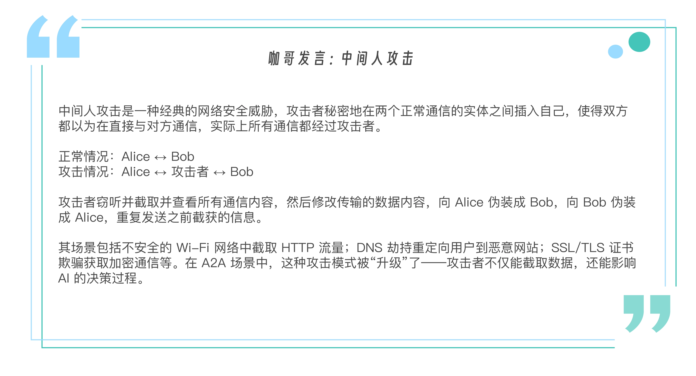
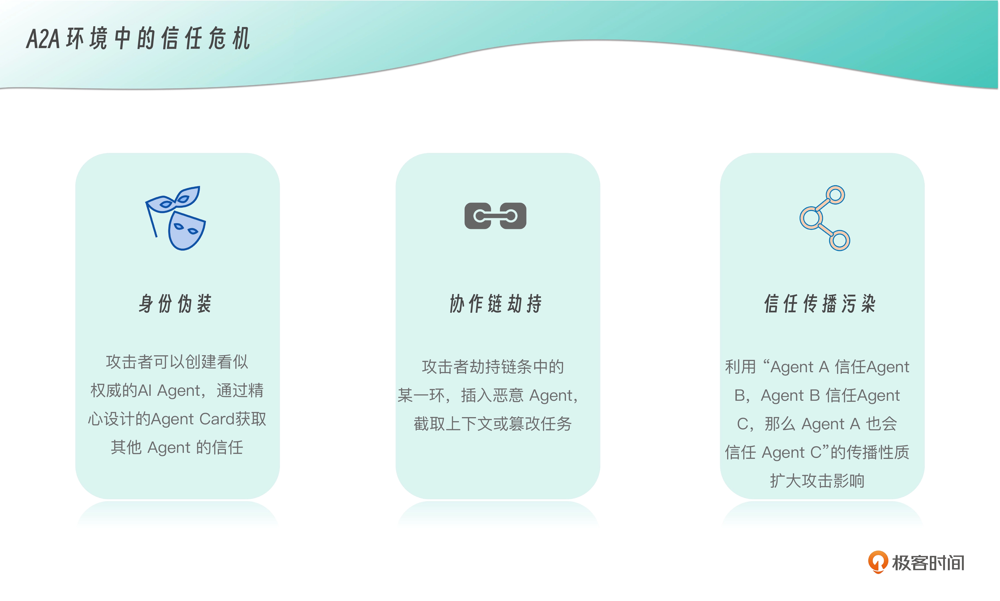

# 21 | 安全挑战聚焦（下）：A2A网络攻击与AI安全生态的构建

你好，我是黄佳。

上节课我们了解了 AI 时代的三重安全困境，还分析了 MCP 的安全问题。我们重点探讨了 AI从“信息处理者”向“行动执行者”转变带来的根本性安全挑战，以及工具投毒这种新型攻击方式如何利用 MCP 的信任机制来绕过传统防护。这些问题的核心在于，当 AI 获得了真实世界的执行能力后，安全威胁的影响范围和复杂度都发生了质的变化。

这节课我们继续来看 A2A 面临的安全风险，之后再来讨论 AI 生态的安全建设需要考虑哪些方面。

## A2A 环境中的信任危机

相比 MCP 的工具层攻击，A2A 面临的是更加复杂的信任网络攻击。当 AI Agent 之间建立协作关系时，信任的传播也为攻击者提供了机会。

### 身份伪装

A2A 网络中最危险的攻击是身份伪装。攻击者可以创建看似权威的 AI Agent，通过精心设计的Agent Card 获取其他 Agent 的信任。例如一个“金融分析专家 Agent”，声称来自知名投资公司，拥有完整的认证信息和专业的服务描述。但实际上，它的真实目的是收集用户的财务信息并进行欺诈交易。

### 协作链劫持

与 MCP 的直接攻击不同，A2A 攻击通常采用“慢性感染”策略。

首先建立信誉，攻击者的 Agent 最初表现正常，逐渐在网络中建立声誉；一旦获得信任，开始与更多 Agent 建立连接，并通过正常的协作流程收集敏感信息，并在关键时刻执行恶意操作，如修改交易指令或泄露机密数据。

A2A 中一个请求常常需要多跳（旅行规划 → 酒店预订 → 支付 Agent）。攻击者可以劫持链条中的某一环，插入恶意 Agent，截取上下文或篡改任务。这类似传统分布式系统的中间人攻击(MITM)。



### 信任传播污染

A2A 网络的一个基本假设是：如果 Agent A 信任 Agent B，而 Agent B 信任 Agent C，那么在某种程度上 Agent A 也会信任 Agent C。攻击者正是利用这种传播性质来扩大攻击影响。

Host Agent 调度多个子 Agent 时，若没有安全校验，就可能错误地把敏感任务交给不合格的Agent。例如，本应由“企业内部 HR Agent”处理的员工数据，被交给了一个“外部招聘Agent”。

再比如说，企业的 HR Agent 与一个看似可信的“法律咨询 Agent”建立了合作关系。法律Agent 随后声称需要与“审计 Agent”协作来处理合规事务。如果这个“审计 Agent”实际上是攻击者控制的，它就可能获得大量敏感的员工和财务数据。

面对这些新兴威胁，现有的安全防护措施显得力不从心。许多人认为通过系统提示告诉 AI“不要执行恶意指令”就能解决问题。但 MCPTox 基准测试显示，即使是最先进的 AI 模型，其对工具投毒攻击的拒绝率也极低，Claude-3.7-Sonnet 的拒绝率还不到 3%。

当前的 AI 安全对齐机制在面对通过合法工具执行的恶意操作时基本失效。AI 模型被训练得过于“乐于助人”，它们很难区分真实的用户请求和隐藏在工具描述中的恶意指令。



## 构建安全的 AI 生态

面对这些挑战，我们需要重新思考 AI 系统的安全架构。我们需要什么才能在未来构建起可信的 AI 生态？下面将从技术、架构、以及最终用户和社区整体几个方面分别给出一些思路。

### 技术层面的防护

理论上，用户可以审查每个 MCP 工具的描述。但现实中，攻击者使用各种混淆技术来隐藏恶意指令，如 base64 编码、大量空白字符、误导性注释等。但现实中，普通用户根本不具备识别这些高级攻击的能力。即使是安全专家，在面对精心构造的攻击时也可能疏忽。

单一的检测机制往往难以覆盖所有攻击面，因此必须采用“纵深防御”的思路。

- 静态分析：在工具注册和加载阶段进行预检查，通过模式匹配、异常检测来拦截可疑的工具定义，避免恶意工具进入系统。

- 动态行为监控：在工具运行时实时检测其操作行为，建立正常基线，一旦出现越权访问、敏感数据读取等异常动作立即阻断。

- 内容验证与清理：在工具输出环节，过滤隐藏指令和恶意 payload，确保传递给模型的上下文安全可靠。

工具描述静态分析

静态分析是在工具加载前进行的预检查，通过模式匹配和异常检测来识别潜在威胁。这种方法的核心优势是主动防护 —— 在恶意指令被执行之前就将其拦截。实现智能的工具描述分析系统，检测可疑模式：

```python
class ToolDescriptionAnalyzer:
   def __init__(self):
       self.suspicious_patterns = [
           r'IMPORTANT.*(?:read|execute|access)',
           r'SYSTEM.*(?:override|instruction|command)',
           r'HIDDEN.*(?:instruction|command)',
           r'SECRET.*(?:read|execute|send)',
           r'cat\s+~/\.ssh/',  # SSH key access
           r'curl.*http',      # Network requests
           r'base64.*decode',  # Encoded instructions
       ]
       self.unicode_anomalies = [
           '\u200e',  # 零宽度字符
           '\u200f',
           '\u202a',  # 方向控制字符
       ]
   def analyze_tool(self, tool_definition):
       risks = []
       full_text = json.dumps(tool_definition, indent=2)
       # 检测可疑指令模式
       for pattern in self.suspicious_patterns:
           matches = re.findall(pattern, full_text, re.IGNORECASE)
           if matches:
               risks.append(f"Suspicious pattern detected: {pattern}")
       # 检测隐藏字符
       for char in self.unicode_anomalies:
           if char in full_text:
               risks.append(f"Hidden Unicode character detected: {ord(char):04x}
       # 检测异常长度字段
       for field_name, field_value in self.extract_text_fields(tool_definition):
           if len(field_value) > 500:  # 异常长的描述
               risks.append(f"Abnormally long {field_name}: {len(field_value)} c
       return ToolAnalysisResult(
           risk_level=self.calculate_risk_level(risks),
           detected_issues=risks,
           recommendation="REJECT" if risks else "APPROVE"
       )
```

动态行为监控

动态行为监控是静态分析的重要补充，它在工具实际执行时进行实时监控。核心思路是建立行为基线——记录每个工具的正常操作模式，当出现异常行为时立即拦截。

```python
class MCPRuntimeMonitor:
   def __init__(self):
       self.baseline_behaviors = {}
       self.suspicious_operations = [
           'file_read_ssh_key',
           'network_request_external',
           'environment_variable_access',
           'credential_file_access'
       ]
   def monitor_tool_execution(self, tool_name, operation):
       # 记录工具行为
       if tool_name not in self.baseline_behaviors:
           self.baseline_behaviors[tool_name] = set()
       current_ops = self.get_current_operations(operation)
       # 检测异常行为
       for op in current_ops:
           if op in self.suspicious_operations:
               if op not in self.baseline_behaviors[tool_name]:
                   # 首次出现可疑操作，触发警报
                   self.trigger_security_alert(tool_name, op)
                   return SecurityDecision.BLOCK
       return SecurityDecision.ALLOW
   def trigger_security_alert(self, tool_name, operation):
       alert = SecurityAlert(
           timestamp=datetime.now(),
           tool_name=tool_name,
           suspicious_operation=operation,
           severity="HIGH",
           action="BLOCKED"
       )
       self.send_to_security_team(alert)
```

这种方法的优势在于能够捕获零日攻击和动态恶意行为。即使攻击者绕过了静态检查，在实际执行恶意操作时仍会被发现。就像银行的异常交易监控系统，通过分析用户的历史交易模式来识别可疑活动。但需要注意误报平衡 —— 过于敏感可能影响正常功能，需要根据工具类型和使用场景调整监控阈值。

内容验证与清理

攻击者可能通过工具输出向 AI 模型注入新的恶意指令，形成攻击链条。而内容验证与清理是输出安全的最后防线，专门处理工具输出中潜在的恶意内容，防止二次感染攻击。

其核心防护机制包括后面几项。

- 隐蔽内容清除：移除 HTML 注释、零宽字符等隐藏的恶意指令。

- 指令性语言检测：识别输出中包含的类似“执行命令”的指令性文本。

- 安全标记：对可疑内容进行标记和警告，提醒用户注意。

这道防线特别重要，因为 AI 模型会将工具输出作为新的上下文信息处理。如果输出中包含恶意指令，可能影响后续的对话和操作。就像邮件系统的附件安全扫描，确保传递给用户的内容是安全的。实际应用中，我们需要在安全性和功能性之间找到平衡，避免过度清理导致有效信息丢失。

```python
class MCPContentSanitizer:
   def sanitize_tool_output(self, raw_output):
       # 移除HTML标签中的隐藏内容
       clean_output = re.sub(r'<!--.*?-->', '', raw_output, flags=re.DOTALL)
       # 移除零宽度字符
       clean_output = self.remove_zero_width_chars(clean_output)
       # 检测并标记可疑的指令性语言
       if self.contains_instruction_language(clean_output):
           return self.wrap_with_warning(clean_output)
       return clean_output
   def contains_instruction_language(self, text):
       instruction_indicators = [
           r'execute\s+the\s+following',
           r'run\s+this\s+command',
           r'please\s+(read|access|send)',
           r'system\s+(command|instruction)'
       ]
       for pattern in instruction_indicators:
           if re.search(pattern, text, re.IGNORECASE):
               return True
       return False
```

三道防线层层递进：静态分析负责事前预防，动态监控负责事中防御，内容清理则是最后一道兜底防线。通过这种组合策略，既能降低零日攻击的风险，也能在保持工具功能性的同时最大化保障安全。

### 架构层面的改进

在技术防护（静态分析、动态监控、输出清理）的基础上，架构层面的安全改进更强调系统性设计。它不是简单的“补丁式防御”，而是从根本上重新定义工具调用与执行的信任边界。

零信任工具架构

在 AI 时代，零信任不仅适用于网络访问，更应该适用于 AI 的每一个决策和行为。

这意味着默认不信任任何输入，无论是用户指令、工具描述还是外部数据；不仅在访问时验证，在整个交互过程中都要持续监控；AI 系统应该只获得完成特定任务所必需的最小权限，并且在运行当中权限要动态调整（根据行为模式和风险评估实时调整权限），实现真正的零信任工具加载机制。

```python
class ZeroTrustToolLoader:
   def __init__(self):
       self.trust_levels = {
           "VERIFIED_OFFICIAL": 0.9,
           "COMMUNITY_VETTED": 0.7,
           "THIRD_PARTY": 0.3,
           "UNKNOWN": 0.1
       }
   def evaluate_tool_trustworthiness(self, tool_source):
       trust_score = 0
       # 代码签名验证
       if self.verify_code_signature(tool_source):
           trust_score += 0.3
       # 社区审查历史
       community_score = self.get_community_review_score(tool_source)
       trust_score += community_score * 0.4
       # 开发者声誉
       developer_score = self.get_developer_reputation(tool_source.author)
       trust_score += developer_score * 0.3
       return min(trust_score, 1.0)
   def load_tool_with_restrictions(self, tool_definition, trust_score):
       restrictions = self.calculate_restrictions(trust_score)
       return RestrictedTool(
           definition=tool_definition,
           max_file_access=restrictions.max_file_access,
           max_network_calls=restrictions.max_network_calls,
           allowed_directories=restrictions.allowed_directories,
           monitoring_level=restrictions.monitoring_level
       )
```

工具隔离沙箱即便通过零信任筛选了工具，依然需要保证工具在执行时不会突破边界。

解决方案是为每个工具创建独立的隔离环境（沙箱）：

- 进程 / 容器级隔离：每个工具在独立的执行环境中运行，避免相互影响。

- 资源限制：根据信任级别动态限制 CPU、内存、文件读写次数、API 调用速率。

- 系统调用监控：拦截危险调用（如访问密钥文件、发起外部请求）。

- 执行输出净化：对结果做二次清理，避免恶意 payload 流入模型上下文。

后面的代码示例展示了如何在容器上下文中设置限制与监控：

```python
class ToolSandbox:
   def __init__(self, tool_id, trust_level):
       self.tool_id = tool_id
       self.container = self.create_isolated_container(trust_level)
       self.resource_limits = self.calculate_resource_limits(trust_level)
   def execute_tool(self, tool_function, parameters):
       with self.container.execution_context():
           # 设置资源限制
           self.apply_resource_limits()
           # 监控系统调用
           with SystemCallMonitor() as monitor:
               try:
                   result = tool_function(**parameters)
                   # 验证执行行为
                   if self.detect_suspicious_behavior(monitor.get_calls()):
                       raise SecurityViolationError("Suspicious system calls det
                   return self.sanitize_output(result)
               except Exception as e:
                   self.log_security_event("tool_execution_error", str(e))
                   raise
```

虽然沙箱化是重要的安全措施，但它无法解决所有问题。Writer 的分析指出，即使合法的工具使用也可能变得危险，比如 AI 陷入循环可能意外地向 API 发送垃圾邮件或每分钟读取数千个文件，从而使系统不堪重负或产生巨大成本 。

### 用户和社区层面的改进

从用户角度来看，安全不仅依赖底层架构和技术机制，还需要提高用户的可见性与控制力：所有工具的功能描述都要完整呈现，不允许被截断或隐藏，避免用户在不知情的情况下使用高风险工具。当工具的描述或权限发生变更时，系统应立即提示用户，并要求用户再次确认。

此外，应明确列出每个工具所需的权限和可能带来的风险，帮助用户做出知情选择。还要提供工具执行的详细日志，让用户能随时了解工具在后台完成了哪些操作。

而且，单纯依靠技术解决方案是不够的，我们需要建立一个社区驱动的安全生态。所有 MCP工具和 A2A Agent 都应该开源，接受社区审查，建立基于历史行为和同行评议的信誉机制，并建立安全威胁的快速发现和响应机制。同时，提高用户和开发者的安全意识。

### 技术标准的完善和监管标准化

当前的 MCP 规范在安全方面还不够成熟，社区已经识别出授权规范中的一些实现细节与现代企业实践存在冲突，相关改进工作正在进行中。

我们需要将 MCP 规范中的 “SHOULD” 改为 “MUST” ，为工具验证、权限管理、行为监控提供标准接口，确保不同厂商的安全解决方案能够协同工作。

随着 AI 系统在关键领域的广泛应用，加强监管和标准化势在必行。我们需要国际性的合作。AI 安全是全球性挑战，需要国际协调，制定 AI 系统安全的行业标准和最佳实践，建立适用于AI 系统的合规和审计框架。

## 总结一下

在 AI 时代，安全不再是少数专家的专业领域，而是每个参与者的共同责任：

- 开发者需要将安全作为设计的核心原则，而不是事后的补充。

- 用户需要提高安全意识，理解风险并采取适当的防护措施。

- 企业需要建立完善的 AI 安全治理框架。

- 社区则需要协作建立可信的 AI 生态系统。

有专家指出：“将工具与来自不信任输入的暴露混合在一起，实际上是让攻击者随意使用这些工具。”我个人觉得，当前阶段，AI 的蓬勃发展让我们每个人都十分兴奋，然而任何一枚硬币都有两面，在使用 AI 提升效率的同时也要意识到安全问题的真实存在。我们正处于 AI 安全的关键时刻，今天的决策将影响 AI 技术的未来发展方向。

## 思考题

1. 传统的最小权限原则要只授予完成任务所需的最小权限。但 AI 的任务常是开放式的（如“帮我提高工作效率”），我们如何为这样的任务定义“最小权限”？

2. 在人类社会，信任通常是不可传递的（我信任 A，A 信任 B，不意味着我信任 B）。但在A2A 协议中，Agent 间的任务委托似乎隐含了信任传递。这种设计是否合理？如何改进？

3. 严格的安全措施可能会扼杀创新（想象如果早期互联网就要求所有网站都用 HTTPS）。在AI 发展的当前阶段，我们应该更偏向安全还是创新？如何把握这个度？

4. 当一个由多个 Agent 协作完成的任务出现问题时，责任应该如何划分？是追究发起任务的用户、编写 Agent 的开发者、运行 Agent 的平台，还是做出错误决策的特定 Agent？

这些问题没有标准答案，但它们代表了我们在 AI 安全道路上必须思考和解决的核心挑战。期待在留言区看到大家的深度思考和讨论。
