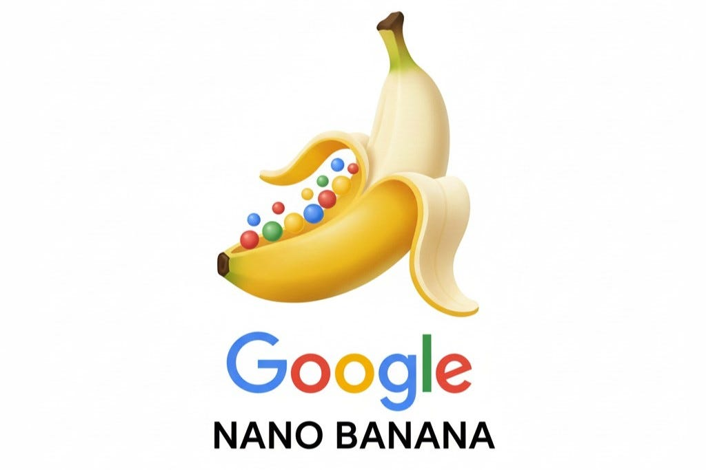
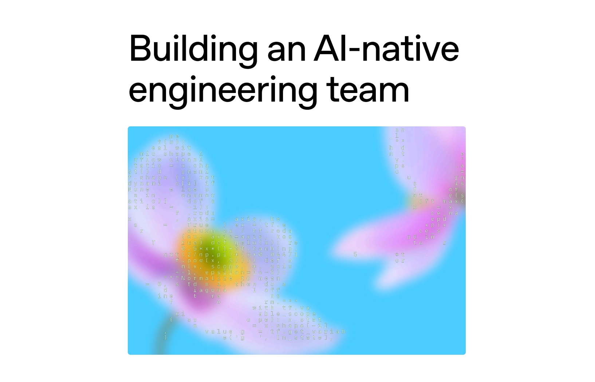
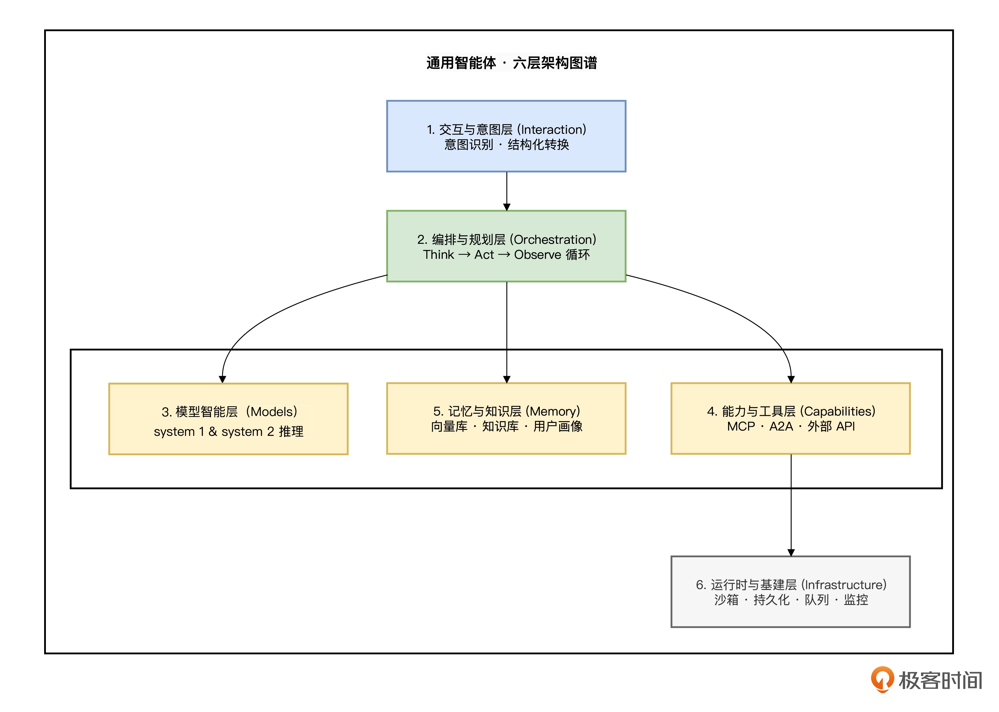
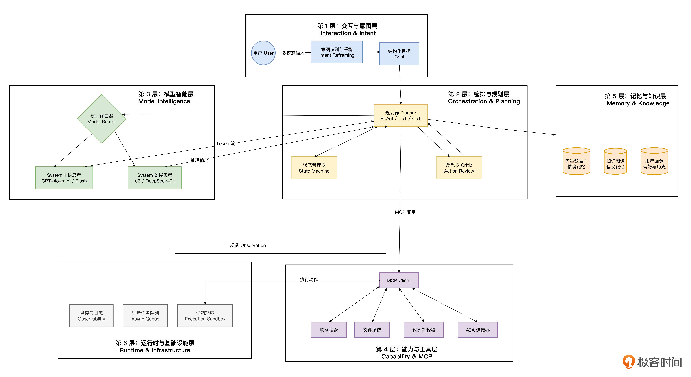

# 23 | 超越MCP和A2A：走向通用Agent技术架构

你好，我是黄佳。

这应该是我们这个专栏在结束语之前，今年所更新的最后一篇技术文章。不过别担心，只要明年 MCP 和 A2A 给我们更多的创新和惊喜，我们随时加更。

这一路走来，我们从最底层的 HTTP/SSE 协议讲起，亲手实现了 MCP（Model ContextProtocol）服务器和客户端，探讨了 A2A（Agent-to-Agent）的协作模式，在上一篇文章中，我们还一起看到了 OpenAI 如何借助 MCP 与 A2A 把自家产品推向“平台级操作系统”的格局。

如果说前面的内容是在教你如何“造砖”和“砌墙”，那么今天，我想带你站在高处，画一张未来的“建筑蓝图”。

面对大模型技术的突飞猛进，我心中其实和你一样，充满了实实在在的紧迫感和危机感。因为AI 和 Agent 的发展速度太快了。OpenAI 的 o3 系列去年重新定义了“慢思考”的价值，DeepSeek-R1 掀起了开源推理模型的狂潮。它们出现之后，大模型的“智商”明显呈现日新月异的状态。

就在我动笔写稿的时候，Google 刚刚宣布 Gemini 3.0 系列直接超越 ChatGPT 和 Claude，碾压式封王；全系模型从推理、视觉到搜索集成，全面刷新多个基准；Flash Thinking 直接把“思维链式推理”塞进轻量模型，证明推理不再是大模型专属能力。Nano Banana / Gemini 3 ProImage 带来了“推理式生成”。这不是简单的“图像生成模型升级”，而是图片生成开始具备逻辑推理能力。你给它一道物理题，它会先推理再画图；你给它植物养护需求，它会查知识库、整合信息再生成图片。 这是第一次“视觉生成”从感性向理性跃迁。

与此同时，OpenAI 也提出了一个新概念：AI-Native Engineering Team（AI 原生工程团队）， 这可能是今年最被低估、却最具有未来价值的概念。

- 设计文档 下载链接 https://cdn.openai.com/business-guides-and-resources/building-an-ai-native-engineering-team.pdf

如何理解呢？企业内部不仅要使用 AI 工具，而是要把代码生成、测试生成、文档生成、系统推理、数据管道重写和自动化 Agent 流程作为基础设施一样融入工程团队。未来的工程组织，将不是“人用模型”，而是人、模型、智能体共同组成的工程系统。

这一连串事件背后，都指向一个底层趋势：

- 我们正在被快速从提示词工程“Prompt Engineering”和上下文工程“ContextEngineering”推向智能体工程“Agentic Engineering”。提示词工程已经不够了。模型变得更强、更会推理、更能协作。

系统设计、工程架构、数据流、工具协议、推理模式……所有这些都被迫重新洗牌。

很多人问我：“佳哥，我已经学了 MCP，学了 Agent，为什么我做出来的应用还是不那么“智能”？为什么我还是不得 Agent 的设计要领？”那我们暂时退一步去思考，答案或许是：因为在这个大模型远远比人类更有智慧的时代，你还在用开发传统软件的逻辑，去开发智能体。

目前，绝大多数所谓的 Agent，其实只是披着 AI 外衣的 Workflow（工作流）。真正的变革，在于从“预定义流程”到“自主认知架构”的跃迁。

作为本专栏的收官之作，我不想再堆砌代码，而是想帮你打通任督二脉，系统性地梳理一套简单的“通用智能体设计架构（General Agent Architecture）”。这将是你未来三到五年构建 AI应用的底层世界观。

### 到底什么才是真正的 Agent？

在深入架构之前，我们必须先通过一个“图灵测试”般的拷问：我们目前做的东西，到底是不是Agent？—— 这里会有一个核心观点，并不是加了几个简单或复杂的提示词的 Chatbot，就是Agent。

过去两年，我们见证了 Chatbot 的爆发。Chatbot 的本质是 f(text) = text。它是一个无状态的函数，你给它输入，它给你输出，然后它就忘了你。

而 Agent（智能体） 的本质，可以用一个核心词概括：Agency（自主权 / 代理权）。

一个真正的 Agent，必须具备人类解决问题的三个核心特征，缺一不可。

1. 自主思考（Autonomous Reasoning）：它不是被动地回答“是什么”，而是主动地构思“怎么做”。它能自己拆解目标，通过 Chain of Thought（思维链）构建策略。

2. 行动能力（Action Capability）：它有手有脚。它能通过 MCP 协议操作文件、控制浏览器、调用 API。它不仅仅是建议者，更是执行者。

3. 在行动中学习（Learning by Doing）：这是一个闭环，Think（思考） → Act（行动） →Observe（观察） → Improve（修正）。它能感知行动的结果（比如报错、网页结构变化），并根据反馈调整下一步策略。

正如 Manus 联合创始人张涛在一次演讲中所提到的：过去几年，资本市场疯狂追逐“垂直Agent”：销售 Agent、法律 Agent、HR Agent。但你会发现，这些产品往往“甚至不如一个好的脚本”。

为什么？因为它们大多是“伪 Agent”。它们背后的逻辑是硬编码的决策树：

- 如果用户说 A，则执行 B；

- 如果执行 B 失败，则转人工。

这种架构无法应对现实世界的长尾任务（Long-tail tasks）。现实任务往往是模糊的、动态的、充满意外的。

- 比如，用户说：“帮我把这周没处理的紧急邮件整理一下，在这个飞书文档里列个表，如果有涉及到合同的，先发给法务确认。”面对这个指令，硬编码的脚本会瞬间崩溃。什么叫“紧急”？怎么判断“涉及到合同”？法务的联系方式在哪？

张涛说：这时候，我们需要的是通用智能体（General Agent）（这节课的核心思路正是受到他演讲的启发）。通用智能体不是“全知全能”，而是具备“通用解决问题的能力”。它不依赖预先写好的剧本，而是依赖强大的认知架构来现场生成剧本。

### 核心哲学：零预定义工作流（Zero Predefined Workflow）

在传统软件工程中，我们的安全感来自于“确定性”。我们画流程图，写 if-else，试图穷尽所有可能。

但在 Agent 时代，确定性是智能的敌人。

我们要构建的架构，其核心哲学是：零预定义工作流。

我们要抛弃人工编排的“逻辑树”，转而构建一个巨大的自主循环（Autonomous Loop）。在这个循环中，系统的职责不再是规定“下一步做什么”，而是提供：

- 丰富的工具箱（MCP）。

- 稳定的执行环境（Runtime）。

- 清晰的长期记忆（Memory）。

- 实时的反馈通道（Observation）。

而“下一步做什么”，完全交给模型（如 OpenAI o3、DeepSeek R1 或 Gemini 3.0）的推理能力去动态生成。智能，是从这个循环中涌现出来的，而不是被设计出来的。

### 通用智能体架构图谱：六层模型

基于上述哲学，我在这里总结了一套通用的六层架构模型，也就是我们今天要设计的核心——General Agent Architecture。

这不仅仅是一个概念图，更是你设计下一代 AI 应用的工程指南。

### 第 1 层：用户输入层（Intent & Context Layer）——从“关键词匹配”到“意图重构”

用户的输入往往是破碎的。比如用户会说：“看一下那个项目咋样了。”。

传统的 Chatbot 会傻眼，或者胡乱回复。通用智能体在这一层要做的是意图重构（IntentReframing）。

- 上下文注入：智能体需要知道“我是谁”“现在几点”“用户最近关注什么”。

- 模糊消歧：利用推理模型（如 DeepSeek-R1）进行 System 2 慢思考，分析“那个项目”大概率指代的是用户昨天打开过的代码库。

- 结构化转化：将自然语言转化为结构化的 Goal 对象，例如 {target: “Project X”, action:“status_check”, urgency: “high”}。

### 第 2 层：规划与控制层（Planning & Orchestration Layer）——智能体的大脑（The

### Brain）

这是架构的心脏，也是在行动中学习（Think → Act → Observe Loop ）发生的地方。这一层的核心技术不再是简单的 Prompt，而是复杂的推理模式。

1. 任务分解（Task Decomposition）：利用 COT（思维链）或 TOT（思维树），将宏大的目标拆解为原子任务序列。

- 目标：写一份竞品分析报告。拆解：1. 搜索竞品名单 -> 2. 抓取竞品官网 -> 3. 提取功能点 -> 4. 对比分析 -> 5. 生成文档。

2. 动态规划（Dynamic Replanning）：

当第 2 步“抓取官网”失败（例如遇到验证码）时，脚本会报错停止，而智能体会自我修正（“官网抓取失败，策略变更为：搜索相关的科技媒体评测文章作为替代数据源。”），这种容错与变通能力，是规划层的灵魂。

### 第 3 层：工具层（Tools & Capabilities Layer）——智能体的感官与手脚

在这一层，我们之前学习的 MCP（Model Context Protocol） 终于派上了大用场。

工具层不应该是一堆乱七八糟的 API 封装，而应该是标准化的能力接口。

- 读取世界： 浏览器（Browser Use）、文件读取器、数据库连接器。

- 改变世界： 写文件、发邮件、部署代码、点击按钮。

这里有一个非常迷人的现象，就是能力的涌现（Emergent Capabilities）。当你给智能体配备了“截图”和“点击”工具，再配上 Gemini 3.0 这种原生多模态大模型，它会突然涌现出“操作图形界面”的能力。你不需要教它如何使用 Photoshop，它通过看屏幕、尝试点击、观察反馈，就能学会简单的修图操作。

工具不再是死的函数，而是智能体探索世界的触角。

### 第 4 层：基础模型层（Foundation Model Layer）——推理引擎（The Engine）

基础模型不是 Agent，它是 Agent 的发动机。在通用架构中，我们需要混合模型编排（ModelOrchestration）。

- 快思考（System 1）： 使用 GPT-4o-mini 或 Gemini Flash。负责快速处理简单任务，如总结文本、格式化数据。成本低，速度快。

- 慢思考（System 2）： 使用 OpenAI o3、DeepSeek-R1 或 Claude 4.5 Sonnet。负责规划层极其复杂的逻辑推理、代码生成和反思纠错。

架构师需要根据任务难度，动态路由请求给不同的模型，实现成本与效果的平衡。

### 第 5 层：基础设施层（Infrastructure & Memory Layer）——最容易被忽视的“生命维

### 持系统”

这是目前大多数 AI 创业公司最薄弱的环节。一个 Chatbot 的生命周期只有几分钟（窗口关闭即死），而一个 Agent 可能需要运行数小时甚至数天。

这里，我们需要构建“智能体操作系统（Agent OS）”的基础设施：

1. 沙盒执行环境（Sandboxed Execution）： 智能体要写代码、跑脚本，必须给它一个安全的Docker 容器或微虚拟机（Firecracker）。不能让它炸了宿主机。

2. 长时记忆（Long-term Memory）：

- 情境记忆（Episodic Memory）： 记录“我做过什么”。基于向量数据库（Vector DB）。1.

- 语义记忆（Semantic Memory）： 记录“世界也是什么”。知识图谱（Knowledge2.Graph）。

- 程序性记忆（Procedural Memory）： 记录“任务该怎么做”。这是智能体进化出的“技能3.库”。

3. 状态持久化（State Persistence）： 智能体运行到一半挂了，重启后能从断点继续吗？这需要像数据库一样的 WAL（Write-Ahead Logging）机制。

### 第 6 层：外部系统与协作层（External Systems & A2A）——社会化智能

智能体不是孤岛，而是开放的、易协作的。这一层负责处理：

- 人机协作（Human-in-the-loop）： 当智能体遇到无法决策的高风险操作（如转账），必须能挂起任务，呼叫人类确认。

- 多智能体协作（A2A）： 一个通用的“项目经理 Agent”可能需要指挥“编码 Agent”、“测试Agent”和“文档 Agent”协同工作。这需要我们在前面学到的 A2A 通信协议。

当你把这六层放在一起看，会突然明白：Agent 不是一个模型，也不是一个工具，而是一种“新型软件形态”。

它不是写死流程，而是像生命一样运行； 它不是“根据输入生成输出”，而是“根据目标生成行动”； 它不是靠人维护逻辑，而是靠认知架构自我调整策略。

通用智能体架构之所以重要，是因为它解决了三个长期困扰工程师的问题：

1. 智能从哪里来？ 并不是来自 prompt，而是来自 Think → Act → Observe 循环。

2. 能力从哪里来？ 来自 MCP 工具链，它让模型真正“触碰世界”。

3. 稳定性从哪里来？ 来自记忆系统、沙盒、日志、持久化，它们构成了 Agent 的“生命维持系统”。

我们正站在一个类似 2005 年 iPhone 未发布之前的时刻。 所有人都在谈应用，没人意识到平台已经改变。 未来的软件不是“写出来的”，而是“涌现出来的”（这就是为什么我们对 A2A 的未来，也就是智能体之间直接通信的未来有更多畅想）。

如果你理解了这些，你就已经走在 95% 工程师前面。

### 总结

好，总结一下今天的通用智能体设计框架：为什么是这 6 层？

1. 交互层解决了“听懂人话”的问题。

2. 编排层解决了“怎么做事”的问题。

3. 模型层提供了“智商”。

4. 能力层提供了“手段”。

5. 记忆层提供了“经验”和“知识”。

6. 基建层提供了“生存环境”。

当你把这 6 层图印在脑子里，再去看 OpenAI 、LangChain，或者市面上任何新的 Agent 框架，或者你未来要根着需求来定制的 Agent 实现架构，无非就是在这 6 层里做填空题。

好了。这就是我在专栏最后送给你的一把“瑞士军刀”。祝你在 Agent 开发的荒野中，披荆斩棘！

## 思考题

1. 你现在正在开发的任何一个应用，如果把其中的某一步换成“模型自己决定下一步”，会发生什么？它会更智能还是更混乱？为什么？

2. 如果让你的 Agent 在无人监管的情况下连续运行 48 小时，你认为它会在哪一层最先崩？是模型、工具、记忆，还是基础设施？为什么？

3. 你认为当前行业里那些号称是“智能体”的产品，真正缺失的是六层架构中的哪一层？你如何改进它？

4. 你公司的工程体系中，有哪一个环节最适合被“零预定义工作流”替代？是测试生成、文档、流程自动化，还是业务分析？为什么？

欢迎你在留言区和我交流互动。如果这节课对你有启发，也欢迎分享给身边更多朋友，让我们一起探讨 Agent 未来发展的更多可能性。
