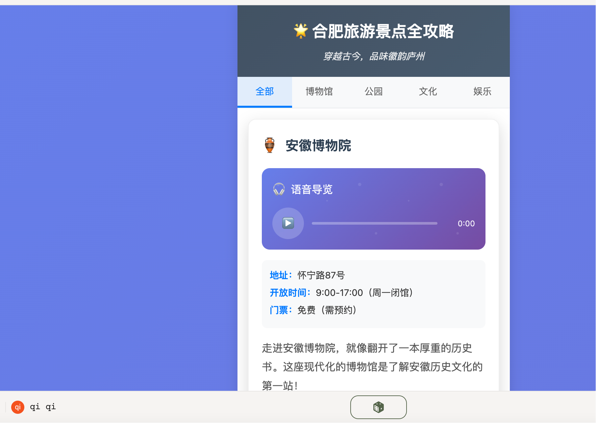
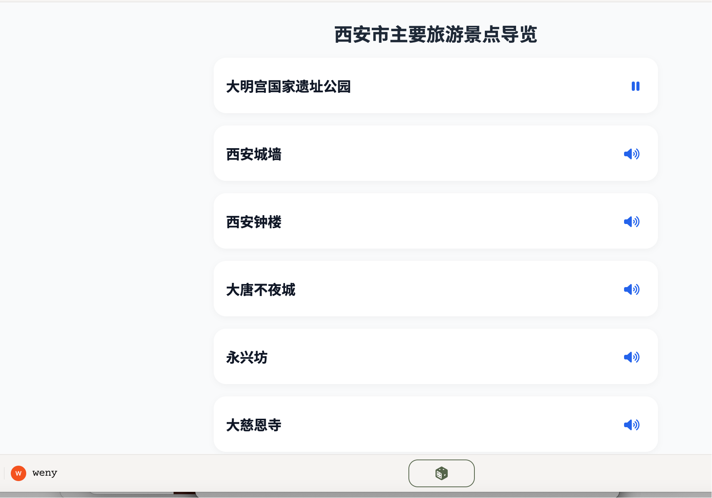

# 更新安排预告&留言问答精选

你好，我是黄佳。

## 告别不是结束，而是新的开始

行文至此，MCP 和 A2A 的协议本身以及实战案例都介绍清楚了。大家可以花一些时间去消化这些内容，也可以在讨论区多多提出自己的看法。我的更新暂时告一段落，但技术的发展不停歇。A2A 和 MCP 协议还在不断演进，新的工具和框架层出不穷，AI 智能体的能力也在日新月异。

我相信，在不久的将来，我们会看到：

- 更加成熟的多智能体协作平台

- 更加丰富的 MCP 工具生态

- 更加智能的代理调度机制

- 更加安全的工具调用框架

请给佳哥一些时间，我会以每个月 1-2 篇文章的速度，持续带你一起探索 MCP 和 A2A 的方方面面，我们不久后的将来再相见！

## 留言问答精选

这里我要给积极参与课程学习、在课程留言区主动参与交流、分享自己实践或思考经验的同学点个赞，你们的提问和反馈也带给我很多启发。

我委托编辑帮我精选了一批精品问答内容集中展示在后面，供更多同学学习参考。

### 协议本质探讨

- 讨论 1：MCP 协议和 JSON-RPC2.0 协议的关系是否可类比为 RESTful API 和 HTTP 协议的关系。讨论 2：是否可以把 MCP 类比为类似 HTTP 协议负责与客户端交互，A2A 类比为内网服务间通过 gRPC 协议交互？讨论 3：MCP 可以看作大模型领域的 k8S 么？

### 讨论 1

YiuTak_Choi 的留言：黄老师好，在阅读的时候，我有一个思考：MCP 协议和 JSON-RPC2.0 协议之间的关系，是否可以类比为 RESTful API 和 HTTP 协议之间的关系？因为RESTful API 作为 HTTP 的一种请求规范，其更着重于业务数据之间的约束（协议消息的业务逻辑层面约束），而 HTTP 协议本质上只关心传输层面约束（协议消息语法层面约束）。

我的这种思考与黄老师在文中提到“JSON-RPC 作为通用远程调用协议，轻量却太过底层：它只管“发什么请求、收什么响应”，但显然不包含大模型的上下文管理、并发会话、流式返回、能力发现等核心需求。”是否有一样的含义？

佳哥回复：您好！我们的探讨越来越有价值了, 留言区中的讨论甚至逐渐超越了课程本身的价值。

你提出的类比 ：MCP 与 JSON-RPC2.0 的关系类似于 RESTful API 与 HTTP 的关系 —— 从协议层级分工的角度来看，的确是非常贴切的类比。

HTTP 定义了消息如何发送（GET/POST/PUT 等）、以及状态码如何返回，这属于基础传输层协议；而 REST 则约定了基于 HTTP 的资源表达、状态转移和语义结构，属于应用层的 API风格约束协议。

比较来说，JSON-RPC 使用 HTTP/TCP/WebSocket 等传输层作为承载，只规定 method 和params 的调用格式，属于轻量级的远程调用语法协议。而 MCP 是在 JSON-RPC 的基础上增加了面向大模型的会话管理、上下文封装、资源订阅、提示模板、流式多段返回、权限能力发现等机制，是面向智能体和上下文感知的“语义层协议”。

因此，你这样的类比是挺恰当的。而且抓住了本质，也就是，MCP 是对 JSON-RPC 在“智能模型调用语义层”的扩展，就像 REST 是对 HTTP 在“Web 资源语义层”的扩展一样。—— 前者定义语义、能力和结构，后者定义传输与格式。

那么，再深入一些去思考：协议的分层设计在不同场景下的适用性。RESTful API 的成功在于它利用 HTTP 的通用性，它定义了灵活且广泛适用的约束。而 MCP 就需要在 JSON-RPC 2.0的基础上，针对大模型的独特需求（如长上下文、流式生成、动态能力发现）进行更深度的定制。这种定制可能比 RESTful API 更复杂，因为大模型的交互模式（例如，生成式 AI 的多轮对话、流式输出）与传统的 CRUD 操作有很大不同。—— 这也就是为什么需要要“资源”“Root” “提示” “Sampling” “Tools”等 MCP 原语和概念的存在。

欢迎大家继续探讨 MCP 协议的本质。

### 讨论 2

胡彦祖的留言：听着 MCP 有点像 HTTP 协议负责和客户端交互，A2A 有点像内网服务于服务间通过 grpc 协议交互。

佳哥的回复：很精辟。甚至可以进一步这样理解。

MCP 像 HTTP + JSON-RPC：

- 你通过 MCP 客户端向服务器发出请求，例如：列出资源、调用工具、应用提示模板。

- 服务器暴露一组“功能清单”，客户端控制是否、何时调用（很像浏览器发起 HTTP 请求）。

- 数据是结构化的 JSON，符合 JSON-RPC 标准。

A2A 像 gRPC + Protobuf：

- 更适用于智能体之间频繁、对称、结构化的通信。

- 每个 Agent 都可能是服务提供者与调用者，像是微服务架构中的多个服务节点。

- 消息以 Task 和 Message 的形式进行上下文传递，有任务状态、工件、事件监听等机制（更靠近 gRPC 的双向流特性）。

MCP 是模型与世界之间的“统一 API 网关”，类似 HTTP+JSON-RPC；A2A 是 Agent 网络内部的“服务编排与协作协议”，类似 gRPC+ 事件驱动模型。

### 讨论 3

一柄竹剑走天涯的留言：黄老师，关于对 MCP 的理解，可否参考 k8s 的理念，就像 k8s 对于容器的编排和管理，MCP 是提供对大模型的整合与管理？

佳哥回复：这个比喻非常有启发性！是一个非常有力的类比。K8s 解耦了容器运行与基础设施之间的耦合，统一调度 API。MCP 解耦了模型调用外部工具 / 数据的方式，统一接口协议。二者都强调“声明式管理 + 自动化执行”。 MCP 让 LLM 不再依赖特定调用逻辑，而是通过标准原语（Tool/Resource 等）与外部世界集成，支持更强的组合性、可维护性和跨平台适配能力。

然而，也要注意几点：我们虽然把 MCP 类比为大模型语义层的‘Kubernetes’，它并不调度模型运行资源，而是编排模型上下文结构与外部工具调用。K8s 是“基础设施编排”，MCP 是“语义上下文协议”。MCP 不是运行时调度系统（如 vLLM ）。K8s 管理的是一个个真实运行的容器；MCP 管理的是对话上下文、函数调用、数据提示等逻辑片段，这些片段最终由 LLM 进行推理。Kubernetes 有完整的状态系统、Controller loop、重试机制；MCP 是一个通信协议，它不对模型结果的状态做存储与持久化管理，也不具备自动“恢复”某个对话状态的能力。K8s是平台级工具，MCP 是协议层接口。

—— 这样，我们是不是同时对 K8s 和 MCP 有了更深入的理解。非常好的探讨。

### AI 应用开发范式讨论

- AI 应用开发范式的总结设想与 AI 成功落地 3 大条件

虎虎❤️的留言：之前没接触过大模型及工程相关的知识，最近一周刚看了黄佳老师 RAG 实战这本书，对 RAG 相关工程在相关工具、技术和框架上有了整体的认识。也感受到了，无论涉及框架还是模型提供了工具和能力，在解决具体企业问题时，还是需要大量的工程和适配工作。今年打算做一些场景的落地尝试，并为企业总结下 AI 应用开发范式——沉淀重复的工程工作到 AI 应用平台，让研发力量更专注于业务。

基于目前的了解，市面上的 AI 应用平台，主要是下沉通用的工程能力，降低开发门槛。目前还没有具体动手，但预感如果简单应用和引入当前的 AI 应用平台，应该只能泛泛地解决浅表问题。深入的落地，还需要结合企业数据，并借鉴框架和算法的思想，不断调优。

通过最近对 MCP 和 A2A 的了解，感觉未来这些具体的优化工作可以沉淀为标准化 MCPserver 的能力。除引入 AI 应用开发平台外，在企业构建 MCP server，推广 MCP 及 A2A 协议，也能提升工作的复用。在开发平台上，规范 agent 实现 A2A 协议，加上编排能力，有点类似于 iPaaS，在不同 agent 之间碰撞出火花，实现 1+1>2 的能力。

刚开始接触，希望能够跟着实战并迭代认知。如理解有偏差，请帮忙指正，谢谢。

佳哥回复：感谢如此深刻的探讨。您的理解是特别到位的。AI 是工具，场景是工具发挥其最大作用的前提条件。

AI 成功落地的 3 大条件：

1. 业务人员对场景需求的超清晰定义；

2. 技术人员对新技术的快速掌握和深刻认知（内核的领悟）；

3. 业务人员和技术人员的通力合作，最好合力建立起一套评估体系。

有这样清晰的落地场景，大模型和 AI 工具就有了腾飞的双翼。

### MCP Client 与 MCP Host 概念辨析

- 同学反馈的概念已通过留言回复加强说明，后面的探讨有助于你深入了解 MCP Host 和MCP Client 的区别及二者关系。

悟空聊架构的留言：文中好像有个笔误？

原文：LLM 大模型：这个相关方隐藏在代码编辑器也就是 MCP Client 内部（内容参见第 1节课）。这里应该是 MCP Host 才对吧？

佳哥回复：悟空兄弟，你太棒了。首先你提出了一个很好的，我在文章中需要加强说明的概念，即 —— 到底什么是 MCP Client，什么是 MCP Host。

首先，MCP Host 不是 MCP Server ，而是处在客户端。其次，Host 和 Client 的术语可能被混用，因为 Host 通常包含 Client 功能。例如，Claude Desktop 既是 Host（提供用户界面），也通过内置的 Client 与 MCP Server 交互。这种紧密耦合可能导致术语的模糊，但严格来说：Host 是应用程序整体，Client 是其内部的通信组件。

MCP Host 是指运行用户交互界面的应用程序，通常是直接与用户交互的 AI 工具或平台，例如 Claude Desktop、Cursor IDE 或其他 AI 增强的应用。Host 是整个系统的“前端”，负责协调用户请求、调用语言模型（LLM）以及管理与 MCP 服务器的交互。通常包含一个或多个MCP Client 来处理与特定 MCP Server 的通信。

MCP Client 是嵌入在 MCP Host 中的组件，负责与特定的 MCP Server 建立和维护一对一的连接。主要作用是处理 Host 与 Server 之间的通信，发送请求、接收响应，并将结果传递回Host 以供语言模型或用户使用。每个 MCP Client 专为一个特定的 MCP Server 工作，充当Host 和 Server 之间的“中间人”。

相对于文中应该怎么说，厘清上述两个概念对我们来说更重要。

更好的说法是：“LLM 大模型：这个相关方通常部署在 MCP Host 或由 MCP Client 调用，例如通过 API 对接 GPT-4o、Claude、DeepSeek 等模型。”

我决定保持原文，不修改原文的说法。这样，大家在看到原文时，其实应该可以明白我的意思，同时也能通过我们的讨论，清晰的认识到 Client 和 Host 在 MCP 语境中的微妙差别。我的意思，其实也就是 LLM 的调用，我们不用管，Cursor 全权负责去调度。

### MCP 的价值探讨

coderlee 的留言：** 先说说 MCP 的理解吧，个人觉得 MCP，相当于把原来的一对适配 API工作，放到了 MCP SERVER 自行提供了，剩下的就是适配或者说是调用也就是 MCP Client的工作，但是前提就是有人去做 MCP Server 的工作。

这个是基于互联网前提下，大家都乐意开放自己的 MCP 工具而言的。假定在小企业，只是有不同的业务线，做平台的，其实调用 MCP 和直接调用 API 代价是差不多的，因为单纯调 API需要一拨人了解原有业务形态，而调用 MCP 则需要原来做业务的那波人去开发 MCPServer，做智能体应用的一拨人去调用 MCP。不知道我理解的对不对。

佳哥回复：兄弟。你的理解是很到位的。对于个人开发者来说，什么 MCP 不 MCP 的，我直接调用工具，我自己的工具的调性我是门儿清的。

“因为单纯调 API 需要一拨人了解原有业务形态，而调用 MCP 则需要原来做业务的那波人去开发 MCP Server，做智能体应用的一拨人去调用 MCP。不知道我理解的对不对。” —— 你说的特别对，因此，MCP 也是传统的 Java、前端、后端、数据库等程序员的救星，MCP 有多个 SDK，我选择 Python 是因为我只熟悉 Python，但是你可以基于你自己的业务语言区开发MCP Server。你理解又到位了。

然而。补充一下，而且我在直播里面也说了嘛！未来的时代是什么时代？是协作的时代。是人机协作的时代，是 Agent-Agent 机机协作的时代。在这个大背景下，MCP 和 A2A 的格局就打开了。

MCP 是一种 “从点对点适配转向标准协议调用”的范式转变。MCP Server 负责将原有系统能力封装成统一描述的工具、资源或提示模板，而 MCP Client 通过标准接口来发现和调用这些能力，实现 AI 系统与外部世界的对接。

你提到的一个关键点也非常重要：MCP 的收益依赖于 Server 的建设成本是否值得。在大型系统或平台级项目中，这种“封装一次、复用多次”的模式带来的长期收益是明显的，尤其当多个Agent、多种模型、多个调用方需要协同时，MCP 能极大降低耦合、提升扩展性。

而在小团队或局部系统中，确实存在一个“做还是不做”的权衡点：直接调 API 虽然不够优雅，但路径短；而搭建 MCP Server 需要更多抽象和通用性设计，就好像设计微服务一样。

所以从长远来看，哪怕是小企业，把核心服务通过 MCP 暴露出来，也有利于构建更灵活、AI友好的平台，特别是当我们希望接入不同的模型供应商、用 AutoAgent、Coze、LangGraph等框架灵活编排智能体的时候，MCP 是理想的“协议中间层”。

再次感谢你的认真反馈，课程才刚刚开始，期待你在后续模块中有更多洞见，欢迎继续提问或分享你的观点！

### 学员实践作业分享 & 经验贴

课后习题解答 + 示例代码运行报错问题汇总 + 调试技巧（By 悟空聊架构同学）

连接：https://github.com/huangjia2019/a2a-in-action/issues/1

私域旅游助手作业 1 安徽合肥版（by 奇奇同学）

https://www.youware.com/project/bb6kbboojx?enter_from=upload

私域旅游助手作业 2（by klee 同学）

https://www.youware.com/project/h625qs5sfr?enter_from=share

