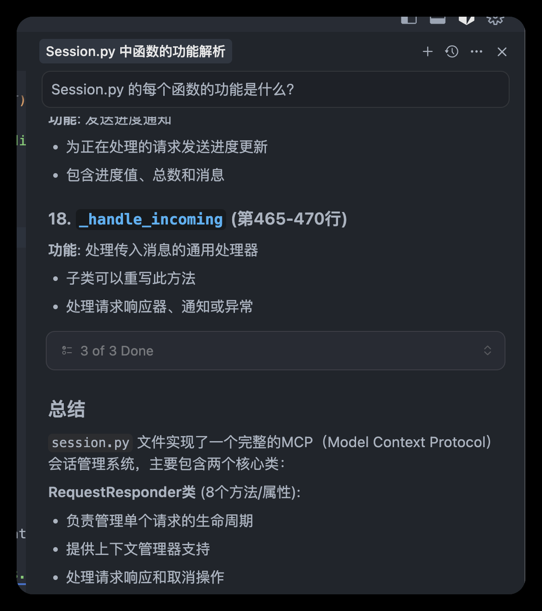
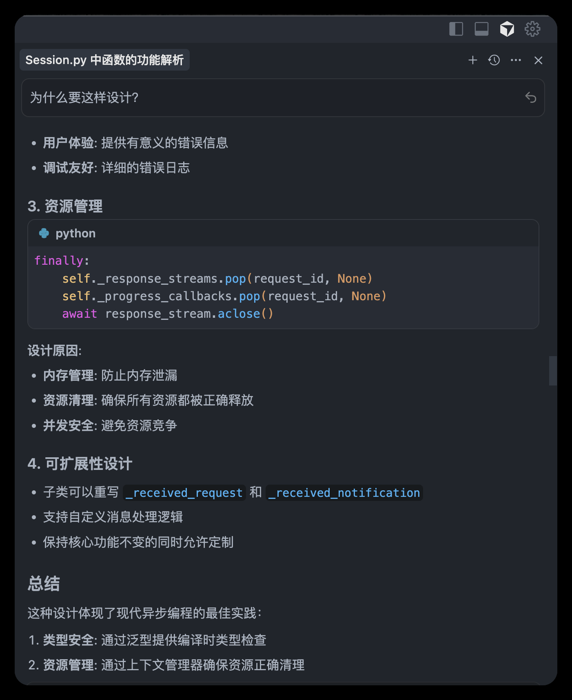
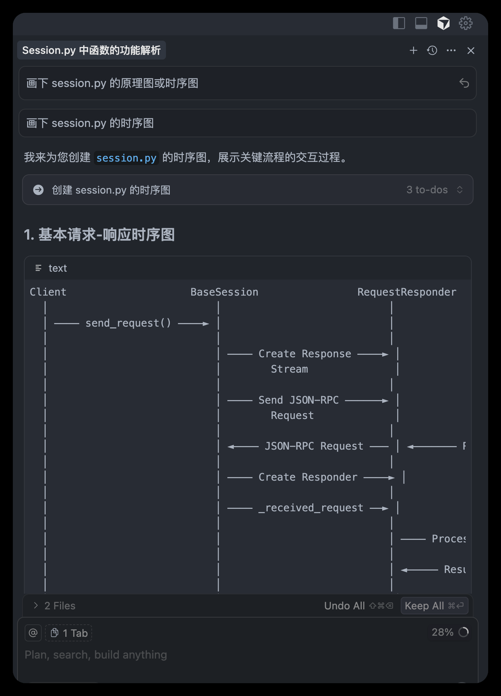
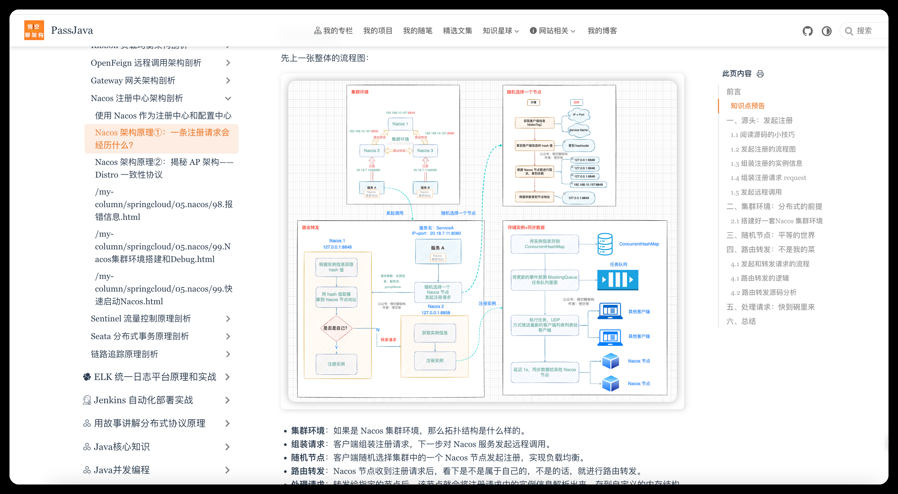

# 用户故事 | 悟空：如何让自己的学习收益最大化？

你好，我是悟空，本专栏的评论区经常可以看到我的身影。简单介绍下自己，我是一名热爱编程的开发者，平时喜欢写技术文章，自己的公众号有 3W+ 读者关注。

很高兴能在这里倾诉我和专栏的故事，下面将以几个问题为切入点，介绍下我与本专栏的故事。

## Question1：我是如何结识这个专栏的？

首先说下我是如何和这门课相遇的。

我在本地搭建了一个简易的智能体，里面的知识库就是极客时间的专栏，想对比下这个智能体和极客时间自带的 AI 工具搜索的效果，然后提问：“MCP 和 A2A 区别？”

我搭的智能体返回的是另外一个专栏的内容，然后极客时间的 AI 工具返回的就是本专栏的第一篇，快速点进去看了下，发现是一个宝藏专栏啊！冲！

## Question2：我是如何学习这个专栏的？

学习最好的方式就是讨论，其次是分享。

### 众人拾柴火焰高：分享踩坑经验

在专栏的很多实战篇中，我遇到了很多坑，也填了很多坑，最终将文中的示例程序跑通。

比如专栏的第四篇，就遇到了一个棘手的问题，示例程序需要用到 OpenAI，但是国内用户使用它会有很多限制。于是我把 OpenAI 换成了阿里云百炼，并按照阿里的官方文档完成了适配，并一步一步 Debug 程序，最终将程序运行起来了。

还有一件特别有趣的事，我为了验证程序的正确性，特地给了一个误导性的知识给大模型，但是大模型依旧能回答正确，让我对大模型有了更深的认识。最后我将遇到的坑和解决方案都放到了 GitHub（链接我贴在了后面），方便其他同学一起学习，大家一起进步，才能让专栏发挥他的最大价值！

- 踩坑经验分享https://github.com/huangjia2019/mcp-in-action/pull/1https://github.com/huangjia2019/a2a-in-action/issues/1提交代码https://github.com/huangjia2019/mcp-in-action/pull/3/https://github.com/huangjia2019/mcp-in-action/pull/1/commits

回看我放在 GitHub 上的笔记，还真的帮助了很多同学，比如下面几位同学的回复。

LinRds 同学的回复：

- 大佬太强了，之前一直卡在申请 Google API 的阶段，差点放弃自己动手跑 demo 了。

还有 aduocd 同学的回复：

- 感谢大神分享。按照大神的总结，成功开通 Google API Key，启用 Gemini。

还有 xdcrazyboy 同学的回复：

- 这种交流的氛围特别棒，感谢悟空大佬的分享，其实大家把学习实践的笔记问题提到issues 就挺好，这个课程如果有更多人分享，最终的记录都可以作为进一步学习的素材。

黄佳老师也鼓励我说“举一反三，清晰直观，值得置顶，手动点赞。不得不说，悟空的学习方式是收益最大化的学习方式。自己、同学和授课者都受益。”

### 师生互动：与老师 battle

在多篇专栏中，我都会认真去回答文末的思考题，黄佳老师也会认真回复，有时候在专栏回复的沟通效率太低，黄佳老师还会直接用微信和我讨论，极大地提高了沟通效率。

我们会对文中的某一个点，进行深入讨论，有来有回，直至双方达成一致。在这种沟通过程中，我会反复阅读老师的文章，去翻 MCP 和 A2A 协议的源代码，相比于只看一遍专栏来说，学习效果有了质的提升。

另外，老师还会将沟通的内容和结论整理到专栏中，方便其他同学学习，相当于专栏的扩展内容。通过这种 battle 方式，我获得了黄佳老师的专业解答，老师也可以通过我的质疑来检验教学盲区，实现了双赢。

### AI 工具辅助学习

在学习专栏的过程中，有的专栏思考题涉及到了 MCP 和 A2A 协议的源码，为了更好的理解这两个协议，就必须去啃源码了。

但是对于初学这两个协议的我来说，并没有什么好的思路去入手源码，于是我借助了 Cursor工具帮我分析了 MCP 的源码。

比如核心类 Session.py 的每个函数的功能是什么，为什么要这样设计等等问题。始终带着问题去问 AI，这样的答案才具有针对性和深度。





AI 工具还有一个好处是它会对源码分析的结果画一些时序图或原理图，一图胜千言，通过图来理解源码，效率会提高很多。



### 提交 PR 到 GitHub

当我将代码以 Pull Request（PR）的方式提交到老师的示例代码仓库时，我的学习模式完成了一次关键的跃迁。这不仅仅是单向的知识吸收和个人练习，而是演变为一种开放式、社会化、具有真实世界反馈的深度学习。

通过提交 PR 到仓库，老师或其他同学可以对我的代码做出审查，提供一些宝贵意见。另外这种方式还会带来思想碰撞，扩宽了我的思路。而且提交到代码还会帮助到其他同学，这种“利他”的成就感会转化为强大的学习动力。

当我的 PR 被评论、讨论，最终被合并时，我会获得巨大的正反馈。这种来自社区的认可和连接感，是驱动我持续学习、持续贡献的强大引擎，远胜于一个人闭门造车的孤独感。

## Question3：对工作和学习带来了什么变化

通过学习这个专栏，我深入理解了 MCP 和 A2A 的工作原理，我在工作和学习中就会经常思考，这些知识是否能运用上。

因为我经常做一些 DevOps 的工作，而 MCP 的其中一项能力就是当做工具来使用，如果将DevOps 和 MCP 结合起来，就变成了 AIOps，听起来就很酷！

心动不如行动，接下来我就和你聊聊我最近的探索。我自己做了一款小的 MCP 工具帮助我部署个人博客网站，可以称作我的 AIOps 的开山之作。

方案就是将部署博客这个“运维操作”封装成一个智能的、可通过自然语言调用的服务。

首先我将部署网站的脚本放到了自己写的 MCP Server 中，然后启动这个 MCP Server。接着我在 AI 工具中添加了该 MCP Server 的配置，最后通过对话的方式，即可部署网站。

```
比如和 AI 对话：请部署我的博客网站，AI 工具就会自动调用 MCP Server 的 deploy_blog
```

工具来打包程序、部署网站。从原始的手动打包部署（5 分钟耗时），到现在跃迁到了 AI 对话式部署（5s），体验感真的拉满。下图就是我部署的网站。



当然 AIOps 其实还可以做更多的事情，比如智能监控与可观测性、根因定位与智能排障等等。这个是后续我在工作中需要去实践的内容。

希望这次分享也能激励到正在学习的你！
