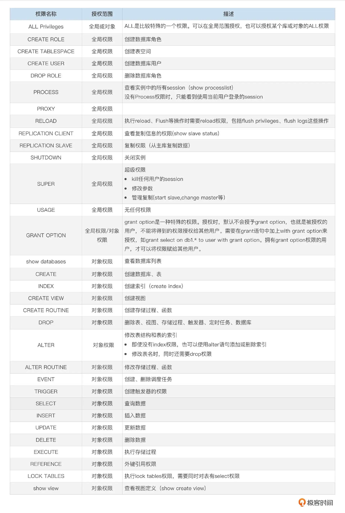

# 02 | MySQL账号和权限管理

你好，我是俊达。

在上一讲中，我们学习了安装 MySQL 的几种方法。MySQL 安装好之后，系统默认建好了root@localhost 用户，这个用户只能在 MySQL 服务器上登录本地的数据库。root 账号拥有数据库所有的权限，可以执行任何操作，因此我建议应用程序不要使用 root 账号访问数据库，这存在很大的安全隐患。

我们需要根据各个业务方的访问需求，分别创建数据库用户，并授予合理的权限。在这一讲中，我们来学习如何创建和管理数据库用户，以及如何给用户授权。

## 用户管理

我们使用 create user 命令创建用户，你可以看一下命令的基本格式。

```
create user 'username'@'host' identified by 'complex_password';
```

在 MySQL 中，一个用户由两部分组成，username 是用户名，host 是允许登录数据库的客户

```
端的主机名或 IP。host 中可以使用通配符，使用百分号 "%" 匹配任意字符串，使用下划线
"_" 匹配一个字符。比如我们下面创建的这个用户，可以在任何地方登录数据库。
create user 'u01'@'%' identified by 'somepassword';
```

创建账号时，也可以使用 IP 地址段来指定客户端 IP 范围，比如下面创建的 u02 用户可以在172.16 这个网段内访问数据库。

```
create user 'u02'@'172.16.0.0/16' identified by 'somepassword';
```

### 用户条目的优先级

MySQL 允许创建 username 相同，但 host 不同的用户。

```
create user 'u03'@'%' identified by 'somepassword';
create user 'u03'@'172.16.0.0/16' identified by 'somepassword';
create user 'u03'@'mysql02' identified by 'somepassword';
create user 'u03'@'172.16.121.%' identified by 'somepassword';
create user 'u03'@'172.16.121.237' identified by 'somepassword';
```

我们上面创建了 5 个用户，虽然用户名都是 u03，但这是 5 个不同的用户，可以分别给这 5个用户设置不同的密码、授予不同的权限。你可以在 mysql.user 表中查询到这些用户。

```sql
mysql> select user,host from mysql.user where user='u03';
+------+----------------+
| user | host           |
+------+----------------+
| u03  | %              |
| u03  | 172.16.0.0/16  |
| u03  | 172.16.121.%   |
| u03  | 172.16.121.237 |
| u03  | mysql02        |
+------+----------------+
5 rows in set (0.00 sec)
```

那么问题来了，当使用 u03 这个用户名登录数据库时，服务端应该使用哪条用户信息来验证用户密码呢？与之相关的还有另外一个问题，使用 u03 登录数据库后，我怎么知道当前登录的是哪个 u03？我们先来回答后面这个问题，登录数据库之后，可以用函数 current_user 来获取当前的登录用户，或者用 show grants 命令也能看到当前的登录用户。

```sql
# mysql -u u03 -psomepassword -h172.16.121.234
mysql> select current_user();
+-------------------+
| current_user()    |
+-------------------+
| u03@172.16.0.0/16 |
+-------------------+
1 row in set (0.01 sec)
mysql> show grants;
+---------------------------------------------+
| Grants for u03@172.16.0.0/16                |
+---------------------------------------------+
| GRANT USAGE ON *.* TO `u03`@`172.16.0.0/16` |
+---------------------------------------------+
1 row in set (0.00 sec)
```

至于前面那个问题，用户表中的每一行记录，都有相应的优先级。MySQL 会把所有的用户记录按优先级从高到低的顺序排列，缓存到内存里。服务端接收到客户端发起的连接请求后，从请求包中解析出用户名和密码信息，从 tcp 连接信息中得到客户端的 IP，然后依次匹配缓存的用户记录列表中的条目。

先匹配 host 字段，如果 host 匹配，再匹配用户名，用户名也匹配后，再验证密码是否正确。如果匹配不到对应的用户记录，或密码不正确，或存在其它问题，服务端会把错误信息发送给客户端。用户验证成功后，客户端就可以开始执行各类命令或 SQL，此时服务端会验证用户是否有权限执行这些命令和 SQL。

mysql.user 表中用户条目的优先级如何确定呢？

基本的规则是这样的：

1. IP 条目的优先级最高。IP 条目中没有通配符，精确的 IP 和 IP 地址段都是 IP 条目。

2. 精确 IP 的优先级比 IP 地址段的优先级高。

3. 对于 2 个 IP 地址段，前缀长的优先级更高。比如 172.16.121.0/24 优先级比 172.16.0.0/16高。

4. 不使用通配符的条目比使用通配符的条目优先级高。

5. 对于都使用了通配符的条目，则根据第一个通配符在 host 字段中出现的位置来判断优先

```
级。通配符出现的位置越靠前，优先级越低。比如 '%' 的优先级最低，'abc%' 的优先级
比 'abcd%' 低。
```

在我们前面的这个例子中，u03 的 5 条用户条目按优先级从高到低排序后是这样的。

```
'u03'@'172.16.121.237'
'u03'@'172.16.0.0/16'
'u03'@'mysql02'
'u03'@'172.16.121.%'
'u03'@'%'
```

我们可以通过一些例子来进行验证。

```sql
客户端地址为 172.16.121.236，匹配到的用户条目为 'u03'@'172.16.0.0/16'。
[root@172-16-121-236 ~]# mysql -u u03 -psomepassword -h172.16.121.234 -e 'select
+-------------------+
| current_user()    |
+-------------------+
| u03@172.16.0.0/16 |
+-------------------+
客户端地址为 172.16.121.237，匹配到的用户条目为 'u03'@'172.16.121.237'。
[root@172-16-121-237 ~]# mysql -u u03 -psomepassword -h172.16.121.234 -e 'select
+--------------------+
| current_user()     |
+--------------------+
| u03@172.16.121.237 |
+--------------------+
客户端地址为 192.168.x.x，匹配到的用户条目为 'u03'@'%'。
mysql -u u03 -psomepassword -h172.16.121.234 -e 'select current_user()'
mysql: [Warning] Using a password on the command line interface can be insecure.
+----------------+
| current_user() |
+----------------+
| u03@%          |
+----------------+
```

前面我们提到了，服务端会根据客户端的 IP 地址来查找用户条目。MySQL 怎么判断某个客户端跟某个主机名相匹配呢？服务端需要将客户端的 IP 反解析成主机名，然后才能进行判断。

比如 MySQL 服务器的 /etc/hosts 有下面这条信息。

```
## /etc/hosts
172.16.121.236 mysql02
```

那么从 172.16.121.236 连接数据库时，客户端主机名就会解析为 mysql02，使用下面这个方法就可以清楚地看到这一点。我们故意使用了错误的密码，服务端会将错误消息发送给客户端。请注意下面例子里错误消息中用户名的格式。

```sql
[root@172-16-121-236 ~]#  mysql -u u03 -pwrongpassword -h172.16.121.234
ERROR 1045 (28000): Access denied for user 'u03'@'mysql02' (using password: YES)
$ mysql -u u03 -pwrongpassword -h172.16.121.234 -e 'select current_user()'
ERROR 1045 (28000): Access denied for user 'u03'@'192.168.113.13' (using password
```

在真实环境中，我们经常会设置 skip_name_resolve，这样 MySQL 就只会根据 IP 来验证用户，不需要再将 IP 反解析成主机名。

```
## my.cnf
skip_name_resolve
```

在 MySQL 5.6 和更早的版本中，使用 mysql_install_db 来初始化数据库。初始化脚本执行时，会创建一个用户名为空的无密码用户，这会引起一个问题。我们通过一个例子来说明。我们先创建一个用户名为空的用户，模拟早期 MySQL 版本的行为。

```
mysql> create user ''@'localhost' ;
Query OK, 0 rows affected (1.26 sec)
```

然后在数据库服务器本地使用一个正常的账号登录数据库，你会发现无法登录，报密码错误。

```
[root@172-16-121-234 ~]# mysql -u u03 -psomepassword -h 127.0.0.1
ERROR 1045 (28000): Access denied for user 'u03'@'localhost' (using password: YES
但实际上，这并不是密码问题，而是在本地登录时，使用了 ''@'localhost' 这个条目来进
```

行用户认证。下面这个测试案例就能说明这一点。

```sql
[root@172-16-121-234 ~]# mysql -u u03 -h 127.0.0.1 -e 'select current_user()'
+----------------+
| current_user() |
+----------------+
| @localhost     |
+----------------+
```

这个问题的解决方法一般就是删除用户名为空的用户。

### 密码验证组件

不要给 MySQL 用户设置过于简单的密码，可以通过密码验证组件来强制密码的复杂度。使用RPM 安装的 MySQL 默认就已经开启了密码验证组件。如果你使用了二进制安装，可以用命令 INSTALL COMPONENT 来启用密码验证。

```
mysql> INSTALL COMPONENT 'file://component_validate_password';
Query OK, 0 rows affected (1.03 sec)
```

开启密码验证组件后，你就无法创建密码过于简单的用户了。

```
mysql> create user 'ux'@'%' identified by 'simplepassword';
ERROR 1819 (HY000): Your password does not satisfy the current policy requirement
```

需要在密码中使用数字、大小写字母和特殊字符，而且密码要超过一定的长度。

```
mysql> create user 'ux'@'%' identified by 'Complex-Password-2024';
Query OK, 0 rows affected (1.04 sec)
```

密码验证组件有几个参数可以配置，你可以根据自己的需求适当调整这些参数。

```
mysql> show variables like 'validate_password%';
+--------------------------------------+--------+
| Variable_name                        | Value  |
+--------------------------------------+--------+
| validate_password.check_user_name    | ON     |
| validate_password.dictionary_file    |        |
| validate_password.length             | 8      |
| validate_password.mixed_case_count   | 1      |
| validate_password.number_count       | 1      |
| validate_password.policy             | MEDIUM |
| validate_password.special_char_count | 1      |
+--------------------------------------+--------+
```

### 忘记密码处理

上一讲结束时，我留了一个思考题，root 密码忘记了怎么处理？我们可以使用参数 skip-grant-tables 来解决这个问题。先停止 MySQL，由于已经忘记了管理员密码，无法使用 shutdown命令正常关闭 MySQL，可以直接 kill mysqld 进程。

然后启动 MySQL，加上 skip-grant-tables 选项。

```
/usr/local/mysql/bin/mysqld_safe \
   --defaults-file=/data/mysql01/my.cnf \
   --skip-grant-tables \
   --skip-networking  &
```

加上 skip-grant-tables 选项后，不需要密码就能登录数据库。此时 MySQL 也不会验证权限。

```
# mysql -uroot -S /data/mysql01/run/mysql.sock
```

登录后，需要先执行 flush privileges 命令，加载用户和权限相关的表，再执行 alter user 命令修改密码，然后重新启动 MySQL，就可以正常访问数据库了。

```
mysql> flush privileges;
Query OK, 0 rows affected (0.55 sec)
mysql> alter user 'root'@'localhost' identified by 'newpassword';
Query OK, 0 rows affected (0.93 sec)
```

## 权限管理

新创建的用户只有 Usage 权限，只能执行一些最基本的操作。用户需要授权后，才能执行其他的一些操作，比如建库建表，读写数据。在 MySQL 中使用 grant 语句进行授权。grant 语句的基本语法如下：

```
grant privileges
on something
to 'user'@'host';
```

早期版本中，如果被授权的用户不存在，那么在执行 grant 语句时，会自动创建这个用户。在MySQL 5.7 中，SQL_MODE 中加入了 NO_AUTO_CREATE_USER 选项，用来避免这种grant 语句自动创建用户的行为。到了 MySQL 8.0，已经不再支持NO_AUTO_CREATE_USER 选项了。

执行 grant 时，被授权的用户必须已经存在，否则会报错。

```sql
mysql> grant select on *.* to 'readonly'@'%';
ERROR 1410 (42000): You are not allowed to create a user with GRANT
```

在 MySQL 中，有的权限是全局的，这些权限跟某个具体的数据库没有关系，授权时需要使用

```
on *.*，比如下面这个例子给用户 u03 授权了查看 process 列表的权限。
grant process on *.* to 'u03'@'%';
```

有的权限跟数据库或数据库中的对象相关，授权时可以指定具体的数据库或数据库对象。下面这个 grant 语句给用户 u03 授权了数据库 db01 的 DDL 权限。

```
grant create,index,alter,drop on db01.* to 'u03'@'%';
```

授权后，u03 可以创建库名为 db01 的数据库，并在这个库中创建表、修改表结构、DROP表，但是不能读写表中的数据。

```sql
mysql> show grants;
+----------------------------------------------------+
| Grants for u03@%                                   |
+----------------------------------------------------+
| GRANT USAGE ON *.* TO `u03`@`%`                    |
| GRANT CREATE, INDEX, DROP, ALTER ON `db01`.* TO `u03`@`%` |
+----------------------------------------------------+
## 可以创建库名为db01的数据库
mysql> create database db01;
Query OK, 1 row affected (2.91 sec)
## 但是不能创建其他数据库
mysql> create database db02;
ERROR 1044 (42000): Access denied for user 'u03'@'%' to database 'db02'
## 可以创建表，修改表结构，DROP表，但是不能读写表中的数据
mysql> create table t1(a int, b int);
Query OK, 0 rows affected (11.54 sec)
mysql> alter table t1 add c int;
Query OK, 0 rows affected (4.98 sec)
Records: 0  Duplicates: 0  Warnings: 0
mysql> insert into t1 values(1,2,3);
ERROR 1142 (42000): INSERT command denied to user 'u03'@'192.168.113.13' for tabl
mysql> select * from t1;
ERROR 1142 (42000): SELECT command denied to user 'u03'@'192.168.113.13' for tabl
```

需要给账号添加相应的权限后，才能访问表中的数据。

```sql
mysql> grant select,insert,update,delete on db01.* to 'u03'@'%';
Query OK, 0 rows affected (2.31 sec)
mysql> show grants;
+--------------------------------------------------------------------------------
| Grants for u03@%
+--------------------------------------------------------------------------------
| GRANT USAGE ON *.* TO `u03`@`%`
| GRANT SELECT, INSERT, UPDATE, DELETE, CREATE, DROP, INDEX, ALTER ON `db01`.* TO
+--------------------------------------------------------------------------------
2 rows in set (0.01 sec)
mysql> insert into t1 values(1,2,3);
Query OK, 1 row affected (0.28 sec)
mysql> select * from t1;
+------+------+------+
| a    | b    | c    |
+------+------+------+
|    1 |    2 |    3 |
+------+------+------+
1 row in set (0.01 sec)
grant 语句中，授权对象（库名和对象名）也可以使用通配符，使用 "%" 匹配任意字符，使用
"_" 匹配一个字符。
grant create,drop,alter,index on `db__`.* to 'u03'@'%';
```

授权后，u03 用户可以创建库名以 db 开头，并且库名长度是 4 个字节的数据库。

```
mysql> create database db_1;
Query OK, 1 row affected (1.89 sec)
mysql> create database db_2;
Query OK, 1 row affected (0.12 sec)
mysql> create database db_10;
ERROR 1044 (42000): Access denied for user 'u03'@'%' to database 'db_10'
如果库名中有下划线 "_"，可以在 grant 时使用转义符对通配符 "_" 进行转义。下面的 SQL
```

把 db_1 库的读写权限赋给了 u03 用户。

```sql
mysql> grant select,insert,update,delete on `db\_1`.* to 'u03'@'%';
Query OK, 0 rows affected (0.91 sec)
```

我们先使用 show grants 命令查看 u03 用户当前的权限。

```sql
mysql> show grants;
+----------------------------------------------------------------+
| Grants for u03@%                                               |
+----------------------------------------------------------------+
| GRANT USAGE ON *.* TO `u03`@`%`                                |
| GRANT SELECT, INSERT, UPDATE, DELETE ON `db01`.* TO `u03`@`%`  |
| GRANT SELECT, INSERT, UPDATE, DELETE ON `db\_1`.* TO `u03`@`%` |
| GRANT CREATE, DROP, INDEX, ALTER ON `db__`.* TO `u03`@`%`      |
+----------------------------------------------------------------+
```

从上面的输出可以看出，u03 用户有数据库 db01、db_1 的 DDL 权限和数据读写权限，有库名以 db 开头并且长度为 4 个字节的数据库的 DDL 权限。

但是在下面这个测试中，我们可以看到，在 db_1 库中执行 DDL 时，报权限不足。

```sql
mysql> use db_2;
Database changed
mysql> create table t1(a int);
Query OK, 0 rows affected (14.64 sec)
mysql> use db_1;
Database changed
mysql> create table t1(a int);
ERROR 1142 (42000): CREATE command denied to user 'u03'@'192.168.113.13' for tabl
为什么会出现这样的问题呢？大概是因为 MySQL 只使用了库名为 'db\_1' 的这条授权记
```

录。从权限表 mysql.db 中可以看到，db_1 这个库没有 create 权限。

```sql
mysql> select user,host, db, create_priv from mysql.db where user='u03';
+------+------+-------+-------------+
| user | host | db    | create_priv |
+------+------+-------+-------------+
| u03  | %    | db01  | N           |
| u03  | %    | db\_1 | N           |
| u03  | %    | db__  | Y           |
+------+------+-------+-------------+
3 rows in set (0.00 sec)
```

为了解决这个问题，可以将数据库 db_1 的 DDL 的权限也授予 u03。

```
mysql> grant create,alter,index,drop on `db\_1`.* to 'u03'@'%';
Query OK, 0 rows affected (0.55 sec)
```

重新授权后，用户 u03 就可以在数据库 db_1 中执行 DDL 操作了。

### MySQL 中有哪些权限

我们使用下面这个表格对 MySQL 中的一些权限做一个简单的介绍。



### 最小权限原则

管理数据库用户的权限时，要遵循最小权限原则。root 用户要交给少数管理人员管理，其他任何人不能使用 root 用户。有的公司出于安全考虑，还会删除系统自带的 root 用户，并单独创建一个超级管理员用户。给不同的业务方分配不同的用户，并按业务的实际需求授予最小的权限。

举例来说，如果业务方的需求是同步数据库中的数据，只需要对库表授予 SELECT 权限。对于一般的应用程序，需要读写数据，授予 SELECT、INSERT、UPDATE、DELETE、EXECUTE 这些权限就可以了。对于 DBA 或运维人员，需要执行数据库变更，可以授予CREATE、ALTER、DROP、INDEX 等 DDL 权限，以及 PROCESS、SUPER 等管理权限。

另外需要注意的一点，给不同环境的数据库创建不同的用户。开发环境和生产环境的用户，不要使用相同的密码。不同的业务方共用同一个用户、授予用户超出需要的权限、开发环境和生产环境使用相同的用户名和密码，都会给数据库安全带来极大的风险。

有时候为了方便，你可能会把 all privileges 授予一个用户，然后所有业务方都使用这个用户来访问数据库。这是非常危险的，千万不要这么做。

我遇到过很多数据库权限设置不当引起的故障。比如开发人员使用图形化管理工具连接到正式环境的数据库，然后在界面上把整个库都删掉了。数据分析人员使用第三方程序库连接生产环境的数据库做数据分析，但是由于配置不当，第三方程序库在关闭数据库连接时将表 DROP了。DBA 在导入数据时，本来应该到测试环境操作，但是错误地将导入命令贴到了生产环境的终端下执行，而且生产环境和测试环境的用户名和密码还都是一样的，然后在导入数据时将生产环境的表都先 DROP 掉了。

这些场景下，如果我们遵循了最小权限原则，至少可以避免一部分重大故障。如果你使用了只读账号，即使错误地执行了 DROP 命令，但是由于用户权限不足，数据库和表并不会被真正DROP。如果生产环境和开发环境设置了不同的用户名和密码，即使错误地将命令贴到了生产环境，因为密码不对，也不会对生产环境造成影响。

## 总结

这一讲我们学习了 MySQL 用户和权限管理。MySQL 的用户由用户名和主机名两部分组成。用户名相同，但主机名不同的多个用户，实际上是完全独立的用户，为了便于管理，要尽量避免创建这样的用户。如果你要限制数据库只允许某些 IP 访问，可以考虑从网络防火墙层面来限制。用户密码应该要有一定的复杂度，可以启用密码验证组件，防止给数据库用户设置过于简单的密码。授权时，要遵循最小权限原则，给用户授予正常业务需求之外的权限会带来额外的安全风险。

## 思考题

一般情况下，我们都建议将数据库部署到内网，因为将数据库暴露到公网上有比较大的安全风险。但是你的公司有一个特殊的业务，就是需要通过公网访问 MySQL 数据库。请你评估下将数据库放到公网有哪些风险？你应使用哪些方法来尽量保证数据库和数据的安全？

期待你的思考，欢迎在留言区中与我交流。如果今天的课程让你有所收获，也欢迎转发给有需要的朋友。我们下节课再见！
