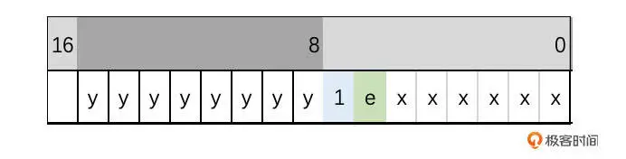
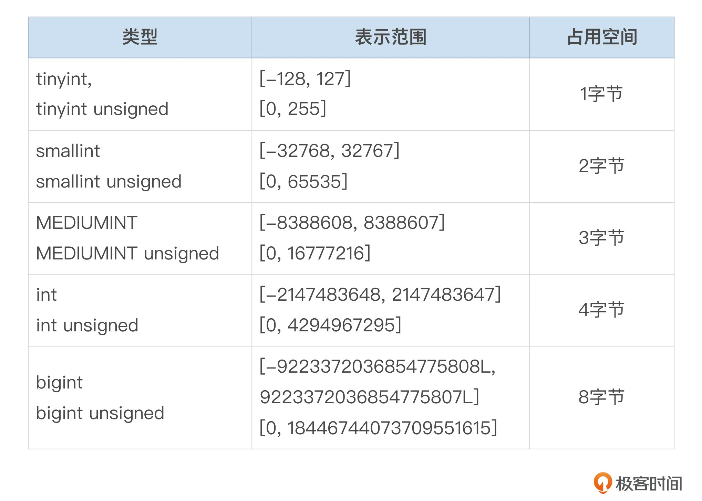
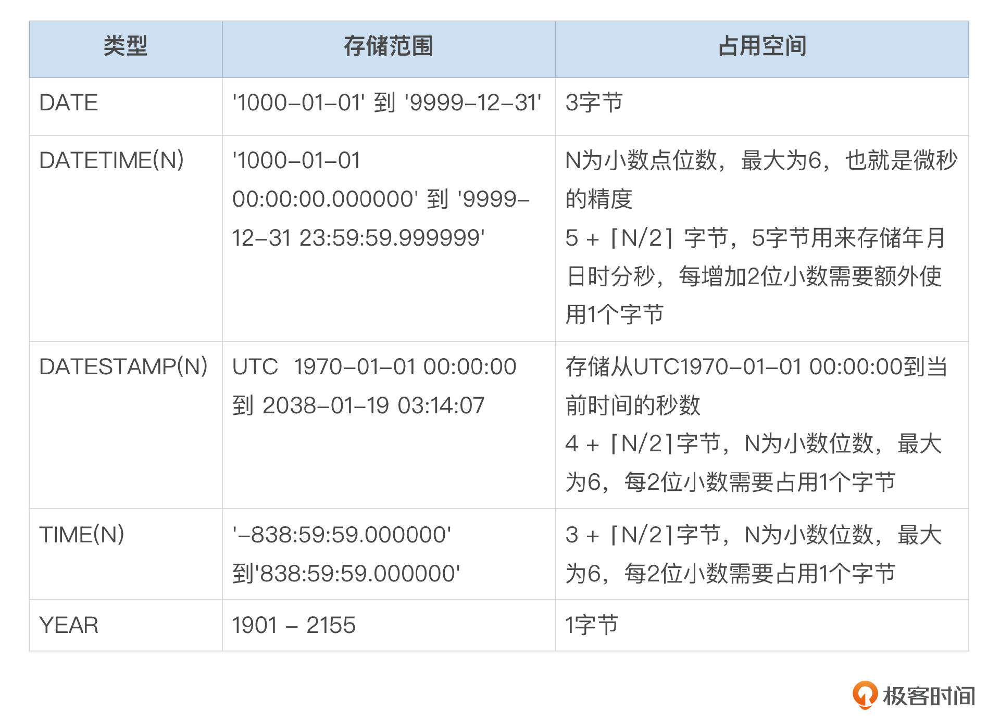

# 05 | 你用对数据类型了吗？

你好，我是俊达。

我们都知道，在关系型数据库中，数据存储在表里面，表由若干个列组成，每个列都有各自的数据类型。MySQL 数据库支持一些基本的数据类型，包括串（String）类型、数值类型、日期和时间类型，MySQL 新版本还支持一些复杂的数据类型，包括 JSON 类型、空间数据类型（Spatial Data Types）。

那么，在设计表结构时，应该如何选择每个列的数据类型呢？总体来说，我们需要根据业务的需求来确定数据类型。在这一讲中，我们就来详细聊一聊 MySQL 中基础数据类型的特点和适用场景，至于复杂的数据类型，这节课先不做太多的讨论。

## 串（String）类型

好，接下来我们就先从串类型开始讲起。

串类型可分为定长类型和变长类型。定长类型又包括 CHAR 和 BINARY，变长类型包括VARCHAR、VARBINARY、TEXT 和 BLOB。下面我们通过一些简单的例子来熟悉一下这些数据类型。

### 字符串类型

### CHAR(N)

首先是 CHAR 类型的一些例子。

```sql
mysql> create table t_char(a char(10));
Query OK, 0 rows affected (0.01 sec)
mysql> insert into t_char values('  中文符号    ');
Query OK, 1 row affected (0.00 sec)
mysql> select length(a), char_length(a) from t_char;
+-----------+----------------+
| length(a) | char_length(a) |
+-----------+----------------+
|        14 |              6 |
+-----------+----------------+
1 row in set (0.00 sec)
mysql> select a, hex(a), concat('{', a, '}') as aa from t_char;
+------------+------------------------------+--------------+
| a          | hex(a)                       | aa           |
+------------+------------------------------+--------------+
|   中文符号 | 2020E4B8ADE69687E7ACA6E58FB7 | {  中文符号} |
+------------+------------------------------+--------------+
1 row in set (0.00 sec)
mysql> insert into t_char values('0123456789A');
ERROR 1406 (22001): Data too long for column 'a' at row 1
mysql> create table t_char(a char(256))  charset utf8mb4;
ERROR 1074 (42000): Column length too big for column 'a' (max = 255); use BLOB or
```

CHAR 类型的基本特点：

1. 使用 CHAR(N) 的形式定义，其中 N 是规定了字段中允许存储的最大字符数，N 不超过255。需要注意，这里的 N 是字符数，而不是字节数。如果使用 UTF8MB4 字符集，CHAR(N) 最多可能占用 N*4 字节。

2. 在 InnoDB 中存储 CHAR(N) 类型的数据时，如果数据实际占用的空间不到 N 字节，则会使用空格填充到 N。这里 InnoDB 的实现上，是将数据填充到 N 字节，而不是 N 个字符。如果存储的数据虽然字符数不到 N，但是占用的空间已经超过了 N 字节，则 InnoDB 不会再填充空格。

3. 查询 Char 类型的字段时，MySQL Server 会自动去掉末尾的空格。SQL_MODE 中的PAD_CHAR_TO_FULL_LENGTH 可以改变这个默认行为（8.0.13 版本开始，PAD_CHAR_TO_FULL_LENGTH 被标记 deprecated，不再建议使用），下面是一个简单的测试案例。

```sql
mysql> select concat('{', a, '}') as a1, char_length(a) from t_char;
+------------------+----------------+
| a1               | char_length(a) |
+------------------+----------------+
| {  中文符号}     |              6 |
+------------------+----------------+
### 设置PAD_CHAR_TO_FULL_LENGTH
mysql> set sql_mode='PAD_CHAR_TO_FULL_LENGTH';
Query OK, 0 rows affected, 1 warning (0.00 sec)
### 返回数据时，使用空格填充满N个字符
mysql> select concat('{', a, '}') as a1, char_length(a) from t_char;
+----------------------+----------------+
| a1                   | char_length(a) |
+----------------------+----------------+
| {  中文符号    }     |             10 |
+----------------------+----------------+
```

### VARCHAR(N)

相比 CHAR 类型，VARCHAR 类型可能平时使用得更多。VARCHAR 字段最多可存储 65535字节。定义 Varchar 类型时，如果字段可存储的最大空间超过了 65535，则在 SQL Mode 严格模式下，SQL 会报错，在非严格模式下，MySQL 会自动将类型转换为 Text。

```sql
mysql> create table t_varchar1(a varchar(65536)) charset latin1;
ERROR 1074 (42000): Column length too big for column 'a' (max = 65535); use BLOB
mysql> set sql_mode='';
Query OK, 0 rows affected (0.00 sec)
mysql> create table t_varchar1(a varchar(65536)) charset latin1;
Query OK, 0 rows affected, 1 warning (0.01 sec)
mysql> show warnings;
+-------+------+--------------------------------------------+
| Level | Code | Message                                    |
+-------+------+--------------------------------------------+
| Note  | 1246 | Converting column 'a' from VARCHAR to TEXT |
+-------+------+--------------------------------------------+
1 row in set (0.00 sec)
### 列类型自动转成了mediumtext
mysql> desc t_varchar1;
+-------+------------+------+-----+---------+-------+
| Field | Type       | Null | Key | Default | Extra |
+-------+------------+------+-----+---------+-------+
| a     | mediumtext | YES  |     | NULL    |       |
+-------+------------+------+-----+---------+-------+
```

MySQL Server 层限制了 1 行记录的最大长度为 65535。1 行记录中，除了数据本身，还有一些额外的开销，比如需要记录变长数据的实际长度，还需要记录字段是否为 NULL 等，所以VARCHAR 能存储的数据，比 65535 要稍微小一些。

```sql
### 表创建失败，行长超过了65535
mysql> create table t_varchar2(a varchar(65533)) charset latin1;
ERROR 1118 (42000): Row size too large. The maximum row size for the used table t
### 加上NOT NULL约束后，可以创建成功
mysql> create table t_varchar2(a varchar(65533) not null) charset latin1;
Query OK, 0 rows affected (0.01 sec)
mysql> desc t_varchar2;
+-------+----------------+------+-----+---------+-------+
| Field | Type           | Null | Key | Default | Extra |
+-------+----------------+------+-----+---------+-------+
| a     | varchar(65533) | NO   |     | NULL    |       |
+-------+----------------+------+-----+---------+-------+
1 row in set (0.02 sec)
```

和 CHAR 类型不一样，VARCHAR 类型不会自动截断插入数据中尾部的空格，也不会往字段尾部里填充空格。

```sql
mysql> create table t_varchar(a varchar(10));
Query OK, 0 rows affected (0.00 sec)
mysql> insert into t_varchar values ('abc   ');
Query OK, 1 row affected (0.00 sec)
mysql> select concat('{', a, '}') from t_varchar;
+---------------------+
| concat('{', a, '}') |
+---------------------+
| {abc   }            |
+---------------------+
1 row in set (0.00 sec)
```

VARCHAR 字段占用的空间主要由实际存储的数据决定。如果我们将字段定义为VARCHAR(8000)，但写入的都是比较短的字符串，那么并不会占用很多存储空间。

所以我们在定义 VARCHAR 类型时，是不是可以把长度设置得很大呢？反正只要不真的存很大的数据进去，长度设置得大一点并不会占用额外的空间？

答案当然是否定的，定义 VARCHAR 类型时，切记不要超过业务真正需要存储的数据的长度。比如身份证号码长度是 18 位，那么就定义为 VARCHAR(18)。如果业务中限制了用户名最多不超过 16 个符号，那么就定义为 VARCHAR(16)。

这是为什么呢？为什么不能把字段长度设置得很大呢？这是因为：

1. 为 VARCHAR 字段设置合理的长度，能避免业务写入超长的数据。这对业务实际上也是一种保护。

2. MySQL 和存储引擎对行长度都有限制。如果行长度超过 65535，建表都建不成功。

3. InnoDB 存储引擎对行长度也有限制。具体的限制和页面大小有关。对于默认 16K 的页面大小，行长度大致为 8000 多一些（页面大小的一半）。同时，InnoDB 还限制了最大行长度不能超过 16K。这里的行长度是指将行外存储的数据排除后，其余数据占用的空间。下面这个例子就是超过了 InnoDB 对行长度的限制。有兴趣的话，你可以测试一下，将列 C11 长度改成多少后，表能建成功？

```sql
### 从报错信息得知，InnoDB默认一行记录最大长度为8126
mysql> create table t_inno1(
       c01 varchar(768),
       c02 varchar(768),
       c03 varchar(768),
       c04 varchar(768),
       c05 varchar(768),
       c06 varchar(768),
       c07 varchar(768),
       c08 varchar(768),
       c09 varchar(768),
       c10 varchar(768),
       c11 varchar(398)
    ) engine=innodb row_format=compact charset latin1;
ERROR 1118 (42000): Row size too large (> 8126). Changing some columns to TEXT or
```

4. InnoDB 二级索引长度有限制。具体的限制跟 ROW_FORMAT 和页面大小有关。

5. 如果使用了 InnoDB，在有些情况下，即使实际存储的数据一样，VARCHAR 长度定义不一样时，行实际占用的空间也可能会不一样。

这跟 InnoDB 数据的物理存储格式有关。对于每个变长类型的列，InnoDB 需要在行首分配 1-2 字节，用来记录列里面实际上存储了多少字节的数据。如果字段最大可能存储的数据不超过255 字节，那么只需要使用 1 个字节就能表示这个长度（1 个字节 8 比特，最大值为 255）。

如果字段最大可存储的数据超过了 255 字节，那么当实际存储的数据不超过 127 字节时，使用 1 个字节就可以表达数据的长度，否则就需要使用 2 个字节来表达数据的长度。

为什么是 127 呢？因为如果 VARCHAR 可存储的数据超过了 255 字节后，用来存储记录长度的字节，最高位有特殊含义，只剩下 7 比特用来表达长度。



解释下这张图：InnoDB 行首用来记录变长字段实际长度的格式。字节最高位为 0 时，使用 1字节表达长度。最高位为 1 时，使用 2 字节表达长度，此时最高位旁边的比特（图中标记为e）也有特殊含义，表示字段是否有行外存储，剩下的 14 比特用来表达长度。

实际上对于每个 CHAR 类型的列，InnoDB 也会在行首分配 1-2 个字节，用来记录 CHAR 列中实际存储了多少字节。这可能是因为由于变长字符集的存在，CHAR 类型占用的空间也不一定是固定的。

6. MySQL Server 层可能会使用不同数据格式。比如在排序时，排序字段的存储格式，或者将排序数据写到临时文件时的格式，可能会根据字段定义的长度来分配空间。

如果执行计划需要用到 Sort Buffer、Join Buffer、Read RND Buffer，在计算这些 Buffer 中能缓存多少行记录时，一般也是基于字段的定义长度来进行计算。

上面列举了这么多原因，其实平时使用时，最重要的是记住一点：不要超过业务的实际需要，额外增加 VARCHAR 字段的长度。

## 二进制串

### BINARY (N)

MySQL 使用 BINARY 和 VARBINARY 类型来存储二进制数据。BINARY(N) 是定长类型，这里 N 是字节数，最大不能超过 255。往 BINARY 字段中存数据时，如果数据不到 N 字节，会在尾部填充 0。

```sql
mysql> create table t_binary(a binary(20)) engine=innodb;
Query OK, 0 rows affected (0.01 sec)
mysql> insert into t_binary values('中文符号');
Query OK, 1 row affected (0.00 sec)
mysql> select a, hex(a) from t_binary;
+----------------------+------------------------------------------+
| a                    | hex(a)                                   |
+----------------------+------------------------------------------+
| 中文符号             | E4B8ADE69687E7ACA6E58FB70000000000000000 |
+----------------------+------------------------------------------+
1 row in set (0.00 sec)
```

因为字符编码后实际上也是一串二进制的数据，所以使用 BINARY 也可以存储文本信息。当然我并不建议你这么做。具体原因我们后面再讨论。

### VARBINARY(N)

VARBINARY 存储变长的二进制串。VARBINARY 和 VARCHAR 在很多方面都比较类似，比如最长不超过 65535 字节，物理存储格式也类似。实际上这一讲中 VARCHAR 部分的内容对VARBINARY 也基本成立。只不过 VARCHAR(N) 中的 N 是字符数，而 VARBINARY(N) 中的N 是字节数。

你可能会问，是不是可以用 VARBINARY 类型来存储文本信息呢？

我们通过一些例子来说明这个问题。

先创建一个表，一个字段使用 VARCHAR 类型，另一个字段使用 VARBINARY 类型，初看好像都行。

```sql
mysql> create table t_varchar_or_varbin(vc varchar(30), vb varbinary(30)) engine=
Query OK, 0 rows affected (0.01 sec)
mysql> insert into t_varchar_or_varbin values('中文符号', '中文符号');
Query OK, 1 row affected (0.00 sec)
mysql> select * from t_varchar_or_varbin;
+--------------+--------------+
| vc           | vb           |
+--------------+--------------+
| 中文符号     | 中文符号     |
+--------------+--------------+
```

但是当我们使用另外一个 GBK 的终端时，就出现问题了，VARBINARY 字段返回了乱码。

```sql
mysql> select * from t_varchar_or_varbin;
+----------+--------------+
| vc       | vb           |
+----------+--------------+
| 中文符号 | 涓枃绗﹀彿 |
+----------+--------------+
1 row in set (0.00 sec)
```

使用 VARCHAR 类型时，数据库帮我们自动进行了字符集的转换，而使用 VARBINARY 类型时，数据库不会做字符集的转换。对于 VARBINARY 类型，其实也不存在字符集这个概念。

VARCHAR 和 VARBINARY 的另外一个重要的区别是，VARCHAR 只允许存储满足字符集编码规则的数据，而 VARBINARY 可以存储任何二进制数据。下面这个例子就说明了这一点。

```sql
mysql> delete from t_varchar_or_varbin;
Query OK, 1 rows affected (0.00 sec)
### 数据无法写入VARCHAR，不符合编码规则
mysql> insert into t_varchar_or_varbin(vc) values ( unhex('ABAB') );
ERROR 1366 (HY000): Incorrect string value: '\xAB\xAB' for column 'vc' at row 1
### 数据可以写入VARBINARY列
mysql> insert into t_varchar_or_varbin(vb) values ( unhex('ABAB') );
Query OK, 1 row affected (0.00 sec)
mysql> select hex(vc), hex(vb) from t_varchar_or_varbin;
+--------------------------+--------------------------+
| hex(vc)                  | hex(vb)                  |
+--------------------------+--------------------------+
| NULL                     | ABAB                     |
+--------------------------+--------------------------+
```

所以，如果业务上需要存储的是文本信息，就不要使用二进制类型。只有当需要存储二进制信息时，才使用 BINARY 或 VARBINARY 类型。

使用 VARCHAR 和 VARBINARY 类型时，不能存储超过 64K 的数据。如果我们需要存储更大的数据，则可以选择使用 Text 或 Blob 类型。Text 类型用于存储文本信息，Blob 类型用于存储二进制信息（一张图片或一个视频文件都是典型的二进制数据）。tinytext 和 tinyblob 最多存储 256 字节，Text 和 Blob 最多存储 64K 字节，mediumtext 和 mediumblob 最多存储 16M字节，longtext 和 longblob 最多存储 4G 字节。

当然在实践中，我们不太建议在数据库中存储大对象，比如大量的图片、视频文件，一般我们会建议将这些文件存储到单独的文件系统中，比如对象存储或分布式文件系统。数据库中最多只存一个链接，记录文件的访问地址。

从理论上来说，所有数据都可以存到串类型的字段中，比如日期时间（2024-12-2312:34:56）、数字（123456）都能以字符串的形式存到 VARCHAR 类型的列中。但是我建议你千万不要这么做，因为这么做有很多缺点。

- 数据存储到 VARCHAR 列后，无法直接进行数学运算，需要先进行类型转换才行。

- 如果我们给 VARCHAR 列建立了过滤性很好的索引，但是业务查询数据时，传入了数字类型的参数，那么将无法使用这个索引，从而导致查询的性能很差。这个问题在真实环境中也比较常见。

- 使用 VARCHAR 类型后，无法限制用户写入非法的数据。

这里做一个小小的调研：你参与过的各个系统中，使用什么数据类型来存储电话号码？

## 数值类型

### 整数类型

整数也很常用的一种类型。MySQL 中可以使用 tinyint、smallint、int、bigint 来存储整数，这几种整数类型的区别是可以存储的数字的范围不一样，同时占用的空间也不一样。如果业务上明确只存储正数，还可以在类型后加上 unsigned 关键字。

下面这个表格总结了各个整数类型可存储的数字范围。



int 类型最多可以存储 20 多亿，如果使用 int unsigned，能存储的最大值是 40 多亿。当然如果你的业务数据量非常大，int 可能还不够用，则可以使用 bigint。

具体使用哪个整数类型，主要取决于业务存储需求。

如果用来存储一个状态值，而且业务中状态值最多可能也就几十种，可以考虑使用 tinyint，因为这样占用的空间少。

如果要存储订单的 ID，并且业务评估将来每秒的订单量有 1 万，那么 1 天就需要分配超过 8亿的订单号，使用 int 类型可能几天就溢出了，这时就要使用 bigint 类型。使用 bigint 类型后，可以用几千万年也不会溢出。

### 小数类型

如果业务中需要存储小数，可以使用 float、double 或 decimal 和 NUMERIC 类型。

float、double 是非精确类型，在进行运算时可能会有一些误差。那么在存储类似金额类的数据时，就不太合适。

```sql
mysql> create table testd(a float, b double);
Query OK, 0 rows affected (0.02 sec)
mysql> insert into testd values(1.1, 1.1);
Query OK, 1 row affected (0.00 sec)
mysql> select * from testd;
+------+------+
| a    | b    |
+------+------+
|  1.1 |  1.1 |
+------+------+
1 row in set (0.00 sec)
### float double可能会有误差
mysql> select a + a, b * 1.1 from testd;
+-------------------+--------------------+
| a + a             | b * 1.1            |
+-------------------+--------------------+
| 2.200000047683716 | 1.2100000000000002 |
+-------------------+--------------------+
```

如果要存储精确的小数信息，不允许有误差，可以使用 decimal 或 NUMERIC 类型。MySQL中 NUMERIC 和 decimal 类型实现方式一样。

使用 decimal(M, N) 形式定义，其中 M 是有效数字的位数，N 是保留的小数位数。

比如对于下面这个例子，可以存储 -999999.99 到 999999.99 之间的数字。

```sql
mysql> create table t_decimal(a decimal(8, 2)) engine=innodb;
Query OK, 0 rows affected (0.01 sec)
mysql> insert into t_decimal values(999999.99)
   -> ;
Query OK, 1 row affected (0.00 sec)
mysql> insert into t_decimal values(1234567)
   -> ;
ERROR 1264 (22003): Out of range value for column 'a' at row 1
```

## 日期时间类型

MySQL 中使用 DATE、DATETIME、TIMESTAMP、TIME、YEAR 这几种类型来存储时间日期信息。

### DATE

DATE 用来存储日期。如果你只需要记录日期信息，不用记录时间信息，如存储人员的出生日期，那么就可以使用 DATE 类型。

### DATETIME

如果你需要同时存储日期和时间，比如存储订单的创建时间，那么就可以使用 DATETIME 类型，可以使用 DATETIME 存储最多精确到微秒的信息。MySQL 中 DATETIME 类型没有时区的概念，如果你需要处理多个时区的时间信息，可以考虑在数据库中统一存储 UTC 时区的时间，并在读取和写入数据时做相应的时区转换。

### TIMESTAMP

TIMESTAMP 类型也可以同时存储日期和时间，也可以精确到微秒。和 DATETIME 类型相比，TIMESTAMP 类型能记录的时间范围更短，TIMESTAMP 可以记录从 UTC 1970-01-0100:00:00 到 UTC 2038-01-19 03:14:07 之间的时间。TIMESTAMP 类型在 InnoDB 存储引擎中，实际上使用了 4 字节的整数来存储距 UTC 1970-01-01 00:00:00 经过的秒数。

和 DATETIME 类型不一样，时区的设置会影响 TIMESTAMP 列中数据的读写。

```sql
###
mysql> create table t_timeinfo(a timestamp, b datetime);
Query OK, 0 rows affected (0.02 sec)
### 将时区设置为UTC
mysql> set time_zone='+00:00';
Query OK, 0 rows affected (0.00 sec)
### 插入 UTC '2024-06-07 14:06:45'
mysql> insert into t_timeinfo values('2024-06-07 14:06:45', '2024-06-07 14:06:45'
Query OK, 1 row affected (0.00 sec)
mysql> select * from t_timeinfo;
+---------------------+---------------------+
| a                   | b                   |
+---------------------+---------------------+
| 2024-06-07 14:06:45 | 2024-06-07 14:06:45 |
+---------------------+---------------------+
1 row in set (0.00 sec)
### 将时区设置为东8区
mysql> set time_zone='+08:00';
Query OK, 0 rows affected (0.00 sec)
### Timestamp列的返回数据转换成对应的时区
mysql> select * from t_timeinfo;
+---------------------+---------------------+
| a                   | b                   |
+---------------------+---------------------+
| 2024-06-07 22:06:45 | 2024-06-07 14:06:45 |
+---------------------+---------------------+
1 row in set (0.00 sec)
```

### TIME

TIME 可能是比较少用的一种时间类型，只存储了时间信息，可以用来存储 -838:59:59 到838:59:59 之间的时间。

### YEAR

YEAR 类型使用 1 个字节来存储年的信息，支持的范围为 1901 年到 2155 年。YEAR 类型最大的优点可能就是能节省一点点空间。

最后我们使用下面这个表格对 MySQL 的时间日期类型做一个小结。



如果使用了时间日期类型，程序中经常会使用一些时间日期函数来处理数据。下面我们对平时最常用的几个日期和时间函数做一个简单的介绍。

使用函数 now() 或 current_timestamp() 来获取系统当前的时间。这 2 个函数的返回值受参数TIME_ZONE 影响，MySQL 按 TIME_ZONE 的设置返回对应时区的当前时间。

```sql
mysql> select now(), sleep(3), current_timestamp();
+---------------------+----------+---------------------+
| now()               | sleep(3) | current_timestamp() |
+---------------------+----------+---------------------+
| 2024-06-07 06:40:52 |        0 | 2024-06-07 06:40:52 |
+---------------------+----------+---------------------+
1 row in set (3.00 sec)
```

参数 timestamp 的设置会影响 now() 和 current_timestamp() 的返回。Binlog 模式为STATEMENT 时，备库上就是使用这个方法来保证主备库时间函数返回一样的数据。

```sql
mysql> set timestamp=1;
Query OK, 0 rows affected (0.00 sec)
mysql> select now(), current_timestamp();
+---------------------+---------------------+
| now()               | current_timestamp() |
+---------------------+---------------------+
| 1970-01-01 00:00:01 | 1970-01-01 00:00:01 |
+---------------------+---------------------+
1 row in set (0.00 sec)
### timestamp设置为0后，函数返回系统当前时间
mysql> set timestamp=0;
Query OK, 0 rows affected (0.00 sec)
mysql> select now(), current_timestamp();
+---------------------+---------------------+
| now()               | current_timestamp() |
+---------------------+---------------------+
| 2024-06-07 06:47:09 | 2024-06-07 06:47:09 |
+---------------------+---------------------+
```

函数 sysdate() 也能获取系统当前时间。sysdate 和 current_time 函数的最大区别是 sysdate总是返回函数执行那一刻的时间，而 current_time 函数返回的是语句开始执行的时间，而且可以通过变量 timestamp 控制。在使用 STATEMENT 格式的 Binlog 时，使用 sysdate() 函数会导致主备数据不一致，因此不建议使用。

## 总结时刻

设计表结构时，需要根据业务的需求，选择合适的数据类型，我们需要考虑几点。

1. 选择精确匹配业务需求的数据类型。如时间和日期类型的数据使用 TIMESTAMP 或DATETIME 类型，整数类的数据使用 INT 系列类型，文本类型的使用 VARCHAR 类型。

2. 要关注数据类型的空间占用情况。在满足业务存储需求的前提下，优先使用空间占用更小的类型。比如业务中最多几十种状态，我们就可以使用 tinyint 类型，而不使用 int 或 bigint。VARCHAR 的长度要按实际需求设置。

3. 如果业务上可以保证一个字段中一定会有数据，就给字段加上 Not Null 约束。

4. 在多个表中，使用相同的数据类型存储同一个业务字段。

5. 文本类型字段要设置合适的字符集。如果需要处理多语言数据，优先考虑 UTF8 字符集。

6. 尽量不要在数据库中存储大量大对象（如图片、视频文件等），使用分布式文件系统可能更加合适。

## 思考题

你刚刚接到了 1 个需求，要开发一个员工管理系统。该系统计划使用 MySQL 数据库，设计人员提供了表结构，其中就包括下面这 2 个表。作为一位资深的 MySQL 使用者，你觉得这 2 个表存在哪些问题？你会怎么改进呢？

```sql
create table t_employee(
   emp_id int not null comment '员工编号',
   emp_name varchar(200) comment '员工姓名',
   birth_day varchar(200) comment '出生日期',
   age int comment '年龄',
   gender varchar(200) comment '性别',
   address varchar(200) comment '住址',
   photo blob comment '员工照片',
   primary key(emp_id)
) engine=innodb charset utf8;
create table t_emp_salary(
   emp_id varchar(30) not null comment '员工编号',
   effect_date varchar(200) comment '生效日期',
   salary double comment '薪资',
   descripton varchar(2000) comment '备注',
   primary key(emp_id, effect_date)
) engine=innodb charset utf8;
```

期待你的思考，欢迎在留言区中与我交流。如果今天的课程让你有所收获，也欢迎转发给有需要的朋友。我们下节课再见！
