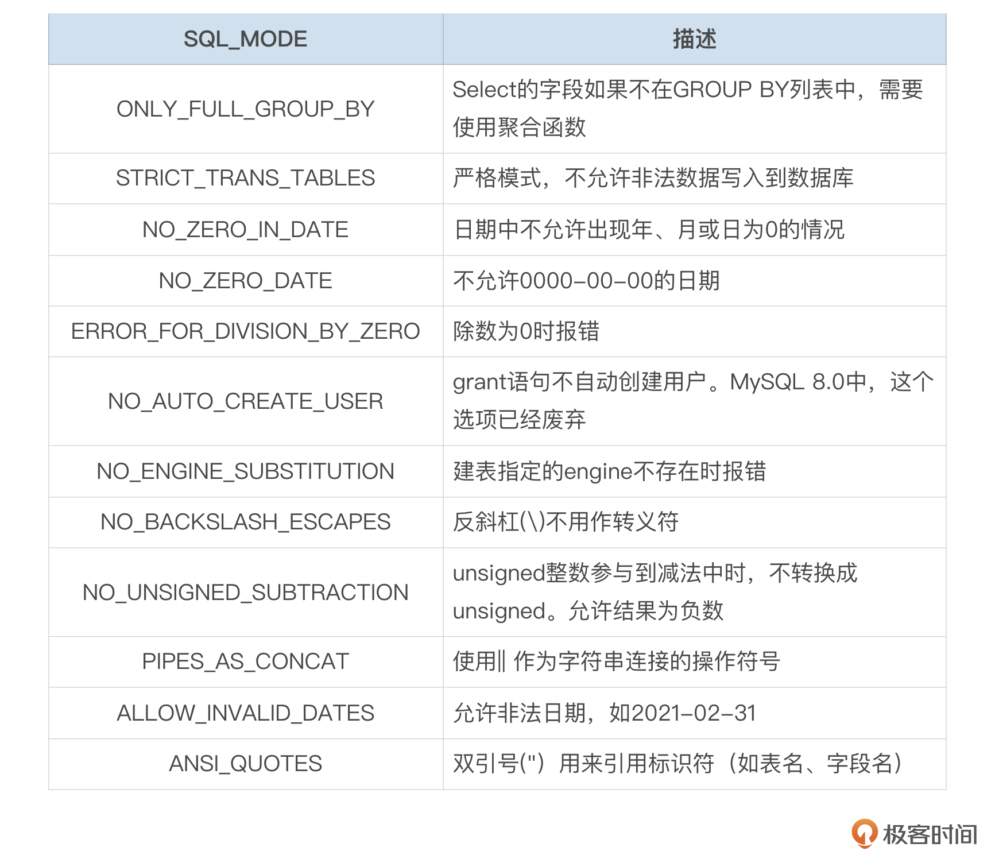

# 06 | SQLMode对程序有怎样的影响？

你好，我是俊达。

SQL Mode 是 MySQL 中比较特殊的一个概念，可以通过参数 sql_mode 进行设置。设置 SQLMode 会影响数据库对 SQL 的语法支持，也会影响数据写入时的校验规则。早期的 MySQL 使用非严格模式，这样有一些不符合 SQL 标准的语句在 MySQL 中也能执行，一些按 SQL 标准来说不合法的数据，也能写到表里面。

不过从 MySQL 5.7 开始，默认就开启了严格模式。这一讲中，我们一起来看看 SQL Mode 是怎么影响到 SQL 语句的，以及应该怎么设置 SQL Mode。

## 非严格模式

非严格模式下，MySQL 会允许你执行一些不符合 SQL 标准的语句。我们通过一些例子来说明这种情况。先创建一个测试表，写入一些数据。

```sql
mysql> create table tab2(
   b int,
   c varchar(10),
   d varchar(30)
) engine=innodb;
Query OK, 0 rows affected (10.16 sec)
mysql> insert into tab2 values
   (10, 'AAA1', 'BBB1'),
   (20, 'AAA4', 'BBB4'),
   (10, 'AAA3', 'BBB3'),
   (20, 'AAA2', 'BBB2')
Query OK, 4 rows affected (0.56 sec)
Records: 4  Duplicates: 0  Warnings: 0
mysql> select * from tab2;
+------+------+------+
| b    | c    | d    |
+------+------+------+
|   10 | AAA1 | BBB1 |
|   20 | AAA4 | BBB4 |
|   10 | AAA3 | BBB3 |
|   20 | AAA2 | BBB2 |
+------+------+------+
4 rows in set (0.00 sec)
```

执行下面这个带了 GROUP BY 的语句时，你会发现执行会报错。因为按 SQL 标准语法，如果 SQL 带了 GROUP BY，那么 SELECT 列表中的字段，要么也出现在 GROUP BY 的字段列表中，要么就加上聚合函数，比如 avg、max、min 等。

```sql
mysql> select b,c,d from tab2 group by b;
ERROR 1055 (42000): Expression #2 of SELECT list is not in GROUP BY clause and co
```

但是在 MySQL 中，如果你把 SQL Mode 中的 only_full_group_by 选项去掉，就可以正常执行上面这个 SQL。从输出结果看，字段 C 和 D 的取值跟数据写入的顺序有关。

```sql
mysql> set sql_mode='';
Query OK, 0 rows affected (0.00 sec)
mysql> select b, c, d from tab2 group by b;
+------+------+------+
| b    | c    | d    |
+------+------+------+
|   10 | AAA1 | BBB1 |
|   20 | AAA4 | BBB4 |
+------+------+------+
```

严格模式下，下面这两个 SQL 都会报错。第一个 SQL 是因为往 int 类型的字段中写入了非数字的字符，第二个 SQL 是因为写入的字符串长度超过了字段定义时允许的范围。

```sql
mysql> insert into tab3(b,c,d) values('a', 'a', 'a');
ERROR 1366 (HY000): Incorrect integer value: 'a' for column 'b' at row 1
mysql> insert into tab3(b,c) values('100', 'ABCDEFGHIJKLMNOPQRSTUVWXYZ');
ERROR 1406 (22001): Data too long for column 'c' at row 1
```

但是在非严格模式下，这两个 SQL 都能执行，虽然执行时会有 Warning。

```sql
mysql> delete from tab3;
Query OK, 4 rows affected (0.54 sec)
mysql> set sql_mode='';
Query OK, 0 rows affected (0.00 sec)
mysql> insert into tab3 values('a', 'a', 'a');
Query OK, 1 row affected, 1 warning (0.45 sec)
mysql> show warnings;
+---------+------+------------------------------------------------------+
| Level   | Code | Message                                              |
+---------+------+------------------------------------------------------+
| Warning | 1366 | Incorrect integer value: 'a' for column 'b' at row 1 |
+---------+------+------------------------------------------------------+
1 row in set (0.00 sec)
mysql> insert into tab3(b,c) values('100', 'ABCDEFGHIJKLMNOPQRSTUVWXYZ');
Query OK, 1 row affected, 1 warning (0.70 sec)
mysql> show warnings;
+---------+------+----------------------------------------+
| Level   | Code | Message                                |
+---------+------+----------------------------------------+
| Warning | 1265 | Data truncated for column 'c' at row 1 |
+---------+------+----------------------------------------+
1 row in set (0.00 sec)
```

我们再来查看数据，第一个 SQL 插入的数据，非法的整数值被替换成了 0。第二个 SQL 插入的数据，超出长度的字符串被截去了，留下了一个前缀。

```sql
mysql> select * from tab3;
+------+------------+------+
| b    | c          | d    |
+------+------------+------+
|    0 | a          | a    |
|  100 | ABCDEFGHIJ | NULL |
+------+------------+------+
2 rows in set (0.01 sec)
```

在 MySQL 5.6 和更早版本中，默认使用非严格模式，上面这样的 SQL 都可以正常执行。如果你的应用中存在这些情况，然后由于某种原因 SQL Mode 切换成了严格模式，那么原先正常的应用程序，就可能无法正常运行了。

## SQL Mode 的各种选项

SQL Mode 有很多选项，MySQL 8.0 中，sql_mode 的默认设置可以通过下面这个方法获取。

```
mysql> set sql_mode=default;
Query OK, 0 rows affected (0.00 sec)
mysql> show variables like 'sql_mode'\G
*************************** 1. row ***************************
Variable_name: sql_mode
       Value: ONLY_FULL_GROUP_BY,STRICT_TRANS_TABLES,NO_ZERO_IN_DATE,NO_ZERO_DAT
1 row in set (0.01 sec)
```

这些选项中，ONLY_FULL_GROUP_BY 和 STRICT_TRANS_TABLES 我们已经遇到过了。此外，还有一些选项不在这个默认的设置中，后面我们也会分别进行介绍。

### ONLY_FULL_GROUP_BY

前面的例子已经演示过 ONLY_FULL_GROUP_BY 的效果了。设置ONLY_FULL_GROUP_BY 后，对有 GROUP BY 的 SQL，SELECT 的字段要么也出现GROUP BY 中，要么使用聚合函数，否则 SQL 执行会报错。

我们可以对 SQL 进行改写，在 GROUP BY 之外的那些字段上使用 ANY_VALUE 函数，这样SQL 就可以正常执行了。

```sql
mysql> set sql_mode='ONLY_FULL_GROUP_BY';
Query OK, 0 rows affected (0.00 sec)
mysql> select b,c,d from tab2 group by b;
ERROR 1055 (42000): Expression #2 of SELECT list is not in GROUP BY clause and co
mysql> select b, any_value(c) as c, any_value(d) as d from tab2 group by b;
+------+------+------+
| b    | c    | d    |
+------+------+------+
|   10 | AAA1 | BBB1 |
|   20 | AAA4 | BBB4 |
+------+------+------+
2 rows in set (0.00 sec)
```

### STRICT_TRANS_TABLES

设置 STRICT_TRANS_TABLES 后，在数据写入时，如果数据不符合字段定义，比如字符串超出长度，或者数值类型数据超出范围时，SQL 会报错。如果不设置 STRICT 模式，会对异常数据进行截断处理，SQL 会显示 Warning，但不报错。

```sql
mysql> create table t_strict(a tinyint, b tinyint unsigned, c decimal(6,2), d var
Query OK, 0 rows affected (6.36 sec)
mysql> set sql_mode='strict_trans_tables';
Query OK, 0 rows affected, 1 warning (0.00 sec)
mysql> insert into t_strict(a) values(512);
ERROR 1264 (22003): Out of range value for column 'a' at row 1
mysql> insert into t_strict(b) values(512);
ERROR 1264 (22003): Out of range value for column 'b' at row 1
mysql> insert into t_strict(c) values(1000000);
ERROR 1264 (22003): Out of range value for column 'c' at row 1
mysql> insert into t_strict(d) values('0123456789ABCDEF');
ERROR 1406 (22001): Data too long for column 'd' at row 1
```

去掉 STRICT_TRANS_TABLES 后，虽然能写入数据，但是数据被截断了，和应用本来想写入的数据有很大的差异。

```sql
mysql> set sql_mode='';
Query OK, 0 rows affected (0.00 sec)
mysql> insert into t_strict(a,b,c,d) values(512, 512, 1000000, '0123456789ABCDEF'
Query OK, 1 row affected, 4 warnings (0.04 sec)
mysql> select * from t_strict;
+------+------+---------+------------+
| a    | b    | c       | d          |
+------+------+---------+------------+
|  127 |  255 | 9999.99 | 0123456789 |
+------+------+---------+------------+
1 row in set (0.00 sec)
```

对不支持事务的存储引擎，比如 MyISAM，STRICT_TRANS_TABLES 的作用就比较复杂了。如果使用了批量 INSERT，也就是同时 INSERT 了多行记录，那么当第一行记录中有数据和字段定义不符合时，SQL 会报错，如果第一行数据没问题，但是后续的记录有问题，那么SQL 能执行成功，但是会对超出范围的数据进行截断处理。下面这个例子中的第二个 INSERT语句，插入了两行记录，第二行记录的数据被截断了。

```sql
mysql> create table t_strict_myisam(a tinyint, b tinyint unsigned, c decimal(6,2)
Query OK, 0 rows affected (0.19 sec)
mysql> set sql_mode='strict_trans_tables';
Query OK, 0 rows affected, 1 warning (0.01 sec)
mysql> insert into t_strict_myisam values(512, 512, 1000000, '0123456789ABCDEF');
ERROR 1264 (22003): Out of range value for column 'a' at row 1
mysql> insert into t_strict_myisam values(100, 200, 9999, '0123456789'), (512, 51
Query OK, 2 rows affected, 4 warnings (0.01 sec)
Records: 2  Duplicates: 0  Warnings: 4
mysql> select * from t_strict_myisam;
+------+------+---------+------------+
| a    | b    | c       | d          |
+------+------+---------+------------+
|  100 |  200 | 9999.00 | 0123456789 |
|  127 |  255 | 9999.99 | 0123456789 |
+------+------+---------+------------+
2 rows in set (0.00 sec)
```

### STRICT_ALL_TABLES

STRICT_ALL_TABLES 对所有存储引擎都生效。对于 MyISAM 这类不支持事务的存储引擎，使用批量 INSERT 时，如果 SQL 中存在超出范围的值，SQL 执行就会报错，但是对于已经写入的数据，无法回滚。下面这个例子就演示了这种情况。

例子中 INSERT 语句的第一行数据是合法的，第二行数据超出了范围，SQL 执行时，第一行数据写入成功，第二行数据无法写入，因此 SQL 就报错了，第三行数据虽然没问题，但是也不会再写入了。虽然 SQL 失败了，但是第一行数据已经写入了，而 MyISAM 不支持事务，无法回滚这一行记录。

```sql
mysql> create table t_strict_all(a tinyint, b tinyint unsigned, c decimal(6,2), d
Query OK, 0 rows affected (0.40 sec)
mysql> set  sql_mode='strict_all_tables';
Query OK, 0 rows affected, 1 warning (0.00 sec)
mysql> insert into t_strict_all values(100, 200, 9999, '0123456789'), (512, 512,
ERROR 1264 (22003): Out of range value for column 'a' at row 2
mysql> select * from t_strict_all;
+------+------+---------+------------+
| a    | b    | c       | d          |
+------+------+---------+------------+
|  100 |  200 | 9999.00 | 0123456789 |
+------+------+---------+------------+
```

### NO_ZERO_DATE 和 NO_ZERO_IN_DATE

设置 STRICT_TRANS_TABLES 和 STRICT_ALL_TABLES 后，表中无法写入非法的日期值。

```sql
mysql> create table t_date(a date, b datetime, c timestamp);
Query OK, 0 rows affected (5.47 sec)
mysql> set sql_mode='strict_trans_tables';
Query OK, 0 rows affected, 1 warning (0.00 sec)
mysql> insert into t_date(a) values('2024-02-30');
ERROR 1292 (22007): Incorrect date value: '2024-02-30' for column 'a' at row 1
mysql> insert into t_date(b) values('2024-02-30 01:23:45');
ERROR 1292 (22007): Incorrect datetime value: '2024-02-30 01:23:45' for column 'b
mysql> insert into t_date(c) values('2024-02-30 01:23:45');
ERROR 1292 (22007): Incorrect datetime value: '2024-02-30 01:23:45' for column 'c
```

但是却可以往 date 和 datetime 类型的字段中写入日期为 0 或年月日中存在 0 的数据。

```sql
mysql> set sql_mode='';
Query OK, 0 rows affected (0.00 sec)
mysql> insert into t_date values('0000-00-00', '0000-01-00 01:23:45', '1970-01-02
Query OK, 1 row affected (0.98 sec)
mysql> select * from t_date;
+------------+---------------------+---------------------+
| a          | b                   | c                   |
+------------+---------------------+---------------------+
| 0000-00-00 | 0000-01-00 01:23:45 | 1970-01-02 01:23:45 |
+------------+---------------------+---------------------+
```

如果要阻止往数据库中写入年月日为 0 的数据，就需要设置 NO_ZERO_DATE 和NO_ZERO_IN_DATE。

```sql
mysql> set sql_mode='no_zero_date,no_zero_in_date,strict_trans_tables';
Query OK, 0 rows affected, 1 warning (0.00 sec)
mysql> insert into t_date(a) values('0000-00-00');
ERROR 1292 (22007): Incorrect date value: '0000-00-00' for column 'a' at row 1
mysql> insert into t_date(a) values('0000-01-00');
ERROR 1292 (22007): Incorrect date value: '0000-01-00' for column 'a' at row 1
mysql> insert into t_date(b) values('0001-00-00 01:23:45');
ERROR 1292 (22007): Incorrect datetime value: '0001-00-00 01:23:45' for column 'b
```

需要注意的是，NO_ZERO_DATE 和 NO_ZERO_IN_DATE 需要跟STRICT_TRANS_TABLES 一起设置，如果只是设置了 NO_ZERO_DATE 和NO_ZERO_IN_DATE，还是能往数据库中写入日期为 0 或年月日中有 0 的数据。

```sql
mysql> delete from t_date;
Query OK, 1 row affected (0.85 sec)
mysql> set sql_mode='no_zero_date,no_zero_in_date';
Query OK, 0 rows affected, 1 warning (0.00 sec)
mysql> insert into t_date(a,b,c) values('0000-00-00', '0000-01-00 01:23:45', '197
Query OK, 1 row affected, 2 warnings (0.83 sec)
mysql> show warnings;
+---------+------+--------------------------------------------+
| Level   | Code | Message                                    |
+---------+------+--------------------------------------------+
| Warning | 1264 | Out of range value for column 'a' at row 1 |
| Warning | 1264 | Out of range value for column 'b' at row 1 |
+---------+------+--------------------------------------------+
2 rows in set (0.00 sec)
mysql> select * from t_date;
+------------+---------------------+---------------------+
| a          | b                   | c                   |
+------------+---------------------+---------------------+
| 0000-00-00 | 0000-00-00 00:00:00 | 1970-01-02 01:23:45 |
+------------+---------------------+---------------------+
1 row in set (0.00 sec)
```

### ALLOW_INVALID_DATES

MySQL 中默认无法写入不合法的日期。不开启严格模式时，非法的日期值都会被转换成0000-00-00。

```sql
mysql> create table t_date2(a date, b datetime, c timestamp);
Query OK, 0 rows affected (5.15 sec)
mysql> set sql_mode='';
Query OK, 0 rows affected (0.00 sec)
mysql> insert into t_date2 values('2024-02-30', '2024-02-30 01:23:45', '2024-02-3
Query OK, 1 row affected, 3 warnings (0.26 sec)
mysql> select * from t_date2;
+------------+---------------------+---------------------+
| a          | b                   | c                   |
+------------+---------------------+---------------------+
| 0000-00-00 | 0000-00-00 00:00:00 | 0000-00-00 00:00:00 |
+------------+---------------------+---------------------+
```

但如果设置了 ALLOW_INVALID_DATES 这个 SQL Mode，就可以在 date 和 datetime 类型中写入不存在的日期值了。注意，即使设置了 ALLOW_INVALID_DATES，timestamp 类型的字段中还是无法写入这些日期值。

```sql
mysql> insert into t_date2 values('2024-02-30', '2024-02-30 01:23:45', '2024-02-3
Query OK, 1 row affected, 1 warning (1.53 sec)
mysql> show warnings;
+---------+------+--------------------------------------------+
| Level   | Code | Message                                    |
+---------+------+--------------------------------------------+
| Warning | 1264 | Out of range value for column 'c' at row 1 |
+---------+------+--------------------------------------------+
mysql> select * from t_date2;
+------------+---------------------+---------------------+
| a          | b                   | c                   |
+------------+---------------------+---------------------+
| 2024-02-30 | 2024-02-30 01:23:45 | 0000-00-00 00:00:00 |
+------------+---------------------+---------------------+
```

### ERROR_FOR_DIVISION_BY_ZERO

我们知道，从数学的意义上看，除数不能为 0。在 MySQL 中，如果除数为 0，会出现什么结果呢？这其实和 SQL Mode 有关系。如果 SQL Mode 中同时设置了ERROR_FOR_DIVISION_BY_ZERO 和 STRICT_TRANS_TABLES，那么当除数为 0 时，SQL 会报错。否则除数为 0 时，结果为 NULL。

```sql
mysql> create table t_n(a int);
Query OK, 0 rows affected (4.25 sec)
mysql> set sql_mode='strict_trans_tables';
Query OK, 0 rows affected, 1 warning (0.00 sec)
mysql> insert into t_n values(1/0);
Query OK, 1 row affected (2.10 sec)
mysql> set sql_mode='ERROR_FOR_DIVISION_BY_ZERO';
Query OK, 0 rows affected, 1 warning (0.00 sec)
mysql> insert into t_n values(1/0);
Query OK, 1 row affected, 1 warning (0.83 sec)
mysql> show warnings;
+---------+------+---------------+
| Level   | Code | Message       |
+---------+------+---------------+
| Warning | 1365 | Division by 0 |
+---------+------+---------------+
mysql> select * from t_n;
+------+
| a    |
+------+
| NULL |
| NULL |
+------+
2 rows in set (0.01 sec)
```

同时设置 ERROR_FOR_DIVISION_BY_ZERO 和 STRICT_TRANS_TABLES 后，如果除数为 0，SQL 会报错。

```sql
mysql>  set sql_mode='ERROR_FOR_DIVISION_BY_ZERO,strict_trans_tables';
Query OK, 0 rows affected, 1 warning (0.00 sec)
mysql> insert into t_n values(1/0);
ERROR 1365 (22012): Division by 0
```

### NO_BACKSLASH_ESCAPES

在 MySQL 中，反斜杠“\”是一个转义符，有特殊的含义。下面这个例子中，本来我们想写入一个 Windows 下的文件路径，但是查询数据时，发现路径分隔符“\”不见了。

```sql
mysql> create table t_char(a varchar(100));
Query OK, 0 rows affected (3.23 sec)
mysql> set sql_mode=default;
Query OK, 0 rows affected (0.00 sec)
mysql> insert into t_char values('C:\Downloads\File');
Query OK, 1 row affected (0.80 sec)
mysql> select * from t_char;
+-----------------+
| a               |
+-----------------+
| C:DownloadsFile |
+-----------------+
1 row in set (0.00 sec)
```

这是因为在 MySQL 中“\”是一个转义符，如果你想写入“\”这个符号，需要对它进行转义。

```sql
mysql> delete from t_char;
Query OK, 1 row affected (1.50 sec)
mysql> insert into t_char values('C:\\Downloads\\File');
Query OK, 1 row affected (0.89 sec)
mysql> select * from t_char;
+-------------------+
| a                 |
+-------------------+
| C:\Downloads\File |
+-------------------+
1 row in set (0.00 sec)
```

但是在别的数据库中，符号“\”可能没有任何特殊含义。如果你需要将数据从别的数据库迁移到MySQL 中，需要对数据进行转换。

其实 MySQL 中可以通过 SQL Mode 来进行控制，设置 NO_BACKSLASH_ESCAPES 选项后，反斜杠“\”就变成一个普通的字符了，没有特殊含义。所以如果你需要从别的数据库迁移到MySQL，设置 NO_BACKSLASH_ESCAPES 可能会帮你减少一些麻烦。

```sql
mysql> set sql_mode='NO_BACKSLASH_ESCAPES';
Query OK, 0 rows affected (0.00 sec)
mysql> delete from t_char;
Query OK, 1 row affected (0.32 sec)
mysql>  insert into t_char values('C:\Downloads\File');
Query OK, 1 row affected (1.18 sec)
mysql> select * from t_char;
+-------------------+
| a                 |
+-------------------+
| C:\Downloads\File |
+-------------------+
1 row in set (0.00 sec)
```

### ANSI_QUOTES

在 MySQL 中，字符串常量可以使用单引号或双引号来引用。

```sql
mysql> set sql_mode=default;
Query OK, 0 rows affected (0.00 sec)
mysql> insert into t_quote values("Let's go");
Query OK, 1 row affected (1.41 sec)
mysql> insert into t_quote values('String s = "Helloworld"');
Query OK, 1 row affected (1.79 sec)
mysql> select * from t_quote;
+-------------------------+
| a                       |
+-------------------------+
| Let's go                |
| String s = "Helloworld" |
+-------------------------+
```

但是在其他数据库中，双引号用来引用标识符，和在 MySQL 中的反引号“`”的作用类似。比如下面这个例子中，order 是 MySQL 中的一个关键词，不能用作表名，但是加上反引号之后就可以了。

```sql
mysql> create table order(a int);
ERROR 1064 (42000): You have an error in your SQL syntax; check the manual that c
mysql> create table `order`(a int);
Query OK, 0 rows affected (8.92 sec)
mysql> select * from `order`;
Empty set (0.00 sec)
```

在 SQL Mode 中设置 ANSI_QUOTES 选项可以改变双引号的作用。设置 ANSI_QUOTES，双引号不再是用来引用字符串常量，而是用来引用标识符。

```sql
mysql> set sql_mode='ANSI_QUOTES';
Query OK, 0 rows affected (0.00 sec)
mysql> select * from "order";
Empty set (0.00 sec)
mysql> insert into t_quote values ("some data");
ERROR 1054 (42S22): Unknown column 'some data' in 'field list'
```

### NO_ENGINE_SUBSTITUTION

MySQL 支持多种存储引擎，存储引擎可以用插件的方式动态加载。在编译 MySQL 时，也可以通过 cmake 选项指定是否要将某个存储引擎编译出来。我们在建表的时候可以指定使用哪个存储引擎。如果指定的存储引擎不存在，那么 MySQL 可以将引擎替换为默认的存储引擎。在下面这个例子中，我们想创建一个 federated 表，但是我们的环境中没有 federated 存储引擎，因此存储引擎被改成了 InnoDB。

```sql
mysql> set sql_mode='';
Query OK, 0 rows affected (0.00 sec)
mysql> create table t_engine(a int) engine=federated;
Query OK, 0 rows affected, 2 warnings (8.95 sec)
mysql> show warnings;
+---------+------+--------------------------------------------------+
| Level   | Code | Message                                          |
+---------+------+--------------------------------------------------+
| Warning | 1286 | Unknown storage engine 'federated'               |
| Warning | 1266 | Using storage engine InnoDB for table 't_engine' |
+---------+------+--------------------------------------------------+
mysql> show create table t_engine\G
*************************** 1. row ***************************
      Table: t_engine
Create Table: CREATE TABLE `t_engine` (
 `a` int DEFAULT NULL
) ENGINE=InnoDB
1 row in set (0.00 sec)
```

如果 SQL Mode 中开启 NO_ENGINE_SUBSTITUTION 选项，建表时如果指定的存储引擎不可用或不存在，SQL 就会报错。

```sql
mysql> set sql_mode='NO_ENGINE_SUBSTITUTION';
Query OK, 0 rows affected (0.00 sec)
mysql> create table t_engine2(a int) engine=federated;
ERROR 1286 (42000): Unknown storage engine 'federated'
```

### PIPES_AS_CONCAT

在 MySQL 中，管道符“||”相当于 OR，这可能和别的数据库不一样。比如在 Oracle 中，经常使用管道符连接字符串。

```sql
mysql> set sql_mode=default;
Query OK, 0 rows affected (0.00 sec)
mysql> select 'a' || 'b';
+------------+
| 'a' || 'b' |
+------------+
|          0 |
+------------+
1 row in set, 3 warnings (0.00 sec)
```

SQL Mode 中设置 PIPES_AS_CONCAT 选项后，管道符就变成了字符串连接符。

```sql
mysql> set sql_mode='pipes_as_concat';
Query OK, 0 rows affected (0.00 sec)
mysql> select 'a' || 'b';
+------------+
| 'a' || 'b' |
+------------+
| ab         |
+------------+
1 row in set (0.00 sec)
```

### REAL_AS_FLOAT

设置 REAL_AS_FLOAT 后，MySQL 会将 REAL 类型映射为 Float 类型。不设置REAL_AS_FLOAT 的话，REAL 类型映射为 Double 类型。

### IGNORE_SPACE

MySQL 中，函数和参数列表之间默认是不允许加空格的。比如下面这个例子中，函数 count和括号之间加了几个空格，语句就无法执行了。

```sql
mysql> select count  (*) from information_schema.tables;
ERROR 1064 (42000): You have an error in your SQL syntax; check the manual that c
mysql> select count(*) from information_schema.tables;
+----------+
| count(*) |
+----------+
|      438 |
+----------+
1 row in set (2.56 sec)
```

这种行为有时候可能比较讨厌。你可以在 SQL Mode 中加上 IGNORE_SPACE 选项，这样函数名之后有空格也不影响 SQL 的正确执行。

```sql
mysql> set sql_mode='ignore_space';
Query OK, 0 rows affected (0.00 sec)
mysql> select count  (*) from information_schema.tables;
+------------+
| count  (*) |
+------------+
|        438 |
+------------+
1 row in set (0.06 sec)
```

### ANSI

ANSI 是一个组合的 SQL Mode，设置 ANSI 相当于同时设置 REAL_AS_FLOAT、PIPES_AS_CONCAT、ANSI_QUOTES、IGNORE_SPACE 和 ONLY_FULL_GROUP_BY 这几个选项。设置 ANSI 后，MySQL 的语法支持和标准 SQL 更接近。

### TRADITIONAL

TRADITIONAL 也是一个组合的 SQL Mode，设置 TRADITIONAL 相当于同时设置STRICT_TRANS_TABLES、STRICT_ALL_TABLES、NO_ZERO_IN_DATE、NO_ZERO_DATE、ERROR_FOR_DIVISION_BY_ZERO 和 NO_ENGINE_SUBSTITUTION这几个选项。

## 如何设置 SQL Mode？

SQL Mode 有这么多的选项，那么我们平时应该怎么设置呢？大部分情况下，我建议使用默认的严格模式设置，也就是设置上 ONLY_FULL_GROUP_BY、STRICT_TRANS_TABLES、NO_ZERO_IN_DATE、NO_ZERO_DATE、ERROR_FOR_DIVISION_BY_ZERO 和NO_ENGINE_SUBSTITUTION 这几个选项，这可以避免往表中写入意外的错误数据。尽量在所有的环境中将 SQL Mode 设置成一样的，避免因为 SQL Mode 设置不一样引起一些不必要的麻烦。

如果你是从别的数据库迁移到 MySQL，一些 SQL 可能和 MySQL 的默认模式不兼容，比如使用管道符“||”连接字符串，使用引号“"”引用标识符，如果你可以修改 SQL，我的建议是将 SQL按 MySQL 的方式进行修改。如果实在是无法修改 SQL，或者修改 SQL 的成本太高了，再考虑设置某些 SQL Mode 选项来解决。

MySQL 数据库从低版本升级或迁移到高版本时，也需要全面测试应用程序。MySQL 5.7 开始默认开启严格模式，避免由于 SQL Mode 默认值的变化而影响程序的正常运行。

下面这个表格对一些 SQL Mode 的作用做了简单总结，你可以参考。



## 总结时刻

设置 SQL_MODE 可能会使原先能执行的 SQL 无法执行，也可能影响数据写入操作，因此在生产环境修改这个参数前，需要对应用进行完整的测试验证。

如果你进行了数据库迁移或升级，新环境数据库 sql_mode 和原先的设置不一样，也可能引起应用程序出错。因此需要注意迁移或升级前后 sql_mode 的设置。MySQL 5.7 开始，sql_mode 的默认设置跟之前的版本相比，有很大的改动，如果你是从更早的版本升级过来，需要特别注意。

## 思考题

MySQL 的备库复制中断了，查看错误信息，发现是有一个建表的语句报错了。

```sql
              Last_SQL_Error: Coordinator stopped because there were error(s) in
 Replicate_Ignore_Server_Ids:
mysql> select * from performance_schema.replication_applier_status_by_worker\G
*************************** 1. row ***************************
                                          CHANNEL_NAME:
                                             WORKER_ID: 1
                                             THREAD_ID: NULL
                                         SERVICE_STATE: OFF
                                     LAST_ERROR_NUMBER: 1118
                                    LAST_ERROR_MESSAGE: Worker 1 failed executin
      c01 varchar(768),
      c02 varchar(768),
      c03 varchar(768),
      c04 varchar(768),
      c05 varchar(768),
      c06 varchar(768),
      c07 varchar(768),
      c08 varchar(768),
      c09 varchar(768),
      c10 varchar(768),
      c11 varchar(398)
   ) engine=innodb row_format=compact charset latin1'
```

但是到主库上查看后，发现这个表创建成功了。

```sql
mysql >show create table t_inno1\G
*************************** 1. row ***************************
      Table: t_inno1
Create Table: CREATE TABLE `t_inno1` (
 `c01` varchar(768) DEFAULT NULL,
 `c02` varchar(768) DEFAULT NULL,
 `c03` varchar(768) DEFAULT NULL,
 `c04` varchar(768) DEFAULT NULL,
 `c05` varchar(768) DEFAULT NULL,
 `c06` varchar(768) DEFAULT NULL,
 `c07` varchar(768) DEFAULT NULL,
 `c08` varchar(768) DEFAULT NULL,
 `c09` varchar(768) DEFAULT NULL,
 `c10` varchar(768) DEFAULT NULL,
 `c11` varchar(398) DEFAULT NULL
) ENGINE=InnoDB DEFAULT CHARSET=latin1 ROW_FORMAT=COMPACT
1 row in set (0.00 sec)
```

为什么会出现这种情况呢？

期待你的思考，欢迎在留言区中与我交流。如果今天的课程让你有所收获，也欢迎转发给有需要的朋友。我们下节课再见！
