# 08 | 程序访问数据库内存溢出怎么解决？

你好，我是俊达。

不知道你平时使用各种语言编写程序访问数据库的时候，有没有遇到过内存方面的问题，确切地讲，是应用程序访问数据库时，消耗了大量的内存，甚至导致整个服务器的内存都耗尽了。

作为一名数据库的用户，我原先也写过一些简单的程序，用来同步数据。代码的核心逻辑很简单，就是到源库执行 SELECT 语句查询数据，每次读取一行数据，然后到目标库执行INSERT 写入数据，就像下面这段简单的 Python 代码所展示的。

```sql
import MySQLdb
def copy_table(src_conn, dest_conn):
   sql_select = 'select * from src_tab'
   sql_insert = "insert into dest_tab values(%s,%s,%s)"
   cur = src_conn.cursor()
   cur.execute(sql_select)
   row = cur.fetchone()
   while row:
       insert_row(dest_conn, sql_insert, row)
       row = cur.fetchone()
def insert_row(dbconn, sql, data):
   cur = dbconn.cursor()
   cur.execute(sql, data)
   dbconn.commit()
if __name__ == '__main__':
   src_conn = MySQLdb.connect(host='src_host', port=3306, user='user_01', passwd
   dest_conn = MySQLdb.connect(host='dest_host', port=3306, user='user_01', pass
   copy_table(src_conn,dest_conn )
```

上面这段代码没有做异常处理，也没有采用批量写入来提高性能，但是在不出异常的情况下，是可以执行的。直到后来发现了一个严重的问题。如果源表数据量很大，那么执行这段代码时，程序会消耗大量的内存，使用 top 命令可以观察到进程使用的内存持续上涨，但是在目标表中却查不到任何新插入的数据。

为什么会这样呢？这一讲我们就来好好地分析一下这个问题。

## 内存分析

在上面这个例子中，代码非常简单，因此我们比较容易想到内存使用量高可能跟源表数据量多有关系。但是在实际场景中，代码可能会很复杂，你首先需要搞清楚内存到底消耗在哪里了。接下来我以一个真实的 Java 程序为例，演示如何进行内存分析。之所以选用 Java，主要是因为 Java 在企业级应用中运用很广泛，而且相关的配套工具也比较完善。

我们可以使用 Heapdump 来分析 Java 程序的内存使用情况，从 Heapdump 中可以分析出程序的很多信息，包括：

- 各种类型对象的数量、占用的空间

- 对象之间的引用关系

- 对象属性的值

- 线程的调用栈

我们使用 MAT（Memory Analyzer Tool）来分析 Java 的 Heapdump 文件。首先需要获取Java 程序的 Heapdump，我们可以使用 jmap 等工具来生成 Heapdump，具体的方法这里就不展开了。获取到 Dump 文件后，使用 MAT 打开。如果生成的 Dump 文件比较大，打开可能需要比较多的时间。

### 总览页

打开 Dump 文件后，从总览页面可以看到内存消耗最高的那些对象。在我们这个 Dump 文件中，内存占用最高的是 JDBC42ResultSet，从名字我们猜测这应该是从数据库取回的结果集。

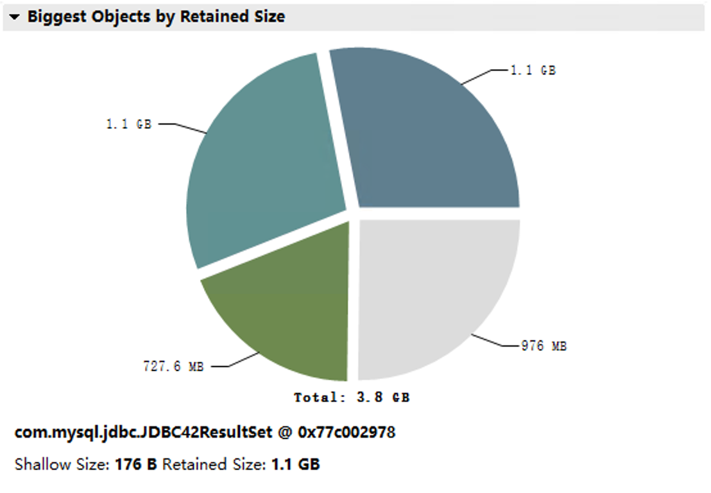

### Dominator Tree

进入 Dominator Tree 模块，查看内存占用最高的对象。这里我们主要关注的是 RetainedHeap 这一列，也就是对象本身加上该对象引用的其他对象占用的内存总和。我们的 Dump 文件中，主要是 JDBC42ResultSet 和 Thread 对象，总共占用了超过 90% 的内存。

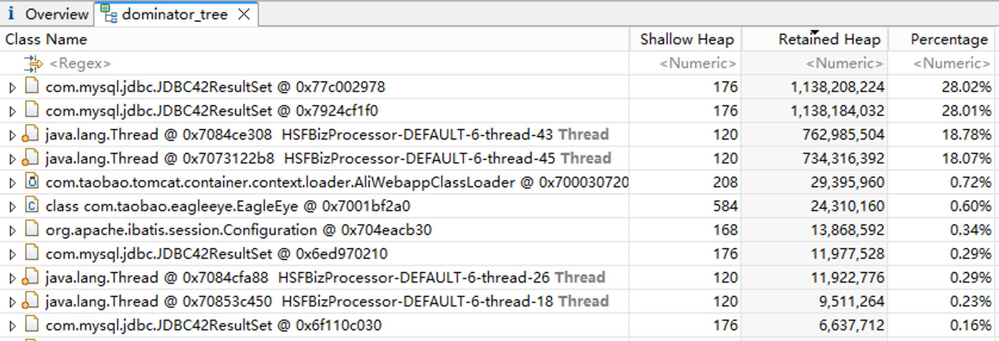

### 对象属性

展开对象，我们发现 JDBC42ResultSet 内存使用这么高的原因是里面有一个 elementData 数组，这个数组里有 80 多万个对象，我们猜测这些对象对应数据库返回的记录。

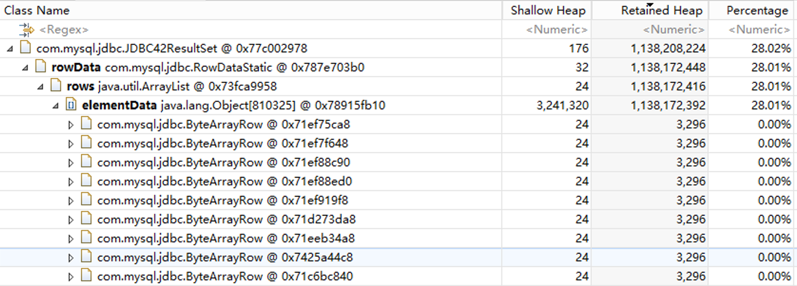

### 查看对象引用

接下来我们希望能找到这是哪个 SQL 查询得到的数据。点击鼠标右键，打开“List objects”下的“with outgoing references”菜单页。

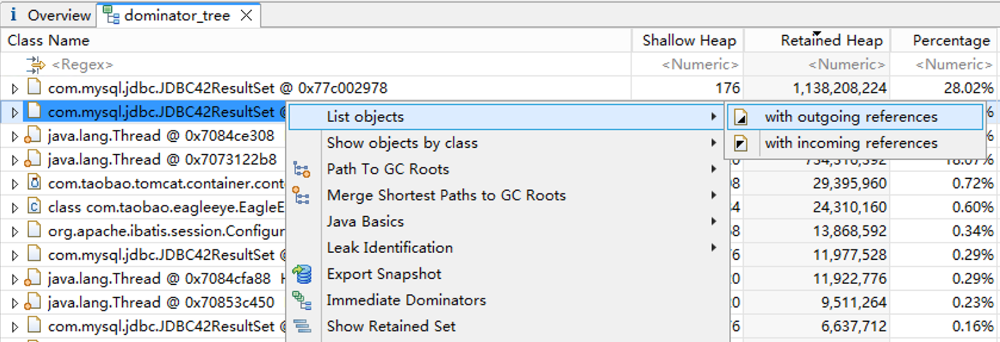

进入 list_objects 菜单页，我们发现在 owningStatement 属性中，可以找到原始的 SQL 语句文本。从 physicalConnection 属性中，我们还能看到数据库连接的相关属性。到这里我们就已经定位到了具体的 SQL 语句。

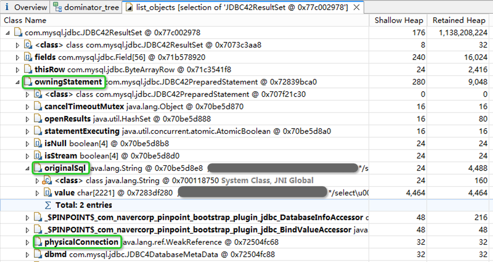

### 分析调用栈

Thread 对象也占用了比较多的内存，展开后可以看到其中也有一个长度为 20 多万的elementData 数组，elementData 里面存的是业务的对象，跟数据库中的记录相对应。

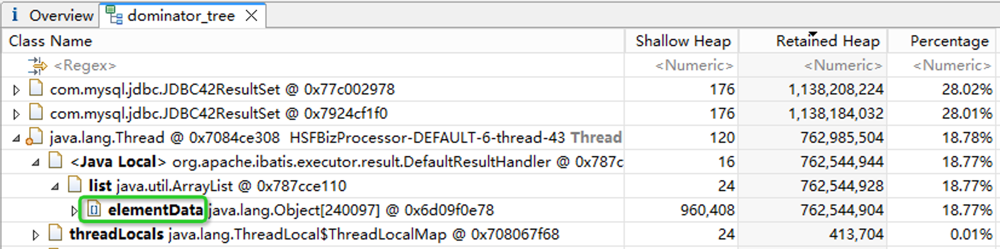

为了分析这些对象是哪个 SQL 查询得到的，我们需要分析线程的调用栈，打开“JavaBasics”下的“Thread Overview and Stacks”菜单。

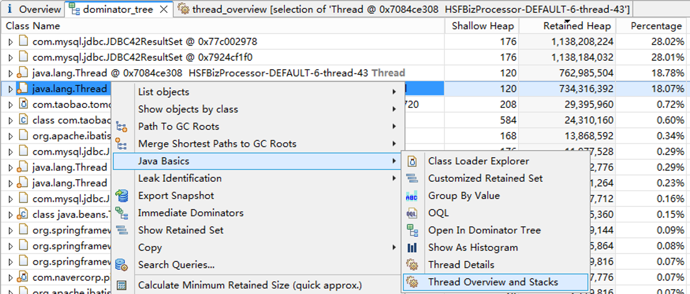

在 thread_overview 菜单页中，我们可以看到线程的调用栈。内存主要由 handleResultSet 的局部变量占用，而 SQL 语句可能是在 SimpleExecutor.doQuery 方法中发起的。

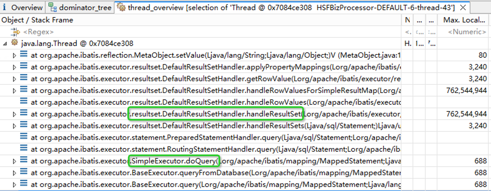

点开 doQuery，我们找到了代码中执行的 SQL 语句。点开 statement 还可以看到传给 SQL 的具体参数。

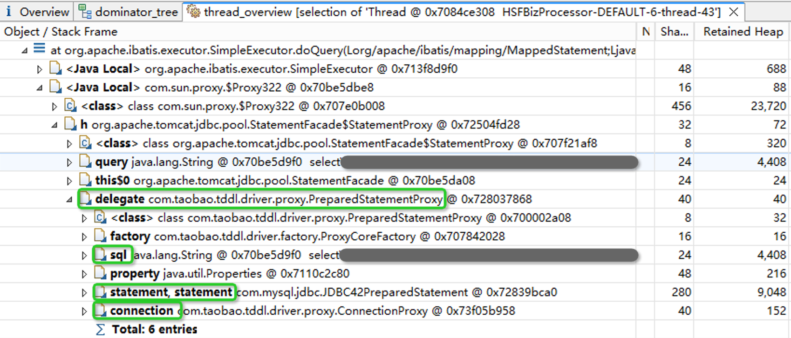

我们演示了从 Heapdump 文件中定位 SQL 语句的一些方法。一条 SQL 的执行结果，在程序中可能会存储两次，一次以 JDBCResultSet 的方式存储，一次以应用程序对象的方式存储。找到 SQL 语句后，就可以从业务的角度进行分析，SQL 语句是否合理、是否可以优化。

接下来我们来回答这一讲开头提出的那个问题：为什么从代码逻辑上看，每次只处理了一行记录，但是程序却占用了大量内存，就好像将所有返回的记录都缓存到了内存中？

为此我们先来分析一个普通的 SELECT 语句完整的执行流程。

## SELECT 语句是怎么执行的？

我们以最简单的一条 SQL 为例，来说明 SQL 的执行步骤。我们假定 src_tab 使用 InnoDB 存储引擎。

```sql
select * from src_tab;
```

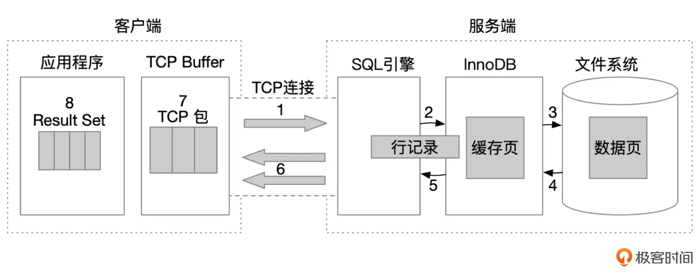

SELECT 语句的完整执行流程大致上可以分为下面这几个步骤：

1. 客户端提交 SQL 语句。客户端驱动程序将 SQL 语句打包，发送给服务器。

2. 数据库服务端接收到客户端发起请求，解析 SQL 文本，生成执行计划，并开始执行 SQL语句。执行时，需要到存储引擎获取数据。

3. InnoDB 存储引擎中，数据存放在数据页面中，数据页缓存到 Buffer Pool 中。

4. 如果数据页还没有缓存到 Buffer Pool 中，就需要发起 IO 操作，从文件系统中读取整个页面进行缓存。

5. 最终 InnoDB 存储引擎将一行数据返回给 SQL 引擎。

6. SQL 引擎将一行记录打包，发送给客户端。

7. 数据包通过 TCP 协议传输到客户端。

8. 客户端读取网络包，解析出一行记录。

这里需要注意的是，SQL 开始执行后，SQL 引擎会持续从存储引擎中获取数据，每读取到一行记录，就把记录通过网络发送给客户端，直到所有的数据都查询完成。所有数据都发送完成后，服务端还要发送一个结束标记，告诉客户端这个 SQL 的所有结果都已经发送了。

### MySQL 客户端服务端交互协议

MySQL 客户端和服务端之间的交互遵循一定的协议，协议的基本格式如下图所示：

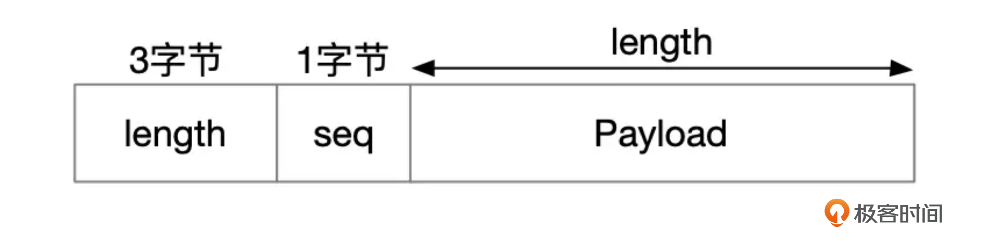

length 为 3 个字节，标识包的长度，一个包最大长度为 16M。超过 16M 的部分需要拆成多个包，seq 是包的序号，payload 是具体的协议数据。对于一个 SELECT 查询语句，客户端发送的请求包格式大致上就是下面图片中展示的这样。其中 command 是命令的类型，目前MySQL 中总共定义了几十种类型，对于查询语句，command 是 COM_QUERY。

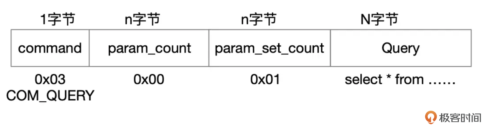

服务端返回的包大致可以分为三种类型。

- 结果集

结果集数据包由元数据、行记录、结束标记这几部分组成。元数据实际上是一个字段列表，告诉你返回的数据由哪几个字段组成。行记录从数据库中查询得到，结果集中可能包含 0 行或多行记录，每行记录由多个字段组成。

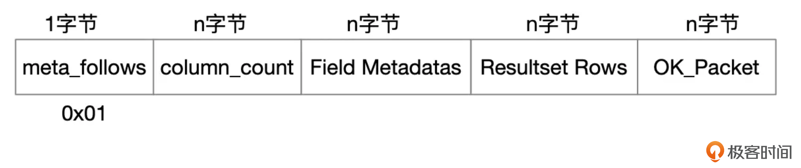

- OK_Packet

OK_Packet 标志着一个语句的结束，包里面也包含了一些额外的信息，比如 SQL 影响了多少行数据，SQL 执行是否有 Warning。

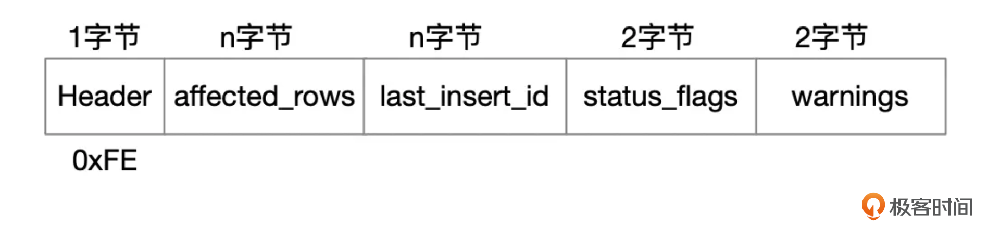

- Err_Packet

如果 SQL 执行过程中出错了，服务端会返回一个 Err_Packet，包括错误编号和错误消息。


### SQL 引擎的核心逻辑

MySQL 优化器生成的执行计划，交给 SQL 引擎执行。SQL 引擎的核心是一个大的循环，根据执行计划中的步骤，从表或索引中获取数据。在最简单的情况下，查询只涉及一个表，SQL引擎调用存储引擎接口，如果正常地获取到了记录，就把记录打包，发送给客户端，然后再继续调用存储引擎接口，获取下一行记录。处理完所有记录后，发送 OK_Packet，告诉客户端所有数据都已经发送完成。

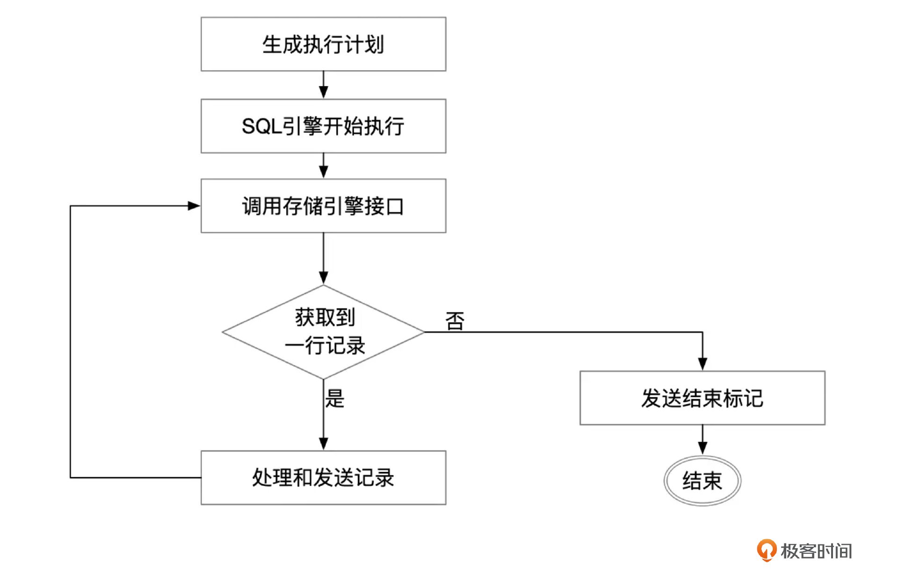

### 存储引擎接口

SQL 引擎调用存储引擎接口时，每次调用最多只获取一行记录，SQL 引擎会提供一段临时内存用来存放这一行记录。存储引擎获取到记录后，进行必要的格式转换后，将记录写到 SQL引擎提供的临时内存中。

### 客户端获取数据

MySQL 的客户端驱动获取数据时，有两种不同的方式。一种方式是将所有的记录都缓存在本地内存中，然后再将结果集交给应用程序处理。MySQL C API 中，mysql_store_result 就是这样处理 SQL 返回的数据的。

这一讲开头的例子中，cur.execute() 这一行代码执行完成后，服务端发送过来的所有数据就已经全部存放在客户端的内存中了。后续再执行 cur.fetchone() 时，实际上只是从本地缓存的结果集中取数据。所以当源表的数据量很大时，程序会消耗大量的内存，甚至引起内存溢出。

```sql
def copy_table(src_conn, dest_conn):
   sql_select = 'select * from src_tab'
   sql_insert = "insert into dest_tab values(%s,%s,%s)"
   cur = src_conn.cursor()
   cur.execute(sql_select)
   row = cur.fetchone()
   while row:
       insert_row(dest_conn, sql_insert, row)
       row = cur.fetchone()
```

客户端还有另外一种处理方式，如果你不想一次性缓存服务端返回的所有记录，可以调用 CAPI mysql_use_result，调用这个函数并不会真正从网络读取记录，只是初始化了一些数据结构。你需要调用 mysql_fetch_row，每调用一次就获取一行记录，这就是流式处理。我们以下面这段 Python 代码为例来演示流式处理。注意代码中使用了 MySQLdb.cursors.SSCursor，这样当执行 cur.execute() 时，不会从网络中读取记录，只有后续执行 cur.fetchone() 的时候，才从网络中读取一行记录。

```sql
>>> import MySQLdb
>>> import MySQLdb.cursors
>>> import time
>>> conn = MySQLdb.connect(host='172.16.121.234',port=3306,user='user_01', passwd
>>> cur = conn.cursor(cursorclass=MySQLdb.cursors.SSCursor)
>>> cur.execute('select * from tab3')
18446744073709551615L
>>> row = cur.fetchone()
```

如果我们使用 tcpdump 对 MySQL 进行抓包分析，会发现执行 cur.execute() 这一行代码后，服务端向客户端发送了一些数据后就停止发送了，这个时候客户端的 TCP 接收窗口为 0。

```
tcpdump -i any  port 3306 -t -nnnn
```

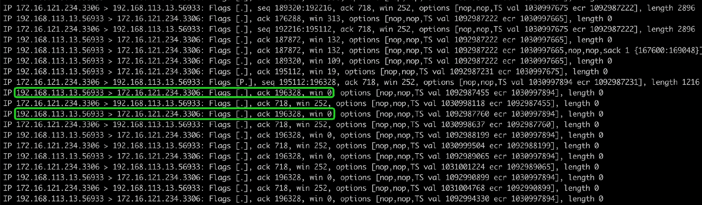

如果客户端在 net_write_timeout 设置的时间内都没有读取数据，服务端的网络写操作会超时，这个时候客户端如果再次获取数据，会发现连接已经被断开了。

```
>>> time.sleep(60)
>>> row = cur.fetchone()
>>> while row:
...     row = cur.fetchone()
...
Exception _mysql_exceptions.OperationalError: (2013, 'Lost connection to MySQL se
```

使用流式处理还有一个副作用，就是执行一个 SQL 后，必须先处理完当前 SQL 返回的结果集中所有的记录，才能执行下一个 SQL，否则会报错“Commands out of sync”。

```sql
>>> cur = conn.cursor(cursorclass=MySQLdb.cursors.SSCursor)
>>> cur.execute('select * from tab3')
18446744073709551615L
>>> cur.execute('select 1')
_mysql_exceptions.ProgrammingError: (2014, "Commands out of sync; you can't run t
```

如果你使用了 JDBC，默认的结果集处理方式和 mysql_store_result 一样，会将服务端发送的所有数据都放到内存中，这也是我们从前面 Heapdump 中看到的那样。如果结果集太大，你不想将所有记录都放到内存中，可以采用流式处理，需要在 createStatement 时传入几个参数，具体使用方法你可以参考官方文档。

```
Statement stmt = conn.createStatement(java.sql.ResultSet.TYPE_FORWARD_ONLY,
             java.sql.ResultSet.CONCUR_READ_ONLY);
stmt.setFetchSize(Integer.MIN_VALUE);
```

使用这种方式执行完一个 SQL 的时候，需要将当前的 stmt 关闭后，才能创建下一个Statement，否则会抛出下面这样的异常。

```
java.sql.SQLException: Streaming result set com.mysql.cj.protocol.a.result.Result
```

我们看到，不管是 C API 还是 Java API，在处理结果集的时候，默认行为都是将数据全部加载到内存中。当返回的记录数不多时，这种处理方式是比较合理的，因为这样可以尽快地获取所有数据，这样在服务端，SQL 也能及时完成。但如果结果集太大，这样做就可能会导致客户端内存溢出，这时你可以使用流式处理，一次只读取一行记录。有一点需要注意，读取记录后要尽快完成业务处理，并及时读取下一行记录。

服务端通过 TCP 协议发送数据，这些数据会先进入到客户端所在机器的 TCP Buffer 中。如果客户端没有及时将数据从 TCP Buffer 中取走，TCP Buffer 很快就会用完，这时客户端就会告诉服务端，我这边 TCP Buffer 已经满了，你先不要发送数据过来了。这实际上是通过 TCP 协议中的 Window Size 来实现的。

客户端 TCP 接收窗口大小为 0 时，服务端发送数据时就会被阻塞。MySQL 通过参数net_write_timeout 来设置网络发送超时时间，该参数默认为 60 秒。如果服务端发送数据时阻塞时间超过了这个设置，就会将连接断开。

## 总结时刻

这一讲中，我们一起学习了 MySQL 客户端和服务端的交互过程，分析了 MySQL 处理结果集的两种方式，以及查询大表为什么会引起客户端内存溢出。

对于 Java 程序，我们可以使用 Heapdump 分析，找到返回大量数据的那些 SQL。如果业务中有 SQL 返回了太多的数据，一般我建议先从业务上进行分析，业务是否真的需要查询这么多数据？是不是可以将 SQL 改写成分页的方式，一次只查询一部分数据？

如果你的应用场景就是需要查询大量的数据，也不方便使用分页 SQL，比如你可能在写一个类似 mysqldump 的数据导出工具，可以采用流式处理。不过采用流式处理时，需要尽快将数据从 TCP Buffer 中取出，否则会导致服务端发送数据被阻塞，如果阻塞时间超过net_write_timeout，还会导致连接中断。即使连接没有中断，也会导致服务端发送数据的效率降低，增加 SQL 的执行时间，如果 SQL 还持有锁，这会引起更大的性能问题。

## 思考题

源库中有一个大表，表结构定义如下：

```sql
create table big_table(
   col1 varchar(32) not null,
   col2 varchar(32) not null,
   col3 varchar(32) not null,
   col4 varchar(256),
   col5 varchar(256),
   ....
   col10 varchar(512),
   primary key(col1, col2, col3)
) engine=innodb;
```

这个表总共有 3000 万行数据，平均行长度大约为 2K。现在需要将这个表复制到目标库。源库和目标库都是 MySQL。有一台 4 核 8G 的中转机器供你使用。请问你会怎么解决这个需求？如果要你写一段程序来完成这个任务，需要注意什么？如何提高数据复制的速度？

期待你的思考，欢迎在留言区中与我交流。如果今天的课程让你有所收获，也欢迎转发给有需要的朋友。我们下节课再见！
