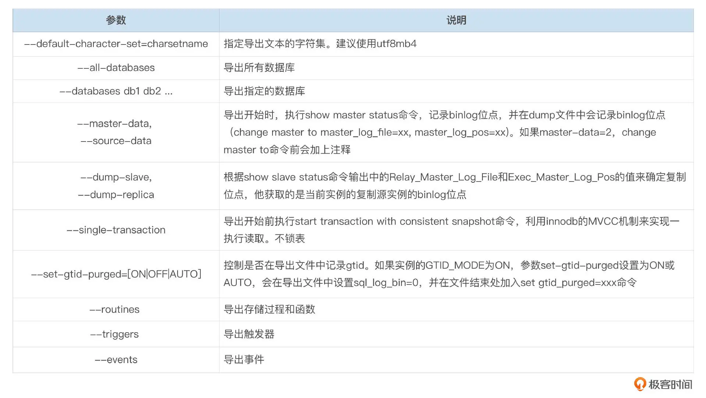
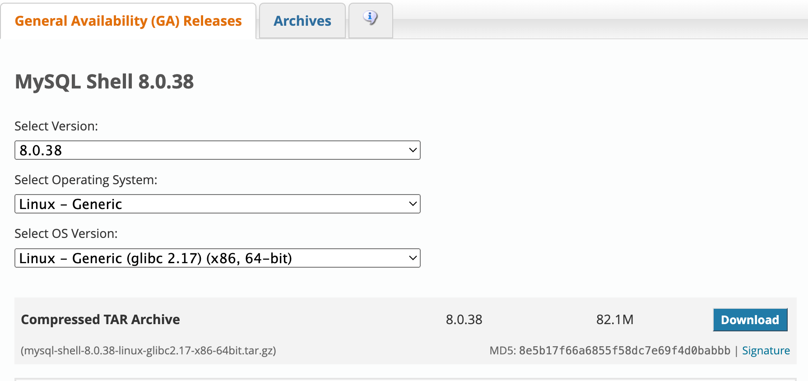
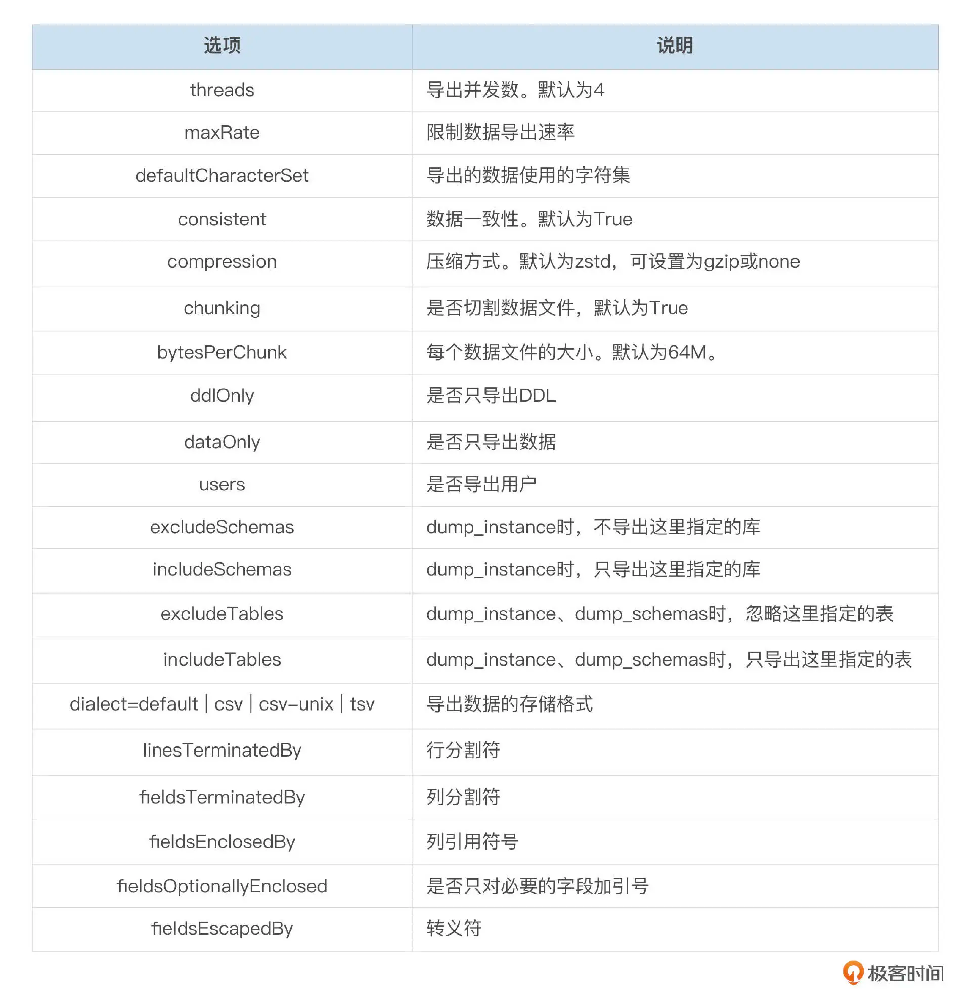

# 09 | MySQL如何快速导入导出数据？（上）

你好，我是俊达。

这一讲中我会介绍 MySQL 中导出数据和导入数据的一些方法，包括传统的 mysqldump 工具、MySQL shell 提供的实例导出和导入工具、MySQL 原生支持的 LOAD DATA 和 SELECTINTO OUTFILE 命令，以及 mysql shell 的单表 export 和并行 import 工具。这些工具有各自的特点，也有一些相通的地方，学习了这些工具的特点和使用方法后，你可以根据自己具体的需求，选择合适的方法来完成数据导出导入相关的任务。

## mysqldump

mysqldump 是 MySQL 自带的一个命令行工具，可以用来导出整个数据库实例，也可以导出指定的库或表。mysqldump 不仅能用来导出数据，还能用来导出数据库中的各类对象，如表结构、存储过程、函数、事件、数据库用户、权限。

### mysqldump 使用场景

使用 mysqldump 备份整个数据库实例时，需要加上参数–all-databases。

```
mysqldump -u user -hhost -psomepass --all-databases
```

如果你还想同时备份存储过程、触发器、事件，就要加上–routines、–triggers、–events 这几个参数。

```
mysqldump -u user -hhost -psomepass --all-databases --routines --triggers --event
```

如果要备份指定的数据库，需要加上参数–databases，后面跟上需要备份的数据库列表。如果在这里指定了所有的数据库，那么效果其实跟使用参数–all-databases 一样。

```
mysqldump -u user -hhost -psomepass --databases db1 db2 ...
```

如果要导出某个表的数据，参数中先加上 dbname，然后再加上需要备份的表的列表。

```
mysqldump -u user -hhost dbname tab1 tab2 ...
```

mysqldump 还可以通过参数–where 添加过滤条件，只备份表中满足条件的数据。

```
mysqldump -u user -hhost dbname --where "create_time >= '2024-08-01'" tab1 tab2 .
```

如果你只想备份表结构，不需要备份数据，就加上参数 -d。

```
mysqldump -u user -hhost -psomepass -d --databases db1 db2 ....
```

mysqldump 会将备份的结果输出到标准输出中，我们一般会将输出重定向到文件中。下面这个例子中，我们将备份数据重定向到 all.sql 中，将 mysqldump 可能产生的日志信息重定向到backup.log 文件中。

```
nohup mysqldump -uroot -h127.0.0.1 -pabc123 --all-databases > all.sql 2>backup.lo
```

mysqldump 的用户需要有一些基本的权限，包括读取表、锁表、读取复制位点、查看视图和触发器、Flush Table 等权限。

```sql
create user 'dump'@'%' identified by 'somepass';
grant LOCK TABLES, PROCESS, REPLICATION CLIENT, EVENT, RELOAD, SELECT, SHOW VIEW,
```

### 数据一致性和锁的问题

数据库导出的过程中，如果允许应用正常访问数据库，进行读写操作，那么我们就称之为热备份。热备份时，如果不做任何处理，那么备份出来的数据很可能是不一致的。比如数据库中有两个表 T1、T2，导出 T1 时，T2 表的数据一直在变动。等到 T1 表导出完成后，导出 T2 表时，T1 表的数据也可能会被修改，那么当整个数据库导出完成后，这些表导出的数据很可能就是不一致的。

如何保证 mysqldump 导出数据的一致性呢？如果数据库中有不支持事务的存储引擎，如MyISAM 表，你需要在导出的过程中把表都锁住。如果数据库中只有 InnoDB 表，还可以使用InnoDB 的一致性读取机制，在不锁表的情况下，获得一份一致的数据。

前面的几个例子中，我们都没有添加其他参数，mysqldump 在导出数据时，以数据库为单位，每处理一个数据库时，会将这个数据库中的所有表都锁住，等处理完这个数据库中的所有表后再解锁。如果我们开启数据库的 GENERAL LOG，再执行 mysqldump 命令，就能在general log 中看到锁表和解锁的动作。

```sql
Init DB  repl
Query    SHOW CREATE DATABASE IF NOT EXISTS `repl`
Query    show tables
Query    LOCK TABLES `hello` READ ,`t1` READ  ...
...
Query    SELECT /*!40001 SQL_NO_CACHE */ * FROM `hello`
...
Query    UNLOCK TABLES
```

为了避免锁表导致业务异常，可以加上参数–skip-lock-tables，这样就不会锁表了。当然，这样就无法保证导出来的数据的一致性了。

```
mysqldump -uroot -hhost -psomepass --skip-lock-tables ...
```

前面这种以库为单位锁表的方式，只能保证同一个库下面表数据的一致性，无法保证多个库之间的数据一致性。在有些情况下，我们需要保证整个实例数据的一致性。比如我们想基于mysqldump 的备份文件来初始化一个备库，这种情况下一般我们会加上参数–master-data、–source-data、–dump-slave 或–dump-replica。

```
mysqldump -uroot -hhost -psomepass --master-data --all-databases --routines --tri
```

为了保证整个实例数据的一致性，导出开始时，mysqldump 会先执行 FLUSH TABLES 和FLUSH TABLES WITH READ LOCK 命令，获取实例的全局读锁，这样其他会话就不能修改任何表的数据了。导出结束时，mysqldump 退出登录，自动释放全局读锁。

```sql
Query    FLUSH /*!40101 LOCAL */ TABLES
Query    FLUSH TABLES WITH READ LOCK
Query    SHOW VARIABLES LIKE 'gtid\_mode'
Query    SELECT @@GLOBAL.GTID_EXECUTED
Query    SHOW MASTER STATUS
....
Quit
```

为了避免 mysqldump 长时间持有全局读锁，可以加上–single-transaction 参数。

```
mysqldump -uroot -hhost -psomepass --master-data --single-transaction \
   --all-databases --routines --triggers --events
```

加上–single-transaction 参数后，mysqldump 会在开始时执行 flush tables with read lock，然后将会话隔离级别设置成 repeatable read，开启一个快照事务（START TRANSACTIONWITH CONSISTENT SNAPSHOT），获取当前的 gtid_executed 和 binlog 位点后，就释放全局读锁，然后再开始导出数据。

```sql
Connect  root@localhost on  using SSL/TLS
Query    FLUSH /*!40101 LOCAL */ TABLES
Query    FLUSH TABLES WITH READ LOCK
Query    SET SESSION TRANSACTION ISOLATION LEVEL REPEATABLE READ
Query    START TRANSACTION /*!40100 WITH CONSISTENT SNAPSHOT */
Query    SHOW VARIABLES LIKE 'gtid\_mode'
Query    SELECT @@GLOBAL.GTID_EXECUTED
Query    SHOW MASTER STATUS
Query    UNLOCK TABLES
......
```

这样，只会在开始时短暂锁表，数据导出的过程中不锁表。通过 InnoDB 的多版本机制（MVCC）来保证数据的一致性。如果数据库中存在非 InnoDB 引擎表（如 myisma 存储引擎表、memory 存储引擎），就不能保证数据的一致性了。使用 single-transaction 时，避免其他会话在 mysqldump 运行期间执行 DDL（ALTER TABLE, CREATE TABLE, DROP TABLE,RENAME TABLE, TRUNCATE TABLE 等），执行了这些 DDL 后，可能会导致备份失败。

```
ERROR 1412 (HY000): Table definition has changed, please retry transaction
```

### mysqldump 注意事项

使用 mysqldump 有几点需要注意。

1. 首先是字符集的问题，字符集选择不当可能会产生乱码。建议使用 utf8mb4 字符集，可以通过参数–default-character-set 指定。

2. mysqldump 产生的备份文件中，对每个表，默认都会生成一个 drop table 的语句。下面这段内容就是 mysqldump 生成的。

```sql
--
-- Table structure for table `t_gbk`
--
DROP TABLE IF EXISTS `t_gbk`;
/*!40101 SET @saved_cs_client     = @@character_set_client */;
/*!50503 SET character_set_client = utf8mb4 */;
CREATE TABLE `t_gbk` (
 `a` varchar(100) DEFAULT NULL
) ENGINE=InnoDB DEFAULT CHARSET=gbk;
/*!40101 SET character_set_client = @saved_cs_client */;
```

包含 DROP TABLE 是为了方便数据导入，但是如果你不小心把 mysqldump 生成的备份文件恢复到了错误的环境，就可能会导致那个环境的表被 DROP，从而引起数据丢失。为了避免这个问题，你也可以加上–skip-add-drop-table 参数，这样就不会生成 drop table 语句了。

另外还有一种情况，在 MM 复制架构下，如果你在备库上恢复数据时，没有设置sql_log_bin=0，DROP TABLE 语句会被复制到主库执行，从而导致主库的数据丢失。当然，由于备份的时候默认会设置参数–set-gtid-purged=AUTO，如果源库开启了 GTID，那么生成的备份文件中已经包含了 set sql_log_bin=0。

```
-- MySQL dump 10.13  Distrib 8.0.32, for Linux (x86_64)
--
-- Host: 127.0.0.1    Database: backme
-- ------------------------------------------------------
SET @MYSQLDUMP_TEMP_LOG_BIN = @@SESSION.SQL_LOG_BIN;
SET @@SESSION.SQL_LOG_BIN= 0;
--
-- GTID state at the beginning of the backup
--
SET @@GLOBAL.GTID_PURGED='0511eeb3-fad6-11ed-9a0f-fab81f64ee00:1-......';
......
```

3. 如果源库中有视图、存储过程、函数等对象，生成的备份文件中，会根据对象的原始创建者指定 DEFINER。下面就是这样一个例子。

```sql
/*!50001 DROP VIEW IF EXISTS `v_t_hello`*/;
/*!50001 CREATE ALGORITHM=UNDEFINED */
/*!50013 DEFINER=`user_01`@`%` SQL SECURITY DEFINER */
/*!50001 VIEW `v_t_hello` AS select `t_hello`.`a` AS `a` from `t_hello` */;
```

如果目标库中没有同样的用户，那么这些恢复出来的对象实际上是无效的，使用时会报错。你要么在目标库上创建一个同名的用户，要么修改这些对象的 DEFINER。

```
ERROR 1449 (HY000): The user specified as a definer ('user_01'@'%') does not exis
```

4. mysqldump 使用单线程导出数据，并且所有数据都存放在同一个文件中。默认情况下，恢复时你也只能使用一个线程。如果你的数据库比较大，恢复就可能会比较慢。或者你只想恢复部分库或表，但是由于所有的数据都在同一个文件中，处理起来也不方便。

如果你想提升恢复速度，或者只恢复部分库或表，可以想办法将备份文件切分开来。mysqldump 生成的是文本文件，有固定的格式。比如每个建表语句前有“Table structure fortable …”，每个表的数据前有“Dumping data for table …”这样的文本，你可以根据这个特点，拆分文件。网上应该也能找到这样的工具。

```sql
--
--  Database: `backme`
--
CREATE DATABASE /*!32312 IF NOT EXISTS*/ `backme` /*!40100 DEFAULT CHARACTER SET
USE `backme`;
--
-- Table structure for table `t_emoji`
--
/*!40101 SET @saved_cs_client     = @@character_set_client */;
/*!50503 SET character_set_client = utf8mb4 */;
CREATE TABLE `t_emoji` (
 `a` varchar(30) DEFAULT NULL
) ENGINE=InnoDB DEFAULT CHARSET=utf8mb4 COLLATE=utf8mb4_0900_ai_ci;
/*!40101 SET character_set_client = @saved_cs_client */;
--
-- Dumping data for table `t_emoji`
--
LOCK TABLES `t_emoji` WRITE;
/*!40000 ALTER TABLE `t_emoji` DISABLE KEYS */;
INSERT INTO `t_emoji` VALUES (_binary '😀😃'),(_binary '中文符号');
/*!40000 ALTER TABLE `t_emoji` ENABLE KEYS */;
UNLOCK TABLES;
```

### mysqldump 参数总览

下面的表格整理了 mysqldump 支持的部分参数，供你参考。完整的参数请参考官方文档。



## MySQL Shell Dump 工具

MySQL Shell 是官方提供的新一代客户端工具，也提供了实例、库、表级的导出和导入功能。跟传统的 mysqldump 相比，MySQL Shell 提供了并行导出和并行导入的功能。

### 安装 MySQL Shell

MySQL Shell 需要单独安装。一般我们到官网下载对应操作系统的最新版本就可以了，比如对于 Linux 系统，我选择使用二进制包来安装。



下载二进制包，确认文件的 md5 没有问题后，解压文件。

```bash
wget https://dev.mysql.com/get/Downloads/MySQL-Shell/mysql-shell-8.0.38-linux-gli
# md5sum mysql-shell-8.0.38-linux-glibc2.17-x86-64bit.tar.gz
8e5b17f66a6855f58dc7e69f4d0babbb  mysql-shell-8.0.38-linux-glibc2.17-x86-64bit.ta
```

我将 MySQL Shell 的二进制包放到 /opt/mysqlsh 目录下。为了便于使用，在 PATH 环境变量中添加 mysqlshell 可执行程序的路径。

```bash
## ~/.bash_profile
PATH=$PATH:/opt/mysqlsh/bin
export PATH
```

### 使用 MySQL Shell Dump 工具

使用 MySQL Shell 导出实例，需要给数据库用户授予相关的权限。这里还需要给用户授予backup_admin 权限。

```sql
create user 'dump'@'%' identified by 'somepass';
grant LOCK TABLES, PROCESS, REPLICATION CLIENT, EVENT, RELOAD, SELECT, SHOW VIEW,
grant backup_admin on *.* to 'dump'@'%';
```

先使用 mysqlsh 登录实例，基本的参数和 MySQL 客户端类似。MySQL Shell 有 JavaScript和 Python 两种命令模式，这里我使用–py 指定使用 Python 模式。

```
mysqlsh -h 172.16.121.234 -u dump -psomepass --py --mysql
```

使用 dump_instance、dump_schemas、dump_tables 这几个方法，MySQL Shell 可以实现实例、数据库和表级导出，接下来我来分别讲解。

### 导出整个实例

使用 dump_instance 导出实例，第一个参数是文件的存放路径，这个路径需要是一个空的目录，里面不能有其他文件，否则 dump 会报错。第二个参数是一个字典对象，可以指定导出的各种选项。这里我用 threads 选项指定导出的并发数。

```
MySQL Py > util.dump_instance("/data/backup/fulldump_20240722", {"threads":8})
Acquiring global read lock
Global read lock acquired
Initializing - done
16 out of 20 schemas will be dumped and within them 117 tables, 4 views.
31 out of 34 users will be dumped.
Gathering information - done
All transactions have been started
Locking instance for backup
Global read lock has been released
Writing global DDL files
Writing users DDL
......
Running data dump using 8 threads.
Writing schema metadata - done
Writing DDL - done
Writing table metadata - done
Starting data dump
Dump duration: 00:05:25s
Total duration: 00:05:32s
Schemas dumped: 16
Tables dumped: 117
Uncompressed data size: 109.91 MB
Compressed data size: 12.28 MB
Compression ratio: 8.9
Rows written: 1442030
Bytes written: 12.28 MB
Average uncompressed throughput: 337.46 KB/s
Average compressed throughput: 37.71 KB/s
```

### 导出部分数据库

如果你只需要导出部分数据库，可以使用 dump_schemas。第一个参数是一个数组，指定需要导出的数据库名称，第二个参数是备份文件的存放路径。第三个参数是一个字典，用来指定导出的各种选项。

```
MySQL Py > util.dump_schemas(
    ["employees","src_db"],
    "/data/backup/db_backups", {"threads":4})
```

### 导出部分表

如果你只想导出部分表，可以使用 dump_tables。第一个参数是库名。第二个参数是一个数组，用来指定需要导出的表名。第三个参数是文件的存放路径。第四个参数是一个字典，用来指定导出的各种选项。

```
util.dump_tables("employees", ["current_dept_emp", "departments", "dept_emp"],
    "/data/backup/table_backups", {"threads":4})
```

### 数据一致性保障

和 mysqldump 类似，使用 MySQL Shell Dump 时，默认也会保证导出数据的一致性。MySQL Shell Dump 使用多线程导出，会保障多个线程读取的数据的一致性。导出启动时，会先执行 Flush tables 和 Flush Tables With Read Locks，获取全局读锁。然后其他几个线程连接到数据库，各自开启一个事务（START TRANSACTION WITH CONSISTENTSNAPSHOT）。

如果账号有 Backup_admin 权限，Dump 主线程还会执行 LOCK INSTANCE FOR BACKUP，获取备份锁，阻止其他会话在数据导出的过程中执行 DDL。这些操作都完成后，MySQL ShellDump 主线程会释放全局读锁，各个线程开始导出数据。

```
Time                 Id Command    Argument
2024-07-22T02:13:39.958184Z       302 Query     FLUSH NO_WRITE_TO_BINLOG TABLES
2024-07-22T02:13:39.978806Z       302 Query     FLUSH TABLES WITH READ LOCK
2024-07-22T02:13:39.979382Z       302 Query     SET SESSION TRANSACTION ISOLATION
2024-07-22T02:13:39.979845Z       302 Query     START TRANSACTION WITH CONSISTENT
2024-07-22T02:13:39.989550Z       303 Connect   dump@mysql02 on  using SSL/TLS
2024-07-22T02:13:39.990216Z       303 Query     SET SESSION TRANSACTION ISOLATION
2024-07-22T02:13:39.990583Z       303 Query     START TRANSACTION WITH CONSISTENT
2024-07-22T02:13:45.983579Z       302 Query     SHOW MASTER STATUS
2024-07-22T02:13:45.984342Z       302 Query     LOCK INSTANCE FOR BACKUP
2024-07-22T02:13:45.984822Z       302 Query     UNLOCK TABLES
```

如果你对数据一致性没有要求，可以在 Dump 时将 consistent 设置为 False，这样就不会获取全局读锁了。

```
MySQL Py > util.dump_schemas( ["employees","src_db"],
    "/data/backup/db_backups",
{"consistent":False})
```

### 导出的文件

MySQL Shell Dump 工具将导出的文件存放在指定的路径下，每个表的 DDL 语句和数据分别存放在单独的文件中。建表语句存放在 database_name@table_name.sql 文件中，表的数据存放在 database_name@table_name@@n.xxx.xxx 文件中。一个表的数据按一定的大小切割成多个文件存放。导出时可以指定文件的格式，默认使用 tsv 格式，并且使用 zstd 进行压缩。

```
# tree /data/backup/fulldump_20240722
/data/backup/fulldump_20240722
├── employees@current_dept_emp.pre.sql
├── employees@current_dept_emp.sql
├── employees@departments@@0.tsv.zst
├── employees@departments@@0.tsv.zst.idx
├── employees@departments.json
├── employees@departments.sql
├── employees@dept_emp@@0.tsv.zst
├── employees@dept_emp@@0.tsv.zst.idx
├── employees@dept_emp.json
......
```

我们来看一下文件中数据的格式。MySQL Dump 使用文本格式存放导出的数据。使用 zstd 解压文件后就可以查看。默认的文件格式实际上和使用 MySQL 的 SELECT INTO OUTFILE 生成的格式一样，列之间以 Tab 符分割，记录之间使用换行符分割。当然，你也可以在 Dump时指定参数，生成不同格式的文件。

```
# zstd -d employees@employees@@0.tsv.zst
employees@employees@@0.tsv.zst: 13821993 bytes
# head -5 employees@employees@@0.tsv
10001  1953-09-02  Georgi  Facello  M  1986-06-26
10002  1964-06-02  Bezalel  Simmel  F  1985-11-21
10003  1959-12-03  Parto  Bamford  M  1986-08-28
10004  1954-05-01  Chirstian  Koblick  M  1986-12-01
10005  1955-01-21  Kyoichi  Maliniak  M  1989-09-12
```

### Dump 选项

下面的表格记录了 Dump 工具支持的一部分参数，供你参考，完整的参数请参考官方文档。



## 总结时刻

这一讲我们学习了 mysqldump 和 MySQL Shell 的 Dump 工具。mysqldump 将数据库导出成一个 SQL 文件，在数据库非常大的情况下，导入这个 SQL 文件可能需要花很长的时间。MySQL Shell 的 Dump 工具可以并行导出，并且每个表的数据会导出到单独的文件中，这便于你进行并行导入，也便于你只导入部分表。关于 MySQL Shell Dump 导出的数据应该如何导入，会在这一讲的下篇中详细介绍。

## 思考题

这一讲我们提到了 mysqldump 的一个限制：导出的数据都存在同一个文件中，不方便并行导入。一次紧急故障中，需要将 mysqldump 备份出来的数据恢复出来，数据库比较大，单线程恢复的话，耗时又会比较久，你有哪些办法来加快恢复的速度？

期待你的思考，欢迎在留言区中与我交流。如果今天的课程让你有所收获，也欢迎转发给有需要的朋友。我们下节课再见！
