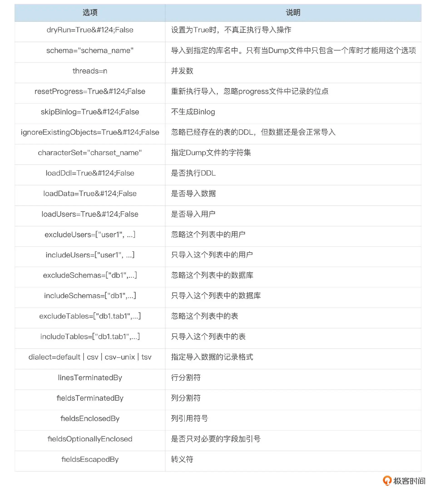
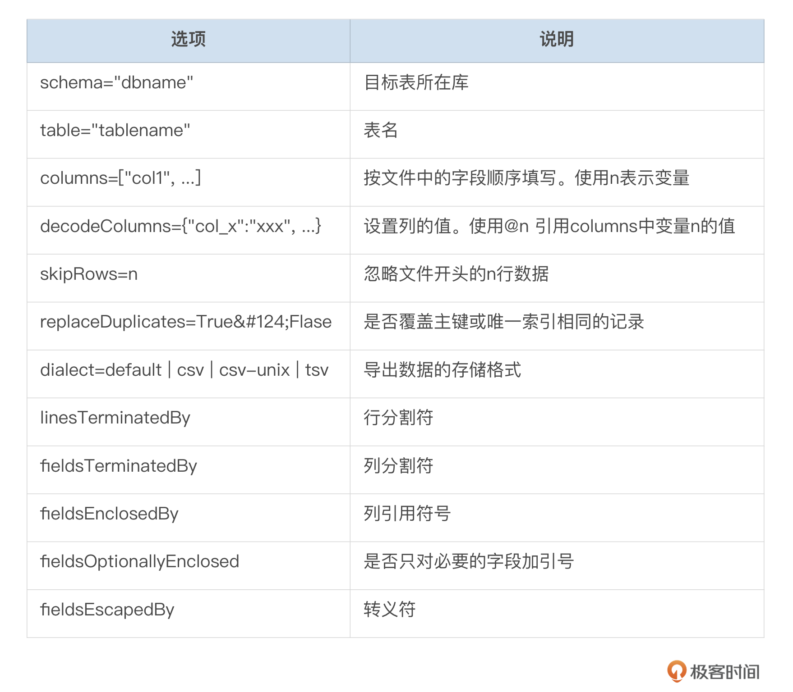

# 10 | MySQL如何快速导入导出数据？（下）

你好，我是俊达。

上一讲我介绍了 mysqldump 和 MySQL Shell 的 Dump 工具。使用 mysqldump 导出的，实际上是一个 SQL 文件，将这个文件直接拿到数据库中执行，就可以完成数据导入。MySQLShell Dump 工具将建表语句、表中的数据导出到了不同的文件中，而且数据以文本文件的形式存储，需要使用 MySQL Shell 配套的 Load 工具，或者使用 Load Data 命令导入数据。

这一讲我们来学习 MySQL Shell Load 工具的使用方法，以及导出和导入单个表数据的一些其他方法。

## MySQL Shell Load 工具

### 使用 load_dump 导入

MySQL Shell Dump 导出的数据，可以用 MySQL Shell Load 工具导入。load_dump 有两个参数，第一个参数是 Dump 文件的路径。第二个参数是一个字典，用来指定导入的各个选项。

```
util.load_dump("/data/backup/db_backups", {})
```

load_dump 默认会导入 Dump 路径下的所有文件。你可以使用 includeSchemas、includeTables 来指定需要导入的库和表，用 excludeSchemas、excludeTables 忽略指一些库和表。这里 includeTables 和 excludeTables 中表名的格式为"db_name.table_name"。

```
util.load_dump("/data/backup/db_backups", {
   "includeTables":["employees.salaries"]
})
```

将 loadDdl 设置为 True，loadData 设置为 False，你可以只导入表结构，不导入数据。

```
util.load_dump("employees_dump", {
   "includeTables":["employees.salaries"],
   "loadDdl":True,
   "loadData":False
})
```

如果你只导出了一个库，还可以通过 schema 选项，数据导入到另外一个库中。如果指定的库不存在，load_dump 会自动创建这个数据库。

```
util.load_dump("/data/backup/backup_employees", {
 "schema":"employees_restore"
})
```

如果 Dump 文件中包含了多个库，那么使用 schema 选项时，会报出下面这样的错误信息。

```
ERROR: The 'schema' option can only be used when loading a single schema, but 2 w
```

### 注意事项

1. load_dump 工具使用 LOAD DATA LOCAL INFILE 命令导入数据，因此需要在目标库上将local_infile 设置为 ON，否则会报错“ERROR: The ‘local_infile’ global system variable mustbe set to ON in the target server, after the server is verified to be trusted.”。

2. 使用 load_dump 导入时，如果目标库中已经有同名的表，导入操作会报错。

```
ERROR: Schema `employees` already contains a table named employees
ERROR: One or more objects in the dump already exist in the destination database.
```

你可以设置 excludeTables，不导入这些表。或者设置 ignoreExistingObjects，忽略已经存在的表。注意，设置 ignoreExistingObjects 只是不重新创建表，数据还是会重新导入的，表中已经存在数据，会被 Dump 文件中的数据覆盖。

3. load_dump 将导入的进度记录在 progressFile 文件中。如果导入过程异常中断，下次继续导入时，会根据 progressFile 文件中的内容跳过已经完成的步骤。如果你想重新导入数据，可以将 resetProgress 设置为 True。

```
util.load_dump("/data/backup/backup_employees", {
 "schema":"employees_restore",
 "resetProgress": True,
})
```

### Load 选项

下面的表格整理了 Load 工具支持的一部分参数，供你参考。完整的选项请参考官方文档。



MySQL Shell Dump 导出的文件，实际上还可以直接使用 LOAD DATA 命令导入，或者使用MySQL Shell 的 import_table 导入，接下来我会依次介绍。

## 单表数据导出

MySQL Shell Dump 导出的数据，实际上使用了比较常用的一种数据格式。在 MySQL 中，还有其他几个方法也能将数据导出成一样的格式，包括使用 SELECT INTO OUTFILE 和使用MySQL Shell 的 export_table 功能。

### 使用 SELECT INTO OUTFILE

使用 SELECT INTO OUTFILE 可以将数据导出到文本文件。不过使用这个功能时，需要先设置数据库参数 secure_file_priv。修改 secure_file_priv 需要重启数据库，我们将参数加到配置文件中，重启数据库。

```
# tail -1 /data/mysql01/my.cnf
secure_file_priv=''
```

OUTFILE 不能指向已经存在的文件，否则会报错。

```sql
mysql> select * from employees.employees limit 10 into outfile '/tmp/emp.txt';
Query OK, 10 rows affected (0.19 sec)
```

SELECT INTO 不加额外参数时，使用 Tab 分割字段，使用换行符分割记录。

```
# head -5 /tmp/emp.txt
10001  1953-09-02  Georgi  Facello  M  1986-06-26
10002  1964-06-02  Bezalel  Simmel  F  1985-11-21
10003  1959-12-03  Parto  Bamford  M  1986-08-28
10004  1954-05-01  Chirstian  Koblick  M  1986-12-01
10005  1955-01-21  Kyoichi  Maliniak  M  1989-09-12
```

```sql
你可以分别指定列分割符、行分割符、转义符。下面这个例子中，列分割符是逗号 ","，行
分割符是换行符 "\n"，字段的数据用引号引用起来。
mysql> select * from employees limit 10
    into outfile '/tmp/emp1.txt'
    character set utf8mb4
    fields terminated by ','
    optionally enclosed by '"'
    escaped by '\\'
    lines terminated by '\n';
Query OK, 10 rows affected (0.01 sec)
```

这样导出的文件，就是非常常见的 CSV 格式。

```
# cat /tmp/emp1.txt
10001,"1953-09-02","Georgi","Facello","M","1986-06-26"
10002,"1964-06-02","Bezalel","Simmel","F","1985-11-21"
10003,"1959-12-03","Parto","Bamford","M","1986-08-28"
10004,"1954-05-01","Chirstian","Koblick","M","1986-12-01"
10005,"1955-01-21","Kyoichi","Maliniak","M","1989-09-12"
```

实际场景中，字段中存储的数据中很可能也包含了列分割符、行分割符、引号、转义符，这会引起文件格式错乱吗？我们用一个例子来测试下。

```sql
mysql> create table emp2(
   emp_no int,
   emp_name varchar(60),
   emp_intro varchar(100),
   primary key (emp_no)
) engine=InnoDB;
mysql> insert into emp2 values
   (10001, '张三', '一生二,二生三,三生万物。'),
   (10002, '李某', '引用一句名言:"天行健\n君子以自强不息"'),
   (10003, '陈某', 'D:\\Pictures\\myself.png');
mysql> select * from emp2;
+--------+----------+------------------------------------------------------+
| emp_no | emp_name | emp_intro                                            |
+--------+----------+------------------------------------------------------+
|  10001 | 张三     | 一生二,二生三,三生万物。                             |
|  10002 | 李某     | 引用一句名言:"天行健
君子以自强不息"                 |
|  10003 | 陈某     | D:\Pictures\myself.png                               |
+--------+----------+------------------------------------------------------+
3 rows in set (0.00 sec)
```

上面这个表的几行数据中，有逗号、双引号、换行符、反斜杠这些特殊的字符。将数据导出后，可以看到这些特殊字符都进行了转义处理。因此导入这些数据时，只要指定相同的参数，就不会有任何问题。

```sql
mysql> select * from emp2 limit 10
    into outfile '/tmp/emp2.txt'
    character set utf8mb4
    fields terminated by ','
    optionally enclosed by '"'
    escaped by '\\'
    lines terminated by '\n';
Query OK, 3 rows affected (0.00 sec)
# cat /tmp/emp2.txt
10001,"张三","一生二,二生三,三生万物。"
10002,"李某","引用一句名言:\"天行健\
君子以自强不息\""
10003,"陈某","D:\\Pictures\\myself.png"
```

SELECT INTO OUTFILE 只能将数据导出在数据库服务器的目录中，使用起来并不是很方便。因为你可能并没有数据库服务器的权限，比如你可能使用了云数据库，无法访问底层操作系统。

### 使用 MySQL Shell export_table 导出数据

MySQL Shell 提供了 export_table 功能，可以将表的数据导出到本地文件中。下面这个例子使用 export_table 导出 emp2 表。

```
mysqlsh -u user_01 -h172.16.121.234 -psomepass --py --mysql
MySQL Py > util.export_table("employees.emp2", "/data/backup/emp2.csv", {
   "linesTerminatedBy": "\n",
   "fieldsTerminatedBy": ",",
   "fieldsEnclosedBy": "\"",
   "fieldsOptionallyEnclosed": True,
   "fieldsEscapedBy": "\\"
   })
Initializing - done
Gathering information - done
Running data dump using 1 thread.
NOTE: Progress information uses estimated values and may not be accurate.
Starting data dump
100% (3 rows / ~3 rows), 0.00 rows/s, 0.00 B/s
Dump duration: 00:00:00s
Total duration: 00:00:00s
Data size: 170 bytes
Rows written: 3
Bytes written: 170 bytes
Average throughput: 170.00 B/s
The dump can be loaded using:
util.import_table("/data/backup/emp2.csv", {
   "characterSet": "utf8mb4",
   "fieldsEnclosedBy": "\"",
   "fieldsEscapedBy": "\\",
   "fieldsOptionallyEnclosed": true,
   "fieldsTerminatedBy": ",",
   "linesTerminatedBy": "\n",
   "schema": "employees",
   "table": "emp2"
})
```

指定相同的参数后，使用 export_table 生成的文件和 SELECT INTO OUTFILE 基本一致。

```
# cat ./employees_dump/emp2.csv
10001,"张三","一生二\,二生三\,三生万物。"
10002,"李某","引用一句名言:\"天行健\n君子以自强不息\""
10003,"陈某","D:\\Pictures\\myself.png"
```

## 单表数据导入

前面讲到，load_dump 底层实际上使用了 LOAD DATA LOCAL INFILE 命令来导入数据。我们也可以在 MySQL 客户端中直接使用 LOAD DATA 命令。

### 使用 Load Data 导入数据

LOAD DATA 命令的基本格式如下：

```
LOAD DATA
   [LOCAL]
   INFILE 'file_name'
   [REPLACE | IGNORE]
   INTO TABLE tbl_name
   [CHARACTER SET charset_name]
   [FIELDS
       [TERMINATED BY 'string']
       [[OPTIONALLY] ENCLOSED BY 'char']
       [ESCAPED BY 'char']
   ]
   [LINES
       [STARTING BY 'string']
       [TERMINATED BY 'string']
   ]
   [IGNORE number {LINES | ROWS}]
   [(col_name_or_user_var
       [, col_name_or_user_var] ...)]
   [SET col_name={expr | DEFAULT}
       [, col_name={expr | DEFAULT}] ...]
```

INFILE 指定文件路径，如果不加 LOCAL，那么文件需要存放在数据库服务器的指定路径下，并且登录用户需要有 FILE 权限。如果加上了 LOCAL，那么文件需要在客户端所在的机器上。如果导入的数据和表里原有的数据有冲突，默认会报错，可以加上 REPLACE，覆盖表中的数据，或者加上 IGNORE，跳过冲突的数据。

你可以使用 IGNORE 忽略文件开头的几行内容。如果你的文件前几行是标题，使用 IGNORE就很方便。

下面的例子中，我们使用 LOAD DATA 命令来导入之前生成的 CSV 文件。注意 mysql 命令行需要加上参数–local-infile。

```
mysql -vvv -uuser_01 -h172.16.121.234 -pabc123 -psomepass --local-infile employee
load data local infile '/data/backup/emp2.csv'
replace into table emp3
character set utf8mb4
fields terminated by ','
optionally enclosed by '"'
escaped by '\\\\'
lines terminated by '\n';
EOF
```

导入后要检查命令的输出信息，如果有 Warning，需要检查下产生 warning 的具体原因。

```
Query OK, 3 rows affected (1.42 sec)
Records: 3  Deleted: 0  Skipped: 0  Warnings: 0
Bye
```

我们来检查下导入的数据，没有发现什么问题。

```sql
mysql> select * from emp3;
+--------+----------+------------------------------------------------------+
| emp_no | emp_name | emp_intro                                            |
+--------+----------+------------------------------------------------------+
|  10001 | 张三     | 一生二,二生三,三生万物。                             |
|  10002 | 李某     | 引用一句名言:"天行健
君子以自强不息"                 |
|  10003 | 陈某     | D:\Pictures\myself.png                               |
+--------+----------+------------------------------------------------------+
3 rows in set (0.00 sec)
```

刚才的例子中，CSV 文件中字段数量和顺序跟表里面的字段数量和顺序完全一致。如果文件和表里面字段数量或顺序不一致，应该怎么处理呢？

我们使用一个具体的例子来说明如何处理这种情况。

```sql
create table emp4(
   emp_name varchar(64),
   emp_no int,
   emp_intro varchar(100),
   grade int,
   primary key(emp_no)
) engine=InnoDB;
```

emp4 这个表和刚才的 emp2.csv 文件的字段顺序不一样，字段数量也不一样。


导入数据时，以 CSV 文件中字段顺序为准，指定字段列表。我们的例子中，第一列对应到emp_no 字段，第二列对应到 emp_name 字段，第三列对应到变量 @emp_intro。然后再使用 SET，将表的 grade 字段设置成固定值 10，将 emp_intro 字段设置为文件中 emp_intro 列的前缀。

```
mysql -vvv -uuser_01 -h172.16.121.234 -pabc123 -psomepass --local-infile employee
load data local infile '/data/backup/emp2.csv'
replace into table emp4
character set utf8mb4
fields terminated by ','
optionally enclosed by '"'
escaped by '\\\\'
lines terminated by '\n'
(emp_no, emp_name, @emp_intro)
set grade = 10, emp_intro = substring(@emp_intro, 1, 5)
EOF
```

我们来看一下导入的数据是不是符合预期。

```sql
mysql> select * from emp4;
+----------+--------+-----------------+-------+
| emp_name | emp_no | emp_intro       | grade |
+----------+--------+-----------------+-------+
| 张三     |  10001 | 一生二,二       |    10 |
| 李某     |  10002 | 引用一句名      |    10 |
| 陈某     |  10003 | D:\Pi           |    10 |
+----------+--------+-----------------+-------+
```

### MySQL Shell 并行导入

使用 Load Data 命令导入一个文件时，数据库内部使用了单线程处理。服务端接收到 LOADDATA LOCAL INFILE 命令后，向客户端访问文件内容。客户端依次读取文件的内容，通过网络发送到服务端，服务端将网络中读取到的数据解析成一行一行的记录，再调用存储引擎接口写入数据。

MySQL Shell 的 import_table 工具提供了并行导入数据的功能，如果你的 MySQL 服务器配置比较高，CPU 和 IO 性能都很好，使用并行导入可能能提高大表的导入速度。

MySQL Shell Dump 导出的文件，也可以用 import_table 来导入。有一点需要注意，import_table 可以直接导入 zstd 压缩过的文件，但是对于单个压缩文件是无法使用并行导入的。

下面这个例子中，我们先解压文件，再使用 import_table 来导入。我们将 bytesPerChunk 设置为 1M，也就是每执行一次 LOAD DATA 命令，就发送 1M 的文件内容。threads 设置为 8。

```
# zstd -d employees@salaries@@0.tsv.zst
# mysqlsh -u user_01 -h172.16.121.234 -psomepass --py --mysql
MySQL Py > util.import_table(
    "/data/backup/employees_dump/employees@salaries@@0.tsv",
    {
       "schema": "employees",
       "table": "salaries_backup",
       "bytesPerChunk": "1M",
       "threads":8
   })
```

到目标服务器上执行 show processlist，可以看到有 8 个会话都在执行 LOAD DATA 命令。

```
*************************** 10. row ***************************
    Id: 60
  User: user_01
  Host: mysql02:45028
    db: employees
Command: Query
  Time: 36
 State: executing
  Info: LOAD DATA LOCAL INFILE '/data/backup/employees_dump/employees@salaries@@
*************************** 11. row ***************************
    Id: 61
  User: user_01
  Host: mysql02:45026
    db: employees
Command: Query
  Time: 36
 State: executing
  Info: LOAD DATA LOCAL INFILE '/data/backup/employees_dump/employees@salaries@@
......
*************************** 17. row ***************************
    Id: 67
  User: user_01
  Host: mysql02:45040
    db: employees
Command: Query
  Time: 36
 State: executing
  Info: LOAD DATA LOCAL INFILE '/data/backup/employees_dump/employees@salaries@@
```

指定相应的参数后，import_table 也能用来导入 CSV 格式的文件，可以看出，这些参数和LOAD DATA 命令可以一一对应起来。

```sql
util.import_table(
    "/data/backup/emp2.csv",
    {
       "schema": "employees",
       "table": "emp4",
       "linesTerminatedBy": "\n",
       "fieldsTerminatedBy": ",",
       "fieldsEnclosedBy": '"',
       "fieldsOptionallyEnclosed": True,
       "fieldsEscapedBy": "\\",
       "replaceDuplicates": True,
       "columns": ["emp_no", "emp_name", 1 ],
       "decodeColumns": {
           "grade":11,
           "emp_intro":"substring(@1, 1, 10)",
       }
   })
mysql> select * from emp4;
+----------+--------+----------------------------+-------+
| emp_name | emp_no | emp_intro                  | grade |
+----------+--------+----------------------------+-------+
| 张三     |  10001 | 一生二,二生三,三生         |    11 |
| 李某     |  10002 | 引用一句名言:"天行         |    11 |
| 陈某     |  10003 | D:\Picture                 |    11 |
+----------+--------+----------------------------+-------+
```

### import_table 选项

我整理了 import_table 支持的部分选项，供你参考。完整的选项请参考官方文档。



## 总结

这一讲我们探讨了 MySQL 数据导入导出的一些工具和方法，这都是官方提供的工具。mysqldump 使用起来非常方便，但由于是单线程的，如果你的数据库特别大，导入数据可能会需要很长的时间。你需要注意，导出数据时是否会锁表，尤其是导出生产环境的数据库时，不要影响正常的业务访问。

MySQL Shell 的 Dump 和 Load 工具能以多线程的方式运行，在导出和导入大量数据时有优势。当然，如果你需要复制整个数据库实例，使用物理备份的方式可能性能更好，后续的课程中，我们会分别介绍使用 xtrabackup 和 clone 插件来复制整个库的方法。

如果你需要将大量数据从别的数据库迁移到 MySQL，一种可行的方法是先将源库的数据导出成 CSV 文件，然后再使用 LOAD DATA 或 MySQL Shell 的 import_table 导入数据。数据导出和导入时，还需要注意文本数据的字符集，导入数据后要检查是否有乱码产生。同时也要检查导入前后的数据量是否一样。

## 思考题

由于公司的策略，需要将一个核心业务系统的 Oracle 数据库迁移到 MySQL。这个 Oracle 数据库大概有 1T 数据，迁移过程中，要尽可能缩短业务停机的时间，业务方能接受的最大停机时间在 1～2 小时之内。请你设计一个方案，将数据平滑地迁移到 MySQL。你需要考虑全量数据如何迁移，业务运行期间新产生的数据如何迁移。

期待你的思考，欢迎在留言区中与我交流。如果今天的课程让你有所收获，也欢迎转发给有需要的朋友。我们下节课再见！
