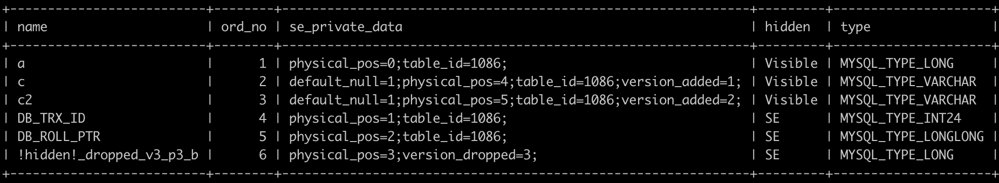
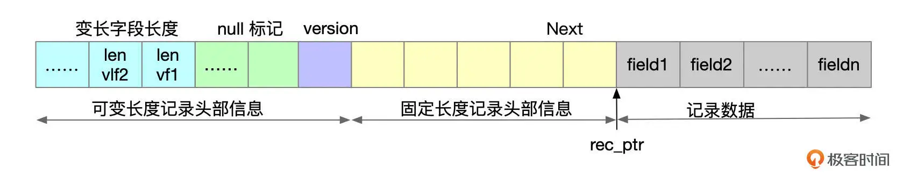

# 11 | 表太大了，修改表结构太慢怎么解决？（上）

你好，我是俊达。

平时我们使用 MySQL，或多或少都会遇到 DDL 的需求。比如有新业务上线，需要给现有的表添加新的字段；或者需要调整索引来优化性能；或者现有的表可能存在大量碎片，需要优化表，收缩空间。

那么对现有的业务表执行各类 DDL 操作时，需要多少时间才能执行完成？执行的过程中是否会锁表，应用程序在 DDL 执行的过程中是否能正常读写数据？DDL 操作是否会消耗大量资源，影响数据库的性能？特别是当操作的表特别大，或者应用系统的可用性要求特别高的时候，这些问题就特别重要。

这一讲我们就来详细地分析 MySQL 中各类 DDL 操作具体是如何执行的。如何在完成 DDL 的同时，尽量减少对业务系统的影响。

有些 DDL 只需要修改元数据，不影响表中实际存储的数据，这些操作通常很快就能完成。有些 DDL 需要重建表，执行过程中需要复制整个表的数据，这些 DDL 的开销比较大。从MySQL 5.6 开始，InnoDB 存储引擎逐渐支持了 Online DDL，很多 DDL 操作，在重建表的过程中可以尽量不锁表，减少对应用系统的影响。但也有一些 DDL，在执行的整个过程中都需要锁表，应用程序只能读取数据，无法修改数据。还有一些 DDL 操作，主要是创建索引，在执行期间不需要重建表，但需要扫描整个表的数据，按索引字段对数据进行排序，构建新的索引。

很多 MySQL DDL 语句中，可以加上关键字 ALGORITHM 和 LOCK，用于指定 DDL 的执行方式。比如在下面这个 SQL 中，我们指定了 ALGORITHM 为 INPLACE，LOCK 为 NONE。由于这个 SQL 只是修改了字段的注释，因此执行很快。

```sql
mysql> desc salaries;
+-----------+------+------+-----+---------+-------+
| Field     | Type | Null | Key | Default | Extra |
+-----------+------+------+-----+---------+-------+
| emp_no    | int  | NO   | PRI | NULL    |       |
| salary    | int  | NO   |     | NULL    |       |
| from_date | date | NO   | PRI | NULL    |       |
| to_date   | date | YES  |     | NULL    |       |
+-----------+------+------+-----+---------+-------+
mysql> alter table salaries
   modify emp_no int not null comment 'Employee Identity',
   algorithm=inplace,
   lock=none;
Query OK, 0 rows affected (6.01 sec)
Records: 0  Duplicates: 0  Warnings: 0
```

如果 DDL 不支持以 ALGORITHM 指定的方式来执行，会直接报错。下面这个 SQL 中，修改了字段的 not null 属性，因此无法以 INSTANT 的方式执行。

```sql
mysql> alter table salaries modify salary int, algorithm=instant;
ERROR 1845 (0A000): ALGORITHM=INSTANT is not supported for this operation. Try AL
```

关键字 ALGORITHM 可以指定为 DEFAULT、INSTANT、INPLACE 或 COPY。

- DEFAULT：默认方式，不同的 DDL 类型，默认的执行方式可能不一样。MySQL 会以该DDL 开销最低的方式来选择默认的执行方式。

- INSTANT：MySQL 8.0 新加的执行方式，使用这种执行方式时，添加字段和删除字段时不需要重建表。ALGORITHM 指定为 INSTANT 时，不能再指定 LOCK 关键字。

- INPLACE：Online DDL。使用 INPLACE 时，默认不锁表。这里的不锁表，是指重建表时复制数据的过程中，或创建二级索引时读取全表数据进行排序、生成索引的过程中不锁表。但是在复制数据或生成索引的过程中，表上会有新的 DML 修改数据，这些修改会记录到一个在线的变更日志中。InnoDB 需要将变更日志中的内容更新到新的表或索引中，而这个过程中是会锁表的，这一点后面会详细介绍。

- COPY：传统的 DDL 执行方式，执行过程中会锁表，默认锁模式为 SHARED，应用程序可以读取表中的数据，但是不能写入数据。如果 LOCK 指定为 EXCLUSIVE，那么读操作也会被阻塞。

关键字 LOCK 可以指定为 NONE、SHARED 或 EXCLUSIVE，如果不指定，就会根据具体的DDL 语句、指定的 ALGORITHM 来确定一个默认的锁级别。

- NONE：不锁表。

- SHARED：共享锁，允许读取数据，但是不允许修改数据。

- EXCLUSIVE：排它锁，不允许读取和修改数据。

接下来，我们分别来介绍 MySQL 中几种不同类型的 DDL。

## 只修改元数据的 DDL 操作

有一些 DDL 只需要修改元数据，不需要修改表中实际存储的数据。修改表名、字段名或索引名就是这样的操作。

```sql
mysql> alter table employees rename to employees_v2;
Query OK, 0 rows affected (0.03 sec)
mysql> alter table dept_emp rename key dept_no to idx_dept_no;
Query OK, 0 rows affected (0.01 sec)
Records: 0  Duplicates: 0  Warnings: 0
mysql> alter table dept_emp rename column to_date to end_date;
Query OK, 0 rows affected (0.02 sec)
Records: 0  Duplicates: 0  Warnings: 0
```

修改表名有一个重要的作用。比如某个业务表不再使用了，我们先不要急着 DROP TABLE，而是先将表改一个名字，等过一段时间，确定确实没有任何业务会访问这个表了，再 DROP表。因为如果 DROP 表之后，你再发现还有业务会访问这个表，恢复起来就比较麻烦了，可能需要比较长的时间，而改个表名，恢复起来就非常方便了。

DROP TABLE、DROP INDEX 这样的操作也基本上也只需要修改元数据，执行速度一般也很快。当然 DROP 表和索引时，还需要回收它们占用的物理空间。如果开启了innodb_file_per_table，DROP 表时需要删除对应的 ibd 文件。

删除索引也是一个需要特别注意的操作。虽然删除索引并不会影响表中的数据，但可能会影响一些查询的性能。一些关键索引删除后，可能会导致数据库 CPU 被打满，这个时候你想把索引再加回来，可能就需要比较长的时间了，而且可能需要先把业务停掉才行。MySQL 8.0 支持不可见索引，删除索引前，你可以先把索引设置为不可见。这样，执行计划不会再考虑这个索引，但是执行 DML 操作时，会正常维护这个索引。

```sql
mysql> alter table dept_emp alter index idx_dept_no invisible;
Query OK, 0 rows affected (0.00 sec)
Records: 0  Duplicates: 0  Warnings: 0
mysql> explain select * from dept_emp where dept_no = 'd005' limit 1;
+----+-------------+----------+------+---------------+--------+-------------+
| id | select_type | table    | type | possible_keys | rows   | Extra       |
+----+-------------+----------+------+---------------+--------+-------------+
|  1 | SIMPLE      | dept_emp | ALL  | NULL          | 331143 | Using where |
+----+-------------+----------+------+---------------+--------+-------------+
```

如果你发现业务系统还需要使用这个索引，可以将索引改成可见，这个操作通常也很快能完成。

```sql
mysql> alter table dept_emp alter index idx_dept_no visible;
Query OK, 0 rows affected (0.01 sec)
Records: 0  Duplicates: 0  Warnings: 0
```

此外，修改表和字段的注释，也只需要修改元数据，这应该容易理解。

```sql
mysql> alter table dept_emp comment='Department Employee Relationship';
Query OK, 0 rows affected (0.01 sec)
Records: 0  Duplicates: 0  Warnings: 0
mysql> alter table dept_emp modify from_date date not null comment 'From Date', a
Query OK, 0 rows affected (0.01 sec)
Records: 0  Duplicates: 0  Warnings: 0
```

需要注意，修改字段的注释时，需要确保字段的类型和是否为 NULL 属性不变，否则就不能仅仅修改元数据了。下面这个例子中，由于修改了字段的是否可为 NULL 的约束，开销就比较大了。

```sql
mysql> alter table dept_emp modify from_date date comment 'From Date', algorithm=
ERROR 1845 (0A000): ALGORITHM=INSTANT is not supported for this operation. Try AL
```

## Instant DDL

给表加字段是一个很常见的需求，但是在 5.7 及更早的版本中，每次加字段都需要重建整个表，开销实在是有点大，特别是当表的数据量比较大的时候。MySQL 8.0 中新增了 InstantDDL 特性，主要解决了加字段需要重建表的这个问题。

实际上在 8.0 中，加字段时，即使不指定 algorithm=instant，默认也是使用 instant 的方式。

```sql
mysql> alter table salaries add c1 int, algorithm=instant;
Query OK, 0 rows affected (0.02 sec)
Records: 0  Duplicates: 0  Warnings: 0
```

MySQL 8.0.29 版本开始，你还可以将字段加到任意指定的位置。

```sql
mysql> alter table salaries add column c2 int after salary, algorithm=instant;
Query OK, 0 rows affected (0.01 sec)
Records: 0  Duplicates: 0  Warnings: 0
mysql> desc salaries;
+-----------+------+------+-----+---------+-------+
| Field     | Type | Null | Key | Default | Extra |
+-----------+------+------+-----+---------+-------+
| emp_no    | int  | NO   | PRI | NULL    |       |
| salary    | int  | NO   |     | NULL    |       |
| c2        | int  | YES  |     | NULL    |       |
| from_date | date | NO   | PRI | NULL    |       |
| to_date   | date | NO   |     | NULL    |       |
| c1        | int  | YES  |     | NULL    |       |
+-----------+------+------+-----+---------+-------+
```

删除字段也可以使用 instant 方式，也只需要修改元数据。

```sql
]mysql> alter table salaries drop column to_date, algorithm=instant;
Query OK, 0 rows affected (0.01 sec)
Records: 0  Duplicates: 0  Warnings: 0
```

当然，instant DDL 也有一些限制，就是同一个表，能执行的 instant 加字段或删除字段的操作次数是有限制的，超过这个次数后，再执行时就会报错“Maximum row versions reached”。

```sql
mysql> alter table salaries add column cc int, algorithm=instant;
ERROR 4092 (HY000): Maximum row versions reached for table employees/salaries. No
```

每执行一次 Instant DDL，表的行版本就会加 1，当行版本达到 64 时，就无法再对这个表执行Instant DDL 了。从 information_schema.innodb_tables 这个系统表中，可以查看表当前的行版本数。

```sql
mysql> select * from information_schema.innodb_tables where name = 'employees/sal
*************************** 1. row ***************************
         TABLE_ID: 1510
             NAME: employees/salaries
             FLAG: 33
           N_COLS: 8
            SPACE: 243
       ROW_FORMAT: Dynamic
    ZIP_PAGE_SIZE: 0
       SPACE_TYPE: Single
     INSTANT_COLS: 0
TOTAL_ROW_VERSIONS: 64
1 row in set (0.00 sec)
```

达到行版本限制后，你就只能使用 inplace 或 copy 的方式加字段了。

```sql
mysql>  alter table salaries add column cc int, algorithm=inplace;
Query OK, 0 rows affected (4.96 sec)
Records: 0  Duplicates: 0  Warnings: 0
```

以 inplace 或 copy 的方式执行过后，表的行版本数会清零，然后你就可以继续开心地使用instant DDL 了。

```sql
mysql>  alter table salaries add column d10 int, algorithm=instant;
Query OK, 0 rows affected (0.02 sec)
Records: 0  Duplicates: 0  Warnings: 0
mysql>  alter table salaries add column d11 int, add column d12 int, algorithm=in
Query OK, 0 rows affected (0.01 sec)
Records: 0  Duplicates: 0  Warnings: 0
```

### Instant DDL 是怎么实现的

那么 Instant DDL 是怎么实现的呢？为什么要限制行版本的数量？执行过 Instant DDL 的表，查询数据和写入数据时有什么特殊的地方吗？这和 InnoDB 的元数据，以及 InnoDB 的行记录格式相关。

### InnoDB 元数据存储

元数据中记录了一个表有哪些字段，这些字段的数据类型是什么，字段的顺序是怎样的。MySQL 8.0 将元数据存储在一系列的 InnoDB 表中。你需要使用 Debug 版本的 MySQL，并且设置一个特殊的会话变量后，才能查询这些元数据表。

我们先创建一个测试表，执行一些 instant DDL 操作，然后再来看元数据中是怎么记录的。

```sql
create table t_instant(a int, b int, primary key(a));
alter table t_instant add c varchar(30), algorithm=instant;
alter table t_instant add c2 varchar(30), algorithm=instant;
alter table t_instant drop b, algorithm=instant;
mysql>desc t_instant;
+-------+-------------+------+-----+---------+-------+
| Field | Type        | Null | Key | Default | Extra |
+-------+-------------+------+-----+---------+-------+
| a     | int         | NO   | PRI | NULL    |       |
| c     | varchar(30) | YES  |     | NULL    |       |
| c2    | varchar(30) | YES  |     | NULL    |       |
+-------+-------------+------+-----+---------+-------+
```

要查看元数据，需要使用 Debug 版本的 MySQL。官方提供的二进制包中包含了 Debug 版本的二进制。你只需要将 mysql 二进制包中的 bin/mysqld 替换成 bin/mysqld-debug，将lib/plugin 下的 so 文件都替换成 lib/plugin/debug 下的 so 文件，再启动 MySQL 就可以了。

登录到 Debug 版本的 MySQL 后，设置 debug 会话变量，然后就可以访问 InnoDB 的元数据了。

```
mysql> SET SESSION debug='+d,skip_dd_table_access_check';
Query OK, 0 rows affected (0.01 sec)
```

我们来看一下前面创建的那个测试表 t_instant 的元数据。

```sql
mysql> desc t_instant;
+-------+-------------+------+-----+---------+-------+
| Field | Type        | Null | Key | Default | Extra |
+-------+-------------+------+-----+---------+-------+
| a     | int         | NO   | PRI | NULL    |       |
| c     | varchar(30) | YES  |     | NULL    |       |
| c2    | varchar(30) | YES  |     | NULL    |       |
+-------+-------------+------+-----+---------+-------+
3 rows in set (0.01 sec)
mysql> select t2.name, t2.ordinal_position as ord_no, t2.se_private_data,
   t2.hidden, t2.type, t2.char_length
from mysql.tables t1, mysql.columns t2
where t1.id = t2.table_id
and t1.name = 't_instant';
+--------------------------+--------+--------------------------------------------
| name                     | ord_no | se_private_data
+--------------------------+--------+--------------------------------------------
| a                        |      1 | physical_pos=0;table_id=1086;
| c                        |      2 | default_null=1;physical_pos=4;table_id=1086
| c2                       |      3 | default_null=1;physical_pos=5;table_id=1086
| DB_TRX_ID                |      4 | physical_pos=1;table_id=1086;
| DB_ROLL_PTR              |      5 | physical_pos=2;table_id=1086;
| !hidden!_dropped_v3_p3_b |      6 | physical_pos=3;version_dropped=3;
+--------------------------+--------+--------------------------------------------
```



从元数据中，我们可以看到，这个表实际上有 6 个字段，其中有 3 个字段是不可见的，对用户可见的有 3 个字段。其中字段 C 是在版本 1 中添加的，字段 C2 是在版本 2 中添加的，字段 B 在版本 3 中被删除了。

### InnoDB 行格式

在 InnoDB 数据页面中，每一行记录的头部，有一个标识位，用来标记这行记录是不是在INSTANT DDL 之后写入的。对于 INSTANT DDL 之后写入或修改过的记录，还会有一个version 字节，用来标识这行记录修改时，表结构的对应版本。



InnoDB 在解析数据页中的一行记录时，先获取记录头部的版本信息，假设这行记录的版本为K，那么只需从元数据中查出在版本 K 或 K 之前添加并且在版本 K 之前还没有被删除的字段，根据这个字段列表来解析这行记录。最后，在返回这行记录时，需要过滤掉当前不可见的字段。

能以 INSTANT 方式执行 DDL 的前提，是这个 DDL 操作不需要修改已有数据的行记录格式。因此，我们就可以这样理解，修改字段类型不能以 INSTANT 的方式执行，因为不同的字段类型，数据存储格式是不一样的。修改字段是否可以为 NULL，也不能以 INSTANT 的方式执行。因为对于可以为 NULL 的字段，记录头部有一个对应的比特，用来标记这个列中存储的数据是否为 NULL。

对于枚举类型，如果只是往类型最后添加新的选项，并且新加的选项不会导致字段存储长度发生变化，那么就可以使用 INSTANT DDL。减少枚举值、修改枚举值的顺序、将新的枚举值添加到已有列表的中间，都无法使用 instant DDL。

```sql
mysql> create table t_enum(a enum('A', 'B'));
Query OK, 0 rows affected (3.42 sec)
mysql> alter table t_enum modify a enum('A', 'B', 'C'), algorithm=instant;
Query OK, 0 rows affected (0.26 sec)
Records: 0  Duplicates: 0  Warnings: 0
mysql> alter table t_enum modify a enum('C', 'B', 'A'), algorithm=instant;
ERROR 1846 (0A000): ALGORITHM=INSTANT is not supported. Reason:
Need to rebuild the table to change column type.
Try ALGORITHM=COPY/INPLACE.
mysql> alter table t_enum modify a enum('A', 'B', 'D', 'C'), algorithm=instant;
ERROR 1846 (0A000): ALGORITHM=INSTANT is not supported. Reason:
Need to rebuild the table to change column type.
Try ALGORITHM=COPY/INPLACE.
```

修改 varchar 类型的长度不能使用 INSTANT DDL。如果是增加长度，并且长度在变更前后都不超过 255 字节，或者长度在变更前后都超过 255 字节，那么可以使用 INPLACE 的方式执行，只需要修改元数据。如果变更前长度不到 255 字节，变更后长度超过 255 字节，那么就不能使用 INPLACE 的方式执行了，需要用 COPY 的方式执行。这主要是跟 varchar 字段的物理存储格式有关。

下面这个例子中，employees 表使用了 utf8mb4 字符集，将 last_name 改成 varchar(64) 时，长度超过 255 字节了，因此需要使用 COPY 的方式来执行 DDL。

```sql
mysql> desc employees;
+------------+---------------+------+-----+---------+-------+
| Field      | Type          | Null | Key | Default | Extra |
+------------+---------------+------+-----+---------+-------+
| emp_no     | int           | NO   | PRI | NULL    |       |
| birth_date | date          | NO   |     | NULL    |       |
| first_name | varchar(14)   | NO   |     | NULL    |       |
| last_name  | varchar(16)   | NO   |     | NULL    |       |
| gender     | enum('M','F') | NO   |     | NULL    |       |
| hire_date  | date          | NO   |     | NULL    |       |
+------------+---------------+------+-----+---------+-------+
mysql> alter table employees modify last_name varchar(64) not null, algorithm=inp
ERROR 1846 (0A000): ALGORITHM=INPLACE is not supported. Reason: Cannot change col
mysql> alter table employees modify last_name varchar(64) not null, algorithm=cop
Query OK, 300024 rows affected (1.38 sec)
Records: 300024  Duplicates: 0  Warnings: 0
```

字段长度超过 255 字节后，再增加长度就可以使用 INPLACE 方式执行，并且不需要重建表，执行速度很快。

```sql
mysql> alter table employees modify last_name varchar(128) not null, algorithm=in
Query OK, 0 rows affected (0.02 sec)
Records: 0  Duplicates: 0  Warnings: 0
```

如果你要缩减 varchar 字段的长度，那么就只能以 COPY 的方式执行 DDL 了。因为缩减长度时，表里面已有的数据可能会超长。

```sql
mysql> alter table employees modify last_name varchar(100) not null, algorithm=in
ERROR 1846 (0A000): ALGORITHM=INPLACE is not supported. Reason: Cannot change col
mysql> alter table employees modify last_name varchar(10) not null, algorithm=inp
ERROR 1846 (0A000): ALGORITHM=INPLACE is not supported. Reason: Cannot change col
```

## 总结

这一讲中，我们讨论的是通常执行速度很快的这一类 DDL，也就是只需要修改元数据的DDL。Instant DDL 是 MySQL 8.0 增加的快速加列特性，可以快速地给大表增加字段。当然，还有一些 DDL，执行期间的开销会比较大，这一讲的下篇中，我们再来详细讨论。

## 思考题

只修改元数据的 DDL、INSTANT DDL 执行速度通常都很快，但是这些 DDL 执行也是需要获取元数据锁的，比如下面这个例子：

- 会话 1 开启一个事务，执行一个 select for update 操作。

```sql
mysql> desc t_ddl;
+-------+------+------+-----+---------+-------+
| Field | Type | Null | Key | Default | Extra |
+-------+------+------+-----+---------+-------+
| a     | int  | NO   | PRI | NULL    |       |
| b     | int  | YES  |     | NULL    |       |
+-------+------+------+-----+---------+-------+
2 rows in set (0.01 sec)
mysql> begin;
Query OK, 0 rows affected (0.00 sec)
mysql> select * from t_ddl limit 1 for update;
Empty set (1.12 sec)
```

- 会话 2 执行一个 instant DDL。

```sql
mysql> alter table t_ddl add c int, algorithm=instant;
```

- 会话 3 执行一个普通的 select 操作。

```sql
mysql> select * from t_ddl limit 1;
```

你会发现，会话 2 和会话 3 都被阻塞了。从 processlist 可以看到，它们都在等待元数据锁。（输出结果做了简化）

```sql
mysql> show processlist;
+----+---------+------+---------------------------------+------------------------
| Id | Command | Time | State                           | Info
+----+---------+------+---------------------------------+------------------------
|  8 | Sleep   |  116 |                                 | NULL
| 11 | Query   |  105 | Waiting for table metadata lock | alter table t_ddl add c
| 12 | Query   |   96 | Waiting for table metadata lock | select * from t_ddl lim
+----+---------+------+---------------------------------+------------------------
```

从 performance_schema.metadata_locks 也可以看到 t_ddl 表的元数据持有和请求情况。

```sql
mysql> select * from metadata_locks where object_name = 't_ddl';
-------------+-------------------+-------------+-------------------+-------------
OBJECT_NAME | LOCK_TYPE         | LOCK_STATUS | SOURCE            | OWNER_THREAD
-------------+-------------------+-------------+-------------------+-------------
t_ddl       | SHARED_WRITE      | GRANTED     | sql_parse.cc:6093 |
t_ddl       | SHARED_UPGRADABLE | GRANTED     | sql_parse.cc:6093 |
t_ddl       | EXCLUSIVE         | PENDING     | mdl.cc:3753       |
t_ddl       | SHARED_READ       | PENDING     | sql_parse.cc:6093 |
-------------+-------------------+-------------+-------------------+-------------
```

还有哪些情况会导致 DDL 无法获取到元数据锁？怎么快速定位到元数据锁的阻塞源？

期待你的思考，欢迎在留言区中与我交流。如果今天的课程让你有所收获，也欢迎转发给有需要的朋友。我们下节课再见！
