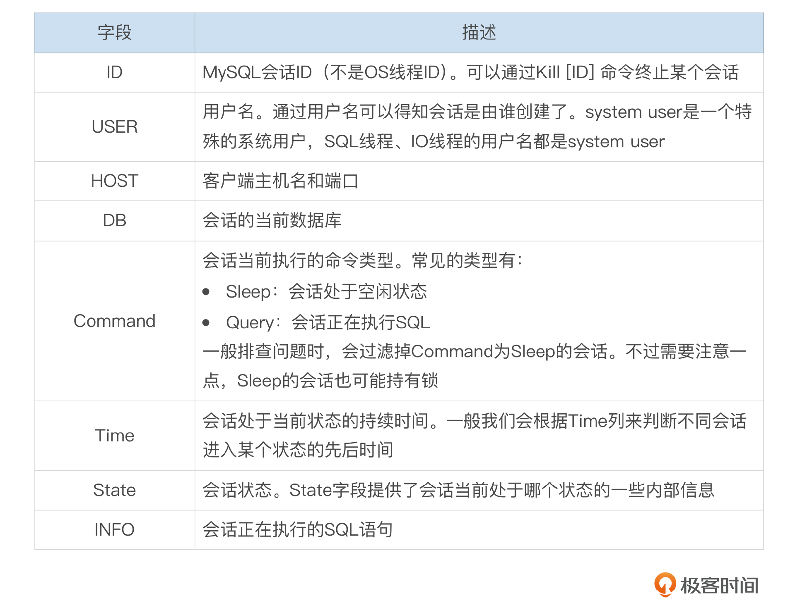

# 13 | 定位MySQL问题的思路：数据库为什么慢了？

你好，我是俊达。

作为一名 DBA，在使用和运维 MySQL 的十多年里，我遇到过很多各种各样的问题，比如：

- 平时执行很正常的一些 SQL，不知道什么原因，突然都变慢了。

- 数据库变得很慢，就是连接到数据库这么简单的操作都需要好几秒，有时甚至会超时。

- 应用系统发布了新的版本，SQL 好像也没有做大的调整，但是数据库负载就是上涨了很多。

- 执行某个 SQL 为什么需要花这么长的时间，总选不到更好的执行计划。

这些都是比较常见的情况，你平时在使用 MySQL 时，是否也遇到过类似的问题呢？在这一讲中，我们将提供一些比较通用的方法，用来分析和定位 MySQL 的各种性能问题。

## 通用问题分析框架

把大象放入冰箱只需要几个简单的步骤：一是打开冰箱门，二是将大象放入冰箱，三是关上冰箱门。在分析 MySQL 相关问题时，我们也采取类似的步骤，首先，了解问题，然后分析MySQL 运行环境的问题，再分析 MySQL 数据库，最后分析访问数据库的客户端的问题。

### 了解问题本身

在正式开始解决问题之前，你需要先了解问题本身。

- 问题是不是正在发生？是当前有问题，还是过去某些时间出现了问题？

- 收集问题的详细信息。问题的现象是什么，问题出现的时间有什么规律吗？

- 如果有报错，记录详细的报错信息，特别是跟数据库相关的报错信息，如错误编号、错误文本。

### 分析操作系统资源使用情况

MySQL 运行在具体的操作系统环境中，其运行效率受限于底层操作系统和硬件环境。一般我们需要分析操作系统的几大核心资源（CPU、内存、IO、文件系统、网络）的使用情况。关于操作系统各大资源如何分析，里面的内容比较多，我会在后续的课程中单独展开细聊。

### 分析 MySQL 运行情况

### ProcessList

MySQL 是一个多线程服务器，服务端会创建服务线程来执行客户端发送过来的命令或 SQL。我们可以使用命令 show processlist 或查询 information_schema.processlist 表来获取 MySQL中所有会话的当前状态。

需要注意的是，查看 Processlist 需要一定的权限。如果执行命令的账号缺少 Process 权限，就无法查看完整的 Processlist。下面的例子中，我们使用 user1 账号登录数据库，只看到user1 账号创建的会话。

```
mysql> show processlist;
+-----+-------+-----------------+------+---------+------+-------+----------------
| Id  | User  | Host            | db   | Command | Time | State | Info
+-----+-------+-----------------+------+---------+------+-------+----------------
| 166 | user1 | localhost:53004 | NULL | Query   |    0 | init  | show processlis
+-----+-------+-----------------+------+---------+------+-------+----------------
```

如果想看到所有的会话，就需要将 Process 权限授权给 user1 账号。

```
mysql> grant process  on *.* to 'user1'@'%';
Query OK, 0 rows affected (0.54 sec)
```

获得授权后，就可以看到所有的会话信息了。

```
mysql> show processlist;
+-----+-----------------+-----------------+------+---------+---------+-----------
| Id  | User            | Host            | db   | Command | Time    | State
+-----+-----------------+-----------------+------+---------+---------+-----------
|  11 | event_scheduler | localhost       | NULL | Daemon  | 1835399 | Waiting on
|  21 | system user     | connecting host | NULL | Connect | 1833985 | Waiting fo
|  22 | system user     |                 | NULL | Query   |  362966 | Replica ha
|  23 | system user     |                 | NULL | Query   |  362967 | Waiting fo
|  24 | system user     |                 | NULL | Connect | 1833985 | Waiting fo
|  25 | system user     |                 | NULL | Connect | 1833985 | Waiting fo
|  26 | system user     |                 | NULL | Connect | 1833985 | Waiting fo
| 158 | root            | localhost:51312 | rep  | Sleep   |       7 |
| 161 | root            | localhost:52470 | NULL | Sleep   |     686 |
| 167 | user1           | localhost:53118 | NULL | Query   |       0 | init
+-----+-----------------+-----------------+------+---------+---------+-----------
```

从 ProcessList 可以获取到这些信息：



正式的环境中，Processlist 可能会包含上千个会话，我们可以通过一些工具对输出进行汇总，便于判断问题。下面这个例子中，我们使用 MySQL 自带客户端的功能，实现按 State 统计会话数量。

```sql
mysql> pager grep State | awk -F':' '{print $2}' | sort  | uniq -c | sort -nr
PAGER set to 'grep State | awk -F':' '{print $2}' | sort  | uniq -c | sort -nr'
mysql> show processlist\G
     4  Waiting for an event from Coordinator
     2  Searching rows for update
     1  Waiting on empty queue
     1  Waiting for source to send event
     1  Replica has read all relay log; waiting for more updates
     1  init
     1
```

Processlist 输出中的 State 字段提供了会话当前处于哪个状态的一些内部信息，实践中我们经常会根据会话的 State 来判断问题的大致方向。下面表格提供了比较常见的一些 state 的含义和可能的原因。


会话在一个 state 下，可能会进行很多不同的操作，单凭一个状态值无法精确地判断 MySQL到底在执行或等待什么。有时候我们也会使用 pstack 收集 mysqld 进程里各个线程的调用栈。

通过调用栈可以更加精确地判断 MySQL 当前运行状态。不过使用 pstack 要特别谨慎，因为这会严重影响 MySQL 的性能。在 MySQL 已经卡死的情况下，使用 pstack 可以收集到对诊断问题很关键的信息，这时可以适当使用 pstack。

在 performance_schema.threads 表中，也可以获取到类似的信息，以及更多的一些信息，如OS 线程号、线程使用了多少内存。

### 慢日志

我们可以通过 processlist 查看 MySQL 在某一个时间点上数据库内各个会话的运行情况。但如果一个 SQL 执行没有那么慢，使用 Processlist 可能就抓不到。而慢日志可以将执行超过一定时间的 SQL 都记录下来。我们建议都开启慢日志。以下是开启慢日志的最基本的参数。

```
slow_query_log=ON
slow_query_log_file=/path/to/slow.log
long_query_time=3
```

执行时间超过 long_query_time 的 SQL 会记录到慢日志中。这个参数可以设置为 0，也就是记录所有 SQL。如果 SQL 的执行频率比较高，这么设置会产生大量日志。我们可以根据业务的具体要求来设置合适的 long_query_time 值。该参数可以动态修改，但是 MySQL 社区版中，这个参数修改后只对新创建的会话生效。

慢日志中记录了耗时较长的 SQL 的一些指标，最重要的指标包括：

- Query_time：SQL 耗时，单位是秒。

- Lock Time：获取行锁耗时，单位是秒。

- Rows_sent：发送给客户端的记录数。

- Rows_examined：MySQL 服务端从存储引擎层读取的记录数。

- Time：SQL 完成执行的时间。有时我们更关心慢 SQL 开始执行的时间。Time 减去Query_time 后可以得到 SQL 开始执行的时间。

下面是社区版 MySQL 慢日志的一个样例，你可以看一下。

```sql
# Time: 2024-06-12T08:46:32.839775Z
# User@Host: root[root] @ localhost [127.0.0.1]  Id:   267
# Query_time: 25.032283  Lock_time: 0.000013 Rows_sent: 0  Rows_examined: 1
SET timestamp=1718181967;
update ty set d=d+1 where a=10;
```

记录在慢日志中的 SQL，有的是因为 SQL 执行效率确实比较差，有的可能是因为服务器整体变慢了才导致 SQL 执行变慢，有的是因为等待全局锁、元数据锁或行锁才执行慢。如何区分这几种不同的情况呢？

首先要观察慢 SQL 的几个指标，特别是 Rows_examined。一般真正的慢 SQL，Rows_examined 指标会比较高。如果是行锁的问题引起的，Lock_time 指标可能会比较大。如果 Rows_examined 很小，Lock_time 也很小，但 SQL 执行时间比较长，需要观察下出现慢 SQL 时服务器的整体负载情况。

我们也可以考虑开启 log_slow_extra，这样慢 SQL 中会记录更详细的信息。

```sql
# Time: 2024-06-12T09:15:00.262670Z
# User@Host: root[root] @ localhost [127.0.0.1]  Id:   266
# Query_time: 83.324812  Lock_time: 0.000058 Rows_sent: 10  Rows_examined: 150010
SET timestamp=1718183616;
select * from (select * from tab3 limit 150000) t order by b,a limit 10;
```

如果慢 SQL 太多了，我们要借助一些工具对日志进行统计分析。Percona 公司出品的 pt-query-digest 就是一个很好的工具。如果你有大量的慢 SQL 需要分析，可以尝试使用这个工具。

对于一个具体的查询语句，可以到一个服务器资源比较空闲的环境下（比如在备库上）进行分析，查看执行计划。如果是 UPDATE 或 DELETE 语句，你可以根据原语句的 WHERE 条件，将 SQL 改成 SELECT 后测试查询的效率。MySQL 在更新或删除一行数据时，需要先定位到这行数据，如果定位数据的耗时较高，那更新或删除自然也会慢。关于 SQL 优化的具体方法，后续课程中我们会做更详细的讲解。

### Performance Schema

有些情况下，比如使用了云厂商提供的云数据库，你可能没有权限直接获取慢日志文件，或者SQL 执行时间没有超过 long_query_time，你可以使用 performance schema，当然前提是开启了 performance schema。

```sql
mysql> select * from events_statements_summary_by_digest where digest_text like '
*************************** 1. row ***************************
               SCHEMA_NAME: rep
                    DIGEST: 58fddf65d882f69efcd30fb2f9136010a6c9bd9db54a0b2ef7a5
               DIGEST_TEXT: SELECT COUNT ( * ) FROM `t_prop` WHERE `pid` + ? = ?
                COUNT_STAR: 798588
            SUM_TIMER_WAIT: 65079266039023000
            MIN_TIMER_WAIT: 1975837000
            AVG_TIMER_WAIT: 81492917000
            MAX_TIMER_WAIT: 798614957000
             SUM_LOCK_TIME: 67559675000000
             SUM_ROWS_SENT: 798578
         SUM_ROWS_EXAMINED: 240372580
...
           SUM_SELECT_SCAN: 798588
     MAX_CONTROLLED_MEMORY: 46416
          MAX_TOTAL_MEMORY: 25269935
...
                FIRST_SEEN: 2024-06-11 14:21:02.361871
                 LAST_SEEN: 2024-06-12 17:46:01.910352
               QUANTILE_95: 199526231496
               QUANTILE_99: 275422870333
              QUANTILE_999: 380189396320
         QUERY_SAMPLE_TEXT: select count(*) from t_prop where pid+0 = 66
         QUERY_SAMPLE_SEEN: 2024-06-12 17:45:28.662619
   QUERY_SAMPLE_TIMER_WAIT: 599478717000
```

performance schema 中的表，比如 events_statements_summary_by_digest，记录了语句执行的汇总信息，有时候我们需要查询 2 次，计算中间的差值，得到语句在一个时间段内的执行情况。

也有的云厂商本身就提供了全量 SQL 分析的功能，需要时也可以使用。不管使用什么工具，重点是能获取数据库中执行了哪些 SQL，分别耗费了多少时间。优化时优先处理那些耗时长、消耗资源多的 SQL。

### InnoDB 存储引擎状态

大部分情况下，我们建议只使用 InnoDB 存储引擎。InnoDB 支持事务，可以保证数据不丢，而且有很好的高并发支持。有时因为 InnoDB 内部实现机制的原因，也会对数据库的性能有一定的影响。可以通过一些命令获取 InnoDB 引擎的运行指标，观察 InnoDB 的整体运行情况。

Show engine innodb status 就是平时比较常用的一个命令，可以获取 InnoDB 内部的很多指标，当然解读这些指标需要对 InnoDB 的运行机制有一些具体的理解。InnoDB 运行机制后续我们会做更深入的解析。这里先对命令的主要输出做一些简单的介绍。

- 信号量和闩锁信息（Latch），这些是 InnoDB 内部用来控制并发的一种机制。高并发的情况下，这里可能会出现比较高的争用。

```
----------
SEMAPHORES
----------
-------------
RW-LATCH INFO
-------------
Total number of rw-locks 16997
OS WAIT ARRAY INFO: reservation count 792834
OS WAIT ARRAY INFO: signal count 191788
RW-shared spins 0, rounds 0, OS waits 0
RW-excl spins 0, rounds 0, OS waits 0
RW-sx spins 0, rounds 0, OS waits 0
Spin rounds per wait: 0.00 RW-shared, 0.00 RW-excl, 0.00 RW-sx
```

- 事务信息

这里可以获取到 InnoDB 内部的事务列表，以及事务系统中很重要的一个指标：History listlength。如果数据库事务量很高，或者有长事务一直没有提交，InnoDB 可能无法及时回收Undo 段，从而影响性能。

```
------------
TRANSACTIONS
------------
Trx id counter 51205
Purge done for trx's n:o < 51188 undo n:o < 0 state: running but idle
History list length 0
Total number of lock structs in row lock hash table 0
LIST OF TRANSACTIONS FOR EACH SESSION:
---TRANSACTION 421605369714584, not started
0 lock struct(s), heap size 1192, 0 row lock(s)
```

- 文件 IO 线程和 IO 请求

InnoDB 使用 IO 线程来读写数据文件。底层 IO 系统出现性能问题或达到性能瓶颈时，Pending IO 可能会持续比较长的时间。有时甚至会遇到 IO 系统卡死导致 MySQL 崩溃的情况。

```sql
--------
FILE I/O
--------
I/O thread 0 state: waiting for i/o request (insert buffer thread)
I/O thread 1 state: waiting for i/o request (log thread)
I/O thread 2 state: waiting for i/o request (read thread)
I/O thread 3 state: waiting for i/o request (read thread)
I/O thread 4 state: waiting for i/o request (read thread)
I/O thread 5 state: waiting for i/o request (read thread)
I/O thread 6 state: waiting for i/o request (write thread)
I/O thread 7 state: waiting for i/o request (write thread)
I/O thread 8 state: waiting for i/o request (write thread)
I/O thread 9 state: waiting for i/o request (write thread)
Pending normal aio reads: [0, 0, 0, 0] , aio writes: [0, 0, 0, 0] ,
ibuf aio reads:, log i/o's:
Pending flushes (fsync) log: 0; buffer pool: 18446744073709551615
33496 OS file reads, 68233 OS file writes, 5534 OS fsyncs
0.00 reads/s, 0 avg bytes/read, 0.00 writes/s, 0.00 fsyncs/s
```

- Insert Buffer 和自适应哈希索引

Insert Buffer 和自适应哈希索引是 MySQL 用来提升性能的一些机制，这里可以观察到相关指标。

```sql
-------------------------------------
INSERT BUFFER AND ADAPTIVE HASH INDEX
-------------------------------------
Ibuf: size 1, free list len 0, seg size 2, 100 merges
merged operations:
insert 100, delete mark 100, delete 0
discarded operations:
insert 0, delete mark 0, delete 0
```

- Redo 日志

Redo 日志是 InnoDB 用来保护数据不丢的核心机制之一。如果 checkpoint 跟不上数据写入的速度，会影响数据库的吞吐量，可以监控这里不同日志序列号之间的差值来进行判断。

```
---
LOG
---
Log sequence number          543093972
Log buffer assigned up to    543093972
Log buffer completed up to   543093972
Log written up to            543093972
Log flushed up to            543093972
Added dirty pages up to      543093972
Pages flushed up to          543093972
Last checkpoint at           543093972
Log minimum file id is       156
Log maximum file id is       159
51944 log i/o's done, 0.00 log i/o's/second
```

- Buffer Pool

读取和修改 InnoDB 中存储的数据时，都需要将数据页先加载到 Buffer Pool 中。这里提供了Buffer Pool 的相关指标。

```
----------------------
BUFFER POOL AND MEMORY
----------------------
Total large memory allocated 0
Dictionary memory allocated 1405012
Buffer pool size   8192
Free buffers       1014
Database pages     7165
Old database pages 2626
Modified db pages  0
Pending reads      0
Pending writes: LRU 0, flush list 0, single page 0
Pages made young 22345, not young 1124041
```

- 行操作记录

在这一部分可以观察 InnoDB 每秒访问的行数，以及 InnoDB 内部的查询数量。

```
--------------
ROW OPERATIONS
--------------
0 queries inside InnoDB, 0 queries in queue
0 read views open inside InnoDB
Process ID=18646, Main thread ID=140128601237248 , state=sleeping
Number of rows inserted 533330, updated 40364, deleted 6, read 422867135
0.00 inserts/s, 0.00 updates/s, 0.00 deletes/s, 0.00 reads/s
Number of system rows inserted 315, updated 526, deleted 238, read 18387
0.00 inserts/s, 0.00 updates/s, 0.00 deletes/s, 0.00 reads/s
----------------------------
END OF INNODB MONITOR OUTPUT
============================
```

### Status 变量

MySQL 通过 Status 变量提供了服务层和存储引擎层的很多统计数据，可以使用 show globalstatus 命令获取这些数据。

```
mysql> show global status where variable_name in  ('com_select', 'com_insert', 'c
+---------------+---------+
| Variable_name | Value   |
+---------------+---------+
| Com_delete    | 4       |
| Com_insert    | 32      |
| Com_select    | 1062151 |
| Com_update    | 43      |
+---------------+---------+
mysql> show global status like '%innodb_row%';
+-------------------------------+-----------+
| Variable_name                 | Value     |
+-------------------------------+-----------+
| Innodb_row_lock_current_waits | 0         |
| Innodb_row_lock_time          | 562805    |
| Innodb_row_lock_time_avg      | 33106     |
| Innodb_row_lock_time_max      | 50240     |
| Innodb_row_lock_waits         | 17        |
| Innodb_rows_deleted           | 6         |
| Innodb_rows_inserted          | 533330    |
| Innodb_rows_read              | 422867135 |
| Innodb_rows_updated           | 40364     |
+-------------------------------+-----------+
mysql> show global status like 'threads%';
+-------------------+-------+
| Variable_name     | Value |
+-------------------+-------+
| Threads_cached    | 47    |
| Threads_connected | 1     |
| Threads_created   | 263   |
| Threads_running   | 2     |
+-------------------+-------+
```

这些指标中，有的是当前值，如 Threads_running 是当前正在运行中的线程数，有的是累加值，如 Com_select 记录了数据库启动以来总共执行了多少 Select 语句。对于累加值，一般需要计算差值，得到一段时间内的增量。

最重要的是要使用监控系统将这些指标记录下来，为你的数据库建立一套基线，这对你分析和诊断数据库问题能提供很大的帮助。比如通过 Com_select、Com_insert、Com_update、Com_delete 等指标，我们可以知道业务的访问量。

通过 Innodb_rows_read、Innodb_rows_inserted、Innodb_rows_updated、Innodb_rows_deleted 等指标，可以知道服务端访问的行数。如果某个时间数据库服务器负载大幅度上涨，我们可以先查看 COM_XXX 系列指标，判断外部请求量是不是有大幅度增长。如果业务请求量没有大幅度增长，而 Innodb_rows_XXX 系列指标有大幅度的增长，则很可能是运行了一些性能较差的大查询导致服务器负载上升。

综合分析这些指标，能帮你大致判断问题的可能方向，再结合这一讲前面提到的一些方法，可以比较快速找到问题的根源，并采取相应的方法来解决问题。

### 错误日志

MySQL 错误日志中记录了从其他地方无法获取到的一些信息。排查问题找不到头绪时，可以看看错误日志，说不定能有一些发现。

```
mysql> show variables like 'log_error%';
+----------------------------+----------------------------------------+
| Variable_name              | Value                                  |
+----------------------------+----------------------------------------+
| log_error                  | /data/mysql01/log/alert.log            |
| log_error_services         | log_filter_internal; log_sink_internal |
| log_error_suppression_list |                                        |
| log_error_verbosity        | 2                                      |
+----------------------------+----------------------------------------+
```

### 分析客户端的情况

有些时候，问题可能不一定出现在数据库内部，而是出现在访问数据库的客户端那一侧。我们不要忽略这一种可能性。

## 总结

这一讲中，我们学习了分析和诊断 MySQL 问题的一个通用框架。有多种不同的原因都会导致MySQL 出问题。

比如：

- 有可能是运行 MySQL 的环境本身存在性能瓶颈。

- 有可能是 MySQL 在忙着执行各种 SQL，可能是 SQL 执行频率太高，也可能是有的 SQL扫描了太多的数据。

- 有可能是一个会话长时间持有锁，无意间锁死了大量会话。

- 有可能是并发太高，内部资源存在严重的争用

现实中，也很可能会同时遇到上面的多种情况。当然在另外一些情况下，问题不是出在数据库上，而是出现在访问数据库的客户端。

通过系统地分析操作系统和 MySQL 的指标、日志、内部状态，大多数情况下都能找到问题的根源。对于一些间歇出现、难以复现、原因不明的问题，我们可以部署一些脚本，将尽可能多的现场信息采集下来。

## 思考题

国庆节假期，DBA 小明突然接到大量数据库告警，登录数据库执行 SHOW PROCESSLIST后，发现大量会话被阻塞了。下面提供了部分会话的信息。请你根据这些信息，帮小明一起分析下，为什么会出现这样的问题？应该怎么解决这个问题呢？有哪些地方可以改进？

```sql
Id: 1842782
User: user_xx
Host: xx.xx.xx.xx:59068
db: db_xx
Command: Query
Time: 2326
State: Waiting for table
Info: update stat_item_detail set sold=sold+1, money=money+19800, Gmt_create=now(
Id: 1657130
User: user_xx
Host: yy.yy.yy.yy:40093
db: db_xx
Command: Query
Time: 184551
State: Sending data
Info: select item_id, sum(sold) as sold from stat_item_detail where item_id in (s
Id: 1044
User: system user
Host:
db:
Command: Connect
Time: 27406
State: Flushing tables FLUSH TABLES
Info:
```

期待你的思考，欢迎在留言区中与我交流。如果今天的课程让你有所收获，也欢迎转发给有需要的朋友。我们下节课再见！
