# 14 | Linux问题诊断入门：操作系统是否存在瓶颈？

你好，我是俊达。

MySQL 运行在具体的操作系统环境中，因此运行效率受限于底层操作系统和硬件环境。在分析数据库的问题时，我们需要同时关注操作系统整体运行情况。在操作系统层面，我们需要关注 CPU、内存、IO、文件系统、网络这几大资源的使用情况，分析这些资源是否繁忙、是否有报错、是否有其它异常现象。这节课我们就来看一下如何分析这几种资源的使用情况。

## CPU 资源

Linux 中有很多查看 CPU 使用率的工具，top 就是其中比较常用的一个工具。使用 top 可以实时查看系统的整体负载和 CPU 使用率，还能同时展示 CPU 使用率最高的那些进程。

你可以看一下 top 命令的输出。

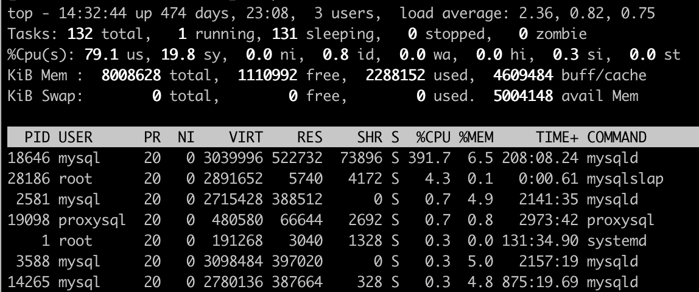

我们主要关注几点：

- 系统整体 CPU 使用率，包括 us，sy，id，wa 等指标。

us 是用户态的 CPU 使用率，sy 是内核的 CPU 使用率，id 是 CPU 空闲率，wa 是进程等待IO 操作完成的时间占比。上面的输出中，用户态 CPU 79.1%，系统 CPU 19.8%，空闲 CPU0.8%。系统处于 CPU 繁忙状态。

- 各状态进程数量，包括运行中（running）的进程数、睡眠（sleep）进程数、停止（stopped）的进程数、僵尸（zombie）进程数。

- 按 CPU 使用率排序的进程列表。显示了进程号（PID）、占用内存（RSS），进程状态（S），进程 CPU 使用率，进程的内存使用率，执行的命令（command）。

进程列表还可以按不同的字段排序，如输入 M 后，按内存使用率排列。输入 P 后，按 CPU使用率排序。上面的案例中，mysqld 进程占用了 391.7% 的 CPU。我们使用了一台 4 核的服务器，相当于 MySQL 几乎占用了系统所有的 CPU 资源。

如果 MySQL 进程的 CPU 使用率很高，一般会考虑是否有 SQL 执行效率不高，或 SQL 执行的频率过高。在有些慢卡的情况下，服务器 CPU 使用率可能不高，或者是其他进程消耗了CPU，这时排查问题的方向就会有所不同。

有时，CPU 的多个核心的使用率可能会存在比较大的差异，有的核心很空，有的核心很繁忙，这也会影响数据库的整体性能，可以使用 mpstat 来分析是否存在这样的问题。下面就是mpstat 的一个例子，可以看到服务器中每个 CPU 核心的使用情况。

```
mpstat -P ALL 3
```

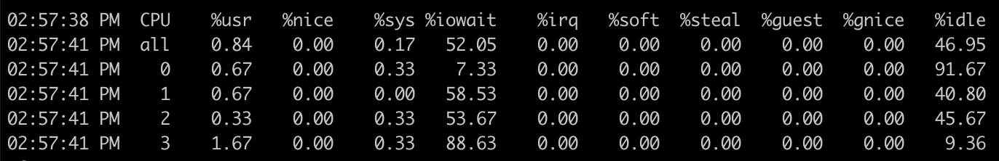

## 内存

使用 free 命令查看系统当前的内存占用情况。

```
free -m
             total        used        free      shared  buff/cache   available
Mem:           7820        2219        1099         400        4501        4901
Swap:             0           0           0
```

free 命令输出以下指标：

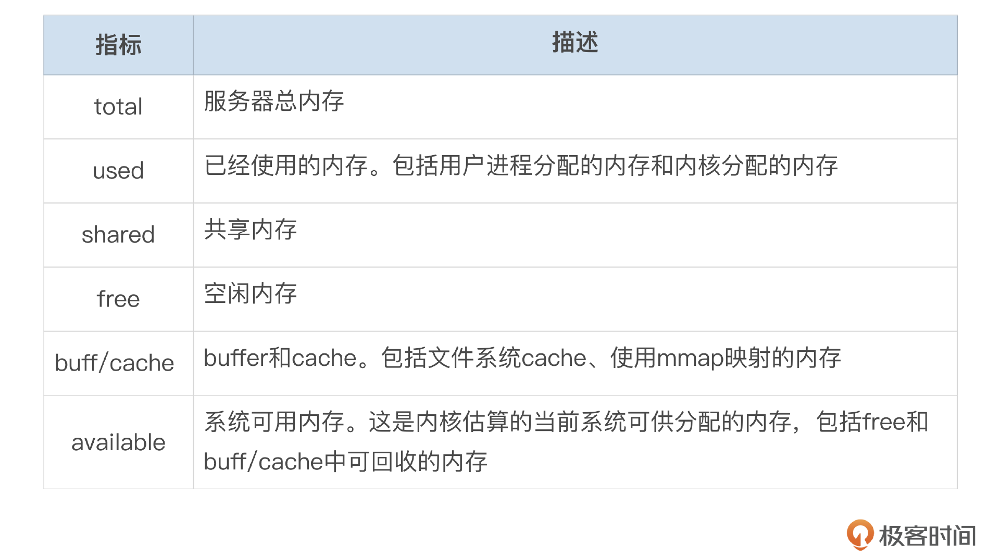

这几个指标满足这个公式：total = used + buff + cached + free


平时我们经常会监控内存使用率， 一般使用公式（1 - available / total） * 100% 来计算内存使用率。

有时候，我们需要分析内存到底分配给谁了。从 /proc/meminfo 里可以查看更详细的内存分配情况。

```
# cat /proc/meminfo
MemTotal:        8008628 kB
MemFree:         3402780 kB
MemAvailable:    4852264 kB
Buffers:          130588 kB
Cached:          1898772 kB
SwapCached:            0 kB
Active:          3699600 kB
Inactive:         498932 kB
......
```

其中 free 命令输出中 used 指标主要包括了这几个部分：

- AnonPages：匿名页，包括程序的栈和堆内存。一般通过 malloc 分配的内存就属于匿名页。

使用 top 或 ps 查看各个进程分别占用了多少内存，下面的命令查看系统内存（RSS）占用最高的几个进程。

```
#  ps aux | head -1; ps aux | sort -nr -k +6 | head
USER       PID %CPU %MEM    VSZ   RSS TTY      STAT START   TIME COMMAND
mysql    18646  0.7  6.6 3025548 528812 ?      Sl   May21 229:17 /usr/local/mysql
mysql     3588  0.4  4.9 3098484 397020 ?      Sl    2023 2157:28 /opt/mysql/bin/
mysql     2581  0.4  4.8 2715428 388512 ?      Sl    2023 2141:44 /opt/mysql/bin/
mysql    14265  0.4  4.8 2780136 387664 ?      Sl   Jan23 875:28 /opt/mysql8.0/bi
mysql     7225  0.0  2.6 1898836 213940 ?      Sl   Feb18 154:14 /opt/mysql5.7/bi
proxysql 19098  0.6  0.8 480580 66468 ?        Sl    2023 2973:55 /usr/bin/proxys
```

当然，我们不能简单地将所有进程使用的内存相加来计算程序占用的内存，因为进程之间可能会有一部分共享的内存。如果要精确地计算每个进程独占了多少内存，可以将

```
/proc/<pid>/smaps 文件中的 Pss 部分的内存相加。
# head smaps
00400000-01c4a000 r-xp 00000000 fd:02 48394553  ...
Size:              24872 kB
Rss:                2924 kB
Pss:                2924 kB
......
```

- Slab：内核对象缓存，缓存了内核中的各类数据结构。使用 slabtop 命令可以查看是哪些内核对象消耗的空间。

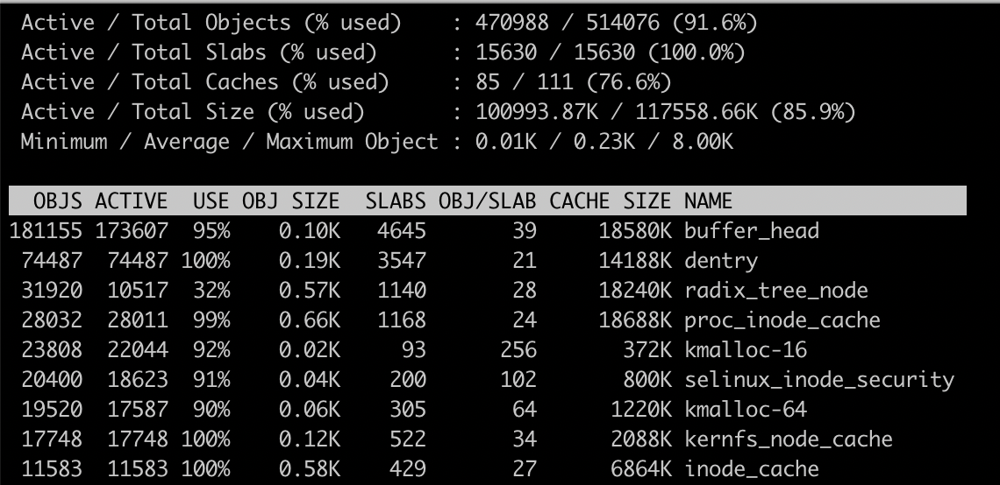

- PageTables：页表占用的空间。在大内存机器上，有时 PageTables 会占用大量内存。使用多进程模式数据库如 Oracle 时，这个问题会比较突出。开启大页可以有效地避免这个问题。

内存使用率只能大致反映服务器的内存使用水位，有时我们还需要关注内存的动态分配和回收情况。Linux 内核统一管理操作系统的所有内存，应用程序使用内存时最终需要向内核申请。当内核发现系统的空闲内存不够时，需要运行一系列的算法来回收内存。

下面这个图标识了通常消耗内存最大的几个部分，包括 Buffer/Cache，匿名页（AnonPages）。

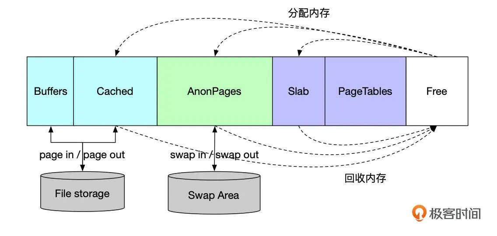

根据内存的不同用途，回收时需要采取不同的方式：

- buffers / cached：回收这部分的内存时，需要将内存页的脏数据写回到存储设备中。

- AnonPages：回收这部分内存时，需要将内存页换出（swap）到 SWAP 设备中。swap 会严重影响系统性能。

内核会根据参数 vm.swappiness 的设置，来决定优先从哪个部分回收内存。当vm.swappiness 的设置接近 100 时，内核倾向于将进程换出到 swap 设备。当vm.swappiness 的设置接近 0 时，内核倾向于回收 Buffers/Cached 部分的内存。对于数据库服务器，建议将内核参数 vm.swappiness 设置为比较小的值，如 0 或 1，这样能尽量避免由于 SWAP 而导致服务器性能下降。

使用 vmstat 命令查看系统是否正在进行 swap。命令输出中 si 和 so 列展示了平均每秒换出和换入的页面数。

```
# vmstat 3
procs -----------memory---------- ---swap-- -----io---- -system-- ------cpu-----
r  b   swpd   free   buff  cache   si   so    bi    bo   in   cs us sy id wa st
2  3      0 165068 115608 4403772    0    0     3     2    0    0  0  0 100  0
1  2      0 163472 115608 4406064    0    0     0 76485 1532 2634  0  4 42 54  0
0  3      0 164172 115608 4405640    0    0     0 59403 1474 2475  0  4 34 61  0
0  3      0 151440 115608 4418524    0    0     0 85520 1581 2458  0  6 35 59  0
0  3      0 169916 115608 4398456    0    0     0 80576 1442 2407  0  3 38 58  0
0  3      0 123476 115608 4448100    0    0     0 84989 1477 2362  1  4 35 61  0
```

使用 sar -B 命令可以查看内存的分配和回收的频率，需要重点关注 pgscank/s、pgscand/s 和%vmeff 这几列的输出。

当服务器中的空闲内存少于一定的阈值（跟参数 vm.min_free_kbytes 有关）时，内核中有专门的线程（kswapd）会尝试回收内存，扫描的内存页数通过指标 pgscank/s 输出。如果进程在分配内存时发现空闲内存不足，那么进程也会尝试释放一部分缓存中的内存。进程扫描的页面数通过指标 pgscand/s 输出。

当 pgscand 比较高，同时 %vmeff 比较低的时候，说明服务器内存资源很紧张，需要扫描大量的页面才能回收少量内存，此时服务器的性能通常会比较差。我在真实环境中多次遇到过这个问题。如果仅仅看内存使用率，并不能发现问题。

下面是 sar -B 的输出。

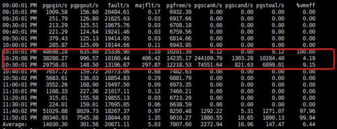

服务器内存资源特别紧张，使用前面提到的几种方式都无法回收足够的内存时，可能还会触发OOM-Killer。OOM-Killer 会通过一定的规则 Kill 掉一些进程，以此来释放内存。我们可以使用dmesg 命令或到系统日志（如 /var/log/messages) 中查看是否有 OOM 出现。

```
[16508339.852674] Out of memory: Kill process 22072 (mysqld) score 85 or sacrific
[16508339.853626] Killed process 22072 (mysqld), UID 1000, total-vm:6674180kB, an
[16508339.855371] systemd-journal invoked oom-killer: gfp_mask=0x201da, order=0,
[16508339.855374] systemd-journal cpuset=/ mems_allowed=0
[16508339.855376] CPU: 3 PID: 384 Comm: systemd-journal Kdump: loaded Not tainted
[16508339.855378] Hardware name: Red Hat KVM, BIOS 1.11.0-3.el7 04/01/2014
[16508339.855379] Call Trace:
[16508339.855385]  [<ffffffffb9f81340>] dump_stack+0x19/0x1b
[16508339.855387]  [<ffffffffb9f7bc60>] dump_header+0x90/0x229
[16508339.855390]  [<ffffffffb9906362>] ? ktime_get_ts64+0x52/0xf0
[16508339.855394]  [<ffffffffb995db7f>] ? delayacct_end+0x8f/0xb0
[16508339.855397]  [<ffffffffb99c208d>] oom_kill_process+0x2cd/0x490
[16508339.855399]  [<ffffffffb99c1a7d>] ? oom_unkillable_task+0xcd/0x120
[16508339.855401]  [<ffffffffb99c277a>] out_of_memory+0x31a/0x500
[16508339.855404]  [<ffffffffb9f7c77d>] __alloc_pages_slowpath+0x5db/0x729
[16508339.855406]  [<ffffffffb99c8d76>] __alloc_pages_nodemask+0x436/0x450
[16508339.855410]  [<ffffffffb9a189d8>] alloc_pages_current+0x98/0x110
[16508339.855412]  [<ffffffffb99bdb47>] __page_cache_alloc+0x97/0xb0
[16508339.855414]  [<ffffffffb99c0ae0>] filemap_fault+0x270/0x420
[16508339.855443]  [<ffffffffc028791e>] __xfs_filemap_fault+0x7e/0x1d0 [xfs]
[16508339.855456]  [<ffffffffc0287b1c>] xfs_filemap_fault+0x2c/0x30 [xfs]
[16508339.855459]  [<ffffffffb99ede3a>] __do_fault.isra.61+0x8a/0x100
[16508339.855461]  [<ffffffffb99ee3ec>] do_read_fault.isra.63+0x4c/0x1b0
[16508339.855463]  [<ffffffffb99f5c30>] handle_mm_fault+0xa20/0xfb0
[16508339.855466]  [<ffffffffb9f8e653>] __do_page_fault+0x213/0x500
[16508339.855468]  [<ffffffffb9f8ea26>] trace_do_page_fault+0x56/0x150
[16508339.855469]  [<ffffffffb9f8dfa2>] do_async_page_fault+0x22/0xf0
[16508339.855472]  [<ffffffffb9f8a7a8>] async_page_fault+0x28/0x30
[16508339.855473] Mem-Info:
```

在大内存的机器上，一般建议将参数 vm.min_free_kbytes 稍微设置得大一些，比如系统总内存的 5%，这样内核会在平时多预留一些空闲内存，当程序突然需要大量内存时，可以做一些缓冲。

## 磁盘 IO

数据库是 IO 密集型的应用，在数据库服务器中，磁盘 IO 比较容易成为瓶颈。使用 iostat 命令可以大致了解系统当前磁盘 IO 的情况。

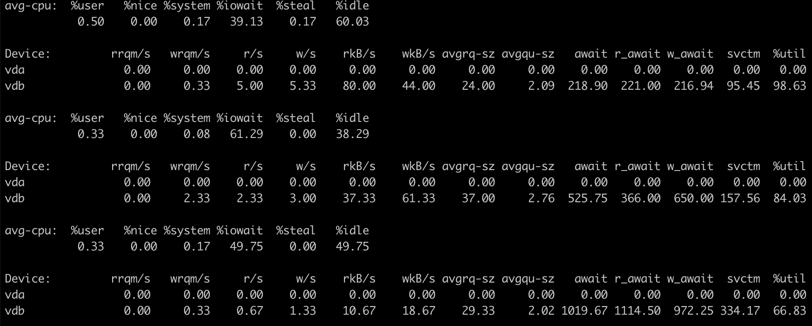

iostat 命令为系统里的每个磁盘设备都提供了几个基本的指标。

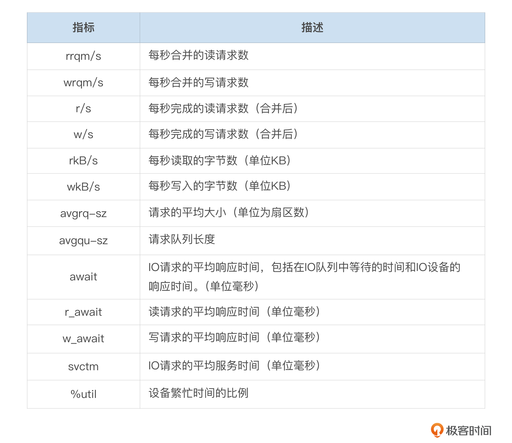

使用 iostat 时，我们主要关注几点：

1. 每秒 IO 读写次数。

2. IO 响应时间。响应时间和磁盘设备的类型相关。如果使用高性能的 SSD 或闪存卡，IO 响应时间可能不到 1 毫秒。如果使用传统的机械磁盘，正常的响应时间大致在 5-10 毫秒。

3. %util 仅仅用来参考。实际上使用率达到 100% 也不一定有问题。

不同的磁盘设备，在性能上会有很大的差异。我们前面的这个例子中，IOPS 很低，但是响应时间达到了几百毫秒，说明底层的 IO 性能真的比较低。

我们建议在数据库服务器上线前，使用工具进行一些基准 IO 性能测试，也为后续分析系统性能提供基准数据。fio 是业界使用比较多的一款 linux io 性能测试工具。

有时候我们可能需要知道到底是谁发起的 IO 请求，可以使用 iotop 工具，下图是 iotop 命令的输出，可以看出大部分 IO 请求是 mysqld 发起的。

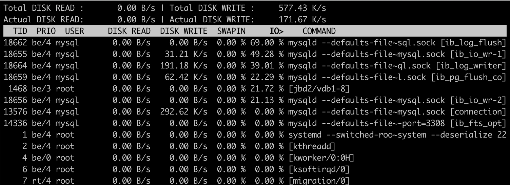

## 文件系统

我们需要关注文件系统的使用率。文件系统空间或 Inode 用满了都会引起一些问题。可以使用df 命令查看空间使用率和 Inode 的使用率。

```
# df -h /data
Filesystem      Size  Used Avail Use% Mounted on
/dev/vdb1        99G   15G   80G  16% /data
# df -i /data
Filesystem      Inodes IUsed   IFree IUse% Mounted on
/dev/vdb1      6553600  3086 6550514    1% /data
```

MySQL 中，如果数据盘满了，会导致写入操作挂起。

```sql
mysql> show full processlist\G
*************************** 8. row ***************************
    Id: 158
  User: root
  Host: localhost:51312
    db: rep
Command: Query
  Time: 241
 State: waiting for handler commit
  Info: insert into ty values(10,10,10,10)
```

此时如果查看 MySQL 的错误日志，就能发现磁盘空间写满的日志信息。

```
2024-06-11T08:00:16.687933Z 158 [ERROR] [MY-000035] [Server] Disk is full writing
2024-06-11T08:10:16.743846Z 158 [ERROR] [MY-000035] [Server] Disk is full writing
```

## 网络

应用程序一般都通过 TCP 协议和数据库服务器进行交互。我们可以使用 sar 命令查看网络吞吐量。

```
# sar -n DEV 3
Linux 3.10.0-1160.el7.x86_64 (172-16-121-234)   06/18/2024   _x86_64_  (4 CPU)
04:53:08 PM     IFACE   rxpck/s   txpck/s    rxkB/s    txkB/s   rxcmp/s   txcmp/s
04:53:11 PM      eth0      4.67      0.00      0.26      0.00      0.00      0.00
04:53:11 PM        lo      0.00      0.00      0.00      0.00      0.00      0.00
04:53:11 PM     IFACE   rxpck/s   txpck/s    rxkB/s    txkB/s   rxcmp/s   txcmp/s
04:53:14 PM      eth0      6.67      0.33      0.37      0.06      0.00      0.00
04:53:14 PM        lo      0.00      0.00      0.00      0.00      0.00      0.00
```

这里主要关注网络的吞吐量，包括每秒传输的字节数和包的数量。当然，如果数据库服务器使用万兆网，一般网络不太会成为瓶颈。

此外，我们经常需要查看 TCP 连接，linux 中可以使用 netstat 或 ss 命令查看网络连接。下面的例子使用了 netstat 命令查看服务器上的监听端口。

```
# netstat -nltp
```

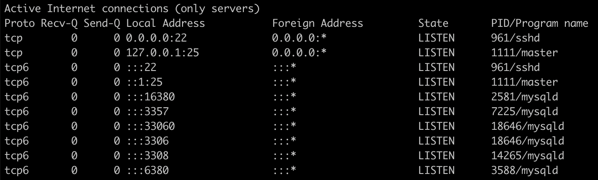

## 进程资源限制

Linux 系统对进程允许使用的资源使用做了一定的限制。常见的资源限制有 2 种。

- Max open files：允许进程同时打开的文件句柄数。Linux 下，打开文件、创建 TCP 连接都需要占用文件句柄。当进程打开的文件数达到限制后，无法再打开新的文件，报错信息为Too many open files。

- Max processes：同一个用户允许运行的最大线程数。超过该限制后无法创建新的进程或线程，报错信息为 fork: Resource temporarily unavailable。

一般在 /etc/security/limits.d 和 /etc/security/limits.conf 中设置资源限制。对于数据库服务器，linux 系统默认的设置不够大，建议将最大可打开的文件数、最大的进程数设置得大一些。经过测试，打开的文件数最大可设置为 1048576。

```
# limits.conf
mysql       soft    nproc     unlimited
mysql       soft    nofile    65535
```

当然，有时候运行中的进程生效的 ulimit 限制可能会跟配置文件中的设置不一致，因为配置文件中的设置只有当用户新登录系统时，或进程启动时才会启用。如果遇到程序有资源限制相关的报错，你可以到 /proc//limits 文件中检查进程的实际资源限制是多少。

```
# cat /proc/18646/limits
Limit                     Soft Limit           Hard Limit           Units
Max cpu time              unlimited            unlimited            seconds
Max file size             unlimited            unlimited            bytes
Max data size             unlimited            unlimited            bytes
Max stack size            8388608              unlimited            bytes
Max core file size        0                    unlimited            bytes
Max resident set          unlimited            unlimited            bytes
Max processes             65536                65536                processes
Max open files            20005                20005                files
```

## 操作系统日志

除了分析几大资源的使用情况，我们还需要关注操作系统层面的一些日志信息。操作系统的各类日志中可能有一些指明问题的关键信息。使用 dmesg 命令可以查看内核最近的一些日志。

```
# dmesg
[    0.000000] Linux version 5.15.0-107-generic (buildd@lcy02-amd64-012) (gcc (Ub
[    0.000000] Command line: BOOT_IMAGE=/boot/vmlinuz-5.15.0-107-generic root=UUI
[    0.000000] KERNEL supported cpus:
[    0.000000]   Intel GenuineIntel
[    0.000000]   AMD AuthenticAMD
[    0.000000]   Hygon HygonGenuine
[    0.000000]   Centaur CentaurHauls
[    0.000000]   zhaoxin   Shanghai
[    0.000000] BIOS-provided physical RAM map:
[    0.000000] BIOS-e820: [mem 0x00000000000000
```

日志管理工具（比较常用的有 rsyslogd）会将日志存储到日志文件中。不同发行版本的 Linux可能会将日志存放到不同的默认文件中，不过一般都会放到 /var/log 目录下。

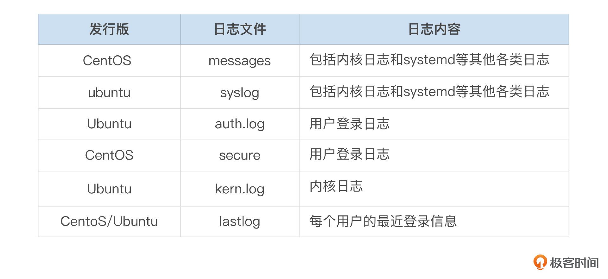

systemd 的日志可以使用 journalctl 查看，下面是一些使用场景。

- 使用 journalctl -k 查看内核日志。

```
# journalctl -k
-- Logs begin at Sat 2023-10-14 09:35:01 CST, end at Thu 2024-06-20 10:30:01 CST.
Oct 26 17:30:37 172-16-121-236 kernel: connection invoked oom-killer: gfp_mask=0x
Oct 26 17:30:37 172-16-121-236 kernel: connection cpuset=/ mems_allowed=0
Oct 26 17:30:37 172-16-121-236 kernel: CPU: 1 PID: 27480 Comm: connection Kdump:
Oct 26 17:30:37 172-16-121-236 kernel: Hardware name: Red Hat KVM, BIOS 1.11.0-3.
```

- 使用 journalctl -u sshd 查看服务器的用户登录日志。

```
# journalctl -u sshd
-- Logs begin at Sat 2023-10-14 09:35:01 CST, end at Thu 2024-06-20 10:35:01 CST.
Oct 23 14:08:20 172-16-121-236 sshd[17680]: Connection closed by 192.168.112.14 p
Nov 17 10:07:15 172-16-121-236 sshd[6079]: Accepted password for root from 192.16
Nov 17 10:10:07 172-16-121-236 sshd[6120]: Accepted password for root from 192.16
Nov 17 11:14:13 172-16-121-236 sshd[6438]: Accepted password for root from 192.16
Nov 30 10:08:40 172-16-121-236 sshd[18206]: Accepted password for root from 192.1
Dec 05 18:08:54 172-16-121-236 sshd[4075]: pam_unix(sshd:auth): authentication fa
```

- 使用 journalctl -xe 查看 systemd 最新的日志

当系统中有某个服务启动失败时，可以用这个命令查看相关日志。

```sql
#  journalctl -xe
-- Unit systemd-update-utmp-runlevel.service has finished starting up.
--
-- The start-up result is done.
6月 20 11:10:32 172-16-121-236 systemd[1]: Startup finished in 906ms (kernel) + 4
-- Subject: System start-up is now complete
-- Defined-By: systemd
-- Support: http://lists.freedesktop.org/mailman/listinfo/systemd-devel
```

## 总结

Linux 是一个功能强大的操作系统，也有一定的复杂度。在这一讲中，我们分别介绍了系统中几大类资源的基本评估方法。一般在分析操作系统相关问题时，我们会考虑几个问题。

1. 是否有资源达到了瓶颈。比如 CPU 是不是打满了，网络带宽是否用满了，是否有大量内存页面换入换出，文件系统空间或 Inode 是否用完了。

2. 硬件是否有性能降级的情况。比如 CPU 是否运行在节能模式下，硬盘是否存在故障，RAID 卡电池是否在充放电。跟软件故障相比，硬件故障的概率可能更低，但是硬件一旦有故障，就可能对性能造成严重的影响。

3. 系统中是否有一些报错日志信息。比如发生 OOM 时，内核会输出相应的日志。

当然如果你使用了云数据库，可能没有操作系统的权限。但依然有必要深入了解操作系统的一些基本原理，毕竟数据库是运行在操作系统环境中的。一般云数据库厂商会提供一些操作系统的基础监控指标，你可以通过这些指标来进行判断。如果你怀疑操作系统或底层硬件有问题，也可以通过工单或售后服务等形式寻找厂商的帮助，当然你最好能提供一些关键的证据。

## 思考题

有一个生产环境的系统，有时候会出现数据库连接超时的报错。从报错的信息看，超时应该和网络有点关系。遇到这样的问题，你会使用哪些方法来定位原因呢？

期待你的思考，欢迎在留言区中与我交流。如果今天的课程让你有所收获，也欢迎转发给有需要的朋友。我们下节课再见！
