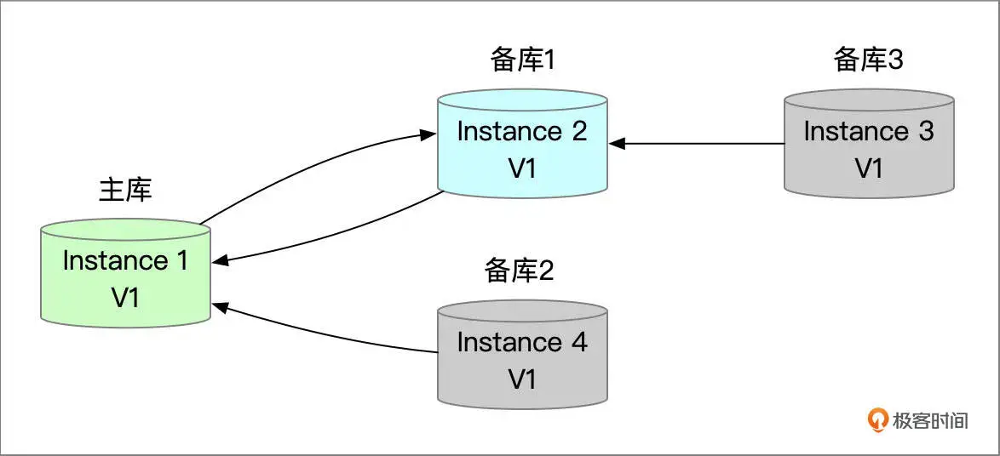
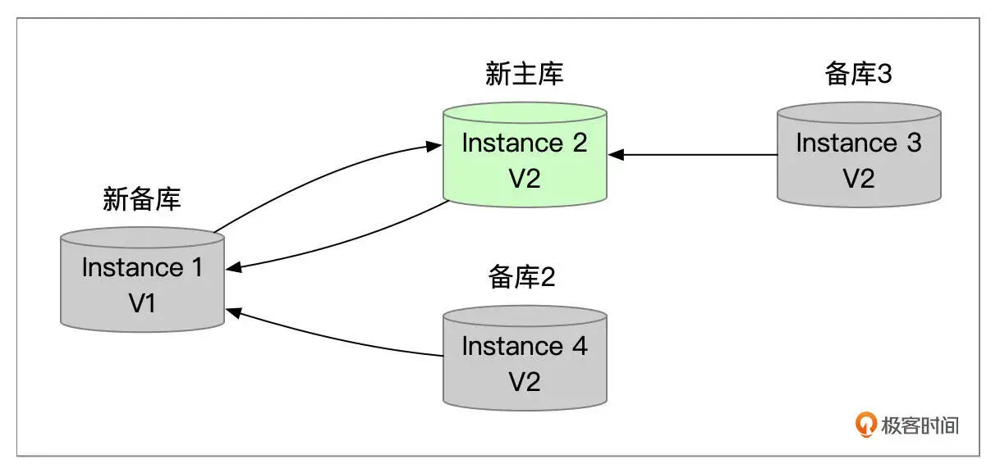
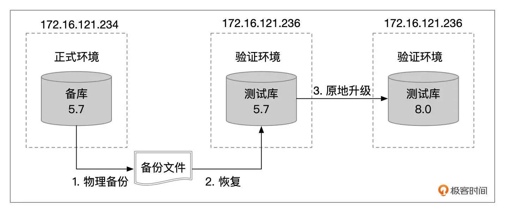
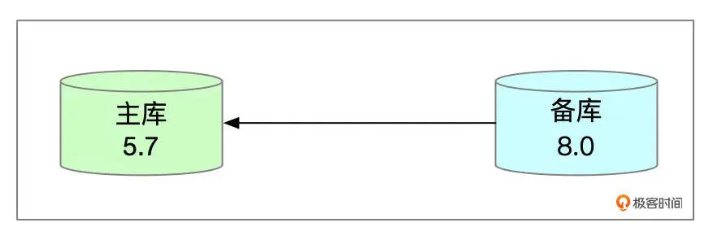
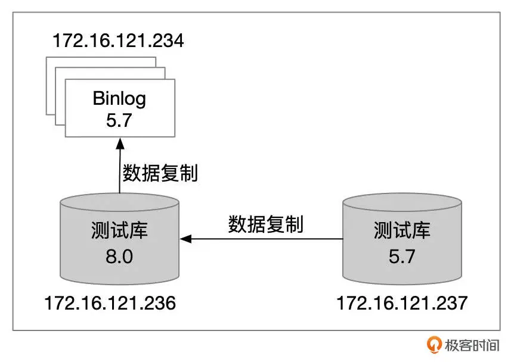
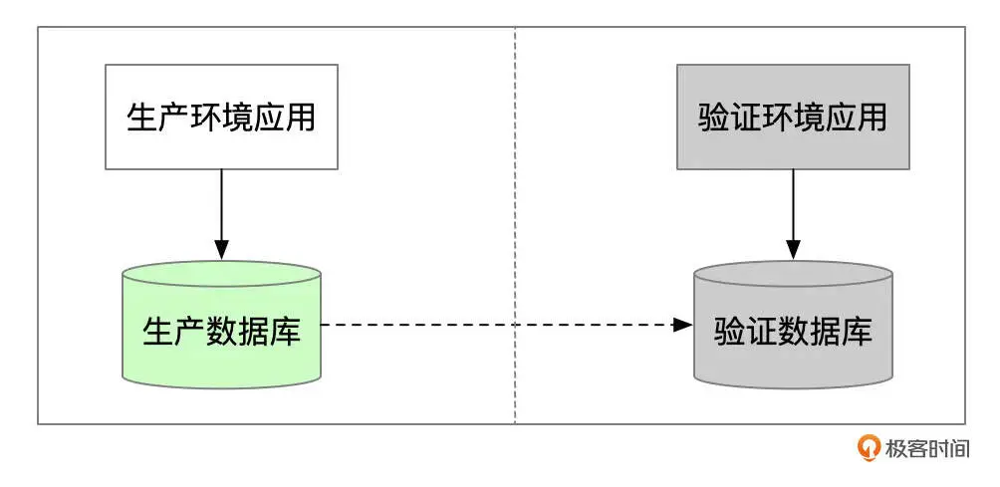

# 16 | 如何在不影响业务的情况下平滑升级MySQL？

你好，我是俊达。

这一讲我们来讨论下将 MySQL 升级到 8.0 最新版本的具体操作步骤。基于数据库的当前版本，升级的路径会有一些差异。MySQL 支持相邻两个大版本的物理升级，比如从 5.5 升级到5.6，从 5.6 升级到 5.7，从 5.7 升级到 8.0，但是不支持跨大版本的升级，比如不能从 5.6 直接升级到 8.0。在同一个大版本下，可以跨越多个小版本升级，比如从 8.0.x 升级到 8.0.z。

版本的降级就比较麻烦了，无法直接从 8.0 降级到 5.7，所以在升级正式环境前，需要做好充分的评估和测试，尽量避免出现版本降级的情况。

## 原地升级

这一讲我们提到的物理升级、原地升级，实际上指的都是同一个意思，也就是使用新版本的MySQL 软件来启动数据库，但是数据目录中，数据文件是在老版本下创建的。

### MySQL 8.0 原地升级小版本

### 版本升级的操作步骤

我们先来看一下 MySQL 8.0 原地升级的操作步骤。我们已经先将相关版本的 MySQL 的二进制包下载并解压到 /opt 目录下。

```
# tree /opt -d -L 1
/opt
├── mysql8.0 -> mysql-8.0.32-linux-glibc2.12-x86_64
├── mysql-8.0.32-linux-glibc2.12-x86_64
├── mysql-8.0.34-linux-glibc2.17-x86_64
├── mysql-8.0.35-linux-glibc2.17-x86_64
├── mysql-8.0.37-linux-glibc2.17-x86_64
└── mysql-8.0.39-linux-glibc2.17-x86_64
```

当前有一个 8.0.32 版本的数据库，相关文件都在 /data/mysql8.0 目录下，接下来要升级到8.0.39。原地升级大致上分为三个步骤。

1. 停止实例

这里我们使用 shutdown 命令正常停止 MySQL。

```
# mysqladmin -h127.0.0.1 -P3380 -uroot -psomepass shutdown
```

2. 软链接 MySQL 8.0 指向新版本

```
# cd opt
# rm mysql8.0
# ln -s mysql-8.0.39-linux-glibc2.17-x86_64 mysql8.0
# tree /opt -d -L 1
/opt
├── mysql8.0 -> mysql-8.0.39-linux-glibc2.17-x86_64
├── mysql-8.0.32-linux-glibc2.12-x86_64
.....
└── mysql-8.0.39-linux-glibc2.17-x86_64
```

3. 启动 MySQL

```
# /opt/mysql8.0/bin/mysqld_safe --defaults-file=/data/mysql8.0/my.cnf &
mysqld_safe Logging to '/data/mysql8.0/log/alert.log'
mysqld_safe Starting mysqld daemon with databases from /data/mysql8.0/data
```

从错误日志中，可以看到数据库自动进行了版本升级。

```
[System] [MY-013381] [Server] Server upgrade from '80032' to '80039' started.
[System] [MY-013381] [Server] Server upgrade from '80032' to '80039' completed.
```

### 版本降级的操作步骤

有时候，升级到新版本后，如果遇到一些无法预知的错误，你可能需要先降级到老版本。那么升级到最新的版本后，还能原地降级到之前的版本吗？MySQL 8.0.35 开始支持原地降级，但如果你的版本比 8.0.35 低，那就无法原地降级，这个时候你可能需要使用数据导出再导入的方式，先从高版本中将数据导出，然后再导入到低版本的数据库中，或者用老版本的数据库备份文件来恢复数据。

接下来我们演示 MySQL 8.0 小版本降级操作的步骤。

1. 关闭 MySQL

```
mysqladmin -h127.0.0.1 -P3380 -psomepass shutdown
```

2. 软连 MySQL 8.0 直接指向老版本

```
# rm mysql8.0
# ln -s mysql-8.0.32-linux-glibc2.12-x86_64 mysql8.0
# tree /opt -d -L 1
/opt
├── mysql8.0 -> mysql-8.0.32-linux-glibc2.12-x86_64
├── mysql-8.0.32-linux-glibc2.12-x86_64
......
└── mysql-8.0.39-linux-glibc2.17-x86_64
```

3. 启动 MySQL

```
# /opt/mysql8.0/bin/mysqld_safe --defaults-file=/data/mysql8.0/my.cnf &
mysqld_safe Logging to '/data/mysql8.0/log/alert.log'
mysqld_safe Starting mysqld daemon with databases from /data/mysql8.0/data
```

这里我们想将版本降级到 8.0.32，但是你会发现数据库无法启动。查看错误日志，可以看到数据库无法降级的信息“Cannot boot server version 80032 on data directory built by version80039. Downgrade is not supported”。

```
[System] [MY-010116] [Server] /opt/mysql8.0/bin/mysqld (mysqld 8.0.32) starting a
[System] [MY-013576] [InnoDB] InnoDB initialization has started.
[ERROR] [MY-013171] [InnoDB] Cannot boot server version 80032 on data directory b
mysqld: Can't open file: 'mysql.ibd' (errno: 0 - )
[ERROR] [MY-010334] [Server] Failed to initialize DD Storage Engine
[ERROR] [MY-010020] [Server] Data Dictionary initialization failed.
[ERROR] [MY-010119] [Server] Aborting
```

MySQL 8.0.35 版本开始才支持原地降级，我们来试一下将数据库降级到 8.0.35 版本。

```
# rm mysql8.0
# ln -s mysql-8.0.35-linux-glibc2.17-x86_64 mysql8.0
# /opt/mysql8.0/bin/mysqld_safe --defaults-file=/data/mysql8.0/my.cnf &
mysqld_safe Logging to '/data/mysql8.0/log/alert.log'.
mysqld_safe Starting mysqld daemon with databases from /data/mysql8.0/data
```

查看错误日志，可以看到数据库的版本从 8.0.39 降级到了 8.0.35。

```
[System] [MY-010116] [Server] /opt/mysql8.0/bin/mysqld (mysqld 8.0.35) starting a
[System] [MY-013576] [InnoDB] InnoDB initialization has started.
[System] [MY-013577] [InnoDB] InnoDB initialization has ended.
[System] [MY-014064] [Server] Server downgrade from '80039' to '80035' started.
[System] [MY-014064] [Server] Server downgrade from '80039' to '80035' completed.
......
[Server] /opt/mysql8.0/bin/mysqld: ready for connections. Version: '8.0.35'  sock
```

连接到数据库后，可以看到版本确实是 8.0.35。

```sql
# mysql -uroot -h127.0.0.1 -pabc123 -P3380
Server version: 8.0.35 MySQL Community Server - GPL
mysql> select @@version;
+-----------+
| @@version |
+-----------+
| 8.0.35    |
+-----------+
```

### 原地升级 / 降级在数据库内部做了什么？

MySQL 8.0.16 版本开始，启动数据库时，如果软件版本比数据库的实际版本更高，默认会自动进行升级操作。如果是要升级到 8.0.16 之前的版本，需要执行 mysql_upgrade 命令，由于这些版本太老了，我们这里就不做介绍了。

MySQL 数据库启动时，怎么判断是否需要进行升级呢？首先在元数据表中，存储了数据库的版本信息。要查看这些数据，你要用 Debug 版本的二进制来启动数据库。官方提供的二进制版本中，默认就有 Debug 版本的程序，你可以参考下面这段代码。

```
# cd /opt/mysql8.0/bin
# mv mysqld mysqld-release
# mv mysqld-debug mysqld
# cd /opt/mysql8.0/lib/plugin
# mkdir release
# mv *.so release
# mv debug/*.so .
```

替换成 Debug 版本后，以正常的方式启动 MySQL。启动之后，正常连接数据库，设置一个Session 变量，然后就可以查看元数据表的数据了。数据库的版本信息存储在mysql.dd_properties 表中。下面这些数据是在 8.0.32 的环境中查询得到的。

```sql
mysql> SET SESSION debug='+d,skip_dd_table_access_check';
mysql> select  substring(convert(properties using utf8mb4),1,256) as prop
   from mysql.dd_properties\G
*************************** 1. row ***************************
prop: DD_VERSION=80023;IS_VERSION=80030;LCTN=0;MINOR_DOWNGRADE_THRESHOLD=80023;MY
```

mysql.dd_properties 表中还存储了元数据表的其他重要信息，在数据库启动时有着重要的作用，你有兴趣的话可以看看里面还存了哪些数据，这里我们不展开了。

MySQL 软件的版本是在源代码中定义的，直接编译到了二进制中。在 include 目录的mysql_version.h 中可以看到相关定义。

```
......
#define MYSQL_VERSION_ID            80032
......
```

数据库启动时，从元数据中获取到物理文件的版本，和软件的版本一对比，如果软件的版本更高，就需要升级，如果软件的版本更低，并且是 8.0.35 之前的版本，数据库会无法启动。如果是 8.0.35 或更新的版本，支持了降级，就会进行降级操作，从前面的几个例子中也可以看到这一点。

在数据库内部，升级时执行了两个大的步骤。

1. 升级数据字典

这里的数据字典是指存储在 mysql schema 中的数据字典表，这些表是直接在 MySQL 的源码中定义的。你可以使用下面这个 SQL 查看有哪些数据字典表。

```sql
mysql> SET SESSION debug='+d,skip_dd_table_access_check';
Query OK, 0 rows affected (0.00 sec)
mysql> select a.name, b.name
   from schemata a, tables b
   where a.id = b.schema_id
   and b.hidden='System'
   and type='BASE TABLE';
+--------------------+------------------------------+
| name               | name                         |
+--------------------+------------------------------+
| mysql              | dd_properties                |
| mysql              | innodb_dynamic_metadata      |
| mysql              | innodb_ddl_log               |
| mysql              | catalogs                     |
| mysql              | character_sets               |
| mysql              | check_constraints            |
......
```

MySQL 会根据数据字典表的最新定义来更新表结构，表里存储的元数据会复制到新的字典表。这一步还会更新 Performance Schema、INFORMATION_SCHEMA 和 ndbinfo。

2. 升级其他内容

这一步会更新 mysql schema 中除数据字典之外的其他表、sys schema 以及用户 schema。

实际上，你可以到 MySQL 源码包的 scripts 目录下查看升级过程中执行的一些 SQL，这些SQL 可以在 mysql_system_tables.sql、mysql_system_tables_fix.sql、mysql_system_tables_data_fix.sql、mysql_sys_schema.sql 这些文件中看到。其中mysql_sys_schema.sql 可以使用 sys_schema 目录中的 generate_sql_file_57.sh 生成。

MySQL 通过参数 upgrade 来控制启动时是否自动进行升级。参数的默认值是 AUTO，也就是会进行自动升级。如果启动 MySQL 时，将 upgrade 指定为 NONE，就不会自动进行升级。

```
# rm mysql8.0
# ln -s mysql-8.0.39-linux-glibc2.17-x86_64 mysql8.0
# /opt/mysql8.0/bin/mysqld_safe --defaults-file=/data/mysql8.0/my.cnf --upgrade=N
```

指定 --upgrade=NONE 后，使用 8.0.39 的软件无法启动 8.0.35 的库，从错误日志中可以看到这些报错信息。

```
[System] [MY-013576] [InnoDB] InnoDB initialization has started.
[System] [MY-013577] [InnoDB] InnoDB initialization has ended.
[ERROR] [MY-013377] [Server] Server shutting down because upgrade is required, ye
[ERROR] [MY-010334] [Server] Failed to initialize DD Storage Engine
[ERROR] [MY-010020] [Server] Data Dictionary initialization failed.
```

upgrade 参数还可以设置为 minimal 或 force。设置为 minimal 时，启动时只升级数据字典。错误日志中可以看到下面这样的日志信息。

```
[Server] Server upgrade is required, but skipped by command line option '--upgrad
```

设置为 force 时，会执行所有的升级步骤。

### MySQL 5.7 升级到 8.0

### 大版本升级操作步骤

MySQL 5.7 也可以原地升级到 8.0。接下来演示 MySQL 5.7 升级到 8.0 的操作步骤。数据库相关文件都放在 /data/mysql5.7 目录下。操作步骤和 8.0 小版本升级类似。

1. 正常关闭数据库

保险起见，可以在关闭 MySQL 之前，将 innodb_fast_shutdown 设置为 0。

```
# mysql -h127.0.0.1 -P3380 -uroot -psomepass -e 'set global innodb_fast_shutdown=
# mysqladmin -uroot -h127.0.0.1 -pabc123 -P3357 shutdown
```

2. 修改 my.cnf

由于我把 5.7 和 8.0 的软件安装到了不同的位置，而 my.cnf 中配置了软件路径，因此需要先调整相关参数。这里主要是 basedir 和 lc_messages_dir 这两个参数。

```
## my.cnf
[mysqld]
basedir=/opt/mysql8.0
lc_messages_dir=/opt/mysql8.0/share
```

3. 启动数据库

使用 8.0 版本的软件启动数据库。

```
# /opt/mysql8.0/bin/mysqld_safe --defaults-file=/data/mysql5.7/my.cnf &
mysqld_safe Logging to '/data/mysql5.7/log/alert.log'.
mysqld_safe Starting mysqld daemon with databases from /data/mysql5.7/data
```

从错误日志中可以看到，MySQL 自动将 5.7 升级到了 8.0。当然，由于我在 5.7 的配置文件中有一个参数 innodb_file_format，但是 8.0 中已经没有这个参数了，因此最后实例启动失败了。这也是大版本升级时需要注意的一个问题。把不支持的参数从配置文件中移除，再次启动MySQL 就可以了。

```
[System] [MY-011012] [Server] Starting upgrade of data directory.
[System] [MY-013576] [InnoDB] InnoDB initialization has started.
[System] [MY-013577] [InnoDB] InnoDB initialization has ended.
[System] [MY-011003] [Server] Finished populating Data Dictionary tables with dat
[System] [MY-013381] [Server] Server upgrade from '50700' to '80039' started.
[System] [MY-013381] [Server] Server upgrade from '50700' to '80039' completed.
......
[ERROR] [MY-000067] [Server] unknown variable 'innodb_file_format=Barracuda'.
[ERROR] [MY-010119] [Server] Aborting
```

### 大版本升级和小版本升级的区别

从操作步骤上看，5.7 升级到 8.0 跟 8.0 小版本升级好像差不多，但实际上，和 5.7 版本相比，8.0 版本在实现上有比较大的差别，因此从 5.7 升级到 8.0 时，数据库在内部执行了更多的操作。

- 升级数据字典

MySQL 8.0 将数据字典存储到了 InnoDB 存储引擎中。物理上，这些数据字典表实际上都存储在 datadir 下的 mysql.ibd 文件中。升级到 8.0 时，MySQL 需要创建 mysql.ibd 表空间，创建数据字典表，并填充数据字典表的数据。

MySQL 5.7 中，在 frm 文件中存储了一份表结构的定义，升级到 8.0 后，就没有这些 frm 文件了。

此外，升级后，每个数据库目录下的 db.opt 文件也不再需要了。5.7 中，db.opt 文件里保存着每个库的默认字符集。

- 升级 InnoDB 物理文件结构

MySQL 8.0 InnoDB 有很大的变化。Undo 段放到了单独的 Undo 表空间中。Redo 文件的存储方式也发生了变化，从原先的 ib_logfile 转到了 #innodb_redo 目录下。DoubleWrite Buffer 拆分到了单独的 dblwr 文件。8.0 还新增了临时表空间。这些变化，对比升级前后 datadir 下的文件和目录，也能看出来。

下面这些文件或目录，都是升级到 8.0 时，新创建的。

```
# tree  -pL 1  /data/mysql5.7/data
/data/mysql5.7/data
├── [-rw-r-----]  #ib_16384_0.dblwr
├── [-rw-r-----]  #ib_16384_1.dblwr
├── [drwxr-x---]  #innodb_redo
├── [drwxr-x---]  #innodb_temp
├── [-rw-r-----]  mysql.ibd
├── [-rw-r-----]  undo_001
└── [-rw-r-----]  undo_002
```

- 升级用户表空间

MySQL 8.0 在每个用户表空间中，存储了一份数据字典信息（SDI），用来记录表空间中存储的用户对象的元数据。升级到 8.0 时，会在用户表空间的 ibd 文件中添加 SDI 信息。你可以使用 MySQL bin 目录下的 ibd2sdi 工具解析这些信息。

下面这个例子中，我们使用 ibd2sdi 工具查看 employees.ibd 中的 SDI 信息。

```
# /opt/mysql8.0/bin/ibd2sdi /data/mysql5.7/data/employees/employees.ibd
{
 "type": 1,
 "id": 90,
 "object":
   {
   "mysqld_version_id": 80039,
   "dd_version": 80023,
   "sdi_version": 80019,
   "dd_object_type": "Table",
   "dd_object": {
       "name": "employees",
       "mysql_version_id": 80039,
       "hidden": 1,
       "options": "avg_row_length=0;encrypt_type=N;key_block_size=0;keys_disable
       "columns": [
           {
               "name": "emp_no",
               "is_nullable": false,
               "is_auto_increment": false,
               "ordinal_position": 1,
               "column_type_utf8": "int",
           },
           {
               "name": "birth_date",
               "is_nullable": false,
               "is_auto_increment": false,
               "ordinal_position": 2,
               "column_type_utf8": "date",
           },
           {
               "name": "first_name",
               "is_nullable": false,
               "is_unsigned": false,
               "is_auto_increment": false,
               "ordinal_position": 3,
               "char_length": 14,
               "column_type_utf8": "varchar(14)",
           },
......
       "schema_ref": "employees",
       "se_private_id": 1071,
       "engine": "InnoDB",
       "indexes": [
           {
               "name": "PRIMARY",
               "hidden": false,
               "is_generated": false,
               "ordinal_position": 1,
               "se_private_data": "id=52;root=3;space_id=32;table_id=1071;trx_id
               "type": 1,
               "algorithm": 2,
               "is_visible": true,
......
```

从命令的输出中可以看到 employees 表的元数据，包括表的物理存储属性、每个字段的信息、索引信息。

- 升级其他系统表

这一点和小版本升级时实际上是类似的，升级 performance_schema、information_schema、sys、mysql 等 schema 中表的定义。

- 其他注意事项

大版本升级时，还有一些地方需要注意。首先是 2 个版本支持的参数会有一些区别。比如我们前面的例子中的 innodb_file_format 参数，8.0 版本就不支持了。又比如 SQL Mode 中的选项NO_AUTO_CREATE_USER 在 8.0.11 之后也不支持了。有些参数的默认值也发生了变化。还有其他一些不兼容的点，建议在升级前，仔细阅读官方文档中关于版本升级的内容。

### 大版本降级

MySQL 8.0 无法直接原地降级到 5.7。你需要使用数据导入导出的方法，或者使用 5.7 版本的备份文件来恢复数据。

### MySQL 5.6 升级到 8.0

MySQL 5.6 或更早的版本无法直接升级到 8.0，如果你使用 8.0 的软件启动 5.6 的库，可以看到类似下面这样的报错信息。

```
[System] [MY-010116] [Server] /opt/mysql8.0/bin/mysqld (mysqld 8.0.39-debug) star
[System] [MY-011012] [Server] Starting upgrade of data directory.
[System] [MY-013576] [InnoDB] InnoDB initialization has started.
[ERROR] [MY-013090] [InnoDB] Unsupported redo log format (v0). The redo log was c
[ERROR] [MY-012930] [InnoDB] Plugin initialization aborted at srv0start.cc[1856]
[ERROR] [MY-011013] [Server] Failed to initialize DD Storage Engine.
[ERROR] [MY-010020] [Server] Data Dictionary initialization failed.
[ERROR] [MY-010119] [Server] Aborting
```

你需要先将 5.6 的数据库升级到 5.7，然后再升级到 8.0。我们先在 /opt 目录下准备好 5.7 和8.0 版本的 MySQL 软件。

```
# tree -d -L 1 /opt
/opt
├── mysql5.6 -> mysql-5.6.45-linux-glibc2.12-x86_64
├── mysql-5.6.45-linux-glibc2.12-x86_64
├── mysql5.7 -> mysql-5.7.41-el7-x86_64
├── mysql-5.7.41-el7-x86_64
├── mysql8.0 -> mysql-8.0.39-linux-glibc2.17-x86_64
└── mysql-8.0.39-linux-glibc2.17-x86_64
```

### 升级到 5.7

先升级到 5.7，依次执行下面这几个步骤。

1. 正常关闭 5.6 版本的数据库

```
# mysql -h127.0.0.1 -P3356 -uroot -e 'set global innodb_fast_shutdown=0'
# /opt/mysql5.6/bin/mysqladmin -uroot -h127.0.0.1  -P3356 shutdown
```

2. 使用 5.7 版本的软件启动数据库

```
/opt/mysql5.7/bin/mysqld_safe --defaults-file=/data/mysql5.6/my_57.cnf &
mysqld_safe Logging to '/data/mysql5.6/log/alert.log'.
Starting mysqld daemon with databases from /data/mysql5.6/data
```

从错误日志中可以看到很多 WARNING 和 ERROR 信息，那是因为 5.6 和 5.7 的系统表的结构不一致引起的，需要在 MySQL 启动后，使用 mysql_upgrade 命令来修复。

```
[ERROR] Incorrect definition of table mysql.db: expected column 'User' at positio
[ERROR] mysql.user has no `Event_priv` column at position 28
[ERROR] Event Scheduler: An error occurred when initializing system tables. Disab
[Note] /opt/mysql5.7/bin/mysqld: ready for connections.
Version: '5.7.41-log'  socket: '/data/mysql5.6/run/mysql.sock'  port: 3356  MySQL
```

3. 运行 mysql_upgrade

数据库启动后，执行 mysql_upgrade，升级系统表。

```sql
# /opt/mysql5.7/bin/mysql_upgrade -h 127.0.0.1 -P3356
Checking if update is needed.
Checking server version.
Running queries to upgrade MySQL server.
mysql.columns_priv                                 OK
......
Upgrading the sys schema.
Checking databases.
employees.departments                              OK
employees.dept_emp                                 OK
......
Warning  : Trigger sakila.rental.rental_date does not have CREATED attribute.
status   : OK
sakila.staff                                       OK
......
Upgrade process completed successfully.
Checking if update is needed.
```

如果 5.6 的 MySQL 是从更早的版本物理升级而来的，执行 mysql_upgrade 时可能会有这样的报错，这主要是由于 TIME、TIMESTAMP、DATETIME 等类型的物理存储格式发生了变化，需要重建表。mysql_upgrade 默认会自动修复这些问题。当然，如果数据库比较大，这里可能会消耗比较多的时间。

```sql
/opt/mysql5.7/bin/mysql_upgrade -h 127.0.0.1 -P3355 -uroot
Checking if update is needed.
......
sakila.actor
error    : Table rebuild required. Please do "ALTER TABLE `actor` FORCE" or dump/
sakila.address
error    : Table rebuild required. Please do "ALTER TABLE `address` FORCE" or dum
......
Repairing tables
sakila.customer
Note     : TIME/TIMESTAMP/DATETIME columns of old format have been upgraded to th
status   : OK
sakila.film
Note     : TIME/TIMESTAMP/DATETIME columns of old format have been upgraded to th
status   : OK
......
`sakila`.`actor`
Running  : ALTER TABLE `sakila`.`actor` FORCE
status   : OK
`sakila`.`address`
Running  : ALTER TABLE `sakila`.`address` FORCE
status   : OK
```

### 升级到 8.0

现在数据库已经升级到 5.7 了，可以原地升级到 8.0。你可以在升级前执行 mysqlcheck 检查一下。

```
# /opt/mysql8.0/bin/mysqlcheck --check-upgrade -h 127.0.0.1 -P3356 --all-database
employees.departments                              OK
employees.dept_emp                                 OK
......
```

检查通过后，关闭数据库，再使用 8.0 版本的软件启动数据库，完成升级。

```
# /opt/mysql5.7/bin/mysqladmin -uroot -h127.0.0.1  -P3356 shutdown
# /opt/mysql8.0/bin/mysqld_safe --defaults-file=/data/mysql5.6/my_80.cnf &
```

## 如何保障升级过程中业务的连续性？

前面我们讲了 MySQL 物理升级的操作步骤，包括 8.0 小版本升级，以及从 5.6 或 5.7 升级到8.0。在正式的环境中升级时，需要保障业务的连续性，不能因为升级数据库而影响了业务系统的正常运行。

我们来考虑下图这样的一个数据复制架构，如何在不影响业务的前提下，升级这些数据库。



我们不能直接升级主库，因为升级时需要停库，先升级备库。在上面这个复制结构下，可以考虑先升级备库 2、备库 3，然后再升级备库 1。升级好备库 1 之后，将备库 1 切换为主库，数据库变成下面这样的结构。



此时原先的主库上所有的业务访问流量都已经切走了，然后再进行升级。当然，如果备库也承担了读的流量，那么在升级备库前，需要先将这些流量切到别的实例上。

### 验证升级操作

MySQL 在不同的版本之间，可能会存在一些不兼容的地方，升级前后跨越的版本越大，不兼容的地方可能就越多。因此在升级正式环境的数据库之前，需要先做好充分的测试。一方面要测试升级的操作本身是否能正常完成。另一方面，要测试应用程序访问升级后的数据库是否一切正常。

接下来我们来看一个从 5.7 升级到 8.0 的例子。首先对正式环境做一个数据库物理备份，再将备份恢复到验证环境中。一般我们使用 xtrabackup 对数据库进行备份和恢复。关于xtrabackup 的具体使用，后续的课程中还会做更详细的介绍，这里我们先来看一下大致的操作步骤。



1. 备份正式环境的数据库

MySQL 5.7 或更早的版本可以使用 xtrabackup 2.4 来备份。到 Percona 官网下载 2.4 的二进制版本，解压到 /opt 目录下。

```
# tree -d -L 1 /opt
/opt
├── mysql5.7 -> mysql-5.7.38-linux-glibc2.12-x86_64
├── mysql-5.7.38-linux-glibc2.12-x86_64
├── percona-xtrabackup-2.4.29-Linux-x86_64.glibc2.17
└── xtrabackup2.4 -> percona-xtrabackup-2.4.29-Linux-x86_64.glibc2.17
```

执行下面这个命令备份数据库，这里我们使用管道，直接将备份文件传输到验证环境的服务器172.16.121.236 上。

```
# /opt/xtrabackup2.4/bin/xtrabackup \
 --backup \
 --slave-info \
 -u root -H 127.0.0.1 -P3357 -pabc123 \
 --stream=xbstream \
 --target-dir /data/backup/mysql5.7 \
 2>/data/backup/mysql5.7/xtrabackup.log \
| ssh root@172.16.121.236 "cat -  > /data/backup/mysql5.7_backup.fil"
```

我们将备份的日志信息重定向到 xtrabackup.log 中，备份结束时，最后一行必须是“completedOK!”才表示备份成功。

```
# tail -2 /data/backup/mysql5.7/xtrabackup.log
xtrabackup: Transaction log of lsn (9920634) to (9920643) was copied.
240816 16:06:09 completed OK!
```

2. 到验证环境恢复数据库

使用 xbstream 命令，将备份文件解压到一个目录下。

```
# mkdir /data/backup/mysql5.7_restore
# /opt/xtrabackup2.4/bin/xbstream -C /data/backup/mysql5.7_restore -x -v < /data/
# tree -L 1 /data/backup/mysql5.7_restore/
/data/backup/mysql5.7_restore/
├── backup-my.cnf
├── ib_buffer_pool
├── ibdata1
├── mysql
├── performance_schema
├── sakila
├── sys
├── xtrabackup_binlog_info
├── xtrabackup_checkpoints
├── xtrabackup_info
├── xtrabackup_logfile
└── xtrabackup_slave_info
```

备份出来的文件，需要执行 xtrabackup --prepare 后，才能用来启动数据库。我们将 prepare的日志重定向到 prepare.log。

```
# cd /data/backup/mysql5.7_restore/
# /opt/xtrabackup2.4/bin/xtrabackup --prepare --target-dir . > prepare.log 2>&1
```

日志的最后一行必须是“completed OK!”，才表示恢复成功。

```
# tail -2 prepare.log
InnoDB: Shutdown completed; log sequence number 9921064
240816 16:27:42 completed OK!
```

接下来，我们将恢复出来的数据库移动到数据目录中。我们使用了这个课程中介绍过的比较通用的目录结构，这次顶层目录使用 /data/mysql5.7_upgrade，my.cnf 按这个目录结构做相应的配置。这里我们先手动创建了 alert.log 这个文件，否则 mysqld_safe 脚本可能会报错。

```
# mkdir -p /data/mysql5.7_upgrade/{data,binlog,relaylog,log,run,tmp}
# mv /data/backup/mysql5.7_restore/* /data/mysql5.7_upgrade/data
# touch /data/mysql5.7_upgrade/log/alert.log
# chown -R mysql:mysql /data/mysql5.7_upgrade
```

然后再使用 5.7 版本的软件启动数据库。

```
/opt/mysql5.7/bin/mysqld_safe --defaults-file=/data/mysql5.7_upgrade/my.cnf &
mysqld_safe Logging to '/data/mysql5.7_upgrade/log/alert.log'.
mysqld_safe Starting mysqld daemon with databases from /data/mysql5.7_upgrade/dat
# tail -2 /data/mysql5.7_upgrade/log/alert.log
[Note] /opt/mysql5.7/bin/mysqld: ready for connections.
Version: '5.7.38-log'  socket: '/data/mysql5.7_upgrade/run/mysql.sock'  port: 335
```

3. 升级恢复出来的数据库

升级操作在前面已经介绍过了，这里你可以先使用 mysqlcheck --check-upgrade 检查一下。

```
# /opt/mysql8.0/bin/mysqlcheck -h127.0.0.1 -P3357 -psomepass --check-upgrade --al
mysql.columns_priv                                 OK
mysql.db                                           OK
...
```

然后再使用 8.0 版本的软件，启动数据库，等待数据库完成升级。

```
# mysqladmin -uroot -h127.0.0.1 -P3357 -psomepass shutdown
# /opt/mysql8.0/bin/mysqld_safe --defaults-file=/data/mysql5.7_upgrade/my_80.cnf
```

### 验证数据复制

验证完数据库升级后，我们最好再验证一下数据复制，因为在升级一个复制结构中所有数据库节点的过程中，会存在高版本从低版本复制数据的情况，比如备节点已经升级到了 8.0，而主节点还是 5.7 版本的。我们需要确保 5.7 的 binlog 能顺利地复制到 8.0 的备库中，因为能将备库切换为主库的前提条件，是备库的数据和主库保持一致。



还可能存在从低版本往高版本复制数据的情况。当备库升级到 8.0 后，切换为新的主库，原先的主库变成备库，还是 5.7 版本的。当然，这个方向的数据复制可能没那么重要，因为 5.7 的备库从 8.0 的主库复制数据时，如果报错了，我们可以先把备库的版本升上来，然后再复制数据。


我在这里提供一种数据库升级后，验证数据复制的方法。实际上就是将新恢复出来并升级后的数据库，设置为备库，从源库复制数据。关于数据复制的内容，后续会专门介绍，这里我们先了解下主要的操作步骤。

1. 在源库上创建一个复制账号。

```
mysql> create user 'repl'@'%' identified by 'somepass';
Query OK, 0 rows affected (2.53 sec)
mysql> grant replication slave, replication client on *.* to 'repl'@'%';
Query OK, 0 rows affected (0.03 sec)
```

2. 建立复制关系，让 8.0 版本的测试库从源库复制数据。

```
xtrabackup生成的备份中，记录了对应的binlog位点，可以到xtrabackup_binlog_info这个文件中查看
# cat xtrabackup_binlog_info
binlog.000002  1359345  6d4efa85-5ba1-11ef-b091-fab81f64ee00:1-56
```

执行下面这几个命令，让恢复出来的 8.0 版本的数据库从源库复制数据。

```
mysql> set global gtid_purged='6d4efa85-5ba1-11ef-b091-fab81f64ee00:1-56';
Query OK, 0 rows affected (0.01 sec)
mysql> change master to master_host='172.16.121.234',master_port=3357, master_use
Query OK, 0 rows affected, 7 warnings (0.72 sec)
mysql> start slave;
Query OK, 0 rows affected, 1 warning (0.28 sec)
```

使用 show slave status 命令查看复制状态。

```
mysql> show slave status\G
*************************** 1. row ***************************
              Slave_IO_State: Waiting for source to send event
                 Master_Host: 172.16.121.234
                 Master_User: repl
                 Master_Port: 3357
               Connect_Retry: 60
             Master_Log_File: binlog.000002
         Read_Master_Log_Pos: 1359806
              Relay_Log_File: relaylog.000002
               Relay_Log_Pos: 869
       Relay_Master_Log_File: binlog.000002
            Slave_IO_Running: Yes
           Slave_SQL_Running: Yes
......
```

3. 给新升级的 8.0 添加一个 5.7 版本的备库。

如果想验证低版本是否能从高版本正常复制数据，可以给 8.0 的库增加一个 5.7 的备库。我们可以使用同样的备份文件，在新的一台机器上再恢复一个实例出来，这次只恢复数据库，不做数据库升级。然后再将新恢复的数据库作为 8.0 的备库，执行下面这几个命令，建立复制关系。

```
# mysql -uroot -h127.0.0.1 -P3357 -pabc123
Server version: 5.7.38-log MySQL Community Server (GPL)
mysql> set global gtid_purged='6d4efa85-5ba1-11ef-b091-fab81f64ee00:1-56';
Query OK, 0 rows affected (0.01 sec)
mysql> change master to master_host='172.16.121.236',master_port=3357, master_use
Query OK, 0 rows affected, 1 warning (0.05 sec)
mysql> start slave;
Query OK, 0 rows affected (0.01 sec)
```

到这里，我们就验证了数据库的升级，以及升级后跨版本的数据复制功能。参考下面这个复制链路图，我们验证了两个版本之间的数据复制功能。



这里我们需要用正式环境的数据库备份文件和 Binlog 来做验证，因为是否能升级成功，以及是否能正常复制数据，跟数据库的具体使用情况，以及 Binlog 中具体的事件相关。

## 总结

这一讲我们介绍了 MySQL 物理升级的操作步骤。一般我会优先选择使用物理升级，因为这样通常速度更快。升级前要做好充分的测试验证，并根据数据库的部署架构，选择合适的升级顺序。

版本降级的成本更高，我们要尽量避免这种情况。如果实在是需要降级，要考虑用老版本数据库最近的一个备份文件来恢复数据库，或者通过数据导入导出的方式，将数据从新版本迁移到老版本。

在使用生产环境的真实数据恢复出来的验证环境做业务测试的时候，有一点需要特别注意，不要影响线上业务，因为验证环境数据库中都是真实的业务数据，测试时可能会影响真实用户。



这一讲我们使用了官方提供的 employees 样例数据库来测试各个版本间的升级。你可以查看官方文档，了解具体的下载和安装方法。

```
# mysql -uroot -h127.0.0.1 -P3357 -pabc123
mysql> source employees.sql
mysql> source sakila/sakila-mv-schema.sql
mysql> source sakila/sakila-mv-data.sql
```

## 思考题

有些情况下，我们可能会使用逻辑的方式来升级数据库，比如将线下低版本的数据库迁移到云上高版本的实例中。使用逻辑的方式升级或降级数据库，可能会存在哪些问题？有哪些需要注意的地方？

期待你的思考，欢迎在留言区中与我交流。如果今天的课程让你有所收获，也欢迎转发给有需要的朋友。我们下节课再见！
