# 17 | SQL优化第一步：理解访问路径

你好，我是俊达。

大家都知道，我们使用 SQL 来访问数据库，而优化 SQL 对于保证数据库系统的高效、稳定运行，以及满足业务需求和降低成本都具有至关重要的意义。从这一讲开始，我们来系统地学习SQL 优化。一条 SQL 语句，在数据库内部是怎么执行的呢？SQL 的性能，又会受哪些因素影响呢？

关系型数据库中，SQL 语句的执行主要分为几个大的步骤。

1. 对 SQL 文本进行解析，生成 SQL 语法树。

2. 优化器根据 SQL 语法树、表和索引的结构和统计信息，生成执行计划。

3. SQL 执行引擎根据执行计划，按一定的步骤，调用存储引擎接口获取数据，执行表连接、排序等操作，生成结果集。

4. 将结果集发送给客户端。

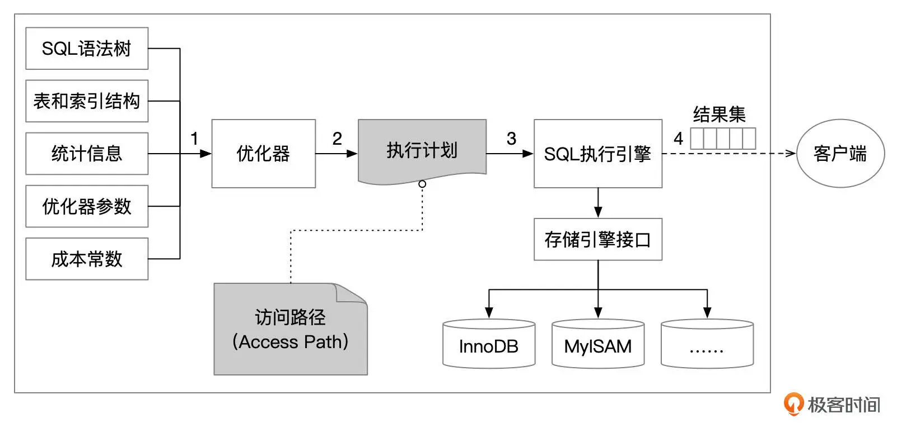

在这一讲和接下来的几讲中，我将围绕优化器、执行计划、SQL 执行引擎，把 SQL 优化讲透。

我们先从访问路径（Access path）开始。访问路径是指根据表的物理存储结构，以及给定的查询条件，从表中获取数据的方法。访问路径包括表扫描和索引访问，还包括表连接的算法，如嵌套循环连接（Nested Loop Join）、哈希连接（Hash Join）、排序合并连接（Sort MergeJoin）。

## 表的物理存储

### 数据页

数据页是数据表中数据存储的基本单位。一个数据页的大小通常可能为 4K、8K、16K、32K。在 InnoDB 中，默认的页面大小为 16K。记录以行的形式存储在数据页中，每行记录在数据页中占用一段连续的空间。通常 1 行记录可能占用几十字节到几百或几千字节。每个数据页能容纳的记录数一般在几行到几百行之间。

InnoDB 对行的长度有一定的限制，每行记录的长度不能超过页面大小的一半。对于 16K 的页面大小，1 行记录最长大概在 8000 字节多一点。如果 1 行记录平均长度为 200 字节，那么一个页面最多可以容纳八十多行记录。

下面是数据页的一个示意图。

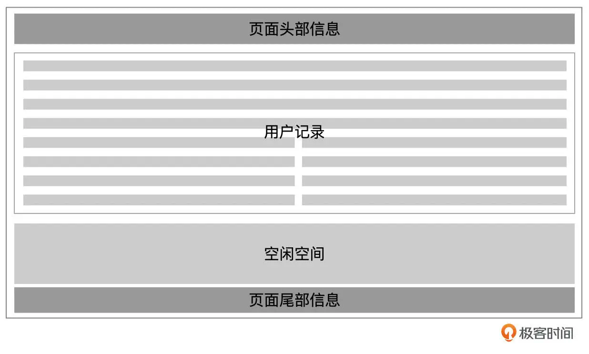

### 数据段

每个表由一系列的数据页组成。一个表的数据页数量主要由表中的记录数决定。如果记录平均长度为 200 字节，每个数据页存 80 行记录，那么存储 1000 万行记录，大致需要 12.5 万个数据页。

InnoDB 中，表的数据以聚簇索引的方式，存储在一个数据段（Segment）中，一个数据段由一系列区块（Extent）组成。每个区块由 64 个 16K 的连续的页面组成。

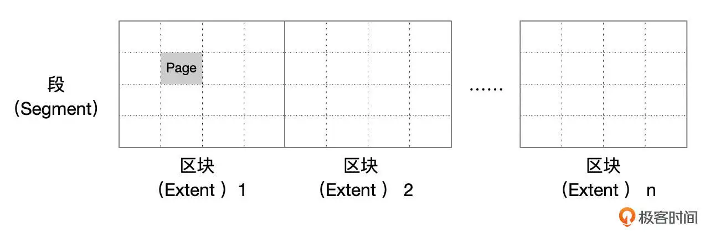

### 索引

索引是用来快速检索数据的一种结构。InnoDB 支持的索引类型包括 B+ 树索引、全文索引、空间索引、Hash 索引。我们课程中，说索引的时候，一般默认是指 B+ 树结构的索引。全文索引、空间索引、Hash 索引不做过多介绍。

B+ 树索引是一种 Key-Value 结构，通过 Key 可以快速查找到对应的 Value。B+ 树索引由根页面（Root）、分支页面（Branch）和叶子页面（Leaf）组成一棵树的结构。InnoDB 中，索引页面的大小由参数 innodb_page_size 控制，默认为 16K。

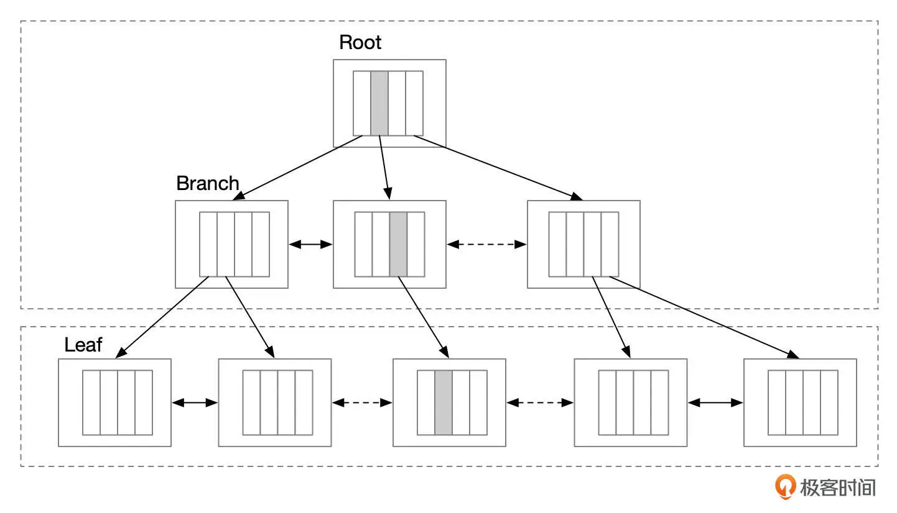

每个索引页面内存储了一系列索引条目，格式为（Key，Value），这些记录按 Key 的顺序排列。每个索引页面里可容纳的条目数量跟条目的长度相关。一个索引页内最少存储 2 行记录，因为如果索引页内只有 1 行记录，就无法构成树的结构了，这也是 InnoDB 限制一行记录最大长度的根本原因。

索引中 Key 包含了哪些字段呢？这是由索引的定义决定的。比如对于下面的这个表，索引idx_a 中，Key 就包括字段了 a、b、id。Value 中存了什么呢？在分支页面中，Value 存了下一层索引页面的编号（Page No），页面编号就是页面在数据文件中的地址。而在叶子页面中，Value 又是什么呢？对于 InnoDB 的二级索引，你可以认为叶子页面中不存 Value，而对于聚簇索引，Value 是表里面的所有字段。聚簇索引的含义后面会具体介绍。

```sql
create table t_index(
   id int not null primary key,
   a int,
   b int,
   c varchar(100),
   key idx_a(a,b)
) engine=innodb;
```

索引页面内的 n 条记录（k1, v1)，（k2, v2），…（kn, vn），将 Key 的取值划分为 n+1 个区间。

注：在 InnoDB 的实现上，每一层最左侧页面中的第一个索引条目有一点特殊，Key 值比 k(1)小的记录，也要到这个索引条目指向的下一层页面中查找。

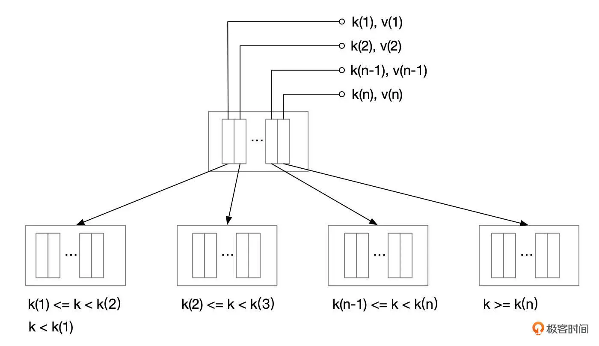

而下一层的索引页面中，每个页面中的索引条目，又将区间划分为更小的范围。假设我们需要查找 Key 为 Kx 的记录。

```sql
select * from tab where key = Kx
```

先在根页面内查找，找到包含值 Kx 的那个区间，k(i) <= Kx < k(i+1)。而索引条目 (ki, vi）中的 vi 是下一层索引页面的地址。递归到下一层页面中按相同的方法查找，最终会定位到某个叶子页面。叶子页面中的记录也是按 (key, value) 的方式存储。如果叶子页面中不存在 Key 为Kx 的记录，则说明表中不存在这条记录。如果在叶子页面中找到了对应的索引条目，那么就可以根据索引条中的主键值，到聚簇索引中查找完整的记录。

### 聚簇索引

InnoDB 中，表里的数据按聚簇索引的形式存储。聚簇索引的 Key 字段为表结构定义中Primary Key 指定的字段。如果不指定 Primay Key，则会以非空的唯一索引作为 PrimaryKey，或者 InnoDB 自动生成一个隐藏字段作为 Primary Key。

下面这个例子中，t_user 表的主键为 id。聚簇索引的 Key 字段为 ID，其他字段作为 Value，存储在索引的叶子页面中。

```sql
create table t_user(
 id int not null,
   username varchar(30),
   email varchar(128),
   phone varchar(15),
   login_time datetime,
   key idx_username(username),
   primary key(id)
);
```

下面是聚簇索引的一个示意图，分支页面中的索引条目为 (id, page num)，叶子页面中，索引条目为 (id, db_trx_id, db_roll_ptr, user_name, …）。这里的 db_trx_id、db_roll_ptr 是 InnoDB中的隐藏字段，后续的课程中还会详细介绍。

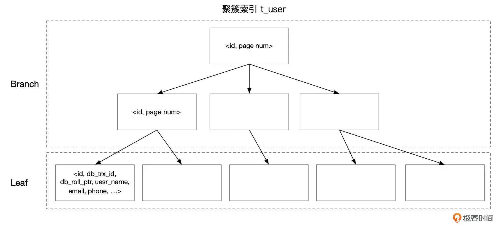

### 二级索引

下面是索引 idx_username 的一个示意图，分支页面中，索引条目为 (username, id, pagenum），叶子页面中，索引条目为 (username, id）。

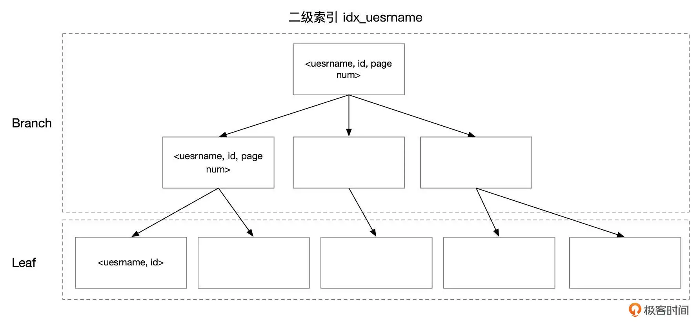

虽然索引 idx_username 的定义中只有 username 字段，但是我们把 username 和 id 拼在一起看作是 Key 字段。username 可能有重复值，但是 username 和 id 拼在一起，就不会重复了。

### 索引结构详解

我们来看一下 B+ 树索引的结构，索引记录在页面中有序存放，每个索引页通过 Next 和 Prev指针指向相邻的页面。

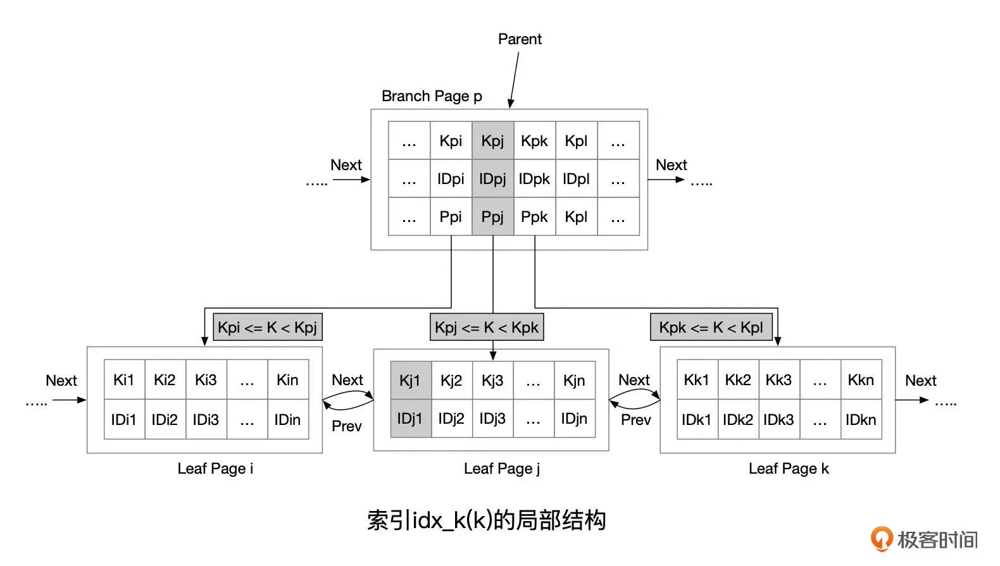

在上图展示的 3 个相邻的叶子页面中，Page i 中的记录总是小于 Page j 中的记录，Page j 中的记录总是小于 Page k 中的记录，依次扫描 i、j、k 这 3 个页面得到的记录（Ki1，Ki2，…，Kj1，Kj2，…，Kk1，Kk2，…）已经是有序的。

如果我们要查询的记录，K 介于 Kpj 和 Kpk 之间，最终会定位到叶子页面 Page j，使用二分查找法，就能找到这条记录，或者发现这条记录不存在。这里我们假设 K 的值没有重复。对 K的值有重复的情况，可以参考接下来对组合索引的描述。

### 组合索引

组合索引是指定义中包含多个字段的索引，下面这个例子中的 idx_abc 就是一个组合索引。

```sql
create table tab(
   id int not null,
   a int,
   b int,
   c int,
   ......,
   primary key(id),
   key idx_abc(a,b,c)
) engine=innodb;
```

组合索引的结构实际上和单列索引是一样的，只不过索引条目由更多的字段组成。我们来看一下组合索引 idx_abc 局部结构的示意图。

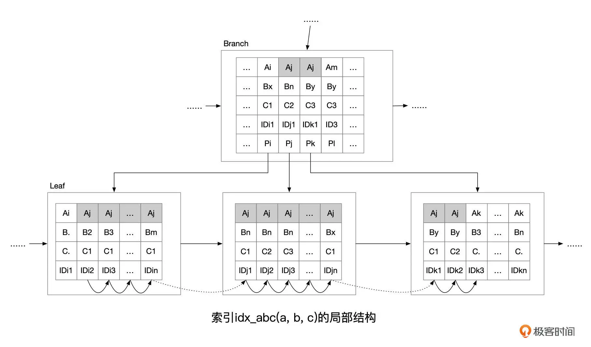

组合索引中，索引条目也是按顺序存放的。

我们来考虑组合索引 idx_abc 的两条索引记录：记录 1（A1，B1，C1，ID1）和记录 2（A2，B2，C2，ID2），如何比较这两条记录的大小？

比较规则如下：

1. 先比较字段 A 的大小，如果 A1 > A2，则记录 1 大，如果 A1 < A2，则记录 2 大。

2. 如果 A1 == A2，则继续比较 B1 和 B2。如果 B1 > B2，则记录 1 大，如果 B1 < B2，则记录 2 大。

3. 如果 B1 == B2，则继续比较 C1 和 C2。如果 C1 > C2，则记录 1 大，如果 C1 < C2，则记录 2 大。

4. 如果 C1 == C2，则继续比较 ID1 和 ID2。因为 ID 是主键，所以 ID1 和 ID2 一定不相等，比较 ID1 和 ID2 就能得出记录的大小。

对于非唯一索引，索引记录中 Key 的值可能存在重复值。但是索引记录中还包括了主键字段，加上主键字段后，整条索引记录就不会重复了。

## 访问路径

SQL 语句查询数据时，通过在 WHERE 子句中指定字段需要满足的条件来获取的数据，不需要指定数据的物理属性。数据库引擎需要将逻辑的 SQL 语句转换为物理的访问路径，从表中获取数据。

### 全表扫描

InnoDB 中，表的数据存储在聚簇索引的叶子页面中。全表扫描时，需要依次访问每一个叶子页面。对于下面这个 SQL，phone 字段既不是主键，也没有建二级索引，因此需要扫描所有的叶子页面，才能获取到满足条件的数据。

```sql
select * from t_user where phone='xxx';
```

大表的全表扫描会大量消耗 CPU 和 IO，应当尽量避免。有些情况下可给查询字段建立合适的索引，避免全表扫描。当然有的场景下，业务可能就是需要获取整个表的所有数据，比如数据仓库需要同步整个表的数据做数据分析。可以考虑在业务低峰期执行这类全表扫描的 SQL，或者建立读库，专门执行这类 SQL。

### 索引访问

### 索引字段等值匹配

等值匹配是指 WHERE 条件中，索引字段以等于 (=) 方式匹配。对于组合索引，可以使用索引的前缀字段。刚刚例子里的组合索引 idx_abc(a,b,c)，以下查询都可以使用索引匹配：

```sql
select * from tab where a = 'a';
select * from tab where a = 'a' and b = 'b'
select * from tab where a = 'a' and b = 'b' and c = 'c'
```

但是下面这几个查询就无法使用索引匹配了，因为缺少了字段 a 的等于条件。

```sql
select * from tab where b = 'b'
select * from tab where c = 'c'
select * from tab where b = 'b' and c = 'c'
```

对于下面这个 SQL，可以用到索引前缀字段 A 进行等值匹配，但是字段 C 则无法用到索引等值匹配中。

```sql
select * from tab where a = 'a' and c = 'c'
```

我们用下面这个例子，来说明索引等值匹配的执行过程。

```sql
select * from tab where a = 'Aj'
```

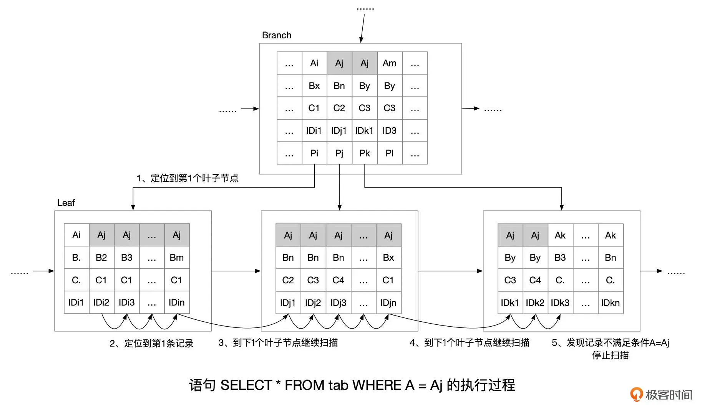

执行过程大致如下：

1. 根据 where 条件，定位到记录所在的最开始的那个叶子页面。

2. 在叶子页面中定位到第 1 条满足条件的记录。如果使用的是二级索引，则还需要根据索引记录中的主键值，到聚簇索引查找数据。获取到记录后，检查该记录是否满足 WHERE 子句中的其他条件。若满足条件，则将这一行记录返回给 Server 层处理。

3. 处理下一条的记录。如果当前页面的记录已经处理完了，则继续处理下一个相邻页面中的记录。

4. 如果获取到的记录不满足索引条件（where A = Aj），则说明没有更多的数据了，停止扫描。

### 索引范围扫描（Index Range Scan）

索引范围扫描是很常见的一种执行方式。索引范围扫描可以分为几种情况：

1. 只限制了范围的最大值，没有限制最小值，如 where A <= Aj。

2. 只限制了范围的最小值，没有限制最大值，如 where A >= Aj。

3. 限制了范围的最小值和最大值，如 where A >= Ai and A <= Aj。

每种情况下，还要看是否包含边界值。使用大于（>）和小于（<）条件时，不包含边界值。

索引范围扫描和索引等值匹配的执行过程比较相似，主要的区别在于如何确定扫描的边界。如果没有限制最小值，则要从索引中的第 1 条记录开始扫描。如果没有限制最大值，则需要一直扫描到索引的最后一个叶子页面。

我们来对比下面这 2 个语句。

```sql
## 语句1
select * from tab where A >= Aj
## 语句2
select * from tab where A > Aj
```

这 2 个语句都要根据边界值 Aj 来定位扫描的开始位置，语句 1 从记录 (Aj, B2, C1,I Di2) 开始扫描。语句 2 从记录 (Ak, B3, C, IDk3) 开始扫描。

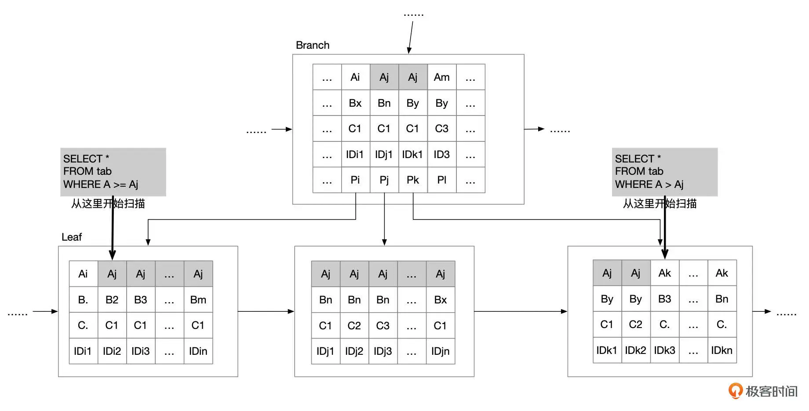

### 索引逆序扫描

索引还支持逆序扫描，比如下面这个 SQL 中，使用了 order b desc。

```sql
select * from tab where A = Aj order by B desc
```

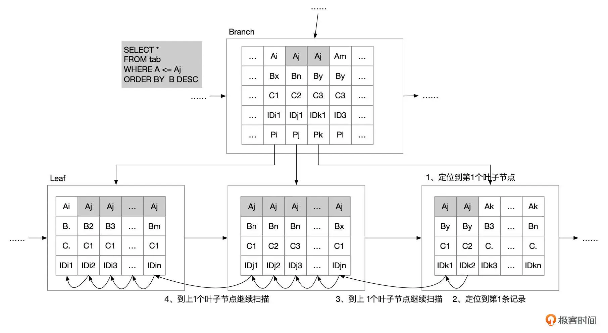

由于索引中的条目都是有序的，在字段 A 的值固定的情况下，字段 B 是有序的，因此只需要按索引条目的顺序反向扫描就可以了。

逆序扫描有几个特点：

1. 逆序扫描从区间的最大值处开始。如果 where 条件中没有限制最大值，则从索引的最后一个页面开始扫描。

2. 在 InnoDB 的实现上，逆序扫描比顺序扫描成本要更高一些。索引页面中，索引条目顺序组成一个单向的链表，逆序访问时，需要做更多的计算。

### 无法使用索引的一些情况

1. 组合索引中，缺少前缀字段的查询条件。考虑下面这个组合索引，索引字段为 C1，C2，……，Ck。

```sql
alter table tab add key idx_c1tok(c1, c2, c3, ..., ck);
```

一个语句能用到这个索引需要满足这些前置条件。

- 索引前缀字段以等值匹配的形式出现在 where 子句中。

- 如果索引中的某个字段 Ci 没有出现在 where 子句中，或者 where 子句中 Ci 以非等值匹配的形式出现，则该字段之后的索引字段不能用来减少索引扫描的范围。

比如下面这两个 SQL 中，语句 1 缺少了 C2 的查询条件，语句 2 中 C2 使用了范围条件，因此 C3 上的条件并不能用来限制索引的扫描范围。

```sql
语句1: select * from tab where c1 = 'x' and c3 = 'y';
语句2: select * from tab where c1 = 'x' and c2 >= 'p' and c2 <= 'q' and c3 = 'y';
```

- 索引字段 Cj 可以使用范围扫描的前提条件：字段 Cj 是索引的第一个字段，或者索引中 Cj之前的字段都以等值匹配的形式出现在 where 子句中。

2. where 子句中，在索引字段上进行了运算，则无法使用索引。比如下面这几个 SQL，虽然字段 A 上建有索引，但是 WHERE 子句，对字段 A 做了运算，所以无法使用到索引。

```sql
select * from tab where a+0 = 1;
select * from tab where to_char(a) = '1';
```

3. 索引字段存在隐式转换。如果索引字段和传入的参数类型不匹配，可能会在索引字段上发生类型隐式转换，这会导致索引无法使用。

```sql
create table tab (
   id int not null,
   b varchar(30),
   ......
   primary key(id),
   key idx_b(b)
);
select * from tab where b = 1;
```

4. 使用了不支持的运算符。

```sql
select * from tab where a != 1;
```

### 索引的其他作用

除了用来快速检索数据，索引还有一些其他的作用。

1. 利用索引的有序性消除排序

如果 SQL 里 order by 字段顺序和索引字段顺序一致，则可以利用索引的有序性避免排序。下面这个例子中，使用了 Order by C2, C3，同时 C1 有等值匹配的条件，因此按索引条目的顺序读取的数据，已经满足了 SQL 的要求，MySQL 就不用再额外进行排序了。

```sql
index (C1, C2, C3, C4, ...)
select * from tab
where C1 = x
order by C2, C3
```

当然，利用索引来避免排序也有一些前置条件。

- 查询本身能使用这个索引。

- order by 中列的顺序和索引中字段顺序一致，并且排序方向一致。

- where 子句中以等值匹配形式出现的索引列和 order by 中的列连在一起是索引的前缀。

比如下面这些 SQL 都需要额外排序。

```sql
## 少了C2
select * from tab where C1 = x1 order by C3, C4
## C2使用了范围条件
select * from tab where C1 = x1 and C2 >= x2 order by C3
## C3用了逆序
select * from tab where C1 = x1 order by C2, C3 desc
## order by中字段顺序和索引不一致
select * from tab where C1 = x1 order by C3, C2
```

2. 覆盖索引

如果一个查询涉及到的字段全都包含在一个索引中，则可以使用索引来满足查询，不需要回表。

下面这个语句中，所有涉及到的字段都包含在同一个索引中，因此可以使用覆盖索引来满足查询。

```sql
index(C1, C2, C3, C4, C5)
select C1,C2
from tab
where C3=x
order by C5
```

如果索引占用的空间比聚簇索引要小很多，那么扫描索引的成本也会比扫描整个表要低，使用覆盖索引可以提升查询的性能。当然，由于 MySQL MVCC 的实现机制，即便是用到了覆盖索引，也有可能需要回表，以构建记录的历史版本，关于这一点我们在第三章再详细介绍。

3. 索引条件下推

对于下面这样的 SQL，虽然字段 C3 的条件不能用来限制索引扫描的范围，但是 MySQL 可以将这个条件下推给 InnoDB，InnoDB 可以利用索引中 C3 字段的值来过滤掉一些不满足条件的记录，减少回表的次数。

```sql
index(C1, C2, C3)
select * from tab where C1 = x and C3 = y
```

我们可以利用这个特点，在创建索引时冗余一些常用的查询字段，来提升性能。

### 表连接

最后我们来简单介绍下表连接的几种算法。

### 嵌套循环连接

嵌套循环连接是 MySQL 中最早支持的连接算法。

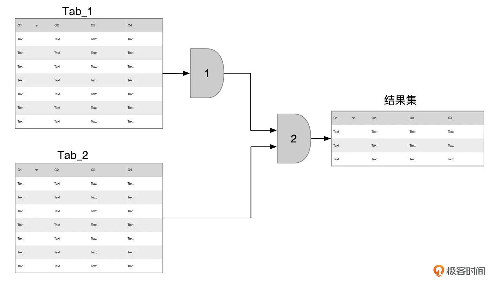

上面这个就是嵌套循环连接的一个示意图，执行步骤大致是：

1. 使用驱动表 Tab_1 的条件定位到满足条件的记录。

2. 每次从步骤 1 获取到一行记录后，查询 Tab_2 表。

3. 查询 Tab_2 时，使用从 Tab_1 表带过来的关联条件，以及 Tab_2 原先的条件，来获取数据。

嵌套查询连接的性能，取决于 3 个因素。

1. 从驱动表获取数据的效率如何。

2. 驱动表中满足条件的记录数，这决定了被驱动表需要查询多少次。

3. 从被驱动表中获取数据的效率如何。

### 哈希连接

在嵌套循环连接算法下，如果被驱动表没有合适的索引可以使用，那么从驱动表每获取一行记录，都要全表扫描一次被驱动表。这种情况下，MySQL 使用了块嵌套循环（BNL）策略，先将驱动表中的一批数据缓存到 Join Buffer 中，然后再全表扫描被驱动表，和 Join Buffer 中的记录进行匹配。MySQL 8.0 在块嵌套循环的基础上，支持了哈希连接算法。

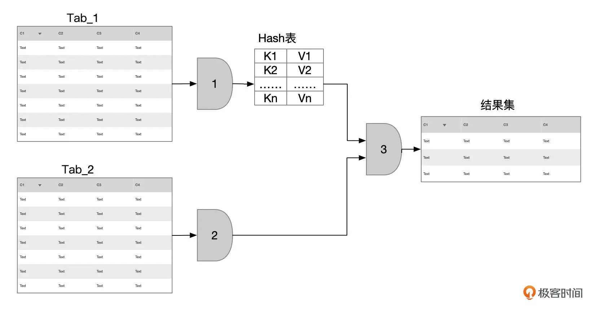

哈希连接算法的执行步骤大致为：

1. 扫描驱动表 Tab_1，并构建哈希表；

2. 扫描被驱动表 Tab_2；

3. 使用从 Tab_2 中获取到的记录，到步骤 1 构建的哈希表中匹配数据。

如果驱动表满足条件的记录数较多，无法一次性加载到 Join Buffer 中，则需要分批处理。

### 合并排序连接

实际上，到 8.0 版本为止，MySQL 并不支持排序合并连接。

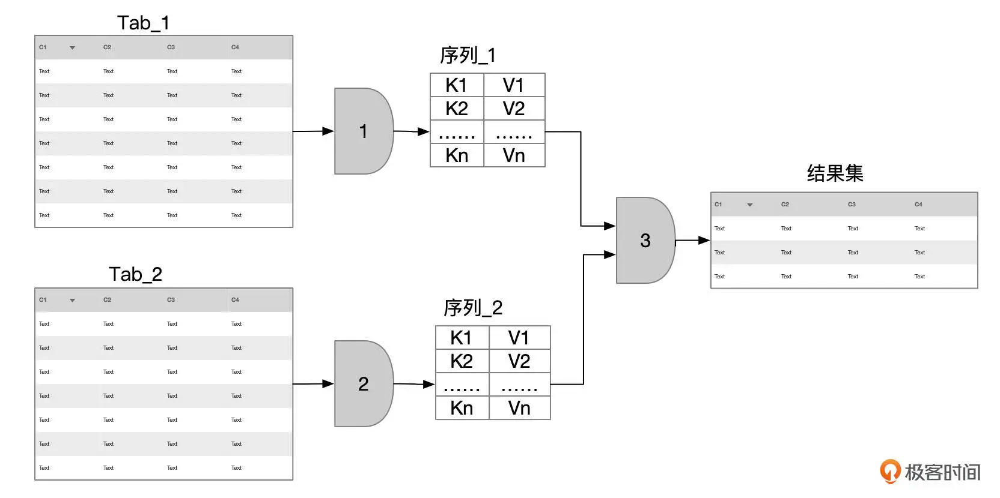

合并排序连接算法的执行步骤大致为：

1. 获取 Tab_1 表满足条件的记录，按连接键排序。

2. 获取 Tab_2 表满足条件的记录，按连接键排序。

3. 读取步骤 1、2 生成的有序数据，执行合并连接。

## 总结

这一讲中，我们学习了数据库中最重要的几种访问路径：全表扫描、索引访问、表连接。理解这些内容，能帮你更好地掌握 SQL 优化。

当然，一个 SQL 语句，并不是说用了索引性能就一定好，不用索引性能就一定不好。优化器会根据具体的情况来进行评估要不要使用索引、使用哪些索引，对于表连接，优化器还需要确定连接的顺序和连接的算法，这些内容在接下来的几讲中揭秘。

## 思考题

```sql
create table t_n(a int not null, primary key(a));
insert into t_n values(1),(2),(3),(4),(5),(6),(7),(8),(9),(10),
 (11),(12),(13),(14),(15),(16),(17),(18),(19),(20);
create table t_abc(
   id int not null auto_increment,
   a int not null,
   b int not null,
   c int not null,
   d int not null,
   padding varchar(200),
   primary key(id),
   key idx_abc(a,b,c)
) engine=innodb;
insert into t_abc(a,b,c,d, padding)
select t1.a, t2.a, t3.a, t3.a, rpad('', 200, 'ABC DEF G XYZ')
from t_n t1, t_n t2, t_n t3;
```

根据测试表 t_abc 的结构，分析下面这几个 SQL 语句的执行路径，有哪些区别？

```sql
select * from t_abc where a = 10 and b = 10;
select * from t_abc where a = 10 and c = 10;
select * from t_abc where a = 10 and d = 10;
select * from t_abc where a = 10 order by a,c;
select * from t_abc where a = 10 order by b,c;
select id, a, b, c from t_abc where a = 10;
select id, a, b, c from t_abc where b = 10;
select id, a, b, c, d from t_abc where b = 10;
```

期待你的思考，欢迎在留言区中与我交流。如果今天的课程让你有所收获，也欢迎转发给有需要的朋友。我们下节课再见！
