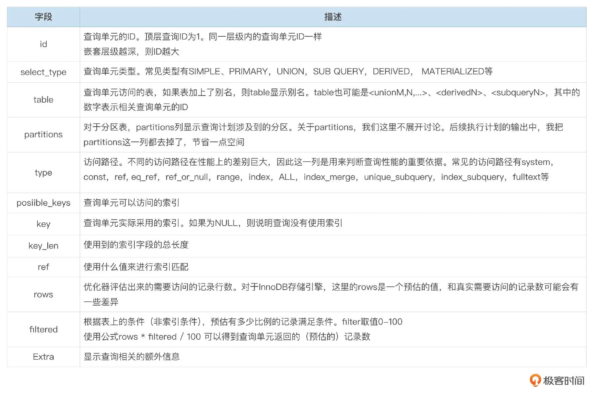

# 18 | 读懂MySQL中的执行计划（上）

你好，我是俊达。

上一讲我介绍了数据库中最主要的几种访问路径，不同的访问路径，在执行性能上可能会存在巨大的差别。但是我们怎么知道某一个具体的 SQL 语句在执行时，采用了什么样的访问路径呢？这就涉及到 SQL 的执行计划了。执行计划描述了 SQL 语句的访问路径，通过执行计划，我们可以知道：

- 表上是否有可用的索引，SQL 执行时是否使用了索引，使用了哪些索引？

- 表连接的顺序是怎样的？

- 使用了哪种表连接算法，是用了 Nest Loop 还是 Hash Join？

- 查询是否用到了临时表，是否进行了文件排序？

在 MySQL 中，我们使用 Explain 命令查看语句的执行计划。这一讲中我会使用四十多个演示SQL，来解释 EXPLAIN 输出信息的具体含义。至于为什么一个 SQL 使用了这个执行计划，而不是别的执行计划，我会在接下来的几讲中慢慢展开。

为了便于演示各种不同的执行计划，我使用了下面这些测试表和测试数据，你也可以在自己的环境中进行测试。

```sql
CREATE TABLE `digit` (
 `a` tinyint NOT NULL,
 PRIMARY KEY (`a`)
) ENGINE=InnoDB;
insert into digit values (0),(1),(2),(3),(4),(5),(6),(7),(8),(9);
CREATE VIEW numbers AS
select a.a*1000 + b.a*100 + c.a*10 + d.a as n
from digit a, digit b, digit c, digit d;
-- 本章中大部分案例都使用tab表
CREATE TABLE `tab` (
 `id` int NOT NULL AUTO_INCREMENT,
 `a` int NOT NULL,
 `b` int NOT NULL,
 `c` int NOT NULL,
 `padding` varchar(7000) DEFAULT NULL,
 PRIMARY KEY (`id`),
 KEY `idx_abc` (`a`,`b`,`c`)
) ENGINE=InnoDB;
insert into tab (a,b,c,padding)
select n%3, n, n%100, rpad('x', 100, 'x')
from numbers where n < 10000;
-- t_merge主要用于演示index_merge的几种情况
create table t_merge(
   id int not null auto_increment,
   a int not null,
   b int not null,
   c int not null,
   d int not null,
   padding varchar(4000),
   primary key(id),
   key idx_ad(a,d),
   key idx_bd(b,d),
   key idx_cd(c,d)
) ENGINE=InnoDB;
insert into t_merge(a,b,c,d,padding)
select n % 3 + 1, n % 17 + 1, n % 19 + 1, n % 10 + 1, rpad('y', 100, 'y')
from numbers
where n between 1 and 3*17*19*10;
```

## 使用 EXPLAIN 命令

使用 EXPLAIN 命令可以查看 SELECT、INSERT、UPDATE、DELETE、REPLACE 等语句的执行计划。EXPLAIN 命令的基本语法如下：

```
explain [format=traditional|json|tree] SQL Statement
```

FORMAT 指定了执行计划的输出格式，不指定时，默认以表格形式输出执行计划。

```sql
mysql> explain select * from tab;
+----+-------------+-------+------------+------+---------------+------+---------+
| id | select_type | table | partitions | type | possible_keys | key  | key_len |
+----+-------------+-------+------------+------+---------------+------+---------+
|  1 | SIMPLE      | tab   | NULL       | ALL  | NULL          | NULL | NULL    |
+----+-------------+-------+------------+------+---------------+------+---------+
```

FORMAT 指定为 TREE 时，以树的形式显示执行计划，这种显示格式和 Oracle 执行计划的显示方式比较像。

下面这个测试 SQL 中，使用了 NO_SEMIJOIN 提示，阻止优化器将子查询改写成表连接。你可以试一下，将提示去掉后，会使用怎样的执行计划。

```sql
explain format=tree
select  /*+ NO_SEMIJOIN(@subq1)  */ *
from tab a
where id in (
   select /*+ QB_NAME(subq1) */ id from tab b
)
EXPLAIN: -> Filter: <in_optimizer>(a.id,<exists>(select #2))  (cost=1031.55 rows=
   -> Table scan on a  (cost=1031.55 rows=9913)
   -> Select #2 (subquery in condition; dependent)
       -> Limit: 1 row(s)  (cost=0.35 rows=1)
           -> Single-row covering index lookup on b using PRIMARY (id=<cache>(a.
```

FORMAT 指定为 JSON 时，以 JSON 格式显示执行计划。JSON 格式的执行计划中，可以看到一些成本的信息。

```sql
explain format=json
select  /*+ NO_SEMIJOIN(@subq1)  */ *
from tab a
where id in (
   select /*+ QB_NAME(subq1) */ id from tab b
)
{
 "query_block": {
   "select_id": 1,
   "cost_info": {
     "query_cost": "1031.55"
   },
   "table": {
     "table_name": "a",
     "access_type": "ALL",
     "rows_examined_per_scan": 9913,
     "rows_produced_per_join": 9913,
     "filtered": "100.00",
     "cost_info": {
       "read_cost": "40.25",
       "eval_cost": "991.30",
       "prefix_cost": "1031.55",
       "data_read_per_join": "264M"
     },
     "used_columns": [
       "id",
       "a",
       "b",
       "c",
       "padding"
     ],
     "attached_condition": "<in_optimizer>(`rep`.`a`.`id`,<exists>(<primary_inde
     "attached_subqueries": [
       {
         "dependent": true,
         "cacheable": false,
         "query_block": {
           "select_id": 2,
           "cost_info": {
             "query_cost": "0.35"
           },
           "table": {
             "table_name": "b",
             "access_type": "unique_subquery",
             "possible_keys": [
               "PRIMARY"
             ],
             "key": "PRIMARY",
             "used_key_parts": [
               "id"
             ],
             "key_length": "4",
             "ref": [
               "func"
             ],
             "rows_examined_per_scan": 1,
             "rows_produced_per_join": 1,
             "filtered": "100.00",
             "using_index": true,
             "cost_info": {
               "read_cost": "0.25",
               "eval_cost": "0.10",
               "prefix_cost": "0.35",
               "data_read_per_join": "27K"
             },
             "used_columns": [
               "id"
             ]
           }
         }
       }
     ]
   }
 }
}
```

## EXPLAIN 输出详解

接下来，我将以默认的表格输出形式为准，来进行介绍。在 EXPLAIN 的输出中，每一行表示一个查询单元。查询单元有几种情况：

- 关联查询中，每一个关联的表是一个查询单元；

- 每个子查询都会对应一个查询单元；

- 组成 UNION 语句的每个子句都会对应一个查询单元；

- 每个派生表对应一个查询单元。

EXPLAIN 的输出中包含以下字段：



### ID

ID 为查询单元的编号。主查询（顶层查询）的 ID 为 1。同一层级内，如果有表连接，则它们的查询单元 ID 一样。子查询的嵌套层级越深，ID 越大。下面的例子中，有 2 个子查询，子查询 2 嵌套在子查询 1 中。

```sql
mysql> explain
select  /*+ NO_SEMIJOIN(@subq1 )  */ *
from tab ta, tab tx
where ta.id in (
   select /*+ QB_NAME(subq1) NO_SEMIJOIN(@subq2) */ id from tab tb
     where c in (select /*+ QB_NAME(subq2) */ c from tab tc)
)
and ta.id = tx.id
+----+-------------+-------+--------+---------------+---------+---------+--------
| id | select_type | table | type   | possible_keys | key     | key_len | ref
+----+-------------+-------+--------+---------------+---------+---------+--------
|  1 | PRIMARY     | ta    | ALL    | PRIMARY       | NULL    | NULL    | NULL
|  1 | PRIMARY     | tx    | eq_ref | PRIMARY       | PRIMARY | 4       | rep.ta.
|  2 | SUBQUERY    | tb    | index  | PRIMARY       | idx_abc | 12      | NULL
|  3 | SUBQUERY    | tc    | index  | NULL          | idx_abc | 12      | NULL
+----+-------------+-------+--------+---------------+---------+---------+--------
```

查询中使用提示 QB_NAME、NO_SEMIJOIN，是为了避免优化器使用半连接查询优化，因为使用半连接优化后，这个示例中的子查询就被优化掉了。ID 为 1 的 2 个查询单元，按从上到下的顺序关联，驱动表为 ta。这里 Extra 中没有额外的信息，说明使用了嵌套循环连接。

### SELECT_TYPE

SELECT_TYPE 为查询单元的类型，有以下几种可能的类型。

- SIMPLE

如果语句没有使用 UNION 或子查询，那么 SELECT_TYPE 为 SIMPLE。

- PRIMARY

如果语句用到了子查询，那么最外层查询的 select_type 为 PRIMARY，表示这是主语句。如果语句使用了 UNION，则第一个查询单元的 select_type 为 PRIMARY。

- UNION

使用 UNION 或 UNION ALL 的查询中，第二个和后续查询的 select_type 为 UNION

- UNION RESULT

UNION RESULT 表示 UNION 去重后的结果。下面这个例子中，ID 为 3 的这一行就是 ID 为1 和 2 这两个查询单元结果集 Union 之后得到的。

```sql
mysql> explain select a from tab ta union select c from tab tb;
+----+--------------+------------+-------+---------------+---------+---------+---
| id | select_type  | table      | type  | possible_keys | key     | key_len | re
+----+--------------+------------+-------+---------------+---------+---------+---
|  1 | PRIMARY      | ta         | index | NULL          | idx_abc | 12      | NU
|  2 | UNION        | tb         | index | NULL          | idx_abc | 12      | NU
|  3 | UNION RESULT | <union1,2> | ALL   | NULL          | NULL    | NULL    | NU
+----+--------------+------------+-------+---------------+---------+---------+---
```

- DEPENDENT UNION

如果 UNION 子句位于子查询中，并且子查询依赖了外部查询中字段，则 select_type 为DEPENDENT UNION。

```sql
mysql> explain select * from tab ta where id in (
   select a from tab tb union select c from tab tc);
+----+--------------------+------------+-------+---------------+---------+-------
| id | select_type        | table      | type  | possible_keys | key     | key_le
+----+--------------------+------------+-------+---------------+---------+-------
|  1 | PRIMARY            | ta         | ALL   | NULL          | NULL    | NULL
|  2 | DEPENDENT SUBQUERY | tb         | ref   | idx_abc       | idx_abc | 4
|  3 | DEPENDENT UNION    | tc         | index | NULL          | idx_abc | 12
|  4 | UNION RESULT       | <union2,3> | ALL   | NULL          | NULL    | NULL
+----+--------------------+------------+-------+---------------+---------+-------
```

- UNCACHEABLE UNION

union 查询出现在子查询中，并且 union 语句使用了非确定性函数（如 rand）或使用了变量，那么 union 查询单元的 select_type 为 UNCACHEABLE UNION。

```sql
mysql> explain select distinct a from  (
   select a from tab tb
   union all
   select c from tab tc where c > rand()
) tx;
+----+-------------------+------------+-------+---------------+---------+--------
| id | select_type       | table      | type  | possible_keys | key     | key_len
+----+-------------------+------------+-------+---------------+---------+--------
|  1 | PRIMARY           | <derived2> | ALL   | NULL          | NULL    | NULL
|  2 | DERIVED           | tb         | index | NULL          | idx_abc | 12
|  3 | UNCACHEABLE UNION | tc         | index | NULL          | idx_abc | 12
+----+-------------------+------------+-------+---------------+---------+--------
```

```sql
mysql> explain select * from tab where exists (
   select avg(b) from tab
   union all
   select b from tab where b > rand()
);
+----+-------------------+-------+-------+---------------+---------+---------+---
| id | select_type       | table | type  | possible_keys | key     | key_len | re
+----+-------------------+-------+-------+---------------+---------+---------+---
|  1 | PRIMARY           | tab   | ALL   | NULL          | NULL    | NULL    | NU
|  2 | SUBQUERY          | tab   | index | NULL          | idx_abc | 12      | NU
|  3 | UNCACHEABLE UNION | tab   | index | NULL          | idx_abc | 12      | NU
+----+-------------------+-------+-------+---------------+---------+---------+---
```

- SUBQUERY

子查询可以出现在 select 列表中、where 条件中，也可以出现在 from 列表中。出现在 from列表中的子查询为派生表（DERIVED）。如果子查询不依赖主查询中的字段，则称为不相关子查询，select_type 为 SUBQUERY。SQL 执行时，会缓存子查询的查询结果。下面的例子中，子查询中的 SQL 只需要执行 1 次，不需要每访问 1 行数据就重复执行 1 次子查询。

```sql
mysql> explain select a, (select avg(b) from tab )  from tab t1;
+----+-------------+-------+-------+---------------+---------+---------+------+--
| id | select_type | table | type  | possible_keys | key     | key_len | ref  | r
+----+-------------+-------+-------+---------------+---------+---------+------+--
|  1 | PRIMARY     | t1    | index | NULL          | idx_abc | 12      | NULL | 1
|  2 | SUBQUERY    | tab   | index | NULL          | idx_abc | 12      | NULL | 1
+----+-------------+-------+-------+---------------+---------+---------+------+--
```

使用 EXPLAN ANALYZE 命令，可以看到子查询只执行了 1 次（run only once）。

```sql
mysql> explain analyze select a, (select avg(b) from tab )  from tab t1\G
*************************** 1. row ***************************
EXPLAIN:
-> Covering index scan on t1 using idx_abc  (cost=1025 rows=10010) (actual time=0
-> Select #2 (subquery in projection; run only once)
   -> Aggregate: avg(tab.b)  (cost=2026 rows=1) (actual time=3.79..3.79 rows=1 l
       -> Covering index scan on tab using idx_abc  (cost=1025 rows=10010) (actu
```

- DEPENDENT SUBQUERY

子查询引用了主查询中的字段，则子查询称为相关子查询。MySQL 中，相关子查询无法被缓存。对主查询中的每 1 行数据，都需要执行 1 次子查询。

```sql
mysql> explain select a, (select avg(b) from tab where a=t1.a) from tab t1;
+----+--------------------+-------+-------+---------------+---------+---------+--
| id | select_type        | table | type  | possible_keys | key     | key_len | r
+----+--------------------+-------+-------+---------------+---------+---------+--
|  1 | PRIMARY            | t1    | index | NULL          | idx_abc | 12      | N
|  2 | DEPENDENT SUBQUERY | tab   | ref   | idx_abc       | idx_abc | 4       | r
+----+--------------------+-------+-------+---------------+---------+---------+--
```

使用 EXPLAN ANLYZE 命令，可以看到子查询执行了 10000 次（loops=10000）。

```sql
mysql> explain  analyze select a, (select avg(b) from tab where a=t1.a) from tab
*************************** 1. row ***************************
EXPLAIN:
-> Covering index scan on t1 using idx_abc  (cost=1025 rows=10010) (actual time=0
-> Select #2 (subquery in projection; dependent)
   -> Aggregate: avg(tab.b)  (cost=669 rows=1) (actual time=1.39..1.39 rows=1 lo
       -> Covering index lookup on tab using idx_abc (a=t1.a)  (cost=336 rows=33
1 row in set, 1 warning (13.94 sec)
```

MariaDB 中，相关子查询也可以 cache，对于本例中的 SQL，子查询依赖主查询中 t1 表的字段 a，每次 t1.a 出现新值时，执行 1 次子查询，并缓存 t1.a 的值和查询结果。子查询执行的次数取决于关联的外部查询中字段的唯一值数量。

下面这个例子是在 MariaDB 10.0 的环境中执行得到的。explain extended 的 warning 信息

```sql
中，<expr_cache> 表示使用了子查询 cache。
--这个例子在mariadb 10.0 中执行
mysql> explain extended select a, (select avg(b) from tab where a=t1.a) from tab
+------+--------------------+-------+-------+---------------+---------+---------+
| id   | select_type        | table | type  | possible_keys | key     | key_len |
+------+--------------------+-------+-------+---------------+---------+---------+
|    1 | PRIMARY            | t1    | index | NULL          | idx_abc | 12      |
|    2 | DEPENDENT SUBQUERY | tab   | ref   | idx_abc       | idx_abc | 4       |
+------+--------------------+-------+-------+---------------+---------+---------+
2 rows in set, 2 warnings (0.00 sec)
mysql> show warnings;
+-------+------+-----------------------------------------------------------------
| Level | Code | Message
+-------+------+-----------------------------------------------------------------
| Note  | 1276 | Field or reference 'mysql.t1.a' of SELECT #2 was resolved in SEL
| Note  | 1003 | /* select#1 */ select `mysql`.`t1`.`a` AS `a`,<expr_cache><`mysq
+-------+------+-----------------------------------------------------------------
```

- DERIVED

子查询出现在主查询的 FROM 子句的位置时，select_type 为 DERIVED。

```sql
mysql> explain select t1.*
   from tab t1, (select a, avg(b) as avgb from tab group by a) t2
   where t1.a = t2.a;
+----+-------------+------------+-------+---------------+-------------+---------+
| id | select_type | table      | type  | possible_keys | key         | key_len |
+----+-------------+------------+-------+---------------+-------------+---------+
|  1 | PRIMARY     | t1         | ALL   | idx_abc       | NULL        | NULL    |
|  1 | PRIMARY     | <derived2> | ref   | <auto_key0>   | <auto_key0> | 4       |
|  2 | DERIVED     | tab        | index | idx_abc       | idx_abc     | 12      |
+----+-------------+------------+-------+---------------+-------------+---------+
```

- DEPENDENT DERIVED

如果派生查询引用了主查询中的字段，则 select_type 为 DEPENDENT DERIVED。

```sql
mysql> explain select a, (select * from (select avg(b) as avgb from tab where a=t
+----+--------------------+------------+-------+---------------+---------+-------
| id | select_type        | table      | type  | possible_keys | key     | key_le
+----+--------------------+------------+-------+---------------+---------+-------
|  1 | PRIMARY            | t0         | index | NULL          | idx_abc | 12
|  2 | DEPENDENT SUBQUERY | <derived3> | ALL   | NULL          | NULL    | NULL
|  3 | DEPENDENT DERIVED  | tab        | ref   | idx_abc       | idx_abc | 4
+----+--------------------+------------+-------+---------------+---------+-------
```

- MATERIALIZED

子查询的结果先存储到临时表，查询的其他部分和生成的临时表再关联。

```sql
mysql> explain select * from tab where a in( select b from tab);
+----+--------------+-------------+--------+---------------------+---------------
| id | select_type  | table       | type   | possible_keys       | key
+----+--------------+-------------+--------+---------------------+---------------
|  1 | SIMPLE       | tab         | ALL    | idx_abc             | NULL
|  1 | SIMPLE       | <subquery2> | eq_ref | <auto_distinct_key> | <auto_distinct
|  2 | MATERIALIZED | tab         | index  | NULL                | idx_abc
+----+--------------+-------------+--------+---------------------+---------------
```

- UNCACHEABLE SUBQUERY

如果（不相关）子查询结果无法被缓存，则 select_type 为 UNCACHEABLE SUBQUERY。

```sql
mysql> explain select * from tab where b > (select avg(b) from tab where b > rand
+----+----------------------+-------+-------+---------------+---------+---------+
| id | select_type          | table | type  | possible_keys | key     | key_len |
+----+----------------------+-------+-------+---------------+---------+---------+
|  1 | PRIMARY              | tab   | ALL   | NULL          | NULL    | NULL    |
|  2 | UNCACHEABLE SUBQUERY | tab   | index | NULL          | idx_abc | 12      |
+----+----------------------+-------+-------+---------------+---------+---------+
```

导致子查询无法 Cache 的一些情况：子查询使用了结果不确定的函数（如 rand），子查询使用了变量。

- UNCACHEABLE UNION

```sql
mysql> explain select distinct a from  (select a from tab tb  union all select c
+----+-------------------+------------+-------+---------------+---------+--------
| id | select_type       | table      | type  | possible_keys | key     | key_len
+----+-------------------+------------+-------+---------------+---------+--------
|  1 | PRIMARY           | <derived2> | ALL   | NULL          | NULL    | NULL
|  2 | DERIVED           | tb         | index | NULL          | idx_abc | 12
|  3 | UNCACHEABLE UNION | tc         | index | NULL          | idx_c   | 4
+----+-------------------+------------+-------+---------------+---------+--------
```

### TABLE

TABLE 这一列说明了一个查询单元的数据是从哪个表获取的。这里分几种情况。

1. table 是一个真实存在的物理表，这里会显示为表的别名。

```xml
<derivedN>，说明是从派生表获取的数据，真实的数据来自 ID 为 N 的查询单元
<unionM,N>，说明是将 ID 为 M 和 N 的查询单元 Union 后得到的数据。
<subqueryN>，说明是 ID 为 N 的子查询物化后得到的数据。
```

这里的几种情况，在前面的例子中都出现过，你可以回头再看一下。

### TYPE

TYPE 列显示查询单元的访问路径，你可以根据 TYPE 列来判断查询单元是否使用了索引。

- system

如果使用了 MyISAM 存储引擎，并且表中只有 1 行，则 Type 为 system。

```sql
mysql> create table t1_myisam(a int) engine=myisam;
mysql> insert into t1_myisam values(100);
mysql> explain select * from t1_myisam;
+----+-------------+-----------+--------+---------------+------+---------+------+
| id | select_type | table     | type   | possible_keys | key  | key_len | ref  |
+----+-------------+-----------+--------+---------------+------+---------+------+
|  1 | SIMPLE      | t1_myisam | system | NULL          | NULL | NULL    | NULL |
+----+-------------+-----------+--------+---------------+------+---------+------+
```

- const

const 表示查询最多返回 1 行记录。对主键或唯一索引的所有字段都使用常量等值匹配时，type 为 const。优化器会将 type 为 const 的查询单元直接替换为常量表。

```sql
mysql> explain select * from tab where id = 10\G
+----+-------------+-------+-------+---------------+---------+---------+-------+-
| id | select_type | table | type  | possible_keys | key     | key_len | ref   |
+----+-------------+-------+-------+---------------+---------+---------+-------+-
|  1 | SIMPLE      | tab   | const | PRIMARY       | PRIMARY | 4       | const |
+----+-------------+-------+-------+---------------+---------+---------+-------+-
```

- eq_ref

使用主键或唯一索引等值匹配时，type 为 eq_ref。对于组合主键、组合唯一索引，索引中的每一个字段都需要以等值匹配时，type 才为 eq_ref。eq_ref 访问路径每次最多只返回 1 行记录。eq_ref 和 const 的区别在于，const 使用常量匹配，而 eq_ref 中，匹配索引字段的值来自驱动表，不是固定的常量。

下面这个例子中，t2 表 id 字段的匹配条件来自驱动表 t1 的字段 a。

```sql
mysql> explain select * from tab t1 , tab t2 where t1.a = t2.id;
+----+-------------+-------+--------+---------------+---------+---------+--------
| id | select_type | table | type   | possible_keys | key     | key_len | ref
+----+-------------+-------+--------+---------------+---------+---------+--------
|  1 | SIMPLE      | t1    | ALL    | idx_abc       | NULL    | NULL    | NULL
|  1 | SIMPLE      | t2    | eq_ref | PRIMARY       | PRIMARY | 4       | rep.t1.
+----+-------------+-------+--------+---------------+---------+---------+--------
```

- ref

普通索引字段的等值匹配，或主键和唯一索引前缀字段上的等值匹配，类型为 ref。对于 ref 类型的访问路径，执行计划输出中的 key 列显示了实际使用的索引，key_len 显示使用的索引字段的长度，ref 字段显示用于匹配的值。

```sql
mysql> explain select * from tab where a=1;
+----+-------------+-------+------+---------------+---------+---------+-------+--
| id | select_type | table | type | possible_keys | key     | key_len | ref   | r
+----+-------------+-------+------+---------------+---------+---------+-------+--
|  1 | SIMPLE      | tab   | ref  | idx_abc       | idx_abc | 4       | const | 3
+----+-------------+-------+------+---------------+---------+---------+-------+--
mysql> explain select * from tab t1, tab t2 where t1.a = t2.a;
+----+-------------+-------+------+---------------+---------+---------+----------
| id | select_type | table | type | possible_keys | key     | key_len | ref
+----+-------------+-------+------+---------------+---------+---------+----------
|  1 | SIMPLE      | t1    | ALL  | idx_abc       | NULL    | NULL    | NULL
|  1 | SIMPLE      | t2    | ref  | idx_abc       | idx_abc | 4       | rep.t1.a
+----+-------------+-------+------+---------------+---------+---------+----------
```

如果索引字段的条件使用了 or 或 in，那么 type 就不再是 ref 了。

- ref_or_null

ref_or_null 和 ref 类似，只是额外加了字段为空的条件。对比下下面这两个语句，字段 A 有not null 约束时，type 为 ref。

```sql
mysql> create table tab3 like tab;
mysql> alter table tab3 modify a int;
mysql> insert into tab3 select * from tab;
mysql> explain select * from tab where a is null or a = 1;
+----+-------------+-------+------+---------------+---------+---------+-------+--
| id | select_type | table | type | possible_keys | key     | key_len | ref   | r
+----+-------------+-------+------+---------------+---------+---------+-------+--
|  1 | SIMPLE      | tab   | ref  | idx_abc       | idx_abc | 4       | const | 3
+----+-------------+-------+------+---------------+---------+---------+-------+--
mysql> explain select * from tab3 where a is null or a = 1;
+----+-------------+-------+-------------+---------------+---------+---------+---
| id | select_type | table | type        | possible_keys | key     | key_len | re
+----+-------------+-------+-------------+---------------+---------+---------+---
|  1 | SIMPLE      | tab3  | ref_or_null | idx_abc       | idx_abc | 5       | co
+----+-------------+-------+-------------+---------------+---------+---------+---
```

- range

```
使用索引字段上的范围条件查询数据。范围条件包括 <, <=, >, >=, BETWEEN 等，索引
```

字段使用 OR 或 IN 多个值时，类型也为 range。对于 range 访问路径，执行计划中 key 列显示实际使用的索引名。key_len 列显示使用到的索引字段的长度，ken_len 取决于使用到的索引字段的数据类型、字段是否可以为空。rows 字段显示优化器评估得到的需要在索引中访问的记录数量。

```sql
mysql> explain select * from tab force index(idx_abc) where   a = 1 or a = 2;
+----+-------------+-------+-------+---------------+---------+---------+------+--
| id | select_type | table | type  | possible_keys | key     | key_len | ref  | r
+----+-------------+-------+-------+---------------+---------+---------+------+--
|  1 | SIMPLE      | tab   | range | idx_abc       | idx_abc | 4       | NULL | 6
+----+-------------+-------+-------+---------------+---------+---------+------+--
mysql> explain select * from tab where a = 1 and b between 100 and 200;
+----+-------------+-------+-------+---------------+---------+---------+------+--
| id | select_type | table | type  | possible_keys | key     | key_len | ref  | r
+----+-------------+-------+-------+---------------+---------+---------+------+--
|  1 | SIMPLE      | tab   | range | idx_abc       | idx_abc | 8       | NULL |
+----+-------------+-------+-------+---------------+---------+---------+------+--
```

- index_merge

index_merge 会使用多个索引来查询数据，并将通过多个索引获取到的数据取并集或交集，得到最终的结果。执行计划输出中，key 字段显示实际参与 index_merge 的索引。Extra 列中的信息显示了实际的索引合并方法，包括 sort_union, union 和 intersect。

如果在执行计划中看到 index_merge 访问路径，一般要考虑是否可以创建联合索引，将访问路径改成 range 或 ref，或者将 SQL 改写为 union 查询。

```sql
mysql> explain select *
 from t_merge
 where (b=1 and d=1) or (c=1 and d between 3 and 5);
+----+-------------+---------+-------------+---------------+---------------+-----
| id | select_type | table   | type        | possible_keys | key           | key_
+----+-------------+---------+-------------+---------------+---------------+-----
|  1 | SIMPLE      | t_merge | index_merge | idx_bd,idx_cd | idx_bd,idx_cd | 8,8
+----+-------------+---------+-------------+---------------+---------------+-----
mysql> explain select * from t_merge where a=1 and b=1 and d=1 and c=1;
+----+-------------+---------+-------------+----------------------+--------------
| id | select_type | table   | type        | possible_keys        | key
+----+-------------+---------+-------------+----------------------+--------------
|  1 | SIMPLE      | t_merge | index_merge | idx_ad,idx_bd,idx_cd | idx_cd,idx_bd
+----+-------------+---------+-------------+----------------------+--------------
```

- index_subquery

index_subquery 是执行下面这种类型的子查询的一种方式：

```sql
where value in (select col from tab where ...)
```

如果子查询中的表 tab 有合适的索引可以用来检索，则可以使用 index_subquery 执行路径，对主查询中的每 1 行记录，执行类似下面的 SQL：

```sql
select * from tab where col = outer.value and ...
mysql> explain select /*+ NO_SEMIJOIN(@qb1) */ * from tab
 where a = 1
 and  b between 100 and 200
 and c in (select /*+ QB_NAME(qb1) */  a from tab where b=1  );
+----+--------------------+-------+----------------+---------------+---------+---
| id | select_type        | table | type           | possible_keys | key     | ke
+----+--------------------+-------+----------------+---------------+---------+---
|  1 | PRIMARY            | tab   | range          | idx_abc       | idx_abc | 8
|  2 | DEPENDENT SUBQUERY | tab   | index_subquery | idx_abc       | idx_abc | 8
+----+--------------------+-------+----------------+---------------+---------+---
mysql> show warnings\G
*************************** 1. row ***************************
 Level: Note
  Code: 1003
Message: /* select#1 */ select /*+ NO_SEMIJOIN(@`qb1`) */
   `rep`.`tab`.`id` AS `id`,`rep`.`tab`.`a` AS `a`,`rep`.`tab`.`b` AS `b`,`rep`.
from `rep`.`tab`
where ((`rep`.`tab`.`a` = 1)
and (`rep`.`tab`.`b` between 100 and 200)
and <in_optimizer>(`rep`.`tab`.`c`,<exists>(<index_lookup>(<cache>(`rep`.`tab`.`c
1 row in set (0.00 sec)
```

- unique_subquery

unique_subquery 和 index_subquery 类似，区别在于 type 为 unique_subquery 时，子查询中的表使用主键或唯一索引来关联查询。

```sql
mysql> explain select /*+ NO_SEMIJOIN(@qb1) */ *
 from tab
 where a=1
 and id in (select /*+ QB_NAME(qb1) */  id from tab);
+----+--------------------+-------+-----------------+---------------+---------+--
| id | select_type        | table | type            | possible_keys | key     | k
+----+--------------------+-------+-----------------+---------------+---------+--
|  1 | PRIMARY            | tab   | ref             | idx_abc       | idx_abc | 4
|  2 | DEPENDENT SUBQUERY | tab   | unique_subquery | PRIMARY       | PRIMARY | 4
+----+--------------------+-------+-----------------+---------------+---------+--
mysql> show warnings\G
*************************** 1. row ***************************
 Level: Note
  Code: 1003
Message: /* select#1 */ select /*+ NO_SEMIJOIN(@`qb1`) */
   `rep`.`tab`.`id` AS `id`,`rep`.`tab`.`a` AS `a`,`rep`.`tab`.`b` AS `b`,`rep`.
 from `rep`.`tab`
 where ((`rep`.`tab`.`a` = 1)
 and <in_optimizer>(`rep`.`tab`.`id`,<exists>(<primary_index_lookup>(<cache>(`re
```

上面例子中 NO_SEMIJOIN 提示是为了阻止优化器使用半连接优化，因为使用半连接优化后，子查询被转换为半连接，就不会出现 index_subquery 和 unique_subquery 访问路径了。

- index

index 访问路径和 ALL 类似，主要区别是 ALL 访问路径需要访问表的每一行数据，而 index访问路径是访问索引中的每一行数据。访问路径为 index 时，key_len 字段显示的是所有索引字段的长度总和。一般 type 为 index 时，possible_keys 总是 NULL。

以下 2 种情况可以使用 index 访问路径：

情况 1：语句使用了覆盖索引，但是又缺少索引字段的查询条件。这种情况下 Extra 列会显示Using index。

情况 2：按索引的顺序读取表的记录，但是无法使用覆盖索引。这种情况下 Extra 列不显示Using index。

下面的 2 个例子分别展示了这两种情况。

```sql
mysql> explain select a,b,c from tab force index(idx_abc) order by a,b,c;
+----+-------------+-------+-------+---------------+---------+---------+------+--
| id | select_type | table | type  | possible_keys | key     | key_len | ref  | r
+----+-------------+-------+-------+---------------+---------+---------+------+--
|  1 | SIMPLE      | tab   | index | NULL          | idx_abc | 12      | NULL | 9
+----+-------------+-------+-------+---------------+---------+---------+------+--
mysql> explain select * from tab force index(idx_abc) order by a,b,c;
+----+-------------+-------+-------+---------------+---------+---------+------+--
| id | select_type | table | type  | possible_keys | key     | key_len | ref  | r
+----+-------------+-------+-------+---------------+---------+---------+------+--
|  1 | SIMPLE      | tab   | index | NULL          | idx_abc | 12      | NULL | 9
+----+-------------+-------+-------+---------------+---------+---------+------+--
```

- ALL

全表扫描，需要访问表中的每一行记录。出现 ALL 访问路径，可能是因为表上缺少合适的索引，或者是因为 SQL 语句的写法问题导致无法使用索引，也可能是因为查询中对表缺少合适的过滤条件，或者是索引字段的过滤性不好，需要根据查询语句的情况具体分析。

\因字数限制，学习后面的内容请直接跳转到下一讲
