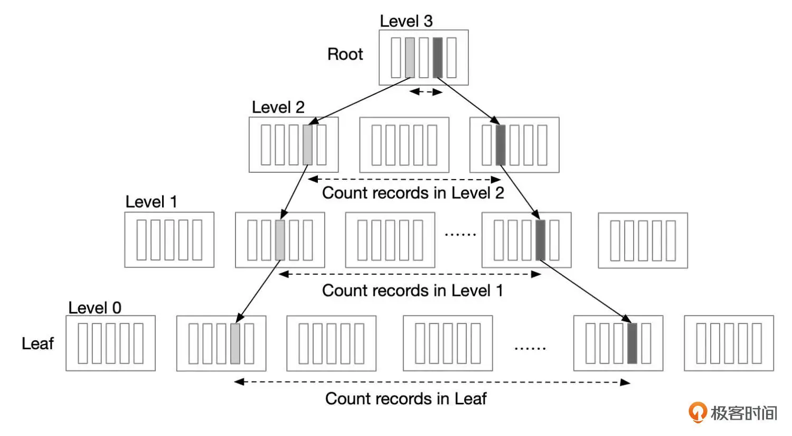
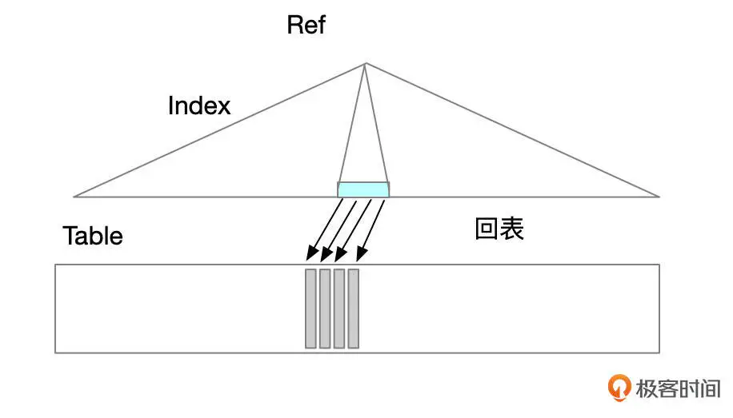
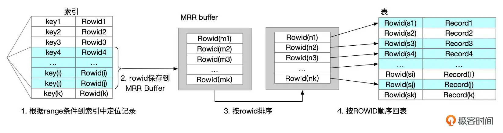
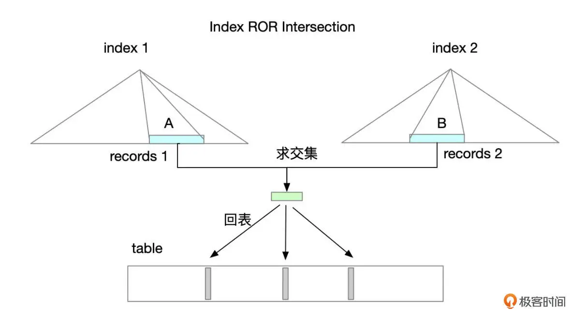
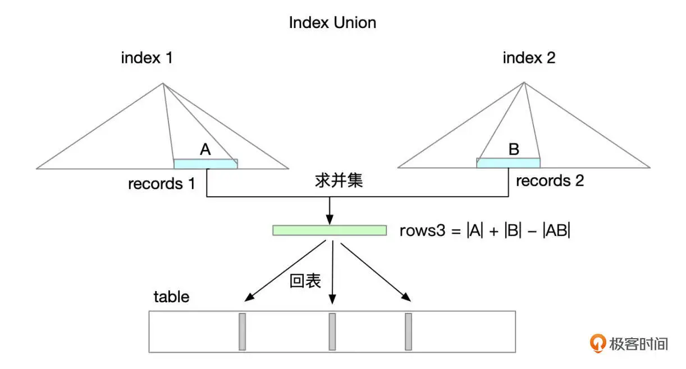
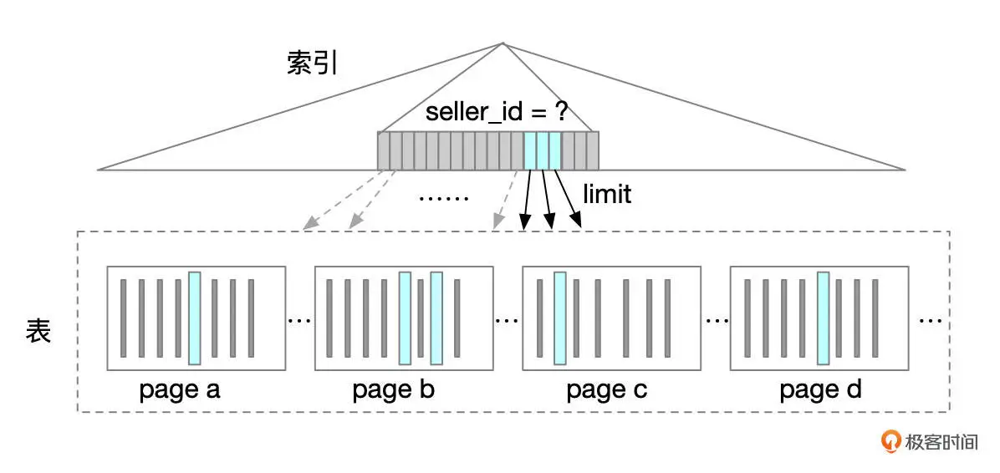

# 20 | 单表查询：如何评估单表访问成本？

你好，我是俊达。

上一讲中我们介绍了优化器的工作原理，并介绍了全表扫描和索引范围扫描的成本评估方法。在这一讲中，我们继续来学习单表查询的其他几种访问路径：REF、覆盖索引、MRR、IndexMerge。最后，我们还将通过一个真实的业务场景，来讨论怎么给业务创建一个合适的索引。

## 测试表

这一讲中，我们依然会使用 18 讲开头创建的那个测试表，这个表的表结构和统计信息情况如下：

```sql
mysql> show create table tab\G
*************************** 1. row ***************************
      Table: tab
Create Table: CREATE TABLE `tab` (
 `id` int NOT NULL,
 `a` int NOT NULL,
 `b` int NOT NULL,
 `c` int NOT NULL,
 `padding` varchar(7000) DEFAULT NULL,
 PRIMARY KEY (`id`),
 KEY `idx_abc` (`a`,`b`,`c`)
) ENGINE=InnoDB DEFAULT CHARSET=utf8mb4 COLLATE=utf8mb4_0900_ai_ci
mysql> select * from mysql.innodb_table_stats where table_name = 'tab'\G
*************************** 1. row ***************************
          database_name: rep
             table_name: tab
            last_update: 2024-02-26 17:37:12
                 n_rows: 9913
   clustered_index_size: 161
sum_of_other_index_sizes: 17
```

## Index Dive 是怎么工作的？

上一讲中提到了，InnoDB 使用了 Index Dive 机制，来评估一个索引区间内有多少行记录。那么 Index Dive 是如何估算一个索引区间内的记录数呢？大致的步骤是这样的。

1. 根据 where 条件，确定 range 访问的上下边界。range 的上下边界，决定了需要在索引中扫描多少记录。

2. 根据上下边界的值，到索引中查找，并记录每一层边界记录的所在位置。

3. 从下边界记录开始扫描数据，一直扫描到上边界记录，或者直到扫描的页面数超出限制（8个页面）。

如果区间内的记录数不多，则可以精确地统计出记录数。如果区间内记录数很多，超过了 8 个页面，那么 InnoDB 会估算出记录数。首先，根据已经扫描的索引页面，可以算出平均每个页面有多少行记录。然后，再估算出区间内有多少个页面，两个数字相乘，就得到了记录数的一个估算值。

InnoDB 怎么估算一个区间内有多少页面呢？从索引结构可以看出，上一层页面中，每一个索引条目都指向了下一层的一个页面，那么统计上一层中索引条目的数量，就知道了下一层中区间内的页面数。



Index Dive 通常都能获得范围内记录数据比较准确的估计。但是有一个特殊情况。range 内的页面数较多时，得到的不是精确的记录数，这需要将行数乘以 2，如果乘以 2 之后的行数超过了表统计信息中记录数的一半，则将记录数设置为总记录数的一半。通过以下几个例子我们可以观察到这种情况。

```sql
-- rows为精确值
mysql> explain select * from tab where id >=1 and id <= 790;
+----+-------------+-------+-------+---------------+---------+---------+------+
| id | select_type | table | type  | possible_keys | key     | key_len | rows |
+----+-------------+-------+-------+---------------+---------+---------+------+
|  1 | SIMPLE      | tab   | range | PRIMARY       | PRIMARY | 4       |  790 |
+----+-------------+-------+-------+---------------+---------+---------+------+
-- rows不精确，按预估行数的2倍返回
mysql> explain select * from tab where id >=1 and id <= 791;
+----+-------------+-------+-------+---------------+---------+---------+------+
| id | select_type | table | type  | possible_keys | key     | key_len | rows |
+----+-------------+-------+-------+---------------+---------+---------+------+
|  1 | SIMPLE      | tab   | range | PRIMARY       | PRIMARY | 4       | 1422 |
+----+-------------+-------+-------+---------------+---------+---------+------+
-- rows不精确，按预估行数的2倍返回
mysql> explain select * from tab where id >=1 and id <= 2396;
+----+-------------+-------+-------+---------------+---------+---------+------+
| id | select_type | table | type  | possible_keys | key     | key_len | rows |
+----+-------------+-------+-------+---------------+---------+---------+------+
|  1 | SIMPLE      | tab   | range | PRIMARY       | PRIMARY | 4       | 4952 |
+----+-------------+-------+-------+---------------+---------+---------+------+
-- rows不精确，预估行数的2倍超过表记录数的一半，按表记录数的一半返回
mysql> explain select * from tab where id >=1 and id <= 6000;
+----+-------------+-------+-------+---------------+---------+---------+------+
| id | select_type | table | type  | possible_keys | key     | key_len | rows |
+----+-------------+-------+-------+---------------+---------+---------+------+
|  1 | SIMPLE      | tab   | range | PRIMARY       | PRIMARY | 4       | 4956 |
+----+-------------+-------+-------+---------------+---------+---------+------+
```

## REF 访问路径

REF 是 MySQL 中比较特别的一种访问路径。和 RANGE 一样，REF 访问路径也使用索引来查找数据，但只有当索引字段的匹配条件是等值匹配，并且索引字段上没有使用 IN 多个值或使用 OR 条件，类型才是 REF。



REF 执行可以看作是索引范围扫描的一种特殊情况，使用 REF 访问路径查找数据的步骤大致如下：

1. 先在索引中定位到第 1 条满足索引查找条件的记录。

2. 如果语句没有使用覆盖索引，还需要回表获取整条记录。

3. 判断记录是否满足查询语句中的其它条件。如果满足条件，则返回记录。

4. 在索引中获取下一行记录。

下面是 REF 访问路径的一个例子：

```sql
mysql> explain select * from tab where a=1;
+----+-------------+-------+------+---------------+---------+---------+-------+--
| id | select_type | table | type | possible_keys | key     | key_len | ref   | r
+----+-------------+-------+------+---------------+---------+---------+-------+--
|  1 | SIMPLE      | tab   | ref  | idx_abc       | idx_abc | 4       | const | 3
+----+-------------+-------+------+---------------+---------+---------+-------+--
```

上述执行计划中，type 列显示 ref，rows 列显示 3333，表示 ref 执行计划需要在索引中查找的记录数。

从 optimizer_trace 中，查看 ref 访问的成本为 454.05。

```sql
mysql> select * from information_schema.optimizer_trace\G
...
"best_access_path": {
 "considered_access_paths": [
   {
     "access_type": "ref",
     "index": "idx_abc",
     "rows": 3333,
     "cost": 454.05,
     "chosen": true
   },
   {
     "rows_to_scan": 9913,
     "filtering_effect": [
     ],
     "final_filtering_effect": 0.336225,
     "access_type": "scan",
     "resulting_rows": 3333,
     "cost": 1031.55,
     "chosen": false
   }
 ]
```

REF 访问路径的成本由 IO 成本和行评估成本组成。

我们上面这个测试中，使用了非覆盖索引，这种情况下，优化器认为每读取 1 行记录都需要访问 1 次 IO。同时 MySQL 对 REF 访问的成本设置了一个上限 worst_seeks，worst_seeks 从下面两种情况中取较小值：

- 表扫描的 IO 成本的 3 倍。

- 读取表（聚簇索引）中 10% 的记录数的成本。优化器将读取 1 行记录的成本记为 1 次 IO访问的成本。

同时优化器还设置了 worst_seeks 的下限 min_worst_seek，min_worst_seek 设置为读取 2条主键记录的成本，也就是 2 次 IO 的成本。

非覆盖索引的情况下，ref 访问的成本使用 python 代码表示：

```python
def worst_seeks(rows, n_rows, clustered_index_size):
   worst_seek1 = 3 * clustered_index_size
   worst_seek2 = 0.1 * n_rows
   min_worst_seek = 2
   worst_seek = min(worst_seek1, worst_seek2)
   if worst_seek < min_worst_seek:
       worst_seek = min_worst_seek
   return worst_seek
def ref_cost_normal_index(rows, n_rows, clustered_index_size, in_mem_pct):
   worst_seek = worst_seeks(rows, n_rows, clustered_index_size)
   if rows > worst_seek:
       result = worst_seek
   else:
       result = rows
   return result * page_read_cost(in_mem_pct)
def ref_cost_normal(rows, n_rows, clustered_index_size, in_mem_pct=1.0):
   io_cost = ref_cost_normal_index(rows, n_rows, clustered_index_size, in_mem_pc
   cpu_cost = row_evaluate_cost(rows)
   return io_cost + cpu_cost
```

上面的代码中，参数 total_rows 和 clustered_index_size 的值从表统计信息中获取，分别为表的总行数和聚簇索引的大小。

在我们的测试案例中，表统计信息中可知，总行数为 9913，聚簇索引的大小为 161。

```sql
mysql> select * from mysql.innodb_table_stats where table_name = 'tab'\G
*************************** 1. row ***************************
          database_name: rep
             table_name: tab
            last_update: 2024-08-22 14:18:26
                 n_rows: 9913
   clustered_index_size: 161
sum_of_other_index_sizes: 17
```

扫描的行数为 3333，因此得到 ref 访问的总成本为 454.05。

```
>>> ref_cost_normal(rows=3333, n_rows=9913, clustered_index_size=161)
454.05
```

### 一个特殊的例子

我们给前面的测试 SQL 增加一个过滤条件，发现这种情况下，MySQL 直接使用了全表扫描。

```sql
mysql> explain select * from tab where a=1 and b <= 9000;
+----+-------------+-------+------+---------------+------+---------+------+------
| id | select_type | table | type | possible_keys | key  | key_len | ref  | rows
+----+-------------+-------+------+---------------+------+---------+------+------
|  1 | SIMPLE      | tab   | ALL  | idx_abc       | NULL | NULL    | NULL | 9913
+----+-------------+-------+------+---------------+------+---------+------+------
```

但是根据测试表 tab 的索引 idx_abc(a,b,c) 的结构看，增添一个过滤条件，理论上是能提高效率的，为什么优化器反而放弃了使用这个索引呢？

我们来看一下优化器跟踪。全表扫描的成本是 1033.65。

```
"table_scan": {
 "rows": 9913,
 "cost": 1033.65
}
```

索引 range 访问的成本是 1050.26，超过了全表扫描的成本，因此没有采用。

```
"range_scan_alternatives": [
 {
   "index": "idx_abc",
   "ranges": [
     "a = 1 AND b <= 9000"
   ],
   "index_dives_for_eq_ranges": true,
   "rowid_ordered": false,
   "using_mrr": false,
   "index_only": false,
   "in_memory": 0.357143,
   "rows": 3000,
   "cost": 1050.26,
   "chosen": false,
   "cause": "cost"
 }
]
```

为什么连 ref 访问路径也没有被采用呢？这里优化器使用了一条规则：因为 range 访问路径和ref 使用了同一个索引，但是 range 使用了更多的索引字段，因此优先选择使用 range。注意优化器跟踪里显示的原因“range_uses_more_keyparts”。

```
"best_access_path": {
 "considered_access_paths": [
   {
     "access_type": "ref",
     "index": "idx_abc",
     "chosen": false,
     "cause": "range_uses_more_keyparts"
   },
   {
     "rows_to_scan": 9913,
     "filtering_effect": [
     ],
     "final_filtering_effect": 0.302633,
     "access_type": "scan",
     "resulting_rows": 3000,
     "cost": 1031.55,
     "chosen": true
   }
 ]
}
```

实际上在 5.7 版本中，这种情况下优化器还是使用了 REF。

```sql
-- 5.7.38-log
mysql> explain select * from tab where a=1 and b <= 9000;
+----+-------------+-------+------+---------------+---------+---------+-------+--
| id | select_type | table | type | possible_keys | key     | key_len | ref   | r
+----+-------------+-------+------+---------------+---------+---------+-------+--
|  1 | SIMPLE      | tab   | ref  | idx_abc       | idx_abc | 4       | const | 3
+----+-------------+-------+------+---------------+---------+---------+-------+--
```

我们再来对比下下面这 2 个 SQL 的执行计划，这 2 个 SQL 基本一样，只是 limit 相差了 1，但是一个 SQL 使用了索引 range 访问，另一个 SQL 使用了全表扫描。

```sql
mysql> explain select * from tab where a=1 and b <= 9000 order by b limit 885;
+----+-------------+-------+-------+---------------+---------+---------+------+--
| id | select_type | table | type  | possible_keys | key     | key_len | ref  | r
+----+-------------+-------+-------+---------------+---------+---------+------+--
|  1 | SIMPLE      | tab   | range | idx_abc       | idx_abc | 8       | NULL | 3
+----+-------------+-------+-------+---------------+---------+---------+------+--
mysql> explain select * from tab where a=1 and b <= 9000 order by b limit 886;
+----+-------------+-------+------+---------------+------+---------+------+------
| id | select_type | table | type | possible_keys | key  | key_len | ref  | rows
+----+-------------+-------+------+---------------+------+---------+------+------
|  1 | SIMPLE      | tab   | ALL  | idx_abc       | NULL | NULL    | NULL | 9913
+----+-------------+-------+------+---------------+------+---------+------+------
```

这主要是在 8.0 的优化器中，对于 order by limit 的情况，做了一些额外的考虑。当可以使用某个索引的有序性来避免排序，并且 limit 的数量比较少，少到扫描索引区间的成本比表扫描更低时，优化器会选择使用这个索引。

在 5.7 中测试，并没有出现这种情况。这也提醒我们，大版本升级后，可能会由于优化器内部实现的变化，导致 SQL 的执行计划发生变化。这也是升级前需要使用真实业务场景做好测试的一个重要原因。

## 覆盖索引

如果查询使用了覆盖索引，那么执行过程中不需要回表，这种情况下，成本的计算方式有一些变化。REF 和 Range 访问路径都有可能使用覆盖索引。

### REF 使用覆盖索引

下面这个例子中，REF 访问路径使用了覆盖索引，注意到 Extra 中的“using index”。

```sql
mysql> explain select a,b,c from tab where a = 1;
+----+-------------+-------+------+---------------+---------+---------+-------+--
| id | select_type | table | type | possible_keys | key     | key_len | ref   | r
+----+-------------+-------+------+---------------+---------+---------+-------+--
|  1 | SIMPLE      | tab   | ref  | idx_abc       | idx_abc | 4       | const | 3
+----+-------------+-------+------+---------------+---------+---------+-------+--
```

使用覆盖索引后，执行计划的成本更低。

```
"analyzing_range_alternatives": {
 "range_scan_alternatives": [
   {
     "index": "idx_abc",
     "ranges": [
       "a = 1"
     ],
     "index_dives_for_eq_ranges": true,
     "rowid_ordered": false,
     "using_mrr": false,
     "index_only": true,
     "in_memory": 1,
     "rows": 3333,
     "cost": 335.184,
     "chosen": true
   }
 ]
```

由于使用了覆盖索引，不需要回表，因此需要访问的数据页数就是索引占用的页面数。

索引页面数的计算方法，我使用下面这段 Python 代码来表示。

```python
BLOCK_SIZE = 16384
MEMORY_BLOCK_READ_COST = 0.25
IO_BLOCK_READ_COST = 1
ROW_EVALUATE_COST = 0.1
def index_scan_pages(rows, key_len, ref_len):
   keys_per_block = BLOCK_SIZE / 2 / (key_len + ref_len) + 1
   index_blocks = 1.0* (rows + keys_per_block - 1) / keys_per_block
   return index_blocks
def page_read_cost(in_mem_pct):
   result = MEMORY_BLOCK_READ_COST * in_mem_pct + IO_BLOCK_READ_COST * (1-in_mem
   return result
def index_scan_io_cost(rows, key_len, ref_len, in_mem_pct):
   pages = index_scan_pages(rows, key_len, ref_len)
   read_cost = page_read_cost(in_mem_pct)
   return pages * read_cost
def covering_index_cost(rows, key_len, ref_len, in_mem_pct):
   result = index_scan_io_cost(rows, key_len, ref_len, in_mem_pct) + row_eval_co
   return result + 0.01
```

在我们的测试例子中，key_len 为 12，ref_len 为 4，ref 访问的记录数为 3333，因此 REF 总成本为：

```
>>> covering_index_cost(rows=3333, key_len=12, ref_len=4, in_mem_pct=1)
335.1837816764133
```

### Range 使用覆盖索引

下面是 Range 查询使用覆盖索引的一个例子，注意到行数为 4944，Extra 中有“Usingindex”。

```sql
mysql> explain select a,b,c from tab where a >=0 and a <= 2;
+----+-------------+-------+-------+---------------+---------+---------+------+--
| id | select_type | table | type  | possible_keys | key     | key_len | ref  | r
+----+-------------+-------+-------+---------------+---------+---------+------+--
|  1 | SIMPLE      | tab   | range | idx_abc       | idx_abc | 4       | NULL | 4
+----+-------------+-------+-------+---------------+---------+---------+------+--
"range_scan_alternatives": [
 {
   "index": "idx_abc",
   "ranges": [
     "0 <= a <= 2"
   ],
   "index_dives_for_eq_ranges": true,
   "rowid_ordered": false,
   "using_mrr": false,
   "index_only": true,
   "in_memory": 1,
   "rows": 4944,
   "cost": 497.069,
   "chosen": true
 }
```

```
>>> covering_index_cost(rows=4944, key_len=12, ref_len=4, in_mem_pct=1)
497.06886939571154
```

### 使用主键访问

直接使用主键来进行 REF 或 Range 访问，可以看作是覆盖索引的一种特殊情况。下面的查询使用主键进行 range 访问，区间内的记录数为 4944。

```sql
mysql>  explain select * from tab where id between 1000 and 4000;
+----+-------------+-------+-------+---------------+---------+---------+------+--
| id | select_type | table | type  | possible_keys | key     | key_len | ref  | r
+----+-------------+-------+-------+---------------+---------+---------+------+--
|  1 | SIMPLE      | tab   | range | PRIMARY       | PRIMARY | 4       | NULL | 4
+----+-------------+-------+-------+---------------+---------+---------+------+--
```

从 optimizer trace 中可以看到执行计划的成本为 496.415。

```
"range_scan_alternatives": [
 {
   "index": "PRIMARY",
   "ranges": [
     "1000 <= id <= 4000"
   ],
   "index_dives_for_eq_ranges": true,
   "rowid_ordered": true,
   "using_mrr": false,
   "index_only": false,
   "in_memory": 1,
   "rows": 4944,
   "cost": 496.415,
   "chosen": true
 }
```

使用主键进行 range 查询时，查询的成本和需要扫描的聚簇索引页面数相关。聚簇索引页面数的计算方式大致是这样的。

1. 先评估表中记录数的一个上限 upper_bound_rows。

这里优化器没有使用统计信息中的表记录行数，而是使用了以下公式来估算记录数：upper_bound_rows = 2 * stat_n_leaf_pages * block_size / min_record_length

上面的公式中，block_size 为 InnoDB 页面大小，默认 16K。stat_n_leaf_pages 为索引叶子节点页面数的一个预估值。InnoDB 将索引的叶子节点存放到一个单独的段，所以可以从段的空间管理信息中获取到页面数。min_record_length 为一行记录至少需要占用的空间，根据行记录格式计算得到。InnoDB 一行记录由记录头部信息、用户字段、InnoDB 隐藏字段等信息组成，具体记录格式后续会在 InnoDB 存储引擎篇中介绍。

2. 根据需要访问的记录数来计算页面数。

页面数由以下公式计算得出：页面数 = 1 + rows / upper_bound_rows *stat_clustered_index_size

上面公式中，stat_clustered_index_size 为统计信息中主键的页面数。优化器根据待访问的记录数占整个表记录数的比例来估算 IO 成本。

使用主键进行 ref 访问的成本计算由以下代码表示：

```python
BLOCK_SIZE = 16384
def primary_key_scan_pages(rows, leaf_pages, min_record_len, clustered_index_size
   upper_bound_rows = 2 * leaf_pages * BLOCK_SIZE / min_record_len
   if rows > upper_bound_rows:
       pages = clustered_index_size
   else:
       pages = 1 + 1.0 * rows / upper_bound_rows * clustered_index_size
   return pages
def primary_key_scan_cost(rows, leaf_pages, min_record_len, clustered_index_size,
   scan_pages = primary_key_scan_pages(rows, leaf_pages, min_record_len, cluster
   return scan_pages * page_read_cost(in_mem_pct)
def range_clustered_cost(rows, leaf_pages, min_record_len,
   clustered_index_size, in_mem_pct):
   io_cost = primary_key_scan_cost(rows, leaf_pages, min_record_len,
       clustered_index_size, in_mem_pct)
   result = io_cost + row_eval_cost(rows) + 0.01
   return result
def range_clustered_cost_total(rows, leaf_pages, min_record_len,
   clustered_index_size, in_mem_pct):
   range_cost = range_clustered_cost(rows, leaf_pages, min_record_len,
   clustered_index_size, in_mem_pct)
   return range_cost + row_eval_cost(rows)
```

在我们的测试案例中，rows 为 4944，leaf_pages 为 128，min_record_len 为 37，clustered_index_size 为 161，表在内存中缓存的比例为 100%，因此使用主键进行 RANGE访问的成本为：

```
>>> range_clustered_cost(rows=4944, leaf_pages=128, min_record_len=37, clustered_
496.4154495011424
```

上面的 leaf_pages、min_record_len 实际上是我从 GDB 调试器中取到的。min_record_len大概是这么计算的：表里有 4 个非空固定长度的 int 字段，占用 16 字节，InnoDB 内部字段db_trx_id 和 db_roll_ptr 共占用 13 字节，行首有 5 字节的固定长度，varchar 字段需要 2 字节记录长度，以及 1 个字节来记录字段数据是否为 null，因此总共需要 16 + 13 + 5 + 2 + 1 = 37字节。

```sql
CREATE TABLE `tab` (
 `id` int NOT NULL,
 `a` int NOT NULL,
 `b` int NOT NULL,
 `c` int NOT NULL,
 `padding` varchar(7000) DEFAULT NULL,
 PRIMARY KEY (`id`),
 KEY `idx_abc` (`a`,`b`,`c`)
) ENGINE=InnoDB
```

## 关于 MRR

MRR 是 DISK SWEEP Multi-Range Read 的简称。在常规的 range 访问路径下，通过索引获取到的 ROWID 是无序的，根据这些 ROWID 回表获取数据时，对表来说，就是随机访问，而随机访问可能带来更多的 IO 操作。MRR 访问路径对这种场景进行了优化。从索引中获取到一批 ROWID 时，先对 ROWID 进行排序，然后按顺序回表获取数据，以此来达到减少随机 IO的目的。



MRR 访问路径会先在 MRR buffer 中对 ROWID 进行排序。MRR buffer 的大小由参数read_rnd_buffer_size 控制。MRR 访问路径的成本计算中，加入了对 ROWID 进行排序的成本。按 ROWID 顺序回表时，IO 成本的计算方式也有一些调整。不过这里我们就不展开讨论MRR 成本的计算细节了。

优化器使用 MRR 有一些额外的条件。

1. 表的大小超过 InnoDB Buffer Pool 的大小。

2. 访问的行数超过 50。

3. optimizer_switch 中开启 mrr_cost_based 选项，MRR 成本比普通的 Range 成本低时，才会使用 MRR。

4. optimizer_switch 中开启 mrr 选项。

如果查询使用了 MRR 或 BKA 提示，则不需要满足以上几点，也可以使用 MRR 访问路径。下面的例子中，我们使用 MRR 了提示，执行计划 Extra 列中有 Using MRR 字样，说明使用了MRR 访问路径。

```sql
mysql> explain select /*+ MRR(tab) */ * from tab where a between 0.9 and 1.1;
+----+-------------+-------+-------+---------------+---------+---------+------+--
| id | select_type | table | type  | possible_keys | key     | key_len | rows | E
+----+-------------+-------+-------+---------------+---------+---------+------+--
|  1 | SIMPLE      | tab   | range | idx_abc       | idx_abc | 4       | 3333 | U
+----+-------------+-------+-------+---------------+---------+---------+------+--
```

## 索引合并（index_merge）

在第 18 讲中，我们提到了索引合并的几种情况。一般在真实业务中，如果遇到了索引合并，通常说明查询的性能不是很好，我们需要先考虑是否能通过一些方法来避免索引合并，比如根据查询条件创建合适的联合索引，或者将 where 语句的 OR 条件拆分成多个 SQL，或者使用union all。这里我们使用 t_merge 表，对索引合并进行一些基本的介绍，生成这个表和数据的SQL 可以在第 18 讲开头找到，这里我就不重复了。

这个表的统计信息如下：

```sql
mysql> select * from mysql.innodb_table_stats where table_name = 't_merge'\G
*************************** 1. row ***************************
          database_name: rep
             table_name: t_merge
            last_update: 2024-04-07 14:43:57
                 n_rows: 9737
   clustered_index_size: 97
sum_of_other_index_sizes: 51
mysql> show indexes from t_merge;
+---------+------------+----------+--------------+-------------+-------------+
| Table   | Non_unique | Key_name | Seq_in_index | Column_name | Cardinality |
+---------+------------+----------+--------------+-------------+-------------+
| t_merge |          0 | PRIMARY  |            1 | id          |        9737 |
| t_merge |          1 | idx_ad   |            1 | a           |           3 |
| t_merge |          1 | idx_ad   |            2 | d           |          30 |
| t_merge |          1 | idx_bd   |            1 | b           |          17 |
| t_merge |          1 | idx_bd   |            2 | d           |         170 |
| t_merge |          1 | idx_cd   |            1 | c           |          19 |
| t_merge |          1 | idx_cd   |            2 | d           |         190 |
+---------+------------+----------+--------------+-------------+-------------+
```

索引合并访问路径会使用多个索引来获取 ROWID，对 ROWID 取交集或并集操作后，再回表获取数据。index_merge 分三种情况：

- intersect：多个索引的条件使用 AND 相连

- union：多个索引的条件使用 OR 相连

- sort_union：多个索引的条件使用 OR 相连

### Index intersect

Index intersect 大致按以下步骤执行：

1. 从 index 1 读取满足索引条件的记录。

2. 从 index 2 读取满足索引条件的记录。

3. 将步骤 1、步骤 2 获取到的记录求交集。

4. 根据步骤 3 得到的 ROWID 回表获取数据。

5. 判断记录是否满足其它额外的条件。



使用 Index Intersection 有一个前提条件，就是参与到 intersection 的索引，其索引字段的条件都要传入。下面的这个测试 SQL 中，使用了索引 idx_bd, idx_ad 进行 intersect 操作，注意这2 个索引的 key_len 都是 8。如果查询中去掉 d=1 这个条件，就无法使用 index intersection。

```sql
mysql> explain select * from t_merge where a=1 and b=1  and d=1\G
*************************** 1. row ***************************
          id: 1
 select_type: SIMPLE
       table: t_merge
  partitions: NULL
        type: index_merge
possible_keys: idx_ad,idx_bd
         key: idx_bd,idx_ad
     key_len: 8,8
         ref: NULL
        rows: 18
    filtered: 95.20
       Extra: Using intersect(idx_bd,idx_ad); Using where
```

Index Intersect 的成本由索引扫描成本、回表成本、行评估成本组成，可以由以下公式表示：

Index Intersect 成本 = 索引扫描成本 + 回表成本 + 行评估成本

具体的计算方式这里就不再展开讨论了。

### Index union

Index Union 大致按如下步骤执行：

1. 按索引条件读取索引记录

2. 对多个索引的记录合并，去重。

3. 回表查询数据



如果第一步从索引中取到记录已经按 ROWID 顺序排列，则可以直接进行合并去重，这种情况下执行计划 Extra 显示“Using union”。如果第一步取到的记录没有按 ROWID 顺序排列，则需要先进行排序，然后再进行合并去重，这种情况下执行计划 Extra 中会显示“Usingsort_union”。

使用 Index Union 的一个例子：

```sql
mysql>  explain select * from t_merge where (c=1 and d=1) or (b=1 and d=1) \G
*************************** 1. row ***************************
          id: 1
 select_type: SIMPLE
       table: t_merge
  partitions: NULL
        type: index_merge
possible_keys: idx_bd,idx_cd
         key: idx_cd,idx_bd
     key_len: 8,8
         ref: NULL
        rows: 108
    filtered: 100.00
       Extra: Using union(idx_cd,idx_bd); Using where
```

和 Index Intersect 成本计算方式类似，Index Union 的成本可以由以下公式来表示：

## IndexUnion成本= 索引扫描成本+ 求并集成本+ 回表成本+ 行评估成本

这个公式中多了一项集合求并集的成本，具体的计算公式这里也不展开讨论了。

### Index sort_union

Index sort_union 的执行方式和 Index union 类似，但是使用 sort_union 时，从各个索引获取到的 ROWID 需要先排序，增加了排序的成本。下面是使用 index sort_union 的一个例子：

```sql
mysql> explain select * from t_merge where (c=1 and d between 1 and 5) or (b=1 an
*************************** 1. row ***************************
          id: 1
 select_type: SIMPLE
       table: t_merge
  partitions: NULL
        type: index_merge
possible_keys: idx_bd,idx_cd
         key: idx_cd,idx_bd
     key_len: 8,8
         ref: NULL
        rows: 312
    filtered: 100.00
       Extra: Using sort_union(idx_cd,idx_bd); Using where
1 row in set, 1 warning (2.88 sec)
```

注意上述执行计划中 Extra 列显示的“Using sort_union”。

## IndexSortUnion成本= 索引扫描成本+ ROWID排序去重成本+ 回表成本

和 Index Union 相比，这里多了 ROWID 排序去重的成本。排序的成本，还和参数sort_buffer_size 的设置有关，具体的计算方式也不展开讨论了。

## 如何创建高效的索引？

关于 MySQL 索引的内容，到这里基本上都介绍完了。那么，在面对一个具体的业务场景时，我们应该怎么来创建合适、高效的索引呢？接下来我们以电商系统中一个很典型的业务场景，订单列表为例，来讨论创建索引的一些关键点。

下面就是一个订单列表页面的一个工具栏，商家和买家都需要查看订单列表。


订单列表使用最多的几个场景包括：

- 查看所有订单

- 查看某个状态的订单（待付款、待发货、待收货、待评价、退款）

- 搜索某个商品相关的订单

一般都会按订单的创建时间来展示订单信息，最新创建的订单排在最前面。

下面是一个假想的订单表。

```sql
create table t_order_detail(
 id bigint unsigned not null,
 seller_id bigint not null,
 buyer_id bigint not null,
 create_time datetime not null,
 modify_time datetime not null,
 order_status tinyint not null comment '订单状态: 未付款、已付款、已发货、已确认收货、订
 refund_status tinyint not null comment '退款状态：未退款、退款中、退款完成',
 goods_id bigint comment '商品ID',
 goods_title varchar(255) comment '商品名称',
 buy_num int comment '购买数量',
 goods_price decimal(20,4) comment '商品单价',
 features varchar(256) comment '商品规格',
 discount decimal(20,4) comment '优惠金额',
 logis_id bigint comment '物流订单编号',
 is_deleted tinyint not null comment '是否删除',
 descrition varchar(512) comment '描述信息',
 primary key(id),
 key idx_sellerid_createtime_sta(seller_id, create_time, order_status, refund_st
 key idx_buyerid_createtime_sta(buyer_id, create_time, order_status, refund_stat
) engine=innodb;
```

订单列表有这么几类 SQL：

```sql
select count(*) from t_order_detail where buyer_id = ? and create_time >= date_su
select * from t_order_detail where buyer_id = ? and create_time >= date_sub(now()
select count(*) from t_order_detail where seller_id = ? and create_time >= date_s
select * from t_order_detail where seller_id = ? and create_time >= date_sub(now(
```

上面的 SQL 中，order_status 和 refund_status 可能传，也可能不传，主要看用户在前端选择了哪些条件。

有一些大商家，订单的数量可能非常多，达到百万甚至千万级别。有一些大买家也可能会有大量的订单，可能有上万单。

我们需要考虑几个问题：

- 如何降低 count(*) 的代价？

- 如何降低 order by 的代价？

- 翻页到很后面时，如何降低查询的代价？

基于索引访问的特征，我们可以这么来设计：

1. 对于 count() 查询，我们利用覆盖索引、索引条件下推等特性，减少大量的回表操作。假设某个用户下有一万条订单数据，索引条目长度控制在五十字节内，那么保存这些数据大约需要三十多个索引页面。如果要回表，那么执行一次 count() 需要访问一万多个数据页，不回表，则只需要访问三十多个数据页。

2. 对于 order by，利用索引的有序性来避免排序。考虑到 order_status、refund_status 可能不传，也可能传多个，需要将 create_time 放在索引的第二个字段，否则就无法避免排序了。这里也请你思考一下，如果无法避免排序，对查询的性能会有什么影响？

3. 对于翻页查询，一个常用的技巧是先在索引上获取记录主键 ID 的分页数据，然后再关联原表获取数据。

查询改成下面这个形式。你可以思考一下，查询改写前后，在执行时会有什么区别。

```sql
select t2.* from (
   select id from t_order_detail
 where  seller_id = ?
 and create_time >= date_sub(now(), interval 90 day)
 and order_status in (?)
 and refund_status in (?)
 order by create_time desc limit M, N)
) t1 straight_join t_order_detail t2
where t1.id = t2.id
```

下面是使用索引进行分页操作的一个示意图，可以减少回表的次数。



最后还需要提一点，虽然使用覆盖索引可以减少回表的次数，但是由于 InnoDB MVCC 实现机制的原因，即使用了覆盖索引，也是有可能要回表的，因为构建记录的一致性版本时，需要用到聚簇索引中的隐藏字段 db_roll_ptr、db_trx_id，这一部分的内容我们会在 InnoDB 存储引擎篇里再做详细介绍。

## 总结

结合上一讲的内容，我们已经把单个表的访问做了比较全面地介绍。索引在 SQL 优化中有非常重要的作用。平时在建索引时，有几个问题需要考虑，一是应该把哪些字段加到索引中，二是索引中字段的顺序如何排列。

我们需要考虑索引的过滤性，这里是指索引前缀字段组合的过滤性。还要根据业务的数据分布情况和访问需求，综合考虑。每新增一个索引都会带来额外的维护成本，因此我们要避免创建重复的索引。尽量使用一些精炼的索引来满足业务的查询需求。

## 思考题

回到我们前面那个订单列表的场景，有一天，产品决定要做一个订单删除的功能，方便用户将一些不想让人看到订单隐藏起来。相应地，业务 SQL 需要做一些相应的调整，where 条件中需要增加 is_deleted 的条件。

```sql
select count(*)
from t_order_detail
where seller_id = ?
and order_status in (?)
and refund_status in(?)
and is_deleted=0;
select t2.* from (
 select id
 from t_order_detail
 where seller_id = ?
 and order_status in (?)
 and refund_status in(?)
 and is_deleted=0
 order by create_time
limit M, N) t1 straight_join t_order_detail t2
where t1.id = t2.id;
```

作为一名研发人员，或者是一名 DBA，接到这个需求后，在数据库这一层，有哪些需要考虑的地方？为了实现这个功能，你会怎样做？

期待你的思考，欢迎在留言区中与我交流。如果今天的课程让你有所收获，也欢迎转发给有需要的朋友。我们下节课再见！
