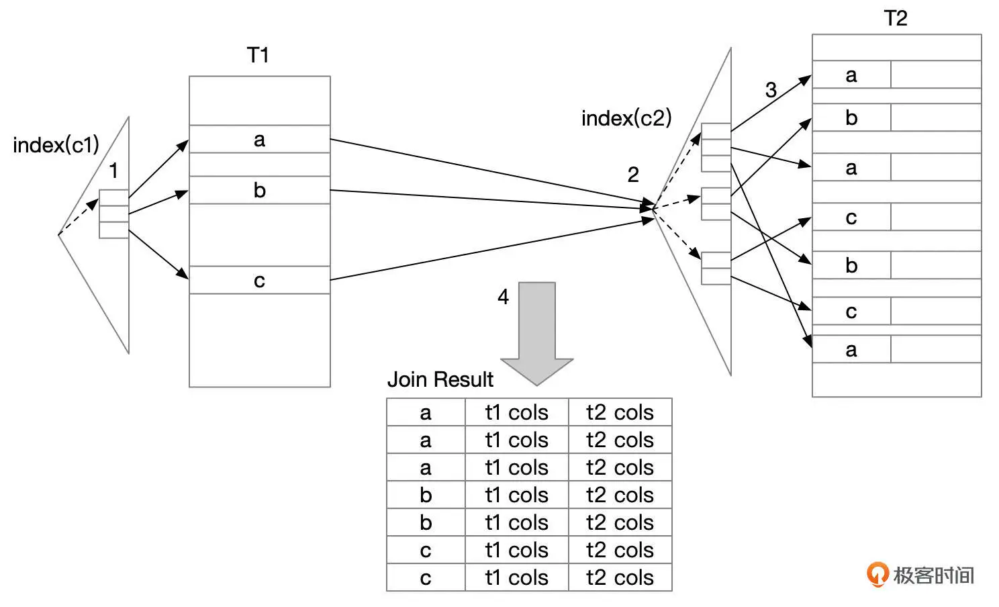
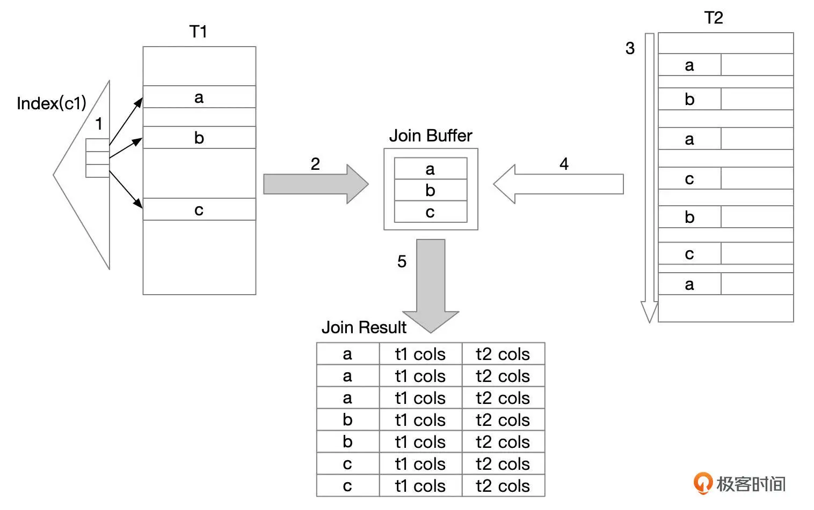
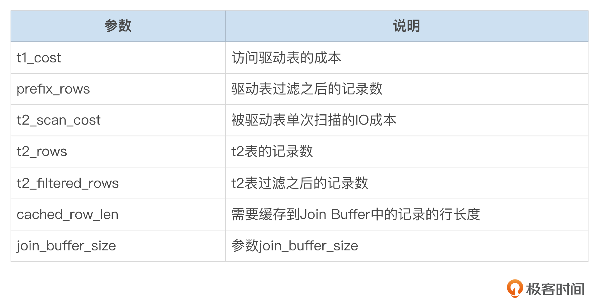
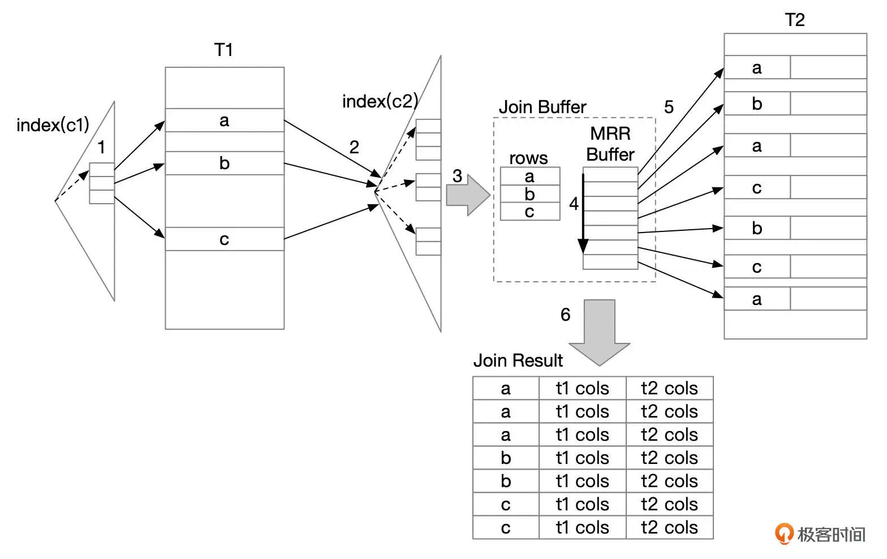
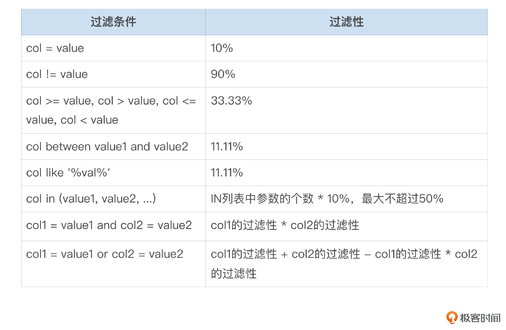
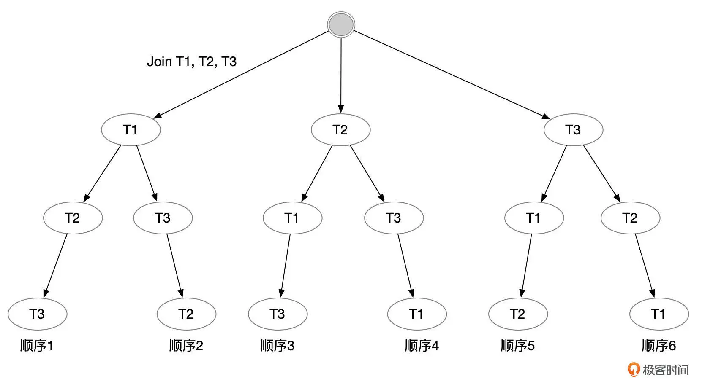
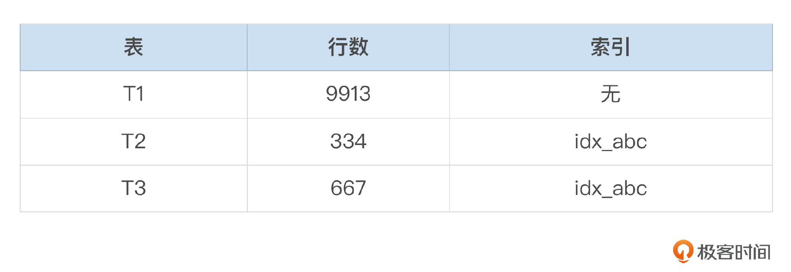
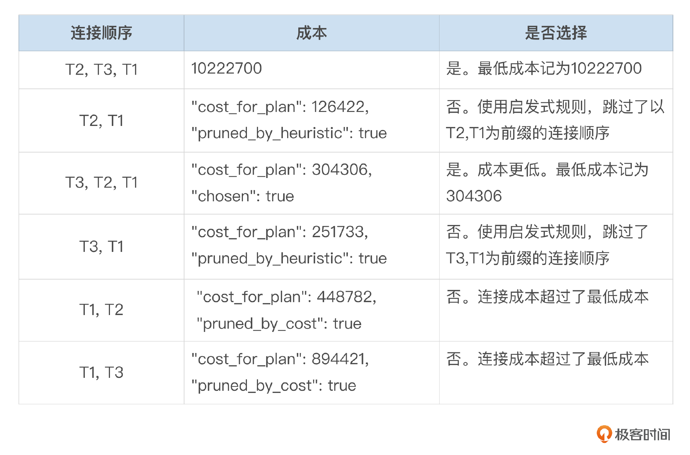
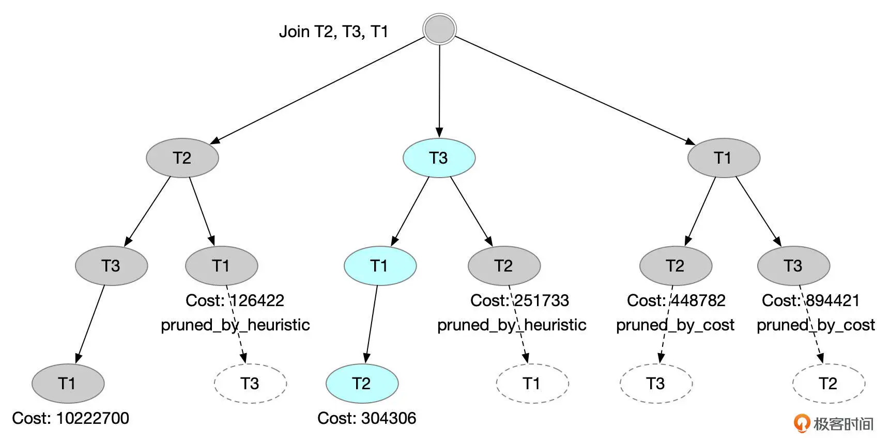

# 21 | 表连接如何执行？

你好，我是俊达。

这一讲我们来聊一聊 MySQL 中的表连接是怎么执行的。

从功能或语法上来看，表连接有内连接（Inner Join）和外连接（Outer Join）。外连接又包括左连接（Left Outer Join）、右连接（Right Outer Join）、全外连接（Full Outer Join）。此外，还有半连接（Semi Join）、反连接（Anti Join），这些连接方式会在 in、not in、exists、notexists 等查询中使用。

不管是哪种连接，在实现层面上，MySQL 会使用嵌套循环连接或哈希连接这两大类算法，它们有着不同的执行方式，以及不同的成本计算方法。执行多表连接时，优化器还需要选择最佳的连接顺序。对于内连接，优化器可以自动选择表的连接顺序，以最低的成本来执行 SQL。对于外连接，修改表的连接顺序会影响查询的结果，因此优化器不能随意调整表的顺序。

MySQL 中还有一种特殊的连接方式——STRAIGHT_JOIN，使用 STRAIGHT_JOIN 时，连接顺序是固定的。

对于已经确定连接顺序的两个表，MySQL 有几种算法来实现表连接。

- 嵌套循环（Nested-Loop）

嵌套循环是 MySQL 中最早支持的连接算法。当驱动表中需要参与关联的记录较少，并且可以使用选择性较高的索引查找到被驱动表的关联记录时，使用嵌套循环效率很高。

- 块嵌套循环（Block Nested-Loop）

如果被驱动表缺少相关的索引，使用普通的嵌套循环算法时，对于驱动表中的每一行记录，都需要全表扫描一次被驱动表，因此性能会很差。块嵌套循环算法引入了 Join Buffer，执行表连接时，先将驱动表中的一批数据缓存到 Join Buffer 中。全表扫描一次被驱动表时，可以跟Join Buffer 中的所有记录进行关联，以此来减少被驱动表的全表扫描次数。MySQL 从 8.0.20版本开始已经废除了块嵌套循环算法，转而使用哈希连接算法。

- 哈希连接（Hash Join）

哈希连接从块嵌套循环连接算法中进化而来。使用哈希连接算法时，先将驱动表的数据以哈希表的形式缓存到 Join Buffer 中。对于被驱动表中的每一行记录，使用哈希查找算法到 JoinBuffer 查找关联记录。在被驱动表缺少合适的索引时，使用哈希连接算法能极大提高查询的效率。

- Batched Key Access

普通嵌套循环连接算法中，通常不是按 ROWID 的顺序回表查找数据，这样可能会带来大量的随机 IO，而在数据库中，大量的随机 IO 会影响查询的性能。和单表 MRR 访问路径类似，使用 Batched Key Access 连接算法时，会先将需要回表查询的记录的 ROWID 缓存到 JoinBuffer 中并进行排序，排序之后按 ROWID 的顺序回表查找数据，在一些特定的场景下，按ROWID 顺序回表访问数据可能会提高一些性能。

接下来我们分别介绍这几种连接算法的实现方式。

## 表连接算法详解

### 嵌套循环连接（Nested-Loop）

对于类似下面的 SQL：

```sql
select *
from t1, t2
where t1.c1 = 'xx'
and t1.c2 = t2.c2
and ...
```

如果满足下面 2 个条件，就有可能使用以 t1 表为驱动表的嵌套循环连接算法。

1. T2 表的关联字段 C2 上建有索引，索引过滤性比较高。

2. T1 表满足其他过滤条件的记录数不多。如果 T1 表的其他过滤字段如 C1 上有索引并且过滤性较高，则查询的性能更高。

嵌套循环连接大致分为下面这几个执行步骤：

1. 使用驱动表 T1 上的过滤条件定位到满足条件的记录。

2. 对于步骤 1 筛选出来的每一行记录，查找 T2 表。

3. 使用 T2 表其它过滤条件以及 T1 表的关联条件，从 T2 表获取数据。

4. 将表连接的结果发送给客户端。这里，MySQL 默认不需要将表连接的结果记录到临时表。而是每关联完成一行记录，就将记录发送给客户端。



我们来看一个例子，这里仍然用了 18 讲中创建的 tab 表，但是 analyze table 后，统计信息有一点区别。

```sql
mysql> select * from mysql.innodb_table_stats where table_name = 'tab'\G
*************************** 1. row ***************************
          database_name: rep
             table_name: tab
            last_update: 2024-08-29 14:33:43
                 n_rows: 9900
   clustered_index_size: 161
sum_of_other_index_sizes: 15
mysql> show indexes from tab;
+------------+----------+--------------+-------------+-------------+
| Non_unique | Key_name | Seq_in_index | Column_name | Cardinality |
+------------+----------+--------------+-------------+-------------+
|          0 | PRIMARY  |            1 | id          |        9900 |
|          1 | idx_abc  |            1 | a           |           3 |
|          1 | idx_abc  |            2 | b           |        9900 |
|          1 | idx_abc  |            3 | c           |        9900 |
+------------+----------+--------------+-------------+-------------+
```

我们来看一个具体的例子，explain 加上了 format=tree，这样更直观一点。

```sql
mysql> explain format=tree select *
   from tab t1, tab t2
   where t1.b between 1 and 100
   and t1.a = t2.a\G
*************************** 1. row ***************************
EXPLAIN:
-> Nested loop inner join  (cost=496805.68 rows=3629637)
   -> Filter: (t1.b between 1 and 100)  (cost=1030.25 rows=1100)
       -> Table scan on t1  (cost=1030.25 rows=9900)
   -> Index lookup on t2 using idx_abc (a=t1.a)  (cost=121.05 rows=3300)
```

从优化器跟踪里可以看到，驱动表访问成本为 1030.25，被驱动表 T2 的访问成本为495775，总成本为 496806。

```
"best_access_path": {
   "considered_access_paths": [
     {
       "rows_to_scan": 9900,
       "filtering_effect": [
       ],
       "final_filtering_effect": 0.1111,
       "access_type": "scan",
       "resulting_rows": 1099.89,
       "cost": 1030.25,
       "chosen": true
     }
   ]
 },
 "condition_filtering_pct": 100,
 "rows_for_plan": 1099.89,
 "cost_for_plan": 1030.25,
 "rest_of_plan": [
   {
     "plan_prefix": [
       "`tab` `t1`"
     ],
     "table": "`tab` `t2`",
     "best_access_path": {
       "considered_access_paths": [
         {
           "access_type": "ref",
           "index": "idx_abc",
           "rows": 3300,
           "cost": 495775,
           "chosen": true
         }
       ]
     },
     "condition_filtering_pct": 100,
     "rows_for_plan": 3.62964e+06,
     "cost_for_plan": 496806,
     "chosen": true
   }
 ]
},
```

嵌套循环连接成本可以用下面这个公式表示：

总成本 = 驱动表访问成本 + 驱动表过滤后记录数 * 被驱动表访问成本

在我们的测试例子中，驱动表访问成本为全表扫描的成本，使用 19 讲中的计算公式计算。

```
>>> scan_cost(pages=161, rows=9900, in_mem_pct=1)
1030.25
```

嵌套循环需要执行多少次呢？根据驱动的过滤条件来估算，条件 b between 1 and 100 中，字段 b 缺少相关索引，MySQL 认为这个条件的过滤性为 0.1111，因此满足条件的记录数为9900 * 0.1111 = 1099.89。关于不同条件的过滤性，后续会做一些介绍。

被驱动表使用索引 idx_abc 做 ref 访问，由于使用了表连接，访问行数通过统计信息计算，为9900/3 = 3300。ref 访问路径的成本使用 20 讲中的公式计算。

```
>>> ref_cost_normal_index(rows=3300, n_rows=9900, clustered_index_size=161, in_me
120.75
```

关联查询的总成本由下面这段 Python 代码来计算。

```python
def join_cost(t1_cost, t1_filtered_rows, t2_io_cost, t2_filtered_rows):
   t2_cost = t2_io_cost + row_eval_cost(t2_filtered_rows)
   result = t1_cost + t1_filtered_rows * t2_cost
   return result
```

由此得到查询的总成本。

```
>>> t1_filetered_rows = 9900 * 0.1111
>>> t2_filtered_rows = 9900.0/3
>>> join_cost(t1_cost=1030.25, t1_filtered_rows=t1_filetered_rows, \
   t2_io_cost=120.75, t2_filtered_rows=t2_filtered_rows)
496805.66750000004
```

### 基于块的嵌套循环（Block Nested-Loop，BNL）

如果被驱动表没有合适的索引可用，在老的版本中，会使用基于块的嵌套循环算法。基于块的嵌套循环算法执行过程大致如下：

1. 查找驱动表中满足条件的记录。

2. 将从步骤 1 得到的记录缓存到 Join Buffer 中。Join buffer 的大小由参数 join_buffer_size 控制。

3. 全表扫描被驱动表。如果被驱动表上有其他过滤条件，则先进行过滤。

4. 将从步骤 3 获取的记录和 Join Buffer 中的记录做匹配。

5. 将步骤 4 匹配到的记录返回给客户端。

如果驱动表中满足条件的记录太多，无法一次性全部缓存到 Join Buffer 中，还需要分批处理。



MySQL 8.0.20 版本之后，实际上已经不会再使用基于块的嵌套循环算法。下面的执行计划是在 5.7.41 的版本中执行得到（输出中去掉了不相关的列）。

```sql
mysql> explain select * from tab t1, tab t2
   where t1.b between 1 and 100
 and  t1.c = t2.c
 and t2.padding like '%x%';
+----+-------------+-------+------+------+----------+----------------------------
| id | select_type | table | type | rows | filtered | Extra
+----+-------------+-------+------+------+----------+----------------------------
|  1 | SIMPLE      | t1    | ALL  | 9755 |    11.11 | Using where
|  1 | SIMPLE      | t2    | ALL  | 9755 |     1.11 | Using where; Using join buf
+----+-------------+-------+------+------+----------+----------------------------
```

注意到上面执行计划中 Extra 列中显示的“Using join buffer (Block Nested Loop) ”。优化器参数 optimizer_switch 中的选项 block_nested_loop 用来控制是否开启 BNL，该选项默认为ON。

### 哈希连接

MySQL 8.0.20 版本开始废弃了对 BNL 的支持，原先使用 BNL 的查询转而使用哈希连接，同时 optimizer_switch 中的选项 hash_join 也不再起作用了。使用和上一节同样的 SQL，在 8.0中执行显示使用 Hash Join，这里使用 format=tree：

```sql
mysql> explain format =tree select * from tab t1, tab t2
   where t1.b between 1 and 100
   and  t1.c = t2.c
   and t2.padding like '%x%'\G
EXPLAIN:
-> Inner hash join (t2.c = t1.c)  (cost=122234.57 rows=1344)
   -> Filter: (t2.padding like '%x%')  (cost=99.21 rows=110)
       -> Table scan on t2  (cost=99.21 rows=9900)
   -> Hash
       -> Filter: (t1.b between 1 and 100)  (cost=1030.25 rows=1100)
           -> Table scan on t1  (cost=1030.25 rows=9900)
```

从 optimizer trace 中，可以看到 using_join_cache 为 true，buffers_needed 是需要填充 JoinBuffer 的次数，这是由驱动表中满足条件的记录数、行长度，以及 join_buffer_size 的设置决定的。我们的测试环境中，join_buffer_size 使用了默认的 256K。

```json
{
 "considered_execution_plans": [
   {
     "plan_prefix": [
     ],
     "table": "`tab` `t1`",
     "best_access_path": {
       "considered_access_paths": [
         {
           "rows_to_scan": 9900,
           "filtering_effect": [
           ],
           "final_filtering_effect": 0.1111,
           "access_type": "scan",
           "resulting_rows": 1099.89,
           "cost": 1030.25,
           "chosen": true
         }
       ]
     },
     "condition_filtering_pct": 100,
     "rows_for_plan": 1099.89,
     "cost_for_plan": 1030.25,
     "rest_of_plan": [
       {
         "plan_prefix": [
           "`tab` `t1`"
         ],
         "table": "`tab` `t2`",
         "best_access_path": {
           "considered_access_paths": [
             {
               "rows_to_scan": 9900,
               "filtering_effect": [
               ],
               "final_filtering_effect": 0.1111,
               "access_type": "scan",
               "using_join_cache": true,
               "buffers_needed": 118,
               "resulting_rows": 1099.89,
               "cost": 230083,
               "chosen": true
             }
           ]
         },
         "condition_filtering_pct": 10,
         "rows_for_plan": 120976,
         "cost_for_plan": 231113,
         "chosen": true
       }
     ]
   }
```

### 哈希连接成本计算

哈希连接的成本包括几个部分：

1. 访问驱动表的成本。

2. 访问被驱动表的成本。

哈希连接时，被驱动表可能需要扫描多次，扫描次数主要由驱动表结果集的大小和 Join Buffer的大小决定。访问被驱动表的成本主要包括 IO 成本和行评估成本。如果被驱动表上有额外的过滤条件，则在这一步可以先滤掉一部分记录。

3. 连接的成本

连接的成本主要是行评估成本。在步骤 2 中已经过滤掉的记录不需要参与表连接，因此连接成本根据步骤 2 过滤之后的记录数来计算。

哈希连接的成本可以使用以下 Python 代码来计算。

```python
def hash_join_cost(t1_cost,
   prefix_rows,
   t2_scan_cost,
   t2_rows,
   t2_filtered_rows,
   cached_row_len,
   join_buffer_size
):
   buffer_cnt = 1.0 + 1.0 * cached_row_len * prefix_rows / join_buffer_size
   t2_scan_cost_all = buffer_cnt * t2_scan_cost
   t2_row_eval_cost = buffer_cnt * row_eval_cost(t2_rows - t2_filtered_rows)
   join_row_eval_cost = row_eval_cost(prefix_rows * t2_filtered_rows)
   result = t1_cost + t2_scan_cost_all + t2_row_eval_cost + join_row_eval_cost
   return result
```

函数 hash_join_cost 参数的含义我整理成下面这个表格，供你参考。



在我们的测试环境中，驱动表全表扫描访问成本为 1030.25，驱动表过滤性为 0.1111。被驱动表单次扫描 IO 的成本为 40.25。被驱动表总记录数为 9900，被驱动表过滤性为 0.1111。驱动表整行记录都需要缓存到 Join Buffer 中，单行记录的长度为 28019，join_buffer_size 为256K，因此查询的总成本为 231112.789595233。

```
>>> hash_join_cost(1030.25,
    prefix_rows=9900 * 0.1111,
    t2_scan_cost=40.25,
    t2_rows=9900,
    t2_filtered_rows=9900*0.1111,
    cached_row_len=28019,
    join_buffer_size=256*1024)
231112.789595233
```

这里行长度是根据表结构来计算的，4 个整数字段长度固定，varchar 字段按定义的长度计算。

```
mysql> desc tab;
+---------+---------------+------+-----+---------+-------+
| Field   | Type          | Null | Key | Default | Extra |
+---------+---------------+------+-----+---------+-------+
| id      | int           | NO   | PRI | NULL    |       |
| a       | int           | NO   | MUL | NULL    |       |
| b       | int           | NO   |     | NULL    |       |
| c       | int           | NO   |     | NULL    |       |
| padding | varchar(7000) | YES  |     | NULL    |       |
+---------+---------------+------+-----+---------+-------+
```

### 非等值哈希连接

我们知道哈希表只支持等值查找。但是在下面的例子中，连接条件为 t1.c > t2.c，可以看到也使用了哈希连接（注意 Extra 中显示的“Using join buffer (hash join)”）。

```sql
mysql> explain select * from tab t1, tab t2
   where t1.b between 1 and 100 and t1.c > t2.c;
+----+-------------+-------+------+------+----------+----------------------------
| id | select_type | table | type | rows | filtered | Extra
+----+-------------+-------+------+------+----------+----------------------------
|  1 | SIMPLE      | t1    | ALL  | 9900 |    11.11 | Using where
|  1 | SIMPLE      | t2    | ALL  | 9900 |    33.33 | Using where; Using join buf
+----+-------------+-------+------+------+----------+----------------------------
```

实际上，在这种情况下，是先做了一个不带关联条件的笛卡尔连接，然后再对结果数据进行过滤。使用 explain format=tree 可以更清楚地看到这一点，注意执行计划中显示的“Inner hashjoin (no condition)”。

```sql
mysql> explain format=tree select * from tab t1, tab t2
        where t1.b between 1 and 100 and t1.c > t2.c\G
*************************** 1. row ***************************
EXPLAIN:
-> Filter: (t1.c > t2.c)  (cost=1094693.45 rows=3629274)
   -> Inner hash join (no condition)  (cost=1094693.45 rows=3629274)
       -> Table scan on t2  (cost=4.64 rows=9900)
       -> Hash
           -> Filter: (t1.b between 1 and 100)  (cost=1030.25 rows=1100)
               -> Table scan on t1  (cost=1030.25 rows=9900)
```

### BKA（Blocked Key Access）

单表 range 查询时，可以使用 MRR 优化，先对 rowid 进行排序，然后再回表查询数据。在表关联的时候，也可以使用类似的优化方法，先根据关联条件取出被关联表的 rowid，将 rowid缓存在 join buffer 中，对 rowid 进行排序后，再回表获取数据。

使用 BKA 算法时，会用到 Join Buffer。BKA 连接算法的执行过程大致如下：

1. 从驱动表中读取满足条件的记录。

2. 将步骤 1 读取的 1 行记录缓存到 Join Buffer 中。

3. 评估驱动表的 1 行记录占用的内存，以及通过这 1 行记录能关联到的被驱动表的记录ROWID 占用的空间。

如果 join buffer 空间够用，则继续往 join buffer 中加入驱动表的记录。否则，分配 MRRbuffer，执行下一步骤。MRR Buffer 分配的空间为 join_buffer_size 减去步骤 2 缓存的行占用的空间。

1. 根据缓存的驱动表的记录，扫描被驱动表的索引，将记录的 rowid 缓存到 MRR buffer 中。将 MRR buffer 内的 rowid 进行排序。

2. 按 ROWID 的顺序到被驱动表获取数据。

3. 关联数据，并将关联后的数据返回给客户端。



和单表 MRR 优化类似，表关联时使用 BKA 优化有一些前提条件：

1. 被驱动表的关联字段存在二级索引。如果使用被驱动表的关联条件是主键，则不会采用BKA 优化。

2. 需要回表访问被关联表。如果在查询中，被驱动表访问的字段都在索引中，不需要回表，则不会采用 BKA 优化。

3. optimizer_switch 参数中，开启 batched_key_access 选项和 mrr 选项。batched_key_access 默认为 OFF。

4. optimizer_switch 参数中，将 mrr_cost_based 设置为 OFF。目前对优化器对 MRR 成本评估比较保守，因此开启 mrr_cost_based 时，MRR 执行计划的成本很可能比普通的嵌套循环还要高。

我们可以在查询中加上 BKA 或 MRR 提示，强制走 BKA 执行计划。

```sql
mysql> explain select /*+ BKA(t2) */ *
   from tab t1, tab t2
   where t1.b between 1 and 100
   and t1.a = t2.a;
+----+-------------+-------+------+---------------+---------+---------+----------
| id | select_type | table | type | possible_keys | key     | key_len | ref
+----+-------------+-------+------+---------------+---------+---------+----------
|  1 | SIMPLE      | t1    | ALL  | idx_abc       | NULL    | NULL    | NULL
|  1 | SIMPLE      | t2    | ref  | idx_abc       | idx_abc | 4       | rep.t1.a
+----+-------------+-------+------+---------------+---------+---------+----------
```

BKA 的成本计算比较复杂，这里就不详细展开了。

## 条件过滤（Condition Filtering）

优化器在计算表的连接顺序时，需要评估每个表有多少行记录满足条件，这决定了有多少行记录会参与到后续的连接操作中。行数评估是否精确，会影响优化器是否能获取一个性能良好的执行计划。如果字段上有索引，MySQL 可以使用 Index Dive 机制或者表和索引的统计信息来评估行数。如果字段没有建索引，MySQL 会使用一些固定的规则来预估满足条件的记录数，这也称为条件过滤。

我们用几个简单的 SQL 来观察下条件过滤的一些情况。

tab 表中没有以字段 C 开头的索引，下面的查询使用全表扫描，过滤条件 C=1 的过滤性为10%。

```sql
mysql> explain select * from tab where c = 1;
+----+-------------+-------+------+------+----------+-------------+
| id | select_type | table | type | rows | filtered | Extra       |
+----+-------------+-------+------+------+----------+-------------+
|  1 | SIMPLE      | tab   | ALL  | 9900 |    10.00 | Using where |
+----+-------------+-------+------+------+----------+-------------+
```

下面的 SQL 使用了索引，但是字段 C 不在索引的前缀中，因此只用到了索引字段 A。过滤性根据条件 C=1 计算，为 10%。

```sql
mysql> explain select * from tab where a = 1 and c = 1;
+----+-------------+-------+------+---------------+---------+---------+-------+--
| id | select_type | table | type | possible_keys | key     | key_len | ref   | r
+----+-------------+-------+------+---------------+---------+---------+-------+--
|  1 | SIMPLE      | tab   | ref  | idx_abc       | idx_abc | 4       | const | 3
+----+-------------+-------+------+---------------+---------+---------+-------+--
```

这是另外一个例子，使用不等于条件，过滤性为 90%。

```sql
mysql> explain select * from tab where c != 1;
+----+-------------+-------+------+------+----------+-------------+
| id | select_type | table | type | rows | filtered | Extra       |
+----+-------------+-------+------+------+----------+-------------+
|  1 | SIMPLE      | tab   | ALL  | 9900 |    90.00 | Using where |
+----+-------------+-------+------+------+----------+-------------+
```

下面的表格总结了一些常见场景下的过滤性，你可以看一下。



### 直方图

默认情况下，MySQL 并不知道表中数据的分布情况，因此在估算条件的过滤性时可能会存在较大的偏差。比如下面这个查询，按默认的规则，预估查询返回的记录数为 2970 行。

```sql
mysql> explain select * from tab where b  in (1,2,3);
+----+-------------+-------+------+------+----------+-------------+
| id | select_type | table | type | rows | filtered | Extra       |
+----+-------------+-------+------+------+----------+-------------+
|  1 | SIMPLE      | tab   | ALL  | 9900 |    30.00 | Using where |
+----+-------------+-------+------+------+----------+-------------+
mysql> explain format=tree select * from tab where b  in (1,2,3)\G
*************************** 1. row ***************************
EXPLAIN:
-> Filter: (tab.b in (1,2,3))  (cost=1030.25 rows=2970)
   -> Table scan on tab  (cost=1030.25 rows=9900)
```

但实际上，只有 3 行记录满足条件。

```sql
mysql> select count(*) from tab where b in (1,2,3);
+----------+
| count(*) |
+----------+
|        3 |
+----------+
```

这种情况下，可以收集字段的直方图，以得到更精确的行数评估。

```sql
mysql> analyze table tab UPDATE HISTOGRAM ON b;
+---------+-----------+----------+----------------------------------------------+
| Table   | Op        | Msg_type | Msg_text                                     |
+---------+-----------+----------+----------------------------------------------+
| rep.tab | histogram | status   | Histogram statistics created for column 'b'. |
+---------+-----------+----------+----------------------------------------------+
```

收集字段 B 上的直方图后，查询获得了更精确的记录数。

```sql
mysql> explain format=tree select * from tab where b  in (1,2,3)\G
*************************** 1. row ***************************
EXPLAIN:
-> Filter: (tab.b in (1,2,3))  (cost=1030.25 rows=10)
   -> Table scan on tab  (cost=1030.25 rows=9900)
```

这里预估的记录数为 10，和真实的记录数有一些差距，但是比收集直方图之前的评估要准确多了。

在单表查询中，是否使用条件过滤对执行计划的影响并不大。但是在多表连接的查询中，条件过滤可能会影响执行计划。我们可以使用 optimizer_switch 中的 condition_fanout_filter 选项来控制是否开启条件过滤计算。

下面这个例子中，关闭了 condition_fanout_filter 选项，查询的过滤性就变成了 100%。

```sql
mysql> set optimizer_switch='condition_fanout_filter=off';
Query OK, 0 rows affected (0.01 sec)
mysql> explain select * from tab where b=10;
+----+-------------+-------+------+------+----------+-------------+
| id | select_type | table | type | rows | filtered | Extra       |
+----+-------------+-------+------+------+----------+-------------+
|  1 | SIMPLE      | tab   | ALL  | 9900 |   100.00 | Using where |
+----+-------------+-------+------+------+----------+-------------+
```

## 表连接顺序如何确定

确定合适的表连接顺序是优化器的一项重要工作。如果 SQL 中使用了外连接或STRAIGHT_JOIN，则相关的两个表的连接顺序已经固定，优化器不能调节表的连接顺序。对于普通的表连接（自然连接、内连接），优化器需要评估不同连接顺序的成本，并从中选择成本最低的执行计划。

N 个表的连接有 N 的阶乘种可能的连接顺序。比如 3 个表的连接有 6 种连接顺序，5 个表的连接有 120 种连接顺序，10 个表的连接有 3628800 种连接顺序。随着表数量的增加，连接顺序的数量呈指数增长，从其中选择最佳连接顺序的成本也相应成指数级增长。MySQL 使用深度优先搜索算法来确定表的连接顺序，在搜索过程中使用了一些规则，以减少评估表连接顺序消耗的时间，同时还能得到最优或接近最优的连接顺序。

优化器大致上使用下面这几个步骤来确定表的连接顺序。

1. 解析 SQL，单独评估 SQL 中每个表的访问成本。

优化器首先对查询中的每个表进行初步评估，包括表的行数、扫描成本。如果有可用的索引，还需要评估索引访问的记录数和成本。

2. 根据步骤 1 分析的结构，对表进行初步排序。

步骤 1 中已经得到了每个表的记录数和通过索引访问的记录数。这一步根据需要访问的记录数进行排序，记录数少的表排在前。

3. 使用深度优先搜索算法，得到最佳的连接顺序。

假设从步骤 2 得到表的顺序为 T1，T2，T3，总共有 6 种可能的连接顺序。按下图显示的顺序依次评估表连接成本：



先计算顺序 1（T1, T2, T3）的连接成本，将得到的成本记为执行计划的最低成本。然后依次评估其它几种连接顺序的成本，得到成本最低的连接顺序。在搜索表连接顺序时，实际上并不会穷举每一个可能的顺序，在一些情况下可以减少搜索的空间。

1. 对一个特定的连接顺序，如果前面几个表的连接成本已经超过最低的访问成本，则不需要再评估以这几个表开头的连接顺序。例如在评估 T2 开头这个连接顺序时，如果访问 T2 表对成本比之前得到的最低成本还要高，就不需要再评估 T2,T1,T3 和 T2,T3,T1 这几种连接顺序了。

2. 参数 optimizer_search_depth 设置了搜索的最大深度。可以通过参数optimizer_search_depth 来限制搜索深度。比如对于 20 个表的连接，需要评估的顺序数为20 的阶乘，这是一个非常巨大的数字。如果将 optimizer_search_depth 设置为 10，可以将评估的顺序数限制到 20*10 的阶乘以内。限制搜索深度可以减少用来评估表连接顺序的时间，但是也可能会错过最佳的连接顺序。如果你不确定如何设置该参数，可以尝试将optimizer_search_depth 设置为 0，优化器会自动选择一个合适的值。

3. 使用一些启发式规则跳过一些看起来不太有前景的连接顺序。优化器还使用了一些启发式的规则，来跳过一些看起来不太好的连接顺序。当然这有可能错过最佳的连接顺序，但是可以减少生成执行计划的时间。可以通过参数 optimizer_prune_level 来控制是否使用启发式规则。该参数默认为 ON。如果你觉得因为使用了启发式规则导致优化器选项了不佳的连接顺序，可以尝试关闭该选项。

下面我们用一个简单的例子来观察优化器如何选择表的连接顺序。

```sql
mysql> explain
    select * from tab t1, tab t2, tab t3
    where t1.c = t2.c
    and t2.b = t3.b
    and t1.c in (10,20,30)
    and t2.b between 1000 and 2000
    and t2.a = 2
    and t3.a > 1 and t3.a <=2;
+----+-------------+-------+-------+---------+------+----------+-----------------
| id | select_type | table | type  | key     | rows | filtered | Extra
+----+-------------+-------+-------+---------+------+----------+-----------------
|  1 | SIMPLE      | t3    | range | idx_abc |  667 |   100.00 | Using index cond
|  1 | SIMPLE      | t2    | ref   | idx_abc |    1 |   100.00 | Using index cond
|  1 | SIMPLE      | t1    | ALL   | NULL    | 9913 |     3.00 | Using where; Usi
+----+-------------+-------+-------+---------+------+----------+-----------------
```

从 optimizer trace 中可以观察到优化的过程：

1. 单独评估每个表的行数和索引（查看 optimizer trace 中 rows_estimation 部分）

- T1 表

T1 表的条件为 t1.c in (10,20,30)，无可用索引，访问记录数为 9913。

```json
{
 "table": "`tab` `t1`",
 "table_scan": {
   "rows": 9913,
   "cost": 40.25
 }
}
```

- T2 表

T2 表的条件为 t2.a = 2 and t2.b between 1000 and 2000，可以使用索引，访问记录数为334。

```
"chosen_range_access_summary": {
 "range_access_plan": {
   "type": "range_scan",
   "index": "idx_abc",
   "rows": 334,
   "ranges": [
     "a = 2 AND 1000 <= b <= 2000 AND 10 <= c <= 30"
   ]
 },
 "rows_for_plan": 334,
 "cost_for_plan": 117.16,
 "chosen": true
}
```

- T3 表

T3 表的条件为 t3.a > 1 and t3.a <=2，可以使用索引。访问记录数为 667。

```
"chosen_range_access_summary": {
  "range_access_plan": {
    "type": "range_scan",
    "index": "idx_abc",
    "rows": 667,
    "ranges": [
      "1 <= a <= 2 AND b <= 2000"
    ]
  },
  "rows_for_plan": 667,
  "cost_for_plan": 233.71,
  "chosen": true
}
```

2. 确定表的初始连接顺序。



表的初始连接顺序为 T2，T3，T1。

3. 搜索最佳连接顺序。

可以从 optimizer trac 中的 considered_execution_plans 中观察表连接顺序的评估过程。



下面就是这个查询连接顺序评估过程的一个示意图。



## 总结

这一讲中，我们学习了 MySQL 中表连接的几种方法。

优化器会评估不同的连接顺序和连接方法的成本，从中选择一个成本最低的执行计划。在有些情况下，优化器选择的执行计划，在执行时并不是效率最高的，这时就需要我们分析 SQL 中相关表的索引结构和统计信息，查看表的数据分布情况，想办法让优化器选择效率更高的执行计划。子查询、半连接 (Semi Join)、反连接（Anti Join）的内容呢，我们放到下一节课再讨论。

## 思考题

最后来看一个表连接的例子，先创建一个测试表，写入 10000 行数据。

```sql
create table t_jointab(
 id int not null auto_increment,
 a int not null,
 b int not null,
 c varchar(4000),
   primary key(id),
   key idx_a(a)
) engine=innodb charset utf8mb4;
insert into t_jointab(a,b,c)
select case when n < 9000 then n else 9000 end as a,
   n % 1000, rpad('x', 2000, 'ABCD')
from numbers where n < 10000;
```

收集并查看统计信息。

```
mysql> analyze table t_jointab;
+---------------+---------+----------+----------+
| Table         | Op      | Msg_type | Msg_text |
+---------------+---------+----------+----------+
| rep.t_jointab | analyze | status   | OK       |
+---------------+---------+----------+----------+
1 row in set (0.62 sec)
mysql> show indexes from t_jointab;
+------------+----------+--------------+-------------+-------------+
| Non_unique | Key_name | Seq_in_index | Column_name | Cardinality |
+------------+----------+--------------+-------------+-------------+
|          0 | PRIMARY  |            1 | id          |        8580 |
|          1 | idx_a    |            1 | a           |        8580 |
+------------+----------+--------------+-------------+-------------+
```

我们来看一下这个 SQL 的执行计划，使用了嵌套循环。

```sql
mysql> explain format=tree
   select count(*)
   from t_jointab t1, t_jointab t2
   where t1.a = t2.a and t1.b = t2.b\G
*************************** 1. row ***************************
EXPLAIN:
-> Aggregate: count(0)  (cost=5079.75 rows=1)
   -> Nested loop inner join  (cost=4221.75 rows=8580)
       -> Table scan on t1  (cost=1218.75 rows=8580)
       -> Filter: (t2.b = t1.b)  (cost=0.25 rows=1)
           -> Index lookup on t2 using idx_a (a=t1.a)  (cost=0.25 rows=1)
```

上面这个执行计划看上去没什么大问题，但是在我的环境中，执行消耗了 1 分多的时间。

```sql
mysql> select count(*)
  from t_jointab t1, t_jointab t2
  where t1.a = t2.a and t1.b = t2.b;
+----------+
| count(*) |
+----------+
|    10000 |
+----------+
1 row in set (1 min 19.29 sec)
```

查看慢日志发现，这个语句的 Rows_examined 比较高，有 100 多万。

```sql
# Query_time: 79.285872  Lock_time: 0.000036 Rows_sent: 1  Rows_examined: 1019000
SET timestamp=1724921875;
select count(*)。
  from t_jointab t1, t_jointab t2
  where t1.a = t2.a and t1.b = t2.b;
```

请你分析一下，这个 SQL 执行比较慢的原因是什么？ 有哪些可能的优化方案（前提是不能修改表里的数据）？

期待你的思考，欢迎在留言区中与我交流。如果今天的课程让你有所收获，也欢迎转发给有需要的朋友。我们下节课再见！
