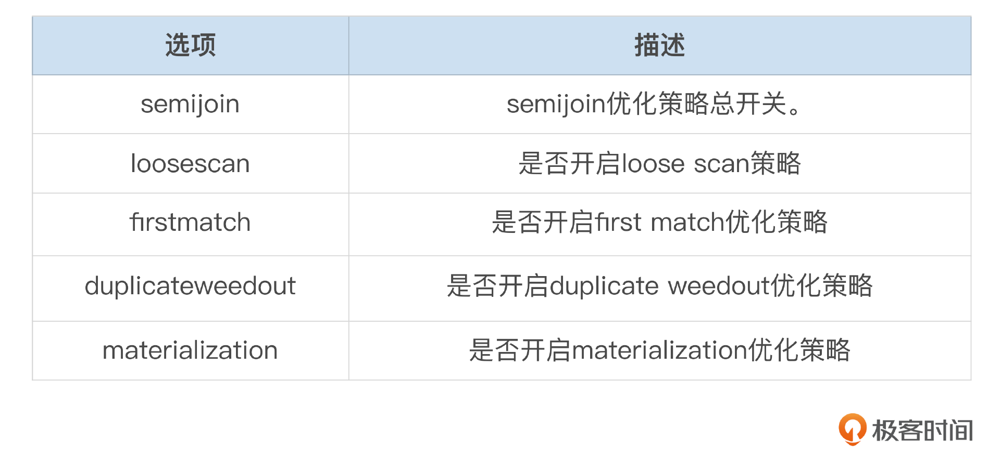

# 22 | MySQL子查询优化策略

你好，我是俊达。

这一讲，我们来讨论子查询的一些优化策略。子查询是 SQL 很重要的一个能力，平时也不少见。

## 子查询的一个例子

早期 MySQL（5.5 以及更早的版本）对子查询的支持比较弱，使用子查询时容易遇到性能问题。

在 13 讲的思考题中，就有一个执行了几天都没有完成的 SQL。

```sql
Command: Query
Time: 184551
State: Sending data
Info: select item_id, sum(sold) as sold
     from stat_item_detail
     where item_id in (
          select item_id
          from stat_item_detail
          where gmt_create >= '2019-10-05 08:59:00')
     group by item_id
```

上面这个 SQL 语句并不复杂，我们来构建一个测试表，准备一些数据，并做一些测试。使用下面这段 SQL 创建表，并写入 100 万行数据。

```sql
create table stat_item_detail(
   id int not null auto_increment,
   item_id int not null,
   sold int not null,
   gmt_create datetime not null,
   padding varchar(4000),
   primary key(id),
   key idx_item_id(item_id),
   key idx_gmt_create(gmt_create)
) engine=innodb;
create view digit
 as select 0 as a union all select 1 union all select 2 union all select 3
    union all select 4  union all select 5 union all select 6
    union all select 7  union all select 8 union all select 9 ;
create view numbers_1m AS
select ((((a.a * 10 + b.a)*10 + c.a)*10 + d.a)*10+e.a)*10+f.a as n
from digit a, digit b, digit c, digit d, digit e, digit f;
insert into stat_item_detail(item_id, sold, gmt_create, padding)
select n + 1000000 - n % 2 as item_id,
   n % 100 - n%100%2,
   date_add('2024-06-01 00:00:00', interval n minute) as gmt_create,
   rpad('x', 1000, 'abcdefg ') as padding
from numbers_1m;
```

当时用的还是 MySQL 5.1 和 5.5 的版本。我们先来看一下在 5.5 中这个 SQL 的执行计划。

```sql
mysql> explain select item_id, sum(sold) as sold
     from stat_item_detail
     where item_id in (
          select item_id
          from stat_item_detail
          where Gmt_create >= '2026-04-26 10:30:00')
     group by item_id;
+----+--------------------+------------------+----------------+------------------
| id | select_type        | table            | type           | possible_keys
+----+--------------------+------------------+----------------+------------------
|  1 | PRIMARY            | stat_item_detail | index          | NULL
|  2 | DEPENDENT SUBQUERY | stat_item_detail | index_subquery | idx_item_id,idx_g
+----+--------------------+------------------+----------------+------------------
```

从上面的这个执行计划可以看到，这个 SQL 在执行时，先全量扫描索引 idx_item_id，每得到一个 item_id 后，执行相关子查询（DEPENDENT SUBQUERY）select 1 fromstat_item_detail where gmt_create >= ‘2026-04-26 10:30:00’ and item_id = primary.item_id。当主查询中表中的数据量很大的时候，子查询执行的次数也会很多，因此 SQL 的性能非常差。

在我的测试环境中，执行这个 SQL 需要 45 秒左右。

```sql
mysql> select item_id, sum(sold) as sold
         from stat_item_detail
         where item_id in (
              select item_id
              from stat_item_detail
              where Gmt_create >= '2026-04-26 10:30:00')
         group by item_id;
+---------+------+
| item_id | sold |
+---------+------+
| 1999990 |  180 |
| 1999992 |  184 |
| 1999994 |  188 |
| 1999996 |  192 |
| 1999998 |  196 |
+---------+------+
5 rows in set (44.64 sec)
```

那么将 IN 改成 exists 后，是否能提升性能呢？我们来试一下，可以看到执行时间和使用 IN基本一样。

```sql
mysql> select item_id, sum(sold) as sold
from stat_item_detail t1
where exists (
   select 1
   from stat_item_detail
   where gmt_create >= '2026-04-26 10:30:00'
 and item_id = t1.item_id )
group by item_id;
+---------+------+
| item_id | sold |
+---------+------+
| 1999990 |  180 |
| 1999992 |  184 |
| 1999994 |  188 |
| 1999996 |  192 |
| 1999998 |  196 |
+---------+------+
5 rows in set (44.71 sec)
```

实际上，你会发现，不管是使用 IN 还是 Exists，执行计划都是一样的。

```sql
mysql> explain select item_id, sum(sold) as sold
    from stat_item_detail t1
    where exists (
        select 1
        from stat_item_detail
        where gmt_create >= '2026-04-26 10:30:00'
        and item_id = t1.item_id )
    group by item_id;
+----+--------------------+------------------+-------+---------------------------
| id | select_type        | table            | type  | possible_keys
+----+--------------------+------------------+-------+---------------------------
|  1 | PRIMARY            | t1               | index | NULL
|  2 | DEPENDENT SUBQUERY | stat_item_detail | ref   | idx_item_id,idx_gmt_create
+----+--------------------+------------------+-------+---------------------------
```

观察这个 SQL 最终返回的数据实际上并不多，因为子查询 select item_id fromstat_item_detail where gmt_create >= '2026-04-26 10:30:00’只需要返回最近写入的数据。

那么是不是可以先执行子查询呢？我们尝试改写一下 SQL。改写后，查询的效率提高了很多，但是查询的结果有点问题了。

```sql
mysql> select t1.item_id, sum(t1.sold) as sold
    from stat_item_detail t1, stat_item_detail t2
    where t1.item_id = t2.item_id
    and t2.gmt_create >= '2026-04-26 10:30:00'
    group by t1.item_id;
+---------+------+
| item_id | sold |
+---------+------+
| 1999990 |  360 |
| 1999992 |  368 |
| 1999994 |  376 |
| 1999996 |  384 |
| 1999998 |  392 |
+---------+------+
5 rows in set (0.00 sec)
```

问题出在哪里呢？因为子查询中，item_id 不是唯一的。改成普通的表连接后，数据有重复。因此我们需要对数据做一个去重。

```sql
select item_id, sum(sold) from (
   select distinct t1.item_id, t1.sold as sold, t2.sold as sold2
   from stat_item_detail t1, stat_item_detail t2
   where t1.item_id = t2.item_id
   and t2.gmt_create >= '2026-04-26 10:30:00'
) t group by item_id;
+---------+-----------+
| item_id | sum(sold) |
+---------+-----------+
| 1999990 |        90 |
| 1999992 |        92 |
| 1999994 |        94 |
| 1999996 |        96 |
| 1999998 |        98 |
+---------+-----------+
5 rows in set (0.00 sec)
```

但是，这样去重后，数据还是不对。因为主表中 item_id 是允许重复的，我们只需要对子查询中的 item_id 去重。将 SQL 改成下面这个样子，查询结果终于正确了，SQL 的效率也还不错。

```sql
mysql> select t1.item_id, sum(t1.sold) as sold
from stat_item_detail t1, (
 select distinct item_id
 from stat_item_detail t2
 where t2.gmt_create >= '2026-04-26 10:30:00') t22
where t1.item_id = t22.item_id
group by t1.item_id;
+---------+------+
| item_id | sold |
+---------+------+
| 1999990 |  180 |
| 1999992 |  184 |
| 1999994 |  188 |
| 1999996 |  192 |
| 1999998 |  196 |
+---------+------+
5 rows in set (0.00 sec)
```

实际上，我们还可以使用另外一种方法来去重，也就是按主表的主键字段来去重。

```sql
select item_id, sum(sold) from (
   select distinct t1.id,  t1.item_id, t1.sold as sold
   from stat_item_detail t1, stat_item_detail t2
   where t1.item_id = t2.item_id
   and t2.gmt_create >= '2026-04-26 10:30:00'
) t group by item_id;
+---------+-----------+
| item_id | sum(sold) |
+---------+-----------+
| 1999990 |       180 |
| 1999992 |       184 |
| 1999994 |       188 |
| 1999996 |       192 |
| 1999998 |       196 |
+---------+-----------+
5 rows in set (0.00 sec)
```

## MySQL 的半连接（SEMIJOIN）优化

MySQL 5.6 开始引入了半连接转换，对于前面例子中的 SQL，优化器会自动进行查询转换，不需要再手动改写 SQL 了。在 MySQL 5.6 和 5.7 中，还不会对 exists 做半连接优化。从MySQL 8.0.16 开始，优化器对 exists 子查询也会进行半连接转换。

在 8.0 的环境中执行这个 SQL，MySQL 自动把查询转换成了半连接。

```sql
mysql> explain select item_id, sum(sold) as sold
     from stat_item_detail
     where item_id in (
          select item_id
          from stat_item_detail
          where Gmt_create >= '2026-04-26 10:30:00')
     group by item_id;
+----+--------------+------------------+-------+----------------------------+----
| id | select_type  | table            | type  | possible_keys              | key
+----+--------------+------------------+-------+----------------------------+----
|  1 | SIMPLE       | <subquery2>      | ALL   | NULL                       | NUL
|  1 | SIMPLE       | stat_item_detail | ref   | idx_item_id                | idx
|  2 | MATERIALIZED | stat_item_detail | range | idx_item_id,idx_gmt_create | idx
+----+--------------+------------------+-------+----------------------------+----
```

上面的这个执行计划，实际上和我们的第一种手动改写的方式类似。

```sql
mysql> select t1.item_id, sum(t1.sold) as sold
from stat_item_detail t1, (
 select distinct item_id
 from stat_item_detail t2
 where t2.gmt_create >= '2026-04-26 10:30:00') t22
where t1.item_id = t22.item_id
group by t1.item_id;
+----+-------------+------------+-------+----------------------------+-----------
| id | select_type | table      | type  | possible_keys              | key
+----+-------------+------------+-------+----------------------------+-----------
|  1 | PRIMARY     | <derived2> | ALL   | NULL                       | NULL
|  1 | PRIMARY     | t1         | ref   | idx_item_id                | idx_item_i
|  2 | DERIVED     | t2         | range | idx_item_id,idx_gmt_create | idx_gmt_cr
+----+-------------+------------+-------+----------------------------+-----------
```

当然，能进行半连接转换的 SQL，需要满足一些基本的条件。

1. 子查询没有使用 UNION。

2. 子查询没有使用 Having。

3. 子查询没有使用聚合函数（如 avg、sum 等）。

4. 子查询中不允许使用 limit。

5. 主查询和子查询没有使用 STRAIGHT_JOIN。

6. 主查询中表的数量和子查询中表的数量相加不超过 MySQL 允许的最大表连接数量。MySQL 最多允许 61 表的连接。

子查询中可以使用 distinct、order by、group by 这些关键词，实际上子查询中的这些关键词会被优化器忽略掉（前提是没有同时使用了聚合函数）。

如果子查询满足了上面这些条件，优化器会自动查询转换，将子查询转换为半连接。优化器会根据语句的具体情况，选择合适策略来执行半连接。这些策略分别是 pullout、duplicateweedout、first match、loose scan、materialization。

- Pullout：直接将子查询提到外层，改写成表连接。

- Duplicate weedout：如果子查询中的数据可能存在重复，MySQL 会对结果数据进行去重。

- First Match：执行表连接时，对于驱动表中的每一行记录，只需要匹配子查询的第一条记录就返回。

- Loose Scan：利用子查询中索引的有序性，获取关联条件的唯一值。

- Materialization：将子查询的结果存储在临时表，临时表再和父表进行关联。

参数 optimizer_switch 中有一些选项用来控制是否开启某个半连接策略，我整理成了下面这个表格。



优化器会计算这些半连接策略的成本，从中选择成本最低的执行计划。

接下来我用一些具体的例子来说明这些执行策略的使用场景。

先根据下面的 SQL，创建几个测试表，准备一些测试数据。

```sql
CREATE TABLE t_parent (
 id int not null auto_increment,
 a int,
 b int ,
 c int ,
 padding varchar(2000),
 primary key(id),
 KEY idx_a (a)
) ENGINE=InnoDB;
CREATE TABLE t_subq (
 id int not null auto_increment,
 a int ,
 b int ,
 c int ,
 d int ,
 padding varchar(2000),
 primary key(id),
 UNIQUE KEY uk_cb (c,b),
 KEY idx_abc (a,b,c)
) ENGINE=InnoDB;
insert into t_parent(a,b,c) values
(1,1,1),(2,2,2),(3,3,3),(4,4,4),(5,5,5),(null,0,0),(2,2,2);
insert into t_subq (a,b,c,d) values
(1,1,1,1),(2,2,2,2),(3,3,3,3),(2,4,4,2);
```

### Pullout

如果子查询中，表上的唯一索引或主键能保证数据的唯一性，就可以直接将子查询转换为表连接，不用做其他额外的处理，这种转换就叫做 Pullout，下面的查询演示了这种情况。

```sql
mysql> explain select * from t_parent where a in (
   select b from t_subq where c = 1);
+----+-------------+----------+------+---------------+-------+---------+---------
| id | select_type | table    | type | possible_keys | key   | key_len | ref
+----+-------------+----------+------+---------------+-------+---------+---------
|  1 | SIMPLE      | t_subq   | ref  | uk_cb         | uk_cb | 5       | const
|  1 | SIMPLE      | t_parent | ref  | idx_a         | idx_a | 5       | rep.t_su
+----+-------------+----------+------+---------------+-------+---------+---------
```

由于子查询内的 ty 表上有唯一索引 uk_cb(c,b)，在 c=1 的情况下，b 是唯一的，所以直接将子查询转换成了表连接。

执行 show warnings 后，可以看到 SQL 已经被改写成了普通的表连接。

```sql
mysql> show warnings\G
*************************** 1. row ***************************
 Level: Note
  Code: 1003
Message: /* select#1 */ select `rep`.`t_parent`.`id` AS `id`,`rep`.`t_parent`.`a`
```

### Duplicate Weedout

如果子查询中的数据有可能出现重复值，那么将子查询转换为表连接时，需要对子查询的数据进行去重，这种情况为 Duplicate Weedout，下面是一个例子：

```sql
mysql>  explain  select * from t_parent where a in (
 select d from t_subq where a in (1,3));
+----+-------------+----------+-------+---------------+---------+---------+------
| id | select_type | table    | type  | possible_keys | key     | key_len | ref
+----+-------------+----------+-------+---------------+---------+---------+------
|  1 | SIMPLE      | t_subq   | range | idx_abc       | idx_abc | 5       | NULL
|  1 | SIMPLE      | t_parent | ref   | idx_a         | idx_a   | 5       | rep.t
+----+-------------+----------+-------+---------------+---------+---------+------
```

注意到执行计划中，select_type 列显示 SIMPLE，说明子查询已经被转换成表连接了。Extra列中的 Start temporary 和 End temporary 说明使用了临时表来对数据进行去重。这里会使用t_parent 表的主键字段来去重。

执行 show warnings 可以看到转换后的查询使用了 semi join。

```sql
mysql> show warnings\G
*************************** 1. row ***************************
 Level: Note
  Code: 1003
Message: /* select#1 */ select `rep`.`t_parent`.`id` AS `id`,`rep`.`t_parent`.`a`
1 row in set (0.00 sec)
```

### First match

子查询转换为半连接后，如果优化器选择以原先的主查询作为驱动表，还可以使用 Firstmatch 策略。First match 的意思是，对于驱动表的每一行数据，关联子查询中的表时，只关联到 1 行数据就返回，这样就不需要对子查询中的数据进行去重处理了。下面是使用 Firstmatch 的一个例子：

```sql
mysql> explain select * from t_parent where c in (select c from t_subq);
+----+-------------+----------+------+---------------+-------+---------+---------
| id | select_type | table    | type | possible_keys | key   | key_len | ref
+----+-------------+----------+------+---------------+-------+---------+---------
|  1 | SIMPLE      | t_parent | ALL  | NULL          | NULL  | NULL    | NULL
|  1 | SIMPLE      | t_subq   | ref  | uk_cb         | uk_cb | 5       | rep.t_pa
+----+-------------+----------+------+---------------+-------+---------+---------
```

注意到上面的执行计划中，Extra 列显示的 FirstMatch(t_parent)。First Match 和 DuplicateWeedout 的一个主要的区别是表连接的顺序不一样。如果以子查询中的表作为驱动表，就无法使用 First Match 策略了。

### LooseScan

LooseScan 策略会利用子查询中表上的索引来获取到一组唯一的值，再跟主查询中的表进行连接。下面是使用 LooseScan 的一个例子：

```sql
mysql> explain  select * from t_parent where a in (select a from t_subq);
+----+-------------+----------+-------+---------------+---------+---------+------
| id | select_type | table    | type  | possible_keys | key     | key_len | ref
+----+-------------+----------+-------+---------------+---------+---------+------
|  1 | SIMPLE      | t_subq   | index | idx_abc       | idx_abc | 15      | NULL
|  1 | SIMPLE      | t_parent | ref   | idx_a         | idx_a   | 5       | rep.t
+----+-------------+----------+-------+---------------+---------+---------+------
```

注意到上面的执行计划 Extra 中显示的 LooseScan，使用了 t_subq 表上的索引 idx_abc 获取到 a 的一系列唯一值，这种方式和索引跳跃扫描（index skip scan）有一些相似之处。使用LooseScan 策略时，以子查询中的表作为驱动表。

### Materialize with deduplication

在 Materialize with deduplication 这种策略下，子查询被物化（Materialize）成一个临时表，生成临时表的时候会同时对数据进行去重。去重后的临时表再和原先主查询中的表进行连接。下面就是使用这种策略的一个例子：

```sql
mysql> explain  select * from t_parent where a in (select d from t_subq where a i
+----+--------------+-------------+------+---------------+---------+---------+---
| id | select_type  | table       | type | possible_keys | key     | key_len | re
+----+--------------+-------------+------+---------------+---------+---------+---
|  1 | SIMPLE       | <subquery2> | ALL  | NULL          | NULL    | NULL    | NU
|  1 | SIMPLE       | t_parent    | ref  | idx_a         | idx_a   | 5       | <s
|  2 | MATERIALIZED | t_subq      | ref  | idx_abc       | idx_abc | 5       | co
+----+--------------+-------------+------+---------------+---------+---------+---
```

注意到上面执行计划中 ID 为 2 的查询单元，select_type 为 MATERIALIZED，这是基于子查询中的表 t_subq 产生的临时表。

### 半连接策略的执行成本

使用 Pullout 策略时，子查询中需要有主键或唯一索引来保证数据的唯一性。使用 LooseScan策略时，也需要子查询中有索引。其他几种策略，对子查询中的索引没有要求。

那么在执行一个具体的子查询时，优化器是怎么来选择半连接策略的呢？实际上在这里，优化器主要也是基于成本来选择执行策略。每一种半连接转换策略都有相应的成本计算方式。我们可以使用优化器跟踪，来看一下子查询策略的选择过程。

```sql
mysql> set optimizer_trace='enabled=on';
Query OK, 0 rows affected (0.00 sec)
mysql> explain select item_id, sum(sold) as sold
          from stat_item_detail
          where item_id in (
               select item_id
               from stat_item_detail
               where gmt_create >= '2026-04-26 10:30:00')
          group by item_id;
+----+--------------+------------------+-------+----------------------------+----
| id | select_type  | table            | type  | possible_keys              | key
+----+--------------+------------------+-------+----------------------------+----
|  1 | SIMPLE       | <subquery2>      | ALL   | NULL                       | NUL
|  1 | SIMPLE       | stat_item_detail | ref   | idx_item_id                | idx
|  2 | MATERIALIZED | stat_item_detail | range | idx_item_id,idx_gmt_create | idx
+----+--------------+------------------+-------+----------------------------+----
mysql> select * from information_schema.optimizer_trace\G
```

- LooseScan

子查询中没有合适的索引可以用来执行 LooseScan 策略。

- MaterializeScan 的成本

MaterializeScan 的成本主要是创建临时表的成本，以及往临时表写入数据的成本。需要写入临时表的记录通过访问索引 idx_gmt_create 得到，需要写入 10 行记录。

```
"execution_plan_for_potential_materialization": {
 "steps": [
   {
     "considered_execution_plans": [
       {
         "plan_prefix": [
         ],
         "table": "`stat_item_detail`",
         "best_access_path": {
           "considered_access_paths": [
             {
               "access_type": "ref",
               "index": "idx_item_id",
               "usable": false,
               "chosen": false
             },
             {
               "rows_to_scan": 10,
               "filtering_effect": [
               ],
               "final_filtering_effect": 1,
               "access_type": "range",
               "range_details": {
                 "used_index": "idx_gmt_create"
               },
               "resulting_rows": 10,
               "cost": 12.5992,
               "chosen": true
             }
           ]
         },
         "condition_filtering_pct": 100,
         "rows_for_plan": 10,
         "cost_for_plan": 12.5992,
         "sort_cost": 10,
         "new_cost_for_plan": 22.5992,
         "chosen": true
       }
     ]
   }
 ]
}
```

再关联主表，得到执行计划的总成本为 35.6627。

```json
{
 "strategy": "MaterializeScan",
 "recalculate_access_paths_and_cost": {
   "tables": [
     {
       "table": "`stat_item_detail`",
       "best_access_path": {
         "considered_access_paths": [
           {
             "access_type": "ref",
             "index": "idx_item_id",
             "rows": 1.88804,
             "cost": 20.0634,
             "chosen": true
           },
           {
             "access_type": "scan",
             "cost": 159249,
             "rows": 903690,
             "chosen": false,
             "cause": "cost"
           }
         ]
       }
     }
   ]
 },
 "cost": 35.6627,
 "rows": 1.88804,
 "duplicate_tables_left": true,
 "chosen": true
}
```

- DuplicatesWeedout 的成本

DuplicatesWeedout 的成本，由正常的表连接成本和去重成本组成，去重的成本为创建临时表的成本加上往临时表中写入数据的成本。从优化器跟踪可以看到，使用 DuplicatesWeedout策略时，查询的总成本为 37.4387，超过了 Materialize 的成本，因此没有选择这个策略。

```json
{
 "strategy": "DuplicatesWeedout",
 "cost": 37.4387,
 "rows": 18.8804,
 "duplicate_tables_left": false,
 "chosen": false
}
```

- 主查询作为驱动表的成本

使用 FirstMatch 时，以原先的主查询作为驱动表，访问主表时，需要全表扫描，成本超过了之前 Materialize 的成本，因此也没有选择这个执行计划。

```json
{
 "plan_prefix": [
 ],
 "table": "`stat_item_detail`",
 "best_access_path": {
   "considered_access_paths": [
     {
       "access_type": "ref",
       "index": "idx_item_id",
       "usable": false,
       "chosen": false
     },
     {
       "rows_to_scan": 903690,
       "filtering_effect": [
       ],
       "final_filtering_effect": 1,
       "access_type": "scan",
       "resulting_rows": 903690,
       "cost": 159249,
       "chosen": true,
       "use_tmp_table": true
     }
   ]
 },
 "condition_filtering_pct": 100,
 "rows_for_plan": 903690,
 "cost_for_plan": 159249,
 "semijoin_strategy_choice": [
 ],
 "pruned_by_cost": true
}
```

## 反连接（ANTI Join）简介

按官方文档的说法，MySQL 8.0.17 开始，对于满足半连接转换条件的 not in、not exists 查询，MySQL 还会使用反查询（ANTI Join）转换。

但是在我的测试中，not in 的执行计划中仍旧是相关子查询（DEPENDENT SUBQUERY）。

```sql
mysql> explain select * from t_parent
   where b not in (
       select b from t_subq where b is not null
   );
+----+--------------------+----------+-------+---------------+-------+---------+-
| id | select_type        | table    | type  | possible_keys | key   | key_len |
+----+--------------------+----------+-------+---------------+-------+---------+-
|  1 | PRIMARY            | t_parent | ALL   | NULL          | NULL  | NULL    |
|  2 | DEPENDENT SUBQUERY | t_subq   | index | NULL          | uk_cb | 10      |
+----+--------------------+----------+-------+---------------+-------+---------+-
```

给主查询的 not in 字段加上 not null 条件后，查询才转换成了反连接。

```sql
mysql> explain select * from t_parent
   where not exists (
       select 1 from t_subq where a=t_parent.a)
   and a is not null;
+----+-------------+----------+-------+---------------+---------+---------+------
| id | select_type | table    | type  | possible_keys | key     | key_len | ref
+----+-------------+----------+-------+---------------+---------+---------+------
|  1 | SIMPLE      | t_parent | range | idx_a         | idx_a   | 5       | NULL
|  1 | SIMPLE      | t_subq   | ref   | idx_abc       | idx_abc | 5       | rep.t
+----+-------------+----------+-------+---------------+---------+---------+------
mysql> show warnings\G
*************************** 2. row ***************************
 Level: Note
  Code: 1003
Message: /* select#1 */ select `rep`.`t_parent`.`id` AS `id`,
    `rep`.`t_parent`.`a` AS `a`,`rep`.`t_parent`.`b` AS `b`,
    `rep`.`t_parent`.`c` AS `c`,`rep`.`t_parent`.`padding` AS `padding`
from `rep`.`t_parent` anti join (`rep`.`t_subq`)
on((`rep`.`t_subq`.`a` = `rep`.`t_parent`.`a`))
where (`rep`.`t_parent`.`a` is not null)
```

关于反连接，有一点需要注意，就是 not in 和 not exists 并不完全等价。如果子查询中存在NULL 值，那么 not in 不会返回任何数据。

我们来执行一个简单的测试，子表 t_subq 写入一条 null 的数据。

```sql
mysql> insert into t_subq values(5,null, 0,0,0,null);
Query OK, 1 row affected (0.25 sec)
mysql> select * from t_parent;
+----+------+------+------+---------+
| id | a    | b    | c    | padding |
+----+------+------+------+---------+
|  1 |    1 |    1 |    1 | NULL    |
|  2 |    2 |    2 |    2 | NULL    |
|  3 |    3 |    3 |    3 | NULL    |
|  4 |    4 |    4 |    4 | NULL    |
|  5 |    5 |    5 |    5 | NULL    |
|  6 | NULL |    0 |    0 | NULL    |
|  7 |    2 |    2 |    2 | NULL    |
+----+------+------+------+---------+
7 rows in set (0.00 sec)
mysql> select * from t_subq;
+----+------+------+------+------+---------+
| id | a    | b    | c    | d    | padding |
+----+------+------+------+------+---------+
|  1 |    1 |    1 |    1 |    1 | NULL    |
|  2 |    2 |    2 |    2 |    2 | NULL    |
|  3 |    3 |    3 |    3 |    3 | NULL    |
|  4 |    2 |    4 |    4 |    2 | NULL    |
|  5 | NULL |    0 |    0 |    0 | NULL    |
+----+------+------+------+------+---------+
```

使用 not in 时，查询没有返回任何数据。这一点是使用 not in 时需要注意的。这是由 not in 和null 的语意决定的，不光是 MySQL，在其他数据库中也是一样的。

```sql
mysql> select * from t_parent where a not in (select a from t_subq);
Empty set (0.01 sec)
```

使用 not exists 时，可以查询到数据。

```sql
mysql> select * from t_parent where not exists (
   select 1 from t_subq where a=t_parent.a);
+----+------+------+------+---------+
| id | a    | b    | c    | padding |
+----+------+------+------+---------+
|  4 |    4 |    4 |    4 | NULL    |
|  5 |    5 |    5 |    5 | NULL    |
|  6 | NULL |    0 |    0 | NULL    |
+----+------+------+------+---------+
```

子查询中需要增加 not null 条件，not in 才能查询到数据。但是和 not exists 返回的数据还是有一点不同，就是 not exists 查询返回了主表中关联字段为 null 的数据。

```sql
mysql> select * from t_parent where a not in (
  select a from t_subq where a is not null);
+----+------+------+------+---------+
| id | a    | b    | c    | padding |
+----+------+------+------+---------+
|  4 |    4 |    4 |    4 | NULL    |
|  5 |    5 |    5 |    5 | NULL    |
+----+------+------+------+---------+
```

## 无法使用半连接优化的子查询

MySQL 中，子查询可以出现在语句的不同部分。子查询可以出现在 Where 条件中，一般以exists、not exists、in、not in 的形式出现，这种情况前面我们已经做了一些讨论了。子查询还可以出现在 SELECT 的字段列表中，或者出现在 FROM 子句中，FROM 子句中的子查询一般也称为派生表。

有些情况下，MySQL 无法使用半连接转换来自动优化子查询，比如当子查询出现在 select 的列表中，或者子查询中使用了聚合函数。这些情况下，你可能需要手动改写 SQL，来优化性能。

我们来举几个例子。先创建一个测试表，写入一些数据。

```sql
create table emp_salary(
   id int not null auto_increment,
 emp_id int not null,
 dept_id int not null,
 salary int not null,
 padding varchar(2000),
 primary key(id),
 key idx_emp_id(emp_id),
 key idx_dept_id(dept_id)
) engine=innodb;
insert into emp_salary(emp_id, dept_id, salary, padding)
select 100000 + n, n % 10, 10000 + (n * n) % 10000, rpad('A', 1000, 'ABCD')
from numbers;
```

下面这个 SQL，子查询中使用了聚合函数，优化器无法使用半连接转换。

```sql
mysql> explain select * from emp_salary t1
where salary > (select avg(salary)
               from emp_salary
               where dept_id = t1.dept_id)
+----+--------------------+------------+------+---------------+-------------+----
| id | select_type        | table      | type | possible_keys | key         | key
+----+--------------------+------------+------+---------------+-------------+----
|  1 | PRIMARY            | t1         | ALL  | NULL          | NULL        | NUL
|  2 | DEPENDENT SUBQUERY | emp_salary | ref  | idx_dept_id   | idx_dept_id | 4
+----+--------------------+------------+------+---------------+-------------+----
```

在我的测试环境中，执行这个 SQL 需要大约执行 9 秒，原因主要是子查询执行的次数比较多。

类似的，下面这个 SQL 也需要执行 9 秒。

```sql
mysql> explain select * from (
   select t1.emp_id, t1.dept_id, t1.salary,
       (select avg(salary)
        from emp_salary where dept_id = t1.dept_id
       ) as dept_avg_salary
   from emp_salary t1 ) t
where salary > dept_avg_salary;
+----+--------------------+------------+------+---------------+-------------+----
| id | select_type        | table      | type | possible_keys | key         | key
+----+--------------------+------------+------+---------------+-------------+----
|  1 | PRIMARY            | <derived2> | ALL  | NULL          | NULL        | NUL
|  2 | DERIVED            | t1         | ALL  | NULL          | NULL        | NUL
|  3 | DEPENDENT SUBQUERY | emp_salary | ref  | idx_dept_id   | idx_dept_id | 4
+----+--------------------+------------+------+---------------+-------------+----
```

对于这样的 SQL，我们可以尝试改写，将相关子查询改成不相关子查询，这样可以减少子查询的执行次数。

```sql
mysql> select t1.*
from emp_salary t1,  (
   select dept_id, avg(salary) as avg_salary
   from emp_salary
   group by dept_id ) t2
where t1.dept_id = t2.dept_id
and t1.salary > t2.avg_salary;
+----+-------------+------------+-------+---------------+-------------+---------+
| id | select_type | table      | type  | possible_keys | key         | key_len |
+----+-------------+------------+-------+---------------+-------------+---------+
|  1 | PRIMARY     | t1         | ALL   | idx_dept_id   | NULL        | NULL    |
|  1 | PRIMARY     | <derived2> | ref   | <auto_key0>   | <auto_key0> | 4       |
|  2 | DERIVED     | emp_salary | index | idx_dept_id   | idx_dept_id | 4       |
+----+-------------+------------+-------+---------------+-------------+---------+
```

按上面这个方式改写后，SQL 的执行效率提升了很多倍。你也可以到自己的环境中验证一下。还可以对比一下这几个 SQL 在慢日志中的 Rows_examined 指标。

## 总结

MySQL 8.0 增强了子查询的优化能力，对很多简单的子查询，优化器可以自动处理。如果你在子查询中使用了聚合函数，或者在 select 字段中使用了子查询，可能需要进行手动的优化。使用 not in 时，要注意子查询中不要出现 null 的数据，这会导致查询不到任何数据。

## 思考题

这一讲中，我提供了两种手动改写子查询的思路。

思路 1：

```sql
mysql> select t1.item_id, sum(t1.sold) as sold
from stat_item_detail t1, (
 select distinct item_id
 from stat_item_detail t2
 where t2.gmt_create >= '2026-04-26 10:30:00') t22
where t1.item_id = t22.item_id
group by t1.item_id;
```

思路 2：

```sql
select item_id, sum(sold) from (
   select distinct t1.id,  t1.item_id, t1.sold as sold
   from stat_item_detail t1, stat_item_detail t2
   where t1.item_id = t2.item_id
   and t2.gmt_create >= '2026-04-26 10:30:00'
) t group by item_id;
```

请问这两种改写方式，分别对应了 MySQL 半连接转换中的哪一个策略？

期待你的思考，欢迎你在留言区中与我交流。如果今天的课程让你有所收获，也欢迎转发给有需要的朋友。我们下节课再见！
