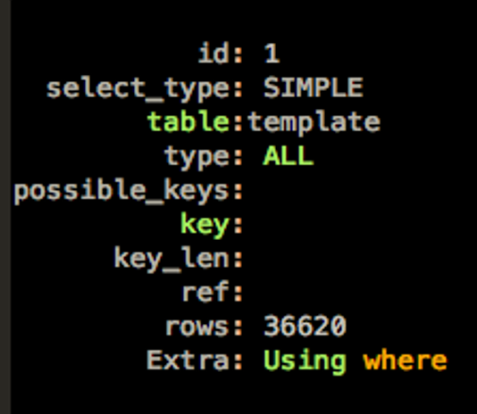
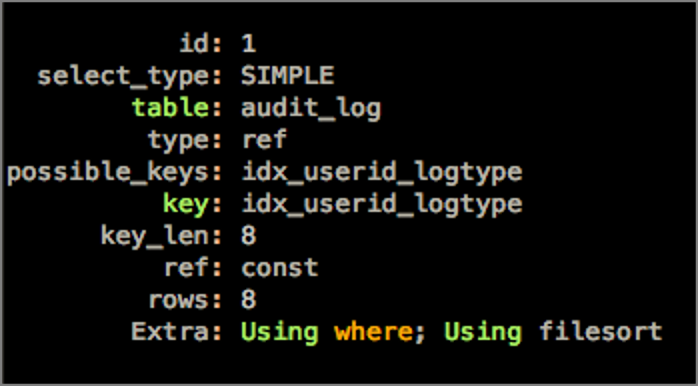
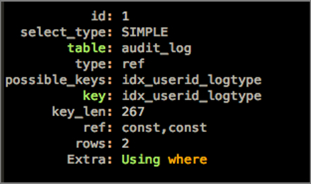
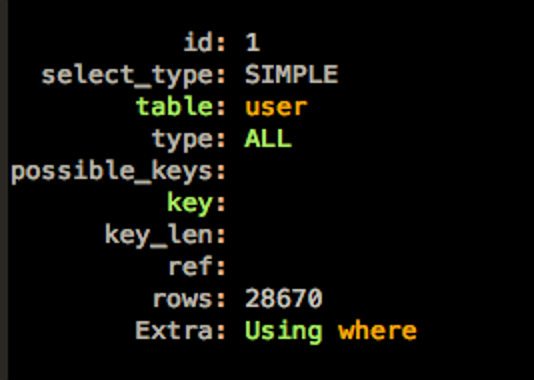
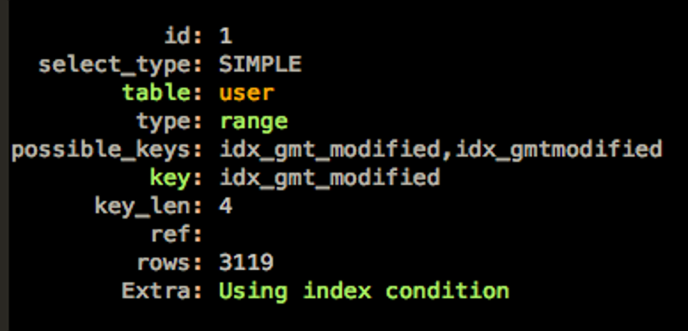
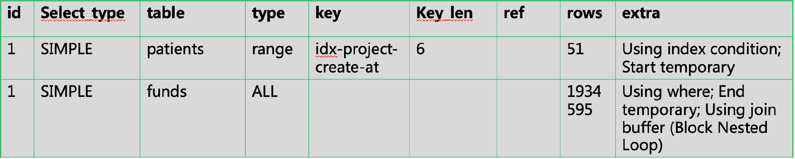
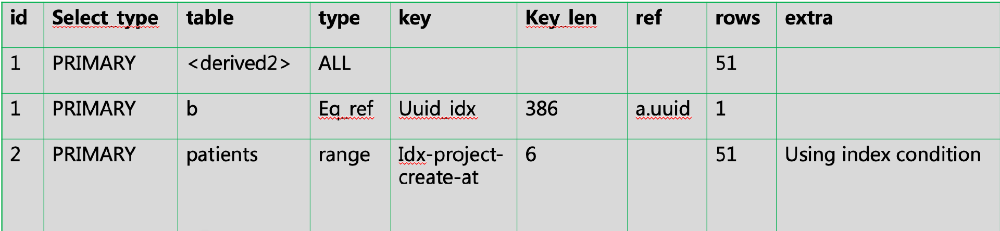
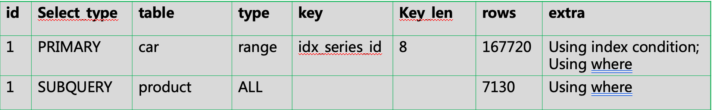
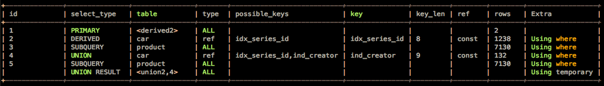

# 23 | 10+SQL执行性能不佳的真实案例（上）

你好，我是俊达。

在第二章 SQL 优化篇的前面几讲中，我们比较系统地学习了 MySQL 中 SQL 优化的基础知识，包括索引访问的原理、优化器成本模型、表连接的几种算法、表连接顺序的计算、子查询的优化策略。在这一讲里，我整理了工作中遇到过的十多种不同类型的 SQL 性能问题，以案例的形式来讲解 SQL 优化的一些思路。

## 案例一：索引缺失引起的全表扫描

这是一个非常简单的 SQL。

```sql
SELECT *
FROM template
WHERE templet_id = 2 AND status = 1
```

我们来看一下这个 SQL 的执行计划。



从这个执行计划里，我们要关注这些信息：

- table：访问的表，这里是 template 表。

- type：ALL，表示全表扫描。

- possible_keys：这个查询没有索引可以使用。

- key：查询没有使用索引。

- key_len：使用到的索引长度。

- rows：预估需要访问的数据，这里是 3.6 万多。

从执行计划可以看到，这个查询需要扫描 3.6 万行数据，没有任何索引可以使用。对于这种场景，我们可以给过滤性高的条件建立索引。

```sql
alter table template
   add key idx_templateid_status(templet_id, status);
```

这里的关键是过滤性，如果过滤性不高，那么建了索引也不一定能提升性能。

过滤性是什么意思呢？可以理解为使用给定的 where 条件过滤出来的记录数占总记录数的比例，这个比例越小，那么使用索引的效果越好。我们可以用下面这个 SQL 来分析一个字段或多个字段的过滤性。

```sql
select 1 / count(distinct c) from tab;
```

字段的唯一值越多，那么上面这个 SQL 的查询值就越小，过滤性越高。如果过滤性为 1，就说明这个字段的数据都是相同的。

在有些业务场景下，可能会存在数据倾斜，某些值的数据特别多。可以用下面这个 SQL 来分析是否存在数据倾斜。

```sql
select col, count(*)
from tab
group by col
order by count(*)
desc limit 10
```

如果有数据倾斜，那么索引是否有效，取决于 where 条件中的传入的值的过滤性，过滤性高的条件组合可以用索引来提升查询效率。在这个案例中，我们建立了一个组合索引：

```
idx_templateid_status(templet_id, status)
```

组合索引中字段的顺序很重要，要结合业务系统中的其他 SQL 来综合考虑。当然仅仅就我们案例中的这个 SQL 来说，字段顺序取（templet_id, status）或（status, templet_id）都可以。

## 案例二：优化排序操作

应用程序经常需要对访问的数据进行排序。下面这个 SQL 中，使用了 order by。

```sql
SELECT *
FROM audit_log
WHERE user_id = ?
AND log_type = ?
ORDER BY gmt_create DESC
```

我们来看一下执行计划。



- key: idx_userid_logtype，使用了 idx_userid_logtype 索引。

- key_len: 8，user_id 为 bigint

- ref: const。

- Extra: Using where; Using filesort。

从执行计划中可以看到，SQL 使用了文件排序（filesort）。排序会消耗 CPU 和内存资源。如果待排序的数据超过了 sort_buffer_size，需要将数据写入临时文件，进行真正的文件排序。

类似上面的这个 SQL，我们可以利用索引的有序性来避免排序。在索引中加上排序字段gmt_create。

```sql
alter table audit_log
  drop key idx_userid_logtype,
  add KEY `idx_userid_logtype` (
    `user_id`,`log_type`,`gmt_create`);
```

查看执行计划，可以看到 Extra 中没有了 filesort 了。



SQL 需要满足几个条件，才能使用索引来消除排序。

1. 排序字段前面的字段（这个例子中是 user_id, log_type)，需要以等值条件传入到 where 条件中（user_id=xx and log_type=xx)。

2. 如果按多个字段排序 (order by col_1, col_2)，那么索引中这几个字段也要以同样的顺序建立，idx(col_1, col_2)。

对于例子中的这个索引 idx(user_id, log_type, gmt_create)，如果 SQL 缺少 log_type 的条件，就无法使用索引来消除排序了。

```sql
SELECT ＊
FROM audit_log
WHERE user_id = ?
ORDER BY gmt_create DESC
```

## 案例三：函数运算导致无法使用索引

有的时候，明明字段上已经建立了索引，但是查询还是无法使用索引。其中有一种情况是因为SQL 中对索引字段进行了函数运算。下面就是一个比较常见的例子，SQL 在 gmt_modified 字段上使用了 date 函数，用来查询当天修改过的数据。

```sql
select * from user
where date(gmt_modified) = date(now())
```

我们来看一下执行计划。



可以看到，possible_keys 是空的，没有任何索引可用。实际上 gmt_modified 上是有索引的。但是由于 where 条件中对 gmt_modified 做了函数运算，导致无法使用索引。我们需要改写SQL，避免在索引字段上使用函数，同时还要保持 SQL 的逻辑不变。

这个案例中，SQL 可以这么改。

```sql
select * from user
where gmt_modified >= date(now())
and gmt_modified < date(date_add(now(), interval 1 day))
```

这 2 个 SQL 的逻辑一样，都是获取修改时间为当天的用户信息。

我们来看一下改写后的执行计划。



可以看到，SQL 使用了 idx_gmt_modified 索引，扫描的记录数为 3119。而之前全表扫描需要访问 2.8 万行数据。

MySQL 8.0 支持函数索引，上面这个 SQL，也能用函数索引来优化。我们来做一个简单的验证，先创建一个表，写入一些测试数据，并创建一个函数索引。

```sql
mysql> create table t_date(
 id int not null auto_increment,
 create_time datetime,
 padding varchar(2000),
 primary key(id)
) engine=innodb;
mysql> insert into t_date(create_time, padding)
 select date_add('2024-06-01 00:00:00', interval n hour),
     rpad('x', 1000, 'abcd ')
 from numbers;
mysql> alter table t_date
add key idx createtime((date(create time)));
```

下面这个 SQL 中，对索引字段进行了函数运算。从执行计划里可以看到，SQL 用到了索引。

```sql
mysql> explain select * from t_date
   where date(create_time) = '2024-06-01';
+----+-------------+--------+------+----------------+----------------+---------+-
| id | select_type | table  | type | possible_keys  | key            | key_len |
+----+-------------+--------+------+----------------+----------------+---------+-
|  1 | SIMPLE      | t_date | ref  | idx_createtime | idx_createtime | 4       |
+----+-------------+--------+------+----------------+----------------+---------+-
mysql> show warnings\G
*************************** 1. row ***************************
 Level: Note
  Code: 1003
Message: /* select#1 */
 select `rep`.`t_date`.`id` AS `id`,
   `rep`.`t_date`.`create_time` AS `create_time`,
   `rep`.`t_date`.`padding` AS `padding`
 from `rep`.`t_date`
 where (cast(`create_time` as date) = '2024-06-01')
```

索引字段上的函数运算还会以其他形式出现，比如下面这两个 SQL。

```sql
select * from t1 where b+0 = ?;
select * from t1 where c||'' = ?;
```

## 案例四：隐式类型转换

从上一个案例中我们已经知道，字段上的函数运算会导致 SQL 无法使用索引。有些情况下，虽然没有显式地对字段进行运算，但由于字段和传入的参数的数据类型不一致，数据库会进行隐式类型转换，这也会导致索引不可用。

下面是隐式类型转换常见的几种情况。

1. 字段类型为 varchar，存储了数字，where 条件中传入了数字类型的参数。

2. 字段类型为 varchar，存储了日期信息，where 条件中传入了日期类型的参数。

3. 字段类型和传入的参数都是 varchar 类型，但是字符集不匹配。

4. 表连接时，连接字段在 2 个表中的类型不一致，或字符集不一致。

我们用一个例子来验证哪些情况下，隐式类型转换会导致索引不可用。

```sql
CREATE TABLE `tab` (
 `id` int NOT NULL AUTO_INCREMENT,
 `phone` varchar(13) DEFAULT NULL,
 `phone2` bigint DEFAULT NULL,
 `create_time` varchar(20) DEFAULT NULL,
 `create_time2` datetime DEFAULT NULL,
 PRIMARY KEY (`id`),
 KEY `idx_phone` (`phone`),
 KEY `idx_phone2` (`phone2`),
 KEY `idx_createtime` (`create_time`),
 KEY `idx_createtime2` (`create_time2`)
) ENGINE=InnoDB DEFAULT CHARSET=utf8mb4
```

情况 1：索引字段为 varchar，传入数字类型的参数，索引不可用。从 warning 信息中可以看到，索引不可用的原因是发生了类型转换。

```sql
mysql> explain  select * from tab where phone=13512345678;
+----+-------------+-------+------+---------------+------+---------+------+------
| id | select_type | table | type | possible_keys | key  | key_len | ref  | rows
+----+-------------+-------+------+---------------+------+---------+------+------
|  1 | SIMPLE      | tab   | ALL  | idx_phone     | NULL | NULL    | NULL |    1
+----+-------------+-------+------+---------------+------+---------+------+------
1 row in set, 3 warnings (0.00 sec)
mysql> show warnings;
+---------+------+---------------------------------------------------------------
| Level   | Code | Message
+---------+------+---------------------------------------------------------------
| Warning | 1739 | Cannot use ref access on index 'idx_phone' due to type or coll
| Warning | 1739 | Cannot use range access on index 'idx_phone' due to type or co
| Note    | 1003 | /* select#1 */ select `test`.`tab`.`id` AS `id`,`test`.`tab`.`
+---------+------+---------------------------------------------------------------
3 rows in set (0.00 sec)
```

将传入的参数改成字符串类型，就可以使用到索引。

```sql
mysql> explain  select * from tab where phone='13512345678';
+----+-------------+-------+------+---------------+-----------+---------+-------+
| id | select_type | table | type | possible_keys | key       | key_len | ref   |
+----+-------------+-------+------+---------------+-----------+---------+-------+
|  1 | SIMPLE      | tab   | ref  | idx_phone     | idx_phone | 55      | const |
+----+-------------+-------+------+---------------+-----------+---------+-------+
1 row in set, 1 warning (0.00 sec)
```

情况 2：索引字段类型为 varchar，传入日期类型的参数，索引不可用。从 warning 信息中可以看到，索引不可用的原因是发生了类型转换。

```sql
mysql> explain  select * from tab where create_time = date(now());
+----+-------------+-------+------+----------------+------+---------+------+-----
| id | select_type | table | type | possible_keys  | key  | key_len | ref  | rows
+----+-------------+-------+------+----------------+------+---------+------+-----
|  1 | SIMPLE      | tab   | ALL  | idx_createtime | NULL | NULL    | NULL |    1
+----+-------------+-------+------+----------------+------+---------+------+-----
1 row in set, 3 warnings (0.00 sec)
mysql> show warnings;
+---------+------+---------------------------------------------------------------
| Level   | Code | Message
+---------+------+---------------------------------------------------------------
| Warning | 1739 | Cannot use ref access on index 'idx_createtime' due to type or
| Warning | 1739 | Cannot use range access on index 'idx_createtime' due to type
| Note    | 1003 | /* select#1 */ select `test`.`tab`.`id` AS `id`,`test`.`tab`.`
+---------+------+---------------------------------------------------------------
3 rows in set (0.00 sec)
```

情况 3：字段类型为数字，传入字符串类型的参数，是否也会导致索引不可用呢？

我们来测试一下。

```sql
mysql> explain  select * from tab where phone2 = '13512345678';
+----+-------------+-------+------+---------------+------------+---------+-------
| id | select_type | table | type | possible_keys | key        | key_len | ref
+----+-------------+-------+------+---------------+------------+---------+-------
|  1 | SIMPLE      | tab   | ref  | idx_phone2    | idx_phone2 | 9       | const
+----+-------------+-------+------+---------------+------------+---------+-------
1 row in set, 1 warning (0.00 sec)
mysql> show warnings\G
*************************** 1. row ***************************
 Level: Note
  Code: 1003
Message: /* select#1 */
select `test`.`tab`.`id` AS `id`,`test`.`tab`.`phone` AS `phone`,
   `test`.`tab`.`phone2` AS `phone2`,`test`.`tab`.`create_time` AS `create_time`
   `test`.`tab`.`create_time2` AS `create_time2`
from `test`.`tab`
where (`test`.`tab`.`phone2` = 13512345678)
```

上面的例子中，phone2 为数字类型，SQL 中传入了字符串类型的参数，索引可用，因为这里类型转换发生在传入的参数上。类似的，下面这种情况也不影响索引的使用。

```sql
mysql> explain  select * from tab where create_time2 = '2023-01-01';
+----+-------------+-------+------------+------+-----------------+---------+-----
| id | select_type | table | partitions | type | possible_keys   | key_len | ref
+----+-------------+-------+------------+------+-----------------+---------+-----
|  1 | SIMPLE      | tab   | NULL       | ref  | idx_createtime2 | 6       | cons
+----+-------------+-------+------------+------+-----------------+---------+-----
mysql> show warnings\G
*************************** 1. row ***************************
 Level: Note
  Code: 1003
Message: /* select#1 */
select `test`.`tab`.`id` AS `id`,`test`.`tab`.`phone` AS `phone`,
 `test`.`tab`.`phone2` AS `phone2`,`test`.`tab`.`create_time` AS `create_time`,
 `test`.`tab`.`create_time2` AS `create_time2`
from `test`.`tab`
where (`test`.`tab`.`create_time2` = TIMESTAMP'2023-01-01 00:00:00')
```

为了避免隐式类型转换导致索引不可用，我有以下几点建议。

1. 设计表结构时，根据业务需求选择精确的字段类型，不要用 varchar 类型存储日期和数字。

2. 同一个业务字段，在不同的表里面字段类型要保持一致，字符集也要保持一致。

3. SQL 中传入的参数要和字段的数据类型保持一致。

## 案例五：字符集不一致导致的隐式类型转换

执行表连接时，如果连接字段在两个表中的字符集不一致，也会发生隐式类型转换，也可能会导致索引不可用。下面这个例子就是这种情况。

```sql
SELECT *
FROM funds
WHERE  uuid  in (
   SELECT uuid
   FROM patients
   WHERE create_at != "0000-00-00 00:00:00"
)
```

先看一下执行计划。



优化器将子查询转换成了半连接，并使用了临时表来去重（Start temporary，Endtemporary）。被驱动表 funds 的 uuid 上有唯一索引，但是执行计划中显示这个表没有可用的索引。查询使用 BNL 连接算法（Block Nested Loop）。

执行 explain extended 后查看 warnings（注：8.0 已经不支持 explain extended 了），发现SQL 中有字符集转换的操作 convert(b.uuid using utf8mb4)。

```sql
mysql> explain extended
   select b.*
   from patients a, funds b
   where a.create_at != "0000-00-00 00:00:00"
   and a.uuid=b.uuid
mysql> show warnings
select *
from patients a
    join funds b
where((a.create_at <> '0000-00-00 00:00:00')
and(a.uuid= convert(b.uuid using utf8mb4)))
```

检查表结构后发现，两个表中 uuid 的字符集不一样。

```sql
CREATE TABLE `funds` (
    `id` int(11) NOT NULL AUTO_INCREMENT,
    `uuid` varchar(128) COLLATE utf8_unicode_ci NOT NULL DEFAULT '' COMMENT 'UUI
    ......,
PRIMARY KEY (`id`),
UNIQUE KEY `uuid_idx` (`uuid`))
ENGINE=InnoDB DEFAULT CHARSET=utf8 COLLATE=utf8_unicode_ci;
CREATE TABLE `patients` (
    `id` int(11) NOT NULL AUTO_INCREMENT,
    `uuid` varchar(128) CHARACTER SET utf8mb4 COLLATE utf8mb4_unicode_ci NOT NUL
PRIMARY KEY (`id`))
ENGINE=InnoDB DEFAULT CHARSET=utf8mb4;
```

funds 表中 uuid 的字符集是 utf8，patients 表中 uuid 的字符集是 utf8mb4。

我们改写了 SQL，使用 convert 函数将 patients.uuid 转换成 utf8，载去和 funds 表连接，这样就避免了 funds.uuid 上的隐式类型转换。

```sql
explain extended
SELECT b.*
FROM (select convert(uuid using utf8) COLLATE utf8_unicode_ci as uuid
   from patients
   where project_create_at != "0000-00-00 00:00:00") a, funds b
WHERE a.uuid = b.uuid
```

我们来看一下 SQL 改写后的执行计划，可以用到 funds 表中 uuid 的唯一索引了，type 为eq_ref。



为了避免表连接时发生隐式类型转换，我建议同一个业务字段，在不同的表里，数据类型和字符集要保持一致。

优化器在转换字符集时，选择了将 utf8mb3 转换成 utf8mb4。下面是一个测试案例，可以说明优化器的这个选择。

先创建两个测试表。

```sql
create table t_1(
 id int not null auto_increment,
 uuid varchar(32),
 padding varchar(2000),
 primary key(id),
 key idx_uuid(uuid)
) engine=innodb charset utf8mb3;
create table t_2(
 id int not null auto_increment,
 uuid varchar(32),
 padding varchar(2000),
 primary key(id),
 key idx_uuid(uuid)
) engine=innodb charset utf8mb4;
```

t_1 表使用 utf8mb3 字符集，t_2 表使用 utf8mb4 字符集。以 t_1 表作为驱动表时，可以使用t_2 表 uuid 的索引，因为 t_2.uuid 没有发生类型转换。

```sql
mysql> explain select * from t_1 straight_join t_2 on t_1.uuid = t_2.uuid;
+----+-------------+-------+------+---------------+-----------+---------+--------
| id | select_type | table | type | possible_keys | key       | key_len | ref
+----+-------------+-------+------+---------------+-----------+---------+--------
|  1 | SIMPLE      | t_1   | ALL  | idx_uuid1     | NULL      | NULL    | NULL
|  1 | SIMPLE      | t_2   | ref  | idx_uuid2     | idx_uuid2 | 131     | rep.t_1
+----+-------------+-------+------+---------------+-----------+---------+--------
2 rows in set, 2 warnings (0.00 sec)
mysql> show warnings\G
*************************** 1. row ***************************
 Level: Warning
  Code: 1739
Message: Cannot use ref access on index 'idx_uuid1' due to type or
collation conversion on field 'uuid'
*************************** 2. row ***************************
 Level: Note
  Code: 1003
Message: /* select#1 */
select `rep`.`t_1`.`id` AS `id`,`rep`.`t_1`.`uuid` AS `uuid`,
 `rep`.`t_1`.`padding` AS `padding`,`rep`.`t_2`.`id` AS `id`,
 `rep`.`t_2`.`uuid` AS `uuid`,`rep`.`t_2`.`padding` AS `padding`
 from `rep`.`t_1` straight_join `rep`.`t_2`
 where (`rep`.`t_1`.`uuid` = `rep`.`t_2`.`uuid`)
```

以 t_2 表作为驱动表时，无法使用 t_1 表 uuid 的索引，因为 t_1.uuid 发生了类型转换。此时优化器使用了 Hash 连接。

```sql
mysql> explain select * from t_2 straight_join t_1 on t_1.uuid = t_2.uuid;
+----+-------------+-------+------+---------------+------+---------+------+------
| id | select_type | table | type | possible_keys | key  | key_len | ref  | rows
+----+-------------+-------+------+---------------+------+---------+------+------
|  1 | SIMPLE      | t_2   | ALL  | idx_uuid2     | NULL | NULL    | NULL |    1
|  1 | SIMPLE      | t_1   | ALL  | idx_uuid1     | NULL | NULL    | NULL |    1
+----+-------------+-------+------+---------------+------+---------+------+------
2 rows in set, 3 warnings (0.00 sec)
mysql> show warnings\G
*************************** 1. row ***************************
 Level: Warning
  Code: 1739
Message: Cannot use ref access on index 'idx_uuid1' due to type or
 collation conversion on field 'uuid'
*************************** 2. row ***************************
 Level: Warning
  Code: 1739
Message: Cannot use range access on index 'idx_uuid1' due to type or
 collation conversion on field 'uuid'
*************************** 3. row ***************************
 Level: Note
  Code: 1003
Message: /* select#1 */
select `rep`.`t_2`.`id` AS `id`,`rep`.`t_2`.`uuid` AS `uuid`,
 `rep`.`t_2`.`padding` AS `padding`,`rep`.`t_1`.`id` AS `id`,
 `rep`.`t_1`.`uuid` AS `uuid`,`rep`.`t_1`.`padding` AS `padding`
from `rep`.`t_2` straight_join `rep`.`t_1`
where (`rep`.`t_1`.`uuid` = `rep`.`t_2`.`uuid`)
```

## 案例六：优化 or 条件

很多情况下，优化器可以自动选择一个最优的执行计划。但由于 SQL 的写法很多，在一些场景下，优化器选择的执行计划效率并不高。这时就可能需要改写 SQL，帮助优化器找到更好的执行计划。where 子句中不同的字段上的条件使用 or 相连，就比较容易引起性能问题。

下面这个 SQL 来自一个真实的业务系统。

```sql
SELECT count(1)
FROM car
WHERE is_deleted = 0
AND (seller_id = 100
    OR (creator = 200 AND seller_id = -1))
AND car_id NOT IN (
   SELECT car_id
   FROM product
   WHERE product_type = 2
   AND source = 2)
```

先看一下执行计划，主查询中使用索引访问 16 万行数据。子查询这里只需要执行一次。



上面的 SQL 中，seller_id=100 和 creator = 200 这两个条件的过滤性都不错，而且也都建了索引，但是这 2 个条件使用了 OR。优化器最终选择了 seller_id 上的索引，但是 seller_id =-1 这个条件的过滤性并不好。

MySQL 支持 index_merge 的执行计划，理论上可以用 seller_id=100 和 creator=200 过滤数据，再把数据合并起来，但是这里优化器并没有采用这个执行计划。因此我们将 SQL 做了改写，将 SQL 拆分成 2 个部分，使用 union all 合并数据。

```sql
SELECT sum(a) FROM (
   SELECT count(1) as a FROM car WHERE is_deleted = 0 AND car_id NOT IN ( SELECT
AND (seller_id = 100)
   union all
   SELECT count(1) as a FROM car WHERE is_deleted = 0 AND car_id NOT IN (SELECT
AND creator = 1000  AND seller_id = -1
) t
```

看一下改写后的执行计划。



改写之后，union all 的 2 个 SQL 片段使用了不同的索引，扫描的行数分别是 1238 和 7130，比改写之前提升了一个数量级。这样改写之后，执行计划也会更稳定。

## 总结

这一讲的六个案例，在平时工作中比较常见，通常也比较容易解决。首先要理解索引的选择性，为查询中过滤性高的条件创建合适的索引。对于隐式类型转换，最重要的是要在建表的时候就选择精确的数据类型，避免使用 varchar 来存储数字类的、日期时间类的数据。字符集也要保持一致。如果表已经建好，系统已经上线运行了，那就要在应用代码里使用和字段类型匹配的数据类型。

## 思考题

有时候我们会遇到执行计划选择了错误的索引，导致 SQL 性能比较差。一个可能的解决方案是使用 force index 强制索引。使用 force index 可能会存在哪些潜在的风险？有没有其他办法来避免执行计划选错索引？

期待你的思考，欢迎在留言区中与我交流。如果今天的课程让你有所收获，也欢迎转发给有需要的朋友。我们下节课再见！
