# 24 | 10+SQL执行性能不佳的真实案例（下）

你好，我是俊达。这节课我们继续看剩下的几个案例。

## 案例七：优化 or 查询的另一个例子

下面是另一个在 where 中使用了 or 的例子，这个 SQL 的性能非常差，需要将 3 个表的数据全部关联起来。

```sql
SELECT t_msg.msg_id，t_msg.content , ......
FROM t_msg
   LEFT JOIN t_user ON t_msg.user_id = t_user.user_id
   LEFT JOIN t_group ON t_msg.group_id = t_group.group_id
WHERE t_msg.gmt_modified >= date_sub('2018-05-20 09:31:45', INTERVAL 30 SECOND)
OR t_user.gmt_modified >= date_sub('2018-05-20 09:31:45', INTERVAL 30 SECOND)
OR t_group.gmt_modified >= date_sub('2018-05-20 09:31:45', INTERVAL 30 SECOND)
```

业务的需求，是查询最近半分钟内发生过变化的数据。这个 SQL 的 where 条件中，用到了 3个表的 gmt_modified 字段来过滤数据，而且这些条件使用 or 相连。看一下下面的示意图，业务关心的是新数据，每个表中，最近修改过的数据都只占了整个表数据的一小部分。而且t_user、t_group 表的数据很少更新。但由于 SQL 的写法，每次都需要连接全量的数据，然后再过滤出一小部分数据，因此 SQL 的效率很低。

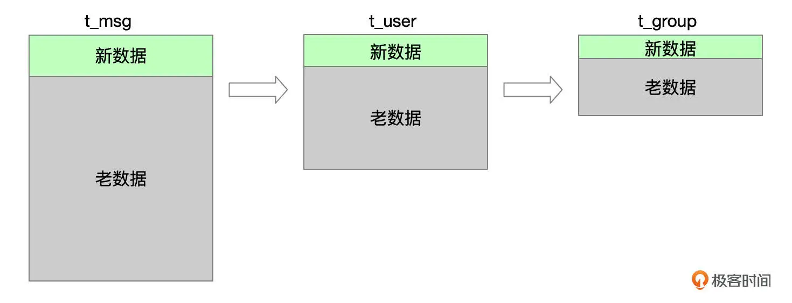

我们将 SQL 拆分成 3 个部分。

- SQL 片段 1

```sql
SELECT t_msg.msg_id，t_msg.content , ......
FROM t_msg
   LEFT JOIN t_user ON t_msg.user_id = t_user.user_id
   LEFT JOIN t_group ON t_msg.group_id = t_group.group_id
WHERE t_msg.gmt_modified >= date_sub('2018-05-20 09:31:45', INTERVAL 30 SECOND)
```

SQL 片段 1 以 t_msg 表作为驱动表，先过滤出表中 gmt_modified 在半分钟之内的数据，然后再去连接 t_user 和 t_group 表，大大减少了连接的数据。

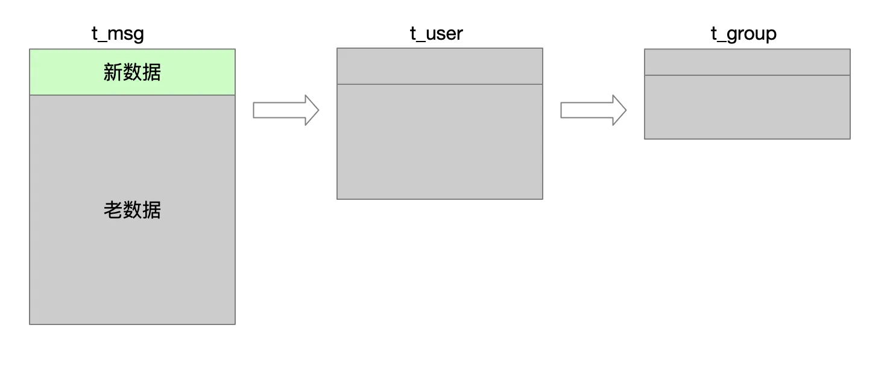

- SQL 片段 2

```sql
SELECT t_msg.msg_id，t_msg.content , ......
FROM t_msg
   LEFT JOIN t_user ON t_msg.user_id = t_user.user_id
   LEFT JOIN t_group ON t_msg.group_id = t_group.group_id
WHERE t_user.gmt_modified >= date_sub('2018-04-29 09:31:44', INTERVAL 30 SECOND)
```

SQL 片段 2 中，对 t_user 表的 left join 等价于普通 join。以 t_user 表为驱动表，先过滤t_user 表最近修改过的数据，再去连接 t_msg 和 t_group 表。

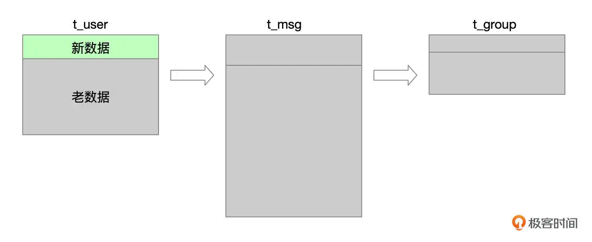

- SQL 片段 3

```sql
SELECT t_msg.msg_id，t_msg.content , ......
FROM t_msg
   LEFT JOIN t_user ON t_msg.user_id = t_user.user_id
   LEFT JOIN t_group ON t_msg.group_id = t_group.group_id
WHERE t_group.gmt_modified >= date_sub('2018-04-29 09:31:44', INTERVAL 30 SECOND)
```

SQL 片段 3 中，对 t_group 表的 left join 等价于普通 join。以 t_group 表为驱动表，先过滤t_group 表最近修改过的数据，再去连接 t_msg 和 t_user 表。

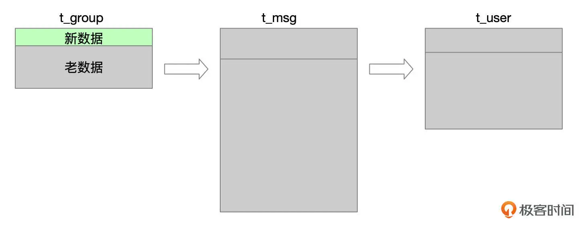

将 SQL 拆分成 3 个部分后，优化器可以对这 3 个 SQL 片段分别优化，选取不同的表关联顺序。在这个业务场景下，由于 t_user 和 t_group 表的数据很少有变化，因此 SQL 片段 2 和SQL 片段 3 大部分时间没有数据返回。

SQL 的写法灵活，但是在有些场景下，我们需要拆分 SQL，使优化器可以选择到更好的执行计划。

## 案例八：exists 子查询优化一例

下面是一个带了 exists 子查询的 SQL，当时这个 SQL 执行需要 120 秒。

```sql
SELECT u.id userId, u.mobile, u.created_date createdDate
FROM `user` u
   LEFT JOIN user_cash_detail ucd ON u.id= ucd.user_id
WHERE 1=1
AND EXISTS(
   SELECT 1
   FROM borrow b
   WHERE b.user_id= u.id
   AND b.borrow_no LIKE '202001011212XXX%')
ORDER BY u.id limit 13;
```

我们来看一下执行计划，要扫描的记录数好像（rows 13）很少，连接的几个表也都有索引，索引的过滤性也都很好（rows=1）。这个 SQL 性能应该是比较好的，为什么执行需要 120s 的时间呢？

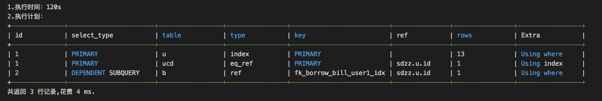

我们来分析一下这个 SQL 的执行过程：先执行主查询，从 user 表获取一行记录，再执行exists 里的子查询，检查是否有匹配的记录。如果匹配了，检查已经获取到的记录数是否已经达到 limit 的要求。如果没匹配，那么从 user 表获取下一行记录，继续这个过程。如果主表的记录数比较大，而且在执行 exists 子查询时一直没有匹配到记录，那么整个查询的执行时间就会比较长。

上一讲中，我们提到了，从 5.6 开始，MySQL 会自动将子查询转换为半连接。但是为什么这个 SQL 没有被转化为半连接呢？

原因是 8.0 之前的版本，MySQL 还不支持转换 exists 子查询。在上面这个例子中，exists 子查询中有一个 b.borrow_no 的条件，看起来过滤性比较高，因此我们手动改写了 SQL。原始SQL 中的 LEFT JOIN user_cash_detail 实际上是多余的，SQL 改写为这个样子。

```sql
SELECT distinct u.id userId, u.mobile, u.created_date createdDate
FROM borrow b
join `user` u on b.user_id= u.id
where b.borrow_no LIKE '202001011212XXX%'
order by u.id limit 13
```

改写后，SQL 的执行时间从 120 秒降到了 3 毫秒。

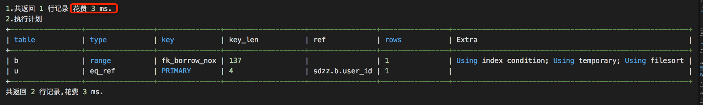

将 exists 子查询改写为常规的表关联，有几个地方要注意。

1. 原始 SQL 中并没有使用到 user_cash_detail 表，可以将 left join 去掉。

2. Exists 改成 join 后，由于 borrow 表 user_id 不唯一，可能会有重复数据出现，需要添加distinct 去重。

我们在 SQL 优化的时候，一个基本思想是尽早过滤掉尽可能多的数据。这个例子中，先执行exists 中的子查询可以提前过滤掉大量数据。

对于这个案例中的 SQL，如果使用了 8.0，就不再需要手动改写了。我们来构造一些测试数据验证一下。先创建 SQL 中的测试表，写入一些数据。

```sql
create table user (
 id int not null auto_increment,
 mobile varchar(20),
 created_date datetime,
 padding varchar(2000),
 primary key(id)
) engine=innodb;
create table user_cash_detail(
 id int not null auto_increment,
 user_id int not null,
 padding varchar(2000),
 primary key(id),
 key idx_userid(user_id)
) engine=innodb;
create table borrow(
 id int not null auto_increment,
 user_id int not null,
 borrow_no varchar(30),
 padding varchar(2000),
 primary key(id),
 key idx_user_id(user_id),
 key idx_borrowno(borrow_no)
) engine=innodb;
insert into user(id, mobile, created_date, padding)
select 1000000 + n, 13500000000 + n, date_add('2024-01-01 00:00:00', interval n h
from numbers;
insert into user_cash_detail(user_id, padding)
select 1000000 + n, rpad('', 1000, 'abcd ')
from numbers;
insert into borrow(user_id, borrow_no, padding)
select 1000000 + n - n % 2,  date_format(date_add('2019-06-01 00:00:00', interval
from numbers;
```

在 8.0 中，这个 SQL 自动转换成了半连接。

```sql
explain> SELECT u.id userId, u.mobile, u.created_date createdDate
FROM user u
   LEFT JOIN user_cash_detail ucd ON u.id= ucd.user_id
WHERE 1= 1
AND EXISTS(
   SELECT 1
   FROM borrow b
   WHERE b.user_id= u.id
   AND b.borrow_no LIKE '202007201%')
ORDER BY u.id limit 13;
+----+--------------+-------------+--------+--------------------------+----------
| id | select_type  | table       | type   | possible_keys            | key
+----+--------------+-------------+--------+--------------------------+----------
|  1 | SIMPLE       | <subquery2> | ALL    | NULL                     | NULL
|  1 | SIMPLE       | u           | eq_ref | PRIMARY                  | PRIMARY
|  1 | SIMPLE       | ucd         | ref    | idx_userid               | idx_useri
|  2 | MATERIALIZED | b           | range  | idx_user_id,idx_borrowno | idx_borro
+----+--------------+-------------+--------+--------------------------+----------
```

## 案例九：range 和 ref

优化器在计算 REF 和 Range 的访问成本时，使用了不同的公式。在有些情况下，使用同一个索引，虽然 range 使用了更多的索引字段，但是成本比 REF 高，有时 Range 的成本比全表扫描还要高，此时优化器会使用 REF 访问路径，而不是效率更高的 Range。

下面的这个例子就是这种情况。这是在 5.6 版本中遇到的问题。先创建一个表，写入一些模拟数据。

```sql
mysql> create table mysql_stat(
   id int not null auto_increment,
   tenant_id int not null,
   instance_name varchar(30) not null,
   check_time datetime not null,
   padding varchar(200),
   primary key(id),
   key idx_tenantid_instname_checktime(tenant_id, instance_name, check_time)
 ) engine=innodb;
mysql> insert into mysql_stat(tenant_id, instance_name, check_time, padding)
select 1, 'dtstack-dev1:3306',
 date_add('2024-01-01 00:00:00', interval n * 10 second) as check_time,
 rpad('x', 100, 'abcd ')
from numbers_1m
mysql> select min(check_time), max(check_time) from  mysql_stat;
+---------------------+---------------------+
| min(check_time)     | max(check_time)     |
+---------------------+---------------------+
| 2024-01-01 00:00:00 | 2024-04-25 17:46:30 |
+---------------------+---------------------+
```

我们来看一下这个 SQL 的执行计划，type 为 ref，只用到了 tenant_id 和 instance_name 的索引条件。

```sql
mysql> explain SELECT *
FROM mysql_stat
WHERE tenant_id = 1
 and instance_name='dtstack-dev1:3306'
 and check_time >='2024-02-01' and check_time <= '2024-03-01'
ORDER BY check_time desc limit 1\G
*************************** 1. row ***************************
          id: 1
 select_type: SIMPLE
       table: mysql_stat
        type: ref
possible_keys: idx_tenantid_instname_checktime
         key: idx_tenantid_instname_checktime
     key_len: 36
         ref: const,const
        rows: 468284
       Extra: Using where
```

check_time 字段上的条件，本来也可以用来过滤数据，但是优化器却没有使用。在我的测试环境中，这个 SQL 耗时 1 秒多。从慢日志中，可以观察到 SQL 扫描了 48 万行数据。

```sql
# Query_time: 1.245558  Lock_time: 0.000281 Rows_sent: 1  Rows_examined: 481600
SET timestamp=1725604597;
SELECT *
FROM mysql_stat
WHERE tenant_id = 1
 and instance_name='dtstack-dev1:3306'
 and check_time >='2024-02-01' and check_time <= '2024-03-01'
ORDER BY check_time desc limit 1;
```

我们给这个 SQL 加上一个 force index 提示。

```sql
mysql> explain SELECT *
FROM mysql_stat  force index(idx_tenantid_instname_checktime)
WHERE tenant_id = 1
 and instance_name='dtstack-dev1:3306'
 and check_time >='2024-02-01' and check_time <= '2024-03-01'
ORDER BY check_time desc limit 1\G
*************************** 1. row ***************************
          id: 1
 select_type: SIMPLE
       table: mysql_stat
        type: range
possible_keys: idx_tenantid_instname_checktime
         key: idx_tenantid_instname_checktime
     key_len: 41
         ref: NULL
        rows: 468284
       Extra: Using index condition
```

加上 force index 之后，执行计划 type 变成了 range。观察慢日志，SQL 只扫描了 1 行数据，执行时间不到 1 毫秒。

```sql
# Query_time: 0.000468  Lock_time: 0.000162 Rows_sent: 1  Rows_examined: 1
SET timestamp=1725604885;
SELECT *
FROM mysql_stat  force index(idx_tenantid_instname_checktime)
WHERE tenant_id = 1
 and instance_name='dtstack-dev1:3306'
 and check_time >='2024-02-01' and check_time <= '2024-03-01'
ORDER BY check time desc limit 1;
```

从 optimizer trace 中可以看到，加了 force index 后，ref 的成本还是比 range 低。

```
"considered_execution_plans": [
 {
   "plan_prefix": [
   ],
   "table": "`mysql_stat` FORCE INDEX (`idx_tenantid_instname_checktime`)",
   "best_access_path": {
     "considered_access_paths": [
       {
         "access_type": "ref",
         "index": "idx_tenantid_instname_checktime",
         "rows": 468284,
         "cost": 123354,
         "chosen": true
       },
       {
         "access_type": "range",
         "rows": 351213,
         "cost": 655599,
         "chosen": false
       }
     ]
   },
   "cost_for_plan": 123354,
   "rows_for_plan": 468284,
   "chosen": true
 }
]
```

但是优化器最终还是选择了 range，因为 range 能用到更多的索引字段。

```
"attached_conditions_computation": [
 {
   "access_type_changed": {
     "table": "`mysql_stat` FORCE INDEX (`idx_tenantid_instname_checktime`)",
     "index": "idx_tenantid_instname_checktime",
     "old_type": "ref",
     "new_type": "range",
     "cause": "uses_more_keyparts"
   }
 }
]
```

上面的这个 SQL，在 5.7 和 8.0 的环境中，不需要加 force index，也会使用效率更高的 range访问路径。有兴趣的话，你可以自己测试一下，使用优化器跟踪对比一下区别。

## 案例十：in 参数列表过长导致的全表扫描

这是一个在 MySQL 5.6 中遇到的性能问题。我们来看这个单表查询的 SQL。表里有几千万行数据。

```sql
SELECT *
FROM t_exp t
WHERE t.link_id in (x,x,x, ......)
and t.com_id = xx
and t.expense in (x,x,x)
and t.link_type= 1
and ledger_status= 1
AND status = 1
```

表上有一个唯一索引。where 条件中，link_id、com_id、expense, link_type 这几个字段是索引的前缀。

```
UNIQUE KEY uk (
 link_id,
 com_id,
 expense,
 link_type,
 link_com_id,
 trans_batch_id,
 status)
```

理论上这个 SQL 是可以用上这个索引的，但是 SQL 却使用了全表扫描。而且即使加上 forceindex 提示，还是全表扫描。

SQL 中 link_id 传入了几万个，我尝试着减少 link_id 的个数，当数量少于某个临界值时，就可以用上索引了，查询的性能也没有问题。但是为什么当 IN 列表中的参数多一点时，就使用全表扫描了呢？

我们来对比下这两种情况下的优化器跟踪信息。

- 使用全表扫描时的跟踪信息

当 IN 传入的参数超过一定的个数后，优化器只考虑了全表扫描。从considered_execution_plans 中可以看出这一点。

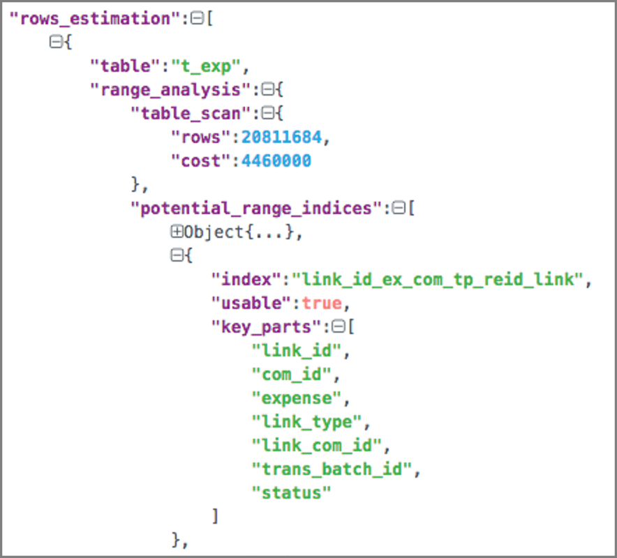

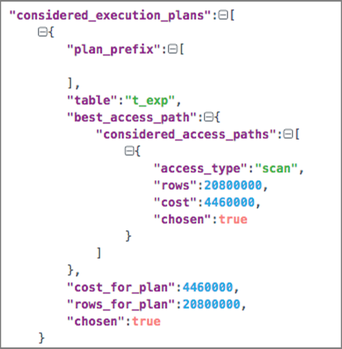

- 使用索引时的跟踪信息

将 IN 的参数减少到某个临界值之后，优化器考虑了 range 访问路径，并且基于成本，选择了range 执行计划。

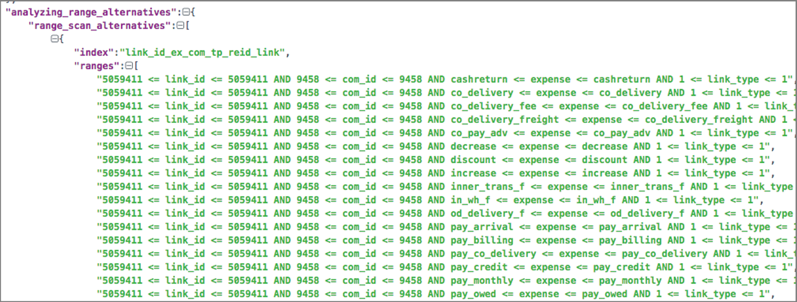

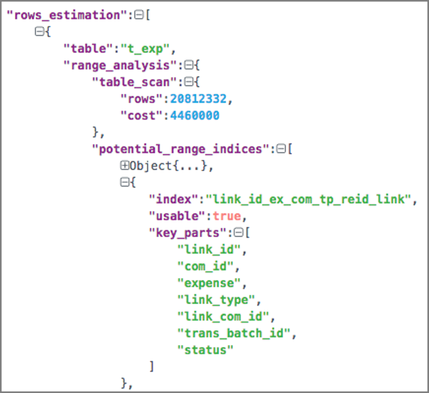

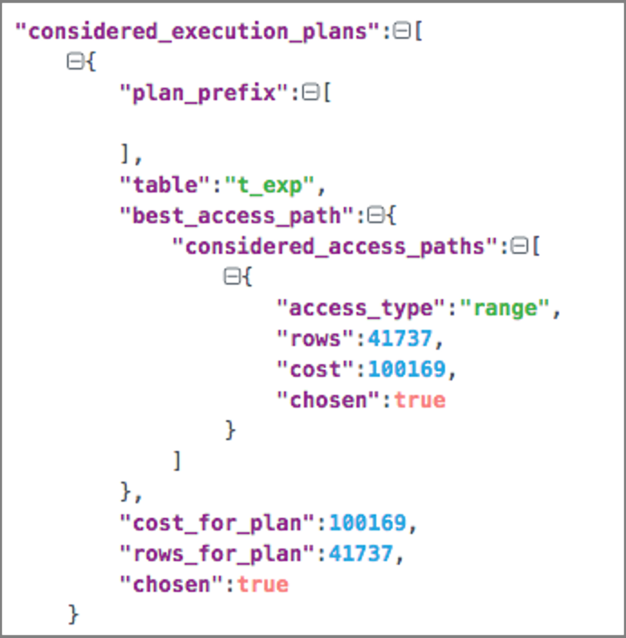

当 in 条件中的值超过一定数量时，优化器会放弃使用 range 执行计划。原因是 MySQL 限制了生成 range 执行计划时使用的内存，当 IN 参数列表太长时，消耗的内存太多，超出了限制，因此放弃使用 range 执行计划，最终使用了全表扫描。MySQL 5.6 中，range 优化内存的上限是固定的。MySQL 5.7 引入了参数 range_optimizer_max_mem_size，我们可以调整这个参数来解决 in 参数列表过长无法使用索引的问题。实际上，在 5.7 版本中，如果 in 参数列表过长导致无法使用 range 优化，会有这样的 warning 信息。

```
Warning    3170    Memory capacity of N bytes for
                  'range_optimizer_max_mem_size' exceeded. Range
                  optimization was not done for this query.
```

根据官方文档的描述，每个 OR 条件使用 230 字节，每个 AND 条件使用 125 字节，单个字段上的 IN 条件，会转换成 OR。多个字段使用 IN，会以组合形式展开，比如 c1 in (a,b) and c2in (x,y,z) 会转换成 (c1 = a and c2 = x) or (c1 = a and c2=y) or ( c1=a and c2=z) or (c1 = band c2 = x) or (c1 = b and c2=y) or ( c1=b and c2=z) 。

我们案例中的 SQL，有 2 个 in 条件会在 range 优化时展开。

```sql
SELECT *
FROM t_exp t
WHERE t.link_id in (x,x,x,…)
and t.com_id = xx
and t.expense in (x,x,x)
and t.link_type= 1
and ledger_status= 1
AND status = 1
```

怎么解决这个问题呢？一个方法是减少 IN 里面传入的参数个数，但这需要修改代码。所以当时我采用另外一种方法，调整索引字段顺序，将 expense 字段调整到了 link_com_id 之后。因为 SQL 缺少 link_com_id 的条件，调整索引字段顺序后，只需要展开 link_id，而不是 link_id和 expense 的组合，这样 SQL 就用上了索引。

```
UNIQUE KEY uk_new (
 link_id,
 com_id,
 link_type,
 link_com_id,
 expense,
 trans_batch_id,
 status)
```

## 案例十一：数据倾斜引起的性能问题

下面这个 SQL 是在一个系统压测时发现的。

```sql
select *
FROM trans_001 a LEFT JOIN purchase_001 b
ON a.serial_no = b.order_no
AND a.dist_name = b.inst_id
AND a.alino = b.alino
WHERE b.order_no IS NULL
AND a.serial_no >= '201809200000057858291ALI'
AND a.serial_no <= '201809216100342526601ALI'
AND a.business_code = 'xx'
AND a.trans_date = '20180921';
```

这是一个两表连接的 SQL，当时这个 SQL 执行了两百多秒，从慢日志中看到扫描行数有 1.1亿。下面是当时诊断报告的输出。

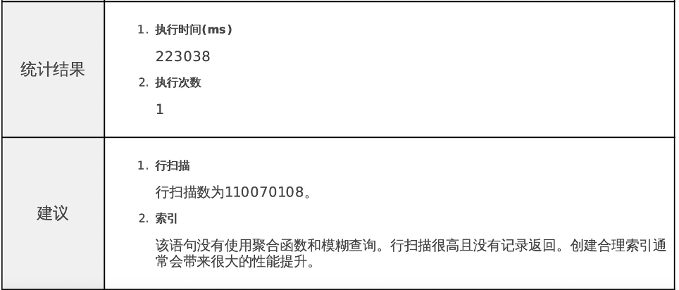

这个系统使用了分库分表，这两个表大概有几十万行数据。SQL 的执行计划并没有问题，连接条件中的字段上也建立了正确的联合索引。但是为什么扫描行数会这么高呢？你是不是会怀疑慢 SQL 的输出有问题？

有经验的同学可能已经想到原因了，这其实是数据倾斜引起的问题。分别查看 2 个表中连接条件上的数据分布就能发现问题。

```sql
select serial_no, dist_name, alino, count(*)
from trans_001
group by serial_no, dist_name, alino
order by count(*) desc limit 10;
select order_no, inst_id, alino, count(*)
from purchase_001
group by order_no, inst_id, alino
order by count(*) desc limit 10;
```

只要某个组合条件下的记录数超过 1 万，连接时扫描的记录数就会超过 1 亿。找到问题后，需要业务方来分析为什么会有这样的数据，并进行相应的处理。

## 案例十二：Range checked for each record

MySQL 优化器在评估一个索引的访问效率时，要么使用 Index Dive，要么使用索引统计信息。在表连接时，如果连接条件是一个范围，那么对于驱动表中的每一行记录，都需要进行一次 Index Dive，来评估被驱动表里满足条件的记录数。这种情况下，执行计划的 Extra 列中会显示“Range checked for each record”，很多时候，这也是一个查询性能不好的信号。

我们来看下面这个例子。

```sql
SELECT t1.ppd , (
   SELECT sum(amount) AS total_amount
   FROM `order`
   WHERE pay_date <= t1.ppd
   AND pay_date >= date_sub(t1.ppd, INTERVAL 7 DAY)
) AS total_amount
FROM (
   select distinct pay_date as ppd
   from `order`
   where pay_date is not null
) t1
```

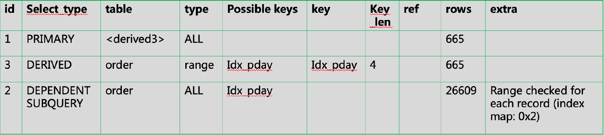

这样的 SQL 还有优化的空间吗？我们来尝试一下。先准备一点测试数据。

```sql
create table t_order(
 id int not null auto_increment,
 pay_date date not null,
 amount int not null,
 padding varchar(2000),
 primary key(id),
 key idx_paydate(pay_date)
) engine=innodb;
insert into t_order(pay_date, amount, padding)
select date_add('2023-01-01', interval n % 365 day),
   2000 + n % 1000,
   rpad('', 1000, 'abcd ')
from numbers;
```

在我的测试环境中，原始 SQL 耗时 35 秒。

```sql
# Query_time: 35.923849
# Lock_time: 0.000086
# Rows_sent: 365
# Rows_examined: 3650365
SELECT t1.ppd , (SELECT sum(amount) AS total_amount
   FROM t_order
   WHERE pay_date <= t1.ppd
   AND pay_date >= date_sub(t1.ppd, INTERVAL 7 DAY) ) AS total_amount
FROM (
   select distinct pay_date as ppd
   from t_order
   where pay_date is not null
) t1;
```

我尝试把 SQL 改写成表连接，执行时间减少了一些。

```sql
# Query_time: 7.566888
# Lock_time: 0.000050
# Rows_sent: 365
# Rows_examined: 365
SELECT t1.ppd, sum(amount) AS leiji_amount
FROM  (select distinct pay_date as ppd
      from t_order
      where pay_date is not null) t1
   , t_order t2
WHERE t1.ppd >= t2. pay_date
   AND t2.pay_date >= date_sub(t1.ppd, INTERVAL 7 DAY)
GROUP BY t1.ppd;
```

就这个 SQL 的逻辑，我们还可以使用 MySQL 8.0 的窗口函数，这样 SQL 执行又更快了一些。

```sql
# Query_time: 0.776545
# Lock_time: 0.000046
# Rows_sent: 365
# Rows_examined: 730
select pay_date, sum(total_amount) over(
   order by pay_date
   range BETWEEN INTERVAL 7 DAY PRECEDING AND CURRENT ROW)
from (
   select pay_date, sum(amount) as total_amount
   from t_order
   where pay_date is not null
   group by pay_date
) t;
```

考虑到 SQL 中只用到了 2 个字段，我们给这个 SQL 建立一个联合索引。

```sql
alter table t_order add key idx_paydate_amount(pay_date, amount);
```

这样执行的速度又提升了一些。

```sql
# Query_time: 0.090399
# Lock_time: 0.000026
# Rows_sent: 365
# Rows_examined: 730
select pay_date, sum(total_amount) over(
   order by pay_date
   range BETWEEN INTERVAL 7 DAY PRECEDING AND CURRENT ROW)
from (
   select pay_date, sum(amount) as total_amount
   from t_order
   where pay_date is not null
   group by pay_date
) t;
```

我们的测试表里，只写入了 10000 行数据，如果你有兴趣，可以尝试写入 10 万行或 100 万行数据，对比下这几种情况下几个 SQL 的耗时。

## 总结

SQL 优化是一项基本的技能。你需要掌握索引的特点，了解不同表连接算法的特点和适用场景，还需要了解优化器的一些工作原理。有的时候你可能需要改写 SQL，或者使用 SQL 提示，来获得更好的性能。

这两讲的十几个例子，都是从真实的业务场景中挑选出来的，当时使用的版本包括 5.5、5.6、5.7。可以看到，在 8.0 中，有一些 SQL 实际上优化器已经能自动优化得更好了。这也是我们要使用新版本的一个重要的原因。

## 思考题

下面这类 SQL 按多个表的字段来排序，请分析下这么排序，对 SQL 性能的影响是什么？如果只使用一个表的字段来排序，性能上会有什么区别吗？

```sql
select *
from t1, t2, t3
where t1.c1 = t2.c1
and t2.c2 = t3.c3
order by t1.s1, t2.s2
limit 100;
```

期待你的思考，欢迎在留言区中与我交流。如果今天的课程让你有所收获，也欢迎转发给有需要的朋友。我们下节课再见！
