# 25 | 数据库无法启动，如何读取InnoDB文件中的数据？（上）

你好，我是俊达。这一讲我们来了解下 InnoDB 的物理存储格式。

了解物理存储格式有什么作用呢？有时，由于系统表空间或其他物理文件损坏，数据库可能无法启动，即使设置了参数 innodb_force_recovery 还是无法启动。有时，由于误操作把表DROP 了，或者是在文件系统层面把 ibd 文件删除了。

解决这些问题，正规的做法是做好备份、备库。但是在一些极端情况下，没有备份和备库，你还能把数据找回来吗？掌握 InnoDB 数据文件的格式后，理论上你可以解析 ibd 文件，提取出里面的数据。如果 ibd 文件被删除了，可以先使用文件恢复工具找回文件，然后再解析 ibd 文件。

另外，理解物理文件格式，也能帮你更好地掌握 InnoDB 内部原理，比如 B+ 树在物理上是怎么存储的，插入、删除、更新等操作具体做了什么，Buffer Pool 的结构到底是怎样的，Redo和 Undo 是如何保证数据不丢的。

要理解 InnoDB 的物理存储结构，最好的方法是创建一些测试表，写入一些数据，然后用一些工具打开文件，理解文件中的每一个字节的含义。

我们先创建一个测试表，写入几行数据。

```sql
create table t_dynamic(
 id varchar(30) not null,
 c1 varchar(255),
 c2 varchar(255),
 c3 varchar(8200),
 c4 text,
 primary key(id)
) engine=innodb row_format=dynamic charset=latin1;
insert into t_dynamic(id, c1, c2, c3, c4)
values
('ROW_001', rpad('', 5, 'A1'), rpad('', 13, 'A2'),
     rpad('',8123,'A3'), rpad('', 8124, 'A4')),
('ROW_003', rpad('', 5, 'B1'), rpad('', 13, 'B2'), null, rpad('', 129, 'B4')),
('ROW_002', rpad('', 5, 'E1'), rpad('', 13, 'E2'), null, rpad('', 22, 'E4')),
('ROW_007', rpad('', 5, 'D1'), rpad('', 13, 'D2'), null, rpad('', 27, 'D4')),
('ROW_004', rpad('', 5, 'F1'), rpad('', 13, 'F2'), null, rpad('', 24, 'F4')),
('ROW_005', rpad('', 5, 'C1'), rpad('', 13, 'C2'), null, rpad('', 35, 'C4')),
('ROW_006', rpad('', 5, 'G1'), rpad('', 13, 'G2'), null, rpad('', 26, 'G4')),
('ROW_008', rpad('', 5, 'H1'), rpad('', 13, 'H2'),
     rpad('', 28, 'H3'), rpad('', 28, 'H4'));
```

## 工具介绍

解读 ibd 文件的内容，需要借助一些工具，以十六进制的方式查看文件的内容。这类工具很多，比如 UltraEdit。这里我使用了 Mac 系统下的 Hex Fiend。下面这个图就是使用 HexFiend 打开 t_dynamic.ibd 文件后显示的内容。

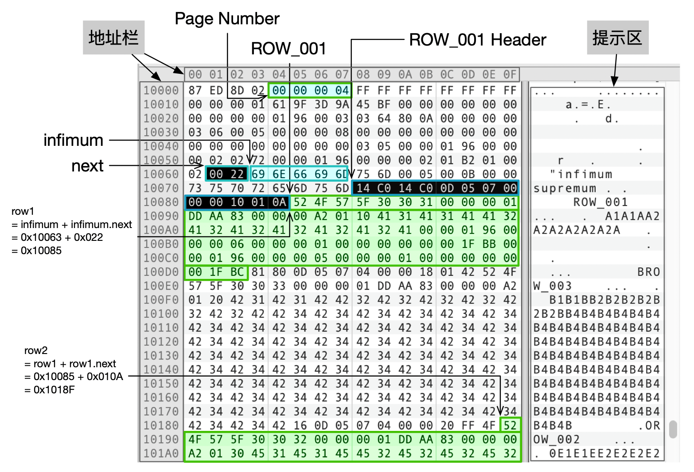

上面这个图里面，最左侧和最上方是地址栏，标注了文件内容的偏移量。右侧是提示区，以文本的形式展示文件内容。我们建的测试表里，存的都是文本数据，在提示区里能看到这些数据。对于我们使用的默认的 16K 的页面大小，任意一个页面在文件中的偏移量是 16K 的整数倍，任意一个字节在页面内的偏移量在 0x00 - 0x3FFF 之间。

InnoDB 在每个页面的开始处用 4 个字节存储了页面编号，比如我们图里 Page Number 指向的地方，页面编号是 0x00 00 00 04，转换成地址就是 0x04 * 0x4000 = 0x10000，也就是图片中数据的起始地址。4 个字节最大能给 0xFF FF FF FF 个页面编号，如果每个页面 16K，那么一个文件最大为 64T，这也是 InnoDB 单个表的最大存储空间。

```
>>> (0xFFFFFFFF + 1) * 0x4000 / 1024 / 1024 / 1024 / 1024
64
```

在一个 InnoDB 页面内，使用 2 个字节表示偏移量。2 个字节最大可表示 0xFF FF，也就是65535，这也是 InnoDB 将单个页面（innodb_page_size）的最大值限制为 64K 的原因，一旦页面大小超过 64K，只用 2 个字节就无法表达页面内的所有偏移量了。

InnoDB 内部用来表示某个数据的存储地址时，有几种形式：

- (space_id, page_no, offset)：space_id（4 字节）是表空间 ID，通常对应一个 ibd 文件。page_no（4 字节）是文件内的页面号。offset（2 字节）是页面内的偏移量。

- (page_no, offset)：用来表示同一个文件中的某个地址，page_no 是页面编号，offset 是页面内偏移量。

- (offset)：如果内容存储在同一个页面内，那么使用 offset 来表示页面内的偏移量。

我们来看一下页面 04 结尾处的内容，这里存储了页目录，page dir 1 存储了 infimum 记录的地址 0x0063，在前面那个图中，你可以找到 infimum 记录（0x10000 + 0x0063 =0x10063）。

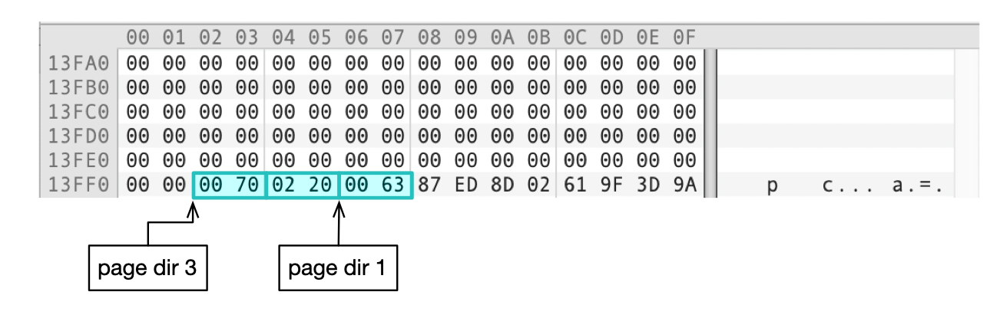

infimum 记录前的 2 个字节（0x00 22)，存储了下一行记录的地址（0x10063 + 0x22 =0x10085），这就是记录 ROW_001 在文件中的物理地址。

当然，进行十六进制的运算时，你可以借助程序员计算器，操作系统内置的计算器一般就够用了。

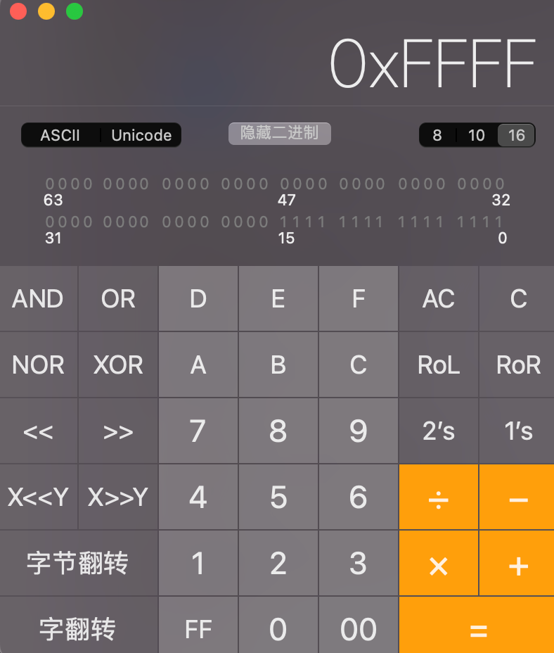

## InnoDB 页面格式

InnoDB 将数据文件划分为页面（Page）进行管理。每个页面的大小由参数innodb_page_size 决定，该参数只能在数据库初始化之前修改，一旦数据库完成初始化，就不能再修改了。innodb_page_size 最小可设置为 4K，最大可设置为 64K，默认为 16K。我们的课程中，都使用默认的 16K 页面大小。

页面有固定的格式，大致可以分为几个部分。

1. 页面头部信息。

每个页面都有固定的头部信息，总共占用 38 字节。为了便于理解，我将页面头部的每个字段都标注在了下面这个示意图中，查看 ibd 文件的十六进制内容时，结合这个图能帮你直观地定位某个字段的位置。

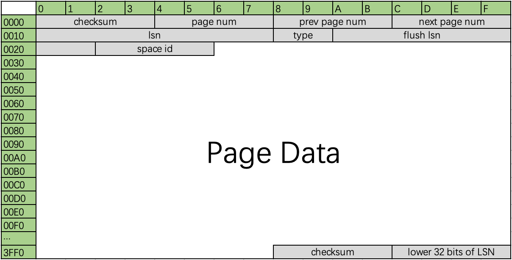

每个字段的具体含义我整理成了下面这个表格。

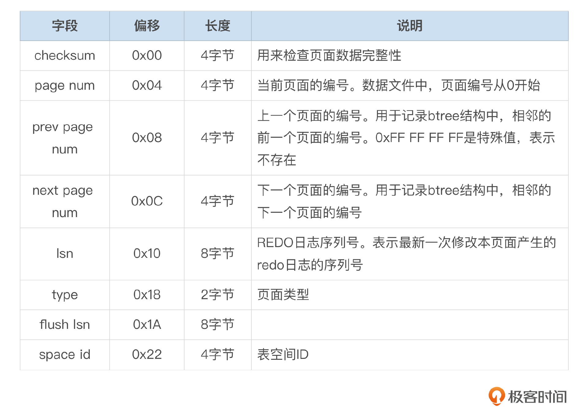

页面编号（Page Num）长度为 4 个字节，可以给 2^32 个页面进行编号（其中 0xFFFFFFFF有特殊含义）。对于 16K 的页大小，一个表空间最大可能的空间为 2^32 * 16K，也就是 64T。

头部信息中，type 字段用于标识页面中存储的数据类型，常见的页面类型我整理成了下面这个表格，供你参考。

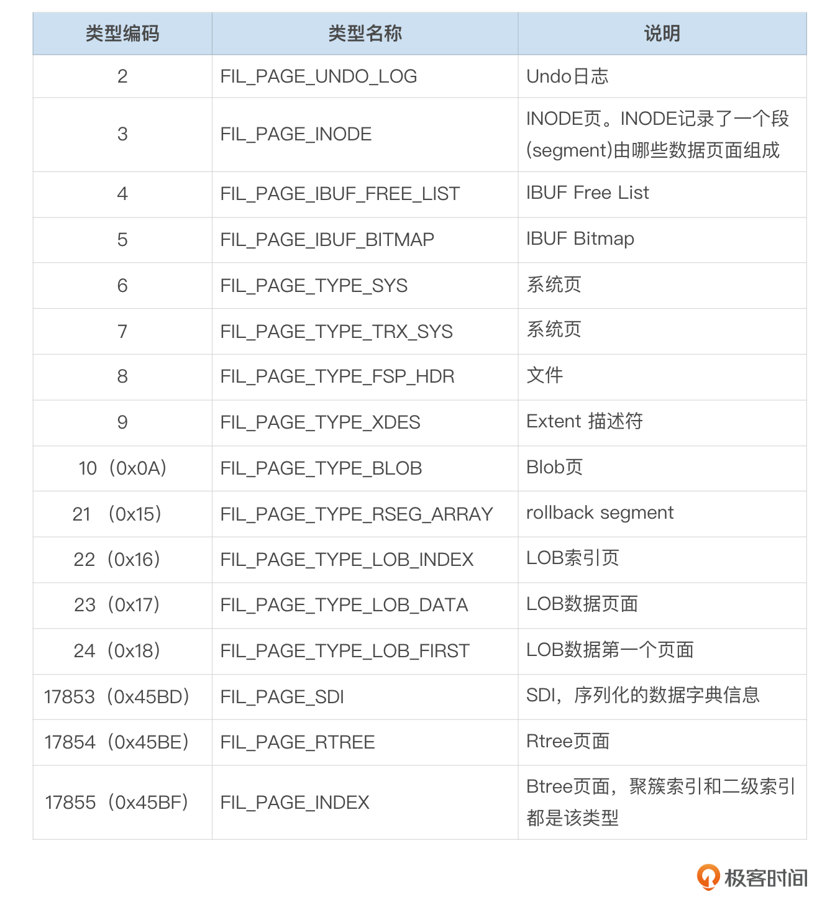

下面是页面头部的一个例子。

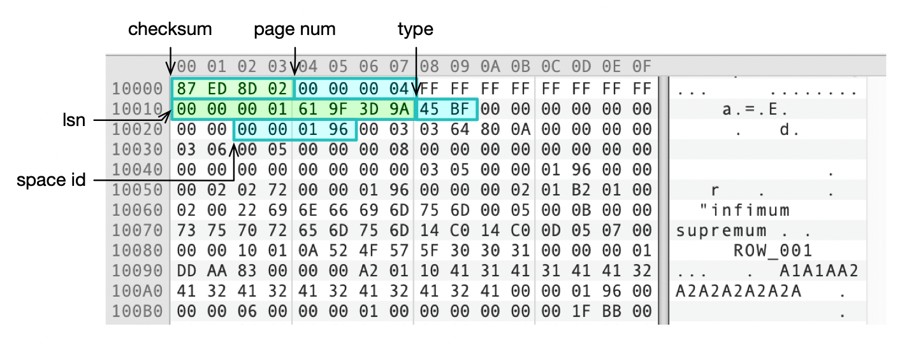

type 为 0x45BF，这是一个 B+ 树页面。space id 是 0x00 00 01 96。从INNODB_TABLESPACES 表可以查到每个表空间的 ID，我们的测试表 space id 是 406，转换成十六进制就是 0x0196。

```sql
mysql> select space, name, space_type, row_format, page_size
   from information_schema.INNODB_TABLESPACES where name='rep/t_dynamic';
+-------+---------------+------------+------------+-----------+
| space | name          | space_type | row_format | page_size |
+-------+---------------+------------+------------+-----------+
|   406 | rep/t_dynamic | Single     | Dynamic    |     16384 |
+-------+---------------+------------+------------+-----------+
```

2. 页面数据。

不同类型的页面以不同的格式存储数据，后续我们会讲解不同类型页面的存储格式。

3. 页面尾部信息。

每个页面尾部都有固定 8 个字节的信息。

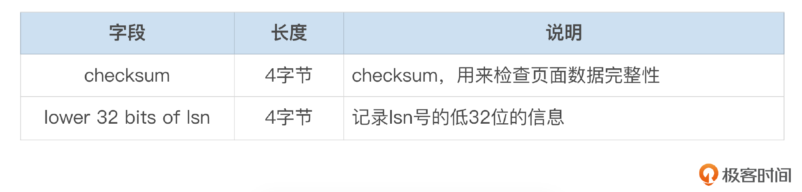

下图是页面的尾部信息，注意 checksum 和 lsn 和页面头部是对应的。

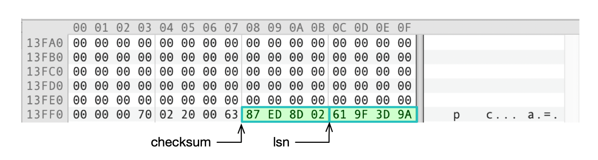

页面头部和尾部都存储了 checksum。为什么 checksum 要存 2 份呢？因为 InnoDB 页面数据写到磁盘时，有可能不是一个原子操作。1 个 InnoDB 页面可能对应多个磁盘上的数据块，写数据的过程中，如果部分数据块写成功，而部分数据块写失败，那么页面的数据就不一致了。通过对比页面头部和尾部 checksum 数据，可以检测数据是否损坏。

### B+ 树页面格式

前面我们一直在讲，InnoDB 中，表的数据以聚簇索引的方式存放，聚簇索引是以主键作为Key 的 B+ 树。

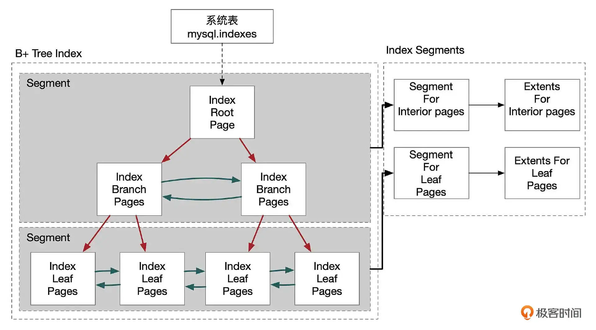

在 InnoDB 中，B+ 树大致结构如上图所示。B+ 树由根页面（Root Page）、跳转页面（Branch Page）、叶子页面（Leaf Page）组成。如果表中的记录数足够少，那么 B+ 树中可能只有 1 个页面，这个页面既是根页面，同时也是叶子页面。

B+ 树页面由头部信息、记录信息、空闲空间、目录项这几部分组成。为了便于理解，我将 B+树页面格式画成了下面这个示意图。


1. B+ 树页面头部信息

B+ 树中，每个页面头部有一些公共信息，具体内容我整理成了下面这个表格。

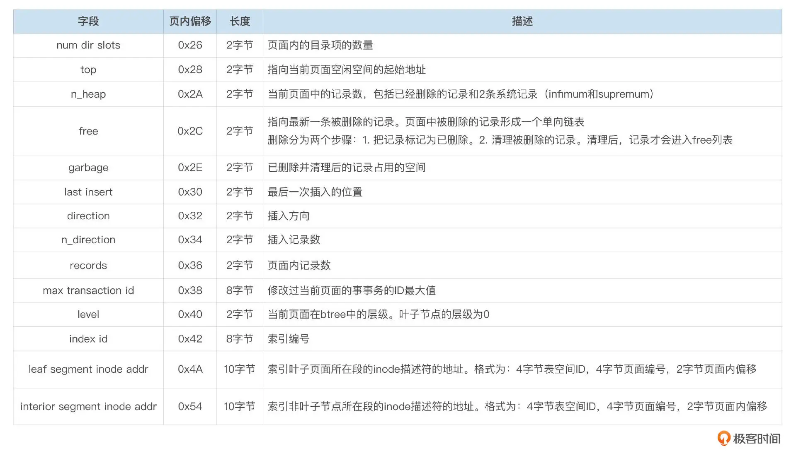

下图是我们的测试表的页面头部信息，图上标注了部分字段。

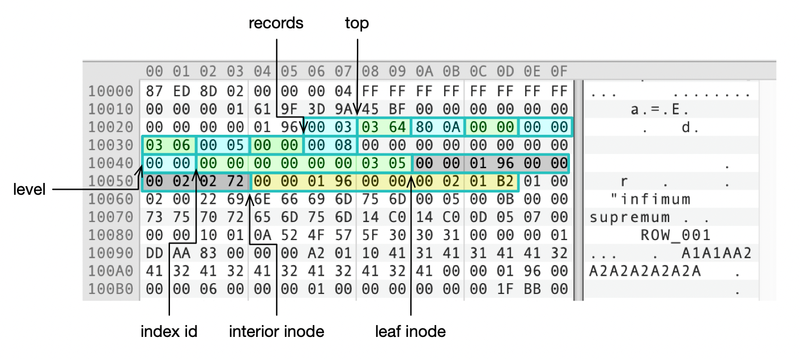

表里插入了 8 行数据，因此 records 为 8。top 指向了页面内空闲空间的开始地址（0x10000+ 0x0364 = 0x10364），这实际上也指向了插入的最后一条记录（ROW_008）的结尾处。

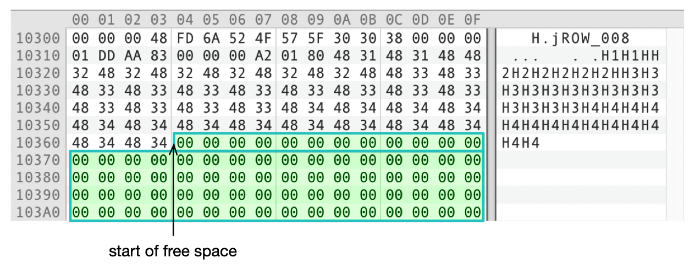

level 为 0，index id 为 0x0305。index id 可以从数据字典中查到，我们测试表 index id 为773，也就是十六进制 0x0305。

```sql
mysql> select t1.name, t2.name, t2.index_id
from information_schema.innodb_tables t1,  information_schema.innodb_indexes t2
where t1.table_id = t2.table_id
and t1.name = 't_dynamic'
and t2.name = 'PRIMARY';
+---------------+---------+----------+
| name          | name    | index_id |
+---------------+---------+----------+
| rep/t_dynamic | PRIMARY |      773 |
+---------------+---------+----------+
mysql> SET SESSION debug='+d,skip_dd_table_access_check';
mysql> select t2.se_private_data
    from mysql.tables t1, mysql.indexes t2
    where t1.id = t2.table_id
    and t1.name = 't_dynamic'
    and t2.name = 'PRIMARY';
+---------------------------------------------------------+
| se_private_data                                         |
+---------------------------------------------------------+
| id=773;root=4;space_id=406;table_id=1472;trx_id=122267; |
+---------------------------------------------------------+
```

leaf inode 和 interior inode 分别指向叶子页面和跳转页面这两个段（Segment）的描述符。

2. 行记录

用户的数据都存储在记录区域内。InnoDB 中，每个页面中都存在 2 条特殊的记录，infimum和 supremum，分别代表页面内的第一条记录和最后一条记录。每一条记录都由记录头部（Record Header）和记录数据（Record Data）组成。

记录头部中存储着记录相关的元数据，包括下一条记录的位置信息。一个页面内的所有记录，组成了一个单向链表，infimum 记录是链表的头部，supremum 记录是链表的尾部。

记录按 B+ 树索引字段的顺序排列。页面中记录逻辑上按索引字段排序，但是物理存储上不一定有序。随着页面中记录的插入、删除、更新，记录区域内可能存在碎片空间。页面头部信息中的 free 字段指向最新被删除的记录，garbage 字段记录了所有被删除的记录占用的空间。这些碎片空间可以在后续往页面中写入数据时重用，或对页面进行碎片整理后释放出来。

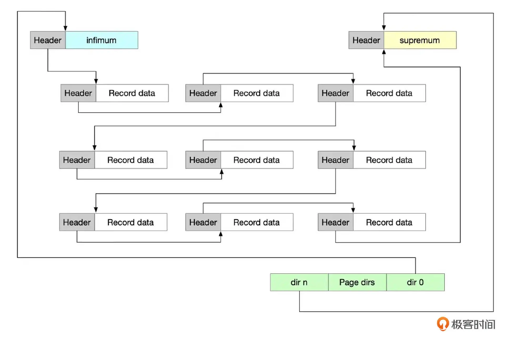

3. 空闲空间

空闲空间是页面中还从未被使用过的一个连续的区域，位于用户记录和页目录项之间。页面头部的 top 字段记录了空闲空间在页面内的偏移地址。

4. 页目录项

页目录项里存储了页面内记录的偏移地址。每一个目录项占用 2 个字节，目录项的空间从高往低分配。InnoDB 并没有给每一条记录都分配一个目录项，两个相邻的目录项之间，可能存在多条记录，我们把这些记录称为一个记录组。一个记录组里最少存 4 条记录，最多存 8 条记录。当然这里有一些例外情况，第一个记录组只有一条记录，也就是 infimum 记录，最后一个记录组内记录数可能小于 4。


在页面中查找数据时，目录项有重要的作用。如果没有目录项，那么在页面内查找记录时，只能顺序扫描，扫描需要的时间和记录的数量成正比。使用目录项，就可以采用二分搜索法，这能极大提高性能。另外，页面中的记录组成一个单向链表，按索引顺序扫描记录时非常方便。但是 MySQL 中还存在按索引逆序扫描的情况，而页面中并没有存储某一条记录的上一条记录的位置信息，这时也需要使用目录项来减少扫描的记录数。

## InnoDB 行格式

InnoDB 支持 DYNAMIC、COMPACT、REDUNDANT 和 COMPRESSED 这四种格式，可以在建表时通过 row_format 选项指定。如果不指定 row_format，会根据参数innodb_default_row_format 来确定行格式，默认为 DYNAMIC。MySQL 5.7 及更早的版本中，行格式和参数 innodb_file_format 相关。innodb_file_format 设置为 Antelope 时，只能使用 COMPACT 和 REDUNDANT 行格式。设置为 Barracuda 时，才能使用全部 4 种行格式。不过 MySQL 8.0 已经没有这个参数了。

```sql
create table test_1(
   a int,
   b varchar(10),
   c datetime
)
[engine = innodb]
[row_format=DYNAMIC
  |COMPACT
  |REDUNDANT
  |COMPRESSED [key_block_size = ]]
[tablespace = tbs_name];
```

### Dynamic 行格式

InnoDB 的每一行数据都由头部信息和记录信息组成。Dynamic 行格式下，头部信息包括长度固定为 5 字节的内容，以及由字段定义和行内实际存储的数据决定的变长内容。

下面就是一行记录的示意图。


图中 rec_ptr 指向记录实际数据的起始地址，表中所有的字段按表结构定义中的顺序连续存储。

### 固定头部信息

每行数据前都有长度固定为 5 字节的头部信息，格式参考下面这个图。


这里面数据的具体含义我整理成了下面这个表格。

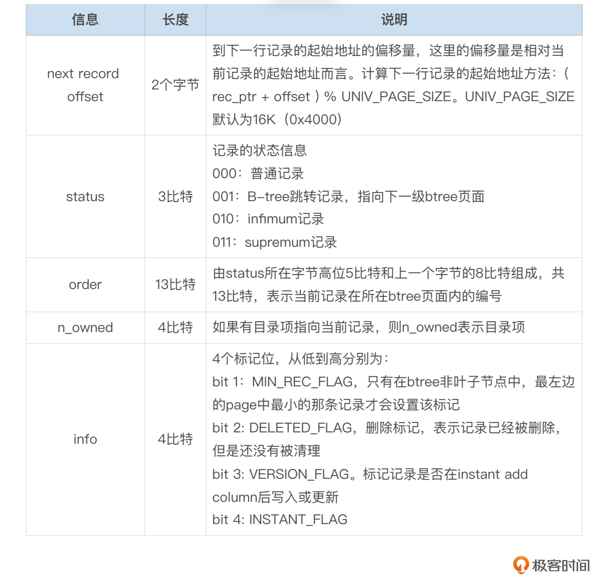

### version

如果表上有 instant add column/drop column 操作，往聚簇索引新插入数据时，需要记录当前的 version 信息。version 占 1 个字节。version 最大不超过 64。如果表没有 instant addcolumn/drop column 操作，或者表经过了 rebuild，则不需要记录 version 信息。

### null 标记

每一个可空的字段，需要 1 比特来标记数据是否为空（null），如果数据为 null，则对应的标记位设置为 1。null 标记字节数是可空字段数除以 8，向上取整。


### 变长字段长度列表

对每个可变长度的字段（如 varchar，varbinary, char），需要使用 1-2 字节来存储长度信息。

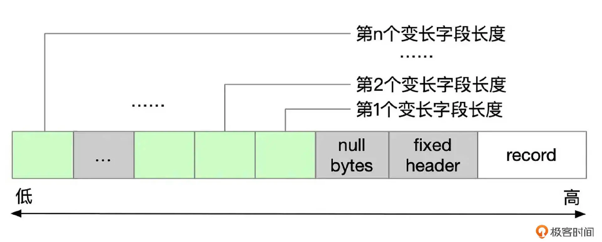

1. 如果字段的最大存储空间不超过 255 字节，则使用 1 个字节来存储长度信息。

2. 如果字段的最大存储空间超过 255 字节，并且字段中实际存储的数据不超过 127 字节，则需要使用 1 个字节来存储长度信息，该字节的最高位比特总是 0，剩下的 7 比特最大可以表示 127。

3. 如果字段的最大可存储空间超过 255 字节，并且字段中实际存储的数据超过 127 字节，或者字段内容溢出，则需要使用 2 个字节来存储长度信息。

2 个字节的编码如下图：

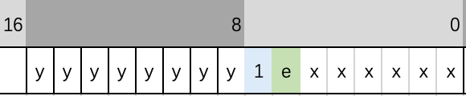

右边字节的最高位置位 1，右边字节的第 7 位用于标识当前字段是否有数据存储在另外的数据页中。右边字节的低 6 位比特和左边的 8 比特（0bxxxxxxyyyyyyyy）用于存储字段在当前页面中实际存储的字节数。InnoDB 允许的最长行记录为 16K，所以 14 比特刚好可以表示不超过 16K 的长度。

我们来看一下测试表里前几行记录的存储格式。

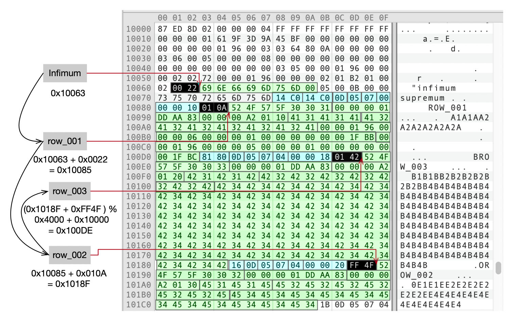

- 5 字节固定长度头部信息

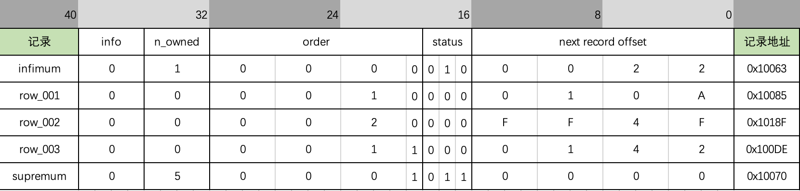

order 字段中保存了记录插入的顺序。row_001 的 order 是 2，row_003 的 order 是 3，row_002 的 order 是 4。

- Null bytes

我们的测试表有 4 个可空字段，因此 null bytes 是 1 字节。


- 变长字段长度列表

变长字段长度列表中的数据是逆向解析的，比如 row_001 的数据是 0x14 C0 14 C0 0D 0507，先分别解析出 07，05，0D，这都是单字节长度。接下来的 C0（0b11000000），最高位是 1，因此是双字节长度，实际长度是 0xC014 第低 14 位，也就是 20。

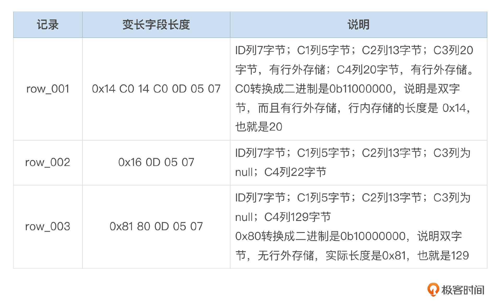

```sql
mysql> select id, length(id), length(c1), length(c2), length(c3), length(c4)
   from t_dynamic where id in ('row_001', 'row_002', 'row_003');
+---------+------------+------------+------------+------------+------------+
| id      | length(id) | length(c1) | length(c2) | length(c3) | length(c4) |
+---------+------------+------------+------------+------------+------------+
| ROW_001 |          7 |          5 |         13 |       8123 |       8124 |
| ROW_002 |          7 |          5 |         13 |       NULL |         22 |
| ROW_003 |          7 |          5 |         13 |       NULL |        129 |
+---------+------------+------------+------------+------------+------------+
```

### Compact

compact 和 dynamic 行格式基本一致，只是处理行外存储时有所区别。Dynamic 行格式下，如果一个字段需要行外存储，会将字段的所有数据都存储在单独的 Lob 页，行内只存储 20 字节的数据，指向 Lob 页。Compact 行格式下，如果字段需要行外存储，会在行内保留 768 字节的数据，其他数据存储到单独的 Lob 页。

### Redundant

按官方文档的描述，Redundant 行格式会占用更多的空间，但是可能会节省一些 CPU。对于Redundant 格式，不做详细的介绍了。我把 Redundant 大致的记录格式放在文章里，如果你有兴趣的话，可以自己创建一些测试表进行观察。


Redundant 行格式特点：

1. 每一行记录都由记录的头部信息和记录中每个字段的数据组成。

2. 记录的数据按字段顺序依次存放。第一个字段的开始地址记为 rec_ptr。

3. 记录头部由 6 字节头部信息和变长的字段偏移列表组成。

- 长度固定为 6 字节的头部信息

Redundant 每行记录头部都有长度固定为 6 字节的信息，具体内容见下面这个图和表格中的说明。


- version 字段

如果表上有 instant add column/drop column 操作，则插入数据时需要记录当前表的版本号。

- 字段偏移列表

字段偏移列表中存储了每一个字段的末尾处的偏移量，这里偏移量是相对于记录开始地址（rec_ptr）而言。

如果记录的长度不超过 127 字节，则每个字段需要 1 个字节来存储偏移量。最高位用来表示字段是否为 null，剩余的 7 位用来存储字段的偏移量。如果记录的数据超过 127 字节，则每个字段需要 2 个字节来存储偏移量。

最高位用于表示字段是否为 null，第二高位用于表示字段是否有行外存储。剩余的 14 位用来存储字段的偏移量。InnoDB 限制了一行记录的最大长度为 16K，所以 14 位刚好够用。Redundant 行格式下，每一个字段都有对应的偏移信息，这和 compact 不一样，compact 行格式的头部只记录了变长字段的数据长度。

### Compressed

compressed 是压缩表，建表时可以将压缩页面的大小设置为 4k 或 8k。压缩表的存储格式，这个课程里不做介绍了。

```sql
create table t_compressed(
 id int not null,
 primary key(id)
) engine=innodb row_format=compressed key_block_size=8;
```

## 字段存储格式

```sql
create table t_column_storage(
 id varchar(10) not null,
 c1 char(10),
 c2 varchar(10),
 c3 smallint,
 c4 smallint unsigned,
 c5 datetime,
 c6 timestamp,
 c7 float,
 c8 double,
 c9 decimal(8,2),
 c10 varchar(10000),
 c11 mediumtext,
 primary key(id)
)engine=innodb row_format=compact charset gbk;
insert into t_column_storage(id, c1, c2)
   values('ROW_01', '中文符号', '中文符号');
insert into t_column_storage(id, c3, c4)
   values('ROW_02', 12345, 12345);
insert into t_column_storage(id, c5, c6)
   values('ROW_03', '2024-09-11 12:34:56', '2024-09-11 12:34:56');
insert into t_column_storage(id, c7, c8, c9)
   values('ROW_04', 3141.59, 3141.59, 3141.59);
insert into t_column_storage(id, c10, c11)
   values('ROW_05', 'SHORT VARCHAR', 'SHORT TEXT');
insert into t_column_storage(id, c10, c11)
   values('ROW_06', rpad('',9999,'LONG VARCHAR '), rpad('',999999,'LONG TEXT '))
```

我把这些字段在 ibd 文件中的存储格式都标注在了下面这个图上。

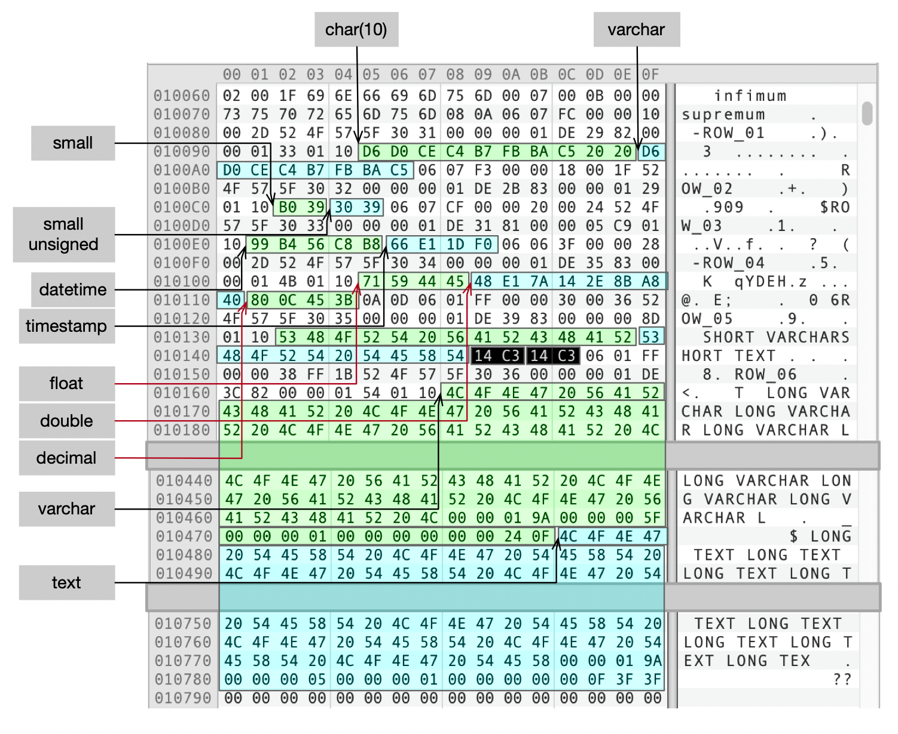

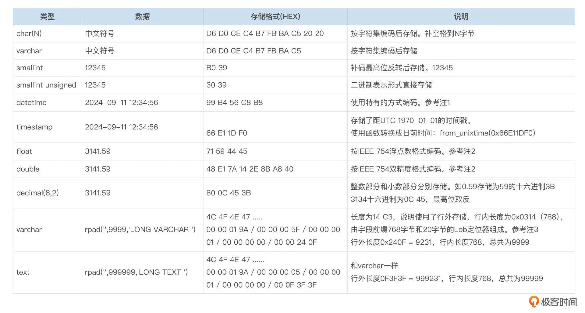

注 1：Datetime 类型在 InnoDB 内部使用了特殊的编码格式。

datetime 类型精确到秒（yyyy-mm-dd hh24:mi:ss）的数据，使用 5 个字节存储，编码格式见下图。

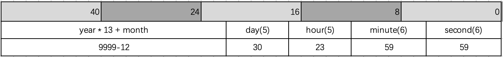

解码方式可以参考下面这段 Python 代码。

```python
def to_datetime(value):
   second = value & 0b111111
   minute = (value >> 6) & 0b111111
   hour = (value >> (6+6)) & 0b11111
   day = (value >> (5+6+6)) & 0b11111
   year_month = (value & ((1 << 39) - 1)) >> 22
   month = year_month % 13
   year = year_month // 13
   return year, month, day, hour, minute, second
>>> to_datetime(0x99B456C8B8)
(2024, 9, 11, 12, 34, 56)
```

注 2：float、double 类型按 IEEE 754 标准编码后存储。你可以找一些在线工具，查看小数编码后的格式。从下面这个图中，可以看到 float 和 double 存储的并不是精确值。

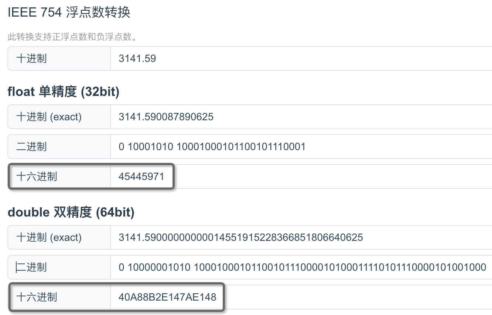

注 3：行长度超过限制后，部分字段需要存储到行外的 LOB 页面后，行内存储 LOB 定位器，指向 LOB 页面。

LOB 定位器的存储格式参考下面的图和表格。


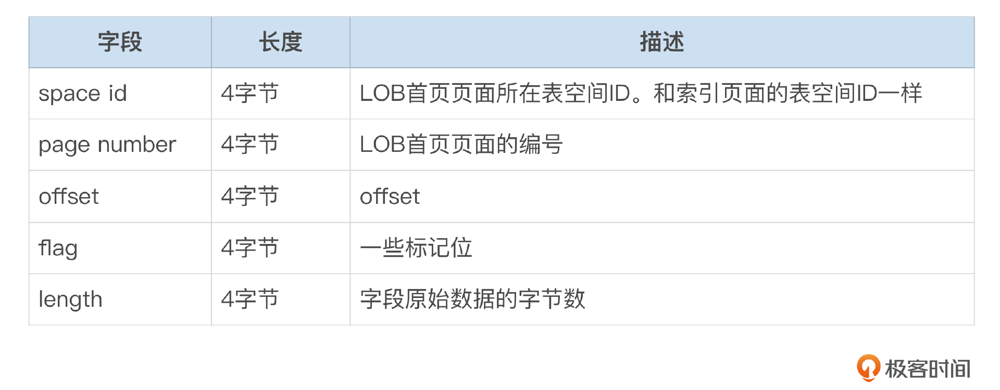

测试表 t_column_storage 中，row_005 的 C10、C11 列都存储在行外，具体数据见下表。

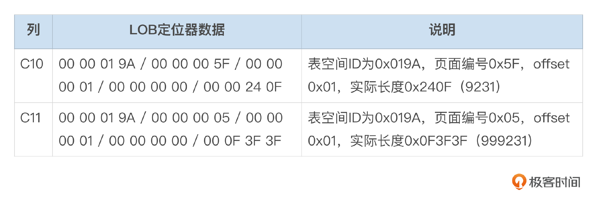

## 总结

这一讲中我们分析了 InnoDB 数据页面的格式，以及 B+ 树页面内记录的存储格式。

数据页头部有很多信息，很多字段的作用这里暂时还没有详细展开，你可以先留意一下这些信息，至于这些字段的具体作用，可以后续再做具体的研究。

这一讲我们只讨论了单个页面的存储格式，至于这些页面是怎么组成 B+ 树的，以及 InnoDB如何管理存储空间，我们下一讲再具体介绍。

## 思考题

我们都知道 InnoDB 中每个索引都由 2 个段（Segment）组成，每个段由一系列区（Extent）组成，每个区的大小为 1M。类似我们测试中的这个表，只写入了几行数据，那么为这个表分配一个区，是不是会有大量的空间浪费？MySQL 是怎么解决这个问题的？

期待你的思考，欢迎在留言区中与我交流。如果今天的课程让你有所收获，也欢迎转发给有需要的朋友。我们下节课再见！
