# 26 | 数据库无法启动，如何读取InnoDB文件中的数据？（下）

你好，我是俊达

这一讲中，我们接着上一讲的内容，介绍 InnoDB 中 B+ 树的物理结构，以及 InnoDB 管理数据文件的一些数据结构。

先创建一个测试表，写入一些数据。

```sql
CREATE TABLE t_btree (
 id varchar(100) NOT NULL,
 a varchar(100),
 padding varchar(1024),
 PRIMARY KEY (id),
 KEY idx_a (a)
) ENGINE=InnoDB;
insert into t_btree(id, a, padding)
select concat('PK', rpad('', 93, '-'), 10000 + n),
   concat('KEY', rpad('', 92, '-'), 10000 + n),
   rpad('', 512, 'DATA')
from numbers
order by n;
```

## InnoDB 中的 B+ 树

之前我们提到过，InnoDB 中表和索引都是 B+ 树的结构，下面就是 B+ 树的一个简单示意图。

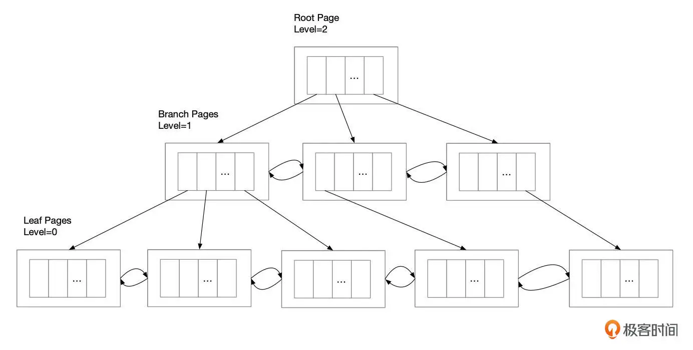

B+ 树由根节点（root page）、分支节点（branch page）和叶子节点（leaf page）组成。每个页面由头部信息和页面记录组成。分支页面的记录中，有指向下一个层级的页面编号。页面头部还记录了同一层级中相邻页面的编号，这些页面组成一个双向链表。页面记录包含 Key 和Value 两个部分。对于主键，Key 就是组成 Primary Key 的字段，分支页面中的 Value 值是页面编号（Page Number），叶子页面中，Value 值包括隐藏字段 DB_TRX_ID，DB_ROLL_PTR，以及表结构中 Primary Key 之外的字段。

二级索引中，分支页面中的记录由索引定义中的字段、主键字段和页面编号组成，而叶子页面中的记录由索引字段和主键字段组成。

这个结构，在物理文件中是怎么体现的呢？我们来看一下测试表 t_btree 中的索引结构。先查看索引的元数据，聚簇索引的根页面是 page 4，idx_a 的根页面是 page 5，表空间 ID 是 411（0x019B）。

```sql
mysql> SET SESSION debug='+d,skip_dd_table_access_check';
mysql> select t2.name, t2.se_private_data
 from mysql.tables t1, mysql.indexes t2
 where t1.id = t2.table_id
 and t1.name = 't_btree';
+---------+---------------------------------------------------------+
| name    | se_private_data                                         |
+---------+---------------------------------------------------------+
| idx_a   | id=779;root=5;space_id=411;table_id=1477;trx_id=122435; |
| PRIMARY | id=778;root=4;space_id=411;table_id=1477;trx_id=122435; |
+---------+---------------------------------------------------------+
```

然后再查看索引字段，聚簇索引里包含了表中所有的字段，还有 2 个隐藏字段 db_trx_id、db_roll_ptr。二级索引的字段包含了主键字段。

```sql
mysql> use mysql;
mysql> select t2.name, t4.ordinal_position as pos,  t4.hidden, t3.name,
   t3.hidden, t3.column_type_utf8
from tables t1, indexes t2, columns t3, index_column_usage t4
where t1.id = t2.table_id
and t1.id = t3.table_id
and t2.id = t4.index_id
and t3.id = t4.column_id
and t1.name = 't_btree'
order by t2.name, t4.ordinal_position
+---------+-----+--------+-------------+---------+------------------+
| name    | pos | hidden | name        | hidden  | column_type_utf8 |
+---------+-----+--------+-------------+---------+------------------+
| idx_a   |   1 |      0 | a           | Visible | varchar(100)     |
| idx_a   |   2 |      1 | id          | Visible | varchar(100)     |
| PRIMARY |   1 |      0 | id          | Visible | varchar(100)     |
| PRIMARY |   2 |      1 | DB_TRX_ID   | SE      |                  |
| PRIMARY |   3 |      1 | DB_ROLL_PTR | SE      |                  |
| PRIMARY |   4 |      1 | a           | Visible | varchar(100)     |
| PRIMARY |   5 |      1 | padding     | Visible | varchar(1024)    |
+---------+-----+--------+-------------+---------+------------------+
```

## 聚簇索引结构

### ROOT

聚簇索引的根页面编号是 0x04，Page 4 的内容见下面这个图，图上标注了一些关键信息。

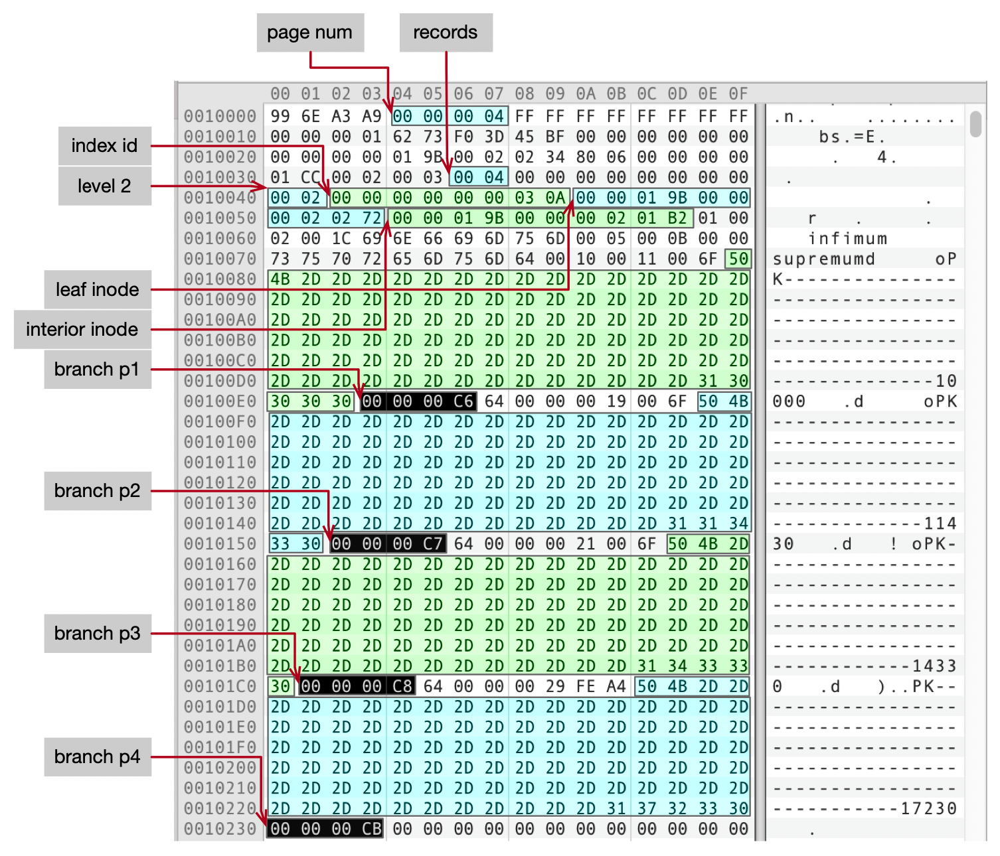

- index id 为 0x030A，也就是 778，和元数据中查到的一样。

- level 为 2，这棵 B+ 树的高度为 3 层。

- leaf inode 和 interior inode 分别记录了叶子页面和分支页面所在段（Segment）的段描述符（inode）的地址。inode 的作用稍后再介绍。

- 根页面中有 4 条索引记录，分别是（PK-10000，Page C6）、（PK-11430，Page C7）、（PK-14330，Page C8）、（PK-17230，Page CB）。

### Branch

从根页面，我们得到了分支页面的编号，我们来看一下其中一个分支页面 Page C6 的内容。

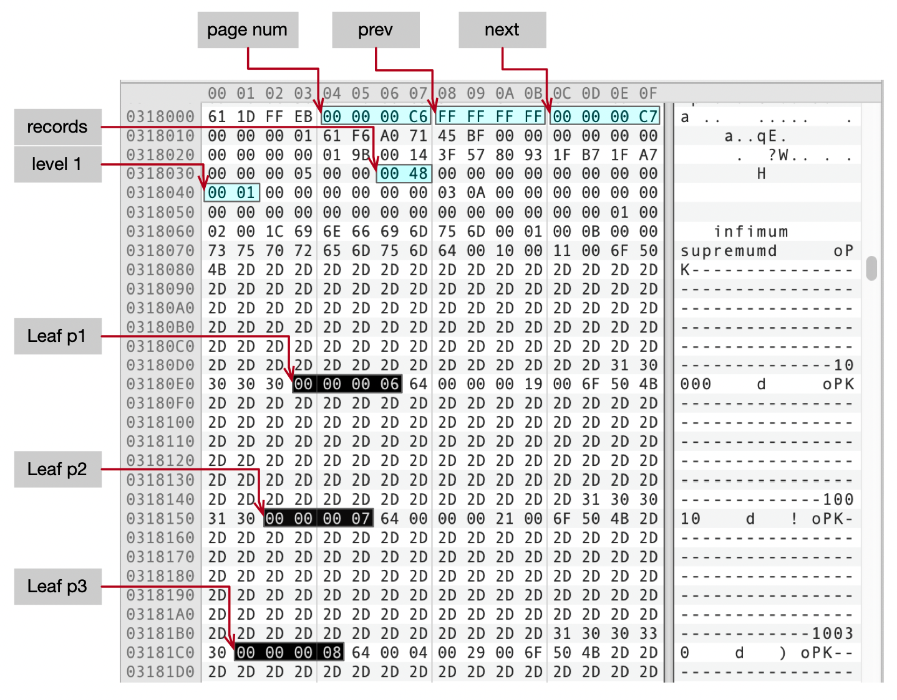

- Level 为 1。

- Prev 为 null，说明这是 Level 1 中的第一个页面。Next 为 Page C7。

- records 为 0x48，说明页面中有 72 条索引记录。

- 图中展示了部分索引条目，分别是（PK-10000，Page 06），（PK-10010，Page 07），（PK-10030，Page 08）。

### Leaf

从分支页面中，我们知道了叶子页面的编号，我们来看一下页面 07 的内容。

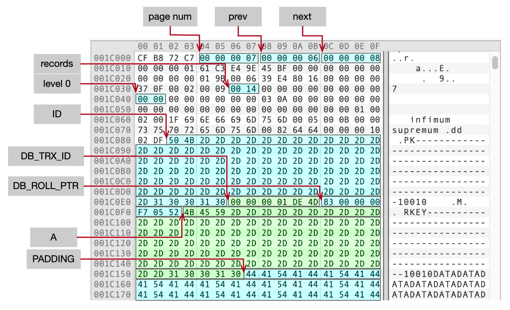

- Level 为 0，说明这是一个叶子页面。

- records 为 0x14，说明页面内有 20 条记录。因为每行记录比较长，页面内只存了 20 条记录。

- Prev 为 Page 06，Next 为 Page 08，分别指向当前页面的前后相邻的页面。

- 每行数据的字段依次为（ID，DB_TRX_ID，DB_ROLL_PTR，A，PADDING），和我们从数据字典中查到的一样。

如果把整个聚簇索引画出来，大概就是下面这个图。

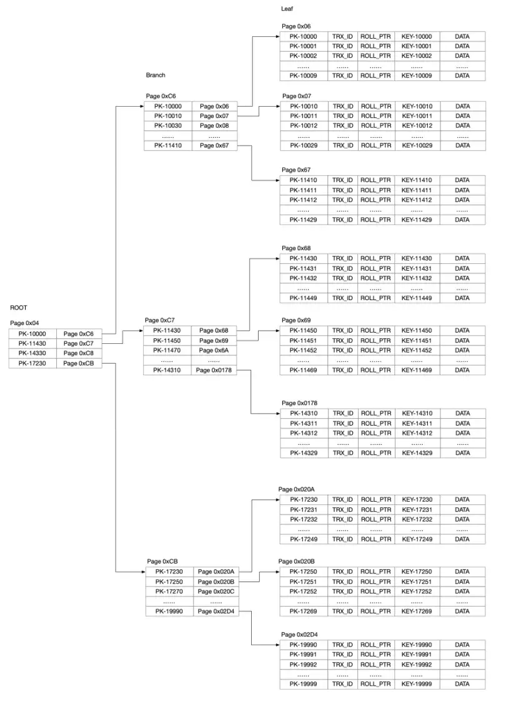

## 二级索引结构

我们再来看一下二级索引的物理结构。先从根页面开始。

### ROOT

我们已经从数据字典中查到，索引 idx_a 的根页面为 Page 05。下图就是 Page 05 的内容。

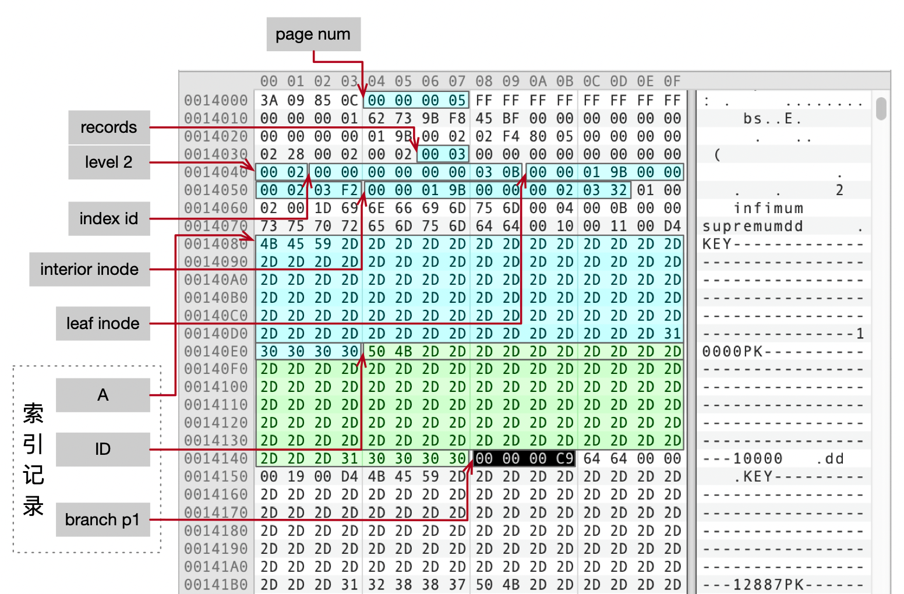

### Branch

下图展示了第一个分支页面 Page C9 的内容。

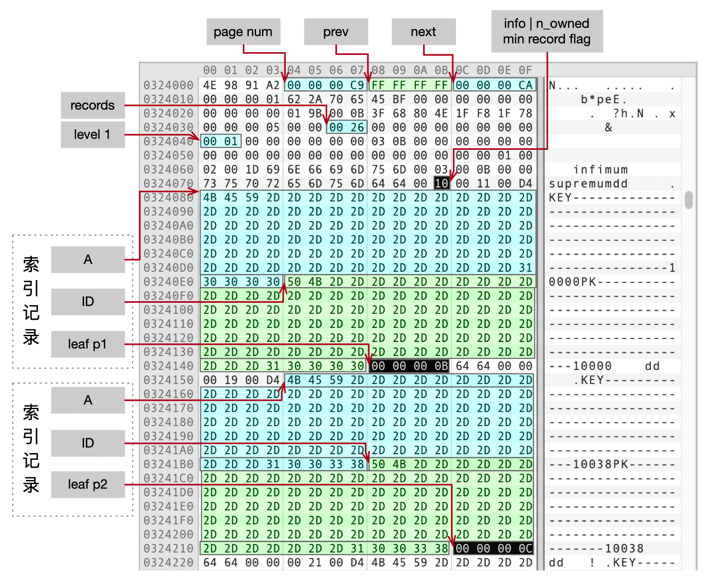

- prev 为空，next 指向 Page CA。

- records 为 0x26，说明页面内有 38 条记录。

- level 为 1。

- 索引记录由字段 A、ID 和指向叶子页面的编号组成。图中显示了两条索引记录，分别是（KEY-10000，PK-10000，Page 0B）和（KEY-10038，PK-10038，Page 0C）。

### Leaf

叶子页面 Page 0B 的内容展示在下面这个图中。

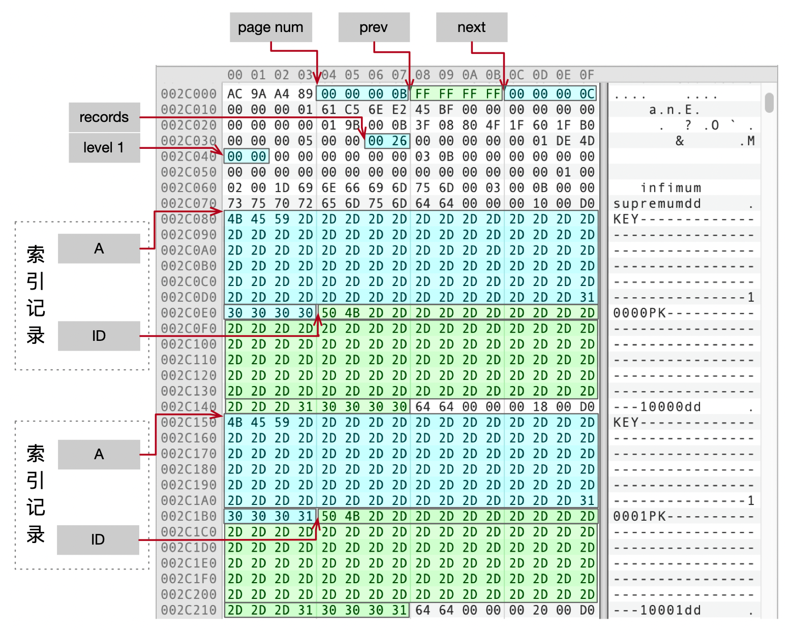

- Prev 为 null，next 指向页面 Page 0C。

- records 为 0x26，页面内有 38 条记录。

- level 为 0，说明是叶子页面。

- 图中有两条索引记录，分别是（KEY-10000，PK-10000）和（KEY-10001，PK-10001）。

## 段空间管理

InnoDB 每个索引都由 2 个段（Segment）组成，在索引的根页面中，记录了这 2 个段的段描述符的地址。测试表 t_btree 的两个索引的段描述符地址我整理到了下面这个表格中。

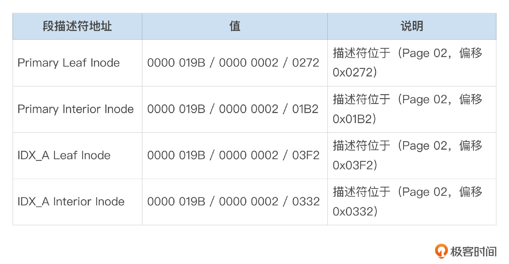

### 段描述符（INODE）

InnoDB 使用段来管理空间，段描述符（inode）记录了段的相关信息，inode 中的信息我整理到了下面这个表格中。

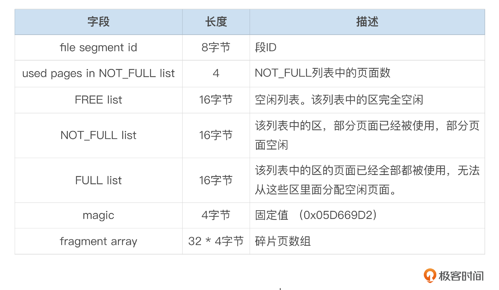

下面这个图里面，展示了聚簇索引的 2 个段的描述符。

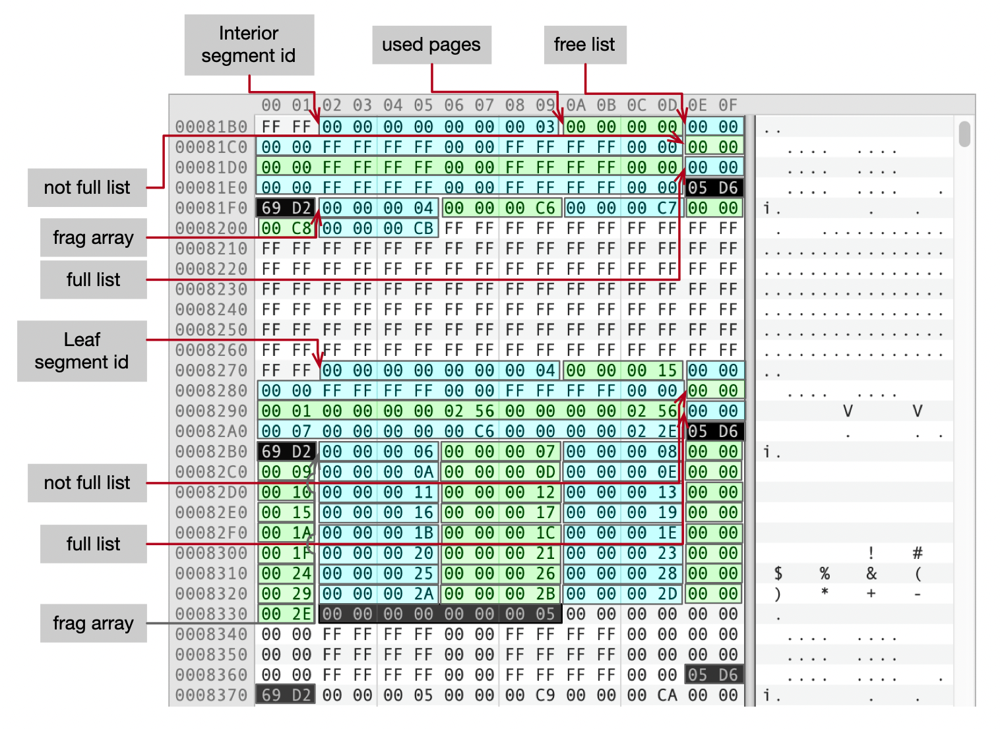

- 聚簇索引跳转页面段的 ID 为 3，段内总共有 5 个页面（包括根页面），编号分别是 04、C6、C7、C8、CB。 这和我们在聚簇索引根页面中看到的一致。

- 聚簇索引叶子页面段 ID 为 4。Not Full 链表中有一个区（Extent），使用了 15 个页面。Full链表中有 7 个区（Extent）。

数据文件中的区（Extent）可分为两种类型，一种是常规的区，常规的区最多只能分配给 1 个段使用。还有一种称为碎片区，碎片区的页面可以分配给不同的段使用。

为什么要这么设计呢？因为对于小表，记录数很少，如果给这些表分配一个完整的区（1M），就会浪费空间。另外，对于一些特殊类型的段，比如回滚段，对于小事务而言，每个回滚段需要的空间很小，如果分配一个完整的区，会浪费大量空间。

给段分配空间时，先会从碎片区中分配页面，这些页称为碎片页，页面编号会记录到 INODE的碎片页数组中。只有分配给一个段的碎片页数量达到 32 之后，才会分配完整的区。

每个段里面，所有的区组成了 3 个链表。

- Free 链表：这个链表中的区是完全空闲的。

- Not Full 链表：这个链表中的区，部分页面已经分配，其他页面是空闲的。

- Full 链表：这个链表中的区，所有的页面都已经分配。

### 数据文件中的链表结构

InnoDB 的数据文件中存在大量双向链表结构，这些链表结构上是一样的，都由链表基节点和链表节点组成。链表基节占用 16 字节，由下面这 3 个字段组成。


链表节点占用 12 个字节，由下面这 2 个字段组成。


下图是 InnoDB 物理文件中双向链表的一个示意图，基节点中记录了链表头部节点和尾部节点，所有节点通过 prev 和 next 指针连接在一起。

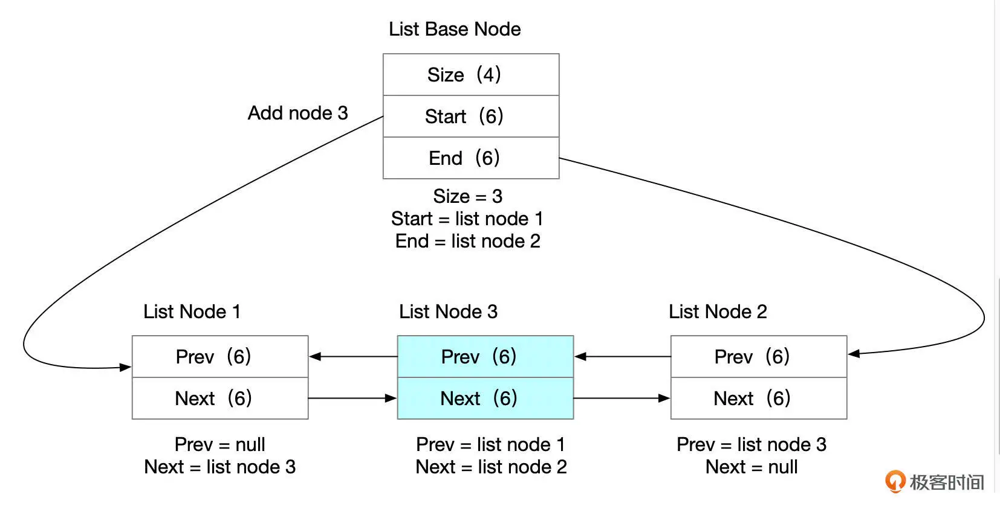

我们来看一下测试表 t_btree 聚簇索引 Leaf 段中的几个链表。

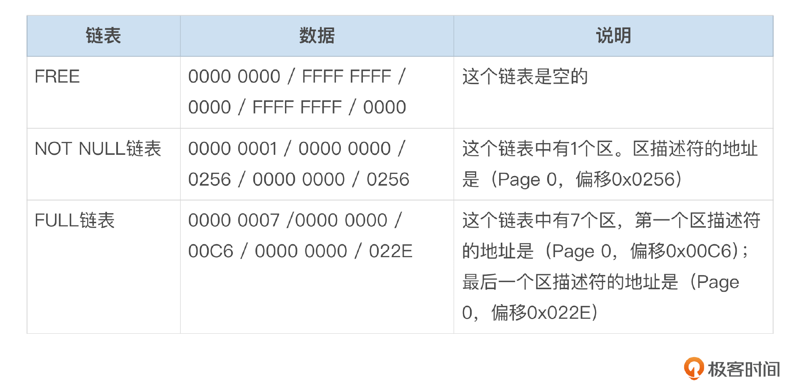

我们来看一下 FULL 链表在物理文件中的存储方式，下面这个图中，标注了 Full 链表中的区描述符。

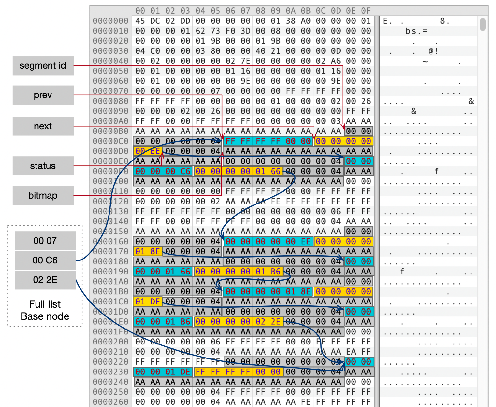

- segment id 为 4。

- prev 和 next 指向链表中相邻的区。

- status 是区的状态。

- bitmap 中记录了区中每一个页面的状态，一个区有 64 个页面。

关于区描述符的更多信息，后面我还会详细介绍。

将 Full 链表中的所有区都整理出来，可以得到下面这个图。

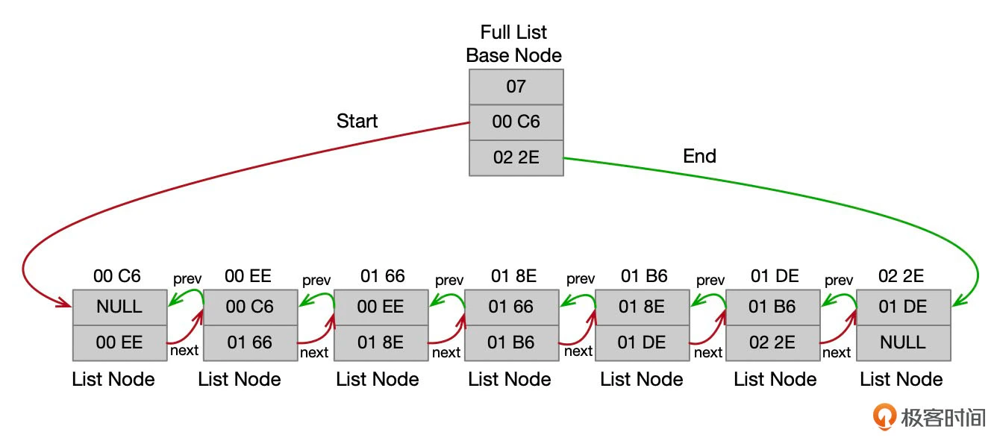

## 表空间管理

最后，我们来看一下 InnoDB 是怎么管理空间的。InnoDB 中，表和索引数据都存储在表空间中。从系统表 information_schema.innodb_tablespaces 可以查看当前数据库中的所有表空间。

```sql
mysql> select space, name, row_format, space_type
      from information_schema.innodb_tablespaces
      order by space;
+------------+---------------------+----------------------+------------+
| space      | name                | row_format           | space_type |
+------------+---------------------+----------------------+------------+
|          1 | sys/sys_config      | Dynamic              | Single     |
|          3 | hello/test          | Dynamic              | Single     |
| 4294967277 | undo_x001           | Undo                 | Undo       |
| 4294967278 | innodb_undo_002     | Undo                 | Undo       |
| 4294967279 | innodb_undo_001     | Undo                 | Undo       |
| 4294967293 | innodb_temporary    | Compact or Redundant | System     |
| 4294967294 | mysql               | Any                  | General    |
+------------+---------------------+----------------------+------------+
```

表空间分为几种不同的类型，我整理成了下面这个表格。

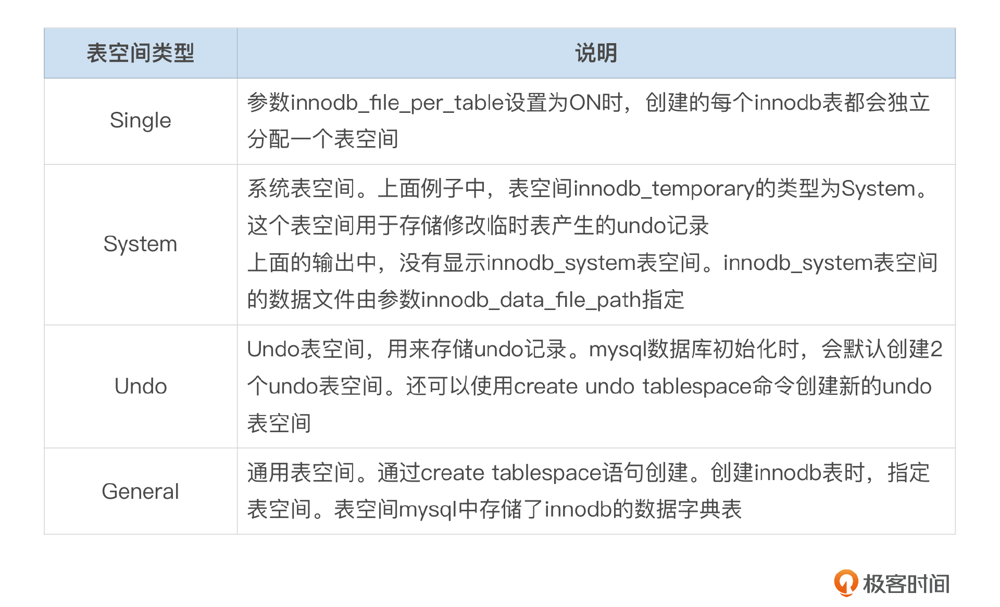

### InnoDB 数据文件格式

InnoDB 中，除了系统表空间，其它每个表空间都是由 1 个数据文件组成。

数据文件有固定的格式，每个数据文件被分割为固定大小的页（Page），相邻的页组成区（Extent）。表和索引的数据通过段（Segment）来组织，每个段由一些页和区组成。

### Page

InnoDB 以 Page 为最小单位来分配空间，每个 Page 的大小由参数 innodb_page_size 指定。该参数只能在数据库初始化之前配置，数据库初始化完成后，不能再修改。InnoDB Page 大小可设置为 4K、8K、16K、32K 或 64K，默认为 16K。后续我们以 16K 的 Page 大小来分析。

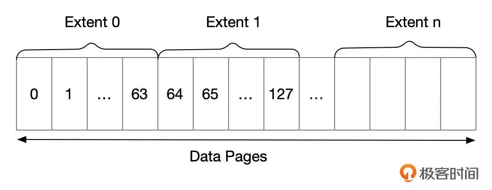

### Extent

InnoDB 将相邻的页面组成一个区（Extent），每个区的大小固定，具体大小和页的大小有关。对于 16K 的页面大小，一个区由 64 个页面组成，大小为 1M。

### Segment

InnoDB 中每一个索引（包括聚簇索引）都由 2 个段（Segment）组成。索引中所有的叶子页面组成一个段，其他页面组成一个段。每个段由页面（Page）和区（Extent）组成。

数据文件的第一个页面称为文件头（FSP Header），里面存储了整个表空间的相关信息。文件头的具体存储格式，可以参考下面这个图和表格。

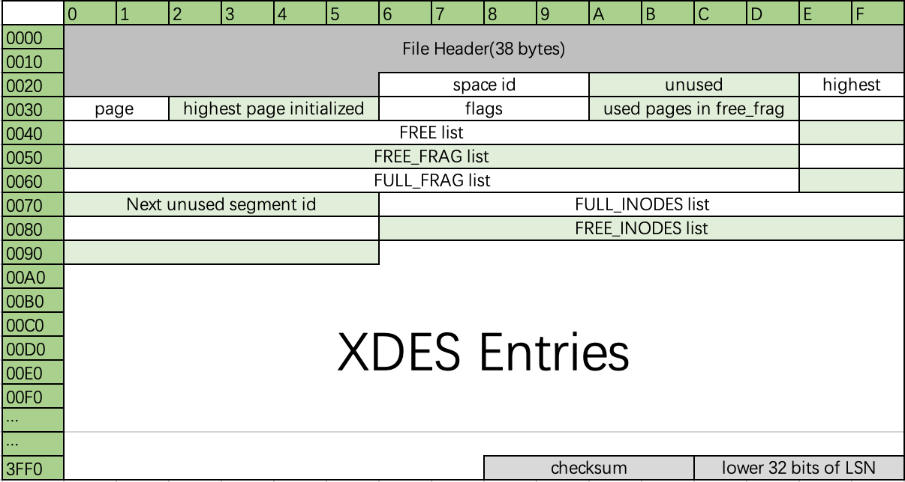

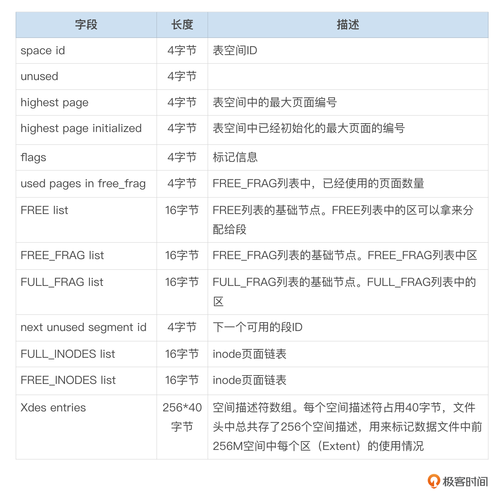

表空间文件分为 3 个区域，FSP Header 中的 highest page initialized 和 highest page 字段分别记录已初始化空间和未初始化空间的最大页面编号。


已初始化空间区域内的区（Extent），要么加入到 FSP Header 头部的 3 个链表中，要么已经分配给某个段（Segment）。未初始化空间区域内的区还没有被格式化，也就是这些区还没有加入到任何链表中。当需要分配空间时，可以将这个区域内的区加入到 FSP Header 中的空闲列表中，然后再分配给某个表或索引。如果数据文件内的区都已经被使用，分配空间时就需要先扩充文件的长度。

FSP Header 维护了几个重要的链表。

- FREE 链表

位于 FREE 链表中的区完全空闲。当需要分配一个完整的区时，从 FREE 链表中获取。如果FREE 链表中没有可分配的区，则需要将未初始化空间中的区加入进来，或者扩展文件后再将区加入进来。

- FREE_FRAG 链表

InnoDB 将区（Extent）分成两种不同的类型：普通的区和碎片区。普通的区是指分配时分配空间时，将整个区分配给某个段。而碎片区会以页为单位，每次只将 1 个页分配给某个段。这么设计的原因，前面已经讲过了，主要是为了节省空间。

分配碎片页时，先从 FREE_FRAG 列表中获取一个碎片区，然后在碎片区中获取一个空闲的页面进行分配。如果碎片区中的所有页都已经分配完，则会将该碎片区移到 FULL_FRAG 链表中。如果 FREE_FRAG 链表中没有碎片区可用，则需要从 FREE 链表中获取一个空闲的区加入进来。

- FULL_FRAG 链表

FREE_FRAG 链表中的碎片区，当页面都已经分配后，就会移到 FULL_FRAG 链表中。FULL_FRAG 链表中的区，如果有页被释放，则会移到 FREE_FRAG 链表中。

- FREE_INODES 链表

INODE 用来跟踪段的空间使用情况。每一个段都有一个对应的 INODE 结构。InnoDB 使用专门的页面来存储 INODE 信息，而 FREE_INODES 链表将还有空闲 INODE 的页面链接在一起。InnoDB 创建段的时候，需要从 FREE_INODES 列表中找到一个 Inode 页面，然后从页面中找到一个未被使用的 INODE。

如果 FREE_INODES 列表中没有可用的页面，则需要重新分配一个空闲的页面，将页面格式化后加入到链表中。如果一个 Inode 页面中的 Inode 都已经被分配，则需要将该 Inode 页面移到 FULL_INODES 链表中。

- FULL_INODES 链表

FULL_INODES 链表用来跟踪已经完全被使用的 INODE 页面。

### 区描述符（Extent Descriptor，XDES）

区描述符记录了区的使用情况。数据文件中每一个区都有一个对应的区描述符（XDES）。每一个区描述符占用 40 字节，具体信息可以参考下面这个表格。

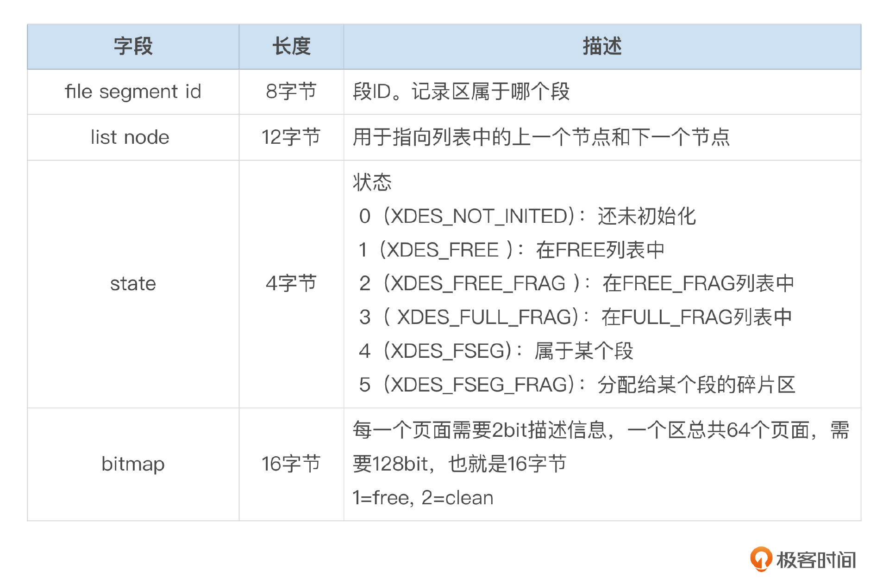

FSP HEADER 中，存储了 256 个区描述符，可以管理 256M 空间。如果数据文件超过256M，则每 256M 的第一个页面都会用来存储区描述符。

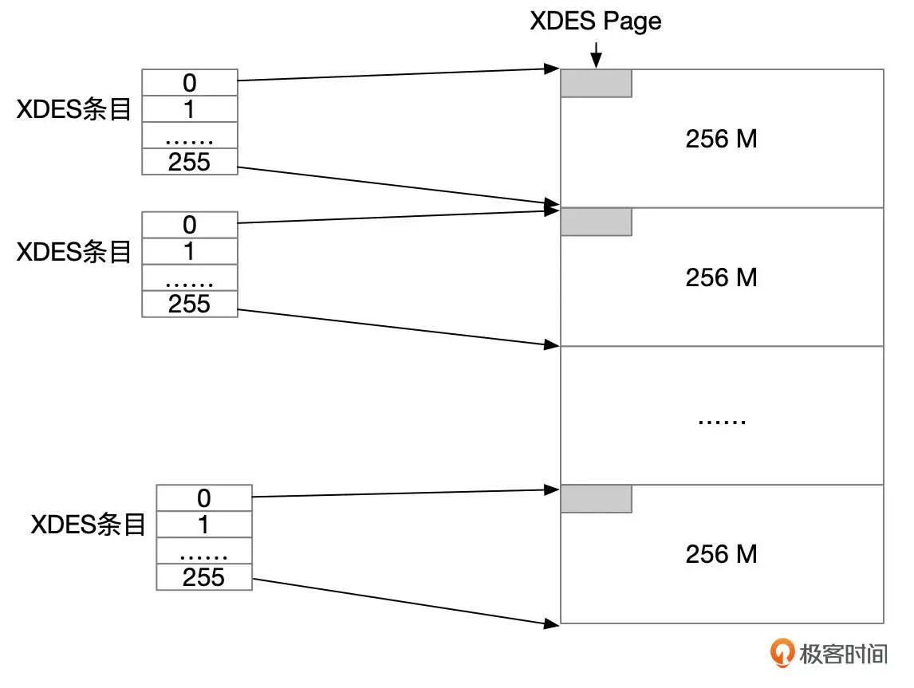

数据文件中，每 256M 空间开头的第一个区有点特殊，因为这些区的第一个页面总是用来存放区描述符，第二个页面总是用来存放 ibuf 位图信息，因此这些区都是碎片区。

我把测试表的第一个页面放在了下面这个图中，对一些重要的字段做了标注。

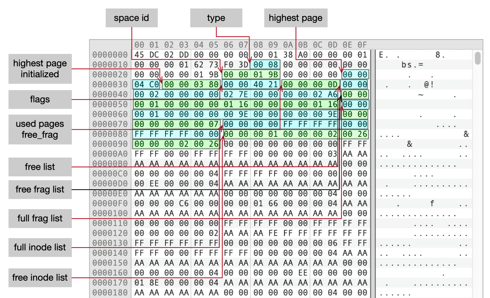

- type 为 8，也就是 FIL_PAGE_TYPE_FSP_HDR。

- highest page 为 0x04C0，转换字节数是 0x4C0 * 16K = 19M，刚好是 ibd 文件的大小。

- highest page initialized 为 0x0380。

- free list、free frag list、full frag list 分别是三个链表。

- full inode list 是空的。

- free inode list 中有一个节点，指向（页面 Page 2，偏移 0x0026）。

Page 2 是一个 Inode 页面，页面内容参考下面这个图。

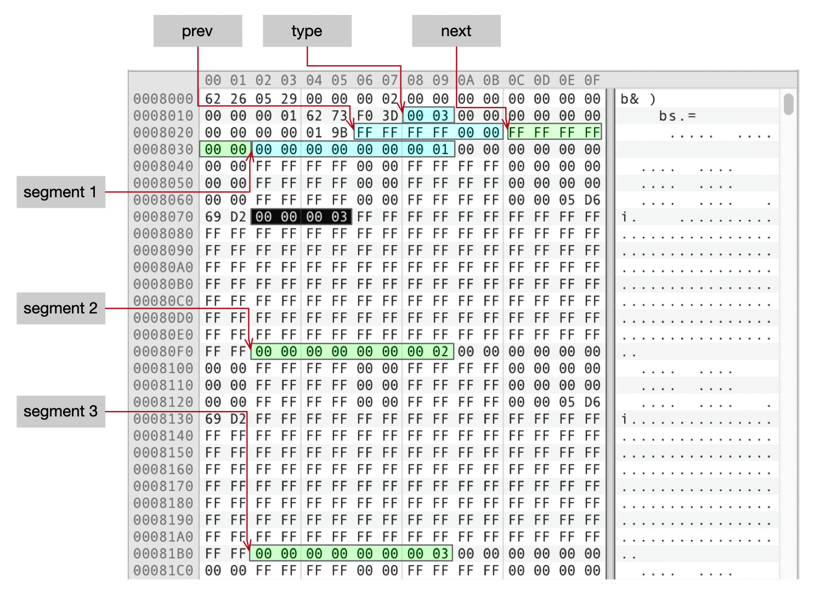

- type 为 3，也就是 FIL_PAGE_INODE

- prev 和 next 分别指向相邻的 Inode 页面，这里只有一个 inode 页面，所以 prev 和 next 都为空。

- 图片中还展示了 3 个段描述符，segment 1 中只有一个页面，segment 2 也是一个特殊的段，segment 3 属于聚簇索引。

## 总结

这一讲中，我们通过一个具体的例子，解析了 InnoDB 聚簇索引和二级索引的存储格式，你可以看到，我们之前关于 InnoDB 表和索引结构的描述，都是有依据的。

我们还看到了 InnoDB 管理段和空间的一些数据结构，包括段描述符、区描述符、Inode 页面。InnoDB 数据文件中，藏着很多链表结构，有单向链表，还有双向链表，后续的课程中，还有更多的链表结构等我们去发现。

## 思考题

我们知道，在 B+ 树中检索数据时，要先从根页面开始，数据字典表 mysql.indexes 记录了每个索引的根页面。

但是 indexes 本身也是一个 InnoDB 表，因此从 indexes 表检索数据时，需要先知道这个表的根页面编号，那么 MySQL 怎么知道 indexes 表的根页面编号是什么呢？

期待你的思考，欢迎在留言区中与我交流。如果今天的课程让你有所收获，也欢迎转发给有需要的朋友。我们下节课再见！
