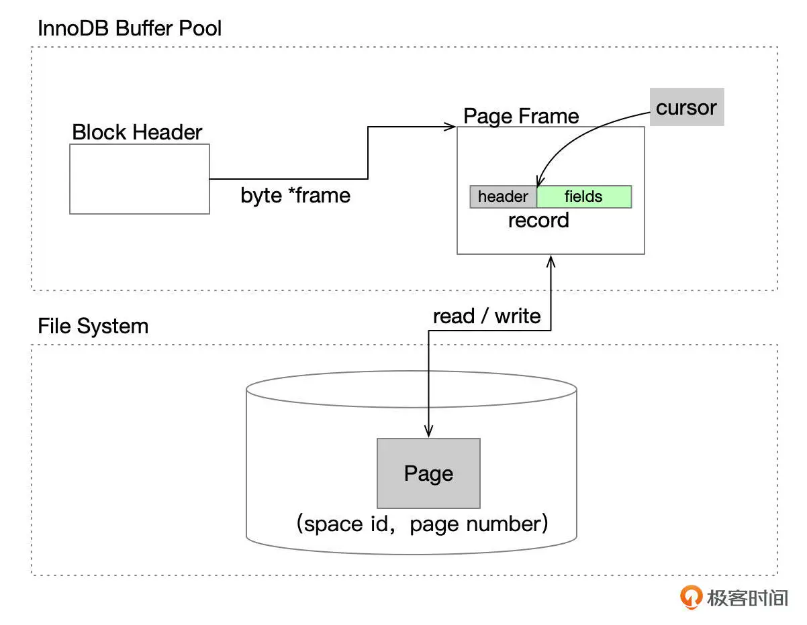
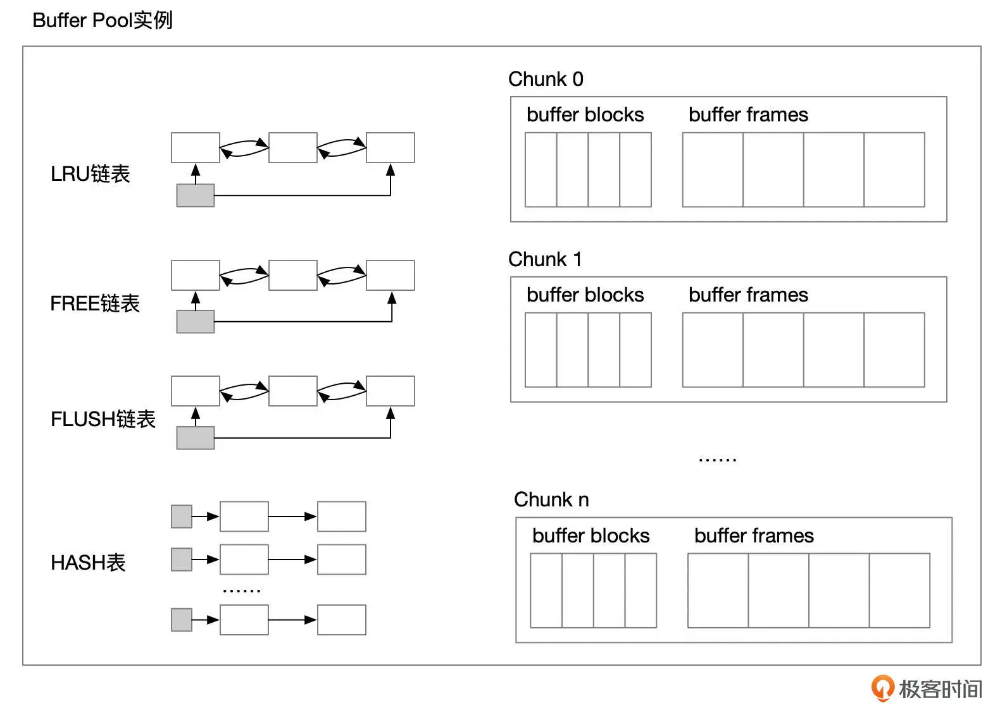
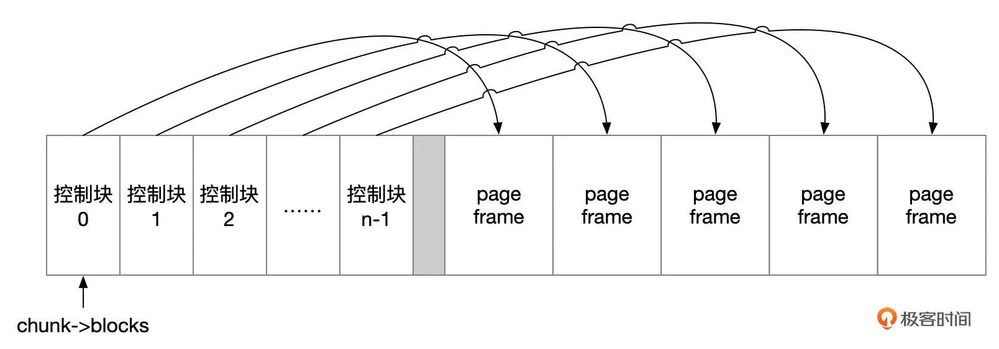
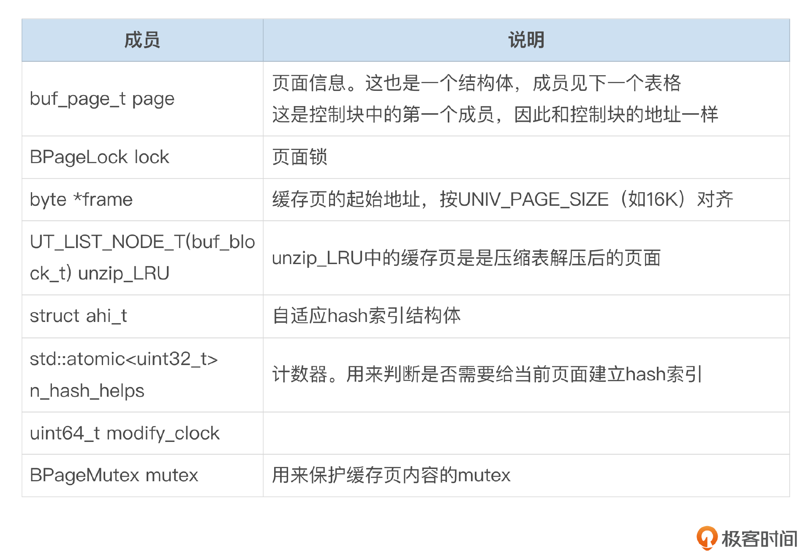
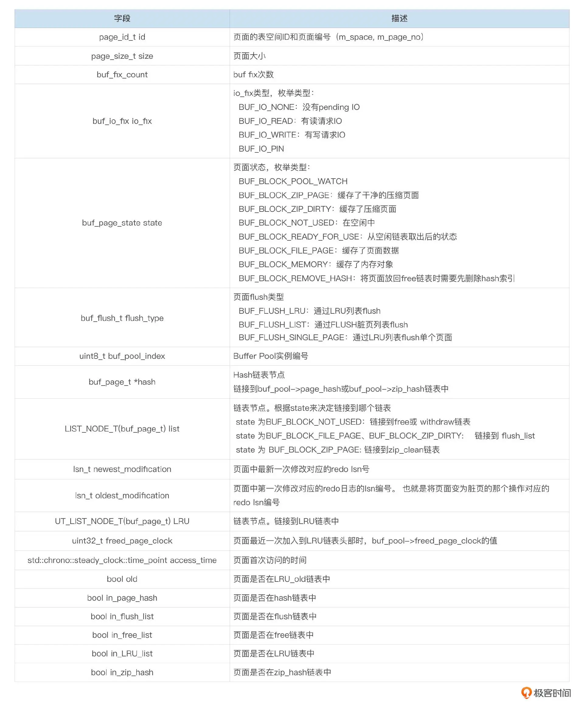
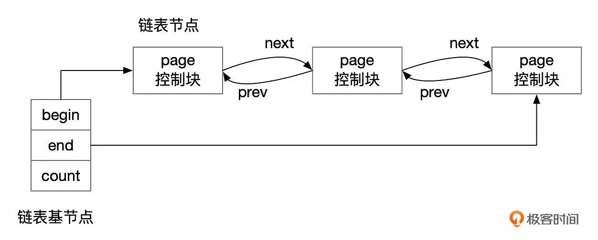
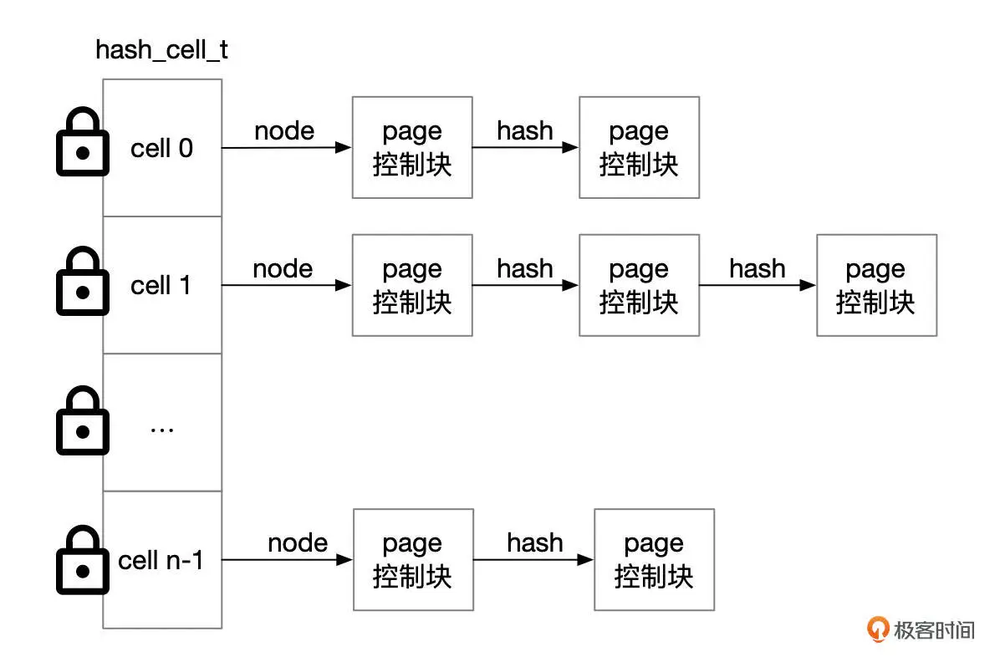
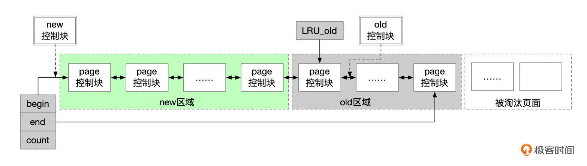
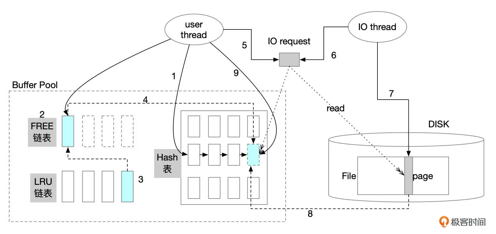

# 27 | InnoDBBufferPool如何提高数据库性能？(上）

你好，我是俊达。

从前两讲中，我们知道了 InnoDB 表和索引的物理存储格式。执行 Select 语句的时候，最终会从 ibd 文件中获取数据，执行 Insert/Update/Delete 语句的时候，最终会将数据写入到 ibd文件。读取或修改 ibd 文件中的数据时，都需要先将数据页缓存到 InnoDB Buffer Pool 中。这主要是因为访问内存的响应时间比访问磁盘要低几个数量级，将数据页缓存在 Buffer Pool 中再操作，可以减少磁盘的访问次数，提升性能。

那么数据页是怎么加载到 Buffer Pool 中，又是怎么写回到 ibd 文件中的，缓存页在 BufferPool 中是怎么组织的？这就是这一讲中我们要学习的内容。

另外，Buffer Pool 中还有一些用来提升性能和保证数据一致性的结构，包括 Change Buffer、自适应 Hash 索引、Double Write Buffer，对这些结构我们也会做一些介绍。

## InnoDB Buffer Pool

InnoDB 将数据存储在表空间中，读取或写入数据时，需要先将数据从文件加载到内存中。InnoDB 分配了专门的内存来缓存表空间中的数据（包括表、索引以及回滚段等），这一块内存称为 Buffer Pool。

缓存的单位是页面（Page），即使你只访问一条记录的一个字段，也要将记录所在的整个页加载到 Buffer Pool。读取数据时，InnoDB 会将记录所在的页面加载到缓冲池，然后解析缓存页面中的记录数据，将结果返回给客户端。

修改数据时，会先在缓存页面中修改。修改后的页面称为脏页，脏页不会立刻写回到文件。InnoDB 会在执行 Checkpoint 时，或者寻找空闲的替换页面时，将脏页写回文件。

下面是一个数据块缓存到 Buffer Pool 中的简单示意图。

- 数据文件中使用（space id，page number）来定位一个数据页。

- Buffer Pool 中的缓存页（page frame）和数据页的大小一致，比如都是 16K。（注：业界有时也将 page frame 称为页框、页帧，这个课程里我称为缓存页）。

- 每一个缓存页都有一个对应的控制块（Bock Header 结构），控制块中记录缓存页的相关信息。后面我们会看到控制块的具体结构。

- InnoDB 内部有一个命名为 cursor 的对象，cursor 实际上是一个指针，指向缓存页中的某行记录。这和客户端驱动（如 JDBC）中的 cursor 不是一个概念。

InnoDB 使用缓冲池，主要有几方面的原因。

1. 提升数据库性能。当前普遍使用的 PC 服务器中，访问内存中的数据耗时大约是几十纳秒，访问高性能 SSD 的耗时大约在几十到几百微秒，而读取机械磁盘中的一个数据块的耗时在毫秒级别。将数据缓存到 Buffer Pool 中，可以提升数据库的读写性能。

2. 合并写入操作。Buffer Pool 中的数据被修改后，不会实时写回到文件系统中。一个数据页被多次修改后，只需要将页面写回一次，就能将所有的操作都持久化。

当然，由于数据先在内存中修改，为了保证事务的 ACID 属性，InnoDB 使用 REDO 和UNDO 等机制，后续几讲我们会详细分析。

### Buffer Pool 结构

InnoDB Buffer Pool 由 1 个或多个实例组成。Buffer Pool 实例数量由参数innodb_buffer_pool_instances 控制。只有 Buffer Pool 的大小超过 1G 时，才可以配置多个Buffer Pool 实例。

引入多个 Buffer Pool 实例，主要是为了减轻使用大内存 Buffer Pool 时存在的资源争用。Buffer Pool 中存在多个链表结构，查询和修改这些链表结构时都需要先获取相关的锁，以保证多个线程并发访问这些链表时数据的一致性。Linux 系统下，如果 innodb_buffer_pool_size超过 1G，默认 innodb_buffer_pool_instances 设置为 8。

对于大内存 Buffer Pool，适当增加 innodb_buffer_pool_instances 可以提高数据库的整体性能。当然，这个参数并不是越大越好，因为维护多个 Buffer Pool 实例会有一些额外的开销。InnoDB 参数的设置，你可以参考第 4 讲。

下面是一个 Buffer Pool 实例的示意图。

- 每个 buffer pool 实例中都有几个链表，包括 lru 链表、free 链表、flush 链表、hash 表。

- buffer pool 实例中，内存会分割成多个块（Chunk）。

一个 Chunk 是一块连续的内存空间，通过参数 innodb_buffer_pool_chunk_size 来设置每个Chunk 的大小。Chunk 中的内存主要分为控制块（buf block）和缓存页（page frame）。缓存页的大小和 InnoDB 物理文件页的大小一致（由参数 innodb_page_size 指定），用来缓存InnoDB 数据文件页的数据。

对应于每一个缓存页，有一个控制块（Buffer Block），记录了缓存页相关的信息，包括缓存页的页面编号（Page No）、缓存页的访问情况、页面是否被修改。每个控制块大约占用几百字节的内存，对于 16K 的页面，控制块占用的内存大约是页面大小的 4%-5%。

参数 innodb_buffer_pool_chunk_size 指定的是缓存页占用的空间，所以实际上 Buffer Pool 分配的内存要比参数指定的大 4%-5%。每一个 Chunk 中分配的连续的内存中，开始的一部分内存用来存放控制块，剩余的内存给缓存页使用。每个控制块都记录了对应的缓存页的地址。每个缓存页的地址按页面大小对齐。

控制块在 MySQL 的源码中是一个结构体，结构体的成员可以参考下面这两个表格。

### 控制块（结构体 buf_block_t）

### 结构体 buf_page_t

为了使 Buffer Pool 的机制能高效地运作，至少需要做到几点：

1. 可以根据数据文件页面编号快速定位到对应的缓存页。

2. 如果数据页还没有被缓存，能快速找到空闲的缓存页，缓存数据。

3. 将经常访问的数据尽可能久地缓存到内存中。

4. 控制好脏页刷新的策略，既要避免大量数据刷新影响实例性能，也要避免大量脏页没有回写导致实例崩溃恢复的时间太久。

InnoDB 使用了一些数据结构来实现这些需求。

### Buffer Pool 中的链表结构

每个 InnoDB Buffer 实例中都存在一些双向链表结构。

- FREE 链表：当需要新的缓存页来加载文件数据时，先到 FREE 链表中查找。如果 FREE链表为空，则需要从 LRU 链表中淘汰一个页面，将淘汰的页面加入到 FREE 链表中。

- LRU 链表：Buffer Pool 中的页面大致按访问的先后顺序加入到 LRU 链表中。最近访问过的页面放到链表的头部，访问较少的页面则会位于链表的尾部。淘汰页面时，从链表的尾部开始查找。

- unzip_LRU 链表：unzip_LRU 链表的缓存页内都是压缩表中页面解压后的内容。

- FLUSH 链表：缓存页的数据被修改后，需要加入到 FLUSH 链表。FLUSH 链表中的页面大致按页面最先被修改的时间排列，最新修改的页面加入到 FLUSH 链表头部。执行Checkpoint 时，依次将 FLUSH 链表尾部的页面刷新到文件。

- zip_free 链表：zip_free 链表用来管理压缩页面的空闲空间。压缩表可以使用不同的页面大小，因此 zip_free 实际上是多个列表，每个列表对应不同大小的压缩页。

这些链表在结构上都是一样的，由链表基节点和链表节点组成。链表基节点记录了链表的头部和尾部，因此访问链表开始和结尾处的节点很快。每个链表节点通过 prev 和 next 指针分别指向前后相邻的节点，通过这些指针可以双向遍历整个链表。当然，访问这些链表时，都需要先获取相关的互斥锁。

### Buffer Pool 中的 Hash 表

查询数据时，先从数据字典中得到索引的根页面号，然后再根据索引条目，找到下一层页面的编号。InnoDB 怎么判断某个页面是否已经缓存呢？这是通过 Hash 表来实现的。每个页面都会根据 hash 算法映射到某一个 Hash 链表中。

在 Hash 表中查找缓存页主要有下面这几个步骤。

1. 根据页面号（Space no，Page No）计算得到 Buffer Pool 实例编号。同一个区（extent）的页面分配给同一个 Buffer Pool 实例。

2. 使用 hash 函数，将页面号（Space no，Page No）转换成 hash 桶的编号。多个页面可能会映射到同一个 hash 桶，这些页面组成一个单向链表。

3. 到 Hash 桶的单向链表中查找页面。通常这个单向链表很短，因此查找速度一般很快。

Hash 桶的数量根据 Buffer Pool 的大小来确定，会取一个比 Buffer Pool 中页面数稍大的质数。Hash 函数的设计会尽量保证将不同的页面分配到不同的 Hash 桶，因此每一个 Hash 桶内链表节点数都比较少。

访问 hash 桶里面的节点时，需要先获取对应的读写锁。InnoDB 并不会给每一个 hash 桶都创建一个读写锁，而是在每个 Buffer Pool 实例中，默认创建 16 个读写锁。Debug 版本的MySQL 中，有一个参数 innodb_page_hash_locks，用来设置 hash 锁的数量。

### LRU 链表

初次访问一个数据页时，要分配一个空闲的缓存页。InnoDB 空闲页都链接到 free 链表中。随着数据库持续运行，当所有的页面都已经被使用后，这时再缓存新的数据页，就要淘汰一个现有的缓存页。应该淘汰哪个页面呢？

InnoDB 会从 LRU 链表的尾部淘汰页面。InnoDB 使用了改良的 LRU 算法，将 LRU 链表分为new 和 old 这两个区域。OLD 区域的占比由参数 innodb_old_blocks_pct 控制，该参数默认为37，也就是 LRU 链表中，尾部大约 3/8 的页面被划入 OLD 区。

改良的 LRU 算法运行过程大致如下：

1. 新的页面首次加入到 LRU 链表中时，会插入到 OLD 区。LRU_old 指向 old 区域的第一个控制块。新加入的控制块插入到 LRU_old 所指的控制块后面。页面首次加入 LRU 链表后，还会设置页面的访问时间（access_time）。

2. OLD 区域的页面后续再次被访问时，判断当前时间和首次访问时间的间隔是否足够长，如果访问的时间间隔超过了参数 innodb_old_blocks_time 设置的值，就将页面移到 LRU 链表的头部。innodb_old_blocks_time 默认为 1000 毫秒。也就是加入到 old 区的页面，1 秒之后再次被访问时，会移到 LRU 链表的头部。

3. 实例运行过程中，有的页面被加入到 OLD 区，有的页面被淘汰，有的页面被移到 LRU 链表头部，这些操作会导致 new 区域和 old 区域内的页面数量偏离预定的设置，InnoDB 会移动指针 LRU_old，使 2 个区域的页面数保持在预定的设置内。

4. new 区域内的页面，并不会在每次访问时都移动到 LRU 链表的头部，因为在 LRU 链表中移动一个页面需要获取互斥锁，大量的页面移动操作会带来额外的性能开销。InnoDB 为每个 Buffer Pool 实例维护了 freed_page_clock 变量，每次淘汰一个页面时该变量加 1。一个页面加入到 LRU 链表头部时，在控制块中记录实例当前的 freed_page_clock。new 区域内的页面再次被访问时，如果在该页面首次加入 new 区域之后，Buffer Pool 中被淘汰的页面数超过了 new 区域总页面数的 1/4，则 InnoDB 认为该页面被淘汰的风险较高，会将该页面移动到 LRU 链表头部。

改进的 LRU 算法可以在一定程度上避免大表单次全表扫描时将 Buffer Pool 中经常访问的页面淘汰掉。在大表单次全表扫描的场景下，页面加载到 Buffer Pool 中，首次访问之后不会再次访问，将这些页面限制在 OLD 区域，可以减少对 new 区域内缓存页的影响。

### 文件 IO

首次访问数据页时，需要发起 IO 操作，从文件读取数据，缓存到 Buffer Pool 中。

InnoDB 使用了异步 IO 读取数据，大致上可以分为几个步骤。

1. 用户执行 SQL，根据页面编号（space id，page number）到 Buffer Pool 中查找该页面是否已经被缓存。先计算得到页面对应的 Buffer Pool 实例，然后到 Buffer Pool 实例的 Hash表中查找。

2. 如果页面已经被缓存，就不需要进行文件 IO。否则，需要到 FREE 链表中找一个空闲的缓存页，用来缓存数据。

3. 如果 FREE 链表中没有空闲页面，需要到 LRU 链表尾部淘汰掉一个页面。淘汰的页面先加入到 FREE 链表，然后再分配给用户线程使用。

4. 获取到空闲的缓存页后，将页面加入到对应的 Hash 链中。

5. 用户线程发起 IO 请求，将文件页读取到缓存中。IO 请求分为同步 IO 和异步 IO。有些页面的读取使用同步 IO，用户线程直接调用 read 系统调用，将数据读取到内存。使用异步 IO时，用户线程先发起 IO 请求，然后等待其他线程完成 IO，然后才可以继续执行。

6. 异步 IO 可分为内核原生异步 IO 和模拟异步 IO。Linux 系统下，如果操作系统内核支持异步 IO，MySQL 会自动使用这种方式，通过参数 innodb_use_native_aio 可以观察是否使用

- 了内核原生异步 IO。如果采用了内核原生异步 IO，用户线程会通过系统调用（如io_submit）将 IO 请求分派给操作系统内核。

7. 如果使用了内核原生的异步 IO，MySQL 的 IO 线程会轮询 IO 操作是否完成。如果使用了模拟的异步 IO，用户线程只是将 IO 请求放到 IO 队列中，由 IO 线程执行具体的 IO 操作。IO 线程的数量由参数 innodb_read_io_threads 和 innodb_write_io_threads 控制。

8. IO 操作完成后，数据就缓存到了 Buffer Pool 中。

9. 数据页缓存后，用户线程可以继续执行，读取或写入记录。

我们知道，Linux 中文件系统本身也提供了缓存机制，而 InnoDB 数据文件也存储在文件系统中，那么数据是否会被多次缓存呢？这和参数 innodb_flush_method 的设置有关，一般建议设置为 O_DIRECT，这样就不会在文件系统中缓存文件的数据。

### Buffer FLUSH

执行 DML 修改数据时，会先修改 Buffer Pool 中的缓存页。事务提交时，不需要等待脏页刷新。脏页会异步刷新到磁盘。那么脏页是什么时候刷新到磁盘的呢？

我们来考虑一个问题，如果脏页一直不刷新，会发生什么情况？

1. 如果脏页一直不刷新，Buffer Pool 中所有的页面最终都会变脏，那么就没有空闲页面可用了。

2. 如果数据库或服务器崩溃了，大量脏页没有刷新到磁盘。虽然有 REDO 日志，数据不会丢失，但是下次数据库启动时，应用 REDO 日志的时间可能会很长。

3. REDO 日志有空间限制，不能无限增长。InnoDB 会循环使用 REDO 日志文件，新产生的REDO 日志会覆盖之前的日志。如果脏页一直不刷新，就无法覆盖老的 REDO 日志文件。

上面这几种情况，实际上也是会触发脏页刷新的几个场景。

1. 如果 LRU 链表中扫描了一些页面（数量由参数 innodb_lru_scan_depth 控制）后找不到干净的替换页，就需要将一些脏页写回到文件。

2. InnoDB 会定期将 flush 链表尾部的页面刷新回磁盘。刷新行为受参数innodb_adaptive_flushing 控制。开启 innodb_adaptive_flushing 后，InnoDB 会根据REDO 日志产生的速率来决定刷新频率。

3. 重用 REDO 日志文件时，需要保证被重用的 REDO 文件的 LSN 号小于数据库的Checkpoint LSN 号，否则要发起 Checkpoint 操作，官方文档将这种情况称为 sharpcheckpoint，此时数据库的写入操作都会被暂停，会严重影响性能。

4. 参数 innodb_max_dirty_pages_pct_lwm 和 innodb_max_dirty_pages_pct 也会影响脏页刷新。当脏页的比例超过 innodb_max_dirty_pages_pct_lwm 时，InnoDB 会开始刷新一些脏页。当脏页比例接近 innodb_max_dirty_pages_pct 时，InnoDB 会开始大量刷新脏页。

## 总结

这一讲中我们对 InnoDB Buffer 的结构做了一些介绍。在实践中，要正确地设置相关的参数。对性能影响最大的参数应该是 innodb_buffer_pool_size 和 innodb_buffer_pool_instances，你可以参考第 4 讲中的相关内容。为了保证数据库的事务 ACID 属性，修改 Buffer Pool 中的数据时，要生成 REDO 和 UNDO 日志，修改记录时还需要先获取行锁，这是接下来几节课要介绍的内容。

## 思考题

读写 InnoDB 表时，会先把数据页缓存到 Buffer Pool 中，那么删除表和索引时，表和索引中已经缓存在 Buffer Pool 中的页面要怎么处理？是不是需要释放这些缓存页？如果有脏页，需要先刷新脏页吗？如果不对这些页面做任何处理，会有什么问题吗？

期待你的思考，欢迎在留言区中与我交流。如果今天的课程让你有所收获，也欢迎转发给有需要的朋友。我们下节课再见！
