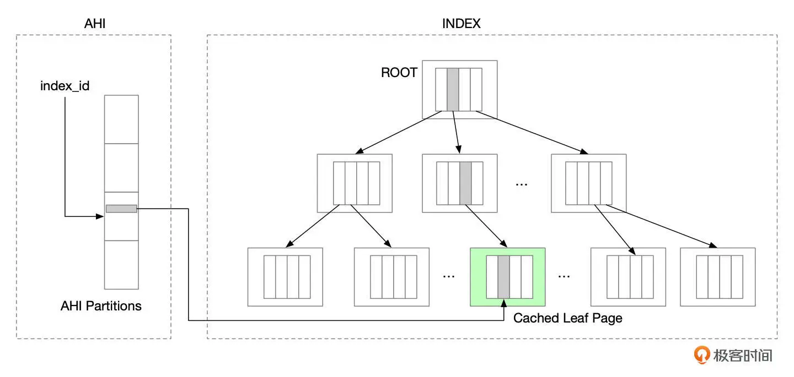
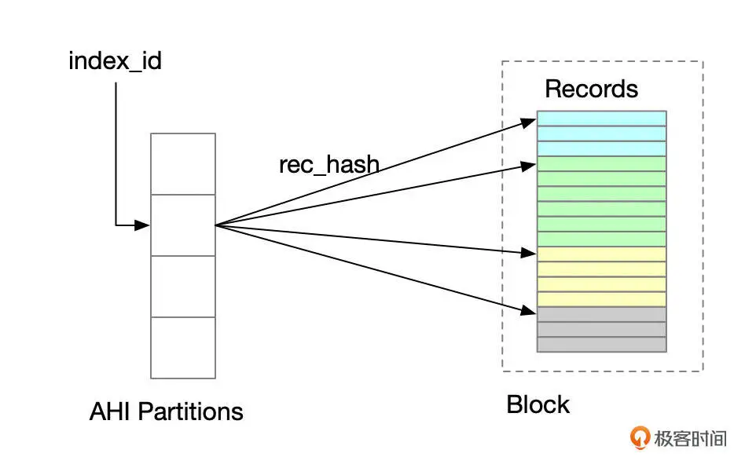
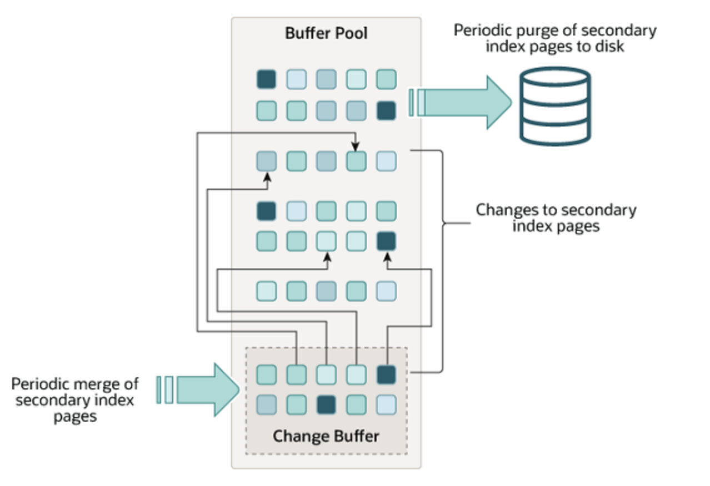
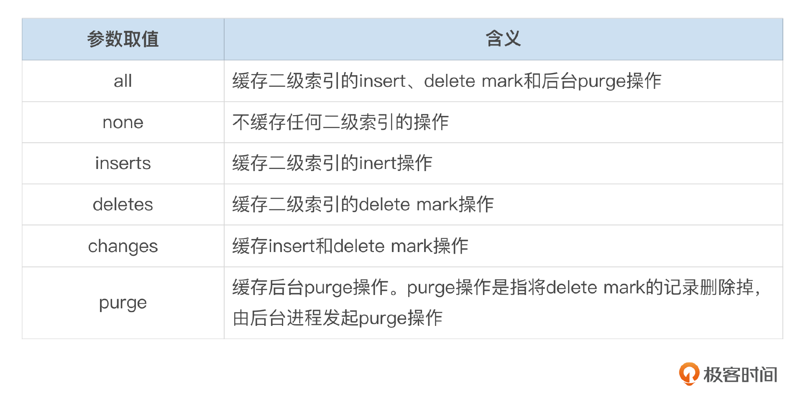
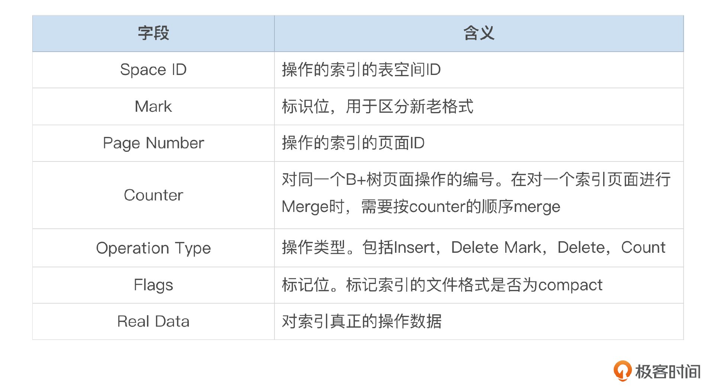
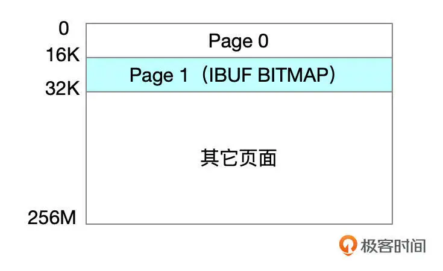
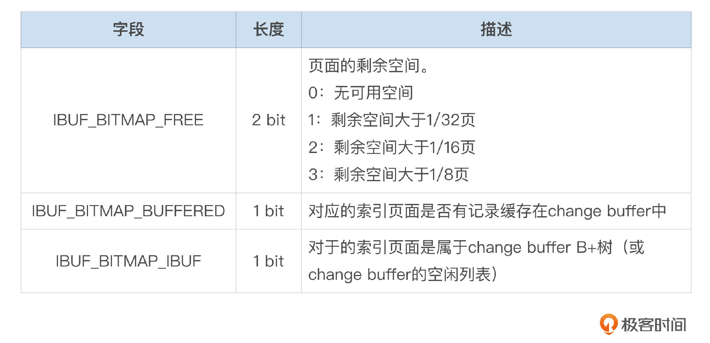
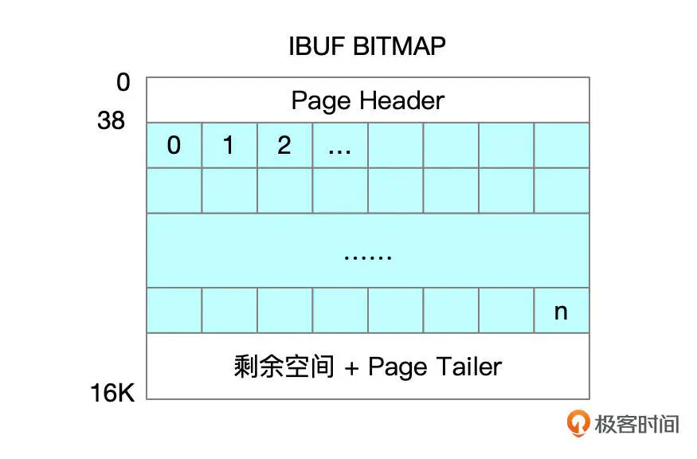
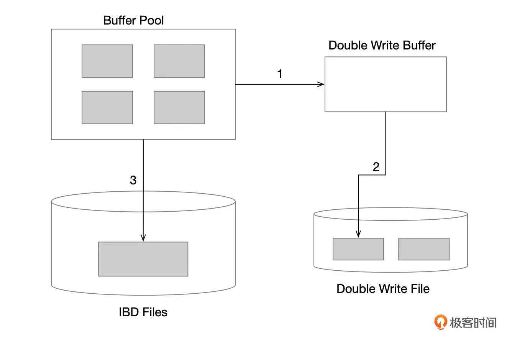

# 28 | InnoDBBufferPool如何提高数据库性能？(下）

你好，我是俊达。

上一讲的思考题中，我留了一个问题，就是删除表或索引时，表或索引已经缓存在 BufferPool 中的数据要怎么处理。实际上处理的方式跟表的类型（是普通表还是临时表，是否使用per-table）以及操作类型有关，还跟 MySQL 的版本有关，这一讲我会对这些情况做一些分析。

InnoDB 还使用了自适应 Hash 索引（Adaptive Hash Index，AHI）、Change Buffer、DoubleWrite Buffer，来提升性能或数据的可靠性，这一讲中我也会分别进行介绍。

## DDL 和 Buffer Pool

### 删除表（DROP Table/Truncate Table）

我们先来看一下 DROP 一个使用独立表空间（innodb_file_per_table=ON）的普通表时，InnoDB 内部需要做哪些处理。

首先要将 AHI 中，跟这个表相关的索引条目清理掉。上一讲中我们提到过，每一个页面的控制块中，有一个 AHI 结构。如果一个索引页面缓存在 AHI 中，那么控制块的 ahi.index 中会指向这个索引。索引在内存中还维护了一个 search_info 结构，里面记录了索引中有多少个页面缓存到了 AHI 中。如果被删除的表，确实有页面缓存在 AHI 中，那么就要扫描每个 Buffer 实例的 LRU 链表，检查每个页面是不是存在和正在删除的这个表相关的 AHI 条目。如果有，先将页面添加到一个临时数组中，临时数组中的页面达到一定数量时，再批量清理这些页面相关的 AHI 条目。

其次，DROP 表时，还需要删除对应的表空间。8.0.23 版本对这一步操作做了优化。之前的版本中，删除表空间时，要扫描 Flush 链表，将这个表的脏页移出 Flush 链表。新版本中，删除表空间时，只需要增加表空间的版本号，不再扫描 Flush 链表。后台线程在刷新脏页时，如果遇到了已经删除的表空间的脏页，会发现页面控制块中记录的表空间的版本号低于表空间最新的版本号，就不需要执行真正的 IO 操作了。

最后，需要删除 ibd 文件。

8.0 中，使用 truncate table 命令清空一个表的数据时，执行的操作类似于先执行 drop table，再 create table，对 Buffer Pool 的操作和执行 Drop table 命令时基本一样。

### 删除索引（DROP Index）

和删除表类似，删除索引时，要先将这个索引相关的 AHI 条目清理掉。清理的步骤和删除表时清理 AHI 的步骤基本是一样的。

删除索引时，还需要回收索引占用的空间。我们在 24、25 讲中说过，一个索引由两个段组成，索引根页面中记录了两个段描述符的地址。分配给一个段的所有区块和页面，可以通过段描述符中的三个链表和碎片页数组找到。回收空间时，从三个链表和碎片页数组中找到分配给索引的区块和页面，依次回收。回收页面时，要再次检查 AHI 是否还有条目指向这个页面，有的话，需要先清理掉 AHI 中的相关条目。

如果删除索引时，Buffer Pool 中还有这个索引的脏页，需要做处理吗？这应该是不用做特殊处理的，因为删除索引后，表空间还在，有脏页的话，后台线程会自动刷新脏页。

### 回收临时表

如果会话使用 create temporary table 命令创建临时表，或者执行一些 SQL（如 selectcount(*) from information_schema.processlist）时用到了临时表，那么在退出连接的时候，要清理会话用到的临时表。在 8.0.23 版本之前，这个清理的开销比较大，需要扫描两次 LRU 链表，清理 AHI 中的索引条目，并将临时表缓存在 Buffer Pool 中的页面从 LRU 链表和 FLUSH链表中移走。

Buffer Pool 越大，扫描 LRU 链表和 FLUSH 链表需要的时间越长，而且操作这些链表结构时，都会获取相关的 mutex，这会导致其他会话被阻塞，对性能有很大的影响。8.0.23 版本做了优化，回收临时表时，不再需要将临时表的页面从 LRU 和 Flush 链表中移走。

第一章中我们讲 DDL 时，提到过 DROP Table、删除索引这些操作通常是很快的。现在我们知道了，执行这些操作时，会涉及到 Buffer Pool 中的一些修改，在高并发的环境下，执行这些操作可能对业务系统造成明显的影响，因此建议 DDL 尽量放在业务的低峰期执行。

## 自适应 Hash 索引（Adaptive hash index）

自适应 Hash 索引是 InnoDB 用来提升查询性能的一个方法。在 B+ 树索引中查找时，需要先到根页面中查找，再依次在索引树的每一层中查找，最终定位到叶子页面，树的层级越多，搜索的页面就越多。而使用 Hash 查找时，先计算出一个 Hash 值，然后直接到 Hash 表中查找。

自适应 Hash 索引由 MySQL 自动维护。MySQL 会基于查询的访问模式，自动识别热点块，为热点块建立 hash 索引。hash 索引完全存在于内存中。为了提高并发性，AHI 分为多个分区，默认分为 8 个分区，可通过参数 innodb_adaptive_hash_index 调整分区数量。

你可以通过参数 innodb_adaptive_hash_index 来控制是否开启 AHI，8.0 时，AHI 默认开启，但是到了 8.4，默认关闭了 AHI。

下面是 AHI 的一个示意图，AHI 中，Key 是索引记录或索引记录的前缀，Value 指向索引叶子页面中的索引条目。



在为某个索引页面建立 Hash 索引时，InnoDB 会给这个索引页面中的所有记录都创建 Hash索引。



开启 AHI 后，InnoDB 需要维护 AHI，这带来一定的开销。查询如果能使用到 hash 索引，可以提升查询的性能。在具体的应用场景下，AHI 是否能提升数据库的整体性能，需要通过实际的测试才能确定。

你也可以观察 show engine innodb status 命令的输出中，ADAPTIVE HASH INDEX 相关的信息，对比 hash 查找和非 hash 查找的次数。

```sql
-------------------------------------
INSERT BUFFER AND ADAPTIVE HASH INDEX
-------------------------------------
Ibuf: size 1, free list len 0, seg size 2, 0 merges
merged operations:
insert 0, delete mark 0, delete 0
discarded operations:
insert 0, delete mark 0, delete 0
Hash table size 17393, used cells 0, node heap has 1 buffer(s)
Hash table size 17393, used cells 0, node heap has 1 buffer(s)
Hash table size 17393, used cells 408, node heap has 3 buffer(s)
Hash table size 17393, used cells 0, node heap has 1 buffer(s)
Hash table size 17393, used cells 375, node heap has 2 buffer(s)
Hash table size 17393, used cells 0, node heap has 1 buffer(s)
Hash table size 17393, used cells 0, node heap has 0 buffer(s)
Hash table size 17393, used cells 0, node heap has 1 buffer(s)
Hash table size 17393, used cells 0, node heap has 1 buffer(s)
Hash table size 17393, used cells 41, node heap has 1 buffer(s)
Hash table size 17393, used cells 1, node heap has 1 buffer(s)
Hash table size 17393, used cells 0, node heap has 1 buffer(s)
Hash table size 17393, used cells 151, node heap has 2 buffer(s)
Hash table size 17393, used cells 6, node heap has 1 buffer(s)
Hash table size 17393, used cells 186, node heap has 2 buffer(s)
Hash table size 17393, used cells 64, node heap has 1 buffer(s)
34.17 hash searches/s, 274.16 non-hash searches/s
```

### 自适应 hash 索引的建立

InnoDB 怎么判断要给某个叶子页面创建 Hash 索引呢？

- 在索引中查找数据，访问叶子页面时，更新索引访问模式的相关信息，包括索引访问信息（search_info.n_hash_potential，search_info.prefix_info）和索引页面的访问信息（block->n_hash_helps，block->ahi.recommended_prefix_info）。

- 如果多次访问一个索引时，访问模式一致（prefix_info 一致)，并且对索引页的访问次数超过一定的阈值，就给当前的页面建立 hash 索引。这个阈值是由下面这几点决定。

- 访问次数超过 block 中的记录数 /BTR_SEARCH_PAGE_BUILD_LIMIT

- 访问索引的次数超过 BTR_SEARCH_BUILD_LIMIT

- 如果检测到索引访问模式发生变化，则会重建 block 的 hash 索引。

## Change Buffer

数据写入到非唯一的二级索引时，如果对应的索引页面还没有缓存在 Buffer Pool 中，正常情况下需要发起 IO 操作，将索引页面加载到 buffer pool 中，而 IO 操作通常比内存操作慢几个数量级。为了优化数据写入的性能，InnoDB 使用了 change buffer。在执行 DML 时，如果二级索引的页面还没有缓存，InnoDB 会尝试先将写入操作缓存到 change buffer 中。在合适的时机（比如其他查询语句将页面加载到 buffer pool 时），innodb 再将该页面缓存在 changebuffer 中的操作合并到页面中，以此来减少数据库随机 IO 的数量。

下面是官方文档中，Change Buffer 的一个示意图。



change buffer 只对非唯一索引生效。对于唯一索引，写入数据时需要判断新数据是否和老数据有冲突，所以需要将索引页加载到内存中进行判断，因此没有必要将写入操作缓存到change buffer 中。

参数 innodb_change_buffer_max_size 控制 change buffer 允许使用的最大内存，默认为innodb buffer pool 大小的 25%。参数 innodb_change_buffering 用于控制将哪些操作缓存到change buffer 中，参数可设置的值请参考下面这个表格。



8.0 中 innodb_change_buffering 默认设置为 all，不过在 8.4 版本中，默认值改成了 none，这可能是由于 SSD 磁盘的大量使用，减少了 Change Buffer 的重要性。如果要关闭 changebuffer，建议先进行性能测试，评估对应用的影响。

Change Buffer 本身是一个 B+ 树，存储在系统表空间中。Change Buffer 中记录的格式我整理到了下面这个表格中。



change buffer 记录以 space id 和 page number 为前缀，所以对同一个二级索引页面的操作，在 change buffer 中存储在相邻的位置。

### change buffer bitmap

Change Buffer 位图信息中，记录了每个索引页面的剩余空间信息。位图页和数据页存储在相同的表空间中。数据文件中，每 256M 连续空间中的第二个页面用来存储位图信息。



每个索引页面使用 4bit 来描述页面状态，这些信息的含义参考下面这个表格。



每个 Page 需要 4bit 的位图信息，那么存放 16384 个页面的位图信息需要 8192 字节，1 个16K 的 IBUF 位图页面足够存放这些信息。根据页面编号可直接获取对应的位图信息。



### change buffer 合并

change buffer 中的内容，会在一些情况下合并回索引页面。

1. 将索引页面从磁盘加载到 InnoDB Buffer Pool 时。比如执行 select 操作时。

2. master 线程每秒合并部分 ibuf，每次合并的页面数和 innodb io capacity 有关。每次会随机选择一些页面进行合并。

3. 写入到 ibuf 前，会计算二级索引页面已经缓存在 ibuf 中的大小。如果已经缓存的内容加上本次插入的内容超过了页面的空闲空间，则需要进行 merge。如何在不读取页面的情况下，获取页面的空闲空间呢？这需要从 ibuf bitmap 中获取。

4. ibuf 本身占用空间超过最大值。

5. 实例进行崩溃恢复时，会合并 ibuf。

6. 关闭实例时，若没有开启快速关闭（innodb_fast_shutdown 设置为 OFF），也会进行 ibuf合并。

## Double write buffer

Double write buffer 是用来保障数据可靠性的一种机制。有些系统中，InnoDB 缓存页写到磁盘设备时，不是一个原子操作。一个缓冲页对应了多个磁盘扇区，可能会存在部分扇区写成功，部分扇区写失败的情况，这样数据页的数据就不一致了。

为了避免出现这种情况，InnoDB 使用了 Double Write Buffer。脏页刷新时，先写到 DoubleWrite Buffer，然后再将 Double Write Buffer 中的页面批量刷新到 Double Write 文件中，如果这个过程失败了，那么数据文件中的页面还是好的。如果写 Double Write 文件成功了，但是后续在写数据文件时失败了，那么就可以用 Double Write 文件中的内容来恢复数据。

下图是脏页刷新写 Double Write 文件的一个示意图。



1. 先在 Double Write Buffer 积攒一批脏页。

2. 脏页写入 Double Write 文件中。

3. 脏页写入到 ibd 文件中。

MySQL 8.0 将 Double Buffer 从系统表空间拆分到了单独的文件。

```
# ls *.dblwr
#ib_16384_0.dblwr
#ib_16384_1.dblwr
```

## 总结

这一讲中，我们介绍了执行 DROP TABLE、TRUNCATE TABLE、DROP INDEX 等 DDL 操作时，InnoDB 内部进行的一些处理，包括清理 AHI、删除表空间、回收索引段的空间。如果你使用的版本小于 8.0.23，那么执行这些 DDL 时对性能可能会有比较大的影响，特别是把Buffer Pool 设置得比较大的实例。

InnoDB 还使用了自适应 hash 索引、Change Buffer 来提升性能，我们也做了一些介绍。

Double Write Buffer 是用来保证数据一致性的，有一定的性能开销。如果你的磁盘设备支持原子写入，可以关闭 Double Write Buffer。

## 思考题

MySQL 8.4 中，默认关闭了 Change Buffer 和自适应 Hash 索引，具体可以参考官方文档。MySQL 这么做可能的原因是什么？关闭 Change Buffer 和自适应 Hash 索引对性能会产生哪些影响？

期待你的思考，欢迎在留言区中与我交流。如果今天的课程让你有所收获，也欢迎转发给有需要的朋友。我们下节课再见！
