# 29 | 数据都在内存里修改，服务器或数据库宕机会丢数据吗？

你好，我是俊达。

InnoDB 使用 REDO 和 UNDO 来实现事务的 ACID 属性，保障数据不丢。事务修改缓存页里的数据时，会生成 UNDO 和 REDO 日志，事务提交时，虽然缓存页没有实时刷新，但是会确保 REDO 日志已经完成持久化。

下面是 REDO 和 UNDO 机制的一个简单的示意图。

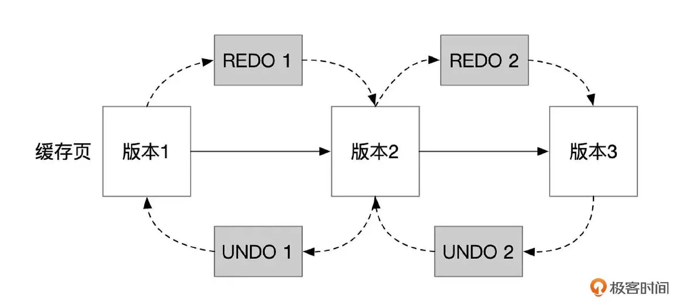

缓存页被修改后，最新的数据为版本 3，文件中保存的还是版本 1 的数据。如果此时数据库崩溃了，下次启动时，应用 REDO 日志，可以将文件中版本 1 的数据重新更新到版本 3。如果数据库崩溃时事务还没有提交，会应用 UNDO 日志，将数据回滚到已经提交的版本。

这一讲中，我们先通过几个具体的例子，来了解基本的 DML 操作是怎么修改数据页的，然后再来分析这些操作，在 REDO 日志中是怎么记录的。

## 页面内的变更

表刚刚创建时，表中还没有数据，B+ 树只有空的根页面。随着不断往表中插入数据、更新数据，一个页面的空间无法容纳新的数据，需要对页面进行分裂，往 B+ 树中添加新的页面。

### 插入记录（insert）

执行 Insert 语句插入记录时，需根据新记录的主键值，在聚簇索引上定位这行记录的位置，定位完成后，游标（cursor）会指向待插入数据的上一行记录。我们先考虑最简单的情况，当前页面有足够的空闲空间来容纳新的记录。在第 25 讲中，我们已经知道，页面内的空闲空间主要由两部分组成。

1. 未使用的空间。页面头部 top 字段指向未使用空间的起始地址。

2. 已经删除的记录释放出来的碎片空间。页面头部 free 字段指向碎片空间的起始地址。

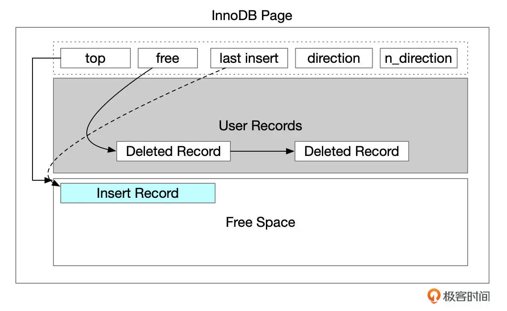

一行记录在页面中会占用一段连续的空间。如果页面内空间够用，记录会重用已删除记录占用的空间，或者在未使用空间中分配一段连续的空间。记录插入后，还需要维护页面头部的相关字段。比如上面这个示意图中，插入记录后，top 需要指向新插入记录的结尾处，也就是新的未使用空间的起始位置。

新插入的记录，还要添加到单向链表中。比如页面内原先有记录 x、z，新插入了记录 y。cursor 会先定位到记录 x，记录 y 插入到页面后，记录 x 的 next record offset 设置为 y，记录y 的 next record offset 设置为 z。

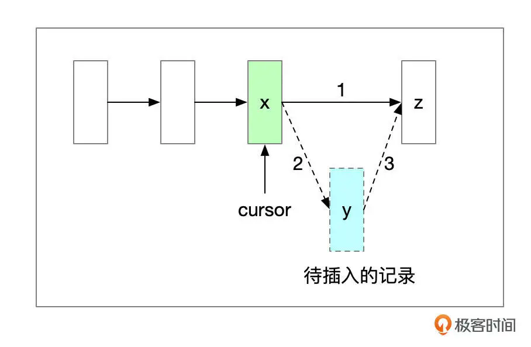

此外，新插入记录后，还需要修改记录组的 n_owned 属性，还可能要添加新的页目录项。

### 删除记录（delete）

InnoDB 中删除记录分为 2 种情况，一种称为删除标记（delete mark），仅在记录头部中设置DELETED_FLAG 标记，记录链中依然保留该记录。另一种是真正删除，将记录从记录链中移除，记录占用的空间可被重用。

执行 delete 语句时，会先给记录打上删除标记，此时还不能直接删除记录，因为其他会话可能还需要读取这行记录未删除的版本。

下面这张图中，记录 Record 2 被标记为删除。

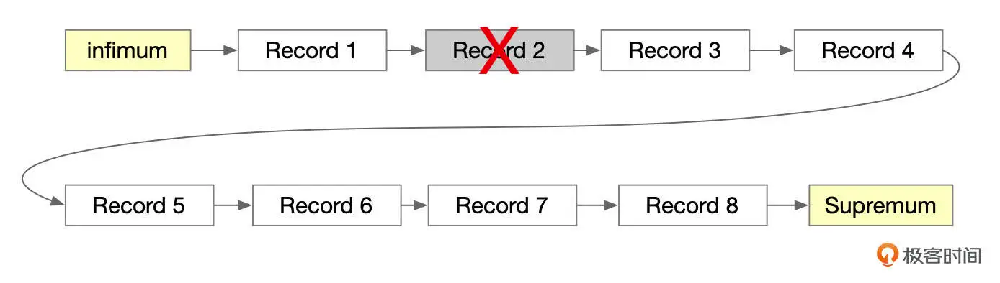

什么时候才能真正删除记录呢？当系统中所有的会话都不再需要记录删除前的版本时，Purge线程会把记录物理删除掉。下面这张图中，删除了记录 Record 2，页面头部的 Free 指向该记录。

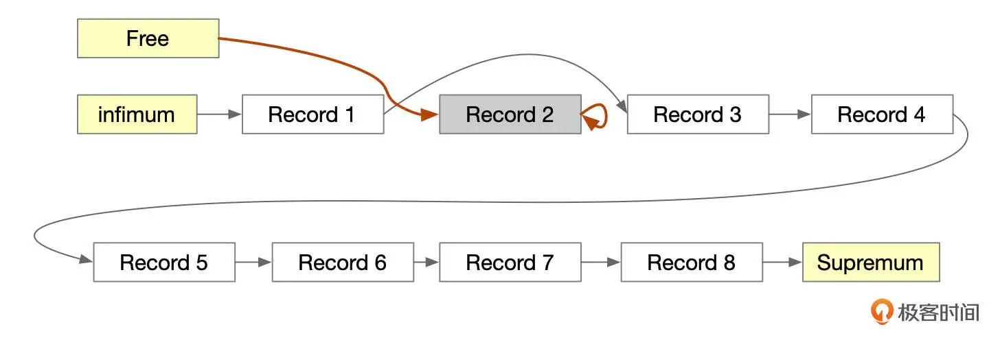

页面内所有删除的记录也组成了一个单向链表，页面头部的 free 字段指向这个单向链表。

下面这个示意图中，记录 Record 7 也被删除了。

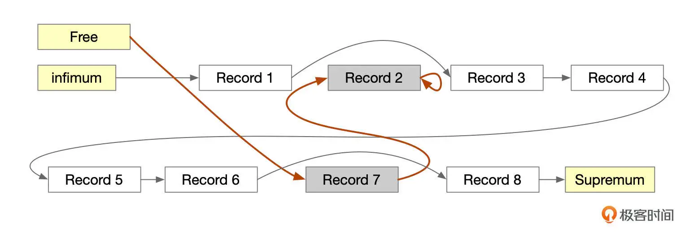

从图中也可以看到，页面内记录删除后，释放出来的空间很可能是不连续的，我们可以称之为碎片空间。

### 更新记录（update）

执行 update 语句更新记录时，要分成几种情况。如果更新后所有字段的长度都没有发生变化，也没有更新行外存储的字段，那么更新可以在原地进行（in place update）。如果更新后字段长度发生变化（变长或变短），就无法进行原地更新，需要先将记录删除（此时的删除是直接真正删除记录，不是给记录加 DELETED_FLAG 标记）后，再重新插入。当然，这里假设了没有更新主键字段。

如果更新了主键字段，那么相当于执行了一个 DELETE 操作，再加一个 Insert 操作。对于二级索引而言，所有的更新操作都会被转换为 delete 和 insert。

### 页面碎片整理

如果页面内的未使用空间不足，无法容纳新插入的数据，但是碎片空间中有足够的空间，可以先对页面进行碎片回收后，再插入新的数据。碎片回收大致上会执行这几个步骤。

1. 内存中分配一个空闲页面。

2. 将碎片页面内的记录依次插入到新的页面。

3. 释放原先的碎片页。

### 页面分裂

如果插入记录时，页面内的空间无法容纳新的记录（即使进行碎片整理后也无法容纳新的记录），就需要将页面分裂成 2 个新的页面。页面分裂大致上分为几个步骤。

1. 找到分裂点。一般情况下，会以页面中的中间记录作为分裂点。假设页面中原先有 n 条记录，则页面分裂后，2 个页面各占 n/2 条记录。这里有几种特殊情况，后面我们会具体介绍。

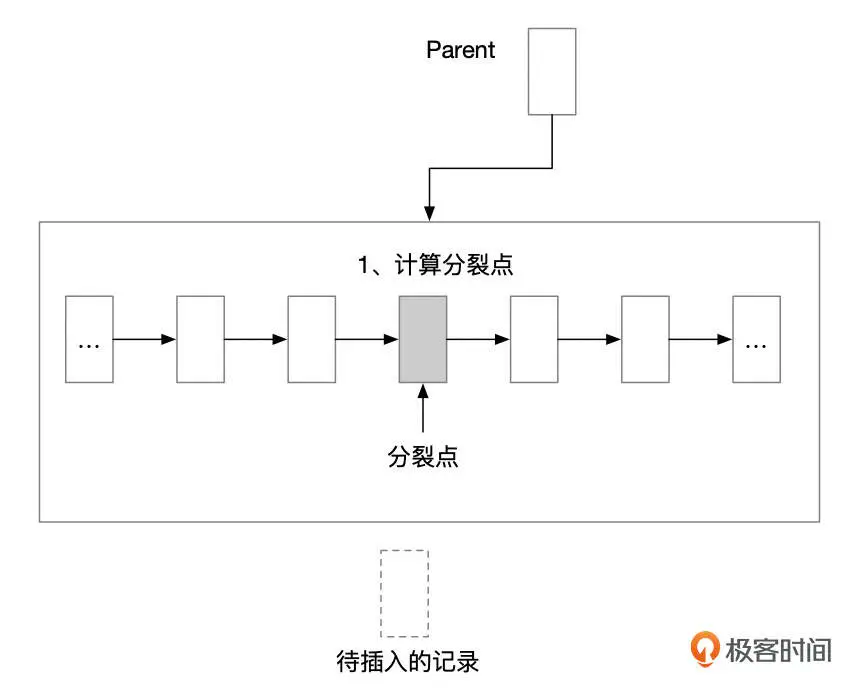

2. 分裂页面

- 新分配一个页面。将原先页面中分裂点以及之后的记录插入到新页面。

- 在父页面中添加指向新页面的记录。如果父页面中空间无法容纳新记录，则需要递归地分裂父页面。

- 在原先页面中，删除分裂点以及之后的记录。

- 比较待插入记录和分裂点记录，判断新记录应该插入到哪个页面，并执行插入操作。

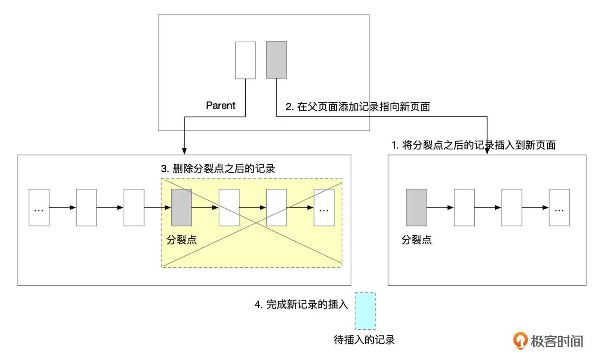

页面分裂有几种特殊情况，分别是 ROOT 页面分裂，向右分裂，向左分裂。

### ROOT 页面分裂

ROOT 页面的分裂有几个特殊的地方。

- ROOT 页面的页面编号（Page Number）在分裂时需要保持不变。因为 B+ 树的搜索都是从 ROOT 页面开始，InnoDB 元数据中记录了 ROOT 页面的编号。如果 ROOT 页面编号发生变化，则还需要同时更新元数据中的信息，增加了复杂度。

- ROOT 页面分裂后，B+ 树的高度会增加 1 层。其他页面的分裂都不会改变 B+ 树的高度。ROOT 页面分裂后，B+ 树的高度会增加 1 层。

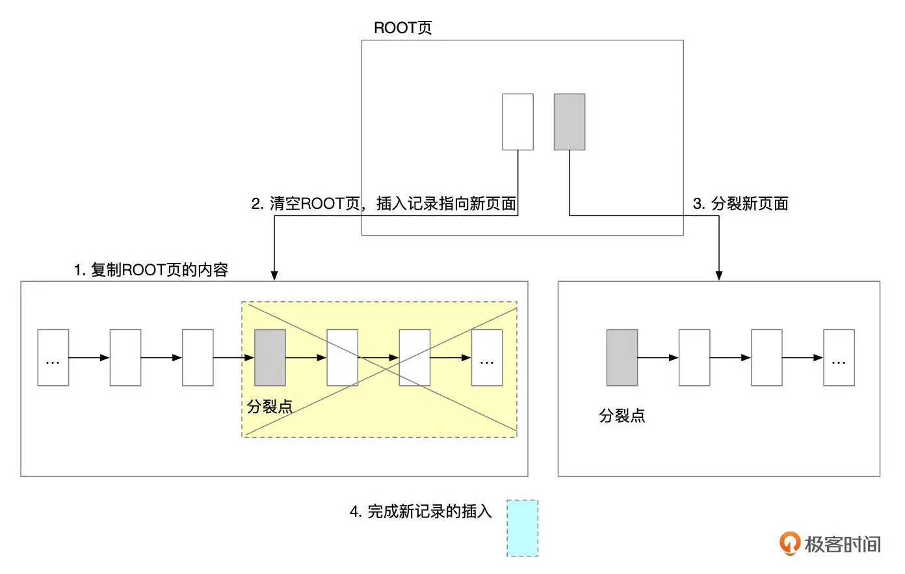

ROOT 页面分裂大致需要执行这几个步骤。

1. 分配一个新的页面。将 ROOT 页面的内容复制到新页面。

2. 清空 ROOT 页面中的内容。并在 ROOT 页面中插入记录，指向新复制出来的页面。

3. 在新页面上执行分裂操作。

4. 插入记录。

### 向右分裂 / 向右插入

往表中插入数据时，如果按 Key 值从小到大的顺序（如自增主键）插入，InnoDB 会采用向右分裂的方式来分裂页面。因为在这种情况下，如果还是采用平均分裂页面的方法，则左边的页面只用了一半的空间，但是后续并不会再往这个页面中插入数据，造成空间浪费。而右边的页面复制了原先页面一半的记录，更容易写满。

InnoDB 插入记录时，在页面头部维护了 Last Insert 字段，里面保存了上一次插入的记录的位置。如果新插入的记录位于上次位置之后，就会使用向右分裂。

向右分裂分为几种情况。

- 情况 1：插入的记录是原先页面中最大的记录。这种情况下，以新插入的记录作为分裂点。

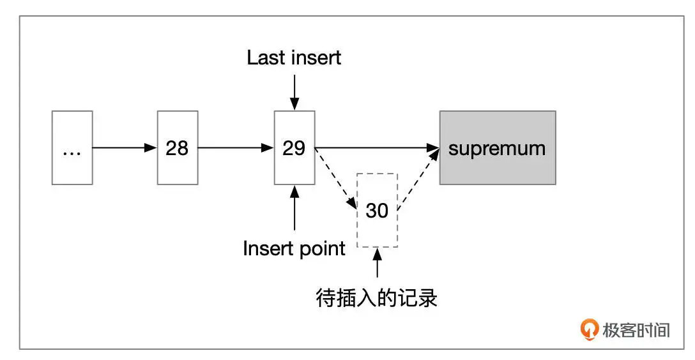

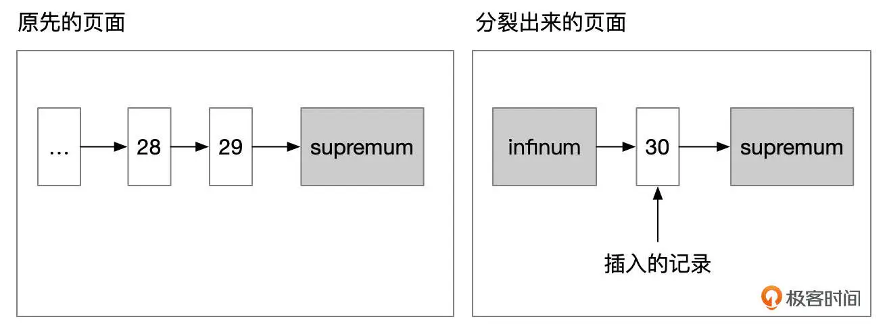

- 情况 2：插入的记录后面，只有 1 条更大的记录。这种情况下，也是以新插入的记录作为分裂点。

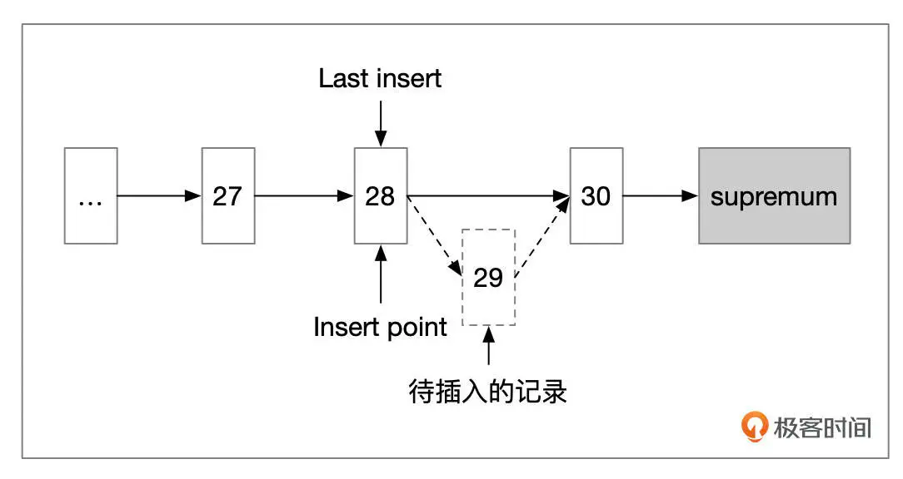

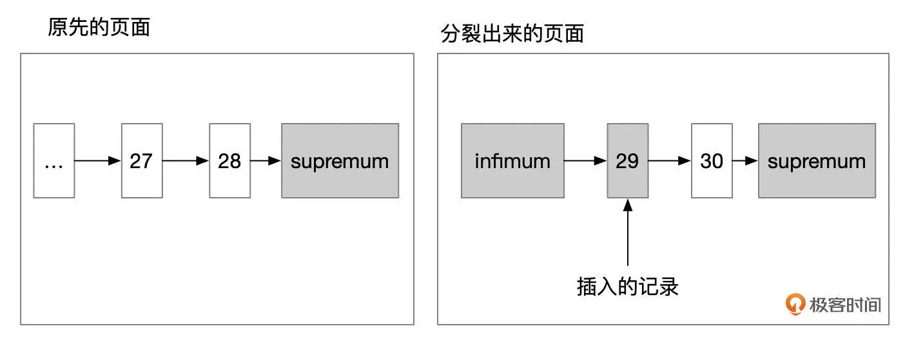

- 情况 3：插入的记录后面，有 2 条或更多的记录。这种情况下，以待插入记录的后面第 2条记录作为分裂点。

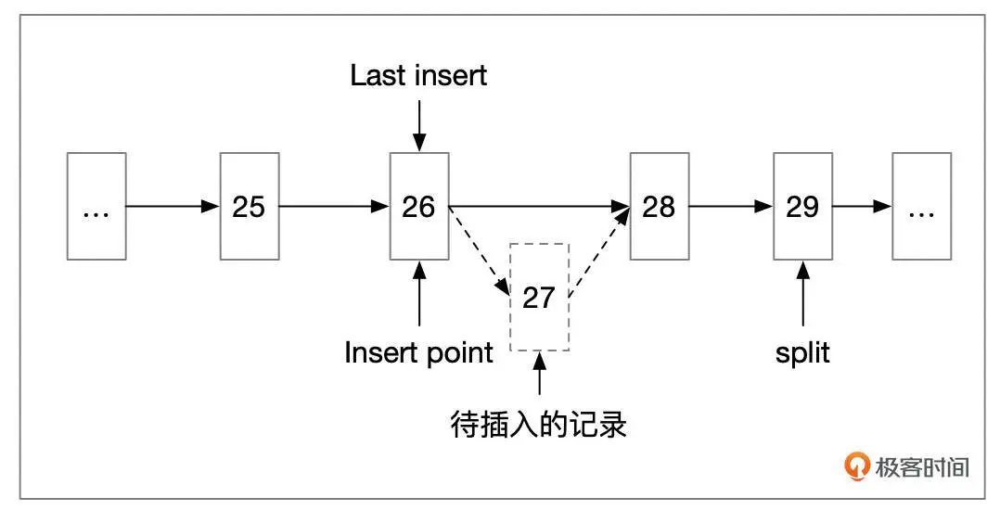

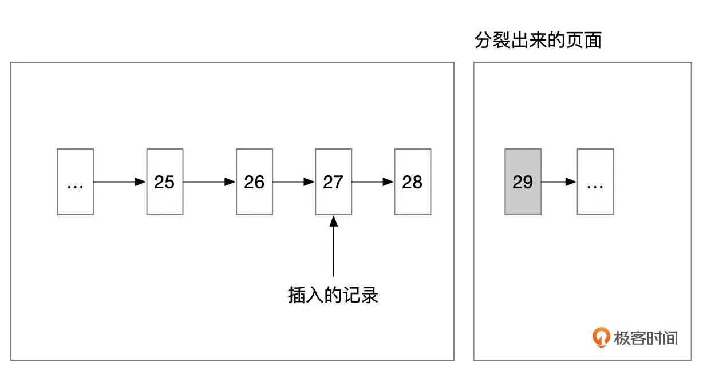

和向右分裂类似的，如果插入的记录，按 Key 值从大到小的顺序插入，则会采用向左分裂。

## REDO 记录格式

通过前面这些内容，我们对页面数据修改已经有一些了解了。实际上，页面数据修改还有其他很多不同的情况，比如执行 DML 语句时，还需要生成 UNDO 日志，UNDO 日志会写到UNDO 表空间中。比如分配空间时，需要维护空间管理相关的一些数据，包括我们在 25 讲中介绍过的那些结构。

InnoDB 使用 REDO 记录，来描述所有这些对数据页的修改操作。下面这张图描述了 REDO记录的基本格式。


每条 REDO 记录都包含了这些基本字段，字段的含义我整理到了下面这个表格中。

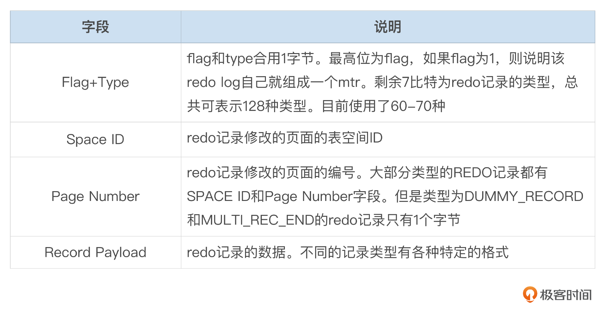

InnoDB 使用 1 个字节中的 7 个比特来表示 REDO 类型。7 比特总共可以表示 128 种类型，8.0.32 版中，最大的 Redo type 为 76。Redo 日志描述了对某个物理页面的数据修改，Spaceid 和 Page number 表示修改的页面。不同的 redo 类型有不一样的数据格式。我们来看一下其中部分 Redo 类型的记录格式。

### MLOG_nBYTE

MLOG_nBYTE，往数据页中写入 n 字节数据，这里的 n 为 1、2、4，或者 8。

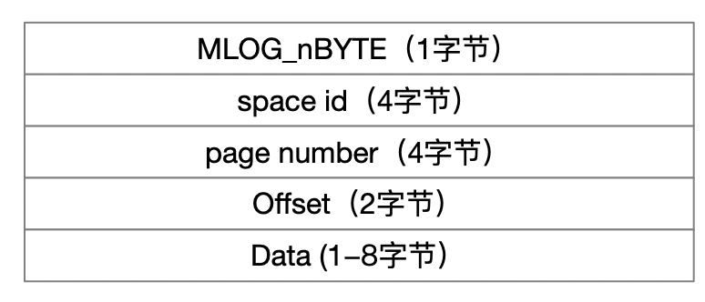

Offset 是写入的数据在页面内的偏移地址。Data 是实际写入的数据，长度由类型中的 n 指定。

### MLOG_WRITE_STRING

MLOG_WRITE_STRING 表示在数据页中写入一串数据。

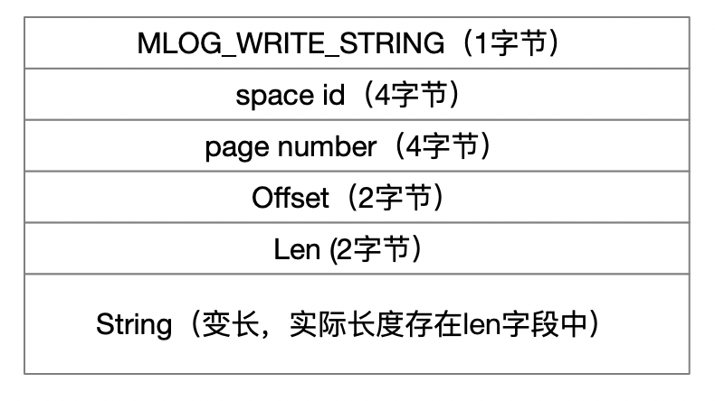

Offset 是写入的数据在页面内的偏移地址，Len 是写入数据的长度，String 是实际写入的数据。

### MLOG_REC_INSERT

前面我们已经看到了，插入一行数据要在页面内修改好几地方。而且根据插入记录的长度、页面内剩余的空间，还可能需要整理页面内的碎片空间或者分裂页面。Redo 记录怎么描述所有的这些变更呢？

对于在当前页面中插入一行数据，REDO 的类型为 MLOG_REC_INSERT，REDO 记录中的内容比较多，可以参考下面这张图片。

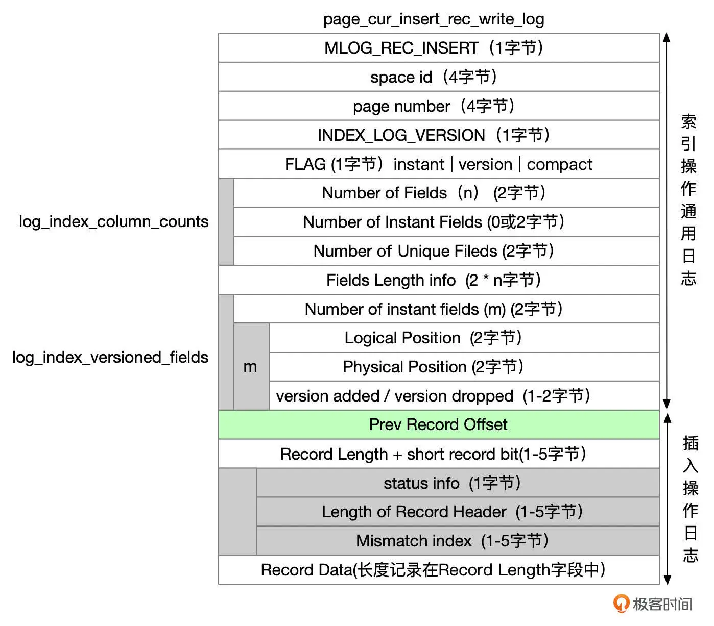

图里面这些字段的含义，我整理到了下面这个表格中。

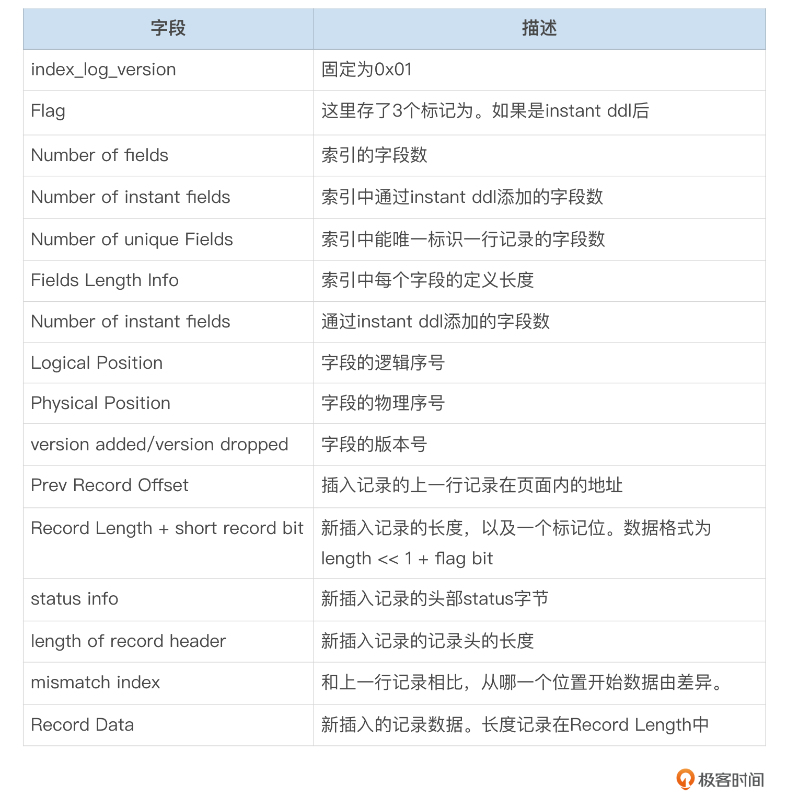

InnoDB 在生成插入记录的 redo 日志时，做了一个优化，会对比新插入的记录和上一条记录，如果两条记录有一些内容是相同的，就可以在 Redo 中少记录一些信息。参考下面这张图，mismatch index 左边，两行记录的内容是一样的。

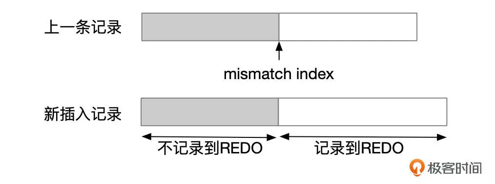

上面对 MLOG_REC_INSERT 类型 REDO 格式的描述，主要是基于page_cur_insert_rec_write_log 这个函数整理出来的，如果你有兴趣的话，可以到源码中看一下这个函数的实现。

### MLOG_REC_UPDATE_IN_PLACE

更新记录时，如果所有字段的长度都没有发生变化，也没有更新行外存储的字段，那么可以在页面内原地更新记录，否则就需要先将原来的记录删除掉，然后再插入新的记录。原地更新时，REDO 类型为 MLOG_REC_UPDATE_IN_PLACE，格式参考下面这张图。

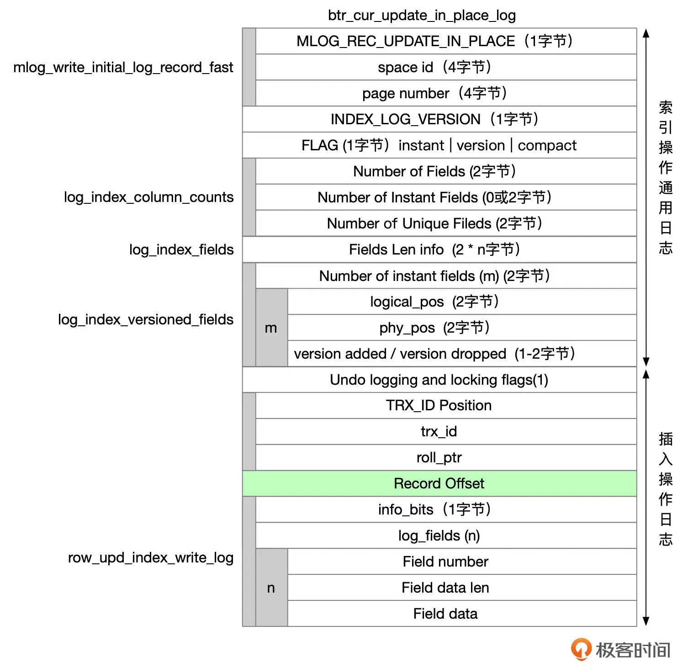

可以看到，原地更新操作的 REDO 格式，和 INSERT 的 REDO 格式很多内容是一样的。这些内容主要是从源码中的 btr_cur_update_in_place_log 函数中整理出来的。

### MLOG_REC_DELETE

删除一行记录时，Redo 类型为 MLOG_REC_DELETE，格式参考下面这张图。

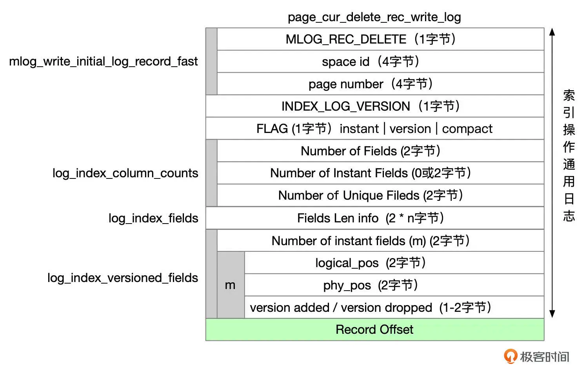

### MLOG_REC_CLUST_DELETE_MARK

给记录打上删除标记时，redo 类型为 MLOG_REC_CLUST_DELETE_MARK，格式参考下面这张图。

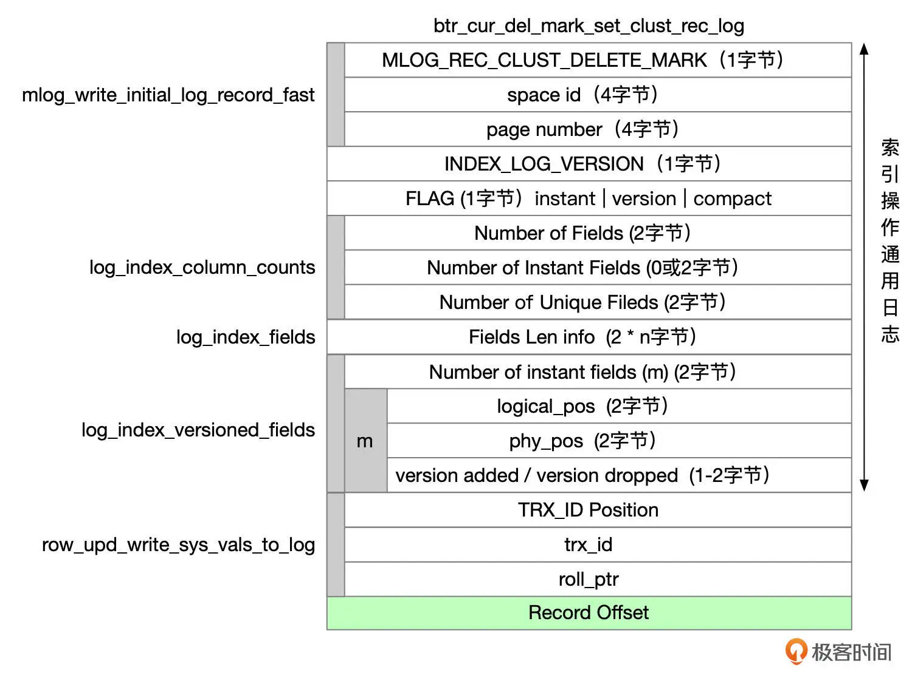

还有几十种 Redo 类型，这里就不详细分析每一种类型了，有兴趣的话，你可以到源码中搜索这些 REDO 类型，看看这些 REDO 类型是什么情况下使用的，日志的格式是怎样的。

```
MLOG_INIT_FILE_PAGE2
MLOG_COMP_PAGE_CREATE
MLOG_LIST_END_COPY_CREATED
MLOG_LIST_END_DELETE
MLOG_UNDO_INSERT
MLOG_UNDO_ERASE_END
MLOG_UNDO_INIT
MLOG_UNDO_HDR_REUSE
MLOG_UNDO_HDR_CREATE
MLOG_LIST_END_COPY_CREATED
MLOG_PAGE_REORGANIZE
MLOG_LIST_END_DELETE
MLOG_LIST_START_DELETE
```

## REDO 如何保护数据？

我们已经大致了解了 REDO 记录的格式，那么 REDO 是怎么保护数据不丢的呢？

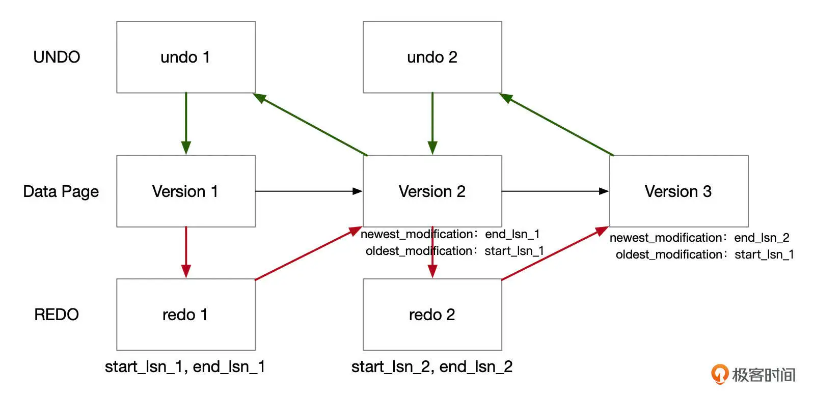

1. 事务执行过程中，修改缓存页的时候，会生成 REDO 日志和 UNDO 日志。

2. 事务提交时，不需要同步刷新缓存页，但是会将 REDO 日志刷新到磁盘中（这里假设innodb_flush_log_at_trx_commit 设置为 1）。

3. 如果事务提交后，数据库崩溃了，ibd 文件中，数据页还是版本 Version 1，但是 redo 都已经持久化了，数据库启动时，解析 redo 文件，发现有数据页相关的 redo 日志，对比 lsn 号后，重新执行 redo 日志，将数据页更新到最新的版本。

4. 如果在事务提交前数据库就崩溃了，如果数据页的新版本 version 3 已经写到了 ibd 文件中，数据库启动时，应用完 redo 日志后，扫描 Undo 表空间，发现有事务还没有提交，就开始回滚事务，undo 日志中记录了回滚事务需要的信息。回滚完成后，数据也不会有问题。

一个事务里面，可能会包含多条 DML 语句，每条语句执行时，可能会修改多个数据页，比如要给事务分配 UNDO 段，记录 UNDO 信息，修改 B+ 树的页面数据，InnoDB 将这些修改组织成一个一个的 mini transaction。

修改数据会按一定的步骤进行。

1. 开启 mini transaction，获取待修改页面的锁。

2. 修改缓存页内的数据，生成 UNDO 日志和 REDO 日志。REDO 日志会先记录到用户线程的私有内存中。

3. 完成修改后，提交 mini transaction，此时会给 redo 日志分配 LSN 号，更新控制块中的newest_modification。如果缓存页是首次修改，还要记录 oldest_modification，将修改的页面加入到 Flush 列表中。并将 REDO 日志复制到 REDO buffer 中。

InnoDB 的后台线程会异步将脏页写回到磁盘。写脏页时，需要确保脏页对应的 REDO 日志都已经持久化到磁盘中，这也称为日志先行（WAL）。

mini transaction 执行过程中，会获取页面锁，所以 mini transaction 提交前，页面内的数据不会被回写到磁盘。mini transaction 提交时，会更新页面控制块中的 newest_modification。只有当页面的 newest_modification 不超过已经刷新到磁盘的 redo 日志的 LSN 号时，才能将缓存页刷新到磁盘。

### MTR 的结构

REDO 记录按 MTR 分组。数据库崩溃恢复时，一个 MTR 中的 REDO 日志，要么全部应用，要么全部丢弃。如果 mtr 中包含了多条 redo 记录，那么在 mtr 提交时，会写入一条类型为MULTI_REC_END 的记录， 标识 mtr 的结束。


如果一个 mtr 中只包含 1 条 redo 记录，则会给这条 redo 记录打上一个MLOG_SINGLE_REC_FLAG 标记位。

### MTR 提交过程

1. 事务执行过程中，REDO 记录会先写入到 mtr buffer 中。每个线程会分配独立的 mtrbuffer。mtr buffer 中，以 512 字节为单位分配内存块。

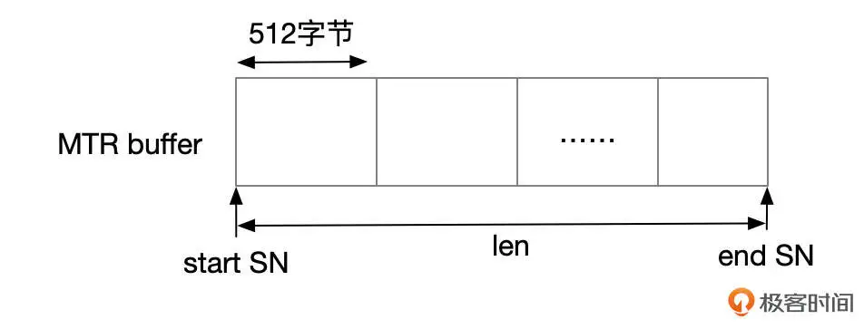

2. mtr 提交时，分配一段连续的 SN 号。start SN 从变量 log.sn 中获取，end SN 号为 startSN 号加上 MTR 内容长度。根据 SN 计算得到 LSN 号。

为什么需要将 SN 号转化成 LSN 号呢？因为 InnoDB 将 REDO 日志文件划分为一系列 512 字节的日志块。每个日志块头部和尾部分别占用 12 字节和 4 字节，剩下 496 字节用来存储REDO 记录数据。SN 转换成 LSN 号时，需要留出日志块头部和尾部占用的空间。

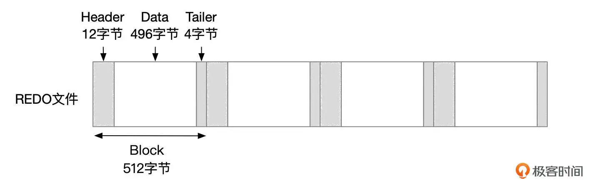

3. 将 redo 记录从 mtr buffer 复制到 redo log buffer 中。在 log buffer 中，数据按 LOG Block的方式组织，往 log buffer 中复制数据时，需要将日志块头部和尾部占用的空间预留出来。

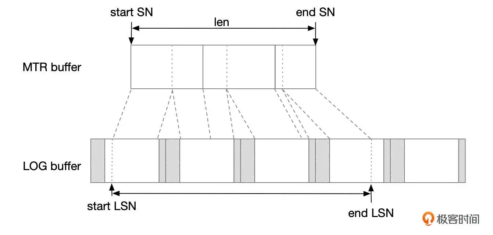

在数据从 log buffer 写入到 REDO 日志文件前，会先填充日志块头部和尾部信息。

4. 将 mtr 中修改过的缓存页加入到 flush 链表中。页面的 newest_modification 设置为 mtr 的end LSN。

5. 释放 mtr 执行过程中获取的缓存页的锁。

## LOG Buffer

MTR 提交时，redo 记录会复制到 redo buffer 中。多个线程并发往 log buffer 中写入 redo 记录时，并不保证写入的顺序。相当于 log buffer 中存在一些空洞。在下面这张图中，用户线程2 已经完成了 redo 记录写入，但是用户线程 1 的 redo 记录，虽然 lsn 号更低，但是还没有完成写入。

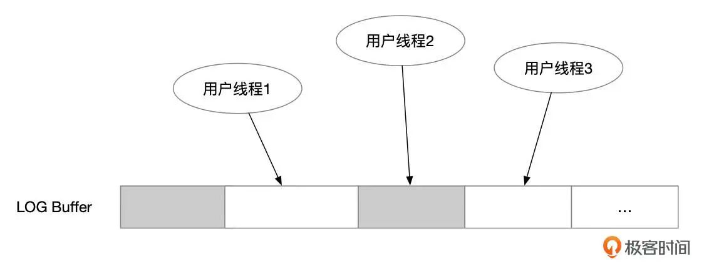

Log writer 线程负责将 Log Buffer 中的 REDO 记录写到 REDO 文件中。Log Writer 会将 LogBuffer 中没有空洞的那一部分 redo 日志写到 REDO 文件中，并释放 Log Buffer 空间。

### REDO 相关的线程和 LSN 号

REDO 日志从产生，到最终持久化到磁盘设备，中间经过多个环节，涉及到多个线程的协作。

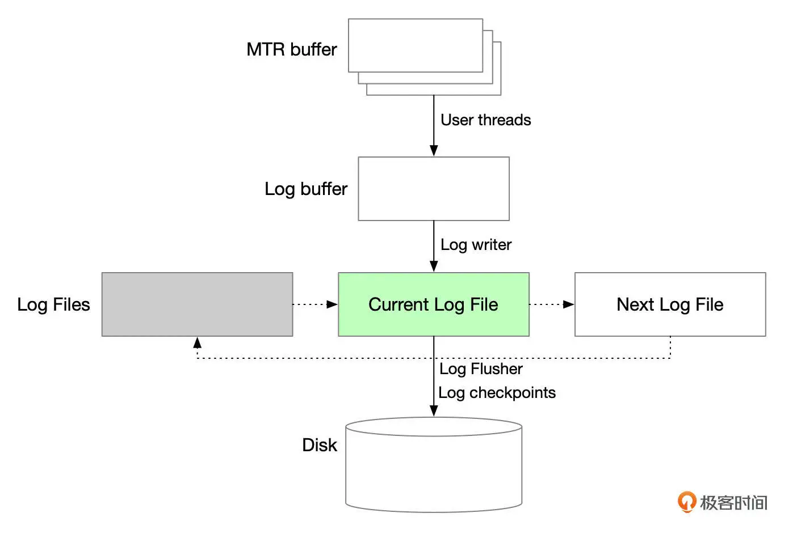

日志系统的线程通过一系列 LSN 号来协调。

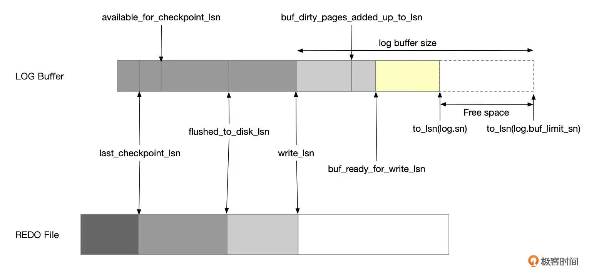

InnoDB 维护了日志系统的各个 LSN 号。

- write_lsn：小于该 LSN 号的 redo 日志都已经写入到 REDO 文件中。log writer 线程会定期将 redo 日志从 log buffer 中写入到 redo 日志文件中，推进 write_lsn 号。

- flushed_to_disk_lsn：小于该 LSN 号的 redo 日志都已经刷新到 REDO 文件中。log flusher线程负责刷新日志文件（调用 fsync）。

- last_checkpoint_lsn：小于该 LSN 号的 redo 日志对应的修改，已经从 buffer pool 刷新到数据文件中，并且 lsn 号已经保存到 checkpoint 记录中。数据库崩溃恢复从该 lsn 号开始。

- available_for_checkpoint_lsn：该 LSN 号之前的脏页都已经刷新回数据文件中。该 LSN 号取以下值中的较小值。

- 所有 buffer pool 实例中 flush 链表中最后一个 page 的 lsn 号，减去一个固定值。

- buf_dirty_pages_added_up_to_lsn。

- buf_ready_for_write_lsn：LSN 号位于 write_lsn 和 buf_ready_for_write_lsn 之间的 redo日志，已经全部写入到 log buffer 中。log writer 线程定期将这些 redo 日志写入到 redo 文件。

- log.sn：将 log.sn 转换得到的 LSN 号，就是已经分配的最大的 LSN 号。LSN 号位于buf_ready_for_write_lsn 和 to_lsn(log.sn）之间的 REDO 日志，有一些还没有完全从 mtrbuffer 中复制到 log buffer 中。

- buf_dirty_pages_added_up_to_lsn：小于该 LSN 号的脏页，都已经加入到 flush 链表中。

show innodb status 命令的输出中，就包含了一些 LOG LSN 信息。

```
---
LOG
---
Log sequence number          108382356
Log buffer assigned up to    108382356
Log buffer completed up to   108382356
Log written up to            108382356
Log flushed up to            108382356
Added dirty pages up to      108382356
Pages flushed up to          96774021
Last checkpoint at           96773372
Log minimum file id is       29
Log maximum file id is       33
11673 log i/o's done, 368.45 log i/o's/second
```

## REDO 日志文件

REDO 记录持久化到 REDO 文件中后，才真正保证了数据不丢。早期版本中，REDO 日志文件大小和数量由参数 innodb_log_file_size 和 innodb_log_files_in_group 配置。8.0.30 版本开始，废弃了这 2 个参数，而改用参数 innodb_redo_log_capacity。如果配置了innodb_redo_log_capacity，则会忽略参数 innodb_log_file_size 和innodb_log_files_in_group。innodb_redo_log_capacity 最大可设置为 128G。

REDO 日志文件默认位于 DATADIR 下的 #innodb_redo 目录中（可通过参数innodb_log_group_home_dir 配置 REDO 文件的存储路径）。InnoDB 总共分配了 32 个REDO 日志文件，每个文件的大小为 innodb_redo_log_capacity/32。

```
[root@172-16-121-234 #innodb_redo]# ls -l /data/mysql01/data/#innodb_redo
总用量 102400
-rw-r----- 1 mysql mysql 3276800 1月   8 11:54 #ib_redo55
-rw-r----- 1 mysql mysql 3276800 1月  17 18:04 #ib_redo56
-rw-r----- 1 mysql mysql 3276800 1月   4 11:01 #ib_redo57_tmp
-rw-r----- 1 mysql mysql 3276800 1月   4 11:01 #ib_redo58_tmp
-rw-r----- 1 mysql mysql 3276800 1月   4 11:01 #ib_redo59_tmp
-rw-r----- 1 mysql mysql 3276800 1月   4 11:01 #ib_redo60_tmp
-rw-r----- 1 mysql mysql 3276800 1月   4 11:01 #ib_redo61_tmp
-rw-r----- 1 mysql mysql 3276800 1月   4 11:01 #ib_redo62_tmp
.......
```

以 tmp 结尾的日志文件暂时还没有使用，其他每个 REDO 日志文件中都存储了 LSN 在一定范围内的 REDO 记录。可通过 performance_schema 中的表查看每个 REDO 文件里存储的日志的 LSN 范围。

```sql
mysql> SELECT FILE_NAME, START_LSN, END_LSN FROM performance_schema.innodb_redo_l
+--------------------------------------------+-----------+-----------+
| FILE_NAME                                  | START_LSN | END_LSN   |
+--------------------------------------------+-----------+-----------+
| /data/mysql01/data/#innodb_redo/#ib_redo55 | 200243712 | 203518464 |
| /data/mysql01/data/#innodb_redo/#ib_redo56 | 203518464 | 206793216 |
+--------------------------------------------+-----------+-----------+
```

执行 Checkpoint 时，InnoDB 将 Checkpoint 记录写入到包含当前 checkpoint LSN 的 REDO文件中。

### 日志文件格式

REDO 日志文件块大小为 512 字节。每个日志文件头部的 4 个数据块有特殊用处。

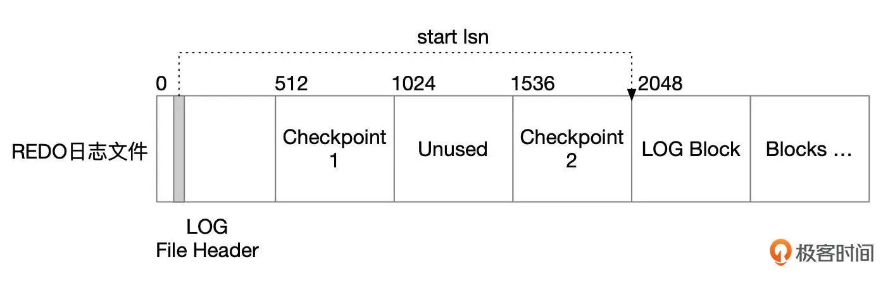

LOG 文件头格式参考下面这张图，其中 start lsn 记录了这个 redo 文件中，第一条 redo 日志的起始 lsn 号。

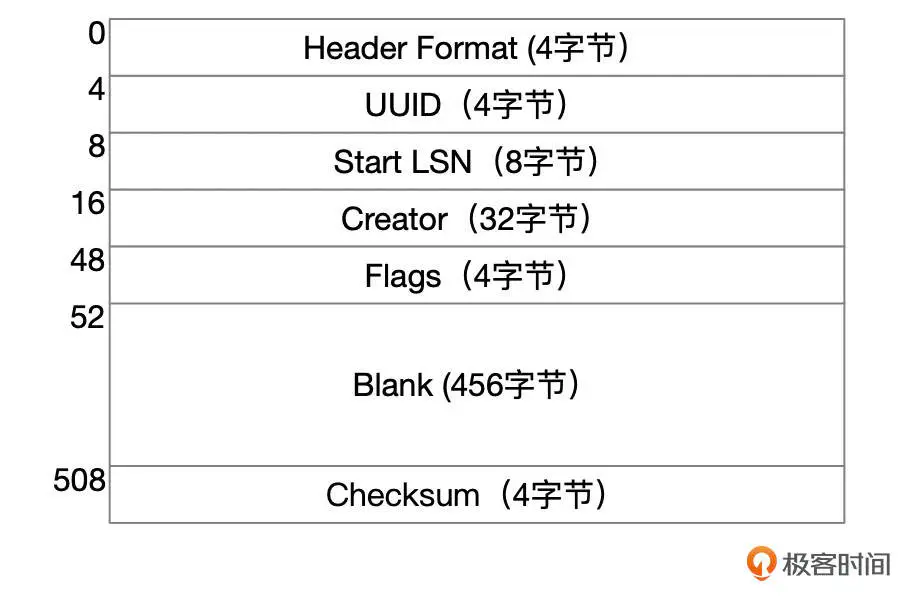

Log Checkpointer 线程会定期将 checkpoint LSN 持久化到 Redo 日志文件头部的 Checkpoint记录中。Checkpoint 记录的格式参考下面这张图。

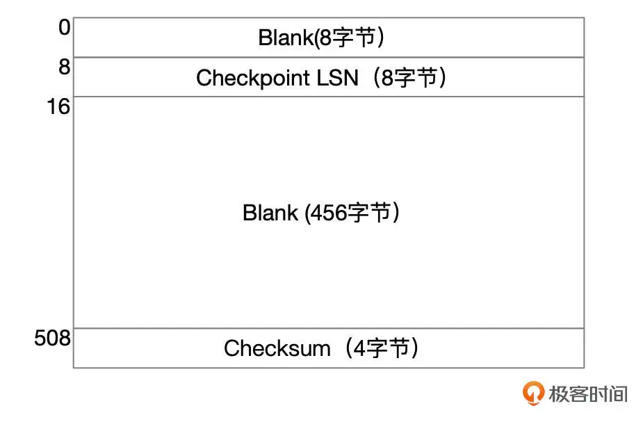

## 崩溃恢复（Crash recovery）

MySQL 启动时，会先进行崩溃恢复，大致分为几个步骤。

1. 读取 redo 文件中的 checkpoint 记录。checkpoint 是恢复的起点。lsn 号在 checkpoint lsn之后的 redo 日志，才是崩溃恢复时需要的日志。

2. 解析 redo 文件中的日志。解析时，如果某个 MTR 的结束标记没有读取到，就说明之后的redo 日志都是不完整的，退出 redo 解析。解析出来的 redo 日志，按（space_id,page_no）加入到一个 hash 表中。

3. 执行 redo。每个页面的 redo 记录，按产生的时间，依次执行。执行时先对比数据页的LSN 号和 Redo 记录的 lsn 号，如果页面的 LSN 号比 REDO 记录的 LSN 大，就跳过这条redo 记录。

4. redo 执行完成后，开始执行 undo，回滚数据库中还没有提交的事务。关于事务回滚的具体实现，我们下一讲再讨论。

## 总结

这一讲中我们对 InnoDB 的 REDO 机制做了一些基本的介绍，其中有几个参数需要注意。

- innodb_flush_log_at_trx_commit：设置为 1 的时候，才能保证数据不丢。

- innodb_log_buffer_size：Log Buffer 一般设置几十 M 到几百 M。

- innodb_redo_log_capacity（或 innodb_log_file_size，innodb_log_files_in_group）：如果数据库写入量特别大，buffer pool 也比较大，可以考虑适当增加innodb_redo_log_capacity。

## 思考题

这节课我们介绍了一些 REDO 日志的格式，比如 insert、update、delete 的 REDO 格式。那么事务提交时（commit），REDO 的格式是怎样的？数据库启动时，怎么知道一个事务已经提交了？

期待你的思考，欢迎在留言区中与我交流。如果今天的课程让你有所收获，也欢迎转发给有需要的朋友。我们下节课再见！
