# 30 | 事务怎么回滚？（上）

你好，我是俊达。

事务是关系型数据库的核心功能，具有 ACID 的特征。一个事务中的修改，要么全部生效，要么全部不生效，即使数据库异常崩溃，也不会违反事务的 ACID 属性。

上一讲中我们介绍了用来保证对数据库的修改都不丢的 Redo 机制。这一讲，我们来看一下，MySQL 怎么做到“事务中的修改，要么都生效，要么都不生效”，实际上 MySQL 使用了 Undo来实现事务的回滚。

## 事务简介

MySQL 中，事务的行为受参数 autocommit 影响。如果 autocommit 设置为 ON（这个参数默认就是 ON），那么每个 SQL 语句会组成单独的事务，SQL 语句执行完成时，InnoDB 自动提交或回滚事务。

autocommit 设置为 ON 时，你也可以使用 BEGIN 或 START TRANSACTION 语句开启事务，开启事务后，可以在一个事务中执行多条 SQL 语句，你需要执行 COMMIT 语句提交事务，或使用 ROLLBACK 语句回滚事务。

如果事务中的 SQL 执行时报错了，MySQL 会怎么处理呢？如果是遇到了死锁，InnoDB 会回滚整个事务。如果是遇到了锁等待超时，那么默认设置下，会回滚最后的那个 SQL 语句。如果把参数 innodb_rollback_on_timeout 设置为 ON，那么锁等待超时后，会回滚整个事务。如果遇到其 SQL 报错，一般情况下都是回滚报错的那个 SQL 语句。

如果 autocommit 设置为 OFF，那么不需要执行 BEGIN 或 START TRANSACTION，MySQL也会自动开启事务，你需要使用 COMMIT 或 ROLLBACK 语句结束事务。一个事务结束后，会自动开启一个新的事务。

在执行 DDL 和一些管理语句时，会隐式提交当前的事务。你可以到官方文档查看哪些语句会隐式提交事务。

## Undo 简介

InnoDB 在修改一行记录时，会把记录的当前状态保存在 UNDO 日志中。

- 对于 INSERT 语句，只需要保存新插入记录的主键值。

- 对于 UPDATE 语句，需要保存记录的主键值，以及发生变化的字段在修改前的值。

- 对于 DELETE 语句，需要保存被删除的记录的主键值。

DELETE 数据时，InnoDB 会先给记录加上删除标记，记录的真正数据并不会立刻被删除，所以在 UNDO 日志中，只需要保存被删除记录的主键值以及索引字段的值。

事务回滚时，要撤销事务所做的全部修改。

- 对于 INSERT 操作，回滚时要把插入的记录删除掉。

- 对于 UPDATE 操作，回滚时要把记录更新回之前的状态。

- 对于 DELETE 操作，回滚时要把记录的删除标记取消掉。

回滚时，要以相反的顺序撤销事务中的修改。一个事务生成的所有 Undo 记录组成一个（或多个）双向链表，逆序遍历 Undo 记录链表，并执行 Undo 操作，就可以将事务的所有修改都回滚掉。

下面是事务回滚一个简单的示意图。

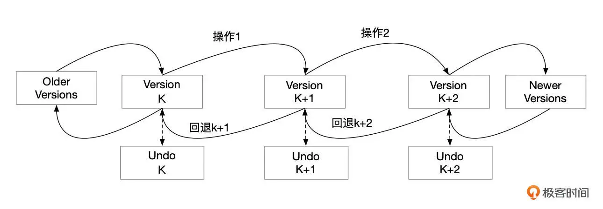

事务回滚的过程中，也涉及到数据的修改，Insert 的数据要删除掉，Delete 的记录要取消删除标记，Update 的记录，要更新回之前的状态，因此回滚操作本身也会生成 Redo 记录。那么回滚时会生成新的 Undo 记录吗？这里 InnoDB 做了处理，回滚时不生成新的 Undo 记录。

Undo 记录保存在 Undo 表空间中。往 Undo 表空间中写入数据时，也需要先在 InnoDB Buffer中修改，也会生成 REDO 日志。因此即使数据库或服务器崩溃了，Undo 记录也不会丢失。

为了更好地观察 Undo 的实现，我们准备了一个测试案例。先创建一个表。

```sql
mysql> create table t_undo(
     id varchar(10),
     a varchar(30),
     b varchar(30),
     c varchar(30),
     primary key(id),
     key idx_a(a)
) engine=innodb;
```

在一个会话中开启一个一致性读取事务，这是为了让 purge 线程不要清理新生成的 Undo 记录。

```
mysql> start transaction with consistent snapshot;
```

然后开启另外一个会话，写入一些测试数据。

```sql
## 自动提交
insert into t_undo values
   ('ROW_01', rpad('',6,'A1'), rpad('',8,'B1'), rpad('',10,'C1'));
insert into t_undo values
   ('ROW_02', rpad('',6,'A2'), rpad('',8,'B2'), rpad('',10,'C2'));
## row-03 v1
insert into t_undo values
   ('ROW_03', rpad('',6,'A3'), rpad('',8,'B3'), rpad('',10,'C3'));
insert into t_undo values
   ('ROW_04', rpad('',6,'A4'), rpad('',8,'B4'), rpad('',10,'C4'));
insert into t_undo values
   ('ROW_05', rpad('',6,'A5'), rpad('',8,'B5'), rpad('',10,'C5'));
insert into t_undo values
   ('ROW_06', rpad('',6,'A6'), rpad('',8,'B6'), rpad('',10,'C6'));
## 开启事务
begin;
delete from t_undo where id = 'ROW_03';
## row-03 v2
insert into t_undo values
   ('ROW_03', rpad('',7,'X3'), rpad('',8,'Y3'), rpad('',10,'Z3'));
## row-03 v3
update t_undo
set a = rpad('', 8, 'R3'), b = rpad('', 8, 'S3'), c = rpad('', 10, 'T3')
where id = 'ROW_03';
## row-03 v4
update t_undo
set a = rpad('', 9, 'u3'), b = rpad('', 8, 'v3'), c = rpad('', 10, 'w3')
where id = 'ROW_03';
commit;
```

从 binlog 中可以找到最后一个事务的 GITD 和 Xid。这个测试案例中，Xid 为 3598。后面你会看到，Undo 日志中也记录了这些信息。

```
SET @@SESSION.GTID_NEXT= '7caa9a48-b325-11ed-8541-fab81f64ee00:16085'
# at 70670766
#240924 14:57:02 server id 119  end_log_pos 70670797 CRC32 0xe2263c4c   Xid = 359
COMMIT/*!*/;
```

上面这个测试案例中，生成了哪些 Undo 日志？Undo 日志又存储在哪里呢？

先把 t_undo 表的数据页 dump 出来。前面提到过，每一行 InnoDB 的数据，都包含了db_trx_id 和 db_roll_ptr 这两个隐藏字段。下面这张图中，标注了每一行记录的 db_roll_ptr 字段。通过 db_roll_ptr 就可以找到对应的 Undo 记录。

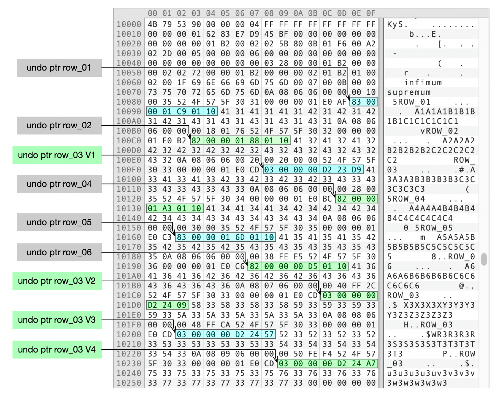

注：从上面的图里还可以观察到，ROW_03 几个版本的数据都在页面中，这是因为更新的时候，每次记录长度都不一样，Update 被转换成了 Delete 加 Insert。

### DB_ROLL_PTR 的格式

DB_ROLL_PTR 字段长度为 7 个字节，格式参考下面这张图。

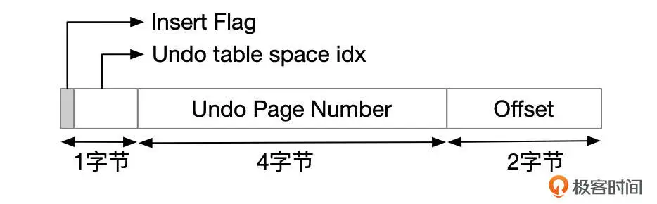

第 1 个字节的最高 1 位是插入标记（Insert Flag），如果 Undo 类型为 insert，那么这一位置为1。第 1 个字节的剩余 7 位为 Undo 表空间的编号，通过这个编号可以计算得到表空间 ID。在8.0 之前的版本中，这 7 位是回滚段 ID。8.0 引入了 Undo 表空间，这 7 位数字的含义有所变化。剩余的 6 个字节保存了 Undo 记录的页面编号和 Undo 记录在页面内的偏移。通过记录中的 DB_ROLL_PTR，就可以找到构建上一个行版本需要的 Undo 记录。

我把测试案例中几行数据的 db_roll_ptr 整理到了下面这个表格中。

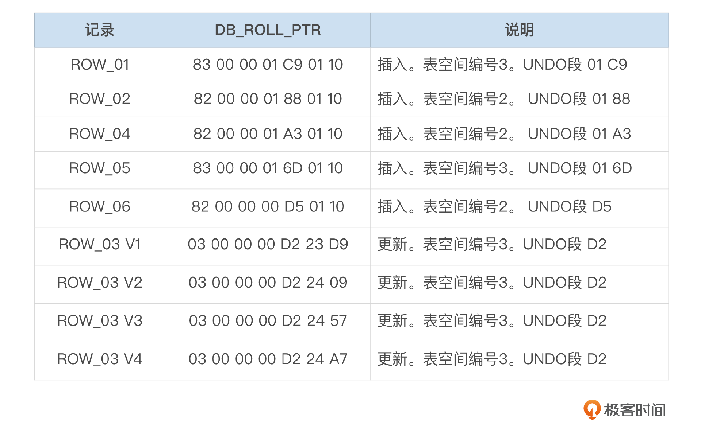

使用下面这个 SQL，可以将 Undo 表空间编号转换成表空间 ID。

```sql
mysql> select name, space, ( 0xFFFFFFEF - space ) % 128 + 1 as space_seq
 from INNODB_TABLESPACES
 where name like 'undo%' or name like 'innodb_undo%';
+-----------------+------------+-----------+
| name            | space      | space_seq |
+-----------------+------------+-----------+
| innodb_undo_001 | 4294967279 |         1 |
| innodb_undo_002 | 4294967278 |         2 |
| undo_x001       | 4294967277 |         3 |
+-----------------+------------+-----------+
```

编号 3 对应的表空间是 undo_x001，这是我额外创建的一个 Undo 表空间。编号 2 对应的表空间是 innodb_undo_002。

## Undo 物理存储

以前的版本中，Undo 存储在系统表空间（ibdata）中。从 8.0 开始，InnoDB 将 Undo 存储到了独立的 Undo 表空间中。Undo 从系统表空间移出来之后，可以避免以前的版本中，因为大事务或 Undo Purge 速度慢导致的系统表空间膨胀的问题。

### Undo 表空间

MySQL 从 8.0.14 版本开始，在数据库初始化时默认会创建 2 个 Undo 表空间。Undo 文件的位置由参数 innodb_undo_directory 指定，默认情况下 Undo 文件存储在 DATADIR 内。

使用 create undo tablespace 命令可以创建额外的 undo 表空间。一个实例中，最多可以有127 个 Undo 表空间。大多数场景下，默认的 2 个 undo 表空间就够用了。如果你需要更多的Undo 表空间，可以用 create undo tablespace 命令来创建。

```
create undo tablespace undo_x001 ADD DATAFILE 'undo_x001.ibu';
```

创建 Undo 表空间有一些要求。

- Undo 文件名必须以.ibu 结尾。

- 如果不指定文件路径，文件默认会放在 innodb_undo_directory 或 datadir 指定的路径下。

- 如果指定了路径，必须使用绝对路径，而且路径要在 innodb_directories 中设置。

- 使用 drop undo tablespace 命令删除 undo 表空间。系统默认的两个 undo 表空间不允许删除。

每个 Undo 表空间最多可容纳 128 个回滚段（Rollback Segment）。回滚段的数量可以通过参数 innodb_rollback_segments 设置，最大不能超过 128。每个回滚段里面，可以创建多个Undo 段，Undo 段的数量跟数据页的大小有关，对于默认的 16K 数据页，一个回滚段里面最多可以创建 1024 个 Undo 段。

一个事务，如果修改了数据，就需要分配 Undo 段，用于存放 Undo 记录。InnoDB 将所有修改数据的操作分为 2 大类，Insert 操作和 Update 操作，这 2 类操作产生的 Undo 记录存放在两个单独的 Undo 段中。

如果事务中使用了临时表，那么修改临时表产生的 Undo 记录会存放到临时 Undo 段中，insert 临时表产生的 Undo 记录存放到临时的 insert undo 段中，update 临时表产生的 undo记录存放到临时的 update undo 段中。所以一个事务最多可能会用到 4 个 Undo 段。

普通的 Undo 段存放到 Undo 表空间中，临时 Undo 段存放到临时表空间中。如果一个事务中没有 insert 操作，就不需要分配 insert undo 段。如果一个事务中没有 Update 操作，本来也不需要分配 update Undo 段，但如果使用了 gtid，那么即使事务中只有 insert 操作，也要分配一个 update undo 段，用来存放事务的 GTID。

### Undo 表空间文件格式

和普通的 ibd 文件类似，Undo 文件分为多个数据页，前几个页面分别是文件头（FileHeader）、ibuf 位图页、Inode 页、回滚段数组（RSEG Array）页。


### 回滚段数组页（RSEG Array）

每个 Undo 表空间的第四个页面是回滚段数组页，页面类型为FIL_PAGE_TYPE_RSEG_ARRAY（0x15），这个页面中存储了当前表空间中所有回滚段的页面编号。这个页面的格式比较简单，参考下面这张图。

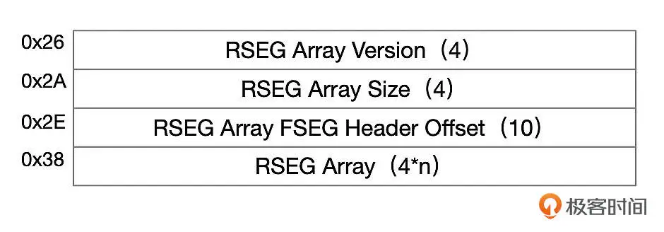

- 这个页面本身就组成了一个段，RSEG Array FSEG Header 指向了 Inode 的地址。

- RSEG Array 存储了 128 个页面编号，每个编号对应一个回滚段。

下面的图里，就是一个回滚段数组页，里面存了 128 个回滚段的页面编号。

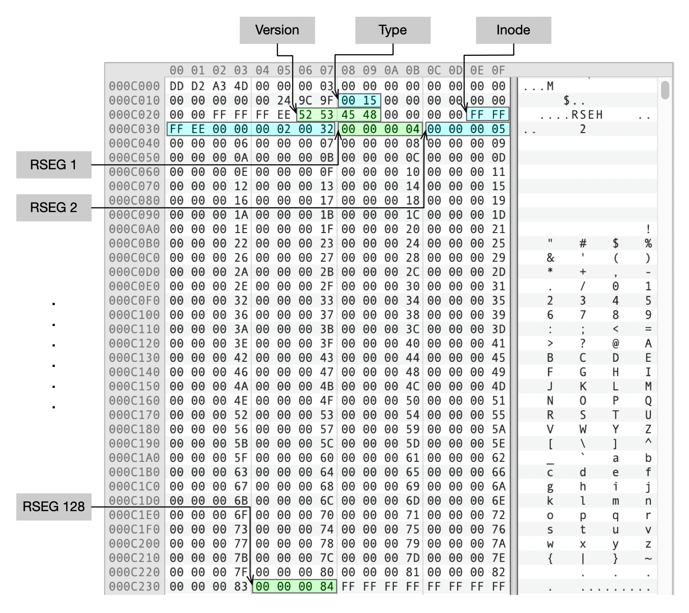

### 回滚段（Rollback Segment）

每个回滚段里最多分配 1024 个 Undo 段，回滚段的格式参考下面这张图。

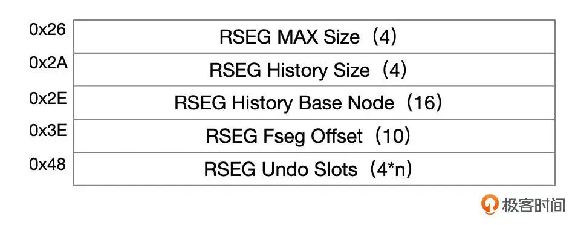

回滚段的格式也比较简单。RSEG History Base Node 是历史 Undo 日志链表的基节点，Purge 线程就是从这个节点开始搜索要清理的 Undo 日志。RSEG Undo Slots 中记录了 Undo段头所在的页面编号，最多存 1024 个 Undo 段。

我们测试案例中最后那个事务的 Undo（位于 Undo 页面 D2），就存储在下面图里展示的回滚段中。

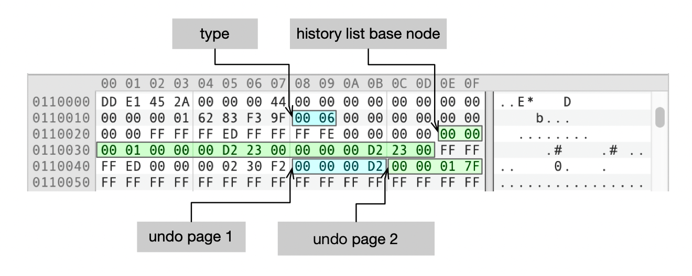

history 链表中只有一个 Undo 日志，页面编号 D2，偏移 2300。

### Undo 段

Undo 日志最终会存放在 Undo 段中。Undo 段由 Undo 页头、Undo 段头、Undo 日志组成。Undo 页面头、Undo 段头的格式参考下面这张图。Undo 段头存放在段内第一个 Undo 页的页头之后。

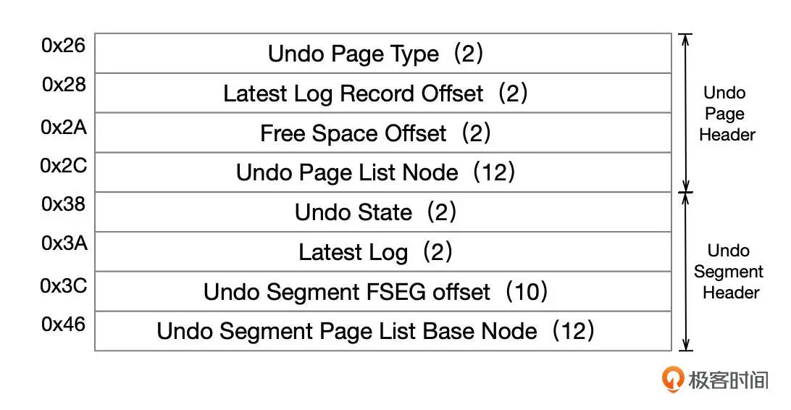

这些字段的含义我整理到了下面这个表格中。

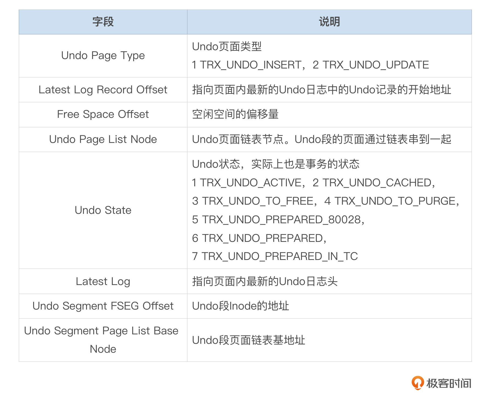

测试案例中最后一个事务的 Undo 日志，就存放在下面这个 Undo 段中。从记录 ROW_03 的db_roll_ptr （03/000000D2/23D9）中可以找到这个 Undo 段。

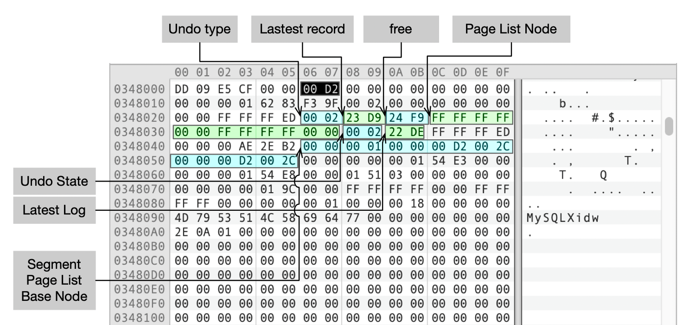

- Undo 类型为 2（TRX_UNDO_UPDATE）。

- Latest Record（23D9）指向最新的 Undo 日志的记录起始处，地址为 0x348000 + 0x23D9= 0x34A3D9。

- free（24F9）指向页面内的空闲空间起始处，地址为 0x348000 + 0x24F9 = 0x34A4F9。

- Latest Log（22DE）指向页面内最新的 Undo 日志头，地址为 0x348000 + 0x22DE =0x34A2DE。

- Undo State 为 2（TRX_UNDO_CACHED），事务已完成，Undo 段可重用。

- Segment Page List Base Node 为 Undo 页面链表，链表中只有一个页面，也就是当前页面，页面编号为 D2。

Undo 日志展示在下面这张图中。Undo 页头的 Latest Log、Latest Record、Free 分别指向了Undo 日志头、Undo 记录、空闲空间。页面的 Undo 记录也组成了一个双向链表。

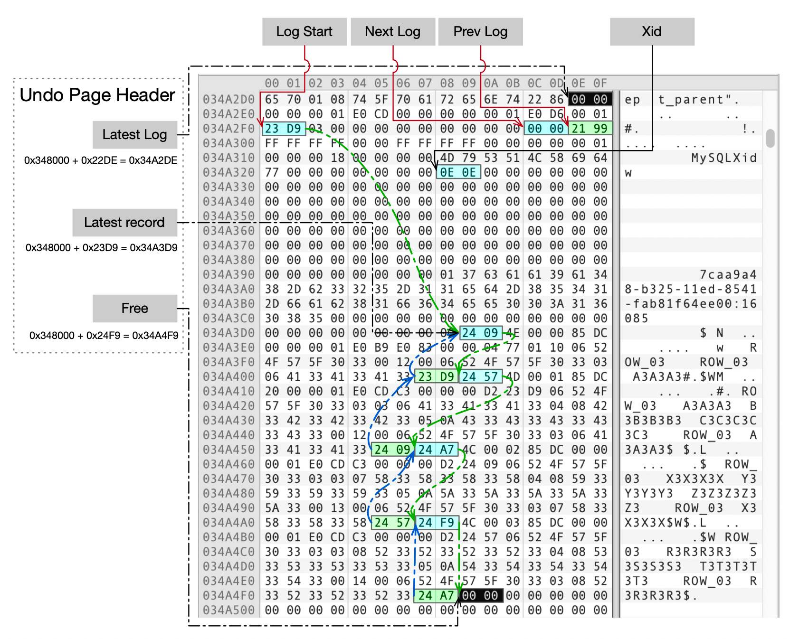

在 Undo 段中，Undo 的数据由 Undo 头和 Undo 记录组成。Undo 头的格式参考下面这张图。

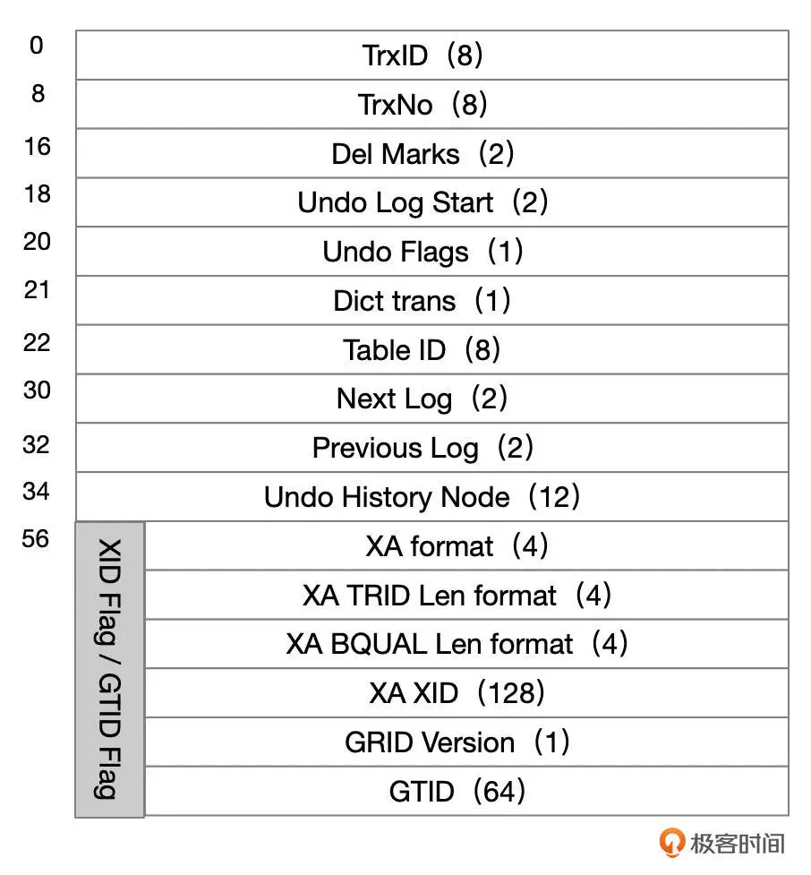

这些字段的含义参考下面这个表格。

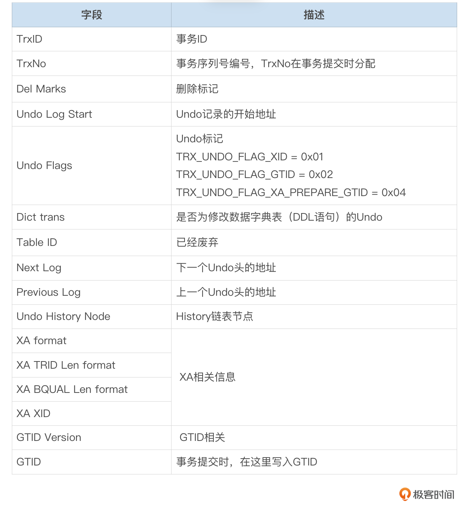

Undo 日志头的一些信息，我在下面这张图中做了标注。

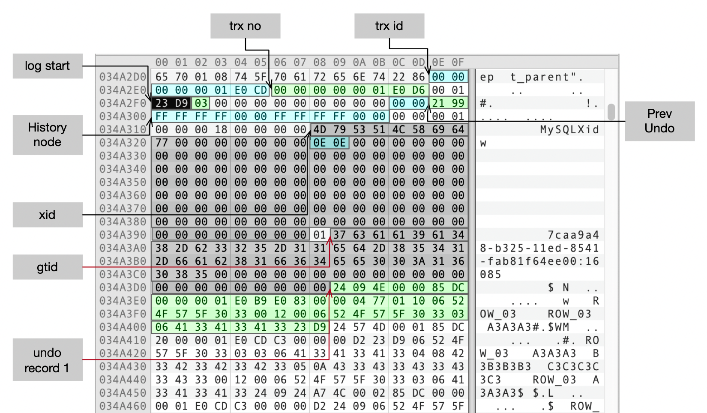

- 事务 ID 为 01 E0 CD，和 ibd 文件中记录头的事务 ID 一样。

- XID 为 0E0E，也就是 3598，和 binlog 中看到的一样

- GTID 也和 binlog 中的一致（7caa9a48-b325-11ed-8541-fab81f64ee00:16085）

### Undo 记录

Undo 记录也有一个固定的格式，每一条 Undo 记录的开始和结束的地方，保存了相邻记录的地址。

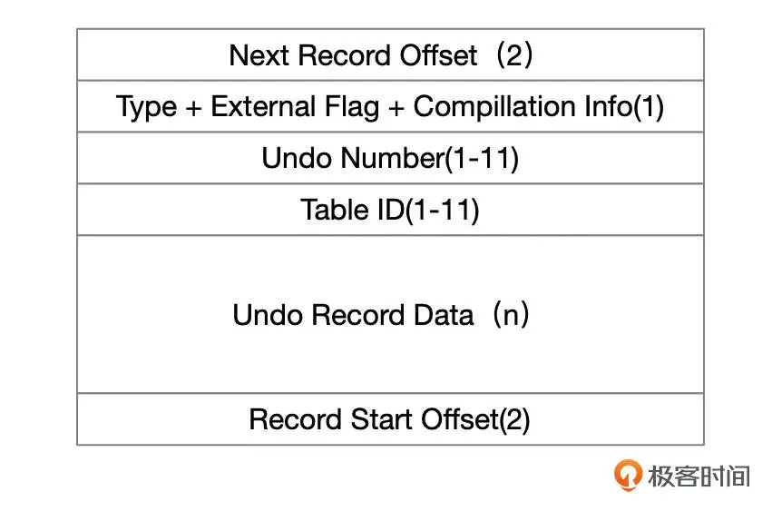

Undo 记录中字段的描述信息参考下面这个表格。

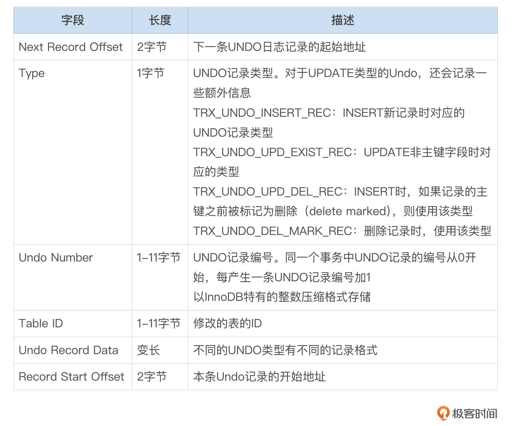

## 总结

InnoDB 使用 Undo 来实现事务的原子性，Undo 日志中记录了回滚事务需要的所有信息。这一讲中，我们介绍了 MySQL 8.0 中 Undo 的物理存储格式。下一讲中还会继续介绍 Undo 在整个事务处理过程中的作用。

## 思考题

早期的版本中，Undo 存储在系统表空间中，有时会遇到一个问题，就是 History 列表持续增长，导致系统表空间占用的文件很大。后续即使清理了 Undo，但是系统表空间无法收缩。在8.0 中，如果遇到类似的问题，Undo 表空间增长得很大，有办法缩减 Undo 表空间吗？

期待你的思考，欢迎在留言区中与我交流。如果今天的课程让你有所收获，也欢迎转发给有需要的朋友。我们下节课再见！
