# 31 | 事务怎么回滚？（下）

你好，我是俊达。

我们接着上一讲，继续介绍 Undo。

## Undo 里的链表结构

Undo 里面，存在着好几个链表结构，包括 Undo 页面链表、Undo 日志头链表、Undo 记录链表。

### Undo 段页面链表

Undo 段中的页面组成一个双向链表。开始时，Undo 段只有 1 个页面。如果事务中修改的记录数很多，1 个页面无法容纳所有的 Undo 记录，就需要往 Undo 段中添加新的 Undo 页面。Undo 段头部信息中记录了 Undo 页面链表的起点和终点。每一个 Undo 页面的头部信息中，记录了链表中前后相邻的 Undo 页面的地址。通过 Undo 页面链表，可以按正向或逆向的顺序遍历所有 Undo 页面。

下面是一个 Undo 页面链表的示意图。

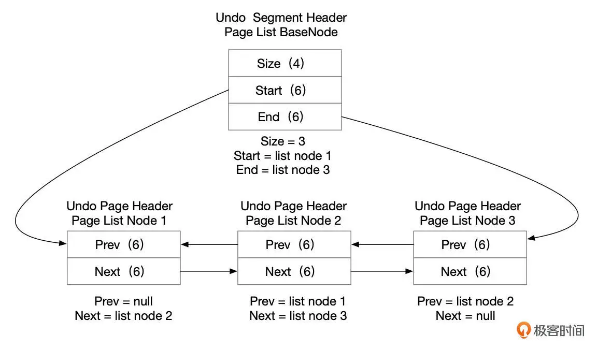

### Undo 日志头链表

Update 类型的 Undo 段，如果一个事务产生的 Undo 记录不多，那么当前事务结束后，这个Undo 段还可以被后续的事务重用。重用时，会在 Undo 段中生成一个新的 Undo 日志头。一个 Undo 段中的所有日志头结构，组成了一个双向链表。

下面就是一个 Undo 页面中的多个 Undo 日志，通过双向链表连在一起。

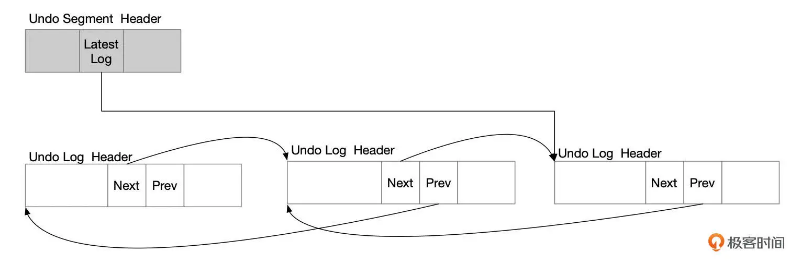

当然，一个 Undo 段被重用，需要满足几个条件。

1. Undo 段只使用了一个 Undo 页。如果一个 Undo 段中的 Undo 页数超过了 1，就不重用这个 Undo 段。

2. Undo 页面里剩余空间超过页面大小的 1/4。如果 Undo 页面的剩余空间不到页面大小的1/4，也不重用这个 Undo 段。

### Undo 页面内的记录链表

一个事务，在同一个 Undo 页面内的记录，通过 Undo 记录中的 Next 和 Prev 指针，组成一个双向的链表。

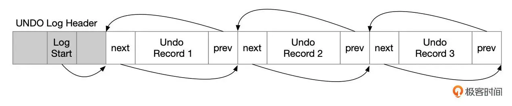

结合 Undo 页面链表和页面内记录链表，就可以按顺序或逆序的方式遍历整个事务的 Undo 记录。回滚事务时，需要以逆序的方式读取和应用 Undo 日志。Purge 历史数据时，以顺序的方式读取和处理 Undo 记录。

## Undo 日志格式

接下来我们看一下 Insert、Update、Delete 语句产生的 Undo 记录的格式。

### INSERT 类型的 Undo 记录格式

INSERT 语句一般情况下产生类型为 TRX_UNDO_INSERT_REC 的 UNDO 记录。日志格式参考下面这张图。

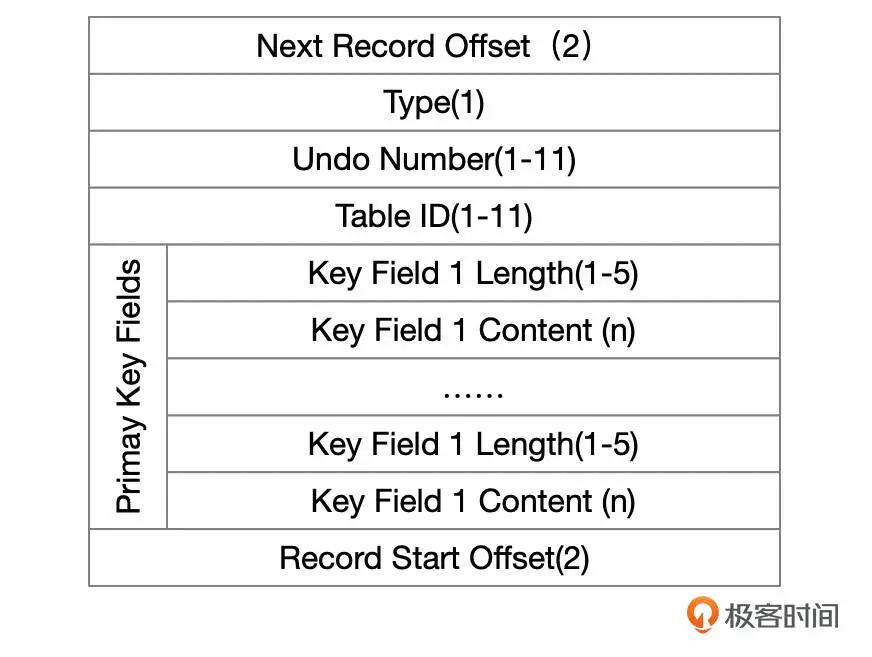

Undo 记录的通用格式已经在上一讲中介绍过了。Insert 类型的 Undo 中，记录了主键字段的数据长度和具体的数据。

我们来看下测试案例中，Insert 记录 ROW_01 的 Undo 记录。从数据页中可以看到 db_trx_id为 01 E0 AF， db_roll_ptr 为 83/000001C9/0110，所以 Undo 段的页面编号为 01C9。下图是Undo 段（页面 01C9）的内容，图上标注了 Insert Undo 记录中的信息。

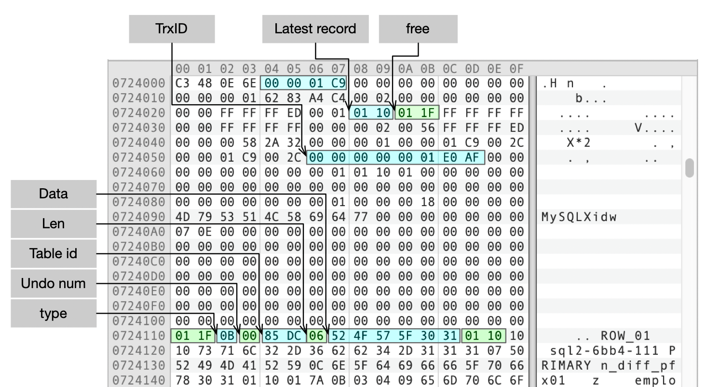

- type 为 0B，是 TRX_UNDO_INSERT_REC。

- Undo num 为 0。

- Table ID 为 85 DC，转换为十进制是 1500（0x5DC）。

从数据字典中确认 Table ID 就是 1500。

```sql
mysql> select table_id, name, space, space_type from information_schema.innodb_ta
+----------+------------+-------+------------+
| table_id | name       | space | space_type |
+----------+------------+-------+------------+
|     1500 | rep/t_undo |   434 | Single     |
+----------+------------+-------+------------+
```

- 数据长度为 6。

- 数据内容为 ROW_01，也就是我们插入记录的主键值。

### UPDATE 类型的 Undo 记录格式

Update 和 Delete 语句产生都会产生 Update 格式的 Undo 记录。UPDATE 语句产生的 Undo类型为 TRX_UNDO_UPD_EXIST_REC。DELETE 语句产生的 UNDO 类型为TRX_UNDO_DEL_MARK_REC。Undo 记录中的信息参考下面这张图。

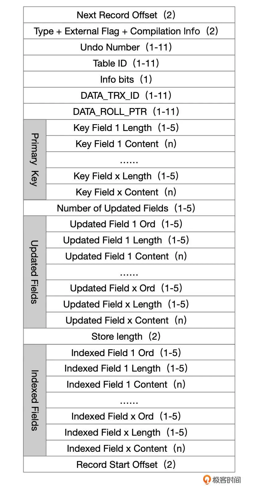

Update 类型的 Undo 记录中，保存了记录上次更新时的 db_trx_id 和 db_roll_ptr，还保存了主键值、更新过的字段更新前的值，以及索引字段的值。这里保存的索引字段的值，在 PurgeUndo 日志时会用到。字段的具体含义可以参考下面这个表格。

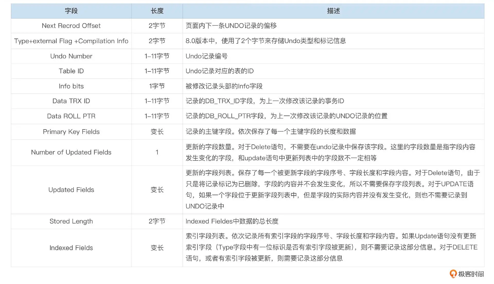

可以看一下对记录 ROW_03 执行 Delete、Insert 和 update 语句所生成的 Undo 日志。图里面标注了 Undo 记录的一些信息。

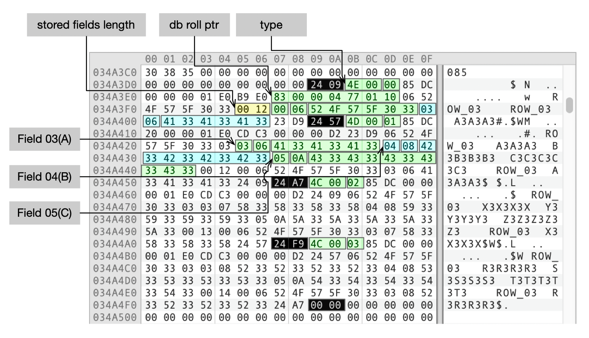

Delete、Insert、Update 这三个语句的 Undo 类型分别是 4E，4D，4C，可以参考下面这个表格中的说明。

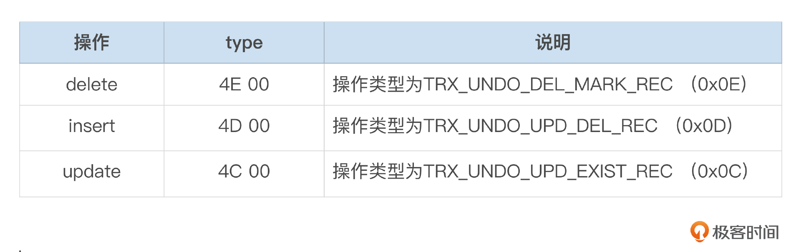

执行 Insert 时，如果新插入的记录和表中标记为删除的记录主键值相同，就会生成TRX_UNDO_UPD_DEL_REC 类型的 Undo，把加了删除标记的整行记录保存下来。我们的测试中，第二次 Insert 记录 ROW_03 就是这种情况。

### UPDATE 主键

如果更新时修改了主键字段，则 InnoDB 需要先删除原来的记录，然后再插入新记录，因此需要记录 2 条 Undo。

1. 对原有的记录设置删除标记，Undo 类型为 TRX_UNDO_DEL_MARK_REC。

2. 插入新记录，Undo 类型为 TRX_UNDO_INSERT_REC。

## 事务（和 Undo 段）的生命周期

InnoDB 开启事务时，并不会立刻为事务分配 Undo 段，只有当事务修改了数据，需要保存Undo 信息时，才会分配 Undo 段。通常 Insert 操作会产生 insert 类型的 Undo，insert Undo保存到 insert Undo 段中。Update 和 Delete 操作产生 update 类型的 Undo，update Undo 保存到 update Undo 段中。

同一个事务中 insert 和 update undo 会保存到两个不同的 undo 段中，主要的原因是事务提交后，update 类型的 undo 记录不能立刻删掉，MVCC 机制可能还需要使用这些 undo 来构建记录的历史版本。而 insert 类型的 undo 记录在事务提交后可以立刻删掉，因为如果记录是新insert 的，那么对应的 DB_ROLL_PTR 字段中会设置 insert 标记位，并且对于新 insert 的记录，不存在更早的版本。

修改临时表所产生的 Undo 记录，会保存到临时 undo 段中。临时 Undo 段从临时表空间中分配。往临时 undo 段中写入 undo 记录时，不需要记录 REDO 日志。系统重启时，临时表空间内的所有数据都会被清空，由于不需要恢复临时表空间内的数据，所以修改临时表空间时，不用记录 Redo 日志。

### 分配回滚段

事务中首次修改数据时，会先分配回滚段，MySQL 以轮询的方式依次在所有 Undo 表空间的所有回滚段中选取。

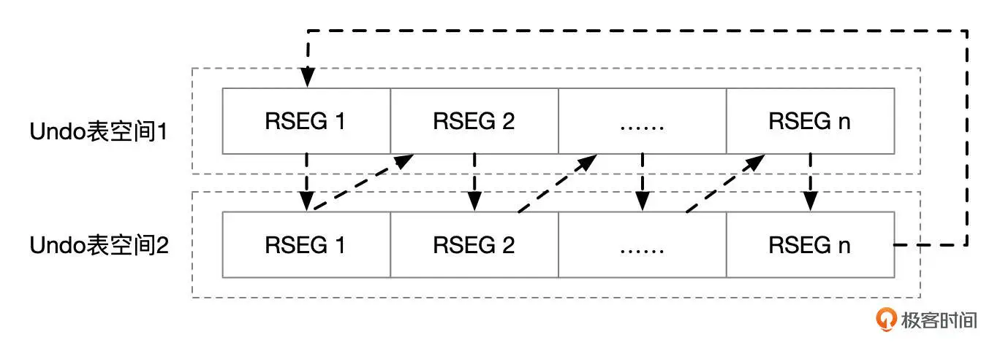

### 分配 Undo 段

对每个回滚段，InnoDB 在内存中维护了 2 个 Undo 段的链表。事务结束时，如果对应的Undo 段只有 1 个 Undo 页，并且 Undo 页剩余空间多于页面大小的 1/4，就会将 Undo 段加入到缓存的 Undo 段列表中，给后面的事务重复使用。

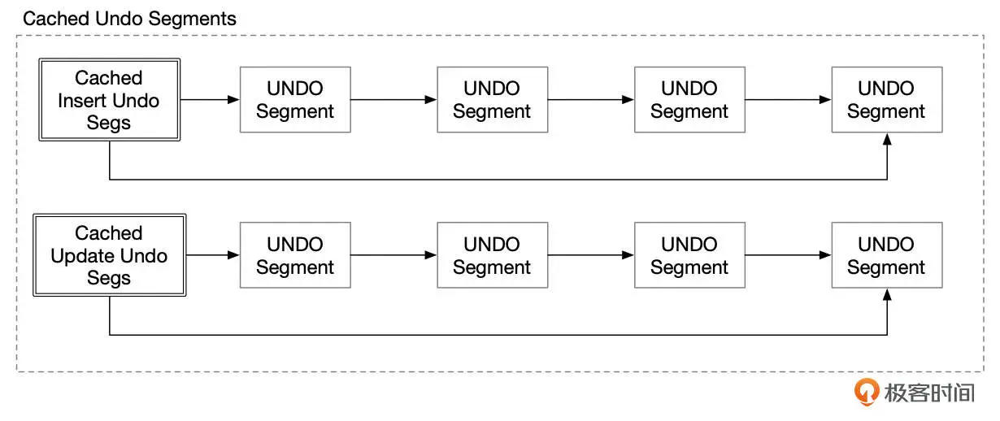

分配 Undo 段时，先根据 Undo 类型，到对应的链表中查找是否有可重用的 Undo 段。如果找到了可重用 Undo 段，先将 Undo 段从链表中取下，然后在 Undo 页面中加入 Undo 记录头部信息。对于 Insert 类型的 Undo 段，之前事务写入的 Undo 信息可以直接覆盖掉。对于Update 类型的 Undo 段，之前事务写入的 Undo 信息不能直接覆盖，需要将新的 Undo 记录头部信息添加到 Undo 页面的空闲区域内。

如果当前没有可重用的 Undo 段，就需要创建新的 Undo 段。每一个回滚段最多可容纳 1024个 Undo 段。在回滚段的页面中，以数组的形式记录了每一个 Undo 段的第一个页面的编号。

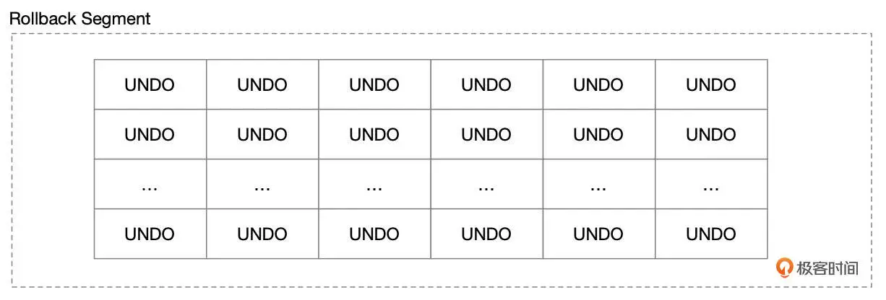

创建新的 Undo 段时，要先从数组中找到一个空闲的 Undo 槽位，空闲槽位由特殊值FIL_NULL（0xFFFF）标识。如果回滚段中的 Undo 槽位都已经被占用，就无法分配新的Undo 段，事务无法进行。如果有空闲的 Undo 槽位，就创建一个新的 Undo 段，并在 Undo槽位中记录 Undo 段的页面编号。

### 释放 Undo 段

事务结束时，需要释放已经分配的 Undo 段。释放 Undo 段大致上分为下面这几个步骤。

1. 设置 Undo 段头部的状态信息（TRX_UNDO_STATE）。

如果 Undo 段内只有 1 个页面，并且页面的空闲空间大于页面大小的 1/4，则说明该 Undo 段可以被后续事务重用，状态设置为 TRX_UNDO_CACHED。如果 Undo 段无法重用，则对于Insert Undo 段，状态设置为 TRX_UNDO_TO_FREE，对于 Update Undo 段，状态设置为TRX_UNDO_TO_PURGE。

2. 将 Update Undo 段加入到 History 链表中。

- 计算事务的 trx no。trx no 从变量 next_trx_id_or_no 中获取。

- 如果 Undo 段可重用（状态为 TRX_UNDO_CACHED），将 Undo 段加入到update_undo_cached 链表中。否则将回滚段中 Undo 数组中对应的槽位设置为空闲状态。

- 将 Update Undo 日志头加入到 History 链表中。

- 设置 undo 段头部的相关字段，包括 trx no、删除标记、GTID 等信息。

3. 释放 insert undo 段，基于 Undo 段的状态执行下面的步骤。

- 如果状态为 TRX_UNDO_CACHED，就把 undo 段加入到 insert_undo_cached 链表中。

- 如果状态为 TRX_UNDO_TO_FREE，就释放 undo 段，并将 Rollback 段中 Undo 数组中对应的槽位设置为空闲状态。

## History 列表和 Purge

Update Undo 段在事务完成时加入到 History 列表中。每个回滚段都维护了一个历史 Undo 的双向链表（可以参考上一讲中的回滚段格式，RSEG History Base Node 就是链表的基节点）。后台 Purge 线程会定期回收 History 链表中的 Undo 段。

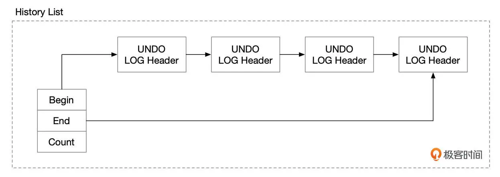

Undo Purge 需要完成几件事情：

1. InnoDB 在删除记录时，或者更新主键字段或二级索引字段时，会给记录添加删除标记。记录只是逻辑上被删除了，记录占用的空间还没有被释放出来。Purge 时，需要将标记为删除的记录从物理上真正删除，释放记录占用的空间。

2. Update Undo 段加入到 History 链表中后，占用的空间并没有释放。Purge 时，需要将Undo 段也释放掉。

Undo 段按事务提交的顺序加入到 History 链表。Purge 时，需要先确定哪些 Undo 段可以Purge。这和当前系统中打开的 Read View 有关。每个 Read View 开启时，会记录当前处于活跃状态的事务的最小的事务 ID（m_up_limit_id）。Purge 时，先计算所有 Read View 中m_up_limit_id 的最小值。History 链表中，如果 Undo 记录的 trx no 小于 m_up_limit_id，就说明所有事务都不需要这个 Undo 记录了，可以清理掉。至于 Read View 具体是什么意思，我们在下一讲中会详细介绍。

show engine innodb status 命令的输出中，Transactions 部分记录了 History 链表相关信息。如果 History 链表的长度持续增加，可能是有长事务一直没有提交，或者 Purge 的速度跟不上数据写入的速度。

```
------------
TRANSACTIONS
------------
Trx id counter 29778
Purge done for trx's n:o < 29726 undo n:o < 0 state: running but idle
History list length 0
Total number of lock structs in row lock hash table 0
LIST OF TRANSACTIONS FOR EACH SESSION:
```

## 系统崩溃恢复

MySQL 数据库运行时，每开启一个新的事务，都会将事务加入到活动事务的链表中，事务提交或回滚后，会将事务从链表中移除。通过事务链表，可以获取到每一个进行中的事务。但是如果数据库崩溃了，内存中的信息全部都丢失了，下一次数据库启动时，怎么知道之前数据库中有哪些进行中的事务呢？

InnoDB 给每一个修改了数据的事务都分配了 Undo 段，Undo 段中保存了事务相关信息，包括事务的状态、事务的 ID 等。数据库启动时，会扫描所有的回滚段，根据回滚段中记录的Undo 段数组，读取事务状态，对于未提交的事务进行回滚操作，将数据库恢复到一致的状态下。

系统启动时，会进行崩溃恢复，大致上要执行下面这些步骤。

1. 重做 lsn 号在 checkpoint 之后的 redo 日志。Redo 在上一讲已经做了介绍。

2. 扫描回滚段，根据回滚段 Undo 段数组里的信息，解析 Undo 段。

3. 基于解析到的 Undo 段，构建事务列表。

4. 回滚还没有提交的事务。

5. 对于状态为 prepared 的事务，还需要根据 Binlog 中是否有对应的 XID 事件，来判断是提交还是回滚事务。

## 总结

通过上一讲和这一讲，你应该已经知道 MySQL 中 Undo 的原理和作用了。在写入特别繁忙的数据库中，清理（Purge）Undo 日志可能会成为制约数据库性能的一个重要因素。建议把History 链表长度监控起来。有一些 Purge 相关的参数可以配置，具体信息可以参考官方文档。Undo 还在事务的一致性读取（MVCC）中起到重要的作用，我们在下一讲中再介绍。

## 思考题

MySQL 中，提交一个事务通常是非常快的，因为提交事务时，不需要等待脏页刷新，只需要将事务生成的 Redo 日志刷新到磁盘就可以了。但是回滚一个事务，成本就比较大了，特别是当你在事务中修改了大量数据后再回滚。

考虑这么一个场景，你对一个大表执行了不带 where 条件的 delete 语句，执行了很长一段时间后，你发现 delete 还没有完成，而且数据库卡死了，为了尽快恢复业务，你选择了重新启动数据库。在数据库启动时，MySQL 会怎么处理这个被中断的 delete 操作？

期待你的思考，欢迎在留言区中与我交流。如果今天的课程让你有所收获，也欢迎转发给有需要的朋友。我们下节课再见！
