# 32 | 隔离级别对应用程序有什么影响？

你好，我是俊达。

事务的 ACID 属性中，I（Isolation）表示隔离性，指的是多个事务并发执行时，各个事务之间相互独立，仿佛在独立的环境中执行一样。数据库用来实现隔离性的两个重要的方法分别是MVCC（Multi-Version Concurrency Control，多版本并发控制）和锁。

这一讲我们会介绍 MVCC，锁的内容在下一讲中再展开。

## 事务的隔离级别是什么意思？

事务之间互相隔离的程度使用隔离级别来描述。ISO SQL 标准定义了 4 个隔离级别，分别为READ UNCOMMITTED、READ COMMITTED、REPEATABLE READ、SERIALIZABLE。事务的隔离级别决定了并发的事务在执行过程中，读取和写入数据受其他事务的影响程度。

根据隔离级别的不同设置，事务在执行过程中可能会存在下面这几种现象：

- 脏读（Dirty read）：读取到其他事务还没有提交的修改。

- 不可重复读（Nonrepeatable read）：事务在 T1 时刻读取到的记录，在 T2 时刻再次读取时，可能会发生变化，要么字段被更新了，要么记录被删除了。

- 幻读（Phantom read）：事务中的一个 SQL，在 T1 时刻执行获取到的记录，在 T2 时刻执行同一个 SQL 时，依然能获取到，但是在 T2 时刻还能获取到额外的记录。

根据事务是否会遇到上面的几种现象，ISO SQL 标准定义了 4 种隔离级别，参考下面这个表格。

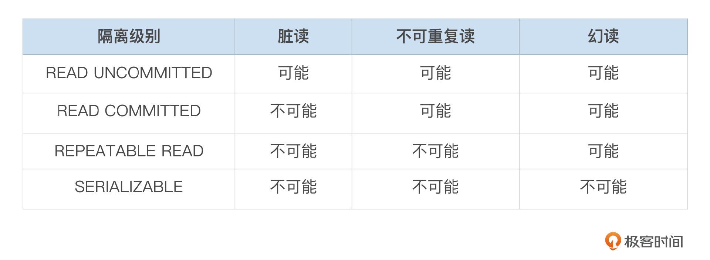

## 如何设置隔离级别？

MySQL 支持 SQL 标准定义的 4 种隔离级别，默认的隔离级别是 REPEATABLE READ。你可以使用参数 transaction_isolation 或命令 set transaction isolation level 在全局、会话或事务设置隔离级别。

### 设置全局隔离级别

使用 set global transaction_isolation 设置全局隔离级别。

```
set global transaction_isolation = 'READ-UNCOMMITTED' |
   'READ-COMMITTED' |
   'REPEATABLE-READ' |
   'SERIALIZABLE';
```

使用 set global transaction isolation level 设置全局隔离级别。

```
set global transaction isolation level READ UNCOMMITTED |
   READ COMMITTED |
   REPEATABLE READ |
   SERIALIZABLE;
```

使用两种方式设置隔离级别的效果是一样的。设置全局隔离级别并不会改变当前会话的隔离级别，只有建立新的会话时配置才会生效。

全局隔离级别可以通过命令 show global variables 查看。

```
mysql> show global variables like 'transaction_isolation';
+-----------------------+-----------------+
| Variable_name         | Value           |
+-----------------------+-----------------+
| transaction_isolation | REPEATABLE-READ |
+-----------------------+-----------------+
1 row in set (0.00 sec)
```

### 设置会话隔离级别

使用 set transaction_isolation 设置会话隔离级别。

```
set [session] transaction_isolation = 'READ-UNCOMMITTED' |
   'READ-COMMITTED' |
   'REPEATABLE-READ' |
   'SERIALIZABLE';
```

上述命令中的 session 关键字可以加上，也可以不加。

使用 set session transaction isolation level 设置会话隔离级别。

```
set session transaction isolation level READ UNCOMMITTED |
   READ COMMITTED |
   REPEATABLE READ |
   SERIALIZABLE;
```

新开启一个事务时，会根据会话级别的隔离设置来决定事务的隔离级别。需要注意，如果在设置会话隔离级别时，事务已经开启，那么当前事务的隔离级别并不会发生变化。

使用命令 show variables 查看会话的隔离级别。

```sql
show [session] variables like 'transaction_isolation';
select @@transaction_isolation;
```

### 设置下一个事务的隔离级别

使用 set @@transaction_isolation 设置下一个事务的隔离级别。

```
set @@transaction_isolation = 'READ-UNCOMMITTED' |
   'READ-COMMITTED' |
   'REPEATABLE-READ' |
   'SERIALIZABLE';
```

使用 set transaction isolation level 设置下一个事务的隔离级别。

```
set transaction isolation level READ UNCOMMITTED |
   READ COMMITTED |
   REPEATABLE READ |
   SERIALIZABLE;
```

使用上面两种方法，都可以修改下一个事务的隔离级别，修改只对下一个事务生效。（下一个事务）之后事务，隔离级别会依据会话的隔离级别来确定。

如果当前已经开启了事务，执行这两个命令都会报错。

```
mysql> set @@transaction_isolation = 'READ-UNCOMMITTED';
ERROR 1568 (25001): Transaction characteristics can't be changed while a transact
mysql> set  transaction isolation level read committed;
ERROR 1568 (25001): Transaction characteristics can't be changed while a transact
```

## 不同隔离级别下，事务的数据可见性

接下来我们使用几个具体的例子，来看看不同隔离级别下事务的数据可见性。

### READ UNCOMMITTED

在 READ UNCOMMITTED 隔离级别下， 事务可以读取其他事务还没有提交的修改。

下面我以一个简单的例子来演示。先准备测试表和数据。

```sql
mysql> create table test_dirty(a int, b int);
Query OK, 0 rows affected (0.76 sec)
mysql> insert into test_dirty values(1,1);
Query OK, 1 row affected (0.53 sec)
```

按顺序执行下面这些 SQL。

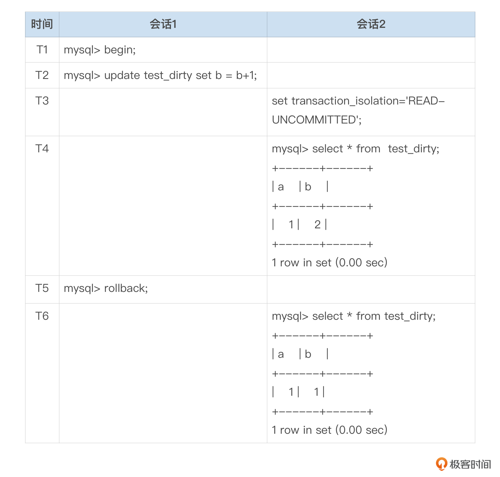

可以看到，使用 READ UNCOMMITTED 隔离级别可以读取其他会话还没有提交的修改。有些数据库中，使用 READ UNCOMMITTED 隔离级别的一个原因是避免读取过程中的锁等待，代价是牺牲了数据的一致性。在 MySQL 数据库中，普通的 SELECT 语句不需要获取记录锁，查询也不会对记录加锁，因此一般不会使用 MySQL 的 READ UNCOMMITTED 隔离级别。

### READ COMMITTED

在 READ COMMITTED 隔离级别下，事务能读取到其他事务提交后的数据。

准备测试数据。

```sql
create table test_account(account_no int, balance int);
insert into test_account values(1001, 1000);
insert into test_account values(1002, 2000);
insert into test_account values(9009, 10000);
```

按以下顺序执行 SQL：

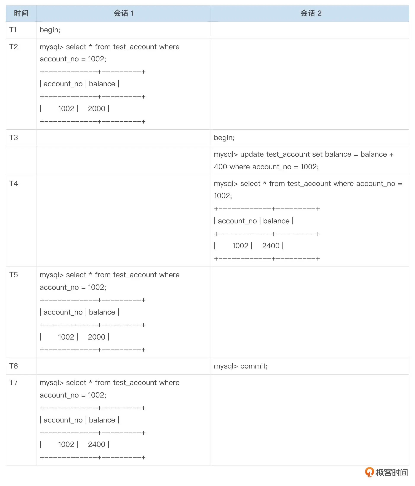

例子中，会话 2 在 T6 时刻提交了修改，会话 1 在 T2 和 T7 两个时间点读取到的记录发生了变化。

我们设想这样一种场景。

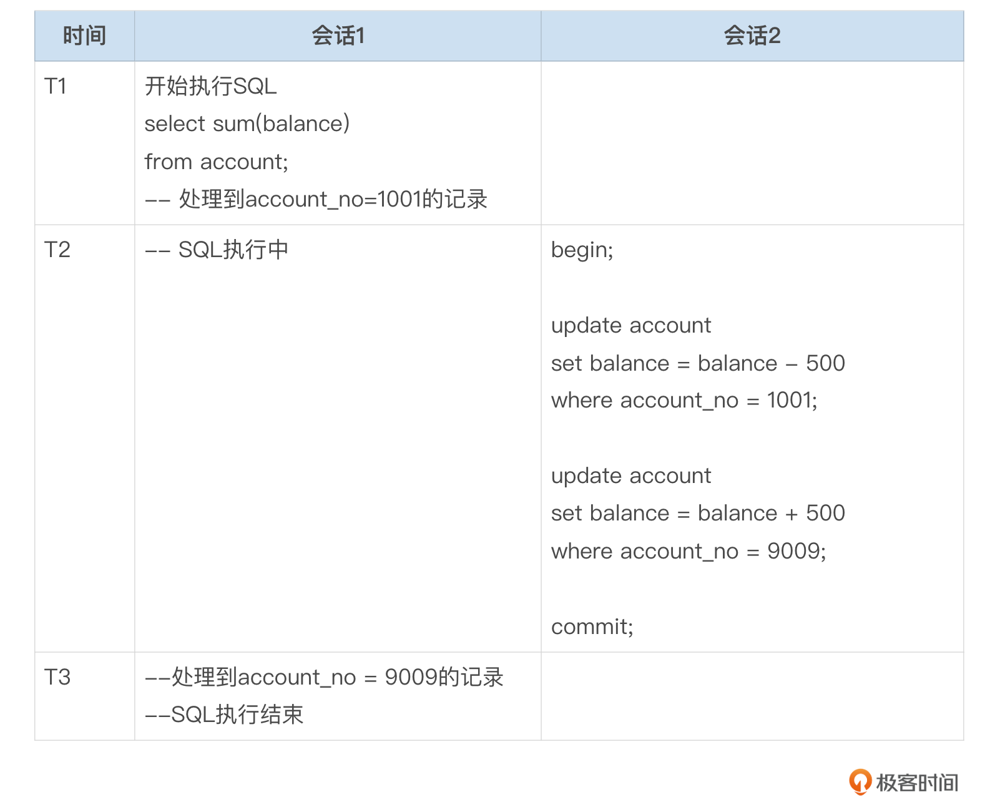

上述假想的例子中，会话 1 开始执行统计 SQL，由于表比较大，该 SQL 需要执行一段时间，在这个 SQL 执行期间，会话 2 发起一个转账事务，将部分金额从 account_no 为 1001 的记录转到 account_no 为 9009 的记录并提交。会话 1 中的 SQL，在 T1 时刻读取到 account_no为 1001 的记录的余额，其中有 500 转到了 T3 时刻读取到的 account_no 为 9009 的记录中，那么在 READ COMMITTED 隔离级别下，该 SQL 是否存在数据不一致的情况（金额被重复计算）？

如果会话 1 的 Select 执行过程中对数据加锁，那么会话 2 的 update 语句需要等待 select 执行完成后才能执行。MySQL 中普通 select 语句不会对数据加锁，而是通过语句级别的一致性读取来避免上述假想例子中存在的数据不一致现象。

总结一下，MySQL 中，READ COMMITTED 不会出现脏读，但是会有不可重复读和幻读。

### REPEATABLE READ

按照 SQL 标准的定义，REPEATABLE READ 隔离级别下，不会出现不可重复读现象，但是可能会出现幻读现象。接下来我们测试一下 MySQL 的 REPEATABLE READ 隔离级别。

```sql
create table test_account(account_no int, balance int);
insert into test_account values(1001, 1000);
insert into test_account values(1002, 2000);
insert into test_account values(9009, 10000);
```

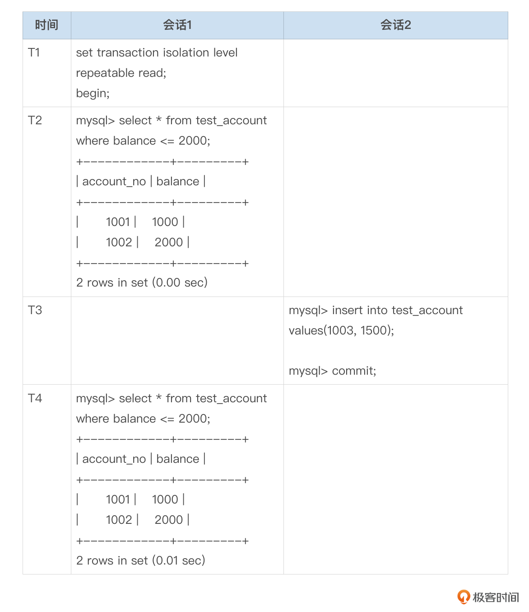

下面是另外一个例子，REPEATABLE READ 隔离级别下，如果 select 语句后加上 for share、for update，或者执行的是 update、delete、insert into t2 select from t1 这类语句时，需要读取记录最新版本，称为当前读。MySQL 会根据 where 条件和 SQL 的执行计划，加上相应的锁，阻止其他会话写入满足查询条件的记录。

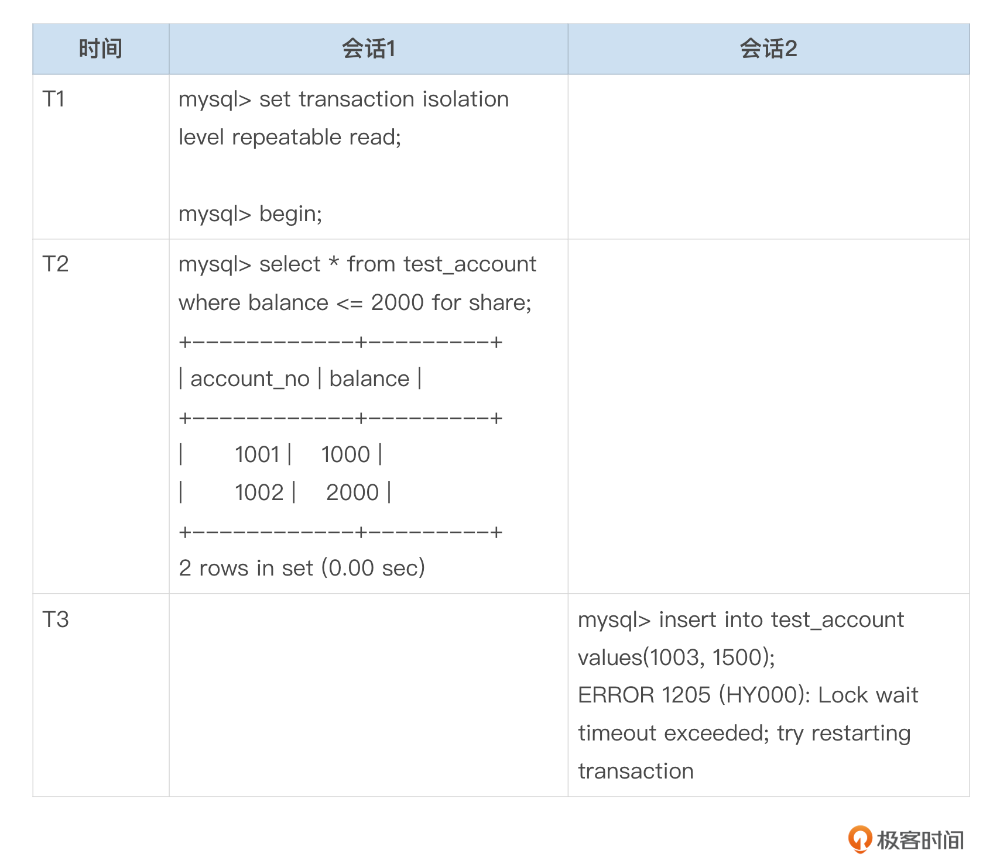

上述例子中，会话 1 查询了 balance <= 2000 的记录，会话 2 插入的记录满足会话 1 中 SQL的 where 条件（balance <= 2000），因此被阻塞。

上面的两个例子，MySQL 看上去实现了可重复读，没有幻读，是不是能说 MySQL 的隔离级别完全实现了 SQL 标准呢？

```sql
create table test_account2(account_no int, balance int, remark varchar(30)) engin
insert into test_account2 values(1001, 1000, '');
insert into test_account2 values(1002, 2000, '');
insert into test_account2 values(9009, 10000, '');
```

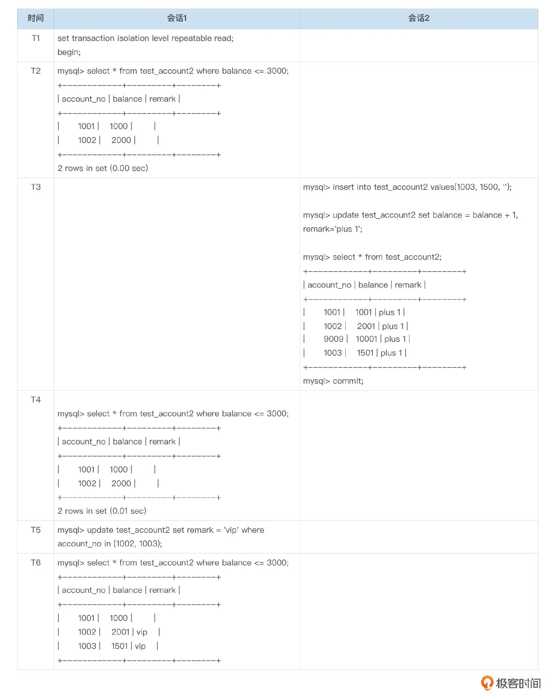

T5 时刻，会话 1 更新了两行记录后，再查询数据，可以看到，被更新过的记录，读取到了最新的版本。因此，这个例子中，出现了幻读（多了 account_no 1003 的数据），还出现了不可重复读（account_no 1002 的数据发生了变化）。

小结一下，MySQL 的 REPEATABLE READ 隔离级别，如果事务是只读的，或者事务中没有修改数据，或者事务中修改的数据和其他事务没有重叠，可以保证可重复读，而且没有幻读。

### SERIALIZABLE

SERIALIZABLE 是等级最高的隔离级别。MySQL 里，SERIALIZABLE 事务中的普通 SQL 读取数据时也会加锁。在 MySQL 中使用 SERIALIZABLE 隔离级别可以避免出现经典的“更新丢失（lost update）”问题。

更新丢失问题：

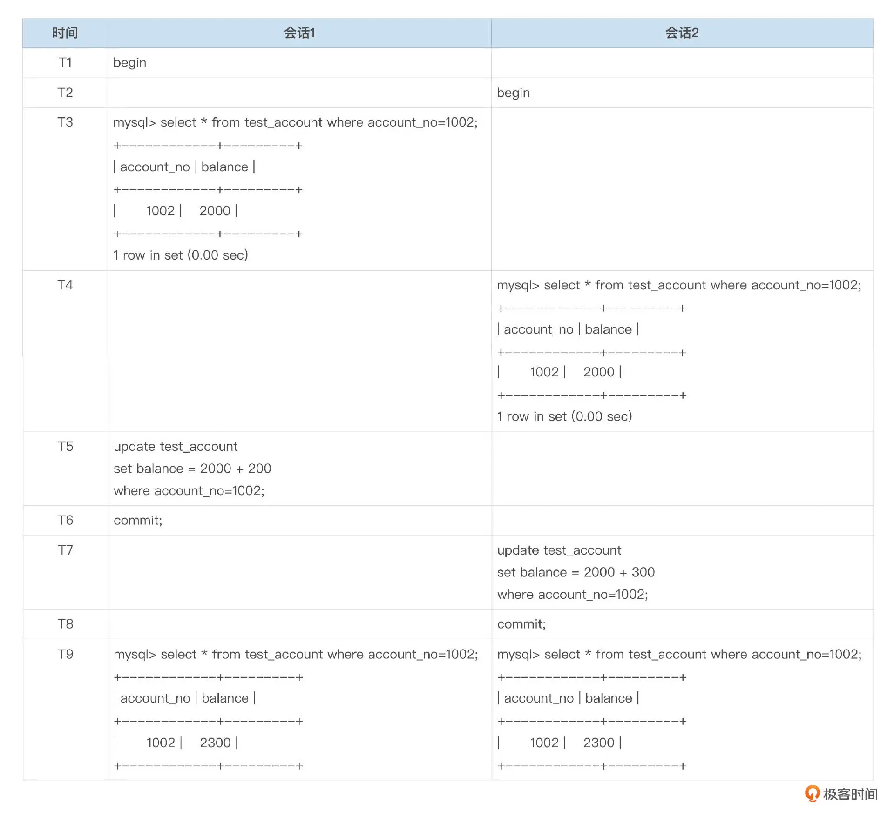

会话 1 和会话 2 分别开启事务，读取 account_no 为 1002 的账户余额，然后会话 1 给账号增加 200 的余额，会话 2 给账号增加 300 的余额。会话 1 的事务先提交，当会话 2 的事务提交时，会话 1 的更新被覆盖，最终账号余额变成 2300，会话 1 的更新相当于丢失了。

解决更新丢失问题，有几种不同的方法。

方法 1：使用 select for update，在查询时就直接锁定记录。

```sql
begin;
select * from test_account where account_no = 1002 for update;
update test_account set balance = 2200 where account_no = 1002;
commit;
```

使用这种方法，在查询时就需要锁定记录，会影响系统的并发性。select 和 update 执行的间隔时间越长，事务持有锁的时间就越长。

方法 2：将 update 语句改成下面这种形式。

```sql
begin;
update test_account
set balance = balance + 200
where account_no = 1002;
commit;
```

方法 3：给记录加上版本号，每次修改记录时需要同时修改版本号。

```sql
begin;
select account_no, balance, version
from test_accout
where account_no = 1002;
update test_accout
set balance = 2200, version = version + 1
where account_no = 1002
and version = :version
commit;
```

使用这种方法，只会在执行 update 时持有锁。如果其他会话修改了当前的记录，版本号也会发生变化，事务在更新记录时就匹配不到这行记录。

如果事务的隔离级别为 SERIALIZABLE，那么在查询数据时就会给记录加上锁。在上面的例子中， T5 时刻的 update 操作需等待会话 2 释放锁，T7 时刻，会话 2 的 update 操作需要等待会话 1 释放锁，形成了死锁。MySQL 检测到死锁后，会回滚其中一个事务。

```sql
mysql> update test_account set balance = 2300 where account_no = 1002;
ERROR 1213 (40001): Deadlock found when trying to get lock; try restarting transa
```

这样也避免了更新丢失的问题。

当然在实际应用中，如果用了 SERIALIZABLE 隔离级别，读操作会阻塞写操作，写操作也会阻塞读操作，会严重影响系统的并发性，所以一般很少使用 SERIALIZABLE 隔离级别。

前面讲了，SERIALIZABLE 隔离级别下 SELECT 也会获取锁，其实也有例外的情况，在autocommit=ON 的设置下，如果没有显式开启事务，那么 SELECT 是不需要锁的。

## InnoDB 的 MVCC 是怎么实现的？

InnoDB 的 MVCC 机制，使用了 Undo 日志，来实现 READ COMMITTED 和 REPEATABLEREAD 隔离级别下的一致性读取。一致性读取在执行时不需要对记录加锁，这样就不会被其他事务的写操作阻塞，也不会阻塞其他事务修改数据。

当然下面的这些情况下，使用了当前读，需要获取记录锁。

1. 使用 select for share 或 select for update 的语句，总是查询数据的当前版本，需要对记录加锁。

2. update 和 delete 语句，在查找满足条件的记录时，需要获取记录的当前版本，查找时需要给记录加锁。这里有一种特殊情况：在 READ COMMITTED 隔离级别下，UPDATE 会使用半一致性读取（semi-consistent read）。关于锁的问题，我们到下一讲再具体介绍。

3. REPEATABLE READ 隔离级别下，insert into t select * from tab、create table t as select *from tab 这类 SQL 中的 select 操作需要对读取到的记录加锁。

### 一致性读取的一个例子

我们以一个简单的例子来说明 MySQL 中 MVCC 的大致工作原理。

先创建一个测试表：

```sql
create table tab(
   pk varchar(10),
   c1 int,
   data varchar(100),
   primary key(pk),
   key idx_c1(c1)
) engine=innodb;
```

开启 2 个会话，按以下表格中的时间顺序依次执行 SQL。

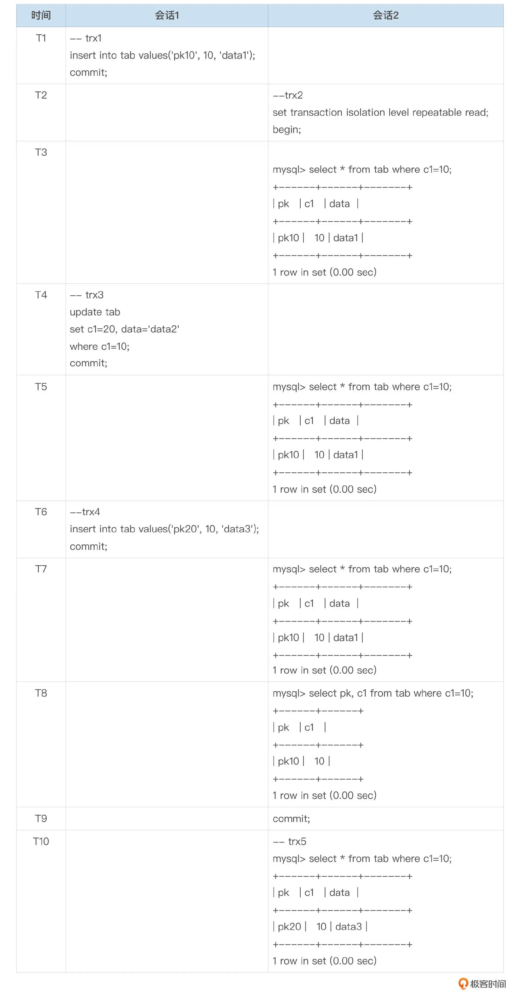

1. T1 时刻，事务 trx1 INSERT 一条记录并提交。

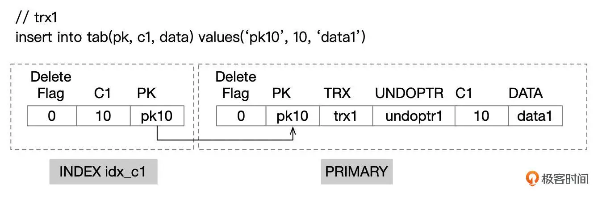

2. T3 时刻，事务 trx2 查询数据，从索引 idx_c1 中定位到记录的主键，然后根据主键到Primary 索引中获取记录，对比记录的 trx 字段，trx1 在 trx2 开始之前已经提交，所以这条记录对于 trx2 可见。

3. T4 时刻，会话 1 开启事务 trx3，执行 UPDATE 操作更新了记录。

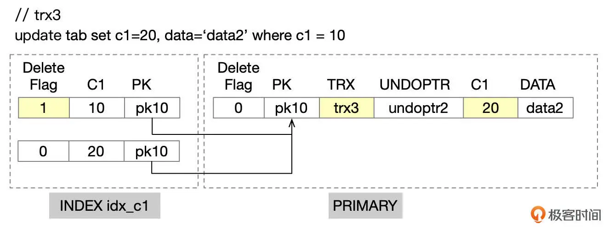

更新之后，索引 idx_c1 中的记录 (10, pk10) 被标记为已删除，同时插入新的索引记录（20,pk10）。主键记录中，db_trx_id 字段更新为 trx3，db_roll_ptr 指向 UPDATE 操作产生的 undo记录，C1 字段更新为 20。

4. T5 时刻，会话 2 再次执行 SELECT 时，根据索引中被标记为删除的记录获取到记录的主键，然后从 Primary 中获取到记录，对比 trx 字段，trx3 是在 trx2 之后才开启的，所以当前的记录对事务 trx2 不可见，MySQL 根据 undoptr2 找到 undo 记录，计算得到记录的上一个版本，并判定版本是否可见。

5. T6 时刻，会话 1 开启事务 trx4，执行 INSERT 操作。

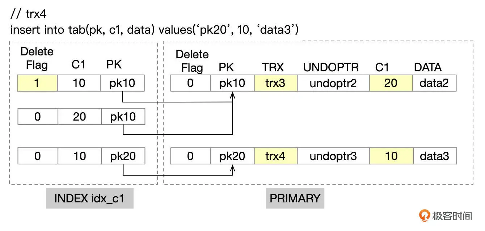

6. T7 时刻，事务 trx2 再次执行 SELECT 操作，这次根据条件（c1=10）从索引 idx_c1 中得到 2 条记录，PK 分别为 pk10、pk20，对于主键为 pk10 的记录，通过多版本机制获取到上一个版本的记录满足 trx2。对于主键为 pk20 的记录，最近一次操作是 INSERT，事务 IDtrx4 对当前事务不可见。因此只返回一行记录。

7. T8 时刻，事务 trx2 执行的 SQL 使用了覆盖索引。但是索引页面的 max_transaction_id 是trx4，虽然使用了覆盖索引，但需要回表构建记录的历史版本，因为只有聚簇索引中记录了db_roll_ptr。

8. T9 时刻，事务 trx2 提交。

9. T10 时刻，新的事务 trx5 执行同样的 SELECT 查询，从索引 idx_c1 中获取到 2 条满足条件的记录：（10，pk10）和（10，pk20），对于主键为 pk20 的记录，对比发现 trx4 在 trx5开始前已经提交，所以该记录对 trx5 可见。对于主键为 pk10 的记录，对比发现 trx3 在trx5 开始之前已经提交，所以该记录对 trx5 可见，但是该记录的 C1 字段已经被修改为20，不满足 C1=10 的条件，所以查询最终只返回主键为 pk20 的记录。

### Read View

怎么判断读某一行数据对当前的事务或语句是否可见呢？MySQL 使用了 Read View 来实现这个功能。这里的 Read View 和平时我们说的视图不是同一个概念，千万不要搞混淆了。

Read View 中记录了当前系统中活动事务信息。

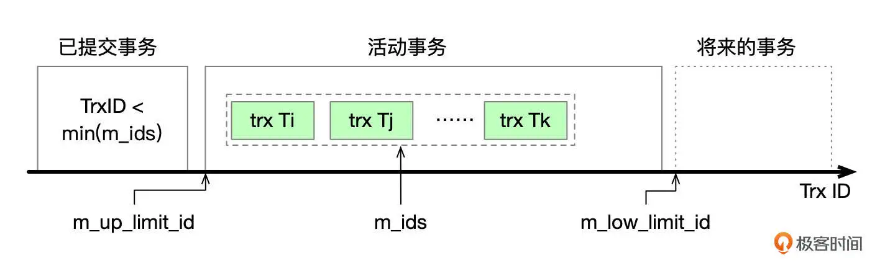

对于一个 Read View 而言，哪些数据是可见的呢？规则其实很简单。

1. 创建 Read View 时就已经提交的事务，它们的修改可见。

2. 和 Read View 绑定的那个事务，自己修改的数据可见。

Read View 中记录了当前系统中活动事务的 ID 列表（m_ids），这些事务的修改不可见。这些事务 ID 中，一定存在一个最小值，最小值保持在成员 m_up_limit_id 中，小于这个 ID 的事务，在创建 Read View 时肯定都已经提交了，他们的修改可见。

创建 Read View 时，系统将分配给下一个事务的 ID 记录在成员 m_low_limit_id 中，大于这个ID 的事务，在创建 Read View 时，还不存在，因此这些事务的修改不可见。Read View 还记录了创建者的事务 ID m_creator_trx_id，本事务修改的数据，对自己当然是可见的。

READ COMMITTED 和 REPETABLE READ 隔离级别在实现上最根本的区别就是创建 READVIEW 的时间不一样。对于 READ COMMITTED 隔离级别的事务，每次执行一致性查询时，都会创建一个新的 Read View，这样 SELECT 就能获取系统中当前已经提交的最新数据。对于 REPETABLE READ 隔离级别的事务，在第一次执行一致性读取时创建 READ VIEW。事务中后续再次执行 SELECT 时，会重用已经创建好的 Read View。

前面有一个例子，一致性读取查不到的数据，却可以被更新到。而更新之后，就可以读取到其他事务的修改了。

```sql
mysql> select * from test_account2 where balance <= 3000;
+------------+---------+
| account_no | balance |
+------------+---------+
|       1001 |    1000 |
|       1002 |    2000 |
+------------+---------+
2 rows in set (0.01 sec)
mysql> update test_account2 set remark = 'vip' where account_no in (1002, 1003);
mysql> select * from test_account2 where balance <= 3000;
+------------+---------+--------+
| account_no | balance | remark |
+------------+---------+--------+
|       1001 |    1000 |        |
|       1002 |    2001 | vip    |
|       1003 |    1501 | vip    |
+------------+---------+--------+
```

这是因为更新时，使用了当前读。而更新记录时，也修改了记录的 db_trx_id 字段，和 ReadView 的 m_creator_trx_id 一样了，因此后续的一致性读取也能查询到这些记录了。

### 记录版本链

最后介绍一下记录的版本链。

- InnoDB 给每一行记录增加了两个隐藏字段：事务 ID（db_trx_id) 和回滚段指针（db_roll_ptr）。

- 每次修改记录时，InnoDB 会将撤销该修改所需的数据写入到回滚段。

- 每次修改记录时，InnoDB 还会修改 db_trx_id 和 db_roll_ptr 字段。

- 修改二级索引页面时，会更新页面中的 max_transaction_id。

- 执行一致性读取时，如果记录当前的版本不可见，就通过 db_roll_ptr 找到 Undo 记录，将记录回退到上一个版本（具体的操作是先将记录复制到临时内存中，然后在临时内存上执行版本回退，不会修改聚簇索引中的数据）。

- 判断回退后的版本是否可见，如果不可见，就继续进行回退操作，直到记录版本可见。或者回退到记录 INSERT 之前，也就是记录不存在。

通过这种版本链条的机制，InnoDB 实现了一致性读取。

### 回退 INSERT 操作

对于 INSERT 操作，UNDO PTR 有一个特殊的标识为，标记当前的操作为 INSERT。

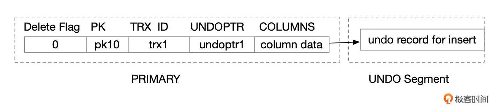

回退 INSERT 操作其实不需要 UNDO 记录中的信息。

### 回退 UPDATE 操作

对于 UPDATE 操作，情况就比较复杂了，可大致分为以下情况。

1. update 之后所有字段长度都没有变长，update 可以直接在本地完成。

2. update 之后记录长度发生了变化，需要在页面内寻找新的空间。也有可能当前页面空间不足，需要分裂当前页面。

3. update 更新了主键字段。对于 B+ 树，更新 key 字段相当于进行了 delete+insert，先delete 原来的记录，再 insert 新的记录。

UPDATE 没有修改主键字段。

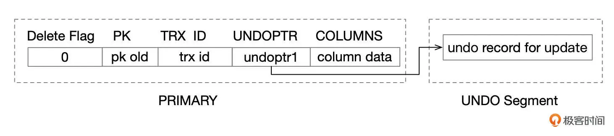

UPDATE 修改了主键字段。

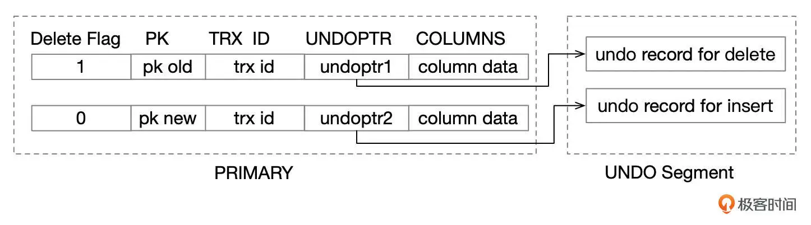

对于不同的情况，UNDO 记录的格式有所不同，但是都可以将记录回退到上一个版本。

### 回退 DELETE 操作

对于 DELETE 操作，InnoDB 分为两个阶段执行。

1. 给记录加上删除标志（delete mark）。

2. 事务提交后，如果系统中其他事务都不需要该记录 delete 之前的版本，就由单独的线程进行 purge 操作。purge 操作将回收标记为已删除的记录占有的空间，也会回收相应的 undo段。

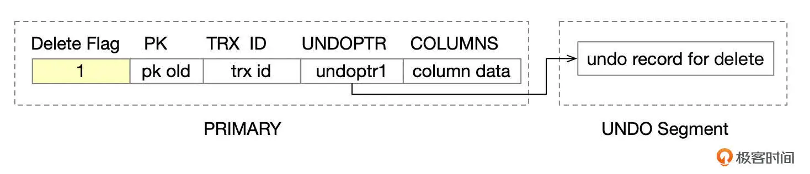

下面这张图中，记录 pk10 insert 后，更新了两次，最后被 delete 了，通过 Undo，可以构建出记录的任何一个版本。

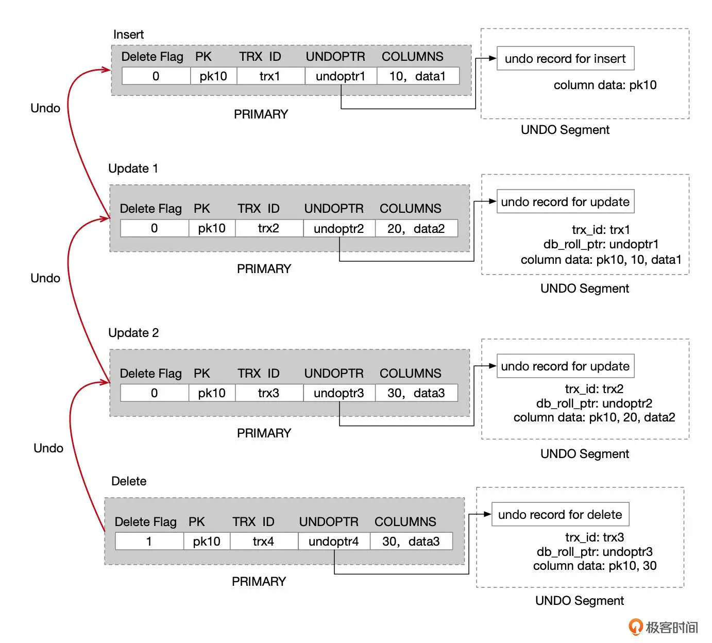

## 总结

MVCC 是 InnoDB 的一个重要机制，通过 MVCC，MySQL 实现了读不阻塞写，写不阻塞读。当然，由于 MySQL 的实现机制，如果事务一直没提交，Read View 一直开着，会导致 Undo一直不能清理，Undo 表空间就会一直增长，影响数据库的性能，所以需要做好监控。

## 思考题

InnoDB Purge 线程会定期清理 Undo 日志，但是有些情况下，清理可能会有比较大的延迟，导致 Undo 表空间持续增长。如何查看系统中有多少 Undo 日志没有被清理？有哪些原因会导致 Undo 日志没有及时清理，如何分析？

期待你的思考，欢迎在留言区中与我交流。如果今天的课程让你有所收获，也欢迎转发给有需要的朋友。我们下节课再见！
