# 33 | InnoDB锁定和死锁问题：为什么我的SQL锁超时了？

你好，我是俊达。

这一讲我们来聊一聊 MySQL 中的锁。MySQL 中，存在很多不同类型的锁，我们先来大致了解下不同锁的作用。

## MySQL 中的锁

MySQL 使用锁来控制多个并发的进程或线程对共享资源的访问。那么在 MySQL 中，有哪些共享资源呢？

我总结起来，大致有下面这几种类型。

- 内存中的数据结构。

- 内存中的链表结构，如会话列表、活跃事务列表、InnoDB Buffer Pool 中 LRU 链表、Flush 链表、Hash 链表等等。

- 内存中的变量，如 REDO 日志序列号、下一个事务的事务 ID。

- 缓存的页面。

- 元数据，包括表、SCHEMA、存储过程等。

- 表和表里的记录。

MySQL 使用了不同类型的锁，来保护这些不同类型的共享资源，对于上面提到的这几类资源，MySQL 分别使用了下面这些类型的锁。

- mutex 和 rw-lock，用于保护内存中的数据结构。使用 show engine innodb status、showengine innodb mutex 等命令可以查看到一些 mutex 的信息。

- 元数据锁（metadata lock），用于管理对数据库对象的并发访问。查询数据（Select）、修改数据（insert、update、delete）、修改表结构时都需要先获取表的元数据锁。

ProcessList 中，状态为“Waiting for table metadata lock”的线程就是在等待元数据锁。

```sql
mysql> show processlist\G
    Id: 396
  User: root
  Host: localhost:41640
    db: rep
Command: Query
  Time: 81
 State: Waiting for table metadata lock
  Info: alter table tx add ccc int
```

可以通过 performance_schema.metadata_locks 表来查看元数据锁的请求状态。

```sql
mysql> select object_type, object_name, lock_type, lock_duration, lock_status
   from performance_schema.metadata_locks;
+-------------+----------------+---------------------+---------------+-----------
| object_type | object_name    | lock_type           | lock_duration | lock_statu
+-------------+----------------+---------------------+---------------+-----------
| TABLE       | tx             | SHARED_READ         | TRANSACTION   | GRANTED
| GLOBAL      | NULL           | INTENTION_EXCLUSIVE | STATEMENT     | GRANTED
| BACKUP LOCK | NULL           | INTENTION_EXCLUSIVE | TRANSACTION   | GRANTED
| SCHEMA      | NULL           | INTENTION_EXCLUSIVE | TRANSACTION   | GRANTED
| TABLE       | tx             | SHARED_UPGRADABLE   | TRANSACTION   | GRANTED
| TABLESPACE  | rep/tx         | INTENTION_EXCLUSIVE | TRANSACTION   | GRANTED
| TABLE       | #sql-553c_18c  | EXCLUSIVE           | STATEMENT     | GRANTED
| TABLE       | tx             | EXCLUSIVE           | TRANSACTION   | PENDING
| TABLE       | metadata_locks | SHARED_READ         | TRANSACTION   | GRANTED
+-------------+----------------+---------------------+---------------+-----------
```

- InnoDB 存储引擎的表锁和记录锁，用于管理事务对表和记录的并发访问。平时我们使用MySQL 遇到的锁超时（Lock wait timeout exceeded）或死锁（Deadlock found whentrying to get lock），大部分情况下和 InnoDB 的表锁或行锁有关。

接下来，我们来看看 InnoDB 中的表锁和记录锁。

## InnoDB 锁的类型

InnoDB 中的锁，还可以分为表锁、意向锁、行锁和自增 ID 锁。这些锁都是内存中的结构，可以在 performance_schema 库中的 data_locks 表和 data_lock_waits 表中查看当前系统中有哪些锁，以及锁等待关系。后续我们会使用这两个表来观察不同情况下锁的情况。我把这两个表字段的含义整理在了下面两个表格中。

- data_locks 表

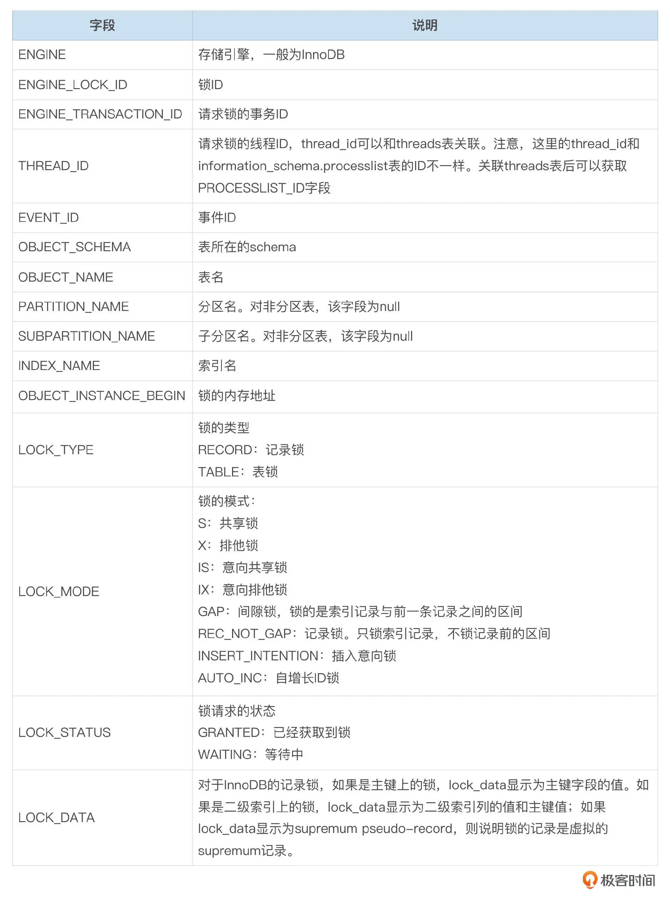

- data_lock_waits

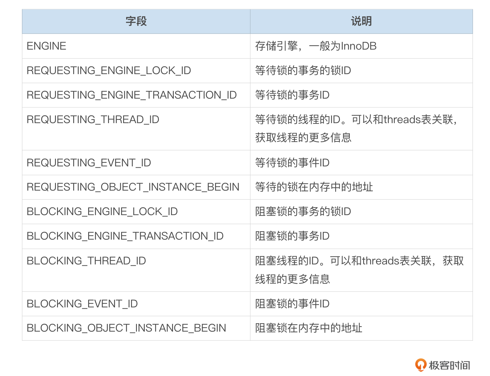

### 表锁

表锁通过 lock tables 命令获取。需要注意的是，只有关闭会话的自动提交（setautocommit=0）后，执行 lock tables 命令才会获取 InnoDB 层的表锁。在 data_locks 表中，表锁 LOCK_TYPE 为 TABLE，LOCK_MODE 为 X 或 S。

lock tables 命令会在 MySQL 层和 InnoDB 层会分别对表加锁。InnoDB 层的表锁会在事务提交时释放，MySQL 层的元数据锁会在执行 unlock tables 命令后释放。当然，会话退出时，也会释放元数据锁。

```sql
mysql> set autocommit=0;
Query OK, 0 rows affected (0.00 sec)
mysql> lock table t1 read, t2 write;
Query OK, 0 rows affected (0.00 sec)
mysql> select engine, object_schema, object_name, lock_type, lock_mode
 from data_locks;
+--------+---------------+-------------+-----------+-----------+
| engine | object_schema | object_name | lock_type | lock_mode |
+--------+---------------+-------------+-----------+-----------+
| INNODB | rep           | t2          | TABLE     | X         |
| INNODB | rep           | t1          | TABLE     | S         |
+--------+---------------+-------------+-----------+-----------+
mysql> select object_type, object_name, lock_type, lock_status
 from metadata_locks;
+-------------+----------------+----------------------+-------------+
| object_type | object_name    | lock_type            | lock_status |
+-------------+----------------+----------------------+-------------+
| GLOBAL      | NULL           | INTENTION_EXCLUSIVE  | GRANTED     |
| SCHEMA      | NULL           | INTENTION_EXCLUSIVE  | GRANTED     |
| TABLE       | t1             | SHARED_READ_ONLY     | GRANTED     |
| TABLE       | t2             | SHARED_NO_READ_WRITE | GRANTED     |
| TABLESPACE  | rep/t2         | INTENTION_EXCLUSIVE  | GRANTED     |
| TABLE       | metadata_locks | SHARED_READ          | GRANTED     |
+-------------+----------------+----------------------+-------------+
```

一个会话以读的模式锁定一个表后，只能执行查询操作，不能修改数据，修改数据时会错“Table xxx was locked with a READ lock and can’t be updated”。其他会话可以查询这个表的数据，但是无法修改数据。

一个会话以写的模式锁定一个表后，其他会话无法查询或修改这个表的数据。

表锁在业务系统中可能比较少用。使用 mysqldump 备份数据时，如果不加 skip-lock-tables 或single-transaction 参数，会使用 lock tables 锁表。

### 意向锁

InnoDB 给表中的记录加锁时，需要先获取表级别的意向锁。如果对记录加 X 模式的锁，那么意向锁的模式是 IX，如果对记录加 S 模式的锁，那么意向锁的模式为 IS。在 data_locks 表中，InnoDB 意向锁的 lock_type 为 TABLE，lock_mode 为 IS 或 IX。

```sql
mysql> begin;
Query OK, 0 rows affected (0.00 sec)
mysql> select * from t1 for share;
Empty set (0.00 sec)
mysql> select * from t2 for update;
Empty set (0.00 sec)
mysql> mysql> select object_schema, object_name, lock_type, lock_mode, lock_data
_mode, object_name;
+---------------+-------------+-----------+-----------+------------------------+
| object_schema | object_name | lock_type | lock_mode | lock_data              |
+---------------+-------------+-----------+-----------+------------------------+
| rep           | t1          | TABLE     | IS        | NULL                   |
| rep           | t2          | TABLE     | IX        | NULL                   |
| rep           | t1          | RECORD    | S         | supremum pseudo-record |
| rep           | t2          | RECORD    | X         | supremum pseudo-record |
+---------------+-------------+-----------+-----------+------------------------+
```

InnoDB 为什么要使用意向锁呢？

考虑这么一种情况，会话 1 锁定了表 tab 中的一行数据，在会话 1 提交前，会话 2 想使用lock tables 命令锁住 tab 表。如果没有意向锁，InnoDB 怎么判断会话 2 能不能获取到这个表锁呢？

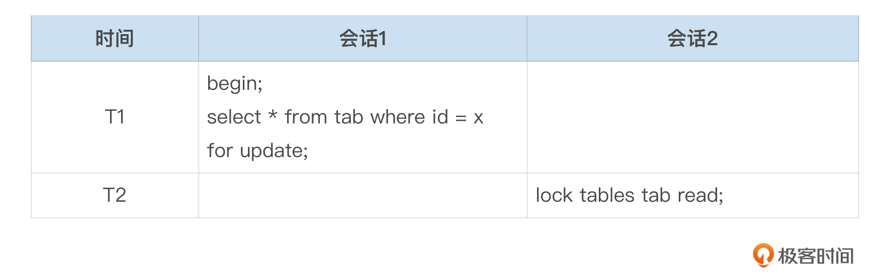

不过实际上，在上面这个场景中，MySQL 使用了元数据锁。从 Processlist 中可以发现会话 2的状态是“Waiting for table metadata lock”，从 metadata_locks 表也可以查到会话 2 在等待元数据锁。

```sql
select object_type, object_name, lock_type, lock_status
 from metadata_locks where object_name='tab';
+-------------+-------------+------------------+-------------+
| object_type | object_name | lock_type        | lock_status |
+-------------+-------------+------------------+-------------+
| TABLE       | tab         | SHARED_WRITE     | GRANTED     |
| TABLE       | tab         | SHARED_READ_ONLY | PENDING     |
+-------------+-------------+------------------+-------------+
```

### 记录锁（行锁）

MySQL 执行普通的 Select 语句时，并不会对记录加锁，只有执行 insert、update、delete时，或者执行 select for share、select for update 时，才会加锁。对哪些记录加锁及锁的模式跟事务的隔离级别、执行的 SQL 语句、语句的执行计划相关，这里的情况比较多，接下来我们分别讨论。先准备测试表和测试数据。

```sql
create table test_lock(
   id varchar(10) not null,
   a varchar(10) ,
   b varchar(10) not null,
   c varchar(10) not null,
   d int,
   primary key(id),
   unique key uk_ac(a,c),
   key idx_b(b));
insert into test_lock(id,a,b,c,d) values
   ('pk10','a10','b10','c10',10),
   ('pk20','a20','b20','c20',20),
   ('pk30','a30','b30','c30',30);
```

InnoDB 中的行锁，又可以细分为记录锁、GAP 锁、Next-Key 锁、插入意向锁。接下来我们通过一些具体的例子来演示这些锁。

### 1. 记录锁

当事务的隔离级别为 READ COMMITTED，或使用唯一索引或主键以等值条件匹配时，只锁定记录，不锁定记录前的间隙（GAP）。记录锁的 lock_type 为 RECORD，lock_mode为“X,REC_NOT_GAP”或“S,REC_NOT_GAP”。

- read commited 隔离模式下，只需要获取记录上的锁，不需要锁记录间的 GAP。

```sql
mysql> set transaction isolation level read committed;
Query OK, 0 rows affected (0.00 sec)
mysql> select * from test_lock where b='b20' for update;
+------+------+-----+-----+------+
| id   | a    | b   | c   | d    |
+------+------+-----+-----+------+
| pk20 | a20  | b20 | c20 |   20 |
+------+------+-----+-----+------+
1 row in set (0.01 sec)
mysql> select object_name, index_name, lock_type, lock_mode, lock_data
 from data_locks order by  object_name;
+-------------+------------+-----------+---------------+---------------+
| object_name | index_name | lock_type | lock_mode     | lock_data     |
+-------------+------------+-----------+---------------+---------------+
| test_lock   | NULL       | TABLE     | IX            | NULL          |
| test_lock   | idx_b      | RECORD    | X,REC_NOT_GAP | 'b20', 'pk20' |
| test_lock   | PRIMARY    | RECORD    | X,REC_NOT_GAP | 'pk20'        |
+-------------+------------+-----------+---------------+---------------+
```

上面这个例子中，使用了索引 idx_b，获取了索引 idx_b 上记录（b20, pk20）和主键 pk20 的记录锁，注意 lock_mode 中有 REC_NOT_GAP。

- repeatable read 隔离模式下，使用主键或唯一索引的等值查询，获取的是记录锁。

```sql
mysql> set transaction isolation level repeatable read;
Query OK, 0 rows affected (0.00 sec)
mysql> begin;
Query OK, 0 rows affected (0.00 sec)
mysql> select * from test_lock where a='a20' and c='c20' for update;
+------+------+-----+-----+------+
| id   | a    | b   | c   | d    |
+------+------+-----+-----+------+
| pk20 | a20  | b20 | c20 |   20 |
+------+------+-----+-----+------+
1 row in set (0.00 sec)
mysql> select object_name, index_name, lock_type, lock_mode, lock_data from data_
+-------------+------------+-----------+---------------+----------------------+
| object_name | index_name | lock_type | lock_mode     | lock_data            |
+-------------+------------+-----------+---------------+----------------------+
| test_lock   | NULL       | TABLE     | IX            | NULL                 |
| test_lock   | uk_ac      | RECORD    | X,REC_NOT_GAP | 'a20', 'c20', 'pk20' |
| test_lock   | PRIMARY    | RECORD    | X,REC_NOT_GAP | 'pk20'               |
+-------------+------------+-----------+---------------+----------------------+
3 rows in set (0.00 sec)
```

上面这个例子中，使用唯一索引 uk_ac 访问，获取了 uk_ac 上记录（a20，c20，pk20）和主键 pk20 上的锁，lock_mode 有 REC_NOT_GAP。

- repeatable read 隔离级别下，如果使用唯一索引没有匹配到相关记录。或者唯一索引为组合索引的情况下，没有匹配所有的索引字段，则还需要锁定记录前的 GAP。

```sql
mysql> begin;
Query OK, 0 rows affected (0.00 sec)
mysql> select * from test_lock where a='a15' and c='c15' for update;
Empty set (0.00 sec)
mysql> select object_name, index_name, lock_type, lock_mode, lock_data from data_
+-------------+------------+-----------+-----------+----------------------+
| object_name | index_name | lock_type | lock_mode | lock_data            |
+-------------+------------+-----------+-----------+----------------------+
| test_lock   | NULL       | TABLE     | IX        | NULL                 |
| test_lock   | uk_ac      | RECORD    | X,GAP     | 'a20', 'c20', 'pk20' |
+-------------+------------+-----------+-----------+----------------------+
```

这个例子中，不存在 a=‘a15’, b=‘b15’的记录，锁的模式为“X,GAP”，锁的是包含记录（‘a15’,‘c15’）的区间，也就是记录 (‘a20’, ‘b20’) 前的 GAP。

我们再来看一个例子，使用了唯一索引，但是只用了唯一索引的前缀。

```sql
mysql> begin;
Query OK, 0 rows affected (0.00 sec)
mysql> select * from test_lock where a='a20' for update;
+------+------+-----+-----+------+
| id   | a    | b   | c   | d    |
+------+------+-----+-----+------+
| pk20 | a20  | b20 | c20 |   20 |
+------+------+-----+-----+------+
1 row in set (0.00 sec)
mysql> select object_name, index_name, lock_type, lock_mode, lock_data
from data_locks order by  object_name;
+-------------+------------+-----------+---------------+----------------------+
| object_name | index_name | lock_type | lock_mode     | lock_data            |
+-------------+------------+-----------+---------------+----------------------+
| test_lock   | NULL       | TABLE     | IX            | NULL                 |
| test_lock   | uk_ac      | RECORD    | X             | 'a20', 'c20', 'pk20' |
| test_lock   | PRIMARY    | RECORD    | X,REC_NOT_GAP | 'pk20'               |
| test_lock   | uk_ac      | RECORD    | X,GAP         | 'a30', 'c30', 'pk30' |
+-------------+------------+-----------+---------------+----------------------+
4 rows in set (0.01 sec)
```

唯一索引 idx_ac 是一个组合索引（a,c），where 条件中缺少字段 C 的条件，这个 SQL 锁定了记录（‘a20’, ‘c20’）以及记录前的 GAP，lock_mode 为 X。lock_mode X 的锁就是后面会讨论的 Next-Key 锁。这个 SQL 还锁定了记录 (‘a20’, ‘c20’) 之后的区间，也就是记录（‘a30’,‘c30’）前的 GAP，锁的模式为“X,GAP”，这是接下来会讨论的 GAP 锁。

### 2. GAP 锁

GAP 锁用于锁住索引中相邻记录之间的区间。GAP 锁的 lock_mode 为“X,GAP”或“S,GAP”，lock data 为区间的右边界。在 REPEATABLE READ 或更高的隔离级别下，为了避免出现幻读，InnoDB 使用了 GAP 锁，阻止其他事务往被锁定的区间内插入数据。

在实现上，GAP 锁加在索引叶子节点中的记录上。在测试表中，索引 idx_b 有 3 条用户记录，形成了 4 个区间。

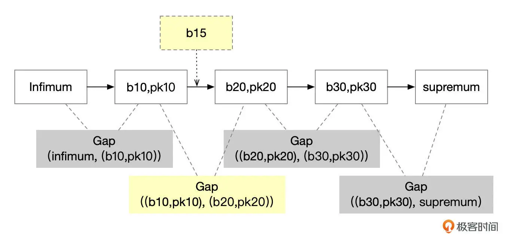

下面是 GAP 锁的一个例子。

```sql
mysql> begin;
Query OK, 0 rows affected (0.00 sec)
mysql> select * from test_lock where b='b15' for update;
Empty set (0.00 sec)
mysql> select object_name, index_name, lock_type, lock_mode, lock_data
 from data_locks order by  object_name, index_name;
+-------------+------------+-----------+-----------+---------------+
| object_name | index_name | lock_type | lock_mode | lock_data     |
+-------------+------------+-----------+-----------+---------------+
| test_lock   | NULL       | TABLE     | IX        | NULL          |
| test_lock   | idx_b      | RECORD    | X,GAP     | 'b20', 'pk20' |
+-------------+------------+-----------+-----------+---------------+
```

测试表中不存在 b=‘b15’的记录，通过 b=‘b15’的条件查询，使用了字段 b 上的索引 idx_b。基于 B+ 数据索引列数据有序的特点，记录’b15’应该位于区间（‘b10’，‘b20’）内，因此锁住了这个区间，就能阻止其他会话插入 b=‘15’的记录，从而通过 b=‘15’条件查询数据时，不会出现新的记录，从而避免了幻读。

当然，这个 GAP 锁，还会阻止其他会话写入 (b10, pk10) 到 (b20, pk20) 之间的任意数据。这个 GAP 锁，还会阻止其他会话把字段 b 的值更新到 b10 和 b20 之间的值。

### 3. Next-Key 锁

Next-key 锁是记录锁和 GAP 锁的一个组合，不仅锁定了记录，也锁定了记录之前的 GAP。next-key 锁的 lock_type 为 RECORD，lock_mode 为 X 或 S。next-key 锁也是 RepeatableREAD 隔离级别下用来防止幻读的。

下面是 Next-key 锁的一个例子。

```sql
mysql> begin;
mysql> select * from test_lock where b = 'b20' for update;
+------+------+-----+-----+------+
| id   | a    | b   | c   | d    |
+------+------+-----+-----+------+
| pk20 | a20  | b20 | c20 |   20 |
+------+------+-----+-----+------+
1 row in set (0.00 sec)
mysql> select object_name, index_name, lock_type, lock_mode, lock_data
 from data_locks order by  object_name, index_name;
+-------------+------------+-----------+---------------+---------------+
| object_name | index_name | lock_type | lock_mode     | lock_data     |
+-------------+------------+-----------+---------------+---------------+
| test_lock   | NULL       | TABLE     | IX            | NULL          |
| test_lock   | idx_b      | RECORD    | X             | 'b20', 'pk20' |
| test_lock   | idx_b      | RECORD    | X,GAP         | 'b30', 'pk30' |
| test_lock   | PRIMARY    | RECORD    | X,REC_NOT_GAP | 'pk20'        |
+-------------+------------+-----------+---------------+---------------+
4 rows in set (0.00 sec)
```

上例中，记录 (b20, pk20) 上的锁就是 Next-key 锁，而记录 (b30, pk30) 上的锁是 GAP 锁，主键记录 pk20 上的锁是普通的记录锁。

下面是 Next-key 锁的另外一个例子。

```sql
mysql> begin;
Query OK, 0 rows affected (0.00 sec)
mysql>。select * from test_lock where b >= 'b11' and b <= 'b12' for update;
Empty set (0.00 sec)
mysql> select object_name, index_name, lock_type, lock_mode, lock_data
 from data_locks order by  object_name, index_name;
+-------------+------------+-----------+-----------+---------------+
| object_name | index_name | lock_type | lock_mode | lock_data     |
+-------------+------------+-----------+-----------+---------------+
| test_lock   | NULL       | TABLE     | IX        | NULL          |
| test_lock   | idx_b      | RECORD    | X         | 'b20', 'pk20' |
+-------------+------------+-----------+-----------+---------------+
2 rows in set (0.00 sec)
```

这个例子中，使用了范围查询，获取了 Next-key 锁。可以对比一下下面这种情况，获取的是GAP 锁。

```sql
mysql> begin;
Query OK, 0 rows affected (0.00 sec)
mysql> select * from test_lock where b in ('b11', 'b12') for update;
Empty set (0.01 sec)
mysql> select object_name, index_name, lock_type, lock_mode, lock_data    from da
+-------------+------------+-----------+-----------+---------------+
| object_name | index_name | lock_type | lock_mode | lock_data     |
+-------------+------------+-----------+-----------+---------------+
| test_lock   | NULL       | TABLE     | IX        | NULL          |
| test_lock   | idx_b      | RECORD    | X,GAP     | 'b20', 'pk20' |
+-------------+------------+-----------+-----------+---------------+
```

### 4. 插入意向（Insert Intention）锁

InnoDB 中插入数据时，需要获取记录所在区间的插入意向锁。InnoDB 中，使用间隙锁和插入意向锁来避免幻读。

下面是插入意向锁的一个例子。

会话 1 先获取 GAP 锁：

```sql
mysql> begin;
Query OK, 0 rows affected (0.00 sec)
mysql> select * from test_lock where b = 'b15' for update;
Empty set (0.01 sec)
```

会话 2 执行 insert 时被阻塞：

```sql
mysql> insert into test_lock values('pk99', 'a15', 'b15', 'c15', 0);
mysql> select thread_id, index_name, lock_type, lock_mode, lock_data, lock_status
 from data_locks order by  thread_id;
mysql> select thread_id, index_name, lock_type, lock_mode, lock_data, lock_status
   ->   from data_locks order by  thread_id;
+-----------+------------+-----------+------------------------+---------------+--
| thread_id | index_name | lock_type | lock_mode              | lock_data     | l
+-----------+------------+-----------+------------------------+---------------+--
|       504 | NULL       | TABLE     | IX                     | NULL          | G
|       504 | idx_b      | RECORD    | X,GAP,INSERT_INTENTION | 'b20', 'pk20' | W
|       506 | NULL       | TABLE     | IX                     | NULL          | G
|       506 | idx_b      | RECORD    | X,GAP                  | 'b20', 'pk20' | G
+-----------+------------+-----------+------------------------+---------------+--
```

上例中，thead_id 为 506 的会话获取了区间 (‘b10’, ‘b20’) 的 GAP 锁。会话 504 插入记录时，数据 b15 位于区间 (b20, b20) 之间，因此被阻塞，这里阻塞的原因是INSERT_INTENTION 锁和 GAP 锁不兼容。

### 自增 ID 锁（auto-inc 锁）

自增 ID 锁是 InnoDB 中的一种特殊的锁，如果插入数据时用到了自增 ID，则需要先获取自增ID 锁。获取自增 ID 锁的方式受参数 innodb_autoinc_lock_mode 控制。

### InnoDB 锁兼容模式

锁兼容模式决定了多个会话是否能同时持有某个资源的锁。InnoDB 中，表锁对应的资源就是表，而记录锁（包括 GAP 锁、Next-key 锁）对应的资源是索引中的记录。

下面的表格中记录了不同模式的锁之间的兼容性。

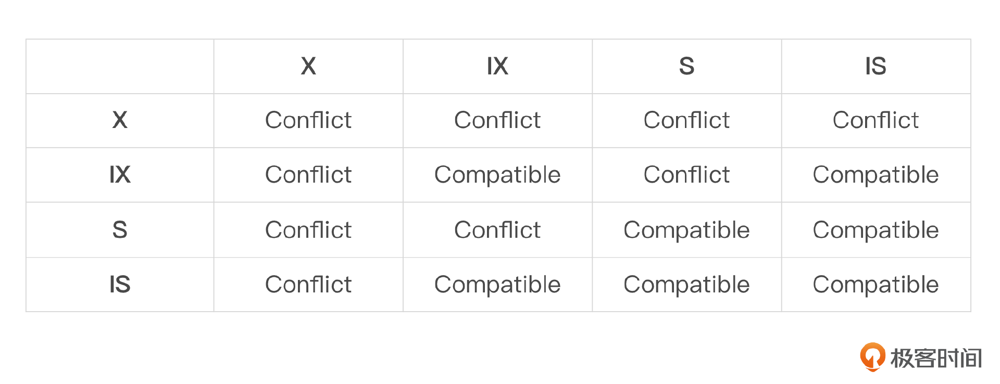

1. 表级别的意向锁 IX、IS 之间互相兼容。表级别的意向锁和记录锁之间兼容。

2. 表级别的排他锁和任何其他锁都不兼容。表级别的共享锁只和共享模式的锁兼容。如果一个会话持有了某个表的表级别排他锁，则其它会话无法以共享或排他模式对该表加任何锁。如果一个会话持有了某个表的表级别共享锁，则其它会话无法得到该表的排他模式的任何锁。

3. GAP 锁之间互相兼容，共享和排他模式的 GAP 锁之间互相兼容。多个会话可以同时持有同一个 GAP 的共享或排他模式的锁。GAP 锁只阻止其他会话往区间中插入新的数据。Next-key 锁是 GAP 锁和记录锁的组合，Next-key 锁中的 GAP 锁部分和普通 GAP 遵循同样的规则。

4. 对于记录级别的锁，多个会话可以同时持有一条记录的共享锁。如果一个会话持有了某条记录的排他锁，其他会话无法同时持有该记录的共享锁和排他锁。Next-key 锁是 GAP 锁和记

- 录锁的组合，Next-key 锁中的记录锁部分和普通记录锁遵循同样的规则。

## 语句的加锁逻辑

MySQL 是怎么给记录加锁的呢？这跟 SQL 语句的执行过程息息相关。我们先来回顾下，使用索引访问数据的基本步骤（InnoDB 使用了聚簇索引，因此全表扫描也可以看作是一种特殊的索引访问）。

使用 B+ 树索引访问数据大致可以分为这四个步骤。

步骤 1：将游标定位到叶子节点中的某条记录。

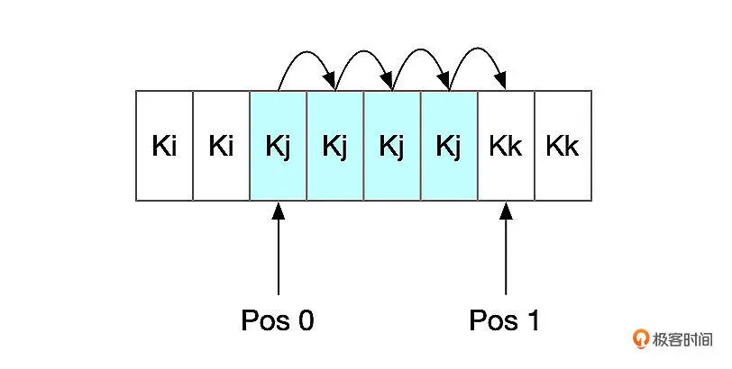

上图这个图里的是一个索引的叶子页面。在使用索引顺序扫描时，有几种不同的情况。

- 如果边界条件为 K > Kj，那么游标要指向 Pos 1，也就是 K 值为 Kk 的第一条记录。

- 如果边界条件为 K >= Kj，那么游标要指向到 Pos 0，也就是 K 值为 Kj 的第一条记录。

- 如果边界值 Ks 在 Ki 和 Kj 之间（Ki < Ks < Kj）, where 条件为 K >= Ks 或 K > Ks 时，游标都指向到 Pos 0。

如果使用锁索引逆序扫描（比如语句是 select * from t where k >= Kj order by k desc），那么情况会有一点不同。

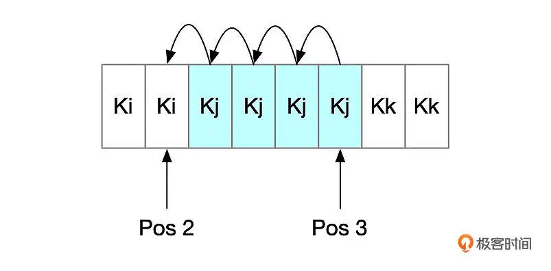

- 如果边界条件为 K < Kj，那么游标指向 Pos 2。

- 如果边界条件为 K <= Kj，那么游标指向 Pos 3。

- 如果边界值 Ks 在 Ki 和 Kj 之间（Ki < Ks < Kj）, where 条件为 K <= Ks 或 K < Ks，那么游标指向 Pos 2。

步骤 2：读取游标指向的索引记录，根据获取到的主键值到聚簇索引获取记录，一般也将这一个过程称为回表。下面几种情况下可能不需要回表。

- 使用了覆盖索引。

- 使用了索引下推条件（Index Condition Pushdown, ICP），并且索引记录不满足下推的条件。

1. 判断获取到的记录是否在扫描的范围内。

根据 MySQL Server 层传过来的范围条件，判断当前读到记录是否在扫描范围内，如果记录已经超出了范围，就说明索引中已经没有更多满足条件的记录了，可以结束索引扫描。

比如下面这个 SQL 语句。

```sql
select * from tab
where K > Ks and K < Kt
```

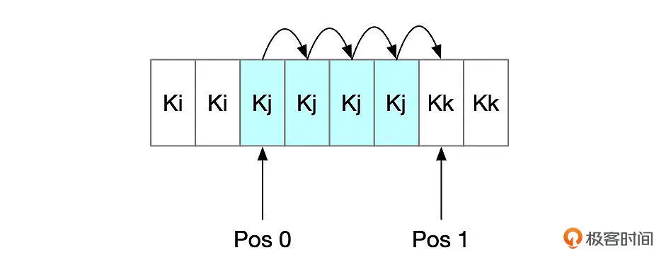

其中 Ki < Ks < Kt < Kj。游标开始时指向 Pos 0，并且范围扫描的右边界 Kt < Kj，说明索引中没有满足查询条件的记录。这种情况下，InnoDB 会返回一个特殊的标记（DB_RECORD_NOT_FOUND）给 Server 层。

2. Server 层根据 InnoDB 层的返回值进行后续处理。

如果 InnoDB 层返回正常，则 Server 层对记录进行后续处理，包括判断记录是否满足 SQL 中的其他条件，如果满足条件，则进行相应的处理，如对记录进行更新或删除操作。处理完当前记录后，按顺序（正序或逆序），将游标指向索引页面中的下一行记录，回到步骤 2 继续处理。如果 InnoDB 层返回没有更多的记录，就说明语句执行完了。

MySQL 对记录加锁的顺序，和上面描述的在 B+ 树叶子页面中读取记录的顺序一致。接下来我们来看一下不同隔离级别下加锁的过程。

### REPEATABLE READ 隔离级别下的几种锁定情况

先准备测试表和测试数据。

```sql
CREATE TABLE `test_lock2` (
 `id` varchar(10) NOT NULL,
 `a` varchar(10) NOT NULL,
 `b` varchar(10) NOT NULL,
 `c` int DEFAULT NULL,
 `d` int DEFAULT NULL,
 PRIMARY KEY (`id`),
 UNIQUE KEY `uk_ac` (`a`,`c`),
 KEY `idx_b` (`b`)
) ENGINE=InnoDB;
insert into test_lock2 values
 ('pk11', 'a10', 'b10', 1, 0),
 ('pk12', 'a20', 'b10', 2, 0),
 ('pk21', 'a30', 'b20', 1, 0),
 ('pk22', 'a40', 'b20', 2, 0),
 ('pk23', 'a50', 'b20', 1, 0),
 ('pk31', 'a60', 'b30', 2, 0),
 ('pk32', 'a70', 'b30', 1, 0);
```

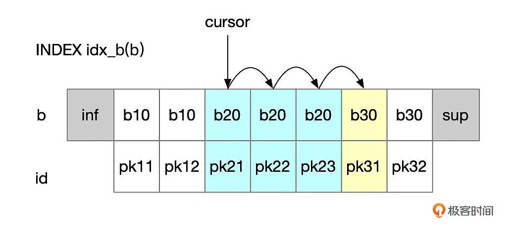

### 情况 1：使用普通索引执行等值匹配。

```sql
mysql> begin;
Query OK, 0 rows affected (0.00 sec)
mysql> update test_lock2 set d=d+1 where b='b15';
Query OK, 0 rows affected (0.00 sec)
Rows matched: 0  Changed: 0  Warnings: 0
```

这个例子中，索引字段 b 使用等值匹配，并且记录不存在，因此获取了记录 (b20, pk21) 的gap 锁。

```sql
mysql> select index_name, lock_type, lock_mode, lock_data
   from data_locks;
+------------+-----------+-----------+---------------+
| index_name | lock_type | lock_mode | lock_data     |
+------------+-----------+-----------+---------------+
| NULL       | TABLE     | IX        | NULL          |
| idx_b      | RECORD    | X,GAP     | 'b20', 'pk21' |
+------------+-----------+-----------+---------------+
```

下面是等值匹配的另外一个例子。

```sql
mysql> begin;
Query OK, 0 rows affected (0.00 sec)
mysql> update test_lock2 set d=d+1 where b='b20';
Query OK, 3 rows affected (0.00 sec)
Rows matched: 3  Changed: 3  Warnings: 0
```

除了给匹配到的 3 条记录加上 Next-key 锁，还给下一条记录 (b30, pk31) 加上了 GAP 锁。

```sql
mysql> select index_name, lock_type, lock_mode, lock_data
   from data_locks;
+------------+-----------+---------------+---------------+
| index_name | lock_type | lock_mode     | lock_data     |
+------------+-----------+---------------+---------------+
| NULL       | TABLE     | IX            | NULL          |
| idx_b      | RECORD    | X             | 'b20', 'pk21' |
| idx_b      | RECORD    | X             | 'b20', 'pk22' |
| idx_b      | RECORD    | X             | 'b20', 'pk23' |
| PRIMARY    | RECORD    | X,REC_NOT_GAP | 'pk21'        |
| PRIMARY    | RECORD    | X,REC_NOT_GAP | 'pk22'        |
| PRIMARY    | RECORD    | X,REC_NOT_GAP | 'pk23'        |
| idx_b      | RECORD    | X,GAP         | 'b30', 'pk31' |
+------------+-----------+---------------+---------------+
```

### 情况 2：使用普通索引执行范围扫描。

```sql
mysql> begin;
Query OK, 0 rows affected (0.00 sec)
mysql> update test_lock2 set d=d+1 where b >= 'b11' and b <= 'b19';
Query OK, 0 rows affected (0.00 sec)
Rows matched: 0  Changed: 0  Warnings: 0
```

范围匹配时，加锁的情况和等值匹配的情况有一点区别，这次给记录 (b20, pk21) 加上了Next-key 锁。

```sql
mysql> select index_name, lock_type, lock_mode, lock_data
from data_locks;
+------------+-----------+---------------+---------------+
| index_name | lock_type | lock_mode     | lock_data     |
+------------+-----------+---------------+---------------+
| NULL       | TABLE     | IX            | NULL          |
| idx_b      | RECORD    | X             | 'b20', 'pk21' |
| PRIMARY    | RECORD    | X,REC_NOT_GAP | 'pk21'        |
+------------+-----------+---------------+---------------+
```

下面是另外一个范围扫描的例子。

```sql
mysql> begin;
Query OK, 0 rows affected (0.00 sec)
mysql> update test_lock2 set d=d+1 where b >= 'b15' and b <= 'b25';
Query OK, 3 rows affected (0.01 sec)
Rows matched: 3  Changed: 3  Warnings: 0
```

除了给匹配到的记录加上了 Next-key 锁，还给下一条记录 (b30, pk31) 加上了 Next-key 锁。

```sql
mysql> select index_name, lock_type, lock_mode, lock_data from data_locks;
+------------+-----------+---------------+---------------+
| index_name | lock_type | lock_mode     | lock_data     |
+------------+-----------+---------------+---------------+
| NULL       | TABLE     | IX            | NULL          |
| idx_b      | RECORD    | X             | 'b20', 'pk21' |
| idx_b      | RECORD    | X             | 'b20', 'pk22' |
| idx_b      | RECORD    | X             | 'b20', 'pk23' |
| idx_b      | RECORD    | X             | 'b30', 'pk31' |
| PRIMARY    | RECORD    | X,REC_NOT_GAP | 'pk21'        |
| PRIMARY    | RECORD    | X,REC_NOT_GAP | 'pk22'        |
| PRIMARY    | RECORD    | X,REC_NOT_GAP | 'pk23'        |
| PRIMARY    | RECORD    | X,REC_NOT_GAP | 'pk31'        |
+------------+-----------+---------------+---------------+
```

### 情况 3：使用唯一索引

```sql
mysql> begin;
Query OK, 0 rows affected (0.01 sec)
mysql> update test_lock2 set d=d+1 where a = 'a20' and c=2;
Query OK, 1 row affected (0.00 sec)
Rows matched: 1  Changed: 1  Warnings: 0
```

如果使用唯一索引，并且查找的记录存在，则只需要给记录加普通的记录锁，而不需要锁记录前的区间。

```sql
mysql> select index_name, lock_type, lock_mode, lock_data
 from data_locks;
+------------+-----------+---------------+------------------+
| index_name | lock_type | lock_mode     | lock_data        |
+------------+-----------+---------------+------------------+
| NULL       | TABLE     | IX            | NULL             |
| uk_ac      | RECORD    | X,REC_NOT_GAP | 'a20', 2, 'pk12' |
| PRIMARY    | RECORD    | X,REC_NOT_GAP | 'pk12'           |
+------------+-----------+---------------+------------------+
```

如果查询的记录不存在，还是需要加 GAP 锁。

```sql
mysql> begin;
Query OK, 0 rows affected (0.00 sec)
mysql> update test_lock2 set d=d+1 where a = 'a20' and c=1;
Query OK, 0 rows affected (0.00 sec)
Rows matched: 0  Changed: 0  Warnings: 0
mysql> select index_name, lock_type, lock_mode, lock_data
 from data_locks;
+------------+-----------+-----------+------------------+
| index_name | lock_type | lock_mode | lock_data        |
+------------+-----------+-----------+------------------+
| NULL       | TABLE     | IX        | NULL             |
| uk_ac      | RECORD    | X,GAP     | 'a20', 2, 'pk12' |
+------------+-----------+-----------+------------------+
```

如果唯一索引字段的条件没有使用等值匹配，而是使用了 is null、is not null，或者干脆没有传入部分字段的条件，则还是需要获取 next-key 锁。

```sql
mysql> begin;
Query OK, 0 rows affected (0.00 sec)
mysql> update test_lock2 set d=d+1 where a = 'a20' and c is not null;
Query OK, 1 row affected (0.00 sec)
Rows matched: 1  Changed: 1  Warnings: 0
mysql> select index_name, lock_type, lock_mode, lock_data
 from data_locks;
+------------+-----------+---------------+------------------+
| index_name | lock_type | lock_mode     | lock_data        |
+------------+-----------+---------------+------------------+
| NULL       | TABLE     | IX            | NULL             |
| uk_ac      | RECORD    | X             | 'a20', 2, 'pk12' |
| uk_ac      | RECORD    | X             | 'a30', 1, 'pk21' |
| PRIMARY    | RECORD    | X,REC_NOT_GAP | 'pk12'           |
| PRIMARY    | RECORD    | X,REC_NOT_GAP | 'pk21'           |
+------------+-----------+---------------+------------------+
```

### 情况 4：使用主键

对于主键，如果 where 条件中主键的边界条件在聚簇索引中实际上也存在，MySQL 在加锁时做了一些优化。下面这个例子中，SQL 语句的数据扫描范围是[pk21, pk23]，索引中也存在pk21，pk23 这两条记录。因此对记录 pk21 只加上了普通的记录锁，没有锁记录前的区间。对于记录 pk23 之后的记录，也就是记录 pk31，也不需要加锁。

```sql
mysql> begin;
Query OK, 0 rows affected (0.00 sec)
mysql> update test_lock2 set d=d+1 where id >= 'pk21' and id <= 'pk23';
Query OK, 3 rows affected (0.00 sec)
Rows matched: 3  Changed: 3  Warnings: 0
mysql> select index_name, lock_type, lock_mode, lock_data from data_locks;
+------------+-----------+---------------+-----------+
| index_name | lock_type | lock_mode     | lock_data |
+------------+-----------+---------------+-----------+
| NULL       | TABLE     | IX            | NULL      |
| PRIMARY    | RECORD    | X,REC_NOT_GAP | 'pk21'    |
| PRIMARY    | RECORD    | X             | 'pk22'    |
| PRIMARY    | RECORD    | X             | 'pk23'    |
+------------+-----------+---------------+-----------+
```

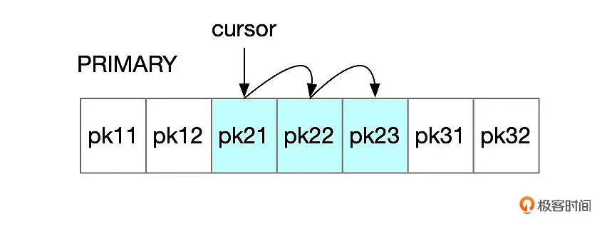

如果 SQL 语句的边界条件在聚簇索引中并不存在，则还是跟使用普通索引时一样，需要锁定相关的区间。

```sql
mysql> begin;
Query OK, 0 rows affected (0.00 sec)
mysql> update test_lock2 set d=d+1 where id > 'pk20' and id < 'pk30';
Query OK, 3 rows affected (0.00 sec)
Rows matched: 3  Changed: 3  Warnings: 0
mysql> select index_name, lock_type, lock_mode, lock_data from data_locks;
+------------+-----------+-----------+-----------+
| index_name | lock_type | lock_mode | lock_data |
+------------+-----------+-----------+-----------+
| NULL       | TABLE     | IX        | NULL      |
| PRIMARY    | RECORD    | X         | 'pk21'    |
| PRIMARY    | RECORD    | X         | 'pk22'    |
| PRIMARY    | RECORD    | X         | 'pk23'    |
| PRIMARY    | RECORD    | X,GAP     | 'pk31'    |
+------------+-----------+-----------+-----------+
```

### 情况 5：索引逆序扫描

```sql
mysql> begin;
Query OK, 0 rows affected (0.00 sec)
mysql> select * from test_lock2
      where b='b20'
      order by id desc for update;
+------+-----+-----+------+------+
| id   | a   | b   | c    | d    |
+------+-----+-----+------+------+
| pk23 | a50 | b20 |    1 |    1 |
| pk22 | a40 | b20 |    2 |    1 |
| pk21 | a30 | b20 |    1 |    1 |
+------+-----+-----+------+------+
3 rows in set (0.00 sec)
mysql> explain select * from test_lock2
 where b='b20'
 order by id desc for update\G
*************************** 1. row ***************************
          id: 1
 select_type: SIMPLE
       table: test_lock2
  partitions: NULL
        type: ref
possible_keys: idx_b
         key: idx_b
     key_len: 42
         ref: const
        rows: 3
    filtered: 100.00
       Extra: Backward index scan
1 row in set, 1 warning (0.00 sec)
mysql> select index_name, lock_type, lock_mode, lock_data
 from data_locks;
+------------+-----------+---------------+---------------+
| index_name | lock_type | lock_mode     | lock_data     |
+------------+-----------+---------------+---------------+
| NULL       | TABLE     | IX            | NULL          |
| idx_b      | RECORD    | X,GAP         | 'b30', 'pk31' |
| idx_b      | RECORD    | X             | 'b10', 'pk12' |
| idx_b      | RECORD    | X             | 'b20', 'pk21' |
| idx_b      | RECORD    | X             | 'b20', 'pk22' |
| idx_b      | RECORD    | X             | 'b20', 'pk23' |
| PRIMARY    | RECORD    | X,REC_NOT_GAP | 'pk12'        |
| PRIMARY    | RECORD    | X,REC_NOT_GAP | 'pk21'        |
| PRIMARY    | RECORD    | X,REC_NOT_GAP | 'pk22'        |
| PRIMARY    | RECORD    | X,REC_NOT_GAP | 'pk23'        |
+------------+-----------+---------------+---------------+
```

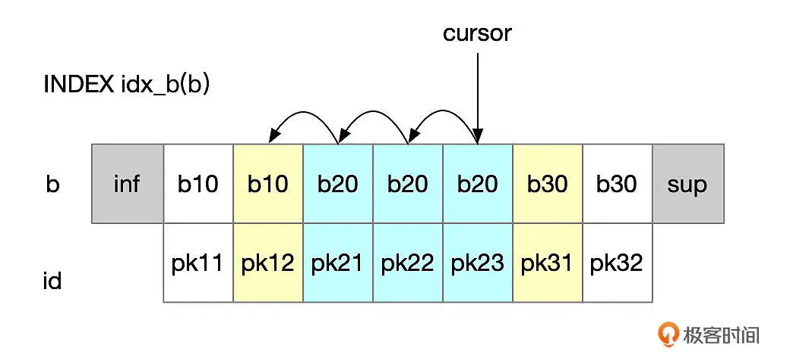

在这个例子中，游标先定位到索引记录 (b20, pk23)，然后获取该记录的下一条记录，也就是记录 (b30, pk31) 的 GAP 锁。然后再根据索引逆序分别获取记录 (b20, pk23)、(b20, pk22)、(b20, pk21)、(b10, k12) 的 next-key 锁。在处理记录 (b10, pk12) 时，发现该记录已经不在索引扫描范围内，因此结束处理。

### READ COMMITTED 隔离级别下的锁定

在 READ COMMITTED 隔离级别下面，SQL 不需要 GAP 锁，只需要获取普通的记录锁。

```sql
mysql> begin;
Query OK, 0 rows affected (0.00 sec)
mysql> update test_lock2 set d=d+1 where b >=  'b15' and b <= 'b25';
Query OK, 3 rows affected (0.01 sec)
Rows matched: 3  Changed: 3  Warnings: 0
```

上面这个 SQL，只锁定了表中实际存在的记录，lock_mode 都是 REC_NOT_GAP。

```sql
mysql> select index_name, lock_type, lock_mode, lock_data from data_locks;
+------------+-----------+---------------+---------------+
| index_name | lock_type | lock_mode     | lock_data     |
+------------+-----------+---------------+---------------+
| NULL       | TABLE     | IX            | NULL          |
| idx_b      | RECORD    | X,REC_NOT_GAP | 'b20', 'pk21' |
| idx_b      | RECORD    | X,REC_NOT_GAP | 'b20', 'pk22' |
| idx_b      | RECORD    | X,REC_NOT_GAP | 'b20', 'pk23' |
| PRIMARY    | RECORD    | X,REC_NOT_GAP | 'pk21'        |
| PRIMARY    | RECORD    | X,REC_NOT_GAP | 'pk22'        |
| PRIMARY    | RECORD    | X,REC_NOT_GAP | 'pk23'        |
+------------+-----------+---------------+---------------+
```

### 半一致性读取

通常，update 语句在查找需要更新的记录的过程中，会给记录加锁，如果记录已经被其他事务锁定了，那么 update 就需要等待锁。但是，如果满足几点条件，那么 update 语句在查找记录时，可以使用一致性读取，先不加锁。如果获取的记录满足 update 语句的其他条件，再使用加锁的方式重新读取这行记录。如果获取的记录不满足 update 语句的其他条件，就可以跳过这行记录，继续处理下一行记录。这种机制就称为半一致性读取。

如果满足下面这几个条件，就可以使用半一致性读取。

1. 事务隔离级别为 READ COMMITTED 或 READ UNCOMITTED。

2. update 语句使用主键来查找记录。

3. where 条件没有使用主键的全字段等值匹配。

下面是使用半一致性读取的一个例子。先准备测试数据。

```sql
mysql> create table test_semi(a int, b int, c int, primary key(a));
Query OK, 0 rows affected (0.52 sec)
mysql> insert into test_semi values(10, 1, 0),(11, 2, 0),(12,1,0),(13,2,0),(14,1,
Query OK, 5 rows affected (0.00 sec)
Records: 5  Duplicates: 0  Warnings: 0
mysql> select * from test_semi;
+----+------+------+
| a  | b    | c    |
+----+------+------+
| 10 |    1 |    0 |
| 11 |    2 |    0 |
| 12 |    1 |    0 |
| 13 |    2 |    0 |
| 14 |    1 |    0 |
+----+------+------+
5 rows in set (0.00 sec)
```

会话 1 执行下面的 SQL。

```sql
mysql> set transaction isolation level read committed;
Query OK, 0 rows affected (0.00 sec)
mysql> begin;
Query OK, 0 rows affected (0.00 sec)
mysql> update test_semi set c=c+10 where b=1;
Query OK, 3 rows affected (0.01 sec)
Rows matched: 3  Changed: 3  Warnings: 0
mysql> select * from test_semi;
+----+------+------+
| a  | b    | c    |
+----+------+------+
| 10 |    1 |   10 |
| 11 |    2 |    0 |
| 12 |    1 |   10 |
| 13 |    2 |    0 |
| 14 |    1 |   10 |
+----+------+------+
5 rows in set (0.00 sec)
```

会话 1 更新了 b=1 的记录，更新后不提交，事务持有主键为 10、12、14 的这几条记录的锁。

会话 2 执行下面这几个 SQL。

```sql
mysql> set transaction isolation level read committed;
Query OK, 0 rows affected (0.00 sec)
mysql> begin;
Query OK, 0 rows affected (0.00 sec)
-- update 1
mysql> update test_semi set c=c+9 where b=2;
Query OK, 2 rows affected (0.00 sec)
Rows matched: 2  Changed: 2  Warnings: 0
mysql> select * from test_semi;
+----+------+------+
| a  | b    | c    |
+----+------+------+
| 10 |    1 |    0 |
| 11 |    2 |    9 |
| 12 |    1 |    0 |
| 13 |    2 |    9 |
| 14 |    1 |    0 |
+----+------+------+
5 rows in set (0.00 sec)
```

会话 2 执行 update 语句时，读取 a=10 的记录时，虽然该记录已经被会话 1 锁定，但是由于采用了半一致性读取，可以在不加锁的情况下获取到记录，该记录不满足 b=2 的条件，所以跳过了这条记录，不需要等待锁。同样 update 还跳过了主键为 12 和 14 的记录，完成了更新操作。

如果会话 1 或会话 2 使用了 REPEATABLE READ 隔离级别，那么会话 2 的这个更新语句就要等会话 1 提交后才能执行下去。

### INSERT 语句如何获取锁？

### 插入意向锁

Insert 数据时，要获取插入意向锁。Update 主键或二级索引字段时，实际上会将 update 转换成 delete 加 insert，因此也需要获取插入意向锁。

执行下面这个 SQL 时，索引记录 (b20, pk25) 会插入到记录 (b30, pk31) 之前。

```sql
insert into test_lock2(id, a,b,c,d)
values('pk25', 'a99', 'b20', 0,0);
```

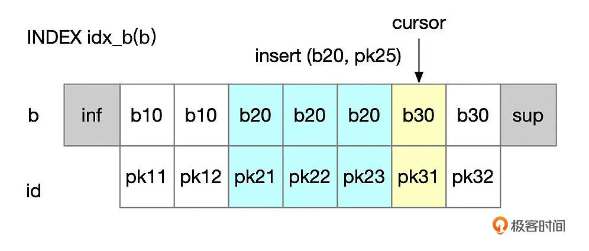

如果记录 (b30, pk31) 之前的 GAP 已经被其他会话锁定（GAP 锁或 Next-key 锁），insert 就需要等待。

```sql
-- 会话1获取记录(b30, pk31)的GAP锁
mysql> begin;
Query OK, 0 rows affected (0.00 sec)
mysql> select * from test_lock2 where b='b25' for update;
Empty set (0.01 sec)
mysql> select thread_id, index_name, lock_type, lock_mode, lock_data, lock_status
      from data_locks;
+-----------+------------+-----------+-----------+---------------+-------------+
| thread_id | index_name | lock_type | lock_mode | lock_data     | lock_status |
+-----------+------------+-----------+-----------+---------------+-------------+
|       506 | NULL       | TABLE     | IX        | NULL          | GRANTED     |
|       506 | idx_b      | RECORD    | X,GAP     | 'b30', 'pk31' | GRANTED     |
+-----------+------------+-----------+-----------+---------------+-------------+
```

会话 2 执行 insert 语句时被阻塞。

```sql
mysql> insert into test_lock2(id, a,b,c,d) values('pk25', 'a99', 'b20', 0,0);
-- 等待中
mysql> select thread_id, index_name, lock_type, lock_mode, lock_data, lock_status
+-----------+------------+-----------+------------------------+---------------+--
| thread_id | index_name | lock_type | lock_mode              | lock_data     | l
+-----------+------------+-----------+------------------------+---------------+--
|       504 | NULL       | TABLE     | IX                     | NULL          | G
|       504 | idx_b      | RECORD    | X,GAP,INSERT_INTENTION | 'b30', 'pk31' | W
|       506 | NULL       | TABLE     | IX                     | NULL          | G
|       506 | idx_b      | RECORD    | X,GAP                  | 'b30', 'pk31' | G
+-----------+------------+-----------+------------------------+---------------+--
```

你可以使用下面这个 SQL 查看 insert 是被哪个会话阻塞了。

```sql
mysql> select
 t3.PROCESSLIST_ID as blocking_processlist_id,
 t3.PROCESSLIST_COMMAND as blocking_processlist_command,
 t3.PROCESSLIST_INFO as blocking_processlist_info,
 t3.PROCESSLIST_STATE as blocking_processlist_state,
 t3.PROCESSLIST_TIME as blocking_processlist_time,
 t5.object_name,
 t5.lock_type blocking_lock_type,
 t5.lock_mode blocking_lock_mode,
 t5.lock_data blocking_lock_data,
 t4.lock_mode waiting_lock_mode,
 t4.lock_status wait_status,
 t2.PROCESSLIST_ID as waiting_processlist_id,
 t2.PROCESSLIST_COMMAND as waiting_processlist_command,
 t2.PROCESSLIST_INFO as waiting_processlist_info,
 t2.PROCESSLIST_STATE as waiting_processlist_state,
 t2.PROCESSLIST_TIME as waiting_processlist_time
from data_lock_waits t1, data_locks t4, data_locks t5, threads t2, threads t3
where t1.REQUESTING_ENGINE_LOCK_ID = t4.ENGINE_LOCK_ID
and t1.BLOCKING_ENGINE_LOCK_ID = t5.ENGINE_LOCK_ID
and t1.REQUESTING_THREAD_ID = t2.thread_id
and t1.BLOCKING_THREAD_ID = t3.thread_id;
*************************** 1. row ***************************
    blocking_processlist_id: 398
blocking_processlist_command: Sleep
  blocking_processlist_info: NULL
 blocking_processlist_state: NULL
  blocking_processlist_time: 658
                object_name: test_lock2
         blocking_lock_type: RECORD
         blocking_lock_mode: X,GAP
         blocking_lock_data: 'b30', 'pk31'
          waiting_lock_mode: X,GAP,INSERT_INTENTION
                wait_status: WAITING
     waiting_processlist_id: 396
waiting_processlist_command: Query
   waiting_processlist_info: insert into test_lock2(id, a,b,c,d) values('pk25',
  waiting_processlist_state: update
waiting processlist time: 26
```

### 隐藏的锁

如果一开始 insert 语句就执行成功了，并不会给记录加上显式的锁。

```sql
mysql> begin;
Query OK, 0 rows affected (0.00 sec)
mysql> insert into test_lock2(id,a,b,c,d) values('pk99', 'a99', 'b99', 1,0);
Query OK, 1 row affected (0.00 sec)
mysql> select thread_id, index_name, lock_type, lock_mode, lock_data, lock_status
+-----------+------------+-----------+-----------+-----------+-------------+
| thread_id | index_name | lock_type | lock_mode | lock_data | lock_status |
+-----------+------------+-----------+-----------+-----------+-------------+
|       211 | NULL       | TABLE     | IX        | NULL      | GRANTED     |
+-----------+------------+-----------+-----------+-----------+-------------+
```

其他会话修改这行新插入的记录时，在获取锁的过程中，会发现记录上没有锁，但是最后一次修改记录的事务还没有提交，则会帮忙给记录加上相关的锁。

下面的例子中，thread_id 506 在获取记录 (b99, pk99) 的锁时，发现最后一次修改这条记录的事务还没有提交，就帮忙创建了一个锁。

```sql
mysql> begin;
Query OK, 0 rows affected (0.01 sec)
mysql> update test_lock2 set d=d+1 where b='b99';
mysql> select thread_id, index_name, lock_type, lock_mode, lock_data, lock_status
 from data_locks;
+-----------+------------+-----------+---------------+---------------+-----------
| thread_id | index_name | lock_type | lock_mode     | lock_data     | lock_statu
+-----------+------------+-----------+---------------+---------------+-----------
|       506 | NULL       | TABLE     | IX            | NULL          | GRANTED
|       506 | idx_b      | RECORD    | X             | 'b99', 'pk99' | WAITING
|       504 | NULL       | TABLE     | IX            | NULL          | GRANTED
|       506 | idx_b      | RECORD    | X,REC_NOT_GAP | 'b99', 'pk99' | GRANTED
+-----------+------------+-----------+---------------+---------------+-----------
```

上面的例子中，持有锁和等待锁的线程 ID 都是 506。

### 唯一索引和主键

为了保证唯一性约束，insert 时需要获取主键和唯一索引相应记录上的锁。

```sql
mysql> begin;
Query OK, 0 rows affected (0.00 sec)
mysql> insert into test_lock2 values ('pk99', 'a40', 'b40', 2, 0);
ERROR 1062 (23000): Duplicate entry 'a40-2' for key 'test_lock2.uk_ac'
```

上面这个例子中，insert 的数据违反了唯一约束，SQL 执行报错后，获取的 uk_ac 上的锁没有自动释放掉。

```sql
mysql> select thread_id, index_name, lock_type, lock_mode, lock_data, lock_status
   from data_locks;
+-----------+------------+-----------+-----------+------------------+------------
| thread_id | index_name | lock_type | lock_mode | lock_data        | lock_status
+-----------+------------+-----------+-----------+------------------+------------
|       211 | NULL       | TABLE     | IX        | NULL             | GRANTED
|       211 | uk_ac      | RECORD    | S         | 'a40', 2, 'pk22' | GRANTED
+-----------+------------+-----------+-----------+------------------+------------
```

### 外键约束

如果表存在外键，那么往子表插入数据时，需要获取父表对应记录的锁。

```sql
CREATE TABLE `parent` (
 `id` varchar(10) NOT NULL,
 `pid` varchar(10) DEFAULT NULL,
 `a` varchar(10) DEFAULT NULL,
 PRIMARY KEY (`id`),
 key idx_pid(pid)
) ENGINE=InnoDB
CREATE TABLE `child` (
 `id` varchar(10) NOT NULL,
 `pid` varchar(10) DEFAULT NULL,
 `a` varchar(10) DEFAULT NULL,
 PRIMARY KEY (`id`),
 KEY `fk` (`pid`),
 CONSTRAINT `child_fk_pid` FOREIGN KEY (`pid`) REFERENCES `parent` (`pid`)
) ENGINE=InnoDB;
insert into parent values('parent-01', 'parent-01', 'parent row');
```

往子表 INSERT 数据时，需要获取父表对应记录上的 S 锁。

```sql
mysql> begin;
Query OK, 0 rows affected (0.00 sec)
mysql> insert into child values('child-01', 'parent-01', 'child row');
Query OK, 1 row affected (0.00 sec)
mysql> select object_name, index_name, lock_type, lock_mode, lock_data, lock_stat
 from data_locks;
+-------------+------------+-----------+---------------+-------------------------
| object_name | index_name | lock_type | lock_mode     | lock_data
+-------------+------------+-----------+---------------+-------------------------
| parent      | NULL       | TABLE     | IS            | NULL
| child       | NULL       | TABLE     | IX            | NULL
| parent      | idx_pid    | RECORD    | S,REC_NOT_GAP | 'parent-01', 'parent-01'
+-------------+------------+-----------+---------------+-------------------------
```

## 死锁的一个例子

死锁也是平时比较容易遇到的一个问题。死锁的情况很多，对于一些偶发的死锁，业务上做好重试，应该能解决大部分的问题。使用 show engine innodb status 命令可以查看最新的死锁。如果设置了 innodb_print_all_deadlocks 参数，还会在错误日志中记录死锁信息。

下面是死锁的一个例子。先创建一个表，准备一些数据。

```sql
create table test_lck2(a int, b int, c int, primary key(a), key idx_b(b));
insert into test_lck2 values(11,11,11),(15,15,15),(19,19,19);
mysql>  select * from test_lck2;
+----+------+------+
| a  | b    | c    |
+----+------+------+
| 11 |   11 |   11 |
| 15 |   15 |   15 |
| 19 |   19 |   19 |
+----+------+------+
3 rows in set (0.00 sec)
```

开启两个会话，按顺序执行 SQL。

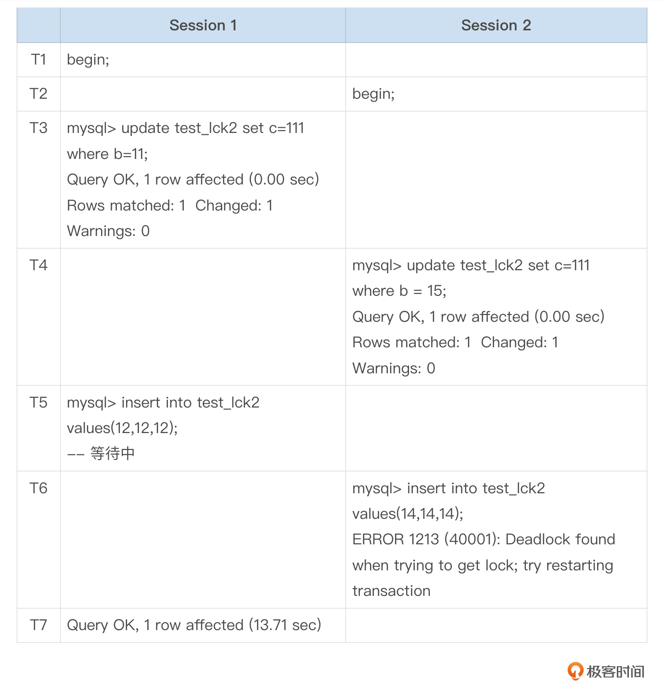

从死锁日志里可以看出。

- 事务 1 持有 idx_b 的记录 15 上的锁，锁模式为“lock_mode X locks gap before rec”。

- 事务 1 在等待 idx_b 的记录 15 上的锁，锁模式为“lock_mode X locks gap before rec insertintention”。

- 事务 2 持有 idx_b 的记录 15 上的锁，锁模式为“lock_mode X”。

- 事务 2 也在等待 idx_b 的记录 15 上的锁，锁模式为“lock_mode X locks gap before recinsert intention waiting”

```sql
*** (1) TRANSACTION:
TRANSACTION 163825, ACTIVE 46 sec inserting
mysql tables in use 1, locked 1
LOCK WAIT 5 lock struct(s), heap size 1128, 4 row lock(s), undo log entries 2
MySQL thread id 46, OS thread handle 140019091113536, query id 84199 localhost 12
insert into test_lck2 values(12,12,12)
*** (1) HOLDS THE LOCK(S):
RECORD LOCKS space id 10018 page no 5 n bits 80 index idx_b of table `test_lock`.
Record lock, heap no 4 PHYSICAL RECORD: n_fields 2; compact format; info bits 0
0: len 4; hex 8000000f; asc     ;;
1: len 4; hex 8000000f; asc     ;;
*** (1) WAITING FOR THIS LOCK TO BE GRANTED:
RECORD LOCKS space id 10018 page no 5 n bits 80 index idx_b of table `test_lock`.
Record lock, heap no 4 PHYSICAL RECORD: n_fields 2; compact format; info bits 0
0: len 4; hex 8000000f; asc     ;;
1: len 4; hex 8000000f; asc     ;;
*** (2) TRANSACTION:
TRANSACTION 163826, ACTIVE 33 sec inserting
mysql tables in use 1, locked 1
LOCK WAIT 5 lock struct(s), heap size 1128, 4 row lock(s), undo log entries 2
MySQL thread id 49, OS thread handle 140019090056768, query id 84200 localhost 12
insert into test_lck2 values(14,14,14)
*** (2) HOLDS THE LOCK(S):
RECORD LOCKS space id 10018 page no 5 n bits 80 index idx_b of table `test_lock`.
Record lock, heap no 4 PHYSICAL RECORD: n_fields 2; compact format; info bits 0
0: len 4; hex 8000000f; asc     ;;
1: len 4; hex 8000000f; asc     ;;
*** (2) WAITING FOR THIS LOCK TO BE GRANTED:
RECORD LOCKS space id 10018 page no 5 n bits 80 index idx_b of table `test_lock`.
Record lock, heap no 4 PHYSICAL RECORD: n_fields 2; compact format; info bits 0
0: len 4; hex 8000000f; asc     ;;
1: len 4; hex 8000000f; asc     ;;
*** WE ROLL BACK TRANSACTION (2)
```

现实中的死锁可能会比上面这个例子复杂很多，一个死锁可能会涉及到更多的会话。但分析思路上是类似的，要分析各个会话加锁的顺序、锁的模式。

## 总结

锁是数据库中很重要的一个机制。MySQL 中，我们主要会关注元数据锁和 InnoDB 的行锁。这一讲中，我们对行锁做了比较详细的介绍。REPEATABLE READ 隔离级别下，使用了 Gap锁、Next-key 锁，锁的范围更大，因此也更容易引起死锁。应用程序遇到锁的问题时，首先要确定是锁超时还是死锁。你可以查询 data_locks、data_lock_waits 表来分析锁等待关系。

## 思考题

长时间的锁等待会严重影响数据库的性能，频繁的死锁也会影响业务，怎么监控数据库中的锁等待和死锁呢？

期待你的思考，欢迎在留言区中与我交流。如果今天的课程让你有所收获，也欢迎转发给有需要的朋友。我们下节课再见。
