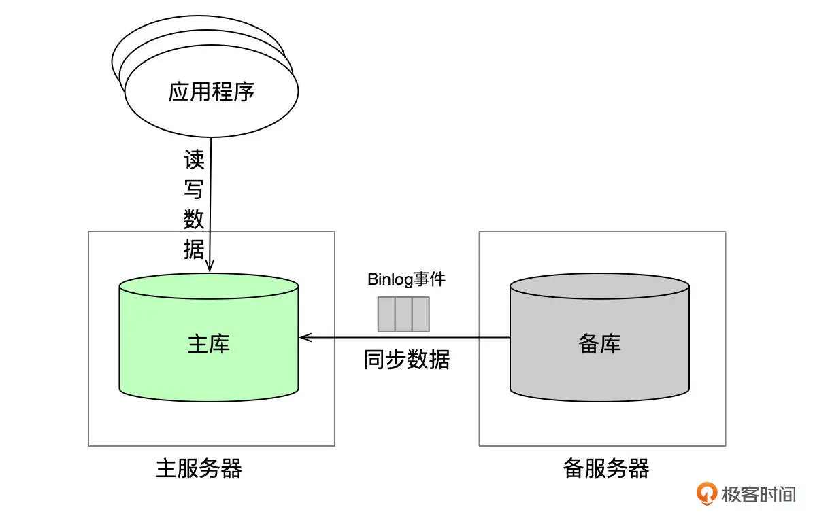
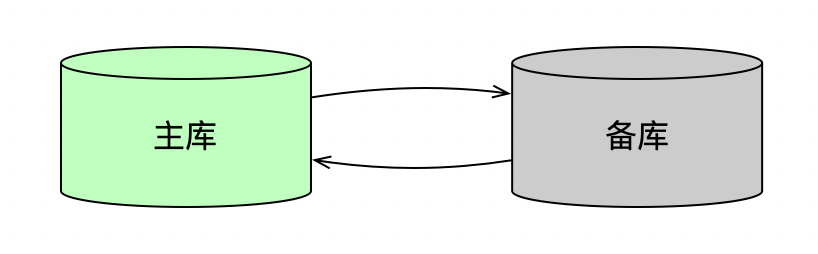
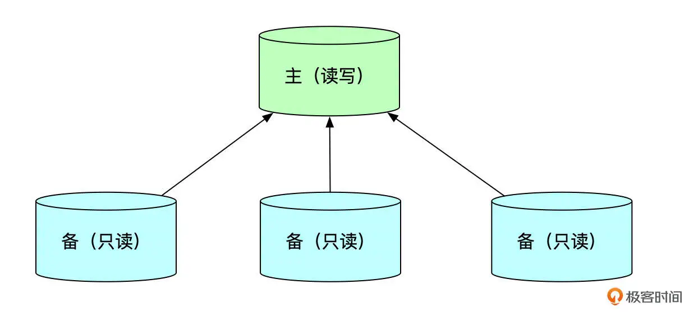
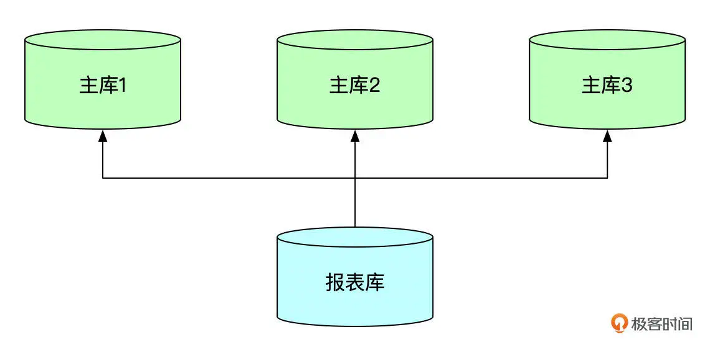
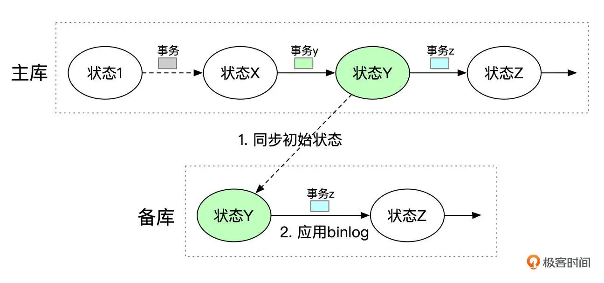
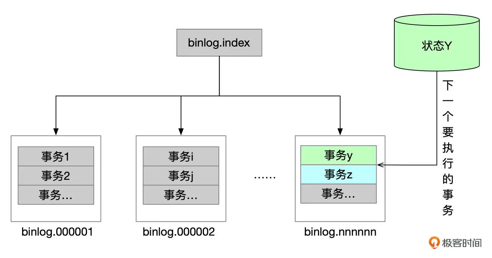
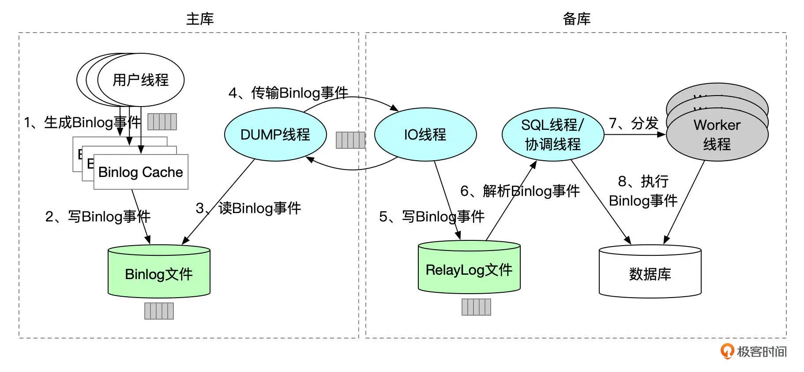
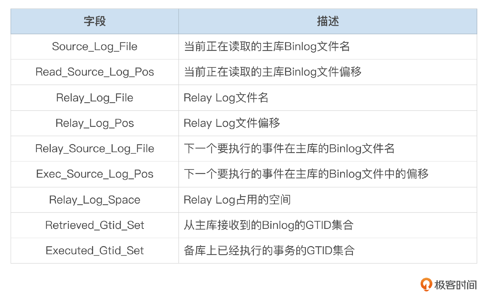
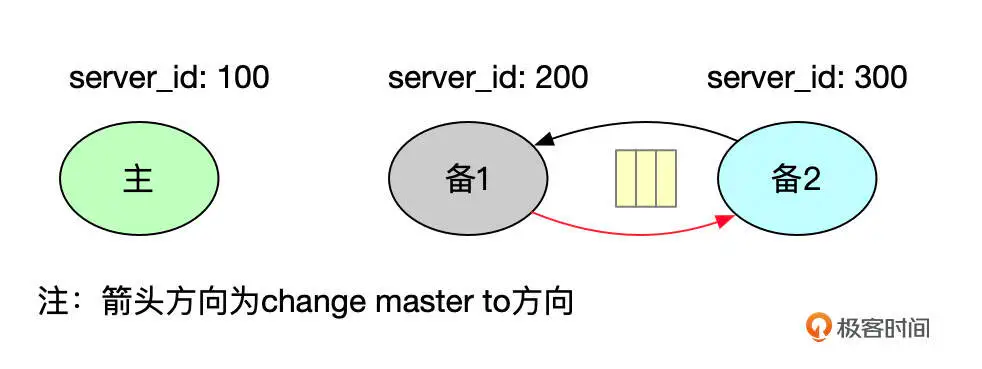

# 34 | MySQL数据库高可用架构部署和维护

你好，我是俊达。

从这一讲开始，我们来聊一聊怎么构建和运维 MySQL 高可用环境。高可用的重要性和必要性，这里就不多说了。实现高可用，需要在 IT 系统的整个链路上消除单点。MySQL 要实现高可用，最基本的就是数据复制技术。

## MySQL 数据复制技术简介

数据复制是 MySQL 一直以来最受欢迎的功能之一。应用程序访问主库，对主库的修改操作都记录到 Binlog 中。备库从主库同步 Binlog、执行 Binlog，这样，备库和主库始终保持一致。



基于数据复制，可以实现多种高可用架构。

- 高可用

应用程序只访问主库，备库作为主库的热备。当主库发生故障，或者主库需要停机维护时，将业务流量切到备库上，减少停机时间。在备库上进行数据库备份等运维操作。



- 读写分离

将应用的一部分读流量分发（select）到备库上执行。MySQL 支持一主多备的数据复制架构，在读多写少的场景下，可以增加多个备库，来提高数据库集群的业务支撑能力。



还可以使用备库来支持一些分析类的大查询、数据抽取等资源消耗较高的操作，避免影响主库业务。

- 报表库



### MySQL 数据复制的基本原理

我们把整个数据库看作是一个状态。每个事务将数据库转换到一个新的状态。虽然主库上事务可以并发执行，但是事务具备原子性和隔离性，因此可以设想主库的事务按顺序执行。如果备库和主库拥有相同的初始状态，并且按相同的顺序执行主库上执行过的事件，那么备库和主库就应该是完全一致的。

下面这张图中，备库先同步了状态 Y 的主库，然后再开始执行 Binlog 事件。



搭建一个备库，有两个核心步骤。

第一步：同步初始状态。有几种常用的方法来设置备库的初始状态。

- 使用第 9 讲、第 10 讲中介绍的数据导入导出工具，比如 mysqldump。

- 使用物理备份工具，如 xtrabackup。

- 在 MySQL 8.0 中，你也可以使用 clone 插件。

- 使用文件系统或块设备的快照功能，得到主库的一个一致的快照。

当然，如果主库和备库都是刚刚新安装的，那么它们当前的状态应该是一样的，就可以跳过这一步了。

第二步：应用 Binlog。

MySQL 将一个事务中对数据库做的所有修改都封装到 Binlog 事件中，同一个事务的 Binlog事件，在 binlog 文件中连续存放。假设在第一步中备库初始化到状态 Y，这个状态下，主库上Binlog 位点指向事务 y 对应的 binlog 事件的结尾处，那么备库就要从这个地方开始同步和应用 Binlog。



binlog 位点使用（bin_log_file，bin_log_pos）来表示，bin_log_file 是 binlog 文件名，bin_log_pos 是 binlog 文件中的偏移量，指向下一个要执行的 binlog 事件的起始地址。

当然，这里面还有很多细节没讲。

- 主库和备库之间的关系如何建立？如何判断备库是否健康？

- 备库会不会影响主库上事务的执行和提交？主库提交事务时，要等待备库确认吗？

- 主库上事务可以并行执行，那么备库上事务是不是也能并行执行，怎么执行？

- 主库或备库崩溃后，数据复制是否会出现异常？

别急，这些问题后续都会一一解答。

## 搭建一套主备复制环境

接下来我们通过一个例子来演示如何搭建一个基本的主备复制环境。

### 1. 主库开启 binlog

主库要先开启 binlog。

```
server_id=100
log_bin=/data/mysql3306/binlog/mysql-binlog
binlog_format=ROW
#enforce_gtid_consistency=ON
#gtid_mode=ON
```

- server_id：主备库 server_id 要设置成不同的值。

- log_bin：binlog 文件的前缀，可以指定绝对路径，也可以只指定文件名。如果不指定路径，binlog 默认存放在 datadir 目录中。这里我们将 binlog 放到了单独的目录中。如果不配置这个参数，在 8.0 中，binlog 默认也是开启的。

- binlog_format：可设置为 STATEMENT、MIXED、ROW 这几种模式。一般建议使用 ROW模式。

上面这些参数中，log_bin 不能动态修改，需要重启 mysql 才能生效。

使用 show global variables 确认主库 binlog 已经开启。

```
mysql> show variables like 'log_bin%';
+---------------------------------+-------------------------------------------+
| Variable_name                   | Value                                     |
+---------------------------------+-------------------------------------------+
| log_bin                         | ON                                        |
| log_bin_basename                | /data/mysql3306/binlog/mysql-binlog       |
| log_bin_index                   | /data/mysql3306/binlog/mysql-binlog.index |
| log_bin_trust_function_creators | OFF                                       |
| log_bin_use_v1_row_events       | OFF                                       |
+---------------------------------+-------------------------------------------+
```

使用 show binary logs 命令查看主库 binlog 列表：

```
mysql> show binary logs;
+---------------+-----------+
| Log_name      | File_size |
+---------------+-----------+
| binlog.000001 |       120 |
+---------------+-----------+
1 row in set (0.00 sec)
```

### 2. 主库创建复制账号

主库要创建一个复制账号。备库会使用复制账号连接到主库，获取 binlog。

```
mysql> create user 'rep'@'%' identified by 'rep123';
Query OK, 0 rows affected (0.00 sec)
mysql> grant replication client, replication slave on *.* to 'rep'@'%';
Query OK, 0 rows affected (0.00 sec)
```

复制账号需要 replication slave 权限，一般我会将 replication client 权限也赋给复制账号。

### 3. 备库参数配置

备库上也要设置参数 server_id，server_id 的值要和主库设置成不一样。如果要搭建级联复制或双主架构，备库上也要开启 binlog，并设置 log_slave_updates，这样，当备库执行了从主库上复制过来的事务后，会在自己的 Binlog 中记录相关的事件。

下面这个配置文件中，设置了一些最基本的参数。

```
server_id=236
log_bin=/data/mysql3306/binlog/mysql-binlog
binlog_format=ROW
log_slave_updates=ON
relay_log=/data/mysql3306/relaylog/relaylog
```

- server_id，和主库设置成不一样的值。

- log_slave_updates，记录从主库复制过来的 binlog。

- relay_log，设置 releylog 的存放路径，这里将 relaylog 放到单独的目录中。

### 4. 初始化备库的数据

可以用物理备份（如 percona 开源的 xtrabackup）、mysqldump 等工具创建主库的一致性备份，并恢复到备库中。如果主备库都是新初始化的数据库实例，主库 binlog 没有缺失，也可以跳过这个步骤，直接开启复制。

下面这个例子中，用 mysqldump 创建了一个全库的一致性备份，可以用这个备份文件来初始化一个备库。

```
mysqldump -uroot -h127.0.0.1 -P3306 -pabc123 \
  --single-transaction \
  --all-databases \
  --master-data=2 \
  --routines \
  --triggers \
  --events \
  --flush-privileges > /data/backup/mysql3306_dump.sql
```

这里的参数需要做一些说明。

- –single-transaction：使用 innodb 的一致性读取机制实现一致性数据库备份，不锁表。但是对非 InnoDB 引擎（如 MyISAM）无效。同时备份过程中不能有 DDL。

- –all-databases --routines --triggers --events：备份所有数据库，包括存储过程、触发器、定时事件。

- –master-data=2：记录数据库当前 binlog 位点。指定 master-data 后，会自动加上 lock-tables 选项，锁定数据库。我们这个案例中，加上–single-transaction，所以不会锁表。

- –flush-privileges：备份完 mysql 数据库后，加上 flush privileges 命令。数据恢复时，恢复完 mysql 数据库后就会执行 flush privileges 命令，恢复出来的用户信息才会生效。

- –gtid-mode=auto：如果数据库开启了 GTID，则备份文件中会加入 set globalGTID_PURGED=xxx;。

当然，正式的环境中，在主库上执行备份可能会带来一些性能开销，这里的开销包括获取全局锁，以及导出数据时会消耗一些资源。操作前要评估好对业务的影响。我们的例子中，使用了master-data=2 来获取发起备份时，主库的 binlog 位点。备份文件恢复到备库后，要从这个位点开始同步 binlog。

在备库上，恢复刚才生成的备份文件。

```
# mysql -uroot -h127.0.0.1 -P3306 -psomepass -e 'set sql_log_bin=0; source mysql3
```

由于 mysqldump 生成的逻辑备份默认包含了 DROP 操作，我们在恢复数据时，临时关闭了binlog，不然在双主架构下，可能会导致主库的库表被 DROP。

### 5. 备库创建复制通道

备库数据恢复完成后，就可以执行命令建立到主库的复制关系。先从备份文件中找到 Binlog位点。

```
# head -40 /data/backup/mysql3306_dump.sql | grep 'CHANGE MASTER TO'
-- CHANGE MASTER TO MASTER_LOG_FILE='mysql-binlog.000001', MASTER_LOG_POS=1040;
```

然后再执行命令，建立复制关系，启动复制，查看复制状态。

```
mysql> change replication source to source_host='172.16.121.234',source_port=3306
mysql> start replica;
mysql> show replica status\G
*************************** 1. row ***************************
            Replica_IO_State: Waiting for source to send event
                 Source_Host: 172.16.121.234
                 Source_User: rep
                 Source_Port: 3306
               Connect_Retry: 60
             Source_Log_File: mysql-binlog.000001
         Read_Source_Log_Pos: 1572
              Relay_Log_File: relaylog.000002
               Relay_Log_Pos: 861
       Relay_Source_Log_File: mysql-binlog.000001
          Replica_IO_Running: Yes
         Replica_SQL_Running: Yes
```

上面的命令中，加上了 get_source_public_key 选项，可以避免下面这个报错。

```
Last_IO_Error: error connecting to master 'rep@172.16.121.234:3306' - retry-time:
```

如果遇到了上面这个报错，也没有关系，执行下面这几个命令，设置 get_source_public_key就可以了。

```
mysql> stop replica;
mysql> change replication source to get_source_public_key=1;
mysql> start replica;
```

## 开启 GTID 复制

用 Binlog 位点来建立复制，存在一个问题，在级联复制架构下，调整复制关系时，确定新主库的 Binlog 位点比较麻烦。为了解决这个问题，MySQL 从 5.6 开始引入了 GTID。开启GTID 之后，主库上提交的每一个事务都有一个全局唯一的 ID，并且事务复制到备库时，这个GTID 也不会变。使用 GTID 有很多优点。

- MySQL 会把每一个提交的事务的 GTID 记录下来，这样可以避免重复执行同一个事务。如果没有开启 GTID，建立复制关系时，如果指定的位点不对，可能会重复执行事务，引起主备数据不一致或复制中断。

- 建立复制关系时，MySQL 可以根据当前实例已经执行过的 GTID 事务，来自动判断需要同步主库的哪些 binlog，不再需要指定具体的 Binlog 位点。

GTID 由两部分组成：server_uuid 和事务序列号。初始化数据库时，会生成一个全局唯一的server_uuid，server_uuid 保存在 datadir 下的 auto.cnf 中。

```
# cat auto.cnf
[auto]
server-uuid=e7ce5684-09b8-11ee-9dd0-fa8338b09400
```

如果删除 auto.cnf，重启实例时会重新生成一个 server_uuid。事务序列号在事务提交时按顺序生成。

搭建开启 GTID 的复制架构，操作步骤上和搭建基于位点的复制差别不大，下面我们主要讨论不同的几个地方。

### 1. 主库开启 GTID

除了常规的参数，主库上还要设置 gtid_mode、enforce_gtid_consistency 参数

```
enforce_gtid_consistency=ON
gtid_mode=ON
```

### 2. 备库配置

5.6 版本开启 GTID 时，备库上要开启 binlog，并设置 log-slave-updates 参数，否则数据库会无法启动。

```
log_bin=/data/mysql5.6/binlog/mysql-binlog
log_slave_updates=ON
binlog_format=ROW
enforce_gtid_consistency=ON
gtid_mode=ON
```

不过从 5.7 版本开始，备库不开启 binlog 和 log-slave-updates 也可以使用 GTID 了。

### 3. 备份主库

备份主库时，要记录主库的 gtid_executed 变量。前面的例子中，我们使用了 mysqldump 来备份数据库，选项 gtid-mode 默认为 auto，如果主库使用了 GTID，生产的备份文件中已经记录了备份时，主库的 GTID_executed 变量。这可以从文件中直接看到。

```
# more mysql3306_dump.sql
-- MySQL dump 10.13  Distrib 8.0.32, for Linux (x86_64)
......
SET @MYSQLDUMP_TEMP_LOG_BIN = @@SESSION.SQL_LOG_BIN;
SET @@SESSION.SQL_LOG_BIN= 0;
--
-- GTID state at the beginning of the backup
--
SET @@GLOBAL.GTID_PURGED=/*!80000 '+'*/ '7caa9a48-b325-11ed-8541-fab81f64ee00:1-1
c1a67221-f9fc-11ed-bffd-fa8338b09400:1-106';
```

### 4. 备库创建复制通道

建立复制通道时，不要指定主库的 Binlog 位点，要使用 source_auto_position。

```
mysql> change replication source to source_host='172.16.121.234',source_port=3306
```

我们在前面的例子中，本来已经建立了基于位点的复制，还可以使用下面这个命令，将复制改成 GTID 自动定位。replica status 的输出中，Auto_Position 为 1，说明复制通道使用了自动定位。

```
mysql> stop replica;
mysql> change replication source to source_auto_position=1;
mysql> start replica;
mysql> show replica status\G
...
               Auto_Position: 1
```

## 管理数据复制

搭建一个 MySQL 的数据复制集群，操作上不复杂，不过在实际环境中，可能会遇到各种各样的问题，导致数据复制中断，或者主备数据不一致。至少有几十种情况会导致复制中断，这里无法穷举所有的情况。不过当你了解复制的核心原理后，大部分问题都是可以解决的。后面我们也会介绍一些典型的复制异常的案例。

### 理解复制原理

参考下面这个数据复制的架构图。



我们需要了解几个关键点。

- 用户执行 DML 操作的过程中，会生成 binlog 事件，事务提交时，Binlog 事件写入到 Binlog文件中。

- 备库上，由 IO 线程负责从主库同步 Binlog。IO 线程作为一个客户端，连接主库，发起同步 Binlog 的请求，并接收主库发送过来的 Binlog 事件，将 Binlog 事件写到本地的Relaylog 中。

- 主库上，Dump 线程负责将 Binlog 发送给备库的 IO 线程。

- 备库上，SQL 线程（使用多线程复制时，SQL 线程也称为协调线程）从 RelayLog 中解析出 Binlog 事件，并执行 Binlog，或将 Binlog 分发给 Worker 线程执行。

这里面任何一个环节都有可能会出错。

### 查看复制状态

分析复制相关的问题时，我们经常会用到一些命令，这里先做一个简单的介绍。

- show master status

使用 show master status 命令查看主库当前的 binlog 位点。

```
mysql> show master status\G
*************************** 1. row ***************************
            File: mysql-binlog.000001
        Position: 61103
    Binlog_Do_DB:
Binlog_Ignore_DB:
Executed_Gtid_Set: 7caa9a48-b325-11ed-8541-fab81f64ee00:1-16333,
c1a67221-f9fc-11ed-bffd-fa8338b09400:1-106
```

- show binary logs

使用 show binary logs 命令查看当前实例中的 binlog 列表。

```
mysql> show binary logs;
+---------------------+-----------+-----------+
| Log_name            | File_size | Encrypted |
+---------------------+-----------+-----------+
| mysql-binlog.000001 |     61153 | No        |
| mysql-binlog.000002 |       197 | No        |
+---------------------+-----------+-----------+
```

- mysqlbinlog

mysqlbinlog 是一个用来解析 binlog 内容的命令行工具，我们可以用 mysqlbinlog 来验证binlog 文件是否损坏。下面这个例子中，指定的位点不是某个事件的起始地址，所以会报错。

```
# mysqlbinlog --start-position 12345 mysql-binlog.000001
......
ERROR: Could not read entry at offset 12345: Error in log format or read error 1.
ERROR: Event too big
```

- show replica status / show slave status

使用 show replica status 或 show slave status 命令查看复制状态。

```
mysql> show replica status\G
*************************** 1. row ***************************
            Replica_IO_State: Waiting for source to send event
                 Source_Host: 172.16.121.234
                 Source_User: rep
                 Source_Port: 3306
               Connect_Retry: 60
             Source_Log_File: mysql-binlog.000001
         Read_Source_Log_Pos: 61965
              Relay_Log_File: relaylog.000004
               Relay_Log_Pos: 319
       Relay_Source_Log_File: mysql-binlog.000001
          Replica_IO_Running: Yes
         Replica_SQL_Running: Yes
             Replicate_Do_DB:
         Replicate_Ignore_DB:
          Replicate_Do_Table:
      Replicate_Ignore_Table:
     Replicate_Wild_Do_Table:
 Replicate_Wild_Ignore_Table:
                  Last_Errno: 0
                  Last_Error:
                Skip_Counter: 0
         Exec_Source_Log_Pos: 61965
             Relay_Log_Space: 834
             Until_Condition: None
              Until_Log_File:
               Until_Log_Pos: 0
          Source_SSL_Allowed: No
          Source_SSL_CA_File:
          Source_SSL_CA_Path:
             Source_SSL_Cert:
           Source_SSL_Cipher:
              Source_SSL_Key:
       Seconds_Behind_Source: 0
Source_SSL_Verify_Server_Cert: No
               Last_IO_Errno: 0
               Last_IO_Error:
              Last_SQL_Errno: 0
              Last_SQL_Error:
 Replicate_Ignore_Server_Ids:
            Source_Server_Id: 119
                 Source_UUID: 7caa9a48-b325-11ed-8541-fab81f64ee00
            Source_Info_File: mysql.slave_master_info
                   SQL_Delay: 0
         SQL_Remaining_Delay: NULL
   Replica_SQL_Running_State: Replica has read all relay log; waiting for more u
          Source_Retry_Count: 86400
                 Source_Bind:
     Last_IO_Error_Timestamp:
    Last_SQL_Error_Timestamp:
              Source_SSL_Crl:
          Source_SSL_Crlpath:
          Retrieved_Gtid_Set: 7caa9a48-b325-11ed-8541-fab81f64ee00:16333
           Executed_Gtid_Set: 7caa9a48-b325-11ed-8541-fab81f64ee00:1-16333,
c1a67221-f9fc-11ed-bffd-fa8338b09400:1-106
               Auto_Position: 1
        Replicate_Rewrite_DB:
                Channel_Name:
          Source_TLS_Version:
      Source_public_key_path:
       Get_Source_public_key: 1
           Network_Namespace:
```

监控备库状态时，要关注 SQL 线程和 IO 线程的状态，Replica_IO_Running 和Replica_SQL_Running 是否都为 ON，如果有异常，查看 Last_IO_Error、Last_SQL_Error，分析原因。此外，还要看备库是否有延迟，可以查看 Seconds_Behind_Source。

这个命令输出内容比较多，下面表格中整理了其中部分字段的含义。



使用多线程复制时，有时候还要看各个 worker 的状态，可以查询performance_schema.replication_applier_status_by_worker 表。

```sql
mysql> show slave status\G
*************************** 1. row ***************************
              Slave_IO_State: Waiting for source to send event
                 Master_Host: 172.16.121.236
                 Master_User: rpl_user
                 Master_Port: 3306
......
                  Last_Errno: 1205
                  Last_Error: Coordinator stopped because there were error(s) in
mysql> select * from performance_schema.replication_applier_status_by_worker\G
*************************** 1. row ***************************
                                          CHANNEL_NAME:
                                             WORKER_ID: 1
                                             THREAD_ID: NULL
                                         SERVICE_STATE: OFF
                                     LAST_ERROR_NUMBER: 1205
                                    LAST_ERROR_MESSAGE: Worker 1 failed executin
......
      APPLYING_TRANSACTION_LAST_TRANSIENT_ERROR_NUMBER: 1205
     APPLYING_TRANSACTION_LAST_TRANSIENT_ERROR_MESSAGE: Lock wait timeout exceed
   APPLYING_TRANSACTION_LAST_TRANSIENT_ERROR_TIMESTAMP: 2023-06-06 17:32:33.8916
```

接下来我们看一下数据复制中可能会遇到的一些问题。

### 主库上的问题

主库是整个数据复制的源头，如果主库有问题，那么数据就无法正常复制。这里列举了几种情况。

- 主库异常崩溃可能会导致 binlog 损坏。如果 binlog 损坏了，备库的 IO 线程会中断。

```
Last_IO_Error: Got fatal error 1236 from source when reading data from binary log
```

- 主库上清理了 Binlog，备库没来得及同步这些 binlog。服务器的存储空间是有限的，因此一般会定期清理 Binlog。如果备库由于各种原因，没有及时同步这些被清理掉的 Binlog，备库就无法正常工作了。

```
Got fatal error 1236 from master when reading data from binary log: 'Could not fi
```

遇到这种情况时，通常的做法是重搭备库。如果你在清理 binlog 前将 binlog 备份下来了，那么还可以尝试将备份的 binlog 应用到备库，避免重搭。

- 主库使用了 Statement 格式的 binlog，并且执行了一些不安全的 SQL。这里不安全的SQL，是指同一个 SQL 在主备库上执行时，会有不同的结果。比如使用了 sysdate() 函数。

### IO 线程相关问题

### 连接不上主库

IO 线程要先连接到主库，然后才能同步 Binlog。连接不上主库，可能是网络的问题、复制账号的问题，也可能是主库有异常。

```
Last_IO_Error: Error reconnecting to source 'rep@172.16.121.234:3307'. This was a
Last_IO_Error: error connecting to master 'rep@172.16.121.234:3380' - retry-time:
```

### 从错误的位点复制数据

备库上指定了错误的位点时，会出现各种报错。下面提供了一些报错的例子。这些错误也可能是因为主库 Binlog 损坏了，可以用 mysqlbinlog 解析主库的 binlog，看看是否会报错。

```
Last_IO_Error: Got fatal error 1236 from master when reading data from binary log
Last_IO_Error: Got fatal error 1236 from master when reading data from binary log
Last_IO_Error: Got fatal error 1236 from master when reading data from binary log
```

一般如果主库有 Binlog 损坏了，要检查下主备库的数据是否一致。我们可以尝试从主库的下一个 Binlog 开始复制。

### 主库 Binlog 缺失

这可能是主库 binlog 被清理了，也有可能是备库上 gtid_purged 设置不正确引起的。使用GTID Auto Position 时，Dump 线程会根据备库发送过来的 GTID 信息自动判断。如果存在一些 GTID，备库是需要的，但是在主库上已经被 Purge 了，也会报这个错。

```
Last_IO_Error: Got fatal error 1236 from master when reading data from binary log
c1a67221-f9fc-11ed-bffd-fa8338b09400:1-106', and the missing transactions are '05
```

如果确实是主库 Binlog 缺失了，就需要重搭备库。

### 备库 GTID 比主库多

备库上 GTID_EXECUTED 中，相对于主库的 SERVER_UUID，GTID 比主库还多，也会报错。这可能是主库异常 Crash 时，一些 Binlog 发送到了备库，但是在主库丢失了。

```
Last_IO_Error: Got fatal error 1236 from master when reading data from binary log
```

遇到这种问题时，要检查下主库和备库数据的一致性。并重新设置备库的 GTID_PURGED 变量，再开启复制。

### SQL 线程相关问题

备库上，SQL 线程应用 Binlog 时，也可能会遇到各种问题。

### 主备数据不一致

如果主备库数据不一致，备库上应用 Binlog 事件时就可能会报错。报错分为几种情况。

1. 执行 insert 事件时，备库已经存在主键（或唯一索引）相同的数据，这样会报主键冲突的错误。

```
Could not execute Write_rows event on table helloworld.test1; Duplicate entry '20
```

2. 执行 update 和 delete 事件时，备库上找不到记录，会报找不到记录的错误。

```
Could not execute Update_rows event on table helloworld.test1; Can't find record
Could not execute Delete_rows event on table helloworld.test1; Can't find record
```

遇到数据不一致引起复制中断时，一般需要先修复不一致的数据。通常有这几种做法。

- 重做备库。以主库的数据为准，备份主库数据，将数据恢复到备库。当然业务上要先确认备库上不一致的数据是否可以忽略。

- 对比数据并修复。对比主库和备库的数据，修复不一致的数据。如果不一致的数据比较多，这么做工作量可能会比较大。

- 跳过不一致的数据。如果开启了 GTID 自动定位，可以在备库上设置 GTID，执行一个空的事务。这样 SQL 线程就可以跳过一个事务。如果使用基于位点的复制，可以设置sql_slave_skip_counter=1，跳过一个事件。还可以设置参数 slave_skip_errors，跳过数据冲突类的报错，但是不建议使用。如果备库的数据和主库不一致，可能会带来严重的业务问题。

当然，还要找到引起数据不一致的原因，从根源上避免问题。引起主备数据不一致的原因可能会比较多，要具体分析。下面列举了一些可能的情况。

- 使用了 memory 引擎。备库重启后，memory 引擎的数据被清空了。

- 使用了非事务型存储引擎，如 MyISAM 存储引擎。

- 主库和备库上都有写操作，也就是常说的“双写”。

- 备库有延迟的情况下，发生了主备切换，业务在新的主库上写入了数据。

### 开启了 GTID 模式，使用基于位点的复制时，从错误的位点复制数据

主备库开启 GTID 后，如果备库上还是使用基于位点的复制，SQL 线程可能会遇到下面这个报错。

```sql
mysql> show replica status\G
......
Last_SQL_Error: Coordinator stopped because there were error(s) in the worker(s).
mysql> select * from performance_schema.replication_applier_status_by_worker \G
......
LAST_ERROR_NUMBER: 1782
LAST_ERROR_MESSAGE: Worker 1 failed executing transaction 'NOT_YET_DETERMINED' at
```

Binlog 中，一个完整的事务由多个 Binlog 事件组成，包括 GTID 事件、BEGIN 事件、Table_map 事件、DML 事件、XID 事件。下面例子中是一个 Delete 语句对应 Binlog 事件。

备库上复制数据时，要指向 GTID 事件，比如例子中的位点 197。如果从其他位点，比如 276开始复制，备库上不知道事件的 GTID，就会发生上面这个报错。

```
# at 197
#241017 16:13:23 server id 119  end_log_pos 276 CRC32 0x1d7504de   GTID  last_com
SET @@SESSION.GTID_NEXT= '7caa9a48-b325-11ed-8541-fab81f64ee00:16334'/*!*/;
# at 276
#241017 16:13:23 server id 119  end_log_pos 350 CRC32 0xdc3b60fa   Query  thread_
BEGIN
/*!*/;
# at 350
#241017 16:13:23 server id 119  end_log_pos 399 CRC32 0x13726bf2   Table_map: `re
# at 399
#241017 16:13:23 server id 119  end_log_pos 443 CRC32 0x31cf2356   Delete_rows: t
# at 443
#241017 16:13:23 server id 119  end_log_pos 474 CRC32 0x51b2b82c   Xid = 6660
COMMIT/*!*/;
```

### 备库 relaylog 损坏

备库异常崩溃时，如果 relaylog 损坏了，也会导致 SQL 线程无法启动。这种情况下，可能要清空 relaylog，从主库重新复制数据。

```
[ERROR] [MY-013121] [Repl] Slave SQL for channel '': Relay log read failure: Coul
```

### 其他问题

- myisam 表损坏

- 备库 SQL 执行超时

- 主备参数不一致引起备库 SQL 执行失败

第六讲思考题中的那个问题，就是由于主库 innodb_strict_mode 为 OFF，而备库innodb_strict_mode 为 ON。主库上执行 SQL 时，只是报了一个 Warning，但是备库上执行就失败了。

### 级联复制架构下的一些问题

级联复制架构下，有时还会遇到一些其他的问题。

### server_id 重复导致的问题

MySQL 复制关系中，主库和备库的 server_id 如果相同，IO 线程会直接报错。但是在级联复制的架构下，可能会出现 server_id 相同的问题。


图里的这个例子中，主和备 1 的 server_id 不同，备 2 和备 1 的 server_id 也不同，但是备 2和主库的 server_id 相同，这会导致一个问题：备 2 的 IO 线程从备 1 获取 binlog 事件时，发现事件的 server_id 和自己的 server_id 一样，就会忽略这些事件，从而备 2 会缺少数据。这种情况下，备 2 不会产生任何异常日志。

### Binlog 事件无限循环复制

如果没有开启 GTID，并且使用了语句模式的 Binlog，复制链路存在环路时，还可能会出现Binlog 事件无限循环复制。

考虑下面这个复制链路。


由于某些原因，需要下线主，备 1 和备 2 组成双向复制架构。



为了修改复制架构，执行了下面这几个步骤。

1. 备 1 上执行 stop slave。

2. 备 2 上执行 show master status，查看当前 binlog 位点。

3. 备 1 上执行 change master 命令，使用从步骤 2 获取到的 binlog 位点。

如果在第 2 步的时候，备 2 上有延迟，那么取到的位点后，可能还会生成 server_id 为 100 的binlog 事件，这些事件是从原来的主库上复制过来的。当备 1 指向备 2 时，这些 server_id 为100 的事件，就可能会在备 1 和备 2 之间循环复制，因为备 1 和备 2 的 server id 都不是100。

如果开启了 GTID，就不会发生这种问题了。

### 备库延迟问题

MySQL 复制延迟，也是平时比较常见的问题，这个话题比较复杂，我们后续再讨论。

## 总结

数据复制是构建 MySQL 高可用架构的基础，这一讲中我们对数据复制的基本概念、运维操作做了基本的介绍。

MySQL 8.0 开始，在术语上做了一些调整，从原先的 Master / Slave，改成了 Source /Replica，相应的，一些命令和参数也做了修改。当前版本下，两套命令和参数还都能用，使用老的这一套命令和参数时，会有一些 warning。

主要的修改包括：

- change master 改成 change replication source，命令中的 master 改成 source；

- start/stop/show slave 改成 start/stop/show replica；

- reset slave 改成 reset replica；

- show slave hosts 改成 show replicas；

- 一些参数名中的 master 改成 source；

- 一些参数名中的 slave 改成 replica。

## 思考题

MySQL 主备数据复制默认是异步的。如果主库执行成功，但 binlog 还没来得及发送给备库，可能会存在备库的事务比主库少的情况。反过来，有没有可能出现备库事务比主库多的情况呢（不考虑业务在备库上写入数据的情况）？

期待你的思考，欢迎在留言区中与我交流。如果今天的课程让你有所收获，也欢迎转发给有需要的朋友。我们下节课再见。
