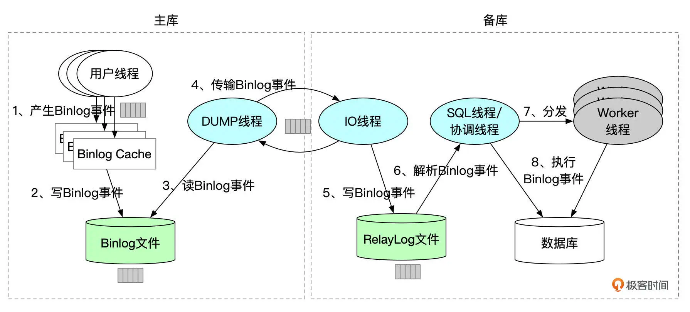
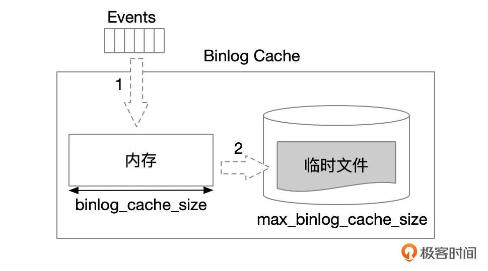
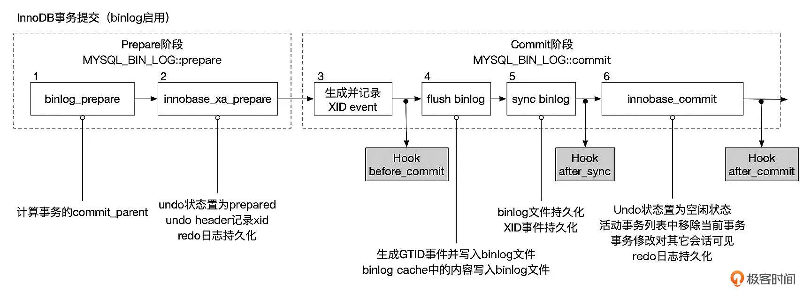
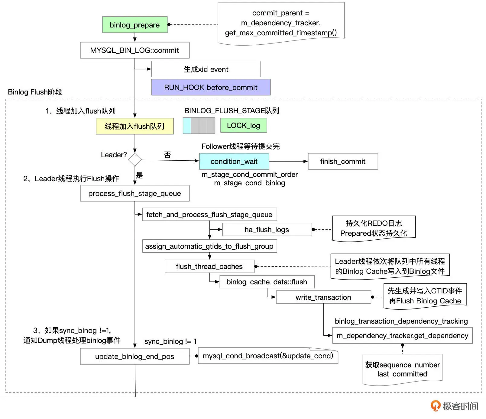
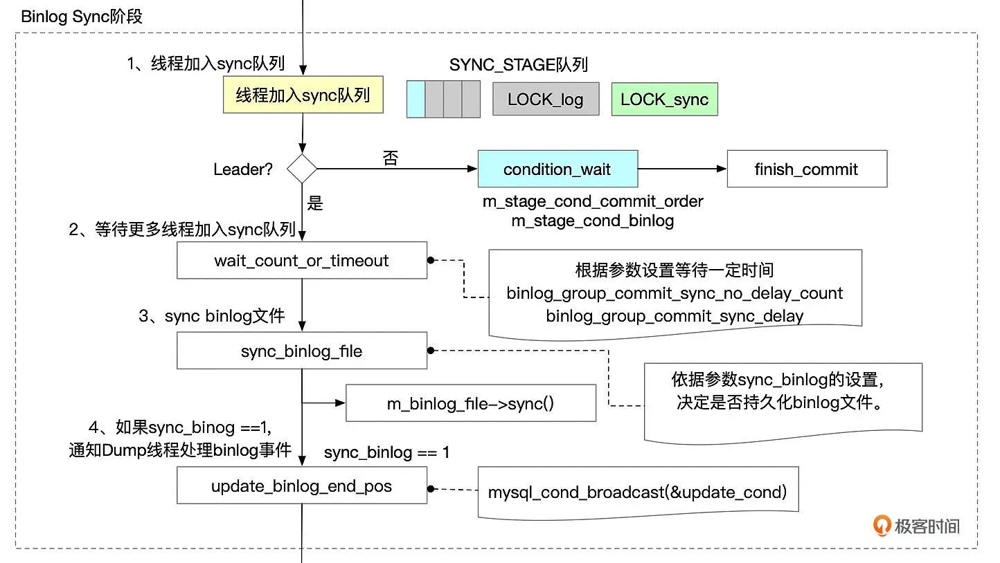
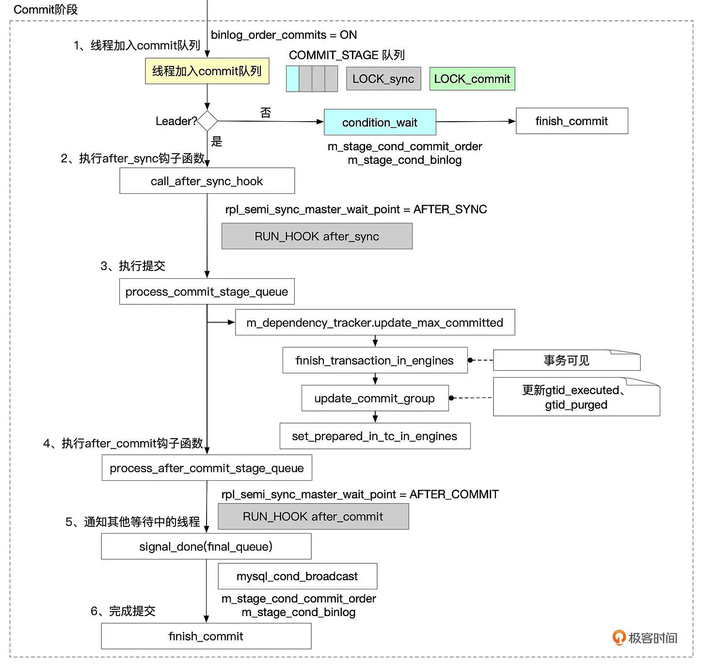
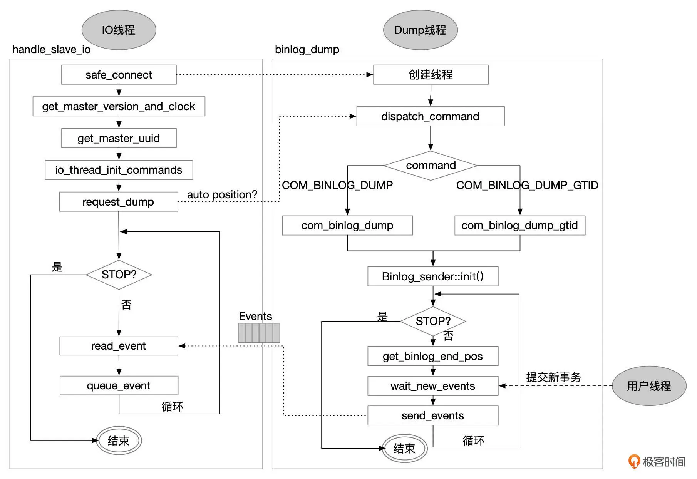
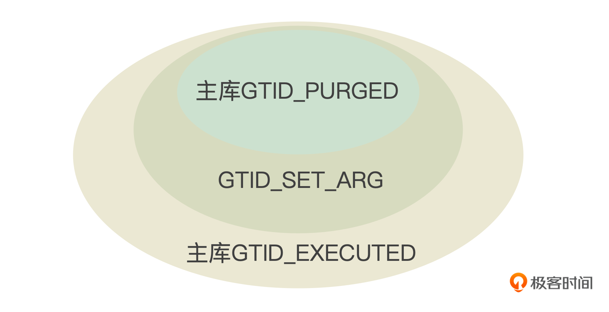
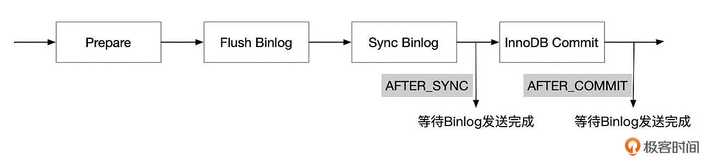

# 35 | MySQL半同步能提高主备数据的一致性吗？

你好，我是俊达。

上一讲中，我留了一个问题，就是在默认的情况下，MySQL 的数据复制是异步的，当主库意外崩溃后，备库是否有可能比主库多执行一些事务？

回答这个问题，需要对主库事务提交的过程，以及数据复制的细节有更深入的了解。这一讲我们就来看一看事务的提交过程，分析 Binlog 是什么时候发送给备库的，还有 Semi-Sync 插件在中间起到的作用。这里我假定只使用了 InnoDB 存储引擎，开启了 GTID，并且使用了ROW 格式 Binlog，这也是推荐的使用方式。

## MySQL 数据复制回顾

下面这张数据复制的架构图，你应该在上一讲中就看到过了。



我们回顾一下。

1. 用户线程在执行事务的过程中不断产生 Binlog 事件。Binlog 事件的内容和事务中执行的语句相关，同时也受参数 binlog_format 影响。产生的 Binlog 事件会先缓存到 Binlog Cache中。每一个用户线程都有各自独立的 Binlog Cache。

2. 提交事务时，用户线程将 Binlog Cache 中的数据写入到 Binlog 文件。一个事务会产生多个Binlog 事件，这些事件在 Binlog 文件中是连续存放的。一个线程在往 Binlog 文件中写入数据时，其他线程要等待之前的线程写完数据，才能写入 Binlog 文件。

3. 用户线程将 Binlog 事件写入到文件或将 Binlog 文件同步到磁盘后，通知 Dump 线程有新的binlog 事件产生，通知的具体时机跟参数 sync_binlog 的设置有关系。

4. 对每一个备库上的 IO 线程，主库上都会创建一个 Dump 线程。Dump 线程负责将已提交事务的 Binlog 事件发送给 IO 线程。

5. IO 线程接收到 Binlog 事件后，将事件写入 RelayLog 文件。

6. SQL 线程从 RelayLog 文件中解析出 Binlog 事件，并进行应用。启用了多线程复制时，SQL 线程也称为协调线程。备库上参数 replica_parallel_workers 设置为大于 1 的值，就能开启多线程复制。参数 replica_parallel_type 用来控制并行复制的方式，建议设置为LOGICAL_CLOCK。

7. 如果启用了多线程复制，SQL 线程会将 Binlog 事件分发给各个 Worker 线程。

8. SQL 线程或 Worker 线程执行 Binlog 事件。

如果主库完成了事务提交，但是 Dump 线程由于各种原因没有及时将 Binlog 发送出去（可能是主备之间的网络有抖动），这个时候如果主库崩溃了，切换到了备库，备库就比主库少执行了一些事务。

如果主库提交事务时，Binlog 在完成持久化之前（可能是 IO hang），Dump 线程已经将Binlog 发送给了备库，这个时候如果主库崩溃了，切换到了备库，备库就会比主库多执行一些事务。

这两种情况是不是有可能发生呢？我们先来看一下主库上事务提交的过程。

## 主库事务提交过程

### Binlog Cache

用户线程执行过程中生成的 Binlog 事件会先缓存到 Binlog Cache。Binlog Cache 内部分配了一块内存空间，大小由参数 binlog_cache_size 控制。Binlog 事件先写入到内存空间中，如果事务生成的 Binlog 超过了 binlog_cache_size，就会将数据写到临时文件中。临时文件的大小由参数 max_binlog_cache_size 控制。如果事务生成的 Binlog 超过了参数max_binlog_cache_size 的限制，事务会失败。



### 二阶段提交

如果使用 InnoDB 存储引擎，并且开启了 Binlog，为了保障 InnoDB 和 Binlog 中数据的一致性，MySQL 会使用两阶段提交协议来提交事务。



如上图所示，MySQL 事务的提交分为 Prepare 和 Commit 两个阶段。在 Prepare 阶段，依次进行 Binlog Prepare 和 InnoDB Prepare，只有当 Binlog 和 InnoDB 都 Prepare 成功后，事务才能进行后续的提交步骤。

1. Binlog Prepare：Binlog Prepare 时会计算事务的 commit_parent。使用多线程复制时，会根据事务的 commit_parent 来判断该事务是否可以并行执行。

2. InnoDB Prepare：31 讲中说过，InnoDB 会给每个事务分配 Undo 段。InnoDB Prepare时，需要将 Undo 段的状态设置为 TRX_UNDO_PREPARED，并且在 Undo 段中记录事务的 XID。MySQL 中每个事务都有各自的 XID，在一个实例的生命周期中（也就是实例没有重启），XID 是唯一的。

InnoDB Prepare 完成后，需要刷新 REDO 日志，这样才能保证 TRX_UNDO_PREPARED 状态不会丢失。如果数据库在事务完成 Prepare 后崩溃了，那么在下次启动时，会读取到状态为TRX_UNDO_PREPARED 的事务，但是由于事务的 Binlog 还没来得及持久化，因此也无法在Binlog 中找到这些事务的 XID 事件，MySQL 会回滚这些事务。

Prepare 成功后，进入到 Commit 阶段。在 Commit 阶段依次执行下面这几个步骤。

1. 生成 XID 事件，并将 XID 写入到 Binlog Cache 中。

2. Flush Binlog：将 Binlog Cache 中的数据写入到 Binlog 文件中。如果开启了 GTID，这时会先生成 GTID 事件，并将 GTID 事件先写入到 Binlog 文件。如果参数 sync_binlog 没有设置为 1，执行完 Binlog Flush 后，通知 Dump 线程读取 Binlog。

3. 持久化 Binlog。这一步是否真正进行 Binlog 持久化还依赖参数 sync_binlog 的设置。如果sync_binlog 设置为 1，则在这一步将 binlog 持久化到磁盘中，并通知 Dump 线程读取Binlog。Binlog 持久化之后，事务事实上就已经完成提交了，只不过这时其他会话暂时还无法读取到当前事务所做的修改。如果这一步完成后 MySQL 服务器崩溃了，在实例重启时，会在 Undo 段中读取到状态为 TRX_UNDO_PREPARED 的事务。因为 Binlog 已经完成了持久化，所以会在 Binlog 中读取到事务的 XID 事件，因此会将事务状态设置为已经提交。

4. InnoDB Commit：在 InnoDB 存储引擎层执行 Commit 操作，包括释放 Undo 段，将事务从活动事务列表中移除，持久化 Redo 日志等。这一步完成后，实例中的其他会话就能读取到当前事务所做的修改了。

所以，如果参数 sync_binlog 没有设置为 1 时，理论上存在备库比主库执行更多事务的可能性。

### 组提交

接下来我们来看一下组提交。MySQL 使用了组提交（Group Commit）技术来提交事务。并发提交事务的会话会先进入到一个队列，最先进入队列的线程称为 Leader，负责提交操作，其它线程等待 Leader 线程完成提交操作。提交的过程分为 Flush Binlog、Sync Binlog、Commit三个阶段，每个阶段都有相应的队列。

### Binlog Flush 阶段

线程完成 Prepare 后，调用 MYSQL_BIN_LOG::commit 函数，开始进行提交阶段的工作。

下面图中，框框里是 MySQL 源码中的函数名，你可以到源码中查看具体的代码实现。



Binlog Flush 的执行过程大致如下：

1. 提交事务的线程进入 Flush 队列。第一个进入队列的线程成为 Leader 往下执行。其他线程成为 follower，等待 Leader 提交完成后再进行后续处理。

2. Leader 线程执行 Flush 操作，主要包括下面这些操作。

- 将队列中的线程提取出来，同时清空队列，以便后续提交事务的线程可以加入队列。

- 持久化 REDO 日志。REDO 日志持久化之后，即使实例发生崩溃重启，事务的 Prepared状态也不会丢失。Leader 线程持久化 REDO 日志时，其他线程的 REDO 日志也自动完成了持久化。

- 依次将队列中所有线程的 Binlog Cache 都刷到 Binlog 文件中。

- 如果开启了 GTID_MODE，则给事务分配一个 GTID。

- 给事务分配 last_committed、sequence_number，生成 GTID 事件，并将 GTID 事件写入到 binlog 文件中。注意这里 GTID 事件需要直接写入 Binlog 文件，而不是加入 BinlogCache，因为 GTID 事件要放在事务的其他事件之前。last_committed 值的计算方式跟参数 binlog_transaction_dependency_tracking 的设置相关。

- 将 binlog cache 中的事件写入到 binlog 文件中。这里只是将事件写到 Binlog 文件，还没有进行 fsync 操作。

3. 如果 sync_binlog != 1，唤醒 Dump 线程发送 binlog。

### Binlog Sync 阶段

Binlog Flush 阶段的 Leader 线程完成 Binlog Flush 后，进入到 Binlog Sync 阶段。



Binlog Sync 阶段依次执行下面这些步骤。

1. 线程先加入 sync 队列。第一个加入队列的成为 leader，执行 sync 操作。其他线程成为follower，等待 leader 线程完成提交操作后再执行。

2. 如果设置了参数 binlog_group_commit_sync_delay 和binlog_group_commit_sync_no_delay_count，等待一定的时间，让更多的线程加入到group 中。

3. 根据 sync_binlog 设置来决定是否将 binlog 刷新到磁盘。如果 sync_binlog 设置为 1，则每次提交时都需要将 binlog 文件刷新（fsync）到磁盘。如果 sync_binlog 为 0，就不刷新binlog 文件。如果 sync_binlog 的设置值 N 大于 1，那么就每 N 次执行一次刷新。Binlog文件刷新到磁盘后，事务实际上就已经完成了持久化，但是事务的修改对其它会话暂时还不可见。如果此时数据库发生崩溃重启，从 UNDO 段中可以获取到处于 Prepared 状态的事务。因为事务的 XID 事件已经持久化到了 Binlog 文件中，MySQL 会将事务状态设置为已经提交。

4. 如果 sync_binlog 为 1，唤醒 dump 线程发送 binlog

### Commit 阶段

Binlog Sync 阶段的 Leader 线程完成相关处理后，进入到 Commit 阶段。



1. 如果参数 binlog_order_commits 设置为 ON，则 sync 阶段的 leader 线程加入 commit 队列。第一个加入队列的线程成为 leader，进行后续的提交操作。其他线程作为 follower，等待 leader 完成提交后再继续处理。如果 binlog_order_commits 设置为 OFF，则线程不需要进入 commit 队列，在调用 after_sync 钩子函数后，然后直接进入到第 5 步唤醒其它等待提交的事务，由各个事务各自完成提交动作。

2. 如果启用了 semi-sync，并且 rpl_semi_sync_master_wait_point 设置为 after_sync，则在这里等待 binlog 同步到备库。

3. 依次执行以下几个步骤。

- 更新 max_committed 变量。下一个 group 进行提交的时候，会根据变量 max_committed的值来设置 last_committed 值。

- 在 InnoDB 存储引擎内提交事务。InnoDB 引擎内部的提交需要进行一系列操作。包括：

- 设置事务回滚段的状态。

- 如果开启了 GTID_MODE，在回滚段中记录事务的 GTID。

- 将事务从活动事务列表中移除。这一步完成之后，其它会话就能看到这个事务修改的数据了。

- 更新 gtid 相关变量：gtid_executed、gtid_purged，更新 gtid_executed 表。

4. 如果启用了 semi-sync，并且 rpl_semi_sync_master_wait_point 设置为 after_commit，则在这里等待 binlog 同步到备库。

5. 唤醒其他等待提交的线程（signal_done）。

6. 执行 finish_commit，完成 commit。

## Binlog 同步

最后，我们来看一下 Binlog 是怎么从主库同步到备库的。同步操作由主库的 Dump 线程和备库的 IO 线程一起配合完成。



### IO 线程

备库上使用 START SLAVE 或 START REPLICA 命令启动复制。当参数 skip_slave_start、skip_replica_start 为 OFF 时，实例启动时也会自动启动复制。

1. IO 线程基于 master_info 中的信息，和主库建立连接。如果建立连接失败，还会进行重连。master_info 以文件或表的形式存储。我建议你把参数 master_info_repository 设置为TABLE，将 master_info 存储在表中。

2. 和主库建立连接后，获取主库的一些基础信息，包括下面这些信息。

- 主库的 UUID；

- 主库的 server id、GTID_MODE；

- 获取主库的当前时间，计算主库和备库之间的时间差 clock_diff_with_master，在计算备库延迟时需要用到这个信息。

3. 发送 Dump Binlog 命令。

- 如果启用了 GTID 并且使用了 GTID AUTO Position，就发送 COM_BINLOG_DUMP_GTID命令，命令的参数中包括备库的 GTID_EXECUTED。

- 如果没有使用 AUTO Position，就发送 COM_BINLOG_DUMP 命令，命令参数中包括需要读取的 Binlog 文件名和位点。

4. 接收主库 Dump 线程发送过来的 Binlog 事件。

5. 将 Binlog 事件保存到 RelayLog 文件中，并更新相关 binlog 位点信息，根据参数设置持久化 relaylog 文件和 master info。

- 更新备库读取 Binlog 的位点信息（Show slave status 输出中的 Master_Log_File 和Read_Master_Log_Pos）。如果开启 GTID，还要更新 Retrieved_Gtid_Set。

- 根据参数 sync_relay_log 的设置决定是否持久化 Relay Log 文件。

- 根据参数 sync_master_info 的设置决定是否持久化 master info。

### DUMP 线程

IO 线程启动时，会跟主库建立连接，主库上会启动一个 Dump 线程。Dump 线程主要执行下面这几个步骤。

1. 处理备库上 IO 线程发送过来的读取 Binlog 的命令。如果备库启用了 AUTO_POSITION，则命令中还包括了备库的 GTID_EXECUTED 信息。如果没有使用 AUTO_POSITION，则命令中包括了 Binlog 的起始文件名和位点。

2. 初始化 Binlog 读取工作。如果备库使用了 AUTO_POSITION，则 Dump 线程需要根据发送过来的 GTID_SET_ARG 信息来计算 Binlog 的起始文件名和位点。这里可能会遇到几种情况。

- 如果主库没有开启 GTID，就直接返回错误消息：The replication sender thread cannotstart in AUTO_POSITION mode。

- 如果备库发送过来的 GTID_SET_ARG 中包含主库上不存在的 GTID（相对于主库的UUID），就返回错误消息：Got fatal error 1236 from master when reading data frombinary log: 'Slave has more GTIDs than the master has, using the master’sSERVER_UUID.

- 如果主库的 GTID_PURGED 不是备库发送过来的 GTID_SET_ARG 的子集，就说明备库上需要的一些事务已经被清理了，报错：Got fatal error 1236 from master when reading datafrom binary log: 'Cannot replicate because the master purged required binary logs.Replicate the missing transactions from elsewhere, or provision a new slave from backup.

一般在正常情况下，备库发送过来的 GTID_SET_ARG 应该是主库 GTID_EXECUTED 的子集，而主库的 GTID_PURGED 应该是 GTID_SET_ARG 的子集。



如果满足了上面这几个条件，Dump 线程开始扫描 Binlog，定位从哪个 BINLOG 开始复制数据。

- 根据 Binlog Index 文件中的 binlog 列表逆序扫描。

- 打开 Binlog 文件，读取 Binlog 头部的 Previous GTIDs 事件。如果 Previous GTIDs 是GTID_SEG_ARG 的子集，就从当前 Binlog 开始复制数据。否则，继续读取上一个 Binlog文件。

3. 发送 Binlog。如果没有使用 AUTO_POSITION，那么 Dump Binlog 命令的参数中就包含了起始 Binlog 的文件和位点。如果使用 AUTO_POSITION，那么前面的步骤已经定位到了起始 Binlog，这时从 Binlog 文件的头部开始读取数据。Dump 线程依次读取 Binlog 文件中的事件，发送给备库。如果使用了 AUTO_POSITION，会在发送前先检查事件的 GTID 是不是包含在 GTID_SET_ARG 中，如果 GTID_SET_ARG 中已经有这个 GTID 了，就跳过这个事件。

当所有 Binlog 内容都已经发送给备库后，Dump 线程开始等待新的 Binlog 事件生成。用户线程提交新的事务时，会通知 Dump 线程进行处理。

### 半同步（Semi Sync）

默认情况下，MySQL 主备库之间的数据是异步进行的。主库提交事务时，并不需要等待Binlog 复制到备库。这样做的好处是减少了备库对主库性能的影响，坏处是主库如果异常崩溃，可能最新的 Binlog 还没有同步到备库，如果业务切换到备库，就有可能出现数据丢失。半同步插件（semi-sync）能在一定程度上减少这种情况的出现。

### 开启半同步

开启半同步需要在主库和备库安装插件，并设置相关参数。

主库上安装 rpl_semi_sync_source 插件。

```
INSTALL PLUGIN rpl_semi_sync_source SONAME 'semisync_source.so';
```

备库上安装 rpl_semi_sync_replica 插件。

```
INSTALL PLUGIN rpl_semi_sync_replica SONAME 'semisync_replica.so';
```

主库上设置参数。

```
set global rpl_semi_sync_source_enabled=ON;
```

备库上设置参数。

```
set global rpl_semi_sync_replica_enabled=ON;
```

开启半同步后，主库上事务提交时，会等待 Binog 发送完成。如果由于各种原因，备库没有接收到 Binlog，主库会一直等待，状态是“Waiting for semi-sync ACK from replica”，直到超时。超时时间通过参数 rpl_semi_sync_source_timeout 设置。

```sql
mysql> show processlist \G
*************************** 2. row ***************************
    Id: 11
  User: root
  Host: localhost:54932
    db: db01
Command: Query
  Time: 10
 State: Waiting for semi-sync ACK from replica
  Info: insert into ta values(1100)
```

超时后，半同步会退化成异步复制。可以查看参数 Rpl_semi_sync_source_status，判断半同步有没有生效。

```
mysql> show global status like '%semi%status%';
+-----------------------------+-------+
| Variable_name               | Value |
+-----------------------------+-------+
| Rpl_semi_sync_source_status | ON    |
+-----------------------------+-------+
```

如果你使用了半同步，建议把 Rpl_semi_sync_source_status 和半同步的等待耗时监控起来。错误日志中也有半同步状态变化的信息，也可以监控起来。

```
[Warning] [MY-011153] [Repl] Timeout waiting for reply of binlog (file: mysql-bin
[Note] [MY-011155] [Repl] Semi-sync replication switched OFF.
[Note] [MY-011156] [Repl] Semi-sync replication switched ON at (mysql-binlog.0000
```

### AFTER_SYNC 和 AFTER_COMMIT

半同步是在事务提交的哪个阶段等待 Binlog 发送呢？这和参数rpl_semi_sync_master_wait_point 的设置有关。



rpl_semi_sync_master_wait_point 可以设置为 AFTER_SYNC 或 AFTER_COMMIT。

- AFTER_SYNC

在 AFTER_SYNC 的设置下，事务的 Binlog Sync 到磁盘之后，等待 Binlog 发送给备库。Binlog Sync 之后，事务对其他线程还不可见。如果这个时候主库异常崩溃了，业务切换到备库。由于 Binlog 还没有同步到备库，所以备库上也看不到事务所做的修改。从业务的角度看，主备库数据是一致的。

但是原来的主库重新启动时，由于事务的 Binlog 已经完成了持久化，MySQL 会将事务设置为已提交状态。因此相比于备库，主库多执行了一些事务。因此主库启动后，需要将这些事务的修改撤销后才能和新主库保持数据一致。

- AFTER_COMMIT

在 AFTER_COMMIT 的设置下，主库在完成 InnoDB Commit 之后，等待 Binlog 同步到备库。此时，主库上其他会话已经能看到事务所做的修改了。如果这个时候主库发生异常崩溃，业务切换到备库。由于 Binlog 还没有同步到备库，因此备库上看不到事务所做的修改。从业务上看，备库比主库少执行了一些事务。

半同步不能保证主备数据之间完全同步，因为半同步可能会退化成异步复制。半同步在没有退化的状态下，可以提升主备数据的一致性。如果使用半同步，一般会给主库添加多个备库，只要有一个备库接收到 Binlog，主库事务就可以完成提交，减少由于单个备库的问题导致主库性能下降。

## 总结

好了，这一讲中，我们分析了 MySQL 事务的二阶段提交。使用默认的异步复制，在极端情况下，主备数据可能会出现不一致。sync_binlog 设置为 1 时，可以保障主库的数据一致性。

半同步可以部分提升主备之间的数据一致性，开启半同步会有一些性能开销，使用半同步需要做好监控。

## 思考题

主备库数据的一致性非常重要。如果数据不一致了，会带来很多问题，备库的复制可能会中断，业务切换到备库后，会取到错误的数据，影响业务。而且一般我们会在备库上备份，避免备份时影响主库性能，但如果备库的数据有问题，那么我们的备份也都是有问题的。

那么怎么检查主备库之间的数据是不是一致的呢？

期待你的思考，欢迎在留言区中与我交流。如果今天的课程让你有所收获，也欢迎转发给有需要的朋友。我们下节课再见。
