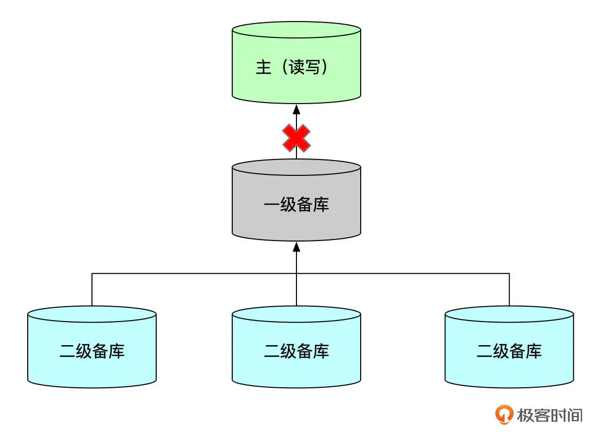
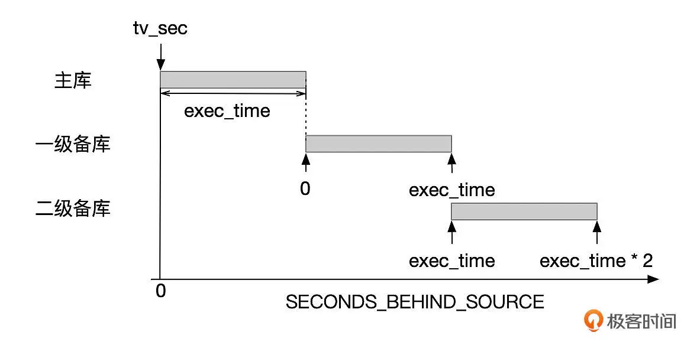
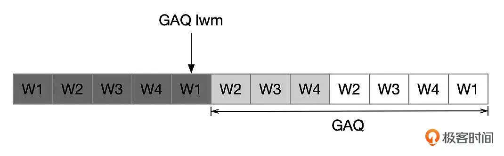
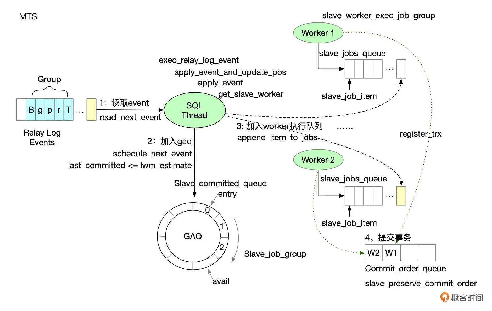
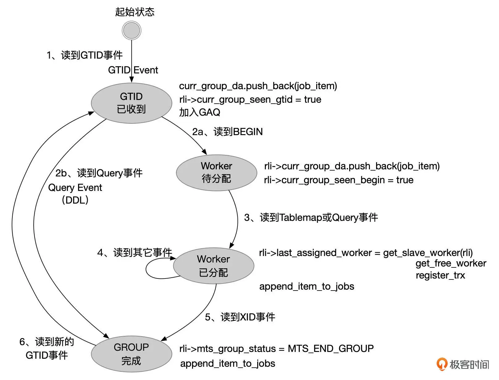
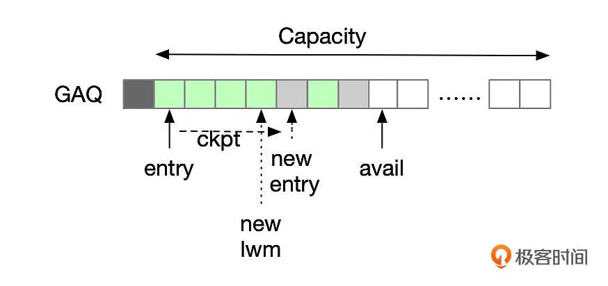
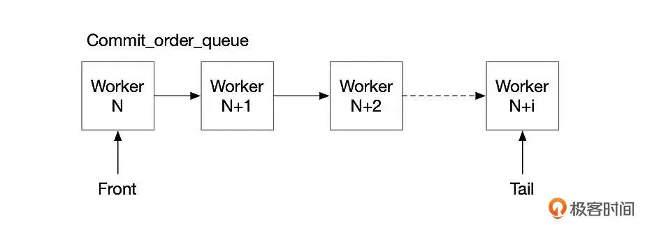

# 36 | 备库有延迟怎么办？

你好，我是俊达。

在 MySQL 高可用架构中，备库延迟一直很重要。备库延迟会带来各种问题。在读写分离架构下，如果备库有延迟，读备库时就可能会读到陈旧的数据，影响业务。当主库发生故障，需要切换到备库时，如果备库有延迟，就需要先等备库执行完积压的 Binlog，这会影响业务的可用性。

MySQL 中 Binlog 复制和 Binlog 应用是分开的。使用半同步，或者使用 MGR 架构，也只是保证主库事务提交时，Binlog 同步到了备库。备库上，SQL 线程应用 Binlog 事件后，数据才真正能被访问到。

很多不同的原因会引起备库延迟，这一讲我们就来聊一聊备库延迟的一些原因，以及一些解决方法。

## 认识备库延迟

### 怎么查看备库延迟？

怎么判断备库有延迟，最简单的方法就是看 show replica status 中的Seconds_Behind_Source。如果 Seconds_Behind_Source 大于 0，说明有延迟。但有时候，Seconds_Behind_Source 并不一定可靠。

- 如果 IO 线程或 SQL 线程中断了，Seconds_Behind_Source 显示为 NULL。

- 级联复制架构下，一级备库上可能复制有延迟或中断了，但是二级备库上，Seconds_Behind_Source 可能还是正常的。



- 到备库，但 Seconds_Behind_Source 显示为 0。

- 如果主备库之间的网络有瓶颈，Binlog 没有及时同步到备库，此时Seconds_Behind_Source 可能为 0，但是主备之间存在延迟。

虽然 Seconds_Behind_Source 存在一些局限性，毕竟这是 MySQL 自带的一个指标，我们有必要了解下它是怎么得到的。

Seconds_Behind_Source 在执行 show replica status 命令时计算，下面是核心的计算公式。

```
time_diff = time() - mi->rli->last_master_timestamp - mi->clock_diff_with_master
```

- time() 取备库的当前时间。

- clock_diff_with_master 是备库和主库的时间差，在备库启动复制时计算。

- last_master_timestamp 是备库当前处理的 Binlog 事件中的信息，通过下面这个公式计算得到。

```
last_master_timestamp = ev->common_header->when.tv_sec + ev->exec_time
```

- tv_sec：主库上事件生成的时间。

- exec_time：主库上执行的时间。不过对于 ROW 格式的 Binlog，这里 exec_time 通常是0，不能反映事务实际的执行时间。

先来看一个 DDL 语句的 Binlog，SQL 执行了 3 分 12 秒多，exec_time 是 193。

```sql
#241022 11:29:02 server id 119  end_log_pos 919 CRC32 0x94a7dbc0   Query  thread_
SET TIMESTAMP=1729567742/*!*/;
/*!80013 SET @@session.sql_require_primary_key=0*//*!*/;
alter table employees add xx int, algorithm=copy
/*!*/;
```

备库上执行这个事件时，last_master_timestamp 设置为 tv_sec + exec_time。备库执行这个DDL 的过程中，如果查看延迟，会看到延迟从 0 增长的 exec_time（假设备库执行速度和主库一样），然后变为 0。如果有二级备库，那么二级备库的延迟从 exec_time 开始，一直增长到 2 倍的 exec_time，然后变成 0。

你可以参考下面这张图。



对于 ROW 模式的 DML 语句，情况就不一样了。我们来看一个 Binlog，事务从 11:17:39 开始，11:23:10 提交，中间经过了 5 分多钟。但是 exec_time 为 0。因此备库上刚开始执行这个 Binlog 时，延迟就是 5 分多钟。

```
#241022 11:17:39 server id 234  end_log_pos 12641940 CRC32 0x463fb265   Query  th
SET TIMESTAMP=1729567059/*!*/;
BEGIN
#241022 11:17:39 server id 234  end_log_pos 12642034 CRC32 0xced9fe46   Update_ro
#241022 11:23:07 server id 234  end_log_pos 12642128 CRC32 0x6a5c159f   Update_ro
#241022 11:23:10 server id 234  end_log_pos 12642159 CRC32 0x61a7e401   Xid = 880
COMMIT/*!*/;
```

前面讨论的备库延迟的计算方式，实际上只是单线程复制时采用的逻辑。对于多线程复制，计算方式又有点不一样了。你可以试一下，启用多线程复制时，执行一个耗时比较长的 DDL 语句，应该能发现，备库刚开始执行 DDL 时，延迟就是 exec_time，然后一直增长到 2 倍的exec_time，然后再变成 0。

使用多线程复制时，协调线程（SQL 线程）使用 GAQ 队列来管理 Binlog 事件的分发，跟踪事务执行进度。last_master_timestamp 计算也跟 GAP 队列有关。下面这张图中，每一个框对应一个事务，灰色框中的事务已经提交，白色框中的事务还在执行中。GAQ lwm 指向一个已经提交的事务。MySQL 会定期执行 mta checkpoint，将 GAQ 中已经完成的任务移出队列，更新 last_master_timestamp 的值。



### 怎么判断备库已经执行完所有 binlog？

使用 Seconds_Behind_Source 指标来判断备库延迟，有时并不是非常可靠。如果要做一个主备切换，怎么判断备库已经把从主库同步过来的 Binlog 都执行完了呢？一个更可靠的方法，是先查看主库 Binlog 的位点，然后检查备库上的 Relay_Source_Log_File，Exec_Source_Log_Pos 是否到达主库的位点。如果开启了 GTID，就检查主备库上的 GTID集合是否一致。

MySQL 提供了几个函数，用来判断备库执行进度。函数 SOURCE_POS_WAIT 用来等待备库执行到主库的某个位点。函数 WAIT_FOR_EXECUTED_GTID_SET 用来等待给定的 gtid 集合中的事务都执行完成。

先查看主库的位点。

```
mysql> show master status\G
*************************** 1. row ***************************
            File: mysql-binlog.000001
        Position: 703
    Binlog_Do_DB:
Binlog_Ignore_DB:
Executed_Gtid_Set: b094c003-8cfa-11ef-bf79-fab81f64ee00:1-2
```

备库上调用函数 SOURCE_POS_WAIT，等待 binlog 事件应用完成，返回值大于等于 0 说明事件应用完成，返回值 -1 说明等待超时了。

```sql
mysql> select SOURCE_POS_WAIT('mysql-binlog.000001', 703);
+---------------------------------------------+
| SOURCE_POS_WAIT('mysql-binlog.000001', 703) |
+---------------------------------------------+
|                                           0 |
+---------------------------------------------+
```

如果开启了 GTID，可以使用 WAIT_FOR_EXECUTED_GTID_SET 等待事务应用完成。返回值为 0 说明事务都已经执行。返回值为 1 说明等待超时了。

```sql
mysql> select WAIT_FOR_EXECUTED_GTID_SET('b094c003-8cfa-11ef-bf79-fab81f64ee00:1-
+------------------------------------------------------------------------+
| WAIT_FOR_EXECUTED_GTID_SET('b094c003-8cfa-11ef-bf79-fab81f64ee00:1-5') |
+------------------------------------------------------------------------+
|                                                                      0 |
+------------------------------------------------------------------------+
1 row in set (23.47 sec)
```

这两个函数还可以加上一个超时的参数，控制等待的时间。

```sql
mysql>  select SOURCE_POS_WAIT('mysql-binlog.000001', 1600, 5);
+-------------------------------------------------+
| SOURCE_POS_WAIT('mysql-binlog.000001', 1600, 5) |
+-------------------------------------------------+
|                                              -1 |
+-------------------------------------------------+
1 row in set (5.00 sec)
mysql>  select WAIT_FOR_EXECUTED_GTID_SET('b094c003-8cfa-11ef-bf79-fab81f64ee00:1
+-----------------------------------------------------------------------------+
| WAIT_FOR_EXECUTED_GTID_SET('b094c003-8cfa-11ef-bf79-fab81f64ee00:1-100', 8) |
+-----------------------------------------------------------------------------+
|                                                                           1 |
+-----------------------------------------------------------------------------+
```

### 数据复制怎么监控？

平时怎么监控数据复制是否运行正常、是否有延迟呢？首先要监控 IO 线程、SQL 线程是否都在正常运行。

```
mysql> show replica status\G
*************************** 1. row ***************************
            Replica_IO_State: Waiting for source to send event
......
       Relay_Source_Log_File: mysql-binlog.000001
          Replica_IO_Running: Yes
         Replica_SQL_Running: Yes
......
       Seconds_Behind_Source: 0
......
             Relay_Log_Space: 99246711
```

备库的空间也要关注，有时候复制延迟可能会积压大量的 Relay Log，如果备库空间满了，复制也会出问题。

对于备库延迟，只依赖 Seconds_Behind_Source 有时候可能不够可靠，你可以使用类似 pt-heartbeat 的工具，在主库上定期更新一行心跳记录的时间戳，然后到备库上计算当前时间和心跳记录时间戳之间的差距。

这里我们演示下 pt-heartbeat 的基本用法。先把工具下载下来。

```bash
wget percona.com/get/pt-heartbeat
chmod +x pt-heartbeat
```

创建一个数据库用来存放心跳表。创建一个监控账号，需要 DML 权限和查看复制信息的权限。

```sql
create user 'monitor'@'%' identified by 'somepass';
create database monitor;
grant select,create,insert,update,delete on monitor.* to 'monitor'@'%';
grant replication client on *.* to 'monitor'@'%';
```

主库上使用 pt-heartbeat 定期更新心跳表，使用–update 参数。

```
$ pt-heartbeat u=monitor,p=somepass,h=127.0.0.1,P=3307,D=monitor --database monit
```

备库上使用 pt-heartbeat 检查延迟，使用–monitor 参数。master-server-id 参数指定主库的server-id。如果有延迟，可以在输出中看到。

```
pt-heartbeat u=monitor,p=somepass,h=127.0.0.1,P=3307,D=monitor --database monitor
0.00s [  0.00s,  0.00s,  0.00s ]
0.00s [  0.00s,  0.00s,  0.00s ]
1.00s [  0.02s,  0.00s,  0.00s ]
2.00s [  0.05s,  0.01s,  0.00s ]
3.00s [  0.10s,  0.02s,  0.01s ]
4.00s [
0.17s,
0.03s,
0.01s ]
```

### 备库延迟的一些原因

如果备库有延迟，怎么分析延迟的原因，并进行解决呢？这里我总结了一下比较常见的情况。

1. 主库执行了大事务或运行时间比较长的 DDL。

主库上，事务提交后，才会传到备库上。假设事务在主库上执行了 N 秒，那么备库刚接收到Binlog，开始执行时，延迟就是 N 秒了，如果备库上执行速度和主库一样，那么备库上延迟最高会达到 2N 秒。对于 DDL，如果使用单线程复制，备库上的延迟时间会从 0 秒开始，最高N 秒。如果使用了多线程复制，那么备库开始执行 DDL 时，延迟可能就已经是 N 秒了，最高会达到 2N 秒。

为了避免这类延迟问题，首先我们要尽量不用大事务。如果是 DDL 引起的延迟，可能要改变DDL 的执行方式，比如使用一些第三方的在线 DDL 工具来做表结构变更。

2. 表缺少主键和索引。

使用 ROW 格式的 Binlog 时，如果表上没有主键和唯一索引，并且表的数据量比较大，那么备库上执行 Binlog 时，需要进行全表扫描，就很容易引起延迟。虽然在参数slave_rows_search_algorithms 中增加 HASH_SCAN 能在一些情况下提升性能，但最根本的解决方法，还是给表添加主键。

如果是缺少主键引起的延迟，在监控系统或在 show engine innodb status 的输出中，经常能观察到一些现象。下面这个例子中的 inserts/s、updates/s、deletes/s 和 reads/s 指标，每秒读取的记录数很高，修改的记录数却很低。你可以看一下。

```
mysql> show engine innodb status\G
--------------
ROW OPERATIONS
--------------
0 queries inside InnoDB, 0 queries in queue
0 read views open inside InnoDB
Process ID=1240, Main thread ID=139629400499968 , state=sleeping
Number of rows inserted 34184665, updated 72258, deleted 0, read 51112044
0.00 inserts/s, 145.62 updates/s, 0.00 deletes/s, 1074316.89 reads/s
Number of system rows inserted 8662, updated 60525, deleted 8182, read 76426
0.00 inserts/s, 0.00 updates/s, 0.00 deletes/s, 0.00 reads/s
```

3. 备库上数据库或表被锁定了。

备库中其他会话获取了表或记录锁，或者获取了全局锁，也会导致复制延迟。如果是锁引起的延迟，就需要找到锁的源头，并进行相应的处理。我们可以到 processlist 中，查看 SQL 线程或 worker 线程的状态。下面这个例子中，状态分别是等待全局锁和元数据锁。在备库上执行备份的时候，可能会获取全局锁。

```
*************************** 7. row ***************************
    Id: 239
  User: system user
  Host:
    db: NULL
Command: Connect
  Time: 26
 State: Waiting for global read lock
  Info: NULL
  *************************** 6. row ***************************
    Id: 239
  User: system user
  Host:
    db: NULL
Command: Query
  Time: 4
 State: Waiting for table metadata lock
  Info: NULL
```

下面这个例子中，从状态中看不出问题。

```
*************************** 7. row ***************************
    Id: 239
  User: system user
  Host:
    db: db01
Command: Query
  Time: 150
 State: Applying batch of row changes (write)
  Info: NULL
```

但是从 innodb status 中，可以看到事务在等待行锁。

```
---TRANSACTION 129890, ACTIVE 48 sec inserting
mysql tables in use 1, locked 1
LOCK WAIT 2 lock struct(s), heap size 1128, 1 row lock(s)
MySQL thread id 239, OS thread handle 139629391050496, query id 111062 Applying b
------- TRX HAS BEEN WAITING 48 SEC FOR THIS LOCK TO BE GRANTED:
RECORD LOCKS space id 2 page no 4 n bits 104 index PRIMARY of table `db01`.`ta` t
Record lock, heap no 33 PHYSICAL RECORD: n_fields 3; compact format; info bits 0
0: len 4; hex 8000c583; asc     ;;
1: len 6; hex 00000001ccec; asc       ;;
2: len 7; hex 82000000fc0110; asc        ;;
```

如果 SQL 线程或 worker 线程应用 binlog 时，锁超时了，错误日志中会有一些信息，也可以监控起来。

```
2024-10-23T08:34:44.198466Z 239 [Warning] [MY-010584] [Repl] Replica SQL for chan
```

4. 主库写入并发高，备库跟不上主库。

还有一种情况，是主库上写入的并发太高了，备库跟不上主库的执行速度。原先使用单线程复制时，这个问题尤其突出。使用多线程复制后，备库的延迟能得到很大程度的缓解。除了使用多线程复制，有时也会采取一些临时措施来提升备库的性能，比如备库上innodb_flush_log_at_trx_commit 和 sync_binlog 不设置为双 1。如果使用了半同步，那么备库上不要开启 rpl_semi_sync_source_enabled。

## 使用多线程复制（MTA）

如果是由于主库并发写入高引起的延迟，我们可以尝试使用多线程复制。实际上，8.0 中默认就开启了多线程复制。

### 多线程复制配置

在备库上将参数 replica_parallel_workers 设置为大于 1 的值，就可以开启多线程复制。参数replica_parallel_type 指定多线程复制的方式，这个参数可以设置为 LOGICAL_CLOCK 或DATABASE。

- LOGICAL_CLOCK：按事务在主库上的提交顺序进行并发执行。主库上同一个 GroupCommit 组里提交的事务，在备库上可以并行执行。在主库上将参数binlog_transaction_dependency_tracking 设置为 WRITESET，可以提高备库执行的并行度。

- DATABASE：主库上不同库里执行的事务可以在备库上并行执行。

LOGICAL_CLOCK 并行复制适用性更广，所以我们后续不讨论 DATABASE 的并行复制方式。

设置这些参数后，会在重新启动复制后生效。参数 replica_preserve_commit_order 设置为ON 时，备库事务的提交顺序会和主库保持一致。

### 备库如何并行执行 BINLOG？

Binlog 中的事务，一个挨着一个，顺序传输到备库、记录到 RelayLog 中。协调线程，以相同的顺序从 RelayLog 中解析出 Binlog，这些 Binlog 是怎么并行应用的呢？Binlog 中的多个事务，什么情况下才并行应用呢？

这主要是根据 Binlog 中 GTID 事件中的 last_committed 和 sequence_number 来确定。

```
mysqlbinlog -v mysql-binlog.000002  | grep -i gtid | egrep -v 'Prev|SET'  | awk '
#241024 10:08:13 last_committed=2261 sequence_number=2262 rbr_only=yes
#241024 10:08:35 last_committed=2262 sequence_number=2263 rbr_only=yes
#241024 10:09:10 last_committed=2263 sequence_number=2264 rbr_only=yes
#241024 14:14:51 last_committed=2264 sequence_number=2265 rbr_only=no
#241024 14:14:58 last_committed=2265 sequence_number=2266 rbr_only=yes
#241024 14:15:00 last_committed=2265 sequence_number=2267 rbr_only=yes
#241024 14:15:02 last_committed=2265 sequence_number=2268 rbr_only=yes
# mysqlbinlog -v mysql-binlog.000002  | grep -i gtid | egrep -v 'Prev|SET'  | awk
#241024 14:17:46 last_committed=0 sequence_number=1 rbr_only=yes
#241024 14:17:48 last_committed=1 sequence_number=2 rbr_only=yes
#241024 14:17:50 last_committed=1 sequence_number=3 rbr_only=yes
#241024 14:17:57 last_committed=1 sequence_number=4 rbr_only=yes
```

sequence_number 按事务写入 binlog 的顺序依次分配，可以看作是事务的编号。last_committed 按一定的规则生成，代表了一个已经提交的事务的编号。备库能并行执行事务的主要依据，就是系统中已经提交的事务编号，不小于 GTID 事件中的 last_committed 属性。比如上面 mysql-binlog.000002 中的事务，sequence_number=1 的事务提交后，sequence_number 为 2、3、4 的这 3 个事务可以并行执行。

### last_committed 是怎么生成的？

last_committed 的生成，和主库上参数 binlog_transaction_dependency_tracking 的设置有关。这个参数可以设置成 COMMIT_ORDER、WRITESET、WRITESET_SESSION。

上一讲中，我们说过，MySQL 使用了组提交技术。一组事务提交时，last_committed 默认设置为上一组已经提交的事务的最大的序列号 binlog_transaction_dependency_tracking 设置为WRITESET 后，MySQL 还会检查事务修改的数据，是否和之前提交的事务有冲突，如果数据没有冲突，last_committed 可以设置为更早的事务的序列号。

在 MySQL8.4 中，已经去掉了 binlog_transaction_dependency_tracking，默认就使用WRITESET 的方式。

### 多线程复制运行细节

最后我们来看一下多线程复制的一些运行细节。



### 事件分发

协调线程（SQL Thread）负责解析 relay log，将事件分发给 worker 线程执行。分发时，同一个事务的 binlog 要全部分发给同一个 worker 线程。

一个完整的事务由几种不同类型的 Binlog 事件组成，这些事件也称为一个组。事务中 Binlog类型可分为几大类。

- 事务开始，一般为 GTID 事件、Begin 事件。在图中标记为 B。

- 分区事件，如 Table_map 事件、Query_log_event 事件，包含数据库名。如果并行类型为DATABASE，需要根据库名来决定将事件分发给哪个工作线程。在图中的标记为 g。

- 内部事件，如设置用户会话变量的事件、RAND 事件等。在图中的标记为 p。

- 常规事件，包括 ROW 模式下的 Delete、Update、Write rows 事件。在图中的标记为 r。

- 事务结束，包括 XID 事件。在图中的标记为 T。

SQL 线程依次解析 Relay Log 中的 Binlog 事件，根据事件的类型分别处理。



1. GTID 事件

如果读取到 GTID 或匿名的 GTID 事件，就说明有一个新的事务要处理。根据事件中的last_comitted 信息判断当前是否可以开始执行这个事务。如果事件的 last_comitted 值不超过备库中已提交事务的低水位序列号（last_comitted <= lwm_estimate），说明可以执行这个事务。否则需要等待依赖的事务完成提交，此时可以从 Processlist 中看到 SQL 线程的状态为Waiting for dependent transaction to commit。

如果当前事务已经可以执行，SQL 线程将当前事务加入到 GAQ（Group Assigned Queue）队列中。读取到 GTID 事件后，worker 线程还没有分配。GTID 事件会先放在一个临时的队列中（rli->curr_group_da）。

2a. BEGIN 事件

一般在事务开始时，都会有一个 BEGIN 事件（事件类型为 QUERY_EVENT，内容为BEGIN）。读取到 BEGIN 事件后，也不分配 worker 线程。BEGIN 事件会先放在临时队列 rli->curr_group_da 中。

2b. DDL 事件

如果紧接着 GTID 事件后的第一个事件不是 BEGIN 事件，而是一个普通的QUERY_EVENT，就说明这个事件单独组成一个事务。DDL 语句就是这样的情况。读取到DDL 事件后，分配一个 worker 线程，并将 DDL 事件加入到 worker 线程的队列中。当然在将DDL 事件加入队列前，需要先将存放在临时队列（rli->curr_group_da）中的 GTID 事件加入worker 线程的队列。

3. Table_Map 或 Query_EVENT

一般的事务，BEGIN 事件之后是 Table_MAP 事件（binlog_format 为 ROW）或Query_Event（binlog_format 为 STATEMENT）。读取到这些事件后，分配 worker 线程，并将事件加入到 Worker 线程的队列中。当然，需要先将临时队列（rli->curr_group_da）中的GTID 事件和 BEGIN 事件加入 worker 线程的队列。

4. 其它事件

一个事务中可能包含多个 Insert、Update、Delete 事件或 Query 事件。SQL 线程依次读取这些事件，并将事件加入到 worker 线程的队列中。每个 worker 线程的队列容量有限制，如过队列中的事件总大小超过了 slave_pending_jobs_size_max 的设置，或者加入的事件是大事件，那么 SQL 线程需要等待 Worker 线程执行掉队列中的一些事件。此时可以从 Processlist 中看到 SQL 线程的状态为 Waiting for Replica Workers to free pending events。

如果 worker 队列中任务的数量超过了限制（worker 队列长度限制为 16384），也需要进行等待，此时 SQL 线程的状态为 Waiting for Replica Worker queue。

5. XID 事件

XID 事件是事务的最后一个事件，读取到 XID 事件后，说明当前事务的事件已经全部都读取完了。将 XID 事件加入 worker 线程的队列中，设置标志（rli->mts_group_status =MTS_END_GROUP），准备处理下一个事务。

### GAQ 队列

GAQ 队列是一个环形的队列，队列中的每一项都和 Binlog 中的一个事务相对应。GAQ 队列的最大长度由参数 slave_checkpoint_group 指定。

GAQ 队列中的任务可能存在几种状态：

- Worker 线程未分配。任务刚加入 GAQ 时，还没有分配 worker 线程。

- 未完成。任务处于未提交状态，worker 线程还在执行对应的事务。

- 已完成。worker 线程提交事务后，将 GAQ 中对应任务的状态设置为已经完成。

GAQ 队列头部已经完成的任务，由 SQL 线程定期执行的 GAQ Checkpoint 回收。



上面这张图中，entry 指向 GAQ 的起始处，avail 指向 GAQ 的尾部，新的任务会加入到 avail所指的位置。GAQ 中可以容纳的任务数由参数 slave_checkpoint_group 控制。当 GAQ 队列头部的任务完成后，GAQ Checkpoint 操作会将这些任务占用的位置释放出来。checkpoint 操作由 SQL 线程定期执行，执行频率跟参数 slave_checkpoint_period 和slave_checkpoint_group 的设置有关。

当离上一次 checkpoint 的时间超过了 slave_checkpoint_period，或者离上一次 checkpoint后，新处理的事务数超过了 slave_checkpoint_group 的设置，就要进行 checkpoint 操作。

### 分配 worker 线程

首次给事务分配 worker 线程时，先判断当前是否有空闲的线程。空闲线程是指 worker 线程的队列是空的，当前没有执行事务。如果有空闲线程，则直接分配。如果所有 worker 线程都繁忙，则 SQL 线程需要等待 worker 线程执行完队列中的事件。此时 SQL 线程的状态为 Waitingfor replica workers to process their queues。

如果参数 slave_preserve_commit_order 设置为 ON，还要将分配的 worker 线程加入到一个队列中。这是为了保证备库上事务提交的顺序和主库保持一致。

事务分配到 worker 线程后，同一个事务中后续的事件会分发给同一个 worker 线程执行。

### worker 线程

worker 线程从队列中依次读取事件，根据事件的类型分别处理，处理完一个事件后，将事件从队列中移走。当队列中没有事件时，worker 线程处于等待状态，processlist 中线程状态为Waiting for an event from Coordinator。

执行 XID 事件时，要更新 slave_worker_info 表，将 worker info 位图中当前事务对应的 bit 置为 1，然后再提交事务。更新 slave_worker_info 表的事务和主事务实际上是同一个事务，因此事务提交后，slave_worker_info 表的更新也同时生效。XID 事件执行完成后，worker 线程将 GAQ 队列中对应的任务状态设置为已完成。

### 关于参数 slave_preserve_commit_order

启用多线程复制时，多个 worker 线程并行执行 Binlog 中的事务，这些事务的提交顺序，可能和主库的提交顺序不一致。比如 Binlog 中有事务 T1、T2，在主库上 T1 比 T2 先完成提交，但是在备库上，事务 T2 有可能比 T1 先完成提交。对于业务来说，主备库提交顺序不一致有可能会有一些影响。备库上将参 slave_preserve_commit_order 设置为 ON 后，可以保证事务在备库的提交顺序和主库保持一致。



开启 slave_preserve_commit_order 后，SQL 线程在给事务分配 worker 线程时，会将 worker线程加入到 Commit_order_queue 队列中。因为 SQL 线程按 Binlog 中事件的顺序依次进行处理，因此 worker 线程加入 Commit_order_queue 的顺序和主库事务提交的顺序一致。worker线程提交事务时，只有排在队列最前面时才能提交事务，否则就要等排在前面的事务先提交。第一个线程完成提交后，退出队列，通知下一个线程进行提交操作。

## 总结

使用 MySQL 的数据复制功能时，要监控好备库的状态和延迟情况。很多原因都会导致备库延迟，这一讲中提供了一些基本的方法。有一些延迟问题是可以避免的。如果是因为主库写入并发高引起的延迟，使用多线程复制能在一定程度上降低延迟。主库上参数binlog_transaction_dependency_tracking 设置为 WRITESET，能提升事务在备库的可并行度。如果你使用了级联复制架构，中间层的实例上，也要将binlog_transaction_dependency_tracking 设置为 WRITESET。

## 思考题

备库在运行过程中，会实时更新一些位点信息，包括主库 Binlog 的读取位点、SQL 线程解析Relaylog 的位点，以及 worker 线程执行事务的情况。如果备库异常崩溃，下次启动时，还能恢复这些位点信息吗？有没有可能出现位点信息没有及时更新的情况？如果这些位点有一些延迟，对备库复制会有影响吗？

期待你的思考，欢迎在留言区中与我交流。如果今天的课程让你有所收获，也欢迎转发给有需要的朋友。我们下节课再见！
