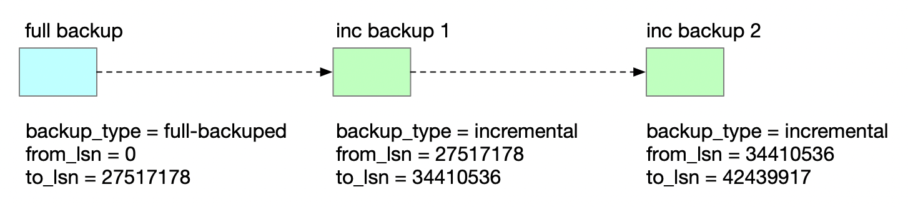
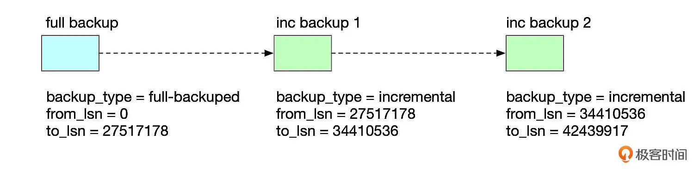
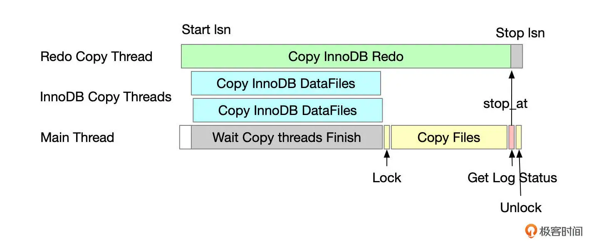

# 38 | 为什么有了备库还要做备份？兼谈Xtrabackup的使用

你好，我是俊达。

前面几讲，我花了比较多的篇幅介绍 MySQL 的数据复制。假设你的数据库都已经做了备库，有了完善的监控，为什么还要做数据库备份呢？

很重要的一个原因，是备库通常都和主库保持同步，如果在主库上执行了一个误操作，或者由于程序的 Bug 或外部攻击，导致数据被误删除或误更新了，这些操作很快会复制到备库，导致主库和备库的数据都有问题。如果没有备份，数据就有可能很难找回来。

从实现方式上看，备份可以分为逻辑备份和物理备份。第 9 讲、第 10 讲中我们介绍过一些 MySQL 逻辑备份的工具。当数据库特别大的时候，使用逻辑备份恢复数据，效率可能会比较低。在实践中，我们经常会使用物理备份工具，直接备份数据库的物理文件。物理备份在备份和恢复性能上有很大的优势。

所以这一讲中我会给你介绍怎么使用 MySQL 中最流行的一个开源的物理备份工具——xtrabackup，来备份和恢复数据库。

## 使用 xtrabackup

### 安装 xtrabackup

到 percona 官网下载合适的版本。Xtrabackup 分为几个大的版本，使用 Xtrabackup 2.4 备份 MySQL 5.7，使用 Xtrabackup 8.0 备份 MySQL 8.0，使用 Xtrabackup 8.4 备份 MySQL8.4。这一讲中，我们使用 8.0 版本。

下载二进制包。

```bash
wget https://downloads.percona.com/downloads/Percona-XtraBackup-8.0/Percona-XtraB
```

解压到 /opt 目录下，创建软链接。

```bash
tar zxvf percona-xtrabackup-8.0.35-31-Linux-x86_64.glibc2.17.tar.gz -C /opt
ln -s percona-xtrabackup-8.0.35-31-Linux-x86_64.glibc2.17 /opt/xtrabackup8.0
```

Xtrabackup 支持全量备份和增量备份，先来看全量备份。

### 本地全量备份

先看一下怎么将整个数据库备份到本地的一个备份目录中。

执行下面这个命令，将数据库备份到本地的 /data/backup/backup_3306 目录中。

```bash
cd /opt/xtrabackup8.0
./bin/xtrabackup \
 --backup \
 --slave-info  \
 -u root -H 127.0.0.1 \
 -P3306 \
 -pabc123 \
 --target-dir /data/backup/backup_3306 \
  2>/tmp/xtrabackup.log
```

备份时需要指定一些参数。

- –backup：发起备份操作；

- -u, -H, -P, -p：连接 mysql 实例，用户名、主机 IP、端口、密码；

- –slave-info：记录 slave 复制位点信息；

- –target-dir：备份文件的存放路径；

- 2>/tmp/xtrabackup.log：将备份过程中的日志重定向到 /tmp/xtrabackup.log 文件中

备份过程中的日志信息会输出到标准错误中，一般会重定向到一个文件中。

我们来看一下 xtrabackup 备份出来的文件。

```
tree /data/backup/backup_3306/ -L 1
/data/backup/backup_3306/
├── backup-my.cnf
├── db_1
├── db_2
├── employees
├── ib_buffer_pool
├── ibdata1
├── mysql
├── mysql-binlog.000003
├── mysql-binlog.index
├── mysql.ibd
├── performance_schema
...
├── sys
├── test
├── undo_001
├── undo_002
├── undo_x001.ibu
├── xtrabackup_binlog_info
├── xtrabackup_checkpoints
├── xtrabackup_info
├── xtrabackup_logfile
├── xtrabackup_slave_info
└── xtrabackup_tablespaces
```

- xtrabackup_logfile：xtrabackup 会将备份过程中生成的 InnoDB Redo 日志复制一份到这个文件，恢复数据库时需要用到。

- xtrabackup_binlog_info：binlog 位点信息和 GTID 信息。备份恢复出来后，需要从这里的binlog 位点开始增量数据的恢复。

- xtrabackup_slave_info：备份实例的 slave 位点信息。

- xtrabackup_checkpoints：备份的一些内部信息。

- backup_type：full-backuped

- from_lsn：0 表示全量备份。非 0 表示增量备份起始日志序列号。

- to_lsn：备份结束时的 checkpoint lsn。也是下一个增量备份的开始 lsn。如果数据块的lsn 小于 to_lsn，则增量备份不需要备份这些数据块。

- last_lsn：apply log 时需要应用到的最大日志序列号。超过 last_lsn 的日志不需要应用到数据文件中。

- flushed_lsn：备份结束时，实例的 checkpoint lsn。

- xtrabackup_info：备份元数据。

- 数据库

- binlog

备份结束后，一定要检查一下日志文件，最后一行输出“completed OK!”时，才表示备份成功了。从日志文件中，也能看到 xtrabackup 的备份过程，如果备份失败了，要根据日志文件中的信息来定位问题。

```
2023-06-21T10:29:36.685670+08:00 0 [Note] [MY-011825] [Xtrabackup] Connecting to
2023-06-21T10:29:36.714220+08:00 0 [Note] [MY-011825] [Xtrabackup] Using server v
2023-06-21T10:29:36.719676+08:00 0 [Note] [MY-011825] [Xtrabackup] Executing LOCK
2023-06-21T10:29:36.721377+08:00 0 [Note] [MY-011825] [Xtrabackup] uses posix_fad
2023-06-21T10:29:36.721453+08:00 0 [Note] [MY-011825] [Xtrabackup] cd to /data/my
2023-06-21T10:29:36.721478+08:00 0 [Note] [MY-011825] [Xtrabackup] open files lim
2023-06-21T10:29:37.086200+08:00 0 [Note] [MY-011825] [Xtrabackup] Starting to pa
2023-06-21T10:29:43.354808+08:00 0 [Note] [MY-011825] [Xtrabackup] Starting to ba
2023-06-21T10:29:44.757598+08:00 0 [Note] [MY-011825] [Xtrabackup] Finished backi
2023-06-21T10:29:44.757659+08:00 0 [Note] [MY-011825] [Xtrabackup] Executing FLUS
2023-06-21T10:29:44.789922+08:00 0 [Note] [MY-011825] [Xtrabackup] Selecting LSN
2023-06-21T10:29:44.796572+08:00 0 [Note] [MY-011825] [Xtrabackup] Copying /data/
2023-06-21T10:29:44.796664+08:00 0 [Note] [MY-011825] [Xtrabackup] Done: Copying
2023-06-21T10:29:44.806407+08:00 0 [Note] [MY-011825] [Xtrabackup] Writing /data/
2023-06-21T10:29:44.806515+08:00 0 [Note] [MY-011825] [Xtrabackup] Done: Writing
2023-06-21T10:29:44.811951+08:00 0 [Note] [MY-011825] [Xtrabackup] Writing /data/
2023-06-21T10:29:44.812042+08:00 0 [Note] [MY-011825] [Xtrabackup] Done: Writing
2023-06-21T10:29:44.819173+08:00 0 [Note] [MY-011825] [Xtrabackup] Writing /data/
2023-06-21T10:29:44.819251+08:00 0 [Note] [MY-011825] [Xtrabackup] Done: Writing
2023-06-21T10:29:44.823595+08:00 0 [Note] [MY-011825] [Xtrabackup] Executing FLUS
2023-06-21T10:29:44.861004+08:00 0 [Note] [MY-011825] [Xtrabackup] The latest che
2023-06-21T10:29:44.861053+08:00 0 [Note] [MY-011825] [Xtrabackup] Stopping log c
2023-06-21T10:29:44.862265+08:00 1 [Note] [MY-011825] [Xtrabackup] >> log scanned
2023-06-21T10:29:45.885625+08:00 0 [Note] [MY-011825] [Xtrabackup] Executing UNLO
2023-06-21T10:29:45.885916+08:00 0 [Note] [MY-011825] [Xtrabackup] All tables unl
2023-06-21T10:29:45.897933+08:00 0 [Note] [MY-011825] [Xtrabackup] MySQL binlog p
-11ed-8541-fab81f64ee00:1-27'
2023-06-21T10:29:45.897948+08:00 0 [Note] [MY-011825] [Xtrabackup] MySQL slave bi
e00:1-27', channel name: ''
2023-06-21T10:29:45.898110+08:00 0 [Note] [MY-011825] [Xtrabackup] Writing /data/
2023-06-21T10:29:45.898177+08:00 0 [Note] [MY-011825] [Xtrabackup] Done: Writing
2023-06-21T10:29:45.906019+08:00 0 [Note] [MY-011825] [Xtrabackup] Writing /data/
2023-06-21T10:29:45.906100+08:00 0 [Note] [MY-011825] [Xtrabackup] Done: Writing
2023-06-21T10:29:46.919361+08:00 0 [Note] [MY-011825] [Xtrabackup] Transaction lo
2023-06-21T10:29:47.182490+08:00 0 [Note] [MY-011825] [Xtrabackup] completed OK!
```

### 备份到远程主机

前面这个例子中，数据库备份到了本地目录。一般由于本地空间的限制，以及出于容错的要求，我们还要将备份文件传到远程的存储空间中。Xtrabackup 支持流式备份，可以将数据库直接备份到远程主机，备份过程中文件不落到本地磁盘。

下面这个例子中，通过 ssh 协议，将数据库备份到了远程的一个主机上。

```
./bin/xtrabackup --backup \
   --slave-info  \
   -u root \
   -H 127.0.0.1 \
   -P3306 \
   -pabc123 \
   --stream=xbstream \
   --target-dir /data/backup/backup_3306 \
2>/data/backup/xtrabackup.log \
| ssh root@172.16.121.236 "cat -  > /data/backup/backup.s1"
```

- –stream=xbstream 参数，备份数据输出到标准输出

- 通过管道，将备份数据保存到远程主机。

### 压缩备份文件

出于存储空间的考虑，有时候我们会压缩备份文件。可以在备份服务器上进行压缩，也可以在远程服务器上进行压缩。

下面这个例子中，使用 gzip 压缩备份文件。

```
./bin/xtrabackup --backup --slave-info  -u root -H 127.0.0.1 -P3380 \
 -pabc123 --stream=xbstream --target-dir /data/backup/ \
2>/data/backup/xtrabackup.log \
| gzip - > /data/backup/backup1.gz
```

还可以在远程的服务器上压缩备份文件。

```
./bin/xtrabackup --backup --slave-info  -u root -H 127.0.0.1 -P3306 \
 -pabc123 --stream=xbstream --target-dir /data/backup/ \
2>/data/backup/xtrabackup.log \
| ssh root@172.16.121.236 "gzip - > /data/backup/backup1.gz"
```

压缩可以减少存储空间，但是可能会增加备份和恢复的时间。对于大数据库，你可能需要根据具体的情况，选择一个合适的压缩工具。常用的工具有 gzip，也可以使用 pigz。pigz 支持并行压缩和并行解压缩，可以加快压缩和解压的速度。

### 库备份到 OSS

OSS（对象存储）也适合用来存储备份文件。我们可以先在本地备份，然后再把备份文件上传到 OSS。也可以直接将数据库备份到 OSS。这里我来介绍将数据库直接备份到 OSS 的一种方法。

1. 准备 OSS。

我们使用 ossutil 工具上传备份文件。先下载 ossutil 工具。

```bash
wget -O ossutil-v1.7.16-linux-amd64.zip "https://gosspublic.alicdn.com/ossutil/1.
unzip ossutil-v1.7.16-linux-amd64.zip
cp ossutil-v1.7.16-linux-amd64/ossutil64 /usr/local/bin/
chmod +x /usr/local/bin/ossutil64
```

准备好 oss 配置文件。运行 ossutil64 config，按提示输入 endpoint、ak、sk 信息。

```
ossutil64 config
```

配置文件如下：

```
# cat ~/.ossutilconfig
[Credentials]
language=EN
endpoint=oss-cn-hangzhou.aliyuncs.com
accessKeyID=XXXX
accessKeySecret=XXXX
```

检查配置是否正确。

```
ossutil64 ls oss://ycdbbackup
ossutil64 cp localfile oss://ycdbbackup
```

2. 创建一个命名管道。

```
# mkfifo /data/backup/backup0625.xbstream
# ls -l /data/backup/backup0625.xbstream
prw-r--r-- 1 root root 0 6月  25 14:33 /data/backup/backup0625.xbstream
```

3. 执行备份命令。将备份的输出重定向到步骤 2 创建的命名管道。

```
./bin/xtrabackup --backup --slave-info  -u root -H 127.0.0.1 -P3306 -pabc123 \
 --stream=xbstream --target-dir /data/backup/ 2>/data/backup/xtrabackup.log \
 > /data/backup/backup0625.xbstream
```

4. 使用 ossutil 工具将备份文件上传到 OSS。

```
# ossutil64 cp /data/backup/backup0625.xbstream  oss://ycdbbackup
Succeed: Total num: 1, size: 0. OK num: 1(upload 1 files).
average speed 1081000(byte/s)
189.095486(s) elapsed
```

5. 将备份日志信息也上传到 OSS。我建议你将 xtrabackup 备份的日志信息也上传到 OSS。

```
ossutil64 cp /data/backup/xtrabackup.log oss://ycdbbackup
Succeed: Total num: 1, size: 56,397. OK num: 1(upload 1 files).
```

6. 删除命名管道

```
rm /data/backup/backup0625.xbstream
```

### 增量备份

如果你的数据库特别大，每天做全量备份开销太大，也可以考虑隔天做增量备份。Xtrabackup支持增量备份。在做增量备份之前，要先做一个全量备份。xtrabackup 会基于 innodb 页面头部的 lsn 号来判断是否需要备份一个页面。如果页面的 lsn 号大于上次备份的 lsn 号，就要备份这个页面。

下面介绍 Xtrabackup 增量备份的基本步骤。例子中，我们先做一个全量备份，然后再做了 2个增量备份。



1. 先进行一次全量备份。

```
./bin/xtrabackup --backup --slave-info  -u root -H 127.0.0.1 -P3380 \
 -pabc123 --stream=xbstream --target-dir /data/backup/full \
--extra-lsndir=/data/backup/full \
2>/data/backup/full/backup_full.log | gzip -  > /data/backup/full/backup_full.gz
```

备份命令加上了–extra-lsndir 选项，将 xtrabackup_checkpoints 单独输出到一个文件。增量备份时会读取 xtrabackup_checkpoints 中上次备份的 lsn 号。

看一下备份出来的文件。

```
# ls -l /data/backup/full
总用量 2996
-rw-r--r-- 1 root root 3014835 6月  25 16:35 backup_full.gz
-rw-r--r-- 1 root root   40313 6月  25 16:35 backup_full.log
-rw-r--r-- 1 root root     134 6月  25 16:35 xtrabackup_checkpoints
-rw-r--r-- 1 root root     673 6月  25 16:35 xtrabackup_info
```

2. 发起增量备份

```bash
mkdir /data/backup/inc1
./bin/xtrabackup --backup \
   --slave-info \
   -u root \
   -H 127.0.0.1 \
   -P3306 \
   -pabc123 \
   --stream=xbstream \
   --target-dir /data/backup/inc1 \
   --extra-lsndir=/data/backup/inc1 \
   --incremental-basedir=/data/backup/full \
   2>/data/backup/inc1/backup_inc1.log | gzip -  > /data/backup/inc1/backup_inc1
```

参数中要加上 incremental-basedir，指定全量备份或上一次增量备份生成的xtrabackup_checkpoints 文件所在的目录。

增量备份也可以在上一次增量备份的基础上进行。

```bash
mkdir /data/backup/inc2
./bin/xtrabackup --backup \
   --slave-info  \
   -u root \
   -H 127.0.0.1 \
   -P3306 \
   -pabc123 \
   --stream=xbstream \
   --target-dir /data/backup/inc2 \
   --extra-lsndir=/data/backup/inc2 \
   --incremental-basedir=/data/backup/inc1 \
   2>/data/backup/inc2/backup_inc2.log | gzip -  > /data/backup/inc2/backup_inc2
```

## 数据库恢复

备份的目的，是为了恢复，接下来看一下 Xtrabackup 备份出来的数据库怎么恢复。

### 恢复全量备份

先看一下全量备份怎么恢复，主要包括解压文件、Prepare 备份文件、复制数据文件、启动数据库这几个步骤。

### 解压文件

如果备份时使用了 xbstream，需要先解压备份文件。我们在备份时用了–stream=xbstream 和gzip 压缩，先使用 gunzip 解压缩，再用 xbstream 将文件提取出来。

```
# gunzip backup_full.gz
# xbstream -x -v < backup_full
ibdata1
sys/sys_config.ibd
demo/tb.ibd
demo/taa.ibd
......
```

xbstream 使用参数 -x 提取文件，加上参数 -v 后，会输出解压的文件列表。

### Prepare 备份文件

解压完成后，要使用 xtrabackup --prepare 命令，将 xtrabackup_logfile 应用到备份的数据文件中，将数据库恢复到备份结束时的状态。xtrabackup --prepare 命令会根据xtrabackup_checkpoints 文件中记录的 last_lsn 来确定需要应用哪些日志。

```
#  cat xtrabackup_checkpoints
backup_type = full-backuped
from_lsn = 0
to_lsn = 27517178
last_lsn = 30394287
flushed_lsn = 30328603
redo_memory = 0
redo_frames = 0
```

执行 prepare 命令。

```
xtrabackup --prepare --target-dir . > prepare.log 2>&1
```

命令执行完成后，查看日志信息，检查恢复是否成功。

```sql
2023-06-26T10:20:01.948054+08:00 0 [Note] [MY-011825] [Xtrabackup] recognized ser
2023-06-26T10:20:01.948397+08:00 0 [Note] [MY-011825] [Xtrabackup] recognized cli
2023-06-26T10:20:02.359130+08:00 0 [Note] [MY-013883] [InnoDB] The latest found c
2023-06-26T10:20:02.359262+08:00 0 [Note] [MY-012560] [InnoDB] The log sequence n
2023-06-26T10:20:02.359283+08:00 0 [Note] [MY-012551] [InnoDB] Database was not s
2023-06-26T10:20:02.359296+08:00 0 [Note] [MY-012552] [InnoDB] Starting crash rec
2023-06-26T10:20:02.367962+08:00 0 [Note] [MY-013086] [InnoDB] Starting to parse
2023-06-26T10:20:02.418985+08:00 0 [Note] [MY-012550] [InnoDB] Doing recovery: sc
2023-06-26T10:20:05.103532+08:00 0 [Note] [MY-013084] [InnoDB] Log background thr
2023-06-26T10:20:05.105082+08:00 0 [Note] [MY-013888] [InnoDB] Upgrading redo log
2023-06-26T10:20:05.105113+08:00 0 [Note] [MY-012968] [InnoDB] Starting to delete
2023-06-26T10:20:05.105284+08:00 0 [Note] [MY-011825] [InnoDB] Removing redo log
2023-06-26T10:20:05.207953+08:00 0 [Note] [MY-011825] [InnoDB] Creating redo log
2023-06-26T10:20:05.218735+08:00 0 [Note] [MY-011825] [InnoDB] Renaming redo log
2023-06-26T10:20:05.225168+08:00 0 [Note] [MY-012893] [InnoDB] New redo log files
2023-06-26T10:20:07.118724+08:00 0 [Note] [MY-011825] [Xtrabackup] completed OK
```

xtrabackup prepare 命令会启动一个临时的 mysql 实例，依赖 innodb 的恢复机制来应用 redo文件。xtrabackup 对恢复代码进行了一些改造，只应用序列号不大于 last_lsn 的 redo 日志，这一点可以从这一行日志中看出：“Doing recovery: scanned up to log sequence number30394287”。

恢复日志最后一行显示“completed OK”，表示 prepare 执行成功。如果最后一行日志不是“completed OK”，说明 prepare 执行过程中有问题，要根据输出的日志分析具体原因。prepare 完成后，xtraback_checkpoints 文件中 backup_type 变成了 full-prepared。

```
#  cat xtrabackup_checkpoints
backup_type = full-prepared
......
```

xtrabackup 启动的 mysql 临时实例 buffer pool 默认为 100M，可以通过参数–use-memory 适当增加内存，加快恢复的速度。官方文档建议将内存设置为 1-2G。

```
xtrabackup --prepare --use-memory=2G --target-dir . > prepare.log 2>&1
```

### 将数据文件复制到数据目录

xtrabackup prepare 完成后的数据库，可以用来直接启动。启动实例之前，要将文件复制（或移动）到目标实例的数据目录中。

这里我们将实例恢复到 /data/full_restore 路径下：

```bash
mkdir -p /data/full_restore/{data,binlog,relaylog,log,run,tmp}
```

配置文件如下：

```
## /data/full_restore/my.cnf
[mysqld]
datadir=/data/full_restore/data
log_bin=/data/full_restore/binlog/binlog
innodb_data_file_path=ibdata1:128M:autoextend
#innodb_data_home_dir=/data/mysql01/data
#innodb_log_group_home_dir=/data/mysql01/data
......
```

复制文件时，有几点需要注意。

- 数据库目录复制到目标实例 datadir。

- 如果设置了 innodb_data_home_dir，则需要将 ibdata 文件复制到对应目录。默认情况下innodb_data_home_dir 和 datadir 一样。

- 如果 log_bin 目录和 datadir 不一样，需要将 binlog 和 binlog.index 文件复制到 log_bin 指定的目录。binlog.index 中记录的 binlog 路径也要做相应的调整。

- innodb_data_file_path 参数需要和备份实例的设置保持一致。

使用下面这些命令，将数据文件、binlog 文件放到对应的目录下。

```bash
## 复制文件
cd /data/backup/full
cp -r * /data/full_restore/data
cp binlog.* /data/full_restore/binlog/
## 修改binlog.index
# cat /data/full_restore/binlog/binlog.index
/data/mysql8.0/binlog/binlog.000020
# sed -i -e 's/mysql8.0/full_restore/' /data/full_restore/binlog/binlog.index
```

### 启动实例

启动实例之前，需要先修改恢复出来的文件 owner。

```
chown -R mysql:mysql /data/full_restore/
```

然后再启动实例。

```
# mysqld_safe --defaults-file=/data/full_restore/my.cnf &
[1] 13010
# 2023-06-26T03:19:12.376984Z mysqld_safe error:
log-error set to '/data/full_restore/log/alert.log',
however file don't exists. Create writable for user 'mysql'.
```

如果 mysqld_safe 脚本启动时报日志文件不存在，先创建文件再启动。

```
touch /data/full_restore/log/alert.log
chown mysql:mysql /data/full_restore/log/alert.log
# mysqld_safe --defaults-file=/data/full_restore/my.cnf &
[1] 13404
2023-06-26T03:21:35.299596Z mysqld_safe Logging to '/data/full_restore/log/alert.
2023-06-26T03:21:35.340097Z mysqld_safe Starting mysqld daemon with databases fro
```

查看 mysql 的错误日志，检查实例是否启动成功。

```
[root@172-16-121-234 full]# tail  /data/full_restore/log/alert.log
2023-06-26T03:21:38.109286Z 0 [System] [MY-010229] [Server] Starting XA crash rec
2023-06-26T03:21:38.152446Z 0 [System] [MY-010232] [Server] XA crash recovery fin
2023-06-26T03:21:38.414645Z 0 [Warning] [MY-010068] [Server] CA certificate ca.pe
2023-06-26T03:21:38.414702Z 0 [System] [MY-013602] [Server] Channel mysql_main co
2023-06-26T03:21:38.491284Z 0 [ERROR] [MY-010544] [Repl] Failed to open the relay
2023-06-26T03:21:38.491320Z 0 [ERROR] [MY-011059] [Repl] Could not find target lo
2023-06-26T03:21:38.495637Z 0 [ERROR] [MY-010426] [Repl] Slave: Failed to initial
2023-06-26T03:21:38.495677Z 0 [ERROR] [MY-010529] [Repl] Failed to create or reco
2023-06-26T03:21:38.495730Z 0 [Warning] [MY-010530] [Repl] Detected misconfigurat
2023-06-26T03:21:38.499008Z 0 [System] [MY-010931] [Server] /opt/mysql/bin/mysqld
```

从日志中可以看到，实例已经启动，但是有一些复制相关的报错。这是由于 mysql 复制信息存储在表中（relay_log_info_repository=TABLE），恢复时将复制信息也恢复出来了。执行 resetslave all 清理掉就可以了。

### 开启复制

如果需要将恢复出来的实例作为备库，加入到原有的复制架构中，可以分为两种情况。


如上图所示，备份在实例备 1 上进行。可以将新恢复出来的实例作为备 1 的备库，也可以将新恢复出来的实例作为主库的备库。

新备库作为备 1 的备库时，需要根据 xtrabackup_binlog 中记录的位点开启复制。

```
# cat xtrabackup_binlog_info
binlog.000020  610  58224b02-09b7-11ee-90bd-fab81f64ee00:1-13191,7caa9a48-b325-11
```

新备库作为主的备库时，需要根据 xtrabackup_slave_info 中记录的位点开启复制。

```
# cat xtrabackup_slave_info
SET GLOBAL gtid_purged='58224b02-09b7-11ee-90bd-fab81f64ee00:1-13191,7caa9a48-b32
CHANGE MASTER TO MASTER_AUTO_POSITION=1;
```

当然，如果开启了 GTID 和 auto position，这两种情况区别不大，因为 gtid_executed 是一样的。

先执行 reset slave all，清空 slave 信息。

```
mysql -uroot -h127.0.0.1 -P6380 -pabc123
mysql> stop slave;
Query OK, 0 rows affected, 2 warnings (0.02 sec)
mysql> reset slave all;
Query OK, 0 rows affected, 1 warning (0.00 sec)
```

设置 GTID_PURGED。

```
mysql> SET GLOBAL gtid_purged='58224b02-09b7-11ee-90bd-fab81f64ee00:1-13191,7caa9
Query OK, 0 rows affected (0.03 sec)
```

开启复制。

```
mysql> change master to master_host='172.16.121.234',master_port=3380,master_user
Query OK, 0 rows affected, 7 warnings (0.07 sec)
mysql> start slave;
Query OK, 0 rows affected, 1 warning (0.03 sec)
mysql> show slave status\G
```

使用 8.0 版本时，默认使用 caching_sha2_password 插件认证账号，change master 时加上get_master_public_key=1，不然可能会遇到下面这个报错。

```
error connecting to master 'rep@172.16.121.234:3380' - retry-time: 60 retries: 1
```

### 恢复增量备份

恢复增量备份时，需要先对基础全量备份进行恢复，然后再依次按增量备份的时间进行恢复。



这个例子中，相关备份文件的目录结构如下：

```
/data/backup
├── full
│   ├── backup_full
│   ├── backup_full.log
│   ├── xtrabackup_checkpoints
│   └── xtrabackup_info
├── inc1
│   ├── backup_inc1.gz
│   ├── backup_inc1.log
│   ├── xtrabackup_checkpoints
│   └── xtrabackup_info
├── inc2
│   ├── backup_inc2.gz
│   ├── backup_inc2.log
│   ├── xtrabackup_checkpoints
│   └── xtrabackup_info
```

### 恢复全量备份

```bash
cd /data/backup/full
xbstream -x -v < backup_full
xtrabackup --prepare --apply-log-only --target-dir=. > prepare_full.log 2>&1
```

恢复全量备份时，需要加上 apply-log-only 参数。如果不加上 apply-log-only 参数，执行prepare 的最后阶段，会回滚未提交的事务，但是这些事务可能在下一次增量备份时已经提交了。

查看日志，确认这一步骤执行成功（最后一行日志显示“completed OK!”）。

```
# tail prepare_full.log
2023-06-26T13:50:28.924817+08:00 0 [Note] [MY-012980] [InnoDB] Shutdown completed
2023-06-26T13:50:28.927081+08:00 0 [Note] [MY-011825] [Xtrabackup] completed OK!
```

这一步执行完成后，xtrabackup_checkpoints 内容如下，backup_type 为 log-applied。

```
# cat xtrabackup_checkpoints
backup_type = log-applied
from_lsn = 0
to_lsn = 27517178
last_lsn = 30394287
flushed_lsn = 30328603
redo_memory = 0
redo_frames = 0
```

### 恢复第一个增量备份

```bash
cd /data/backup/inc1
gunzip backup_inc1.gz
## 需要先删除这两个文件，否则xbstream提取文件时有冲突
rm xtrabackup_checkpoints xtrabackup_info
## 提取文件
xbstream -x -v < backup_inc1
## 恢复增量备份时，切换到全量备份的目录执行
cd /data/backup/full
xtrabackup --prepare --apply-log-only --incremental-dir=/data/backup/inc1 --targe
```

恢复增量备份时，加上 apply-log-only 参数，参数–incremental-dir 设置为增量备份文件所在的目录。

检查执行日志，确认增量备份恢复执行成功（日志最后一行显示“completed OK!”）：

```
# tail prepare_inc1.log
......
2023-06-26T14:04:14.658596+08:00 0 [Note] [MY-011825] [Xtrabackup] Done: Copying
2023-06-26T14:04:14.663291+08:00 0 [Note] [MY-011825] [Xtrabackup] Copying /data/
2023-06-26T14:04:14.663414+08:00 0 [Note] [MY-011825] [Xtrabackup] Done: Copying
2023-06-26T14:04:14.667887+08:00 0 [Note] [MY-011825] [Xtrabackup] completed OK!
```

执行完这一步后，xtrabackup_checkpoints 内容如下：

```
# cat xtrabackup_checkpoints
backup_type = log-applied
from_lsn = 0
to_lsn = 34410536
last_lsn = 42425151
flushed_lsn = 42341369
redo_memory = 0
redo_frames = 0
```

### 恢复第二个增量备份

```bash
cd /data/backup/inc2
gunzip backup_inc2.gz
## 需要先删除这两个文件，否则xbstream提取文件时有冲突
rm xtrabackup_checkpoints xtrabackup_info
## 提取文件
xbstream -x -v < backup_inc2
## 恢复增量备份时，切换到全量备份的目录执行
cd /data/backup/full
xtrabackup --prepare --incremental-dir=/data/backup/inc2 --target-dir=. > prepare
```

恢复最后一个增量备份时，不需要再加上–apply-log-only。

查看日志文件，检查恢复是否成功。

```
# tail prepare_inc2.log
......
2023-06-26T14:11:46.742649+08:00 0 [Note] [MY-011825] [Xtrabackup] Copying /data/
2023-06-26T14:11:46.742714+08:00 0 [Note] [MY-011825] [Xtrabackup] Done: Copying
2023-06-26T14:11:46.748296+08:00 0 [Note] [MY-011825] [Xtrabackup] Copying /data/
2023-06-26T14:11:46.748363+08:00 0 [Note] [MY-011825] [Xtrabackup] Done: Copying
2023-06-26T14:11:46.753459+08:00 0 [Note] [MY-011825] [Xtrabackup] completed OK!
```

这一步执行完成后，xtrabackup_checkpoints 文件内容如下：

```
# cat xtrabackup_checkpoints
backup_type = full-prepared
from_lsn = 0
to_lsn = 42439917
last_lsn = 52717010
flushed_lsn = 52617342
redo_memory = 0
redo_frames = 0
```

backup_type 为 full-prepared，可以使用恢复出来的文件启动数据库。

到这一步之后，操作和恢复全量备份基本一样。

### 复制文件，启动数据库

将数据文件、Binlog 文件复制到相应的目录。

```bash
## 复制文件
cd /data/backup/full
cp -r * /data/full_restore/data
cp binlog.* /data/full_restore/binlog/
sed -i -e 's/mysql8.0/full_restore/' /data/full_restore/binlog/binlog.index
chown  -R mysql:mysql /data/full_restore
```

启动实例。

```
# mysqld_safe --defaults-file=/data/full_restore/my.cnf &
[1] 23586
2023-06-26T06:32:18.756919Z mysqld_safe Logging to '/data/full_restore/log/alert.
2023-06-26T06:32:18.799475Z mysqld_safe Starting mysqld daemon with databases fro
```

查看启动日志，检查实例是否启动成功。

```
[root@172-16-121-234 full]# tail -10 /data/full_restore/log/alert.log
......
2023-06-26T06:32:21.793703Z 0 [ERROR] [MY-010544] [Repl] Failed to open the relay
2023-06-26T06:32:21.793742Z 0 [ERROR] [MY-011059] [Repl] Could not find target lo
2023-06-26T06:32:21.797553Z 0 [ERROR] [MY-010426] [Repl] Slave: Failed to initial
2023-06-26T06:32:21.797596Z 0 [ERROR] [MY-010529] [Repl] Failed to create or reco
2023-06-26T06:32:21.797633Z 0 [Warning] [MY-010530] [Repl] Detected misconfigurat
2023-06-26T06:32:21.800913Z 0 [System] [MY-010931] [Server] /opt/mysql/bin/mysqld
```

## Xtrabackup 工作原理

Xtrabckup 通过直接读取数据库物理文件的方式来实现备份。我们将这种备份方式称为物理备份。xtrabackup 备份时，数据库可以正常访问，进行读写操作，我们称之为热备份或在线备份。由于备份过程中数据库文件可能会不断地发生变化，不同时刻读取到的数据块可能会存在不一致的情况。xtrabackup 会将备份期间生成 redo 日志备份到单独的文件，基于 innodbredo 机制，可以将所有数据块的状态恢复到一个一致的状态。


如上图所示，备份开始时，数据库处于状态 Vi，备份过程中，数据库的状态不断变化，备份完成时，数据库的状态为 Vn。

Xtrabackup 备份开始时，启动一个 Redo 复制线程，然后再启动一些线程，Copy InnoDB 数据文件。InnoDB 数据文件 Copy 完成后，获取全局锁（FLUSH TABLES WITH READLOCK），复制其他文件，如 MyISAM 表、系统数据库中的一些文件。最后获取 Binlog 位点，结束备份。



虽然 Xtrabackup 使用了热备份，但是备份的一些阶段中，也可能会获取一些锁。

存在以下情况会锁表。

1. 备份选项加上了 slave-info，但是备库没有开启 auto_position，而且备库不是 perconaserver。

2. 存在 myisam 引擎或 rocksdb 引擎的表，并且没有加 lock-ddl-per-table 选项(have_unsafe_ddl_tables)。

3. 如果实例支持 backup lock（如 percona server），会使用 lock tables for backup 代替 flushtables with read lock。

如果备份的数据库上有长时间运行的 SQL 或未提交的事务，无法获取到全局锁（flush tableswith read lock)，这种情况下，如果执行了 flush tables with read lock 命令，会导致整个实例无法写入，需要等长时间运行的 SQL 结束后才能恢复正常。为了避免出现这种情况，xtrabackup 提供了几个选项，你可以根据需要进行选择。

- –ftwrl-wait-timeout：等待 SQL 执行完成，或放弃备份。

- –kill-long-queries-timeout：kill 长时间运行的 SQL。

## 总结

备份对于数据库非常重要。这一讲我们介绍了 xtrabackup 的一些使用场景，包括全量备份、增量备份，以及数据库的恢复。比备份工具更重要的，是根据业务的数据恢复需求，设计一个合理的备份策略，包括备份的周期、备份的方式（全量备份还是增量备份）、备份文件的保存策略。

你还要定期进行数据库恢复演练，验证整个备份机制的有效性。大部分时候，我们只是定时备份数据库，甚至都不一定检查备份是否真正成功了。如果在发生紧急故障，需要恢复数据库的时候，才发现备份其实没成功，就一切都晚了。

现实中还存在一个风险，一般为了减轻对主库的影响，可能会选择在备库上备份，这时一定要注意备库是否健康。如果备库延迟比较长，或者备库已经中断了很长时间，或者备库和主库数据不一致，那么在备库上得到的备份，其实是无效的。

## 思考题

如果你管理了大量的数据库实例，为了提高运维效率，需要设计一个备份调度管理系统。你会怎么来设计这个系统呢？

期待你的思考，欢迎在留言区中与我交流。如果今天的课程让你有所收获，也欢迎转发给有需要的朋友。我们下节课再见。
