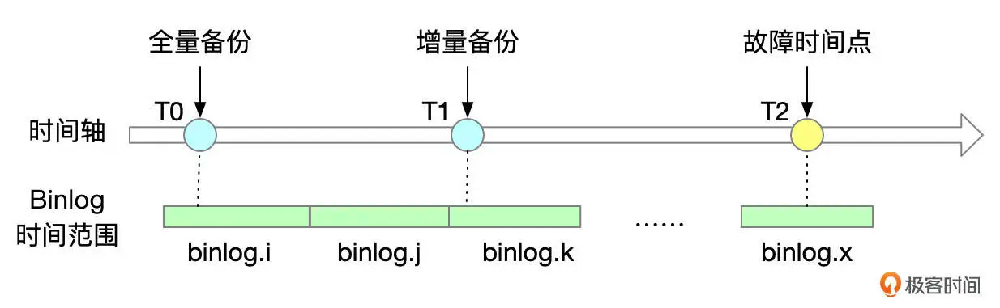

# 39 | 数据误操作了如何快速恢复？

你好，我是俊达。

上一讲中，我们知道了如何使用 Xtrabackup 来备份数据库和恢复数据库。不管是全量备份，还是增量备份，实际上都只能将数据库恢复到一个固定的时间点，这个时间点就是Xtrabackup 备份完成的那个时刻。

但是在现实中，数据恢复的要求往往会更高。假设我们每天凌晨都会备份数据库。某一天下午，由于误操作，某一个重要的业务表的数据被清空了。使用凌晨的备份文件，只能恢复一部分数据。从凌晨到误操作发生的那一刻，这个表上进行了很多 DML 操作，这部分数据如何恢复呢？

这一讲我们就来解决这个问题。根据误操作的不同情况，我们可以选择不同方法来恢复数据。

## Binlog 备份

为了将数据库恢复到任意一个时间点，我们需要将 Binlog 也备份起来。如果 Binlog 没有备份，同时你又把 Binlog 删除了，那么就可能无法将数据恢复到这些 Binlog 覆盖的时间点。

备份 Binlog 实际上比较简单，一个 Binlog，一旦完成切换，里面的内容就不会发生变化。你可以使用操作系统的命令，比如 cp，将除了最后一个 binlog 之外其他 Binlog，拷贝到备份空间。使用这种方式，无法实时备份最新的那个 Binlog 文件。极端情况下，如果这个时候数据库所在的服务器崩溃了，而且无法启动，那么你可能会丢失最后一个 Binlog 中的数据。

命令行工具 mysqlbinlog 提供了一个功能，可以实时接收远程数据库上生成的 Binlog 事件。

```
mysqlbinlog \
 --read-from-remote-server \
 --host=172.16.121.234 \
 --port=3307 \
 --user=backup \
 --password=somepass \
 --protocol=tcp \
 --stop-never \
 --raw \
 --result-file=/path/to/binlog-backup/ \
 mysql-binlog.00000N
```

mysqlbinlog 的命令行参数中，加上 read-from-remote-server 后，可以模拟 IO 线程，连接到数据库，执行 BINLOG_DUMP 命令，接收 Binlog。加上参数 stop-never，读取完当前所有的Binlog 后，也不会退出，而是继续等待主库生成新的 Binlog 事件。

使用 mysqlbinlog 备份远程的 Binlog 时，一般要加上 raw 参数。你可以将参数 result-file 设置为一个目录，这样 Binlog 会写到这个目录中，如果不加这个参数，默认会将 Binlog 文件保存到当前目录下。

最后一个参数（mysql-binlog.00000N）是开始读取的第一个 Binlog 的文件名。如果发生一些异常，如网络超时，或 Dump 线程被 Kill 了，mysqlbinlog 命令会异常退出。如果mysqlbinlog 命令异常退出了，你可以先看一下最后备份的那个 Binlog 文件，然后再重新从这个文件开始，备份 Binlog。

## 恢复到指定时间点

只要有全量备份，以及全量备份后的所有 binlog，就能将数据库恢复到全量备份之后的任意时间点。



看上面这个图，如果在 T2 时间点发生了数据丢失故障，就可以找一个在 T2 时间之前完成的全量备份。假设在时间点 T0 有一个全量备份，T1 有一个增量备份，就可以先恢复全量备份和增量备份，然后再应用 T1 到 T2 之间的 Binlog。如果没有增量备份，也可以恢复全量备份后，应用 T0 到 T2 之间的 Binlog。这样都能将数据恢复到发生故障前的那个时间点。

### 找到时间点对应的 binlog

时间点恢复具体怎么操作呢？首先要定位该时间点对应的 binlog 位点（binlog 文件和文件内的偏移量）。每个 binlog 头部都记录了 binlog 产生的时间，我们可以使用 mysqlbinlog 工具解析binlog，查看 binlog 的第一个 event 的时间。

```
# mysqlbinlog -v binlog.000021 | head
/*!50530 SET @@SESSION.PSEUDO_SLAVE_MODE=1*/;
/*!50003 SET @OLD_COMPLETION_TYPE=@@COMPLETION_TYPE,COMPLETION_TYPE=0*/;
DELIMITER /*!*/;
# at 4
#230625 16:44:06 server id 23480  end_log_pos 126 CRC32 0x245d7ed7   Start: binlo
```

如果我们需要恢复到某个时间点 T，那么我们需要找的 binlog 开始时间不大于 T，并且该binlog 的下一个 binlog 的开始时间大于 T。

这里提供一个 python 的脚本，可以批量查看 binlog 时间。

```python
import sys
import struct
if len(sys.argv) >= 2:
  pattern = sys.argv[1]
else:
  pattern = 'mysql-bin.[0-9]*'
print ('binlog pattern: %s' % pattern)
def parse_binlog_header(filename):
   with open(filename, 'rb') as f:
       data = f.read(8)
       return struct.unpack('i', data[4:])[0]
def main():
   import glob
   from datetime import datetime
   for f in sorted(glob.glob(pattern), key=lambda x: int(x.split('.')[-1])):
       ts = parse_binlog_header(f)
       print f, ts, datetime.fromtimestamp(ts)
if __name__ == '__main__':
   main()
```

使用脚本，传入 binlog 匹配模式，显示 binlog 时间：

```
# python parse_binlog_time.py  'binlog/binlog.[0-9]*'
binlog pattern: binlog/binlog.[0-9]*
binlog/binlog.000001 1686640790 2023-06-13 15:19:50
binlog/binlog.000002 1686647377 2023-06-13 17:09:37
binlog/binlog.000003 1686647391 2023-06-13 17:09:51
......
binlog/binlog.000020 1687682137 2023-06-25 16:35:37
binlog/binlog.000021 1687682646 2023-06-25 16:44:06
binlog/binlog.000022 1687683127 2023-06-25 16:52:07
```

我们的全量备份 binlog 位点是 binlog.000020。

```
# cat xtrabackup_binlog_info
binlog.000020  610  58224b02-09b7-11ee-90bd-fab81f64ee00:1-13191,7caa9a48-b325-11
```

假设我们希望将数据库恢复到 2023-06-25 16:45:00，那么根据各个 binlog 的时间信息，我们需要恢复到 binlog.000021，从这个 binlog 中找到 16:45:00 对应的位点。

```
# mysqlbinlog --stop-datetime="2023-06-25 16:45:01" binlog/binlog.000021 | grep -
# at 340009
#230625 16:45:00 server id 23480  end_log_pos 340040 CRC32 0xa1841663   Xid = 882
```

我们需要应用 binlog.000021 偏移量 340040 之前的 binlog。

接下来要解决怎么应用 Binlog 的问题。MySQL 提供了命令行工具 mysqlbinlog，可以解析Binlog，解析出来后，可以直接发送给 MySQL 执行。这可能也是平时比较常用的一个方法。更好的方法，是利用 MySQL 的复制模块来应用 Binlog。我们来看一下这两种方法分别是怎么操作的。

### 方法一：使用 mysqlbinlog 解析 binlog 并执行

从前面的步骤，我们得到了需要执行的 binlog。

- binlog 开始位点：binlog.000020，偏移量 610。

- binlog 结束位点：binlog.000021，偏移量 340040。

依次使用 mysqlbinlog 解析 binlog，并发送给 mysql 执行。执行第一个 binlog 时指定参数start-position，执行最后一个 binlog 时，指定参数 stop-position。

使用下面的命令执行第一个 binlog。

```
mysqlbinlog --start-position=610 binlog.000020 | mysql -uroot -h127.0.0.1 -P6380
```

执行中间的 binlog，如果 binlog 数量比较多，你可能需要写一个脚本来处理。当然，这个测试案例中只有 2 个 binlog。

使用下面的命令执行最后一个 binlog。

```
mysqlbinlog --stop-position=340040 binlog.000021 | mysql -uroot -h127.0.0.1 -P638
```

binlog 执行完成后，校验一下数据。这里我们查看最后一个应用的 binlog 事件。

```sql
mysqlbinlog -v --stop-position=340040 binlog.000021 | tail -30
# at 339746
#230625 16:45:00 server id 23480  end_log_pos 339817 CRC32 0x89660c48   Query  th
SET TIMESTAMP=1687682700/*!*/;
BEGIN
/*!*/;
# at 339817
#230625 16:45:00 server id 23480  end_log_pos 339880 CRC32 0xd5fb3c23   Table_map
# has_generated_invisible_primary_key=0
# at 339880
#230625 16:45:00 server id 23480  end_log_pos 340009 CRC32 0x8153feb1   Write_row
BINLOG '
jP6XZBO4WwAAPwAAAKgvBQAAANEAAAAAAAEABGRlbW8ACWxhc3RfZ3RpZAACAw8CoA8CAQEAAgP8
/wAjPPvV
jP6XZB64WwAAgQAAACkwBQAAANEAAAAAAAEAAgAC/wBsaAAAVwA1ODIyNGIwMi0wOWI3LTExZWUt
OTBiZC1mYWI4MWY2NGVlMDA6MS0yOTExMCwKN2NhYTlhNDgtYjMyNS0xMWVkLTg1NDEtZmFiODFm
NjRlZTAwOjEtMjex/lOB
'/*!*/;
### INSERT INTO `demo`.`last_gtid`
### SET
###   @1=26732
###   @2='58224b02-09b7-11ee-90bd-fab81f64ee00:1-29110,\n7caa9a48-b325-11ed-8541-
```

查看数据，验证数据是否恢复到了正确的时间点。

```sql
mysql> select * from demo.last_gtid order by id desc limit 1;
+-------+------------------------------------------------------------------------
| id    | gtid
+-------+------------------------------------------------------------------------
| 26732 | 58224b02-09b7-11ee-90bd-fab81f64ee00:1-29110,
7caa9a48-b325-11ed-8541-fab81f64ee00:1-27 |
+-------+------------------------------------------------------------------------
1 row in set (0.00 sec)
```

### 方法二：使用 MySQL 原生复制功能实现时间点恢复

虽然使用 mysqlbinlog 解析并执行 binlog，是实现 mysql 时间点恢复的一种常用的方法，但是这么做其实有一些缺点。

- 先解析 Binlog，再发送给 MySQL 执行，性能不够好，事务只能单线程应用。

- 如果中间某个 Binlog 执行时出错了，脚本中还要做好错误处理。

在正式环境中，我更建议使用下面这种方法，利用 MySQL 的数据复制功能来实现时间点恢复。

操作方法其实很简单。

1. 启动一个空的 mysql 实例，将需要恢复的 binlog 注册到这个实例中。

2. 将需要恢复数据的那个实例，作为备库，从步骤 1 创建的 binlog 实例中复制数据。

### 启动 binlog 实例

先初始化一个空白实例。

```bash
## 创建相关目录
mkdir -p /data/servebinlog/{data,log,binlog,relaylog,tmp,run}
## 准备my.cnf
## 初始化数据库
/opt/mysql/bin/mysqld --defaults-file=/data/servebinlog/my.cnf --initialize
tail -1 /data/servebinlog/log/alert.log
2023-06-26T08:54:33.758630Z 6 [Note] [MY-010454] [Server] A temporary password is
## 修改文件owner，并启动实例
chown -R mysql:mysql /data/servebinlog/
mysqld_safe --defaults-file=/data/servebinlog/my.cnf &
## 修改默认密码，创建复制账号
mysql -uroot -par2sWPCf4.++ -h127.0.0.1 -P16380
mysql> alter user 'root'@'localhost' identified by 'abc123';
Query OK, 0 rows affected (0.01 sec)
mysql> create user 'rep'@'%' identified by 'rep123';
Query OK, 0 rows affected (0.02 sec)
mysql> grant replication slave on *.* to 'rep'@'%';
Query OK, 0 rows affected (0.01 sec)
```

注册 binlog。将需要的 binlog 复制到 binlog 实例的目录中，并编辑 binlog.index 文件，重启binlog 实例。

```
## 停实例
mysqladmin -h127.0.0.1 -P16380 -uroot -pabc123 shutdown
## 清空原有binlog，将需要的binlog复制到指定目录
rm /data/servebinlog/binlog/binlog.00000*
cp /data/mysql8.0/binlog/binlog.0000{20,21,22} /data/servebinlog/binlog/
## 编辑binlog.index，最终内容如下
# cat /data/servebinlog/binlog/binlog.index
/data/servebinlog/binlog/binlog.000020
/data/servebinlog/binlog/binlog.000021
/data/servebinlog/binlog/binlog.000022
## 启动实例
chown -R mysql:mysql /data/servebinlog/
mysqld safe --defaults-file=/data/servebinlog/my.cnf &
```

到这一步，binlog 实例就准备完成了。

```sql
mysql> show binary logs;
+---------------+-----------+-----------+
| Log_name      | File_size | Encrypted |
+---------------+-----------+-----------+
| binlog.000020 |   5598638 | No        |
| binlog.000021 |   4751928 | No        |
| binlog.000022 |   3944712 | No        |
| binlog.000023 |       237 | No        |
+---------------+-----------+-----------+
mysql> select @@gtid_purged\G
*************************** 1. row ***************************
@@gtid_purged: 0b06b27c-13ff-11ee-8d21-fab81f64ee00:1-3,
58224b02-09b7-11ee-90bd-fab81f64ee00:1-13191,
7caa9a48-b325-11ed-8541-fab81f64ee00:27
1 row in set (0.00 sec)
mysql> select @@gtid_executed\G
*************************** 1. row ***************************
@@gtid_executed: 0b06b27c-13ff-11ee-8d21-fab81f64ee00:1-3,
58224b02-09b7-11ee-90bd-fab81f64ee00:1-51514,
7caa9a48-b325-11ed-8541-fab81f64ee00:27
1 row in set (0.00 sec)
```

### 从 binlog 实例复制数据

先查看全备的 binlog 位点。

```
# cat xtrabackup_binlog_info
binlog.000020  610  58224b02-09b7-11ee-90bd-fab81f64ee00:1-13191,7caa9a48-b325-11
```

到需要进行时间点恢复的实例上执行下面这些命令，建立数据复制通道，使用 start slave until命令将数据恢复到指定的 Binlog 位点。

```
mysql> reset slave all;
Query OK, 0 rows affected, 1 warning (0.03 sec)
mysql> change master to master_host='172.16.121.234', master_port=16380, master_u
Query OK, 0 rows affected, 9 warnings (0.13 sec)
mysql> start slave until master_log_file='binlog.000021', master_log_pos=340009;
Query OK, 0 rows affected, 3 warnings (0.03 sec)
```

等待 SQL 线程执行完成，执行完成的标志是 Slave_SQL_Running=No，并且Relay_Master_Log_File 和 Exec_Master_Log_Pos 和 start slave until 命令中指定的位点一样。

```
mysql> show slave status\G
*************************** 1. row ***************************
              Slave_IO_State: Waiting for source to send event
                 Master_Host: 172.16.121.234
                 Master_User: rep
                 Master_Port: 16380
               Connect_Retry: 60
             Master_Log_File: binlog.000023
         Read_Master_Log_Pos: 237
              Relay_Log_File: relaylog.000004
               Relay_Log_Pos: 340210
       Relay_Master_Log_File: binlog.000021
            Slave_IO_Running: Yes
           Slave_SQL_Running: No
......
         Exec_Master_Log_Pos: 340040
```

和直接使用 mysqlbinlog 解析 binlog 并执行的方法对比，用 binlog 实例进行时间点恢复需要创建一个临时空白实例，看起来更加复杂，但是有下面这些优点。

- 并执行更可靠。

2. 效率更高。如果开启了多线程复制，应用 binlog 的效率会更高。

3. 更容易处理异常。如果应用 binlog 的过程中遇到各种错误，可以像处理一个普通的备库遇到的问题那样来处理。

### 时间点恢复注意事项

使用备库产生的 binlog 恢复数据时，需要注意备库是否有延迟。如果备库本身存在延迟，那么备库上生成的 binlog 的时间戳和真实的业务时间可能存在偏差，依据这个时间来进行恢复，就可能达不到业务上的恢复目标。所以进行时间点恢复时，优先选择使用主库的 binlog来进行恢复。当然在实际业务场景中，主备库之间可能会存在角色切换，需要想办法确定待恢复的时间点上，哪一个实例是主库。

我们也需要监控好主备库的复制状态，如果存在复制中断、复制延迟、甚至是主备库数据不一致的情况，需要及时处理。不然，在对备库进行的备份可能实际上是无效的。

前面讲的时间点恢复方案，优点是适应性广，理论上能恢复所有类型的数据误操作。但是如果数据库特别大，恢复的时间可能会比较久。恢复数据消耗的时间越长，业务受到的损失就可能越大。在一些特定的场景下，还可以采用其他一些恢复方法，提升恢复的速度，作为整个数据恢复方案的补充。

## 基于 Binlog 回滚的数据恢复

如果使用了 ROW 格式的 Binlog，并且参数 binlog_row_image 为 FULL，那么在执行 DML 语句时，会在 Binlog 中记录修改的记录的所有字段。如果是执行 UPDATE 或 DELETE 语句导致的数据问题，你可以在 Binlog 中找到修改前的数据，进行数据恢复。当然，如果是因为执行了 tuncate table 或 drop table 导致的数据丢失，binlog 中没有记录具体的数据，就不能使用这种方式来恢复了。

怎么解析 Binlog 中的数据呢？有一些开源的工具，比如 binlog2sql。其实你也可以使用mysqlbinlog 来解析。

对于 ROW 格式的 Binlog，mysqlbinlog 加上 -v 选项，可以输出文本格式的数据。比如我在数据库上执行了这几个 SQL。

```sql
update salaries set salaries = 999999 limit 100;
delete from employees limit 30;
```

使用 mysqlbinlog -v，可以解析出这样的数据。

```sql
### UPDATE `employees`.`salaries`
### WHERE
###   @1=10001
###   @2=60117
###   @3='1986:06:26'
###   @4='1987:06:26'
### SET
###   @1=10001
###   @2=999999
###   @3='1986:06:26'
###   @4='1987:06:26'
### UPDATE `employees`.`salaries`
### WHERE
###   @1=10001
###   @2=62102
###   @3='1987:06:26'
###   @4='1988:06:25'
### SET
###   @1=10001
###   @2=999999
###   @3='1987:06:26'
###   @4='1988:06:25'
### DELETE FROM `employees`.`employees`
### WHERE
###   @1=20
###   @2='2013:10:10'
###   @3='AAAA'
###   @4='BBBB'
###   @5=1
###   @6='2024:08:03'
### DELETE FROM `employees`.`employees`
### WHERE
###   @1=10001
###   @2='1953:09:02'
###   @3='Georgi'
###   @4='Facello'
###   @5=1
###   @6='2024:08:03'
```

如果是 Update 更新错了，可以把 Update 的 Binlog 中，Where 部分的字段提取出来，这些是更新前的数据。如果是 Delete 错了，把 Where 部分的字段提取出来，也可以恢复数据。

这里的格式比较简单，你可以写一些脚本来提取这些数据。这里我提供一段 python 代码作为参考。

```sql
import re
import sys
"""
mysqlbinlog --no-defaults -v binlog_file | python parse_binlog.py
or
mysqlbinlog --no-defaults -v binlog_file > decoded_binlog
python parse_binlog.py decoded_binlog
"""
if len(sys.argv) == 1:
   file = sys.stdin
else:
   file = open(sys.argv[1])
STATE_UPDATE = 10
STATE_DELETE = 20
STATE_INIT = 0
m_update = re.compile('### UPDATE `(.*)`[.]`(.*)`')
m_delete = re.compile('### DELETE FROM `(.*)`[.]`(.*)`')
m_set = re.compile('###   @[0-9]+=(.*)$')
def get_lines(file):
   while True:
       line = file.readline()
       if line:
           yield line
       else:
           return
def parse_binlog():
   state = STATE_INIT
   db = ''
   table = ''
   columns = []
   for line in get_lines(file):
       line = line.strip()
       if state == STATE_INIT:
           m = m_update.match(line)
           if m:
               state = STATE_UPDATE
               db, table = m.groups()
               columns = []
               continue
           m = m_delete.match(line)
           if m:
               state = STATE_DELETE
               db, table = m.groups()
               columns = []
               continue
       elif state == STATE_UPDATE:
           if line == '### WHERE':
               continue
           elif line == '### SET':
               state = STATE_INIT
               print_sql(db, table, columns, 'update')
               columns = []
           else:
               m = m_set.match(line)
               if m:
                   val = m.groups()[0]
                   columns.append(val)
       elif state == STATE_DELETE:
           if line == '### WHERE':
               continue
           else:
               m = m_set.match(line)
               if m:
                   val = m.groups()[0]
                   columns.append(val)
               else:
                   print_sql(db, table, columns, 'delete')
                   columns = []
                   m = m_delete.match(line)
                   if m:
                       state = STATE_DELETE
                       db, table = m.groups()
                   else:
                       state = STATE_INIT
def print_sql(db, table, columns, dml_type):
   print "-- dml_type: {}, db: {}, table: {}, columns: {}".format(dml_type, db,
   print "replace into {}.{} values({})".format(db, table, ", ".join(columns))
if __name__ == '__main__':
parse binlog()
```

这样，你就可以找回误更新或误删除的数据了。

```sql
# mysqlbinlog -v mysql-binlog.000014 | python parse_binlog.py
-- dml_type: update, db: employees, table: salaries, columns: 4
replace into employees.salaries values(10001, 60117, '1986:06:26', '1987:06:26')
-- dml_type: update, db: employees, table: salaries, columns: 4
replace into employees.salaries values(10001, 62102, '1987:06:26', '1988:06:25')
...
-- dml_type: delete, db: employees, table: employees, columns: 6
replace into employees.employees values(10028, '1963:11:26', 'Domenick', 'Tempest
-- dml_type: delete, db: employees, table: employees, columns: 6
replace into employees.employees values(10029, '1956:12:13', 'Otmar', 'Herbst', 1
```

这里的方法虽然看起来比较简陋，但是在一些特定的场景下，可以帮你快速恢复数据。当然，如果在正式环境使用这类工具，我的建议是先把从 Binlog 中找回的数据写到一个临时表里，对数据进行验证后，再更新到正式的业务表里。

## Xtrabackup 单表恢复

如果表被 DROP 或 Truncate 了，你还可以考虑使用 xtrabackup 的单表恢复功能。当然，能使用单表恢复的前提，是使用了独立表空间 (innodb_per_table=1)。

接下来我给你演示一下单表恢复的操作步骤。

### 1. Prepare 备份文件

prepare 时带上参数–export，xtrabackup 会生成 import tablespace 需要的文件。

```
# xtrabackup --prepare --export --target-dir=. > export.log 2>&1
```

查看日志，确认 prepare 成功。

```
tail export.log
```

查看目标数据库下的文件，这里我们希望恢复 demo.last_gtid 表。

```
# ls -l demo/last_gtid.*
-rw-r--r-- 1 root root     715 6月  27 11:03 demo/last_gtid.cfg
-rw-r----- 1 root root 9437184 6月  26 16:08 demo/last_gtid.ibd
```

### 2. 目标数据库上创建希望恢复的表

表结构要和备份时的表结构一致。

```sql
mysql> show create table last_gtid\G
*************************** 1. row ***************************
      Table: last_gtid
Create Table: CREATE TABLE `last_gtid` (
 `id` int NOT NULL AUTO_INCREMENT,
 `gtid` varchar(1000) DEFAULT NULL,
 PRIMARY KEY (`id`)
) ENGINE=InnoDB AUTO_INCREMENT=26733 DEFAULT CHARSET=utf8mb4 COLLATE=utf8mb4_0900
1 row in set (0.00 sec)
```

我们先将表 drop 掉，模拟数据丢失的场景。

```
mysql> drop table last_gtid;
Query OK, 0 rows affected (0.03 sec)
```

创建结构，并执行 discard tablespace 命令。

```sql
mysql>  CREATE TABLE `last_gtid` (
      `id` int NOT NULL AUTO_INCREMENT,
      `gtid` varchar(1000) DEFAULT NULL,
      PRIMARY KEY (`id`)
    ) ENGINE=InnoDB;
Query OK, 0 rows affected (0.06 sec)
mysql> alter table last_gtid discard tablespace;
Query OK, 0 rows affected (0.01 sec)
```

### 3. 将备份的文件 copy 到目标实例的数据库目录下

我们将表的 cfg 和 ibd 文件 copy 到目标实例数据库对应目录下，并修改文件 owner。如果文件 owner 没有正确设置，下一步 import 表空间时可能会出错。

```
# cp last_gtid.* /data/full_restore/data/demo/
# ls -l /data/full_restore/data/demo/
-rw-r--r-- 1 root  root      715 6月  27 11:06 last_gtid.cfg
-rw-r----- 1 root  root  9437184 6月  27 11:06 last_gtid.ibd
# chown -R mysql:mysql /data/full_restore/data/demo/
```

### 4. import 表空间

执行 import tablespace 命令恢复数据。确认数据已经恢复。

```sql
mysql> alter table demo.last_gtid import tablespace;
Query OK, 0 rows affected (0.29 sec)
mysql> select count(*) from demo.last_gtid;
+----------+
| count(*) |
+----------+
|    10813 |
+----------+
1 row in set (0.00 sec)
```

如果不知道表的表结构，可以使用 ibd2sdi 工具，从 ibd 文件中提取表结构信息。

```
# ibd2sdi last_gtid.ibd | more
["ibd2sdi"
,
{
 "type": 1,
 "id": 371,
 "object":
   {
   "mysqld_version_id": 80032,
   "dd_version": 80023,
   "sdi_version": 80019,
   "dd_object_type": "Table",
   "dd_object": {
       "name": "last_gtid",
       "mysql_version_id": 80032,
       "created": 20230621022444,
       "last_altered": 20230621022444,
       "hidden": 1,
       "options": "avg_row_length=0;encrypt_type=N;key_block_size=0;keys_disable
uto_recalc=0;stats_sample_pages=0;",
       "columns": [
           {
               "name": "id",
               "type": 4,
               "is_nullable": false,
               "is_zerofill": false,
               "is_unsigned": false,
               "is_auto_increment": true,
               "is_virtual": false,
               ......
               "column_key": 2,
               "column_type_utf8": "int",
               "elements": [],
               "collation_id": 255,
               "is_explicit_collation": false
           },
           {
               "name": "gtid",
               "type": 16,
               "is_nullable": true,
               "is_zerofill": false,
               "is_unsigned": false,
               "is_auto_increment": false,
               "is_virtual": false,
               "hidden": 1,
               "ordinal_position": 2,
               "char_length": 4000,
               .....
               "column_key": 1,
               "column_type_utf8": "varchar(1000)",
               "elements": [],
               "collation_id": 255,
               "is_explicit_collation": false
           },
```

## 总结

在备份系统的设计中，要把 Binlog 备份也考虑进去，有了完整的 Binlog，你可以将数据库恢复到任意一个时间点。在有些场景下，使用 Binlog 回滚的方案，能加快数据恢复的速度，减少业务的故障时长。

针对可能存在的数据丢失故障，你可以有计划地进行恢复演练，这不仅能验证备份和数据恢复方案的有效性，还能给恢复时长建立一个基线。这样，当需要紧急恢复数据时，你可以比较精确地估算出恢复需要多少时间。

## 思考题

如果数据库中有几个表被错误地 Truncate 了，如何在最短的时间内，将这几个表的数据恢复到执行 truncate 命令前的时间点？

期待你的思考，欢迎在留言区中与我交流。如果今天的课程让你有所收获，也欢迎转发给有需要的朋友。我们下节课再见。
