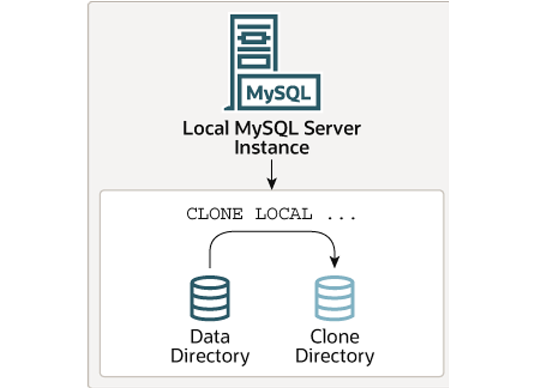
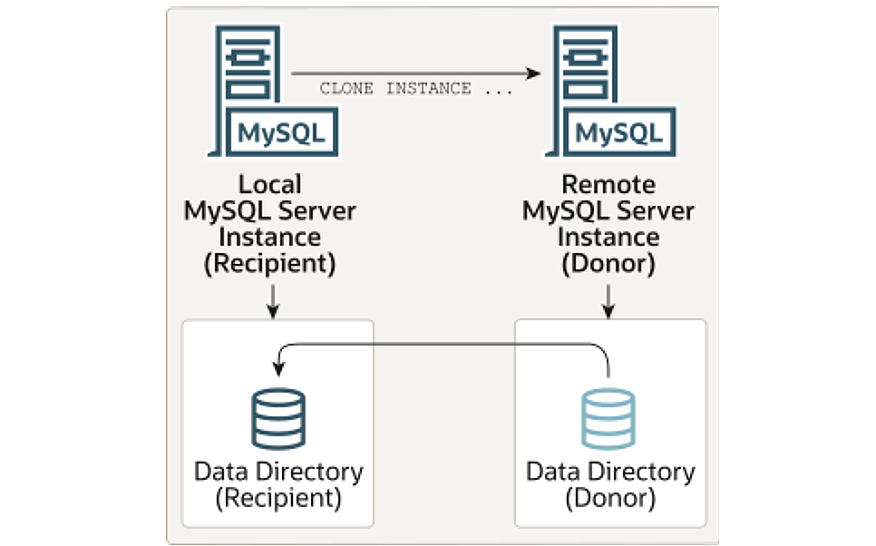
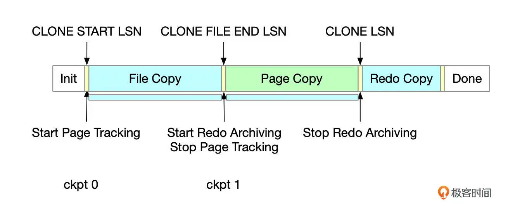

# 40 | MySQL8.0Clone插件的应用和内部原理

你好，我是俊达。

前面我讲过，搭建一个备库，有一个核心的步骤是同步源库的初始状态。逻辑备份（比如使用mysqldump）和物理备份（比如使用 xtrabackup）都可以用来初始化备库。MySQL 8.0 中，还引入了 Clone 插件，也可以用来初始化一个备库。有了 Clone 插件，搭建备库会变得更加简单。MySQL MGR（Group Replication）也会使用 Clone 插件来初始化成员的数据。此外，还可以将整个数据库克隆到本地的一个目录中，这相当于是给数据库做了一个全量备份。

这一讲中，我们就来聊一聊 Clone 插件的一些用法，以及 Clone 插件的内部原理。

## Clone 插件介绍

MySQL 8.0.17 版本引入了 clone 插件。使用 Clone 插件可以对本地或远程的 mysql 实例进行克隆操作。Clone 插件会拷贝 InnoDB 存储引擎表，克隆得到的是数据库的一个一致的快照，可以使用这个快照数据来启动新的数据库实例。Clone 插件还会记录数据库的 Binlog 位点，可以将克隆得到的实例作为源实例的备库。

Clone 插件支持本地克隆和远程克隆这两种模式。本地克隆将数据存放在源数据库所在主机上。远程克隆涉及到两个实例，提供数据的实例称为捐赠者（Donor），接收数据的实例称为接收者（Recipient）。捐赠者将整个数据库通过 MySQL 网络协议发送给接收者，接收者将数据存放到数据目录。

你要先安装 Clone 插件，才能使用克隆的功能。我们可以在配置文件中配置。

```
[mysqld]
plugin-load-add=mysql_clone.so
```

也可以使用 install plugin 命令安装插件。

```
mysql> install plugin clone soname 'mysql_clone.so';
```

使用 show plugins 命令或到 plugins 表查看插件状态。

```sql
mysql> SELECT PLUGIN_NAME, PLUGIN_STATUS
   FROM INFORMATION_SCHEMA.PLUGINS
   WHERE PLUGIN_NAME = 'clone';
+-------------+---------------+
| PLUGIN_NAME | PLUGIN_STATUS |
+-------------+---------------+
| clone       | ACTIVE        |
+-------------+---------------+
```

使用 uninstall plugin 命令卸载插件。

```
mysql> uninstall plugin clone;
Query OK, 0 rows affected (0.19 sec)
```

## 本地 Clone

本地 Clone 得到的数据文件和源实例存放在同一台主机上。

下面这个是官方文档中本地克隆的一个示意图。



执行 clone 命令的账号需要有 backup_admin 权限。

```
GRANT BACKUP_ADMIN ON *.* TO 'clone_user';
```

使用 clone local 命令发起本地克隆，命令中要指定克隆数据的存放路径，使用绝对路径。路径的最后一层是克隆数据的顶层目录，这个目录不能存在，Clone 命令会自己创建这个目录，否则会报错“database exists”。路径中的其它目录需要先创建好，比如下面例子中的/data/clone 目录。

```
CLONE LOCAL DATA DIRECTORY  '/data/clone/mysql02_backup';
```

运行 MySQL 的操作系统账号需要有相应路径的读写权限，不然 clone 命令会报错。

```
ERROR 1006 (HY000): Can't create database '/data/clone/mysql02_backup/' (errno: 1
```

Clone 操作不能并行执行，同一个时间内， 一个数据库中最多只能运行一个克隆进程。

```
ERROR 3634 (HY000): Too many concurrent clone operations. Maximum allowed - 1.
```

### 查看 clone 状态

你可以到 performance_schema.clone_status 表，查看最新一次 clone 操作的状态。

```sql
mysql> select * from performance_schema.clone_status\G
*************************** 1. row ***************************
            ID: 1
           PID: 55
         STATE: Completed
    BEGIN_TIME: 2023-08-22 15:11:26.581
      END_TIME: 2023-08-22 15:11:36.646
        SOURCE: LOCAL INSTANCE
   DESTINATION: /data/clone/mysql02_backup/
      ERROR_NO: 0
 ERROR_MESSAGE:
   BINLOG_FILE:
BINLOG_POSITION: 0
 GTID_EXECUTED:
1 row in set (0.00 sec)
```

### 使用 Clone 的数据启动实例

Clone 得到的文件，是原实例的一个一致性的快照，可以使用这些文件来启动 mysql 实例。可手动创建一个配置文件，将 datadir 指向 clone 路径，就可以启动 mysql 实例。

```
##/data/clone/my.cnf
[mysqld]
port=3333
datadir=/data/clone/mysql02_backup
...
mysqld_safe --defaults-file=/data/clone/my.cnf &
```

实例启动后，可以看到，gtid_executed 和 Clone 时，源库的 gtid_executed 一致。

```
mysql> show master status\G
*************************** 1. row ***************************
            File: binlog.000001
        Position: 157
    Binlog_Do_DB:
Binlog_Ignore_DB:
Executed_Gtid_Set: b094c003-8cfa-11ef-bf79-fab81f64ee00:1-2302
```

需要注意的是，Clone 操作只会克隆 InnoDB 存储引擎的表，以及 MySQL 的系统表。如果有MyISAM 表，需要用其他方法来备份。

使用 Xtrabackup 备份的数据库，在恢复时，还需要先 Prepare 后，才能启动。但是使用Clone 插件备份出来的数据库，可以直接启动。

## 远程 Clone

远程 Clone 将整个数据库从捐赠者（Donor）复制到接受者（Recipient）。接受者实例原先的数据会被清理掉。

下面这个是官方文档中，远程 Clone 的示意图。



使用 clone instance 命令发起远程克隆。

```
CLONE INSTANCE FROM 'user'@'host':port
IDENTIFIED BY 'password'
[DATA DIRECTORY [=] 'clone_dir']
[REQUIRE [NO] SSL];
```

容易看出命令中几个参数的含义。

- user：登录捐赠者实例的用户名。

- host：捐赠者实例的主机名或 IP。

- port：捐赠者实例的端口。

- password：捐赠者实例的密码。

- clone_dir：不指定 clone_dir 时，会清空接受者实例的 datadir 目录，并将数据放到 datadir目录中。如果指定了 data directory，则该路径需要不存在，mysql 服务需要有目录权限。

- REQUIRE [NO] SSL：指定传输数据是否使用加密协议。

### 远程 clone 前置条件

使用远程 clone 需要满足几点前置条件。

- 账号权限，捐赠者的账号需要有 backup_admin 权限。接受者的账号需要 clone_admin 权限。clone_admin 权限包含 backup_admin 权限和 shutdown 权限。

- 捐赠者和接受者的版本需要保持一致。不仅大版本要一样，小版本也要一样。可使用 showvariables 命令查看版本。

```
mysql> SHOW VARIABLES LIKE 'version';
+---------------+--------+
| Variable_name | Value  |
+---------------+--------+
| version       | 8.0.32 |
+---------------+--------+
```

- 捐赠者和接受者的运行平台和操作系统需要一致。

- 捐赠者和接受者都需要安装 Clone 插件。

- 捐赠者和接受者字符集需要一样（character_set_server，collation_server）。

- 捐赠者和接受者的参数 innodb_page_size，innodb_data_file_path 需要一样。

- 接受者上，参数 clone_valid_donor_list 需要包含捐赠者的地址。

- 默认情况下，远程 clone 会在完成数据克隆后，重启接受者实例。需要有控制进程（如mysqld_safe 脚本、systemctl 等）来拉起接受者实例。如果缺少控制进程，则接受者实例关闭后，无法自动启动，会报下面这样的错误。

```
ERROR 3707 (HY000): Restart server failed (mysqld is not managed by supervisor pr
```

### 远程 clone 操作步骤

接下来演示远程 Clone 操作的基本步骤。

### 1. 在捐赠者实例上创建相关账号并授权

```
mysql> CREATE USER 'donor'@'%' IDENTIFIED BY 'password';
mysql> GRANT BACKUP_ADMIN on *.* to 'donor'@'%';
```

### 2. 在接受者实例上创建账号并授权

```
CREATE USER 'recipient'@'%' IDENTIFIED BY 'password';
GRANT CLONE_ADMIN on *.* to 'recipient'@'%';
```

### 3. 登录接受者实例，发起 clone 操作

```
CLONE INSTANCE FROM 'donor'@'host':port
IDENTIFIED BY 'password';
```

clone 完成后，会自动重启接受者实例。

## Clone 插件的一些限制

- 8.0.27 版本之前，clone 时，捐赠者和接受者都不允许进行 DDL。从 8.0.27 版本开始，捐赠者默认可以进行 DDL，可以由参数 clone_block_ddl 进行控制。clone_block_ddl 设置为ON 时，clone 运行时，DDL 会被阻塞。

- 一次只能 clone 一个实例。

- clone 插件不会复制 mysql 参数。clone 时，不会将捐赠者实例的参数复制到接受者实例。

- clone 插件不会复制 binlog。

- clone 插件只复制存储在 innodb 存储引擎中的数据。不会复制 myisam、csv 等其他存储引擎的数据。

- 不支持通过 mysql router 连接到捐赠者实例。

- 本地 Clone 操作不支持复制使用了绝对路径的通用表空间。

## Clone 插件实现

最后我们来看一下 Clone 插件是怎么实现数据克隆的。



参考上面这个图，数据库克隆主要分为几个阶段。

1. 初始阶段（Init）

在初始阶段，会开启页面跟踪（Page Tracking）。开启页面跟踪后，会将发生过数据修改的页面的编号记录下来。页面的修改可分为两个阶段：首先在内存中修改，也就是先修改 InnoDBBuffer Pool 里的缓存的页面；然后被修改的页面会在一定的时机写回到数据文件。页面跟踪机制会在页面持久化的时候记录页面的编号（页面的表空间 ID 和 Page ID）。

2. 文件复制阶段（File Copy）

在这一阶段，Clone 插件会复制所有 InnoDB 文件。文件复制完成后，开启 InnoDB Redo 归档，关闭页面跟踪。

3. 页面复制阶段（Page Copy）

在这一阶段，会将文件复制过程中跟踪到的页面复制出来。也就是在文件复制过程中，发生过修改的页面，会在页面复制阶段拷贝到克隆数据库中。

页面复制完成后，停止 Redo 归档。将当时的 lsn 号记录为 clone lsn，这也是 clone 出来的数据库的 lsn 号。这里还会记录实例当前的复制位点，包括 binlog 位点和 gitd_executed 信息，gtid_executed 会存储到 mysql.gtid_executed 表。

4. Redo 复制阶段（Redo Copy）

在这一阶段，要处理归档出来的 Redo 日志，将 Redo 日志应用到克隆数据库中。应用完归档日志后，克隆出来的数据库文件可以直接用来启动一个数据库实例。

### 如何保证克隆数据的一致性？

Clone 插件如何保证最终得到的数据的一致性呢？假设 clone 开始的时候 checkpoint lsn 为ckpt_0，clone 文件复制结束的时候 checkpoint lsn 为 ckpt_1。

1. 首先在 clone 开始时（clone start lsn），先开启了页面跟踪。开启页面跟踪后，在这个时间点之后写入文件的页面编号都会被记录下来。

2. 文件复制阶段会将所有已经完成持久化的数据复制出来。这一步保证 ckpt_0 之前修改的数据都被复制出来。

3. 文件复制过程中，数据库文件会持续更新。由于开启了页面跟踪，数据文件中更新过的页面编号都会被记录下来。关闭页面跟踪时数据库 checkpoint 为 ckpt_1，那么 ckpt_0 和ckpt_1 之间修改的页面，都会被记录下来，这些页面会在页面复制阶段拷贝到克隆数据库中。

4. 文件复制完成后、关闭页面跟踪前，会先开启 Redo 归档。Redo 归档会将日志序列号在当前 checkpoint lsn（不超过 ckpt_1）之后的 redo 日志都复制到归档 REDO 文件中。由于

- Redo 归档是在关闭页面跟踪前开启的，所以能保证 ckpt_1 之后的 Redo 日志都会被复制到归档的 Redo 文件中。

5. 页面复制结束时，可能会有部分页面的数据修改还没有刷新到磁盘。这些页面修改的日志序列号都在 ckpt_1 之后。而 ckpt_1 之后的 Redo 日志都拷贝到归档的 Redo 文件中了，将归档的 Redo 日志应用到克隆数据库后，就可以将数据库恢复到一个一致的时间点（clonelsn)，也就是停止 Redo 归档时的那一刻。

## 总结

有了 Clone 插件后，给数据库添加一个备库就变得更简单了，你可以不依赖第三方备份工具，直接初始化备库的数据。你还可以基于本地 Clone 来实现数据库的物理备份，相比于Xtrabackup，Clone 插件是 MySQL 官方提供的，使用也比较方便。需要注意的是，Clone 插件只支持 InnoDB 存储引擎。

## 思考题

你需要将一个 Clone 出来的数据库，作为备库，加入到原先的复制架构中。如果使用 GTIDAuto Positon，那么 Clone 的数据库启动时，会根据 mysql.gtid_executed 表的记录，正确地设置 gtid_executed 变量，因此可以直接建立复制关系。但如果使用了基于位点的复制，你应该从哪个 Binlog 位点开启复制呢？这个 Binlog 位点信息是存储在哪个地方的？

期待你的思考，欢迎在留言区中与我交流。如果今天的课程让你有所收获，也欢迎转发给有需要的朋友。我们下节课再见。
