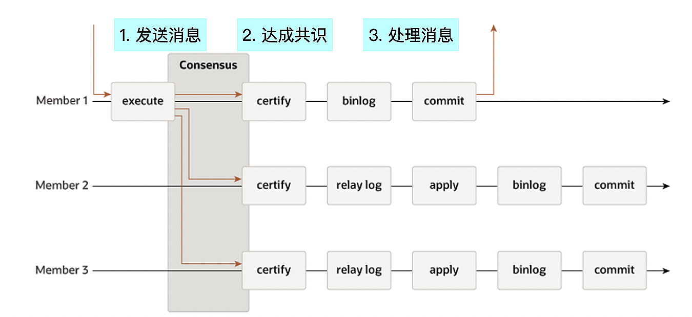
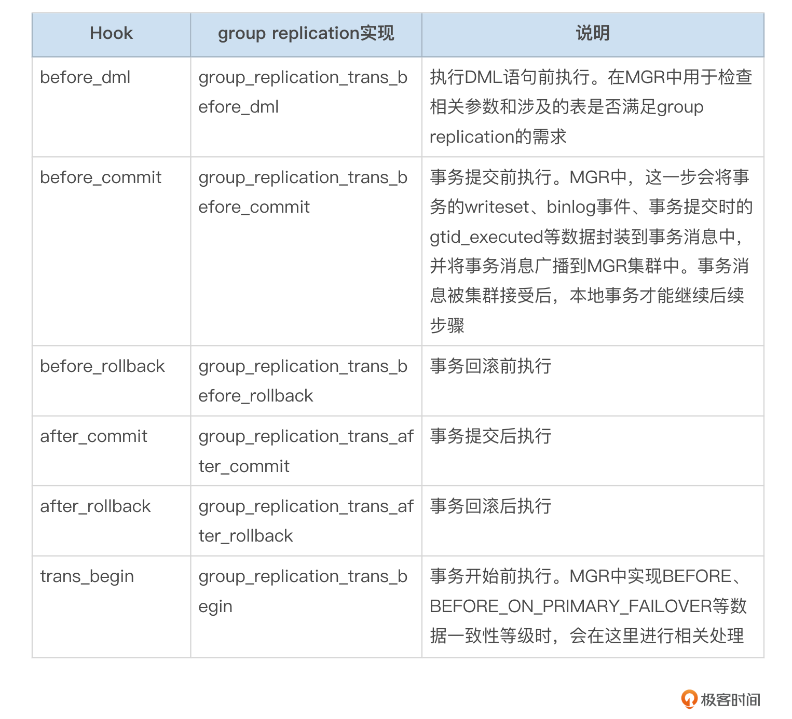
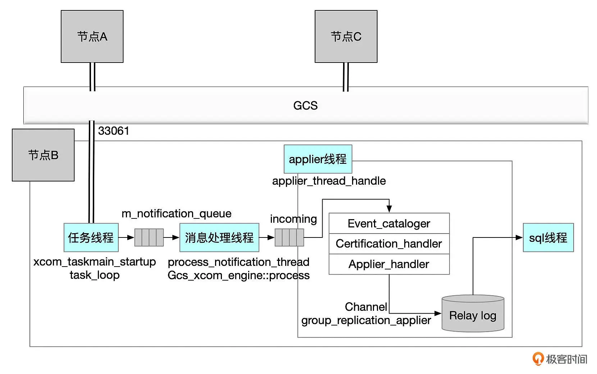
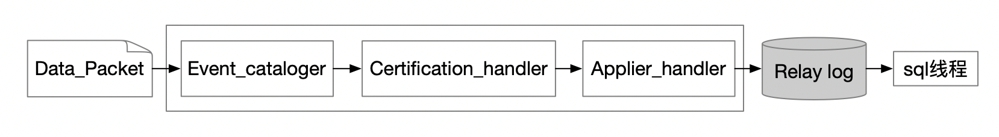
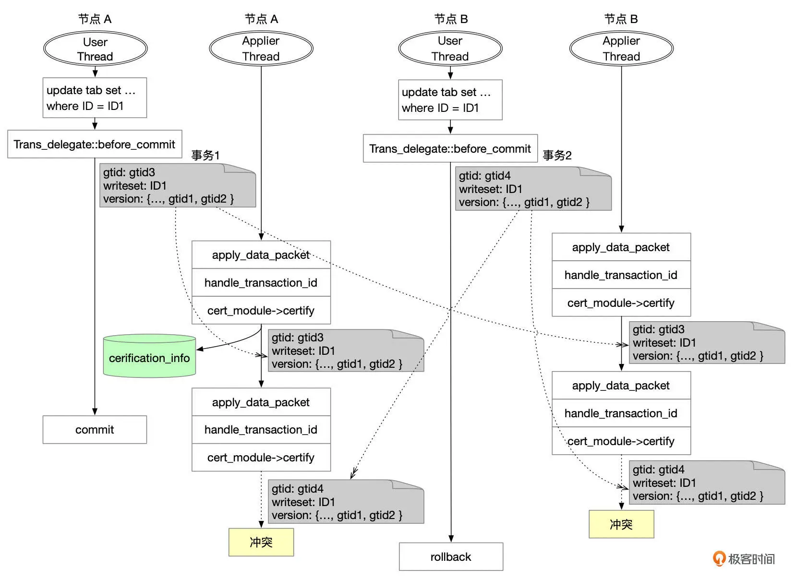
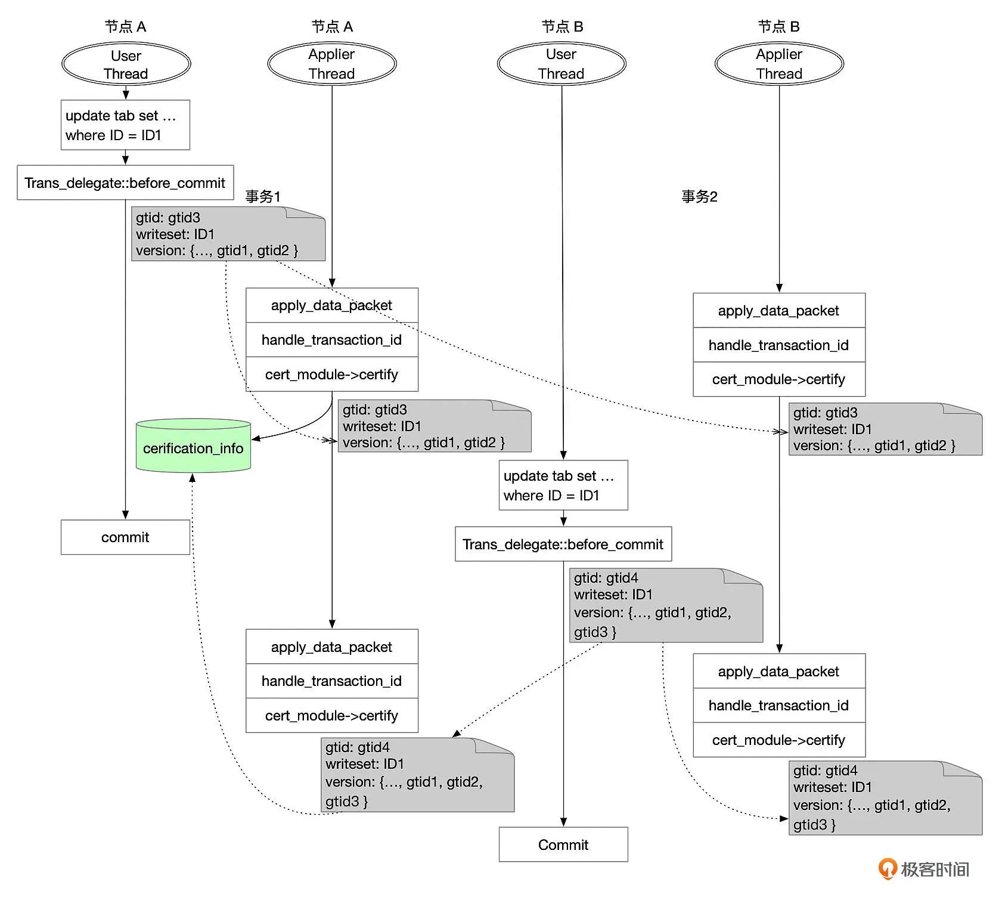
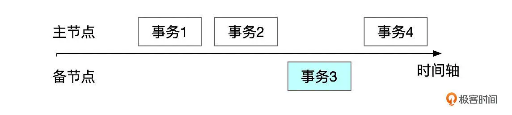
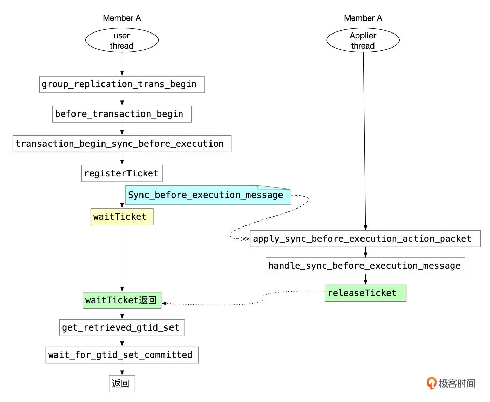
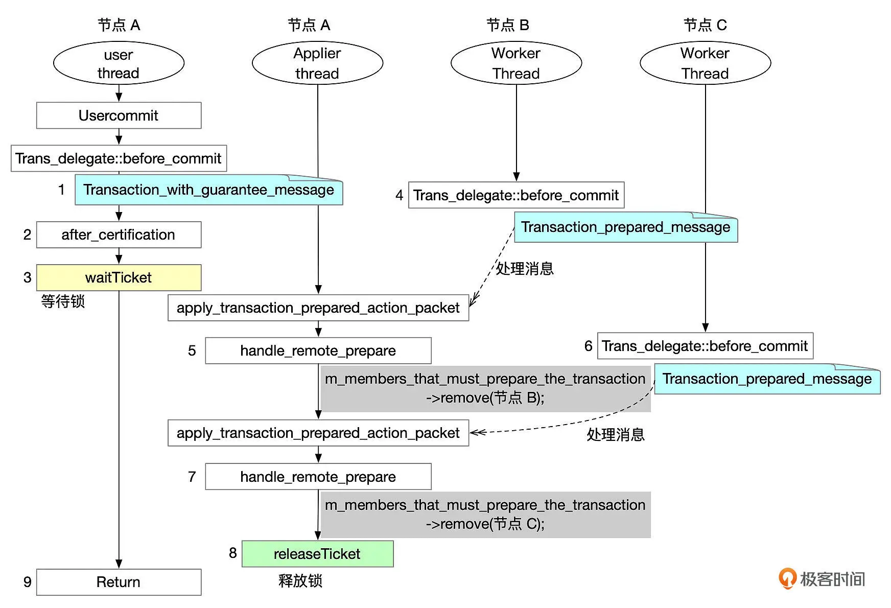
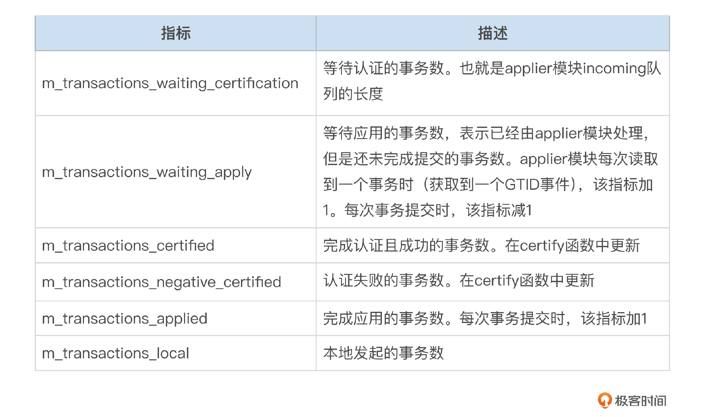

# 42 | MySQL8.0组复制技术的应用（下）

你好，我是俊达。

为了实现事务数据的强一致性，group_replication 插件在事务的处理流程上，加入了一些特殊的处理逻辑。这一讲中，我们来大致地了解下组复制的一些实现细节。当然，由于组复制的实现比较复杂，这里只能介绍部分实现逻辑。

## MGR 架构实现

MGR 集群中，提交事务前，需要将事务广播到集群中，等集群中的多数节点接收到事务消息后，本地节点才能完成提交。

从流程上看，分为三个大的阶段。

第一阶段：发送消息

本地发起 commit 时，向 MGR 集群广播事务消息，消息中包含事务生成的 Binlog 和WriteSet。

第二阶段：达成共识

各个节点发送的消息，通过 Paxos 协议达成一致。达成一致的过程，也是对各个节点的消息进行全局排序的过程。各个节点会以相同的顺序来处理消息。比如在多主模式下，集群中的各个节点可以同时修改数据，各个节点的事务消息经过 paxos 协议处理后，在各个节点上会以同样的顺序执行。

第三阶段：处理消息

通过冲突检测的事务，在源节点上可以进行提交。在其他节点上，事务消息中的 Binlog 写入到 Relay Log 中。协调线程和 Worker 线程负责事务的应用。借助官方文档中的组复制的示意图，我标注了事务执行的三个阶段，你可以看一下。



## 发送消息

### 事务处理流程中的钩子

MySQL 在代码的特定位置处加入钩子函数（HOOK），插件通过实现钩子函数，来完成特定的目的。Group replication 插件实现了事务处理中的一些钩子，来完成 MGR 的功能。我在表格中整理了 group replication 实现的钩子函数，你可以看一下。



### 事务消息

事务消息中包含几个重要的信息。

- binlog event：集群中的其他节点基于消息中的 binlog 事件，来同步数据。

- writeset：writeset 中每一项都对应着事务中修改的某一行记录。writeset 计算方式大致如下。

a) 对事务中修改的每一行数据，根据所修改表的主键和唯一索引，按固定格式拼接得到一串数据。拼接格式可以参考下面这张图。


b) 计算拼接得到的数据的 hash 值。

c) 将 hash 值加入到 writeset。

- 事务提交时节点的 gtid_executed 变量值（snapshot_version）。

writeset 和 snapshot_version 用来检测不同节点上事务修改的数据是否有冲突。

## 消息处理流程

MGR 集群中的节点，通过 GCS（Group Communication System）来发送和接收消息。



消息处理主要由几个线程来完成。

1. 任务线程（xcom_taskmain_startup）

任务线程通过集群内部监听（由参数 group_replication_local_address 设置）接收 MGR 集群中的消息。任务线程将通过 paxos 协议达成共识后的消息，加入到消息队列（m_notification_queue）。

2. 消息处理线程（process_notification_thread）

消息处理线程根据消息的类型，分别处理队列中的消息。消息处理线程的主要任务是分发消息，最终的消息会通过 applier 线程来完成处理。消息处理线程会将消息加到 applier 模块的incoming 队列中。

消息处理线程的核心逻辑在函数 on_message_received 里执行，你可以参考下面这段代码。

```sql
void Plugin_gcs_events_handler::on_message_received(
   const Gcs_message &message) const {
 Plugin_gcs_message::enum_cargo_type message_type =
     Plugin_gcs_message::get_cargo_type(
         message.get_message_data().get_payload());
 const std::string message_origin = message.get_origin().get_member_id();
 Plugin_gcs_message *processed_message = nullptr;
 switch (message_type) {
   case Plugin_gcs_message::CT_TRANSACTION_MESSAGE:
     handle_transactional_message(message);
     break;
   case Plugin_gcs_message::CT_TRANSACTION_WITH_GUARANTEE_MESSAGE:
     handle_transactional_with_guarantee_message(message);
     break;
   case Plugin_gcs_message::CT_TRANSACTION_PREPARED_MESSAGE:
     handle_transaction_prepared_message(message);
     break;
   case Plugin_gcs_message::CT_SYNC_BEFORE_EXECUTION_MESSAGE:
     handle_sync_before_execution_message(message);
     break;
   case Plugin_gcs_message::CT_CERTIFICATION_MESSAGE:
     handle_certifier_message(message);
     break;
   case Plugin_gcs_message::CT_PIPELINE_STATS_MEMBER_MESSAGE:
     handle_stats_message(message);
     break;
   case Plugin_gcs_message::CT_MESSAGE_SERVICE_MESSAGE: {
     Group_service_message *service_message = new Group_service_message(
         message.get_message_data().get_payload(),
         message.get_message_data().get_payload_length());
     message_service_handler->add(service_message);
   } break;
   case Plugin_gcs_message::CT_RECOVERY_MESSAGE:
     processed_message =
         new Recovery_message(message.get_message_data().get_payload(),
                              message.get_message_data().get_payload_length());
     if (!pre_process_message(processed_message, message_origin))
       handle_recovery_message(processed_message);
     delete processed_message;
     break;
   case Plugin_gcs_message::CT_SINGLE_PRIMARY_MESSAGE:
     processed_message = new Single_primary_message(
         message.get_message_data().get_payload(),
         message.get_message_data().get_payload_length());
     if (!pre_process_message(processed_message, message_origin))
       handle_single_primary_message(processed_message);
     delete processed_message;
     break;
   case Plugin_gcs_message::CT_GROUP_ACTION_MESSAGE:
     handle_group_action_message(message);
     break;
   case Plugin_gcs_message::CT_GROUP_VALIDATION_MESSAGE:
     processed_message = new Group_validation_message(
         message.get_message_data().get_payload(),
         message.get_message_data().get_payload_length());
     pre_process_message(processed_message, message_origin);
     delete processed_message;
     break;
   default:
     break; /* purecov: inspected */
 }
 notify_and_reset_ctx(m_notification_ctx);
}
```

3. applier 线程依次处理 incoming 队列中的消息

Applier 线程的核心逻辑，在函数 applier_thread_handle 里执行，你可以参考下面的代码。

```sql
int Applier_module::applier_thread_handle() {
......
 // applier main loop
 while (!applier_error && !packet_application_error && !loop_termination) {
   if (is_applier_thread_aborted()) break;
   this->incoming->front(&packet);  // blocking
   switch (packet->get_packet_type()) {
     case ACTION_PACKET_TYPE:
       this->incoming->pop();
       loop_termination = apply_action_packet((Action_packet *)packet);
       break;
     case VIEW_CHANGE_PACKET_TYPE:
       packet_application_error = apply_view_change_packet(
           (View_change_packet *)packet, fde_evt, cont);
       this->incoming->pop();
       break;
     case DATA_PACKET_TYPE:
       packet_application_error =
           apply_data_packet((Data_packet *)packet, fde_evt, cont);
       this->incoming->pop();
       break;
     case SINGLE_PRIMARY_PACKET_TYPE:
       packet_application_error = apply_single_primary_action_packet(
           (Single_primary_action_packet *)packet);
       this->incoming->pop();
       break;
     case TRANSACTION_PREPARED_PACKET_TYPE:
       packet_application_error = apply_transaction_prepared_action_packet(
           static_cast<Transaction_prepared_action_packet *>(packet));
       this->incoming->pop();
       break;
     case SYNC_BEFORE_EXECUTION_PACKET_TYPE:
       packet_application_error = apply_sync_before_execution_action_packet(
           static_cast<Sync_before_execution_action_packet *>(packet));
       this->incoming->pop();
       break;
     case LEAVING_MEMBERS_PACKET_TYPE:
       packet_application_error = apply_leaving_members_action_packet(
           static_cast<Leaving_members_action_packet *>(packet));
       this->incoming->pop();
       break;
     default:
       assert(0);
   }
   delete packet;
 }
end:
......
}
```

对于事务消息，会经过 applier 线程内部的流水线，依次进行处理。流水线上的三个模块分别是 Event_cataloger、Certification_handler、Applier_handler。



其中 Certification_handler 一个很重要的工作，是执行事务的冲突检测。Applier_handler 会把通过冲突检测的事务的 Binlog，写入到 Relay Log 中。Applier_handler 只是将 Binlog 写到Relay Log 中，这些 Binlog，最终会通过数据复制中的 SQL 线程和 Worker 线程来执行。

## 冲突检测的原理

MGR 开启多主模式后，每个节点都能修改数据。多个节点同时修改同一行数据时，可能会发生冲突，因此事务提交前，需要先进行冲突检测，如果有冲突，就要回滚事务。

我们通过一个例子来理解冲突检测算法。



上面这张图中，节点 A 和节点 B 在差不多同一个时间都开启了一个事务，修改了同一个表的同一行记录。

```sql
update tab set val = xx, ... where id = ID1
```

假设刚开始时，集群的数据是一致的，也就是节点 A 和节点 B 的 gtid_executed 是一样的。事务提交时，节点 1 和节点 2 分别向集群广播了事务消息，事务的消息中包含了下面这些信息。

- gtid：两个事务的 gtid 分别是 gtid3、gtid4

- writeset：ID1

- snapshot_version：{…, gtid1, gtid2}

经过 paxos 算法，这两个事务最终的执行顺序是事务 1、事务 2。

Applier 线程依次处理这两个事务。假设处理事务 1 时，没有发现冲突。事务 1 的信息记录到认证数据库中（certification_info）。认证数据库是内存中的 Key-Value 数据库，Key 是Writeset 中的条目，在这个例子中 Key 是 ID1，Value 是事务的快照版本，也就是{…, gtid1,gtid2}。

对事务 2 进行冲突检测时，从快照数据中获取到 Writeset 中的记录 ID1 的一行记录（ID1 ->{…, gtid1, gtid2}），而事务 2 的快照版本是{…, gtid1, gtid2}，和认证数据库中的快照版本是一样的，因此事务 2 和事务 1 更新的数据有冲突，事务 2 只能回滚。

我们再来看另外一个场景，节点 A 和节点 B 还是执行了同样的两个事务。



这次，节点 B 的事务稍微晚了一些执行，执行的时候，节点 A 的事务 1 已经复制到了节点B，并且在节点 B 提交了。因此，节点 B 执行事务 2 的时候，快照版本是{…, gtid1, gtid2,gtid3 }。

Applier 线程在对事务 2 进行冲突检测时，从认证数据库中获取到 Writeset 中记录 ID1 的快照版本是{…, gtid1, gtid2}，这个版本是事务 2 的快照版本的真子集，因此没有冲突，事务 2 可以提交。而认证数据库中，Key ID1 的快照版本也更新为事务 2 的快照版本，{…, gtid1, gtid2,gtid3 }。

我们总结一下冲突检测算法的实现逻辑。

1. 集群的每个节点都在内存中维护一个冲突检测 KV 数据库（cerification_info），记录了当前节点上每一行修改的数据的快照版本。Key 是 writeset 中的条目，Value 是事务的快照版本，就是事务在来源节点提交时的 gtid_executed。

2. 执行冲突检测时，对事务 writeset 中的每一条记录进行检查。

- 查找 cerification_info，如果查找不到对应的数据，则说明这行数据没有冲突。

- 存在对应 Key 的数据，对比这条记录在 cerification_info 中的快照版本和当前事务的快照版本。如果当前事务的快照版本包含了 cerification_info 中的快照版本，就说明当前这行记录没有冲突。否则，就说明当前事务发起时，看到的数据不是最新的数据，需要回滚这个事务。

3. 事务通过冲突检测后，将事务的 writeset 和快照版本添加到 cerification_info 中。

### cerification_info 过期信息清理

需要定期清理 cerification_info 中的信息，否则 cerification_info 中的数据会一直增加。MySQL 维护了一个 stable_gtid_set 信息，stable_gtid_set 通过计算集群中所有节点的gtid_executed 交集得到。集群中的每个节点会定期（每 30 秒）广播本节点的 gtid_executed消息，当节点收到所有在线节点广播的 GTID 消息后，就可以计算最新的 stable_gtid_set。

对于 cerification_info 中的任意一条记录，如果记录的快照版本是 stable_gtid_set 的真子集，就说明这条记录可以被清理掉了。gr_certif 线程会定期清理 cerification_info 中的数据。清理逻辑比较简单，就是获取 certification_info 中的信息，对比 gtid set 是否为 stable_gtid_set 的真子集，如果满足条件，就把这个记录从 cerification_info 中删除。

## MGR 集群数据一致性

我们一直说 MRG 能实现数据的强一致性，那么这里的“集群数据一致性”又是什么意思呢？为了更容易理解，这里我对问题做一个简化，只讨论单主模式下，集群数据一致性。

如果应用的读写都只访问主节点，那么通过 MySQL 的锁、MVCC 机制就能保证数据的一致性。

如果使用了读写分离，从备节点读取数据，是不是一定能读取到数据的最新版本呢？这和参数group_replication_consistency 的设置有关。

主节点提交事务时，先将 Binlog 发送给集群中其他节点。远程节点上，完成冲突检测后，将事务写入到 relaylog，由协调线程和 Worker 线程异步应用 relaylog 中的事件。根据参数group_replication_consistency 的设置，集群的数据一致性分为几个不同的等级。

- EVENTUAL

设置为 EVENTUAL 可以实现数据的最终一致性，这也是默认的设置。主节点提交事务时，不用等待备节点应用事务。这是性能最高的设置，但是从备节点中，可能会读取到老的数据。主节点切换后，新的主节点可以立即提供读写服务，不用等待从原来的主节点传输过来的事务应用完成。所以切换主节点后，在新的主节点上也可能会读到老的数据。

- BEFORE_ON_PRIMARY_FAILOVER

在这个设置下，切换到新的主节点后，要等待从其他节点发送过来的事务应用完成后，才能提供读写访问。这就能保证，在新的主节点上读取的数据是最新的。这样设置，在平时不影响读写性能，但是在发生主节点切换后，需要先应用完 Relay Log 中的日志，可能会增加业务的不可用时间。

- BEFORE

如果一致性等级设置为 BEFORE，那么事务启动时，需要先等排在当前事务前面的事务全部应用完成后才能开始执行。从备库上读取数据时，将一致性等级设置为 BEFORE，可以保证读取到数据的正确版本。比如下面图里的这些事务，如果备节点上一致性等级设置为BEFORE，那么事务 3 执行时，会等待事务 2 应用完成，因此能读取到正确的数据。



这个设置会影响备节点上读取数据的性能。

- AFTER

如果一致性等级设置为 AFTER，那么事务提交时，需要等待事务在所有节点都执行完成，本地节点上才能完成提交。这个设置下，可以保证全局强一致性。事务在本地节点完成提交后，所有节点都能读取到最新的数据。这个设置会影响事务写入性能。

- BEFORE_AND_AFTER

这个设置，同时实现了 BEFORE 和 AFTER 等级的一致性，性能影响最大。

接下来我们来看一下 BEFORE 和 AFTER 一致性等级是怎么实现的。

### BEFORE 一致性的实现

如果会话的一致性等级设置为 BEFORE 或 BEFORE_AND_AFTER，那么开启事务前，需要先向 MGR 集群广播一条同步消息（Sync_before_execution_message)，本节点收到并处理这条同步消息后，获取 applier 通道接收到的事务的 GTID SET，然后等待 applier 通道中的事务全部回放完成。



使用同步消息的主要目的是等待本节点先处理完成同步消息之前的消息，也就是要等集群中排在前事务前面的那些事务，Binlog 都同步到了本地的 Relay Log 中，然后再等待 Relay Log 中的事务执行完成，才开始执行当前事务。

只要在备节点上将一致性设置为 BEFORE 级别，这样就不影响主库数据写入的性能，又能在备库上读取到一致的数据。

### AFTER 一致性的实现

如果会话的一致性等级设置为 AFTER 或 BEFORE_AND_AFTER，那么事务提交前，需要等待 MGR 集群中的其他节点完成提交，准确地说，是等待这个事务，在其他节点上都完成Prepare 后，才能在本地节点完成提交。



实现方式可以参考上面这张图。

1. 节点 A 的用户线程提交事务时，向集群广播一条强一致事务的消息（Transaction_with_guarantee_message）。

2. 用户线程根据集群当前情况，记录需要等待哪些节点，以及需要等待的事务信息(after_certification）。

3. 用户线程等待其他节点提交事务（waitTicket）。

4. 节点 B 接收到事务消息，通过 MGR 的消息处理机制，最终会通过 worker 线程执行事务，worker 线程在提交事务时，向 MGR 集群发送事务完成 Prepare 的消息（Transaction_prepared_message）。

5. 节点 A 的 Applier 线程处理节点 B 的事务 prepared 消息（handle_remote_prepare）。

6. 节点 C 接收到事务消息，最终通过 worker 线程执行事务，在事务提交时，向 MGR 集群发送事务 Prepared 消息（Transaction_prepared_message）。

7. 节点 A 的 Applier 线程处理节点 C 的事务 prepared 消息（handle_remote_prepare）。

8. 成员 A 的 applier 线程确认所有其他节点都已经完成事务的提交后，释放锁（releaseTicket）。

9. 用户线程结束锁等待，完成事务提交。

主节点一致性等级设置为 AFTER 后，写入的性能会受到很大的影响。但是读取数据时，总是能读到最新的数据。

## MGR 的流控机制

MGR 集群的吞吐量受集群中处理能力最低的那个节点限制。如果主节点数据写入吞吐量过大，备节点来不及应用 Binlog 事件，出现事件积压，那么当主节点由于各种原因无法提供服务时，切换到备节点时，如果不等待备节点应用完积压的日志，直接提供服务，就可能会读取到老的数据，或者修改数据时发生冲突。如果等待备节点应用完积压的日志，就会增加数据库的不可用时间。

MGR 引入了流控机制来尽量避免出现上述情况。流控的主要目标是控制备节点的日志积压，当备节点出现日志积压时，限制主节点的数据写入量。

参数 group_replication_flow_control_mode 控制是否开启流控，这个参数的默认值是QUOTA，开启了流控。流控模块根据等待认证的消息队列（applier 模块 incoming 队列）和等待执行的日志队列（通道 group_replication_applier 中的 relaylog）中积压的任务数来判断是否要限流。限流的阈值分别由参数 group_replication_flow_control_certifier_threshold 和group_replication_flow_control_applier_threshold 控制。

```
mysql> show variables like '%flow_control%';
+-----------------------------------------------------+-------+
| Variable_name                                       | Value |
+-----------------------------------------------------+-------+
| group_replication_flow_control_applier_threshold    | 25000 |
| group_replication_flow_control_certifier_threshold  | 25000 |
| group_replication_flow_control_hold_percent         | 10    |
| group_replication_flow_control_max_quota            | 0     |
| group_replication_flow_control_member_quota_percent | 0     |
| group_replication_flow_control_min_quota            | 0     |
| group_replication_flow_control_min_recovery_quota   | 0     |
| group_replication_flow_control_mode                 | QUOTA |
| group_replication_flow_control_period               | 1     |
| group_replication_flow_control_release_percent      | 50    |
+-----------------------------------------------------+-------+
```

流控模块的机制主要包括以下两个方面。

1. 收集集群各个节点的吞吐量和队列长度的统计数据，估算各个节点的处理能力。

2. 如果有节点积压数量超过配置的阈值（group_replication_flow_control_applier_threshold，group_replication_flow_control_certifier_threshold），计算配额，限制节点在一个流控周期内的事务量。

每个节点定期向集群广播本节点的统计数据，参数 group_replication_flow_control_period 控制流控消息发送的频率，默认 1 秒发送 1 次。

下面这个表格中，整理了流控依赖的指标。



流控模块还需确定限流的配额（quota_size），也就是一个流控周期内集群中允许提交的事务数。配额主要基于集群中处理能力最弱的节点来计算，大致逻辑如下：

- 如果等待认证的事务数超过 group_replication_flow_control_certifier_threshold，则说明集群认证的处理能力有限，以一个周期内完成认证的事务数（通过计算m_transactions_certified 差值得到）作为可能的上限（min_certifier_capacity）。

- 如果等待应用的事务数超过 group_replication_flow_control_applier_threshold，则说明集群应用事务的能力有限，以一个周期内完成应用的事务数（通过计算m_transactions_applied 差值得到）作为可能的上限（min_applier_capacity）。

取所有节点的 min_certifier_capacity 和 min_applier_capacity 的最小值作为集群的处理能力。

此外还有一些参数会影响最终的配额。

- group_replication_flow_control_max_quota：配额上限。如果计算得到的配额超过这个限制，就以这里的限制为准。如果设置为 0，就不设置配额的上限。

- group_replication_flow_control_min_quota：配额下限。如果计算得到的配额小于这里的设置，则以这里的限制为准。如果设置为 0，就会按参数group_replication_flow_control_certifier_threshold 和group_replication_flow_control_applier_threshold 中的较小值的 5% 作为配额的下限。

- group_replication_flow_control_min_recovery_quota：如果没有设置group_replication_flow_control_min_quota，并且设置了group_replication_flow_control_min_recovery_quota，并且集群中存在 recovery 状态的节点，就以这个参数的设置作为配额的下限。

- group_replication_flow_control_member_quota_percent：存在多个主节点的情况下，配额会按一定规则分配给各个写节点。如果这个参数设置为 0，那么配额在多个节点之间平均分配。如果设置了这个参数，那么本节点的配额按这个参数设置的比例分配。比如计算得到配额为 100，集群中有 2 个写节点，如果这个参数设置为 0，那么每个写节点的配额都为50。如果这个数设置为 30，那么节点的配额是 100 * 30% = 30。

- group_replication_flow_control_hold_percent：配额预留比例。最终给到集群的配额需要减去这里设置的预留比例。例如计算得到的配额是 100，hold percent 默认设置为 10，那么

- 分配给集群的配额为 100 - 100 * 10% = 90。

- group_replication_flow_control_release_percent：当所有节点都解除限流状态后，以一定的方式增加当前配额。如果这个参数设置为 0，就立刻将配额设置为 0，也就是不设置配额。否则，在每一个计算周期，按这个参数设置的比例增加配额，例如当前配额为 100，这个参数默认值为 50，那么配额增加为 100 + 50% * 100 = 150。

每次事务提交时，都需要递增已使用配额（quota_used+1）。如果当前配额不为 0，并且已经使用的配额大于当前的配额（quota_used > quota_size, quota_size != 0），就要阻塞当前的事务，直到集群有新的配额，或者等到下一个流控周期。

## 总结

组复制技术通过 Paxos 算法，保证了事务在一个节点提交时，事务消息被集群中的大多数节点接收到。在读写分离的架构下，为了确保在备节点上能读到一致的数据，可以在备节点上将参数 group_replication_consistency 设置成 BEFORE。

虽然 MGR 集群支持多主模式，但是整个集群的写入能力受流控机制的限制。和单主模式相比，多主模式并没有特别大的优势。从架构的简单性考虑，如果使用 MGR，建议使用单主模式。

## 思考题

使用异步复制时，需要监控好备库的延迟。使用了组复制后，也要监控好备节点上事务应用的延迟时间。那么组复制下，事务的延迟怎么监控呢？

期待你的思考，欢迎在留言区中与我交流。如果今天的课程让你有所收获，也欢迎转发给有需要的朋友。我们下节课再见。
