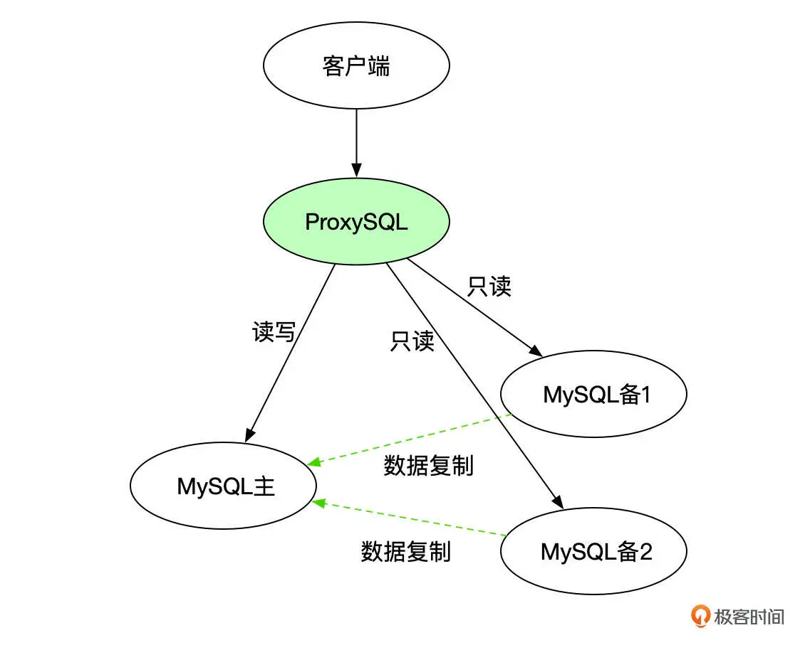
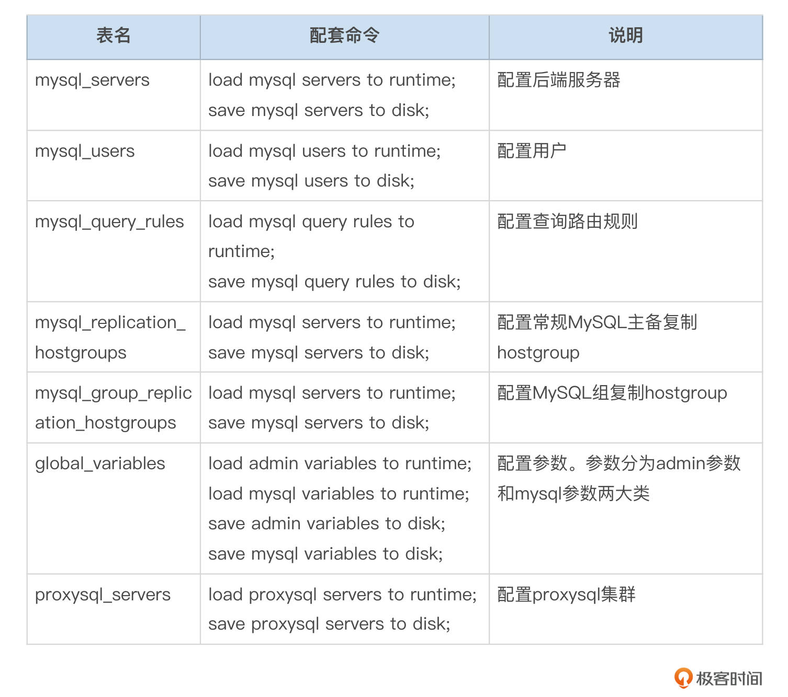
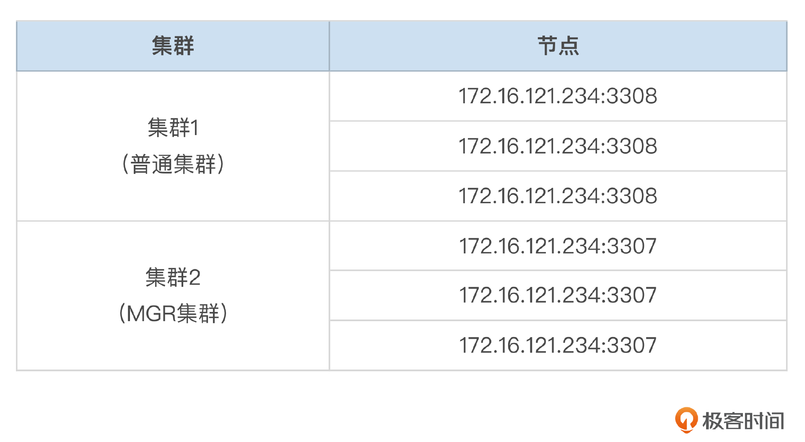
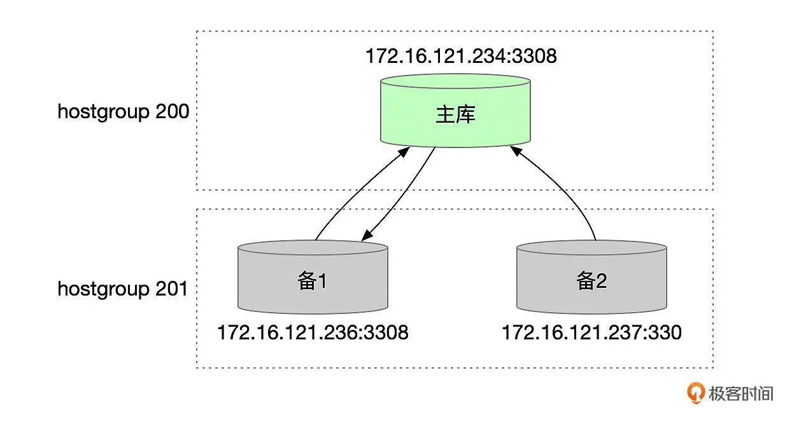
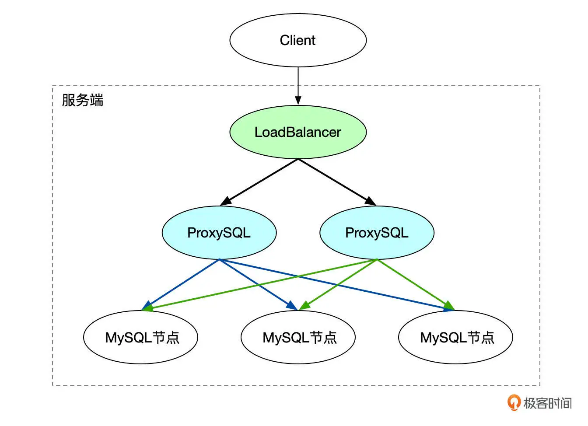
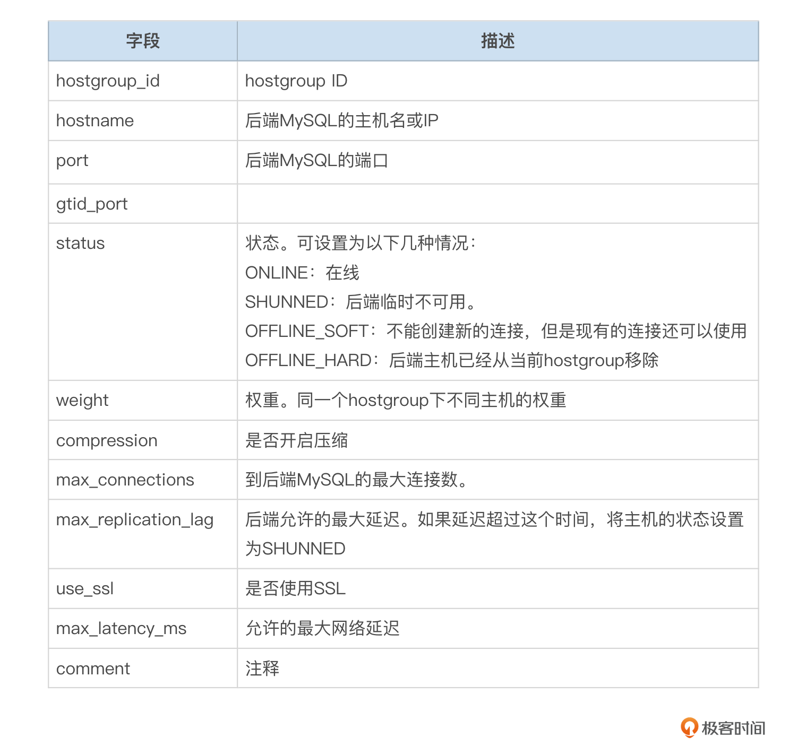
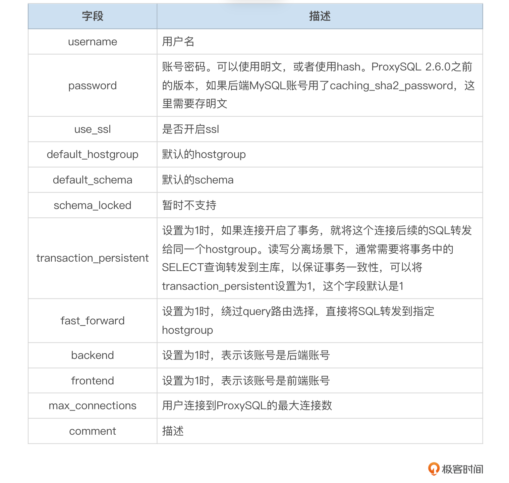
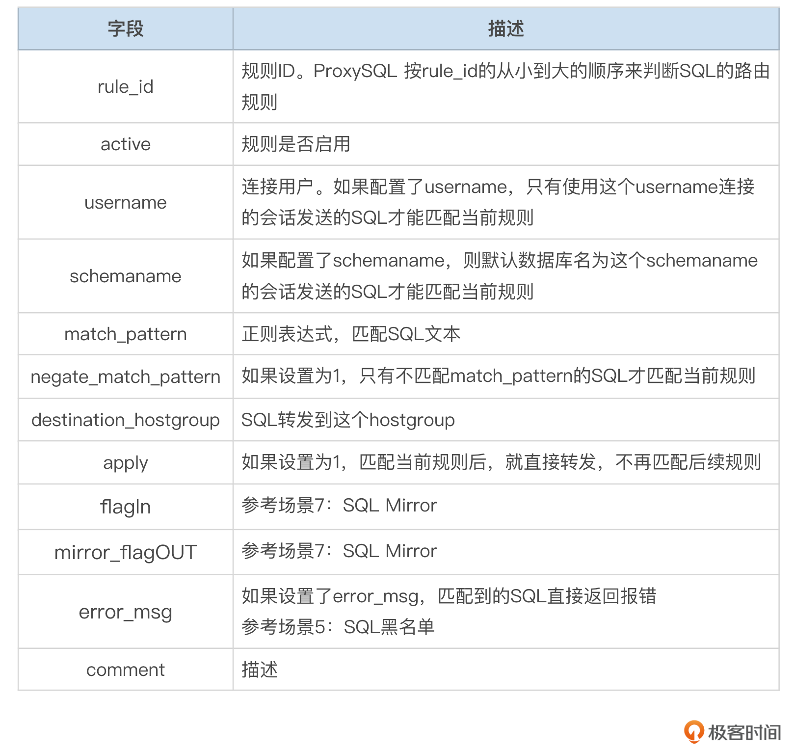
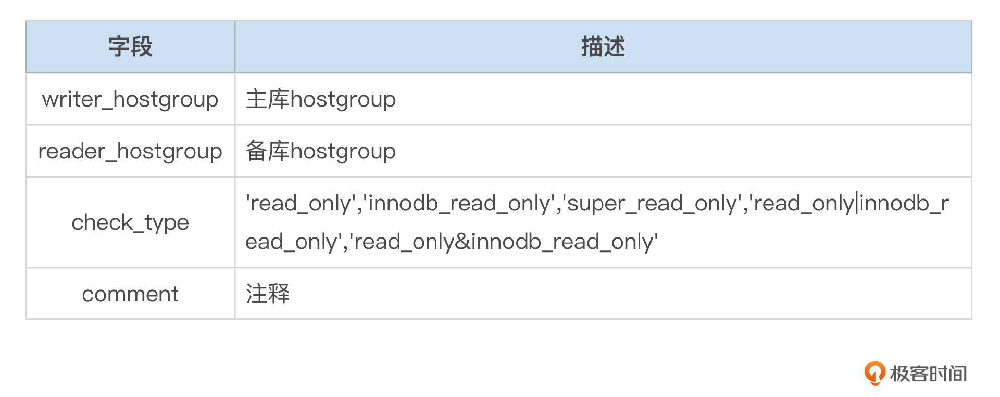
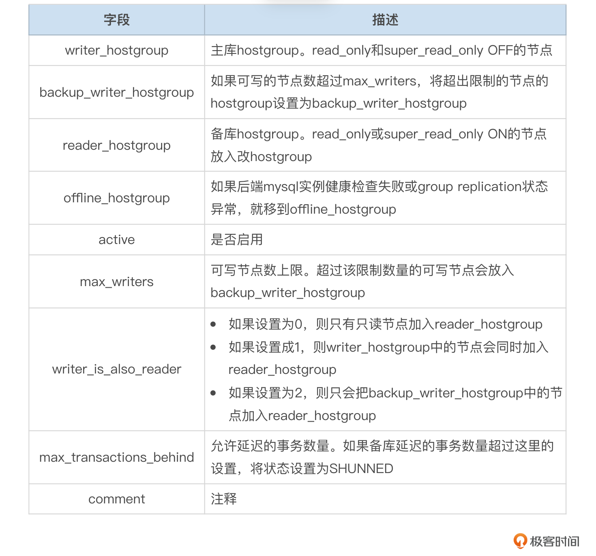

# 43 | ProxySQL：数据库高可用了，应用高可用怎么做？

你好，我是俊达。

通过前面几讲，我们知道了怎么使用 MySQL 的数据复制技术，来实现数据库层面的高可用。但是对于应用系统，当后端的 MySQL 发生高可用切换时，应该怎么处理？

这里有几种可选的方案。

1. 应用通过域名访问数据库。域名指向主库，当后端数据库发生主备切换后，将域名指向新的主库。使用域名存在几个问题，包括域名缓存的问题，以及端口的问题。因为域名只能解析到 IP，如果主库和备库的端口不一样，就无法直接通过切换域名来解决。

2. 在客户端解决。将 MySQL 集群中的实例信息都配置到应用程序中，在应用程序中自动检测主库和备库信息。也可以引入一些客户端的 SDK 来实现高可用。使用客户端的方案，会给应用开发带来额外的编码工作，或者对程序的开发语言有要求。

3. 引入 Proxy，应用程序只访问 Proxy。Proxy 内部自动识别主库，将应用的请求转发给正确的后端数据库。这里 Proxy 的作用，和在 web 高可用架构中的负载均衡器作用类似。使用Proxy 的好处，一是对客户端的限制少，你可以使用熟悉的方式访问数据库。而且有的Proxy 可以通过一些策略，实现读写分离、SQL 黑名单和白名单、SQL 改写等功能。

业界 MySQL Proxy 的产品比较多。这一讲中，我们就以开源的 ProxySQL 为例，来看一下数据库高可用的一种实现方式。

ProxySQL 支持 MySQL 传统的主备复制架构，也支持 MGR 架构。

客户端使用标准的 MySQL 协议访问 ProxySQL，在客户端眼里，ProxySQL 和 MySQL 没有大的区别。ProxySQL 根据访问的用户、执行的 SQL 语句，将请求转发给后端 MySQL，SQL执行完成后，再由 ProxySQL 将结果返回到客户端。



## ProxySQL 安装部署

先安装一个 ProxySQL。

1. 从 github 下载安装包

根据 OS 版本，选择对应的安装包。这里我们以 CentOS 7 为例，选择了当前最新的版本。

```bash
wget https://github.com/sysown/proxysql/releases/download/v2.7.1/proxysql-2.7.1-1
```

下载后验证一下文件校验码是否正确。

```
# sha256sum proxysql-2.7.1-1-centos7.x86_64.rpm
336b913c1b2bde5bdac49b1b6290a6ce636405e5e19090a1de6030e47b92b8fa  proxysql-2.7.1-
```

2. 安装 ProxySQL

我们下载的是 rpm 安装包，使用 rpm 命令进行安装。先安装依赖包。

```bash
yum install perl-DBI
yum install perl-DBD-mysql
```

再安装 ProxySQL。

```
[root@172-16-121-234 opt]# rpm -ivh proxysql-2.7.1-1-centos7.x86_64.rpm
警告：proxysql-2.7.1-1-centos7.x86_64.rpm: 头V4 RSA/SHA512 Signature, 密钥 ID 8217c
准备中...                          ################################# [100%]
正在升级/安装...
  1:proxysql-2.7.1-1                 ################################# [100%]
```

安装完成后，使用系统脚本启动 ProxySQL。

```
# systemctl start proxysql
# systemctl status proxysql
● proxysql.service - High Performance Advanced Proxy for MySQL
  Loaded: loaded (/etc/systemd/system/proxysql.service; enabled; vendor preset:
  Active: active (running) since 四 2024-11-14 14:15:19 CST; 38s ago
 Process: 10042 ExecStart=/usr/bin/proxysql --idle-threads -c /etc/proxysql.cnf
Main PID: 10044 (proxysql)
  CGroup: /system.slice/proxysql.service
          ├─10044 /usr/bin/proxysql --idle-threads -c /etc/proxysql.cnf
          └─10045 /usr/bin/proxysql --idle-threads -c /etc/proxysql.cnf
```

### 配置 ProxySQL

有几个地方可以配置 ProxySQL。

3. 配置文件。

默认的配置文件是 /etc/proxysql.cnf，也可以通过命令行参数 -c 指定配置文件。

```javascript
## /etc/proxysql.cnf
datadir="/var/lib/proxysql"
errorlog="/var/lib/proxysql/proxysql.log"
admin_variables=
{
 admin_credentials="admin:admin"
 mysql_ifaces="0.0.0.0:6032"
}
mysql_variables=
{
 threads=4
 interfaces="0.0.0.0:6033"
 ...
}
...
```

datadir 指定了 proxysql 内置数据库的存放路径。需要注意的是，proxysql.cnf 中的配置只在初次启动 proxysql 时生效。如果 proxysql 的内置数据库已经创建，后续只会从内置的数据库中读取配置信息，这时再修改 proxysql.cnf 就不起作用了。

4. 配置数据库

你可以用 mysql 客户端登录 proxysql 的 admin 端口，使用标准的 SQL 语句来配置参数。admin 端口由参数 admin_variables mysql_ifaces 指定，admin 账号密码由参数admin_credentials 指定。admin 账号只能在本地登录。登录后可以查看和修改配置项。

```javascript
# mysql -uadmin -padmin -P6032 -h127.0.0.1
Server version: 5.5.30 (ProxySQL Admin Module)
mysql>
mysql> show databases;
+-----+---------------+-------------------------------------+
| seq | name          | file                                |
+-----+---------------+-------------------------------------+
| 0   | main          |                                     |
| 2   | disk          | /var/lib/proxysql/proxysql.db       |
| 3   | stats         |                                     |
| 4   | monitor       |                                     |
| 5   | stats_history | /var/lib/proxysql/proxysql_stats.db
```

使用 show databases 命令，可以看到 ProxySQL 的几个配置数据库。

- main：内存数据库。这个库里的表分两类，runtime 开头的表存的是当前实际生效的配置。其它表存的是配置值，可通过 load 命令加载到 runtime 中，通过 save 命令持久化到磁盘

- 中。

- disk：sqllite 数据库。proxysql 启动时从这个数据库加载配置项。

常用的一些配置表，我整理到了这个表格中，后续我会通过一些具体的例子来介绍这些表的使用方法。



使用 ProxySQL，一般要完成下面这几项内容的配置。

1. 配置监控账号，监控账号用来检测后端 MySQL 实例是否健康，比如是否能连接上、复制是否正常、复制是否有延迟等。

2. 配置后端 mysql 实例连接信息，实例连接信息存储在 mysql_servers 表。

3. 配置连接 proxysql 和后端实例的账号，账号信息存储在 mysql_users 表。

4. 配置查询路由信息，路由信息存储在 mysql_query_rules 表。

5. 配置后端 mysql 集群信息，根据后端 mysql 集群架构，配置分别存储在mysql_replication_hostgroups、mysql_group_replication_hostgroups、runtime_mysql_galera_hostgroups、runtime_mysql_aws_aurora_hostgroups 等表中。

6. 根据具体需要，调优相关参数，参数存储在 global_variables 表。

### 配置监控账号

ProxySQL 使用监控账号来探测后端 MySQL 实例的健康度。监控账号要有一些基本的权限，包括：连接数据库、查看复制状态（replication client）、查看 group replication 相关表（performance_schema）。

使用下面这些命令创建监控账号。

```sql
create user 'dbmonitor'@'%' identified with mysql_native_password
by 'monitorpasswd';
grant replication client on *.* to 'dbmonitor'@'%';
-- group replication
grant select on performance_schema.replication_group_member_stats
to 'dbmonitor'@'%';
grant select on performance_schema.replication_group_members
to 'dbmonitor'@'%';
```

然后在 ProxySQL 中配置监控账号。

```
set mysql-monitor_username = 'dbmonitor';
set mysql-monitor_password = 'monitorpasswd';
load mysql variables to runtime;
save mysql variables to disk;
```

## ProxySQL 使用场景

接下来我们通过一些使用场景，来看看怎么配置 ProxySQL。例子中，会用到两个 MySQL 集群，一个是普通的主备复制集群，一个是 MGR 集群。



### 场景 1：使用 Proxysql 实现读写分离

我们把下面这个 MySQL 数据复制集群配置到 ProxySQL 中。



### 配置 hostgroup

先把数据库节点的信息写到 mysql_servers 表。

```sql
insert into mysql_servers (
 hostgroup_id, hostname, port, max_replication_lag)
values ( 200, '172.16.121.234', 3308, 3);
insert into mysql_servers (
 hostgroup_id, hostname, port, max_replication_lag)
values ( 201, '172.16.121.236', 3308, 3);
insert into mysql_servers (
 hostgroup_id, hostname, port, max_replication_lag)
values ( 201, '172.16.121.237', 3308, 3);
load mysql servers  to runtime;
save mysql servers  to disk;
```

这里我们把两个备库都加到了 hostgroup 201 中。

### 配置用户信息

然后到 ProxySQL 中配置用户信息。

```sql
insert into mysql_users
(username, password, default_hostgroup, transaction_persistent, backend, frontend
values ('user1', 'somepass', 200, 1, 1, 1, 'user1');
load mysql users  to runtime;
save mysql users  TO disk;
```

这里我们将用户的请求默认转发到 hostgroup 200，也就是主库。transaction_persistent 设置为 1，这是为了将一个事务中的所有 SQL 都发送到同一个后端 MySQL。

当然，还要到后端的 MySQL 上创建用户和授权。

```sql
create user 'user1'@'%' identified by 'somepass';
grant create,alter,insert,update,delete,select on *.* to 'user1'@'%';
```

关于用户认证插件，在 ProxySQL2.6.0 版本前，如果后端账号使用了caching_sha2_password 插件认证，配置用户时需要做一些特殊处理。

先把 admin-hash_passwords 设置为 false。

```sql
set admin-hash_passwords=1;
LOAD ADMIN VARIABLES to runtime;
save ADMIN VARIABLES to disk;
-- 确认配置生效
mysql> select * from runtime_global_variables where variable_name = 'admin-hash_
+----------------------+----------------+
| variable_name        | variable_value |
+----------------------+----------------+
| admin-hash_passwords | false           |
+----------------------+----------------+
```

然后再配置用户表，以明文的形式存储 password 字段。

```sql
load mysql users to runtime;
save mysql users to disk;
-- 确认runtime_mysql_users表中的密码是明文
mysql> select username, password
 from runtime_mysql_users
 where username = 'user1';
+----------+---------------+
| username | password      |
+----------+---------------+
| user1    | user1-backend |
```

### 配置读写分离规则

按前面这样配置，读写请求都会路由到主库。如果你想将一些查询转发到备库上执行，可以到mysql_query_rules 表中添加一些转发规则。

```sql
insert into mysql_query_rules
(rule_id, username, match_pattern, destination_hostgroup,active, apply, comment )
values (101, 'user1', '^SELECT.*FOR UPDATE$', 200,1,1, 'route to hostgroup 200');
insert into mysql_query_rules
(rule_id, username, match_pattern, destination_hostgroup, active, apply, comment)
values (102, 'user1', '^SELECT', 201,1,1, 'select query route to hostgroup 201');
load mysql query rules to runtime;
save mysql query rules to disk;
```

上面这个例子中，除了 select for update，其他所有 SELECT 开头的查询都转发到备库。

```sql
mysql> select @@hostname,@@server_id  for update;
+----------------+-------------+
| @@hostname     | @@server_id |
+----------------+-------------+
| 172-16-121-234 |     3308234 |
+----------------+-------------+
1 row in set (0.00 sec)
mysql> select @@hostname,@@server_id ;
+----------------+-------------+
| @@hostname     | @@server_id |
+----------------+-------------+
| 172-16-121-237 |     3308237 |
+----------------+-------------+
1 row in set (0.00 sec)
mysql> /*+ comment */ select  @@hostname,@@server_id ;
+----------------+-------------+
| @@hostname     | @@server_id |
+----------------+-------------+
| 172-16-121-234 |     3308234 |
+----------------+-------------+
```

上面这个配置，只是一个演示的例子，正式环境中，并不建议像这样将所有 SELECT 都无条件转发到备库。我建议你根据业务的需求，配置更精确的转发规则。而且在正式环境中添加转发规则前，要做好充分的测试。

### 场景 2：后端 MySQL 自动切换

上一个场景中，所有的写入都转发到 hostgroup 200。如果后端的数据库发生了主备切换，怎么将写请求转发到新的主库呢？

我们可以到 mysql_replication_hostgroups 表里添加一条配置记录，告诉 ProxySQL，hostgroup 200 和 201 是一个数据复制集群。

```sql
insert into mysql_replication_hostgroups
(writer_hostgroup, reader_hostgroup, check_type, comment)
values(200, 201, 'read_only', 'mysql mm cluster');
load mysql servers to runtime;
save mysql servers to disk;
```

这样配置后，ProxySQL 会检测主备库的 read_only 状态。检测到 read_only 从 OFF 变成 ON时，会将 writer_hostgroup 中的主机添加到 reader_hostgrup 中；当检测到 read_only 从 ON变成 OFF 时，会将主机从 reader_hostgroup 中移到 writer_hostgroup 中。

这里 check_type 可以设置为 read_only、innodb_read_only、super_read_only、read_only|innodb_read_only、read_only&innodb_read_only 这几种类型，区别就是检测的条件不一样。

我们来做一个测试。当前 172.16.121.234 是主库。

```sql
mysql> select hostgroup_id, hostname, port, status from runtime_mysql_servers;
+--------------+----------------+------+--------+
| hostgroup_id | hostname       | port | status |
+--------------+----------------+------+--------+
| 200          | 172.16.121.234 | 3308 | ONLINE |
| 201          | 172.16.121.236 | 3308 | ONLINE |
| 201          | 172.16.121.237 | 3308 | ONLINE |
+--------------+----------------+------+--------+
```

我们把 172.16.121.236 切换为主库，先将 172.16.121.234 的 Read_only 设置为 ON。这时可以看到 hostgroup 200 中的主机被下线了。

```sql
mysql> select hostgroup_id, hostname, port, status from runtime_mysql_servers;
+--------------+----------------+------+--------------+
| hostgroup_id | hostname       | port | status       |
+--------------+----------------+------+--------------+
| 200          | 172.16.121.234 | 3308 | OFFLINE_HARD |
| 201          | 172.16.121.234 | 3308 | ONLINE       |
| 201          | 172.16.121.236 | 3308 | ONLINE       |
| 201          | 172.16.121.237 | 3308 | ONLINE       |
+--------------+----------------+------+--------------+
```

然后再把 172.16.121.236 的 read_only 设置为 OFF。可以看到，172.16.121.236 加到了hostgroup 200 中。

```sql
mysql> select hostgroup_id, hostname, port, status from runtime_mysql_servers;
+--------------+----------------+------+--------------+
| hostgroup_id | hostname       | port | status       |
+--------------+----------------+------+--------------+
| 200          | 172.16.121.234 | 3308 | OFFLINE_HARD |
| 200          | 172.16.121.236 | 3308 | ONLINE       |
| 201          | 172.16.121.234 | 3308 | ONLINE       |
| 201          | 172.16.121.236 | 3308 | ONLINE       |
| 201          | 172.16.121.237 | 3308 | ONLINE       |
+--------------+----------------+------+--------------+
```

上面的例子中，172.16.121.236 加到 hostgroup 200 后，同时还在 hostgroup 201 中。

如果需要将这个实例从 read hostgroup 中移除，要将参数 mysql-monitor_writer_is_also_reader 设置为 false。

```
set mysql-monitor_writer_is_also_reader='false';
load mysql variables to runtime;
save mysql variables to disk;
```

然后再重新加载 mysql server，就可以把设置了 read_only=OFF 状态的后端实例从 readhostgroup 中移除。

```sql
mysql> load mysql servers to runtime;
mysql> select hostgroup_id, hostname, port, status from runtime_mysql_servers;
+--------------+----------------+------+--------------+
| hostgroup_id | hostname       | port | status       |
+--------------+----------------+------+--------------+
| 200          | 172.16.121.234 | 3308 | OFFLINE_HARD |
| 200          | 172.16.121.236 | 3308 | ONLINE       |
| 201          | 172.16.121.234 | 3308 | ONLINE       |
| 201          | 172.16.121.237 | 3308 | ONLINE       |
+--------------+----------------+------+--------------+
```

ProxySQL 只根据后端 MySQL 的 read_only 状态来判断，是将实例放到 write hostgroup 还是read hostgroup。所以需要正确地设置 read_only 状态。如果主备实例都设置了read_only=OFF，会发生双写，容易引起数据不一致。如果在备库复制有延迟或备库复制中断的情况下，将备库的 read only 设置为 OFF，同样也可能会引起数据不一致。

这通常要使用一些 MySQL 自动切换的工具，比如 MHA，来进行判断、设置。

### 场景 3：ProxySQL 和 MGR 配合使用

MGR 自带故障检测和自动切换能力，接下来我们看一下 MGR 的一个例子。

### 配置集群节点

```sql
insert into mysql_servers (
 hostgroup_id, hostname, port, max_replication_lag)
values ( 500, '172.16.121.234', 3307, 3);
insert into mysql_servers (
 hostgroup_id, hostname, port, max_replication_lag)
values ( 501, '172.16.121.236', 3307, 3);
insert into mysql_servers (
 hostgroup_id, hostname, port, max_replication_lag)
values ( 501, '172.16.121.237', 3307, 3);
load mysql servers  to runtime;
save mysql servers  to disk;
```

### 配置集群信息

到 mysql_group_replication_hostgroups 表中添加一条记录，告诉 ProxySQL，hostgroup500，501 组成了一个 MGR 集群。

```sql
insert into mysql_group_replication_hostgroups
(writer_hostgroup, backup_writer_hostgroup, reader_hostgroup,
offline_hostgroup, active, max_writers, writer_is_also_reader,
max_transactions_behind, comment)
values(500, 502, 501, 503, 1, 1, 0, 0, 'mysql mgr cluster 1');
load mysql servers to runtime;
save mysql servers to disk;
```

### 创建和配置用户信息

在 ProxySQL 中配置用户信息。

```sql
insert into mysql_users
(username, password, transaction_persistent, backend, frontend, default_hostgroup
values ('mgr', 'mgr123', 1, 1, 1, 500, 'backend user for mgr cluster');
load mysql users  to runtime;
save mysql users to disk;
```

然后到后端 MySQL 创建用户。

```sql
create user 'mgr'@'%' identified by 'mgr123';
grant select,insert,update,delete,create,alter on *.* to 'mgr'@'%';
```

都配置好之后，查看集群的配置信息。

```sql
mysql> select hostgroup_id, hostname, port, status
 from runtime_mysql_servers
 where hostgroup_id >= 500;
+--------------+----------------+------+--------------+
| hostgroup_id | hostname       | port | status       |
+--------------+----------------+------+--------------+
| 500          | 172.16.121.234 | 3307 | ONLINE       |
| 501          | 172-16-121-236 | 3307 | ONLINE       |
| 501          | 172-16-121-237 | 3307 | ONLINE       |
| 501          | 172.16.121.236 | 3307 | ONLINE       |
| 501          | 172.16.121.237 | 3307 | ONLINE       |
+--------------+----------------+------+--------------+
```

我们把 172.16.121.234 强制下线，可以看到集群选举了新的主节点。

```sql
mysql> select  member_host, member_port, member_state, member_role from replicati
+----------------+-------------+--------------+-------------+
| member_host    | member_port | member_state | member_role |
+----------------+-------------+--------------+-------------+
| 172-16-121-237 |        3307 | ONLINE       | PRIMARY     |
| 172-16-121-236 |        3307 | ONLINE       | SECONDARY   |
+----------------+-------------+--------------+-------------+
```

ProxySQL 中的 hostgroup 也自动更新了。

```sql
mysql> select hostgroup_id, hostname, port, status
      from runtime_mysql_servers
      where hostgroup_id >= 500;
+--------------+----------------+------+---------+
| hostgroup_id | hostname       | port | status  |
+--------------+----------------+------+---------+
| 500          | 172.16.121.237 | 3307 | ONLINE  |
| 501          | 172-16-121-236 | 3307 | ONLINE  |
| 501          | 172.16.121.236 | 3307 | ONLINE  |
| 502          | 172-16-121-237 | 3307 | ONLINE  |
| 503          | 172-16-121-234 | 3307 | SHUNNED |
| 503          | 172.16.121.234 | 3307 | SHUNNED |
+--------------+----------------+------+---------+
```

### 场景 4：强制查询走主库

使用读写分离时，有时候我们可能想让一些查询到主库上执行。这里提供一些强制让查询路由到主库的方法。

### 方法一：使用用户表的 transaction_persistent 设置

先把用户 transaction_persistent 字段设置为 1。

```sql
update mysql_users set transaction_persistent=1 where username='user1';
load mysql users to runtime;
```

查询前先开启事务，这样查询就会转发到主库。

```sql
mysql> start transaction read only;
Query OK, 0 rows affected (0.00 sec)
mysql> select @@hostname;
+----------------+
| @@hostname     |
+----------------+
| 172-16-121-236 |
+----------------+
1 row in set (0.00 sec)
mysql> commit;
Query OK, 0 rows affected (0.00 sec)
```

### 方法二：使用 query 注释

还有一种方法是通过注释，指定主库的 hostgroup。

```sql
mysql> SELECT /*+ ;hostgroup=200 */ @@hostname;
+----------------+
| @@hostname     |
+----------------+
| 172-16-121-236 |
+----------------+
1 row in set (0.00 sec)
mysql> SELECT /*+ ;hostgroup=201 */ @@hostname;
+----------------+
| @@hostname     |
+----------------+
| 172-16-121-237 |
+----------------+
1 row in set (0.00 sec)
```

需要注意，如果指定的 hostgroup 不存在，查询会超时。

```sql
mysql> SELECT /*+ ;hostgroup=999 */ @@hostname;
ERROR 9001 (HY000): Max connect timeout reached while reaching hostgroup 999 afte
```

### 场景 5：SQL 黑名单

利用 mysql_query_rules 表中的 error_msg 字段，可以实现 SQL 黑名单的功能。如果规则设置了 error_msg，当 SQL 语句匹配这条规则时，proxysql 会直接将 error_msg 的内容返回给客户端。

当遇到一些大查询严重影响数据库性能时，可以使用 proxysql 规则临时屏蔽这些 SQL。

### 查询 stats_mysql_query_digest

假设我们想屏蔽下面这条 SQL。

```sql
select count(*) from information_schema.tables;
```

先到 stats_mysql_query_digest 查询这个 SQL 的摘要，使用 SQL 摘要可以精确屏蔽某一类SQL。

```sql
mysql> select * from stats.stats_mysql_query_digest
 where digest_text like '%tables%' limit 1\G
*************************** 1. row ***************************
       hostgroup: 201
      schemaname: information_schema
        username: user1
  client_address:
          digest: 0x98CB260C02C33558
     digest_text: select count(*) from information_schema.tables
      count_star: 1
      first_seen: 1731567555
       last_seen: 1731567555
        sum_time: 25779
        min_time: 25779
        max_time: 25779
sum_rows_affected: 0
   sum_rows_sent: 1
```

### 配置屏蔽规则

我们选择按查询的 digest 来屏蔽，往 mysql_query_rules 写入下面这条规则。

```sql
insert into mysql_query_rules
(rule_id, username, digest, error_msg, active, apply, comment )
values (10, 'user1', '0x98CB260C02C33558', 'request denied by rule' ,1,1, 'reques
load mysql query rules to runtime;
save mysql query rules to disk;
```

需要注意，屏蔽规则的 rule_id 需要比其它规则的 rule_id 小，proxysql 是按 rule_id 的顺序依次判断是否匹配规则。

### 测试屏蔽效果

使用 digest，屏蔽的是一类 SQL，如果 SQL 只是传入的参数有差异，SQL 的 digest 一样，那么也会匹配该规则。

```sql
mysql> select count(*) from information_schema.tables;
ERROR 1148 (42000): request denied by rule
```

### 场景 6：改写 SQL

使用查询修改功能，可以在不改变应用程序的情况下，修改 SQL 语句。比如，我们可以使用SQL 改写的功能，给 SQL 添加 hint，以此来优化性能。

```sql
delete from mysql_query_rules;
insert into mysql_query_rules
(rule_id, username, match_pattern, replace_pattern,
 destination_hostgroup, active, apply, comment )
values (20, 'user1',
 '^SELECT\s+(.*?)\s+FROM\s+ta\s+where\s+a\s+=\s+(\d+)$',
 'SELECT \1 FROM ta force index(idx_a) WHERE A = \2',
 200, 1, 1, 'add force index');
load mysql query rules to runtime;
```

在上面的例子中，我们给 TA 表的查询加上了 force index 提示。

```sql
mysql> select * from ta where a = 10;
ERROR 1176 (42000): Key 'idx_a' doesn't exist in table 'ta'
mysql> select a, val from ta where a = 10;
ERROR 1176 (42000): Key 'idx_a' doesn't exist in table 'ta'
```

### 场景 7：SQL Mirror

使用 ProxySQL 的镜像（mirror）功能，可以把 SQL 发送到一个额外的后端实例执行。

还可以把发送到镜像的 SQL 进行改写，以测试修改后的 SQL 是否能正常执行。

通过 mirror_flagOut 字段，可以将多条规则串联起来。

```sql
delete from mysql_query_rules;
-- 执行SQL，同时将SQL mirror一份
insert into mysql_query_rules
(rule_id, username, match_pattern, destination_hostgroup,
mirror_flagOut, active, apply, comment )
values (20, 'user1', '^SELECT', 200,
 1001, 1, 1, 'mirror');
-- 对于mirror的SQL，增加注释，发送到hostgroup 201执行
insert into mysql_query_rules
(rule_id, username, flagIn, match_pattern, destination_hostgroup,
replace_pattern, active, apply, comment )
values (21, 'user1', 1001, '^SELECT', 201,
 'select /*+ mirrored */', 1, 1, 'mirror sql modified');
load mysql query rules to runtime;
```

上面的例子中，rule_id 为 20 的规则，设置了 mirror_flagOut=1001，rule_id 为 21 的规则，设置了 flagIn=1001，也就是将转发给 hostgroup 200 的 Select 语句，同时也转发一份到hostgroup 201，转发时，还加上了一个注释。

## ProxySQL 本身的高可用

ProxySQL 作为一个程序，本身也可能出现故障。部署 ProxySQL 的服务器也可能出现故障。高可用架构的一个基本原则是消除单点。那我们怎么解决 ProxySQL 的单点问题呢？

我们来看解决办法。你可以在多台服务器上部署 ProxySQL，在 ProxySQL 前再加一层负载均衡（如使用 LVS 或其他网络层的技术），从而消除 ProxySQL 的单点。



部署多台 ProxySQL 后，需要保证配置信息同步。不然就可能会引起客户端访问出错。可以使用 ProxySQL 自带的集群功能，来实现多个节点之间的配置信息同步。

开启 ProxySQL 的集群功能，需要做一些配置。

1. 配置 cluster 账号，用于查询对比集群内各 proxysql 节点的配置信息。

2. 配置 proxysql_servers，将集群内的 proxysql 节点信息添加到 proxysql_servers 表。

这些操作要到集群中的所有 ProxySQL 节点上执行。

### 配置 cluster 账号

通过参数 admin-cluster_username 和 admin-cluster_password 设置 cluster 账号。不能使用admin 账号作为 cluster 账号，因为 admin 账号只能在本地（127.0.0.1）登录。同时还需要将cluster 账号添加到参数 admin-admin_credentials 中。

```
set admin-admin_credentials = 'admin:admin;clusteradmin:passadmin';
set admin-cluster_username='clusteradmin';
set admin-cluster_password='passadmin';
load admin variables to runtime;
save admin variables to disk;
```

### 使用 ProxySQL 集群

我们把组成 proxysql 集群的多个节点的信息添加到 proxysql_servers 表。

```sql
mysql> show create table proxysql_servers\G
*************************** 1. row ***************************
      table: proxysql_servers
Create Table: CREATE TABLE proxysql_servers (
   hostname VARCHAR NOT NULL,
   port INT NOT NULL DEFAULT 6032,
   weight INT CHECK (weight >= 0) NOT NULL DEFAULT 0,
   comment VARCHAR NOT NULL DEFAULT '',
   PRIMARY KEY (hostname, port) )
1 row in set (0.00 sec)
insert into proxysql_servers（hostname, port, weight, comment)
   values('172.16.121.234', 6032, 1, 'proxysql node 1');
insert into proxysql_servers
   values('172.16.121.236', 7032, 1, 'proxysql node 2');
load proxysql servers to runtime;
save proxysql servers to disk;
```

这样配置好之后，在一个 ProxySQL 节点上修改的配置，会自动同步到集群的其他节点上。

## ProxySQL 配置表参考

ProxySQL 的配置主要通过一些配置表来实现。这里我对文章中用到的几个配置表做一个简单的说明，方便你查看。更详细的信息，你可以看官方文档。

### mysql_servers



### mysql_users



### mysql_query_rules



### mysql_replication_hostgroups



### mysql_group_replication_hostgroups



## 总结

在应用程序和后端 MySQL 之间，增加一层 Proxy，可以向应用屏蔽掉后端 MySQL 主备切换的一些细节。这样对应用程序而言，使用起来更加方便。同时，Proxy 还可以起到连接池的作用。

这里，其实还有一个问题没有解决，就是后端的 MySQL 怎么切换？早期比较有名的是 MHA工具。在云上，各个云厂商提供的 RDS 高可用版本，一般都标配了数据库自动切换的功能。

如果是自建的环境，你可以调研下一些开源的工具，比如 MHA、Orchestrator 等。如果数据库的数量有一定的规模，你也可以考虑自己实现一个数据库自动切换的工具。

## 思考题

如果自己实现一个 MySQL 的自动切换程序，要考虑哪些方面的问题？

期待你的思考，欢迎在留言区中与我交流。如果今天的课程让你有所收获，也欢迎转发给有需要的朋友。我们下节课再见。
