# 45 | MySQL源码分析和GDB调试器的应用

你好，我是俊达。

之前在评论区有同学留言问是否能加一讲源代码调试的内容。考虑到这个专栏中有相当多的篇幅是讲 MySQL 和 InnoDB 的内部实现机制，而我自己在整理这些内部原理时，也参考了大量的 MySQL 源码，有时也会用 GDB 来调试跟踪代码的执行，因此在这一讲中，我们就来聊聊MySQL 源码分析和 GDB 在源码分析中的一些使用场景。

这里我们只讨论 MySQL 的源码分析，不涉及到怎么修改 MySQL 源码来实现一些定制化的功能。

## MySQL 源码介绍

这一讲中，我们就以当前 8.0 系列中最新的 Release 版本 8.0.40 为例，下载代码并解压。我们先简单看一下 MySQL 源码文件的组织（只是为了看结构，下面的输出中，把很多内容删减掉了）。

```
# tree -d -L 2
...
├── include
├── mysys
├── plugin
│   ├── auth
│   ├── clone
...
│   ├── group_replication
...
│   ├── semisync
│   └── x
......
├── sql
│   ├── auth
│   ├── binlog
│   ├── changestreams
│   ├── conn_handler
│   ├── containers
│   ├── daemon_proxy_keyring
│   ├── dd
│   ├── examples
│   ├── gis
│   ├── histograms
│   ├── iterators
│   ├── join_optimizer
│   ├── locks
│   ├── memory
│   ├── partitioning
│   ├── protobuf
│   ├── raii
│   ├── range_optimizer
│   ├── server_component
│   └── xa
├── sql-common
│   └── oci
├── storage
......
│   ├── innobase
│   └── temptable
└── vio
```

我们先对源码中的一部分目录做一个简单的介绍。

### plugin

plugin 目录下是插件的源码，比如专栏中介绍过的 clone 插件、semisync 插件、group_replication 插件，每个 plugin 的代码在对应的目录下。

### sql

MySQL Server 核心模块的大量源代码都在 sql 目录下。8.0.40 版本中，这个目录下有接近100 万行源码。

```
# find sql -regextype posix-egrep -regex '(.*\.cc)|(.*\.h)' | \
 xargs wc -l | \
 tail -1
940750 total
```

- sql/sql_yacc.yy 是比较特殊的一个文件，这里定义了 MySQL 中 SQL 的语法。

- sql/mysqld.cc 里定义了 mysqld_main，这是 MySQL 数据库启动时调用的入口函数。

- sql/iterators 目录下是 SQL 执行引擎的代码，包括表扫描、索引扫描、表连接的执行。

- sql/sql_optimizer.cc 里的 JOIN::optimize 是优化器的一个入口函数。

- sql/sql_parse.cc 中的 do_command 函数，读取客户端发送过来的请求（命令或 SQL），并根据请求的类型进行分发（dispatch_command）。

- sql/conn_handler 目录中是 MySQL 处理新建连接请求的代码。默认使用connection_handler_per_thread.cc，也就是给每个客户端分配一个独立的线程，处理客户端的请求。

- sql/dd 目录下是数据字典的实现代码。数据字典表的定义，初始化数据库（mysqld --initialize）时怎么创建数据字典表，数据库启动时怎么加载数据字典表，很多代码都在这个目录下。

- sql/log_event.cc 里，定义了不同类型 Binlog 事件的格式。

- sql/handler.cc 里实现了 handler 类。读取或修改表里的数据，都会通过 handler 接口来实现。存储引擎继承 handler 类（比如 innodb 的 ha_innobase），实现数据的读写功能。

### storage/innobase

storage 目录中是 MySQL 支持的各个存储引擎的实现代码。InnoDB 的代码在 innobase 目录中，代码量接近 50 万行。

```
# find storage/innobase -regextype posix-egrep -regex '(.*\.cc)|(.*\.h)|(.*\.ic)'
   xargs wc -l | \
   tail -1
460953 total
```

InnoDB 的代码，按功能模块，分为多个目录。

```
# tree -d -L 1
.
|-- api
|-- arch
|-- btr
|-- buf
|-- clone
|-- data
|-- ddl
|-- dict
|-- eval
|-- fil
|-- fsp
|-- fts
|-- fut
|-- gis
|-- ha
|-- handler
|-- ibuf
|-- include
|-- lob
|-- lock
|-- log
|-- mach
|-- mem
|-- mtr
|-- os
|-- page
|-- pars
|-- que
|-- read
|-- rem
|-- row
|-- srv
|-- sync
|-- trx
|-- usr
`-- ut
```

这里先做一个简单的介绍。

### include 目录

include 目录里是 InnoDB 代码使用的一些头文件。

fil0types.h 中定义了 InnoDB 页面的基本格式，这里定义了页面头部和尾部中各个字段在页面内的偏移地址。

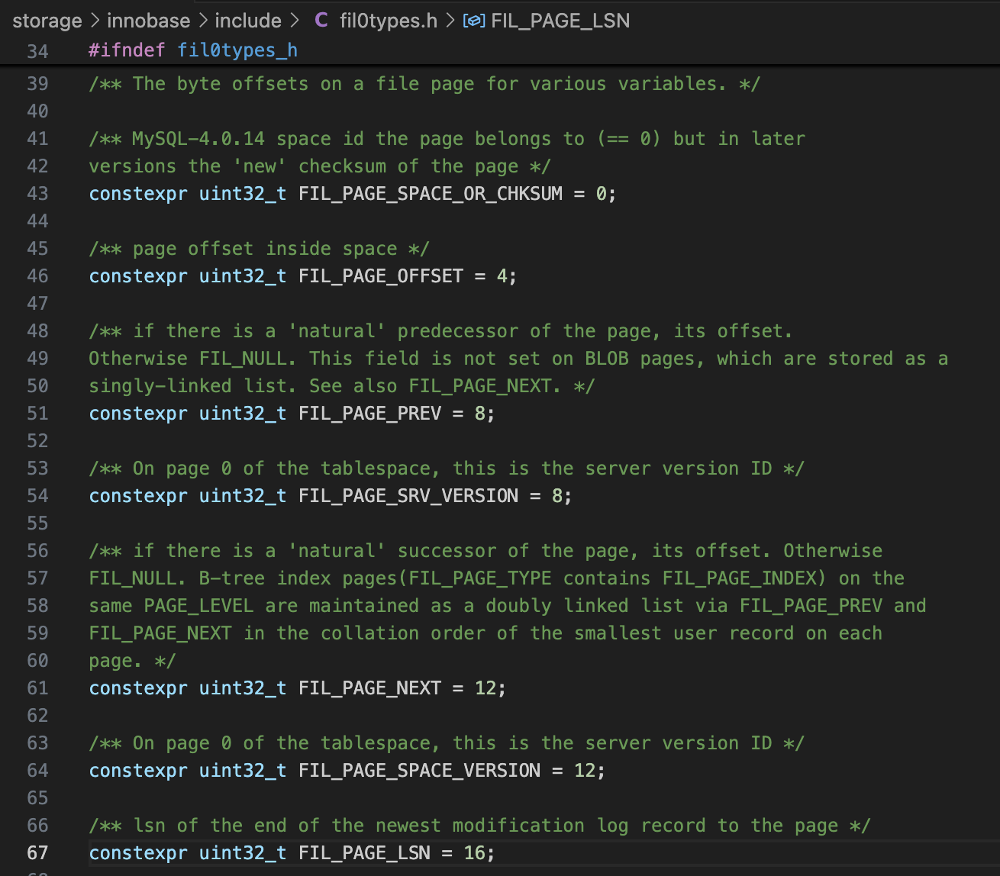

fsp0fsp.h 中定义了文件头（Space Header）的格式，还定义了 Inode、区描述符（XDES）等这些用来管理文件空间的数据结构的存储格式。

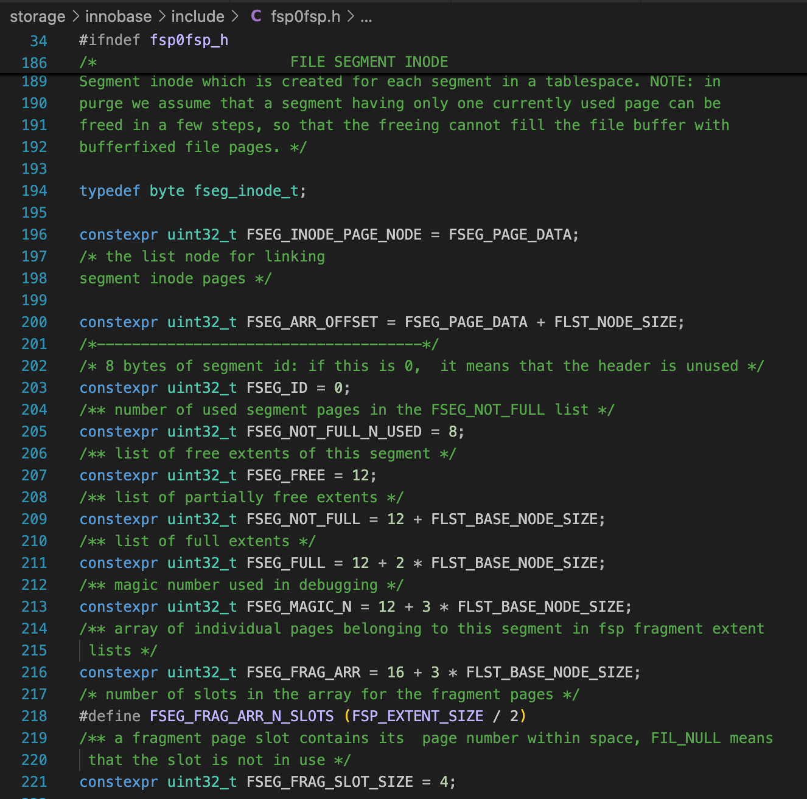

page0types.h 中定义了 B+ 树页面头的格式。

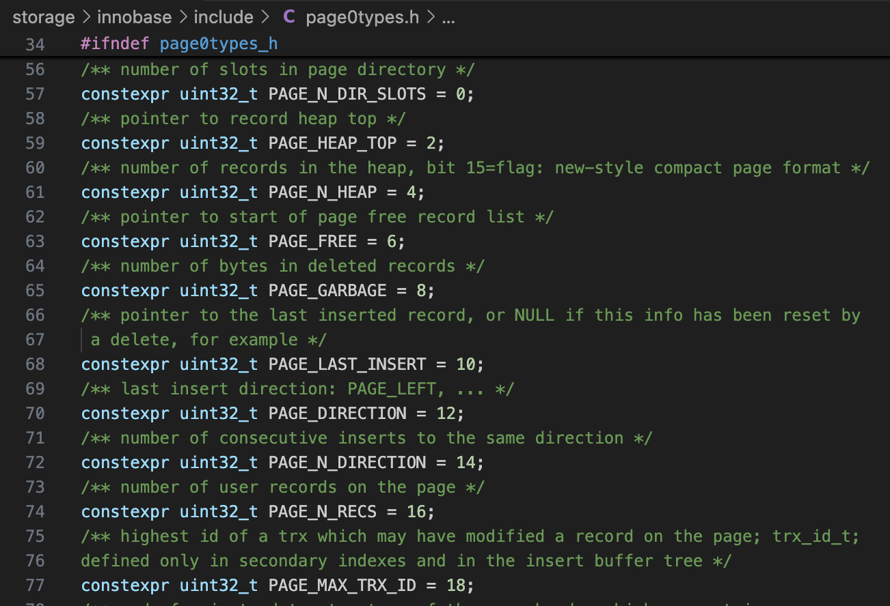

在代码里搜索这里定义的常量，能很快找到使用这些常量的代码，就能理解这些字段的作用。比如搜索 PAGE_HEAP_TOP，看到函数 page_mem_alloc_heap 中会写入这个字段（page0page.cc 243 行）。

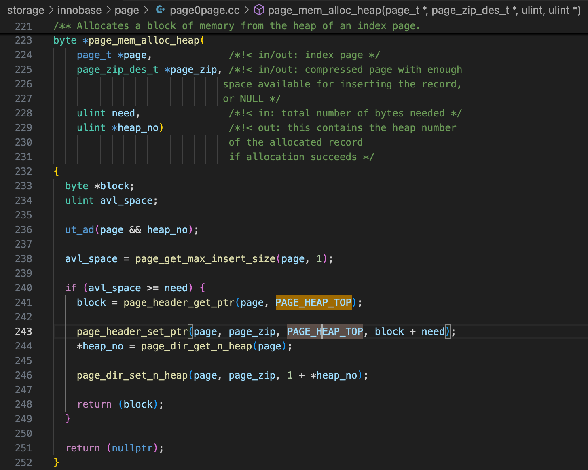

再搜索 page_mem_alloc_heap，发现这个函数在 insert 时被调用（page0cur.ccpage_cur_insert_rec_low），然后就可以看到 insert 的记录是怎么写到数据块中了（参考page_cur_insert_rec_low 中标了编号的几行代码注释）。

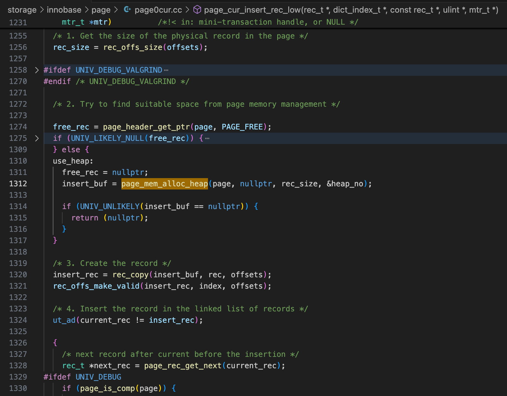

根据这几个头文件，再到代码中搜索和分析使用了这些常量的一些代码，就能整理出25、26这两讲中的页面物理格式了。

### rem

rem 目录下是定义和操作行记录格式的代码。rem0rec.cc 里定义了 InnoDB 支持的两大类行格式，一类是 REDUNDANT 格式，也就是注释中的“OLD STYLE”，另一类是 Compact 类型，包括 compact、dynamic、compressed，也就是注释中的“NEW STYLE”。

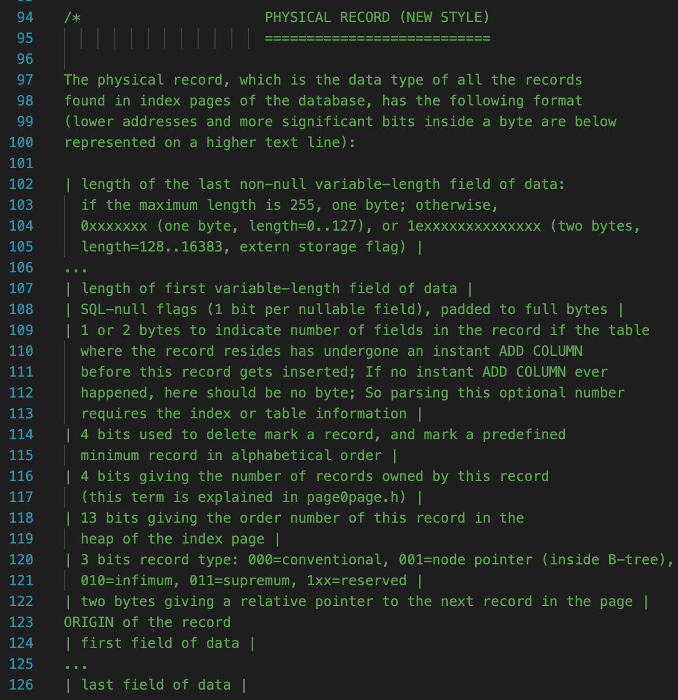

### page

page 目录下主要是操作 B+ 树页面内容的代码，包括创建 B+ 树页面、往页面中插入记录、删除页面中的记录等代码，还有维护页目录项的代码。

### btr

btr 目录下主要 B+ 树相关的代码。B+ 树是 InnoDB 中最核心的一个数据结构。这里包括在B+ 树中查找记录（btr_cur_search_to_nth_level）、插入记录（btr_cur_optimistic_insert，btr_cur_pessimistic_insert）、更新记录（btr_cur_update_in_place、btr_cur_optimistic_update、btr_cur_pessimistic_update）、删除记录（btr_cur_optimistic_delete、btr_cur_pessimistic_delete）的代码，也包括了维护自适应Hash 索引的代码。

### row

row 目录下包括了操作行的相关代码，比如插入行（row_insert_for_mysql）、更新或删除行（row_update_for_mysql）、清理行（row_purge）。

row_search_mvcc 是这里比较重要的一个函数，从 InnoDB 中查询数据，包括执行 Select 语句，或者执行 Delete 和 Update 语句时，都会通过这个函数来查询数据。函数row_vers_build_for_consistent_read 用来构建记录的历史版本。

MySQL Server 层和 InnoDB 层使用了不同的行和字段存储格式，这里提供了格式转换函数，row_mysql_convert_row_to_innobase 将 MySQL 行格式转换成 InnoDB 行格式，row_sel_store_mysql_rec 将 InnoDB 行格式转换成 MySQL 行格式。

这里还包括了回滚行操作的代码（row_undo，row_undo_ins，row_undo_mod）。

当表上有 Online DDL 在执行时，对表的 DML 操作需要记录到在线变更日志中。在线创建索引时，DML 操作通过 row_log_online_op 记录，DDL 执行结束前，通过 row_log_apply 函数应用在线变更日志。在线 Rebuild 表时，表上的 DML 操作通过 row_log_table 函数来记录，DDL 执行完成前，使用 row_log_table_apply 应用在线变更日志。

### trx

trx 目录中是事务处理的相关代码，包括事务提交（trx_commit，trx_commit_in_memory,trx_release_impl_and_expl_locks）、事务回滚（trx_rollback_for_mysql）。

Undo 日志，通过函数 trx_undo_report_row_operation 记录。如果想了解事务执行过程中记录了哪些 Undo 日志以及 Undo 日志的具体格式，可以分析这个函数。数据库启动时，要执行崩溃恢复，函数 trx_recover_for_mysql 用来查找处于 Prepared 状态的事务。这里还包括了回滚段和 Undo 段处理的相关代码。

### buf

buf 目录中是 InnoDB Buffer Pool 的实现代码，包括 Buffer Pool 的结构，Buffer Pool 中的各个链表和 Hash 表。

### fsp

fsp 目录中是 InnoDB 表空间管理的相关代码，包括分配页面、释放页面空间等。

### handler

hander 目录下是 MySQL 存储引擎 Handler 接口的实现代码。MySQL Server 层调用 InnoDBHandler 代码，读取或写入数据，提交或回滚事务。类 ha_innobase 中实现了访问 InnoDB 数据的函数。

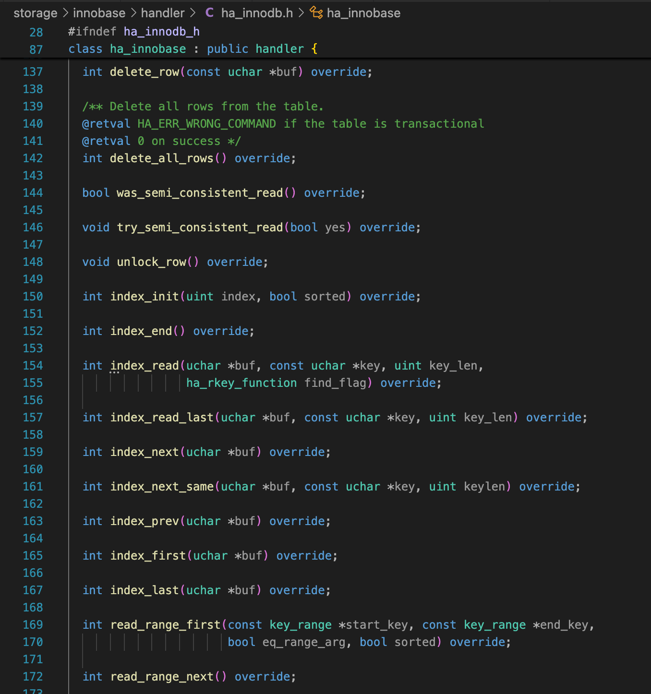

函数 innodb_init 中设置了一系列给 server 层调用的函数。加载 InnoDB 插件时调用这个函数。

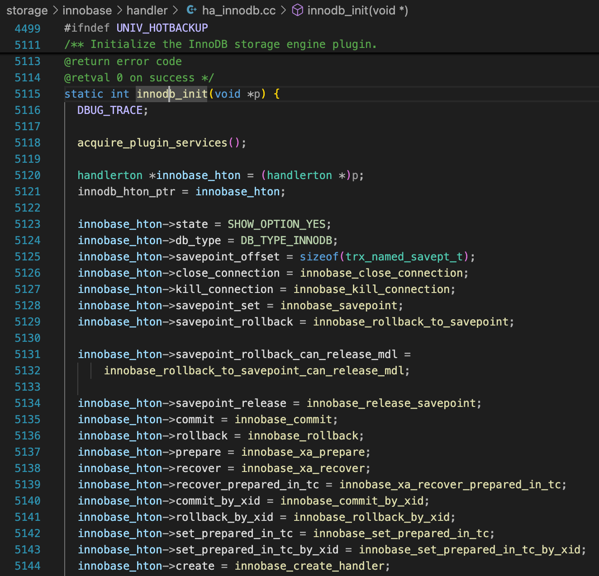

### log

log 目录下是 Redo 的相关代码，包括管理 Log Buffer 空间，分配 Log 序列号，将 Redo 日志写入 Log Buffer。

log_writer、log_flusher、log_checkpointer 这几个是 Redo 系统的几个关键线程的主函数，负责 Redo 日志的持久化。数据库启动时，调用 log_start_background_threads 函数，启动这些线程，以及其他一些线程。

数据库启动时，调用函数 recv_recovery_from_checkpoint_start，扫描和解析 checkpoint 之后的所有 Redo 日志。

函数 recv_scan_log_recs 解析 Redo 日志，并将解析出来的日志先加到 Hash 表中。函数recv_apply_hashed_log_recs 应用 hash 表中的 Redo 日志。

### mtr

mtr 目录中是 Mini Transaction 相关代码。mlog_write 开头的一系列函数（mlog_open_and_write_index，mlog_write_string，mlog_write_ulint，mlog_write_ull，mlog_write_initial_dict_log_record 等）生成 Redo 日志，写到 mtr buffer 中。在这些函数上设置断点，就能看到事务执行过程中会生成哪些 Redo 日志，以及日志的格式。

mlog_parse 开头的一系列函数（mlog_parse_initial_log_record，mlog_parse_nbytes，mlog_parse_string，mlog_parse_index 等）从 Redo 文件中解析日志。mtr_t 是一个比较重要的数据结构，m_impl.m_memo 记录了 mtr 执行过程中修改的数据块、获取的锁对象和锁模式，m_impl.m_log 中记录了 Redo 日志。mtr 提交时（mtr_t::commit），m_log 中的 Redo 日志复制到 Redo Log Buffer，修改过的脏页添加到 Flush 链表，mtr 执行过程中获取的锁，也会在提交时解锁（memo_slot_release）。

### srv

srv 目录下，包括了 InnoDB 一些服务线程的代码，如 srv_master_thread、srv_worker_thread、srv_purge_coordinator_thread、srv_monitor_thread、srv_error_monitor_thread。数据库启动时调用 srv_start 启动 InnoDB。

## 使用代码分析工具

前面对 MySQL 的代码做了一个非常简单的介绍，还提供了一些比较关键的函数，这些函数可以作为了解 MySQL 源码的一个起点。但是 MySQL 的源码，代码文件数多，代码量大，代码风格不统一，函数调用层次比较深。利用一些工具，能帮我们更好地理解这些代码。

有一些代码分析工具，比如 SourceInsight，能分析函数、方法、全局变量、结构、类等符号信息。能显示参考树、类继承图和调用树等，直观地展示函数的调用关系、类的继承层次等。

还能迅速搜索整个项目，找到符号的定义位置、被调用位置等所有引用，方便追踪代码的执行路径和数据流向。

这里，我介绍一款轻量，但功能强大的源代码编辑器，VSCode。安装上 C/C++ 扩展后，使用VSCode 可以方便地分析 MySQL 源码。VSCode 还可以整合编译、调试工具，不过这里我只用了代码分析功能。如果你有兴趣，也可以尝试在 VSCode 中整合调试工具。

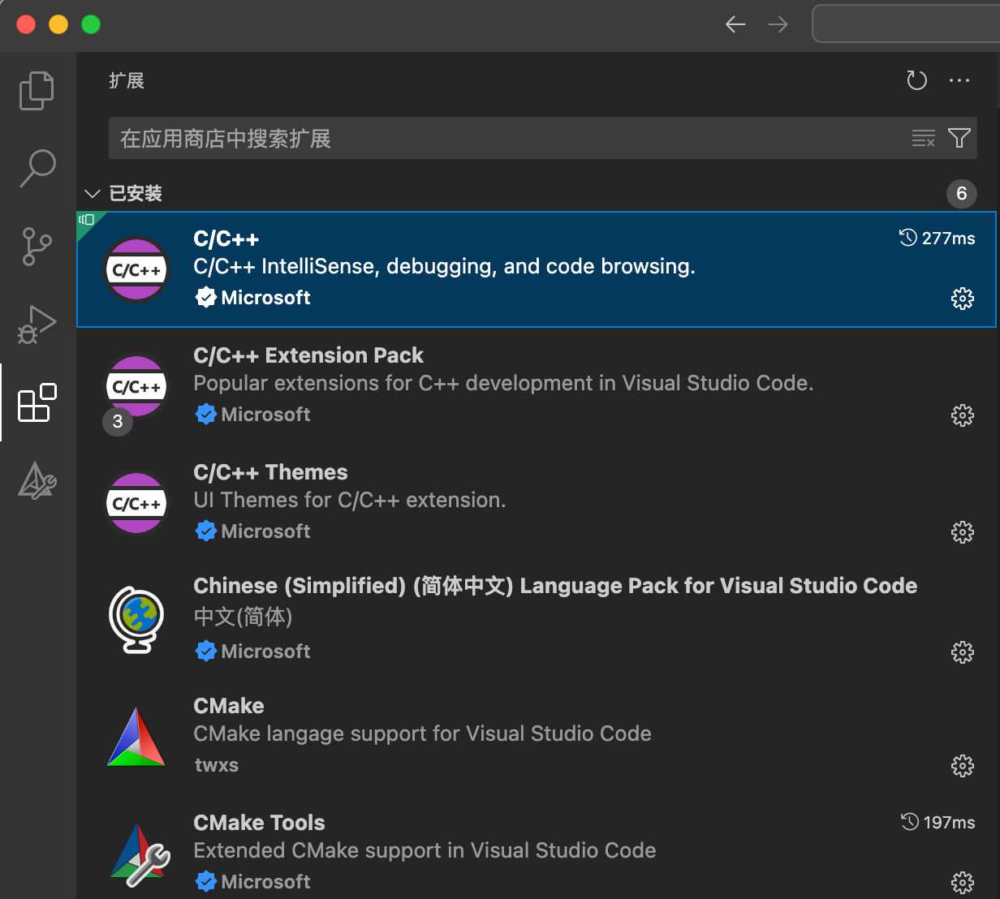

### 使用 VSCode 分析代码

接下来就使用 VSCode，来分析下数据库崩溃恢复时，怎么处理 Prepared 状态的事务。35讲中的“二阶段提交”这一小节中，提到过 Prepared 状态的事务，在数据库启动时是提交还是回滚，取决于 Binlog 中是否存在对应的 XID 事件。

### 函数 trx_recover_for_mysql

innobase/trx/trx0trx.cc 中有一个函数 trx_recover_for_mysql，看起来和崩溃恢复有关，我们就从这个函数开始分析。

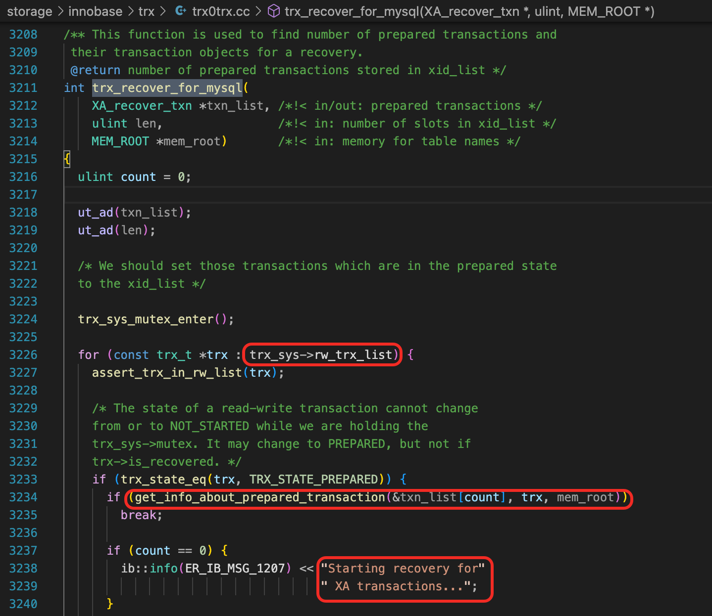

这个函数的逻辑比较简单，就是统计 trx_sys->rw_trx_list 中状态为 TRX_STATE_PREPARED的事务，函数的返回值就是 Prepared 状态的事务数。

这里还调用了一个函数 get_info_about_prepared_transaction，可以直接跳转到函数的定义中。这里还有一点值得注意，函数 get_info_about_prepared_transaction 的第一个参数，传入了一个指针，指向 trx_list 的第 N 个元素，调用这个函数后，就把第 N 个 Prepared 状态的事务加到了 trx_list 中。

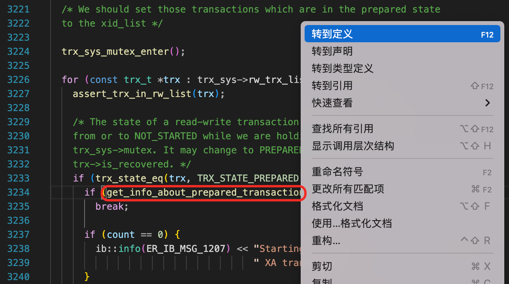

### 链表 trx_sys->rw_trx_list 的数据从哪里来？

那么数据库启动时，rw_trx_list 里的数据是从哪里来的呢？使用查找功能（CMD + SHIFT +F）进行搜索，发现 trx0trx.cc 中有一处代码会往这个列表中插入数据（UT_LIST_ADD_FIRST）。

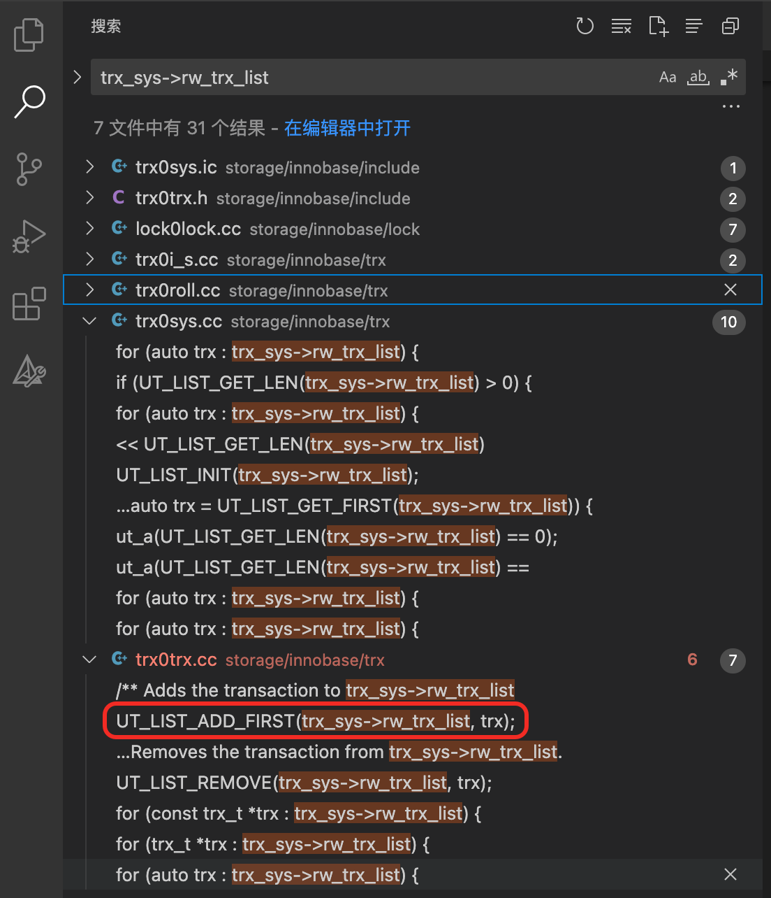

查看代码，这里只是封装了一个函数 trx_add_to_rw_trx_list。

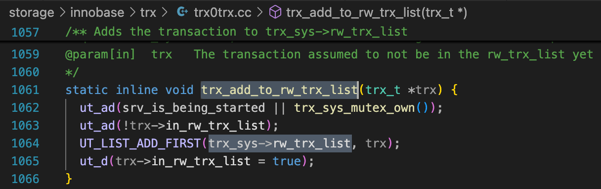

接下来要看哪些地方调用了这个函数。这里可以使用全局搜索，也可以使用“查找所有引用”（快捷键 ALT + SHIFT + F12）。

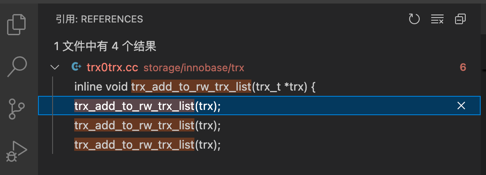

调用这个函数的地方不多，分别查看后，trx_sys_init_at_db_start 应该是我们想找的函数。

函数 trx_sys_init_at_db_start

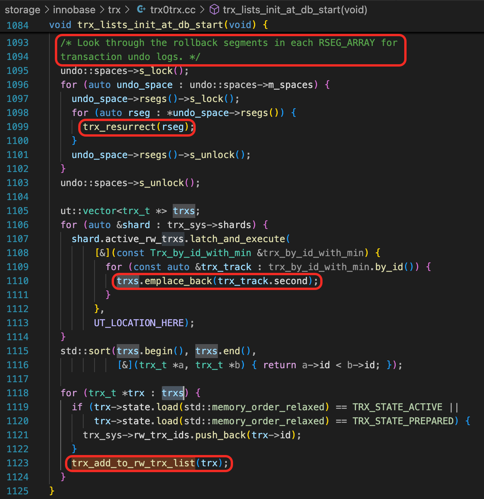

这个函数中主要做了几件事情。

- 扫描每一个 Undo 表空间中的每一个回滚段，调用 trx_resurrect 函数，读取回滚段中所有的 Undo 段，把未完成的事务识别出来。trx_resurrect 函数中最终会调用trx_sys_rw_trx_add，把事务加到 trx_sys->shars 中。

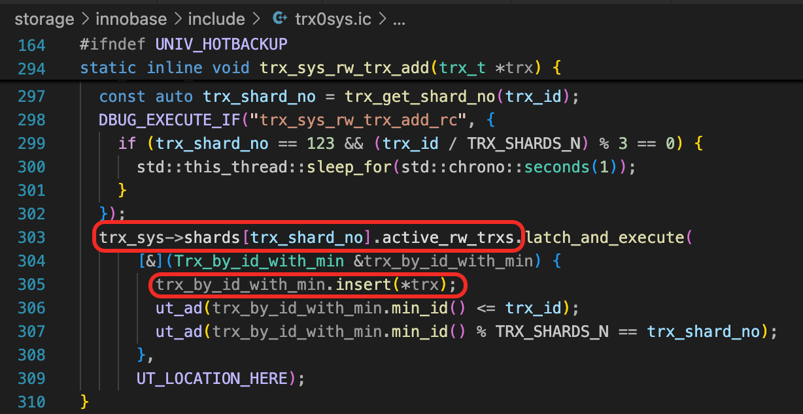

- 事务加到 trxs，按事务 ID 排序后，加到 trx_sys->rw_trx_list 中。

当然，你还可以继续分析回滚段、Undo 段中的数据怎么读取。

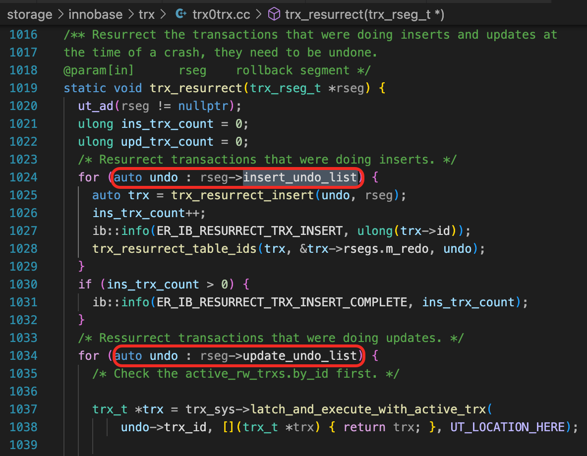

函数 trx_resurrect 中用到了 rseg->insert_undo_list，rseg->update_undo_list，分析这几个列表的数据怎么添加，最终可能会发现下面这个调用链路。这里我就不具体展开了。

```
trx_rsegs_init -> trx_rseg_mem_create ->
-> trx_undo_lists_init -> trx_undo_mem_init
```

你还可以分析 trx_sys_init_at_db_start 是什么时候调用的。最终你可能会发现大致的调用链路是这样的。

```
mysqld_main -> process_bootstrap -> dd::init -> Dictionary_impl::init
-> bootstrap::initialize -> DDSE_dict_init -> innobase_ddse_dict_init
-> innobase init files -> srv start -> trx sys init at db start
```

当然你也可以在调试器中设置断点，代码运行到 trx_sys_init_at_db_start 时，查看调用栈，这样更方便，也更准确。不过直接阅读源码进行分析也是一个很好的练习。

### 事务是怎么恢复的

上面我们只是分析了怎么从 Undo 表空间中把未完结的事务扫描出来。但是这些事务具体是怎么恢复的呢？

回到 trx_recover_for_mysql 这个函数，谁调用了这个函数呢？很快就找到了innobase_xa_recover。

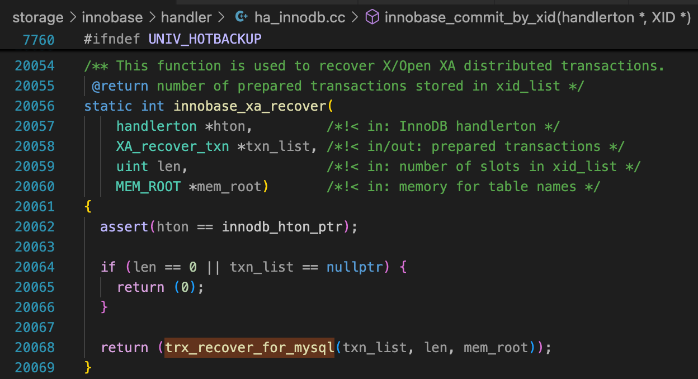

谁调用了 innobase_xa_recover 呢？你会发现代码中并没有直接调用这个函数。但是innodb_init 中，这个函数赋值给了 innobase_hton->recover 这个函数指针。执行innobase_hton->recover 时，实际上就是在执行 innobase_xa_recover。

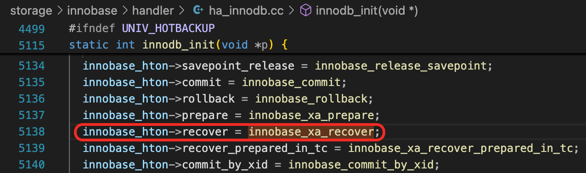

你可以试着查一下 hton->recover 在哪里调用。直接搜索 innobase_hton->recover 或 hton->recover 找不到调用的地方，因为在调用的地方，变量名不是 innobase_hton 或 hton。改成搜索“->recover(”，可以找到调用的地方。

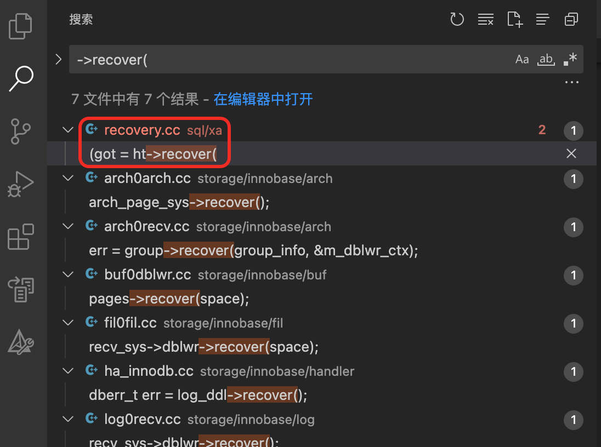

recover_one_htrecover_one_ht 中调用了 ht->recover。我们已经知道，调用 recover 时，会把 Prepared 状态的事务加到 trx 链表中，也就是这里的 info->list 中。

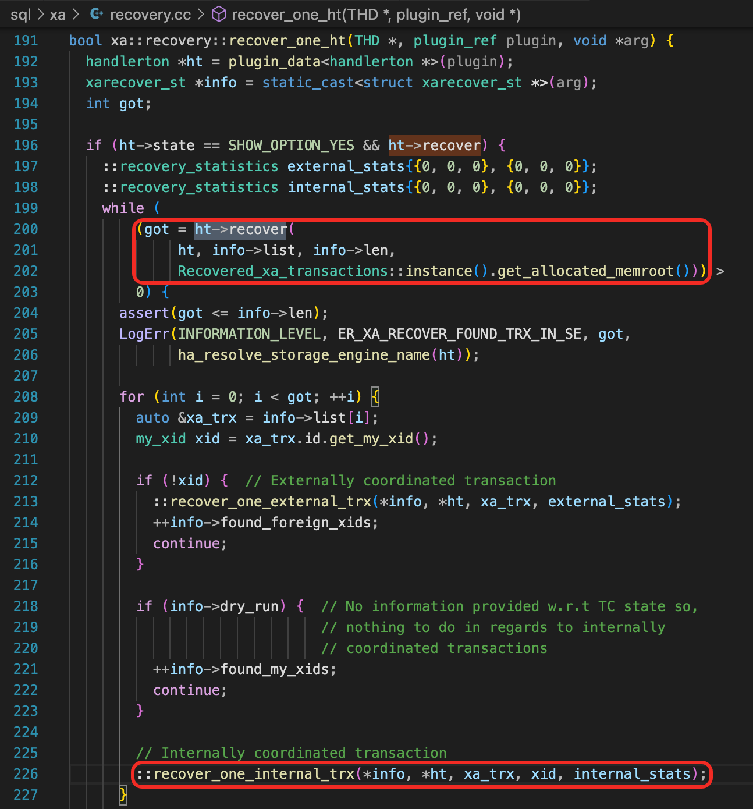

208 行的循环中，依次处理每一个事务，调用函数 recover_one_external_trx 或recover_one_internal_trx 恢复事务。这个专栏中，没有涉及到 XA 事务，这里只分析recover_one_internal_trx。

recover_one_internal_trx

函数 recover_one_internal_trx 中，会判断 info.commit_list 中是否有当前处理的事务的 XID，如果有，就执行 ht.commit_by_xid 提交事务，如果没有，就执行 ht.rollback_by_xid 回滚事务。

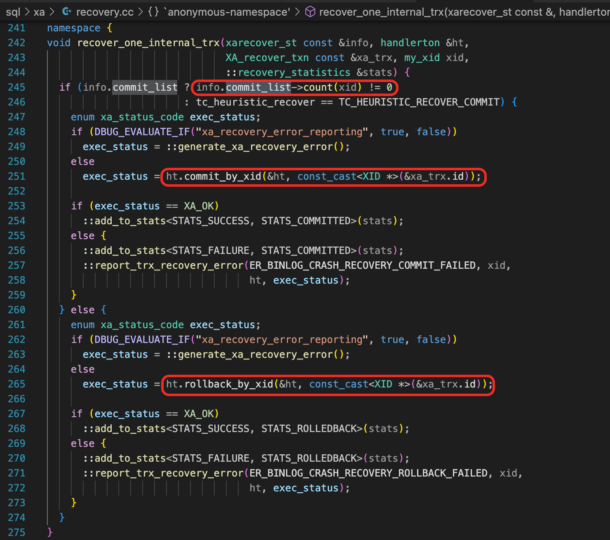

commit_list

接下来我们要分析 commit_list。commit_list 作为参数传给 ha_recover 函数。

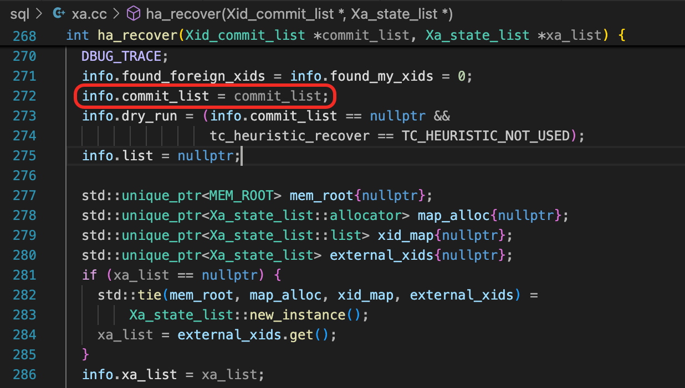

Binlog_recovery::recover

ha_recover 由函数 Binlog_recovery::recover 调用，传入的参数是 this->m_internal_xids。这里的 this，就是 Binlog_recovery 对象。

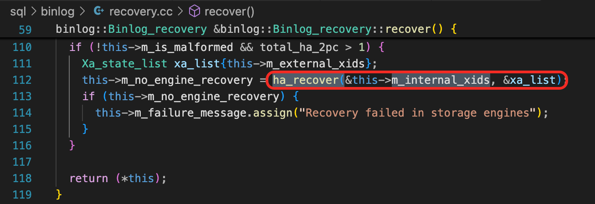

m_interal_xids

再搜索 m_internal_xids，可以找到 Binlog_recovery::process_xid_event 函数中会把 XID 加进来。

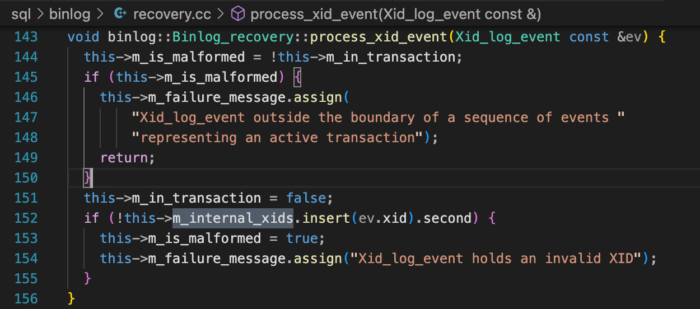

Binlog_recovery::recover

Binlog_recovery::recover 函数中会调用 process_xid_event。64 行的循环中，读取 Binlog 文件中的每一事件，如果读取到一个 XID 事件，就把 XID 加到 m_interal_xids 中。

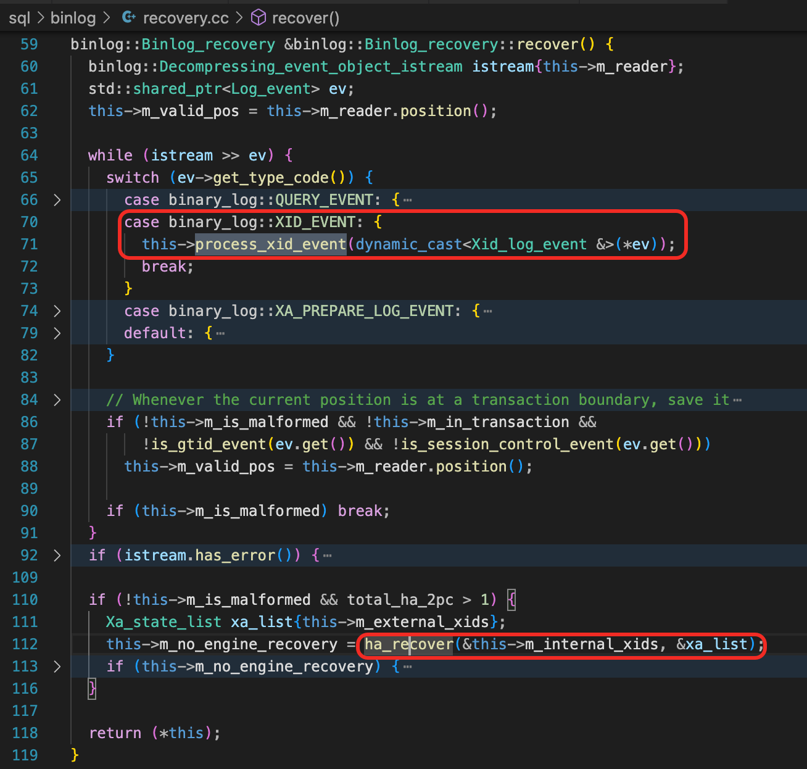

open_binlog

Binlog_recovery::recover 在函数 open_binlog 中调用。open_binlog 判断当前的 Binlog 是不是数据库崩溃时在使用的，这实际上是根据 Binlog 头部的 FORMAT_DESCRIPTION_EVENT事件中，是否有 LOG_EVENT_BINLOG_IN_USE_F 标记来判断的。如果有这个标记，就执行 Binlog_recovery::recover，读取 Binlog 中的所有 XID，调用 ha_recover 处理 Prepared 状态的事务。

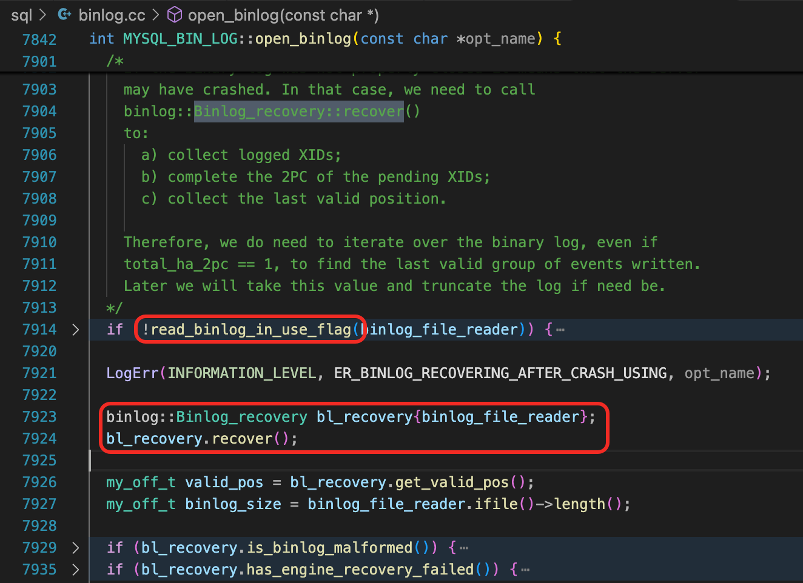

继续分析，能找到下面这个调用链路。

```
mysqld_main -> init_server_components -> open_binlog
 -> Binlog_recovery::recover -> ha_recover
```

上面分析了 Prepared 状态的事务，在恢复时的处理逻辑。

继续搜索 trx_sys->rw_trx_list，还能找到活动的事务的处理过程。

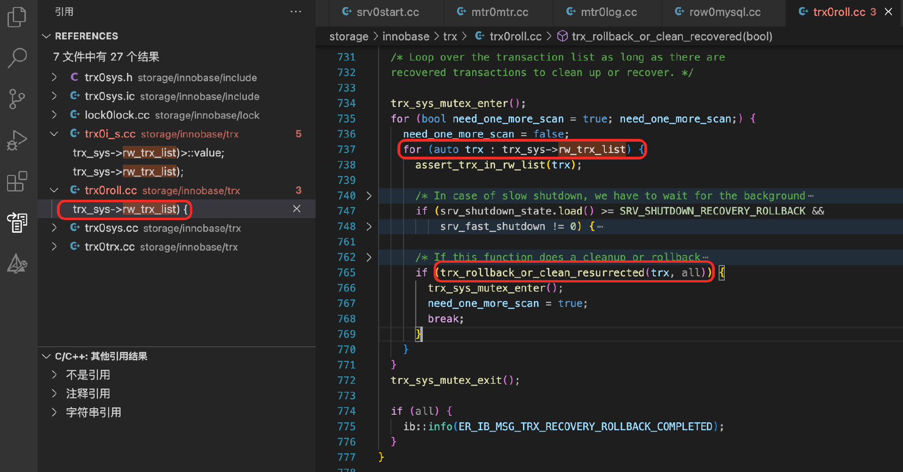

从代码中，还能找到下面这个调用链路。

```
trx_recovery_rollback_thread -> trx_recovery_rollback
 -> trx_rollback_or_clean_recovered -> trx_rollback_or_clean_resurrected
```

trx_recovery_rollback_thread 是回滚线程的主函数，这个线程在srv_start_threads_after_ddl_recovery 中创建。

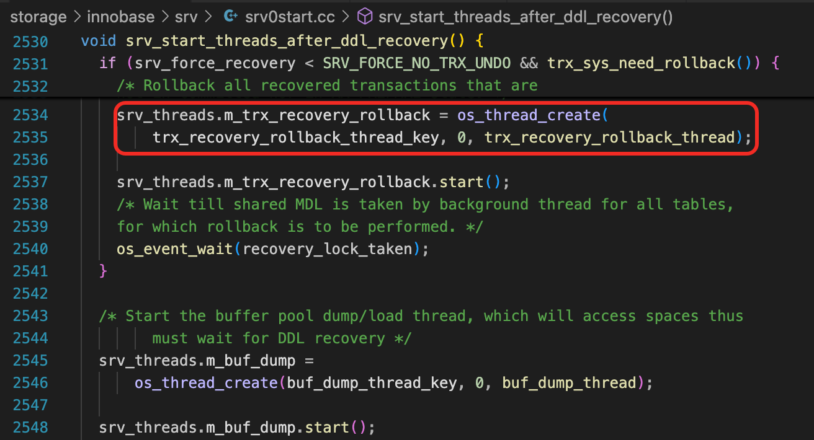

调用链路大概这这样的。

```
mysqld_main -> init_server_components -> ha_post_recover
 -> post_recover_handlerton -> post_recover
 -> innobase_post_recover -> srv_start_threads_after_ddl_recovery
```

## 使用 GDB 调试 MySQL 源码

现在我们对 MySQL 的源码结构已经有了一定的了解，并且可以借助一些工具来分析源码。但是，MySQL 是不是一定按我们理解的方式在运行呢？毕竟 MySQL 有上百万行代码，看代码时，有时候很容易忽略掉一些细节。而且有些情况下，代码比较复杂，并不一定能完全理解代码的含义。

- 传给函数的参数取什么值是怎么确定的？比如函数 row_search_mvcc 的参数中，参数mode、prebuilt、match_mode 是怎么确定的，和执行的 SQL 有什么关系？

- 函数执行时，会走到哪个分支？

- 事务提交过程中，执行到哪一行代码后，修改的数据对其他会话可见？

使用调试器，就能观察程序在运行时的状态，查看参数和变量具体的值，分析函数的调用栈。还能使用调试器来构建一些边界条件。比如要调试 Prepared 事务在恢复时的处理逻辑，就得先生成一些 Prepared 状态的事务，然后重启数据库。使用调试器，就能让事务停留在Prepared 状态。

接下来，我会通过一些调试场景，来初步介绍 GDB 的一些用法。

先准备一个调试环境，Build 一个 Debug 版本的 MySQL，创建一个数据库。具体的步骤在第 1 讲介绍过，这里就不重复了。

如果遇到下面这样的报错，很可能是 gdb 的版本太低，可以安装一个高版本的试试。

```
Reading symbols from /usr/local/mysql/bin/mysqld...
Dwarf Error: wrong version in compilation unit header (is 5, should be 2, 3, or 4
(no debugging symbols found)...
done.
```

我的测试环境是 CentOS 7.9 的系统，用了 devtoolset-11。

```bash
yum install devtoolset-11-gdb
source /opt/rh/devtoolset-11/enable
```

### SQL 如何执行？

第 8 讲中介绍过“SELECT 语句是怎么执行的”，到 gdb 中验证一下。先运行 gdb，attach 到mysqld 进程。先给 do_command 函数设置一个断点（break do_command），执行 continue命令。

```
# gdb /opt/mysql8.0/bin/mysqld 12312
GNU gdb (GDB) Red Hat Enterprise Linux 10.2-6.el7
(gdb) break do_command
Breakpoint 1 at 0x330a841: file /root/buildenv/mysql-8.0.40/sql/sql_parse.cc, lin
(gdb) c
Continuing.
```

连接到 MySQL，执行一个简单的 SQL 语句。

```sql
mysql> select * from ta;
```

执行 next 命令，单步跟踪。执行完 dispatch_command 后，你会发现 SQL 执行完成了。

```
Thread 44 "connection" hit Breakpoint 1, do_command (thd=0x7fa5d8017480)
   at /root/buildenv/mysql-8.0.40/sql/sql_parse.cc:1311
1311    NET *net = nullptr;
(gdb) n
1312    enum enum_server_command command = COM_SLEEP;
(gdb)
1314    DBUG_TRACE;
(gdb)
1315    assert(thd->is_classic_protocol());
(gdb)
1321    thd->lex->set_current_query_block(nullptr);
(gdb)
1329    thd->clear_error();  // Clear error message
......
1438    DEBUG_SYNC(thd, "before_command_dispatch");
(gdb)
1440    return_value = dispatch_command(thd, &com_data, command);
(gdb)
```

所以需要跟踪到 dispatch_command 函数里面去。可以在这里设置一个断点，或者使用 step命令。

这里我们在 sql_parse.cc 的 1440 行设置一个断点，运行到这里后，执行 step 命令进到函数dispatch_command 里。执行 backtrace 命令查看调用堆。

```
(gdb) break /root/buildenv/mysql-8.0.40/sql/sql_parse.cc:1440
```

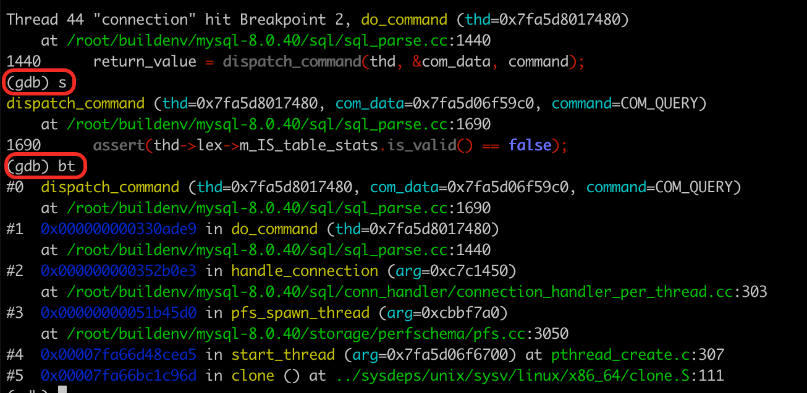

类似这样，你可以继续单步跟踪执行。因为我们知道查询数据时，会调用 row_search_mvcc获取记录，因此就给函数 row_search_mvcc 设置一个断点。

```
(gdb) break row_search_mvcc
Breakpoint 3 at 0x4c85040: file /root/buildenv/mysql-8.0.40/storage/innobase/row/
(gdb) continue
Continuing.
Thread 44 "connection" hit Breakpoint 3, row_search_mvcc (buf=0x7fa5d8008420 "\37
   mode=PAGE_CUR_G, prebuilt=0x7fa5d8b3c9a8, match_mode=0, direction=0)
   at /root/buildenv/mysql-8.0.40/storage/innobase/row/row0sel.cc:4423
4423    DBUG_TRACE;
```

查看调用堆，可以看到很多函数调用。

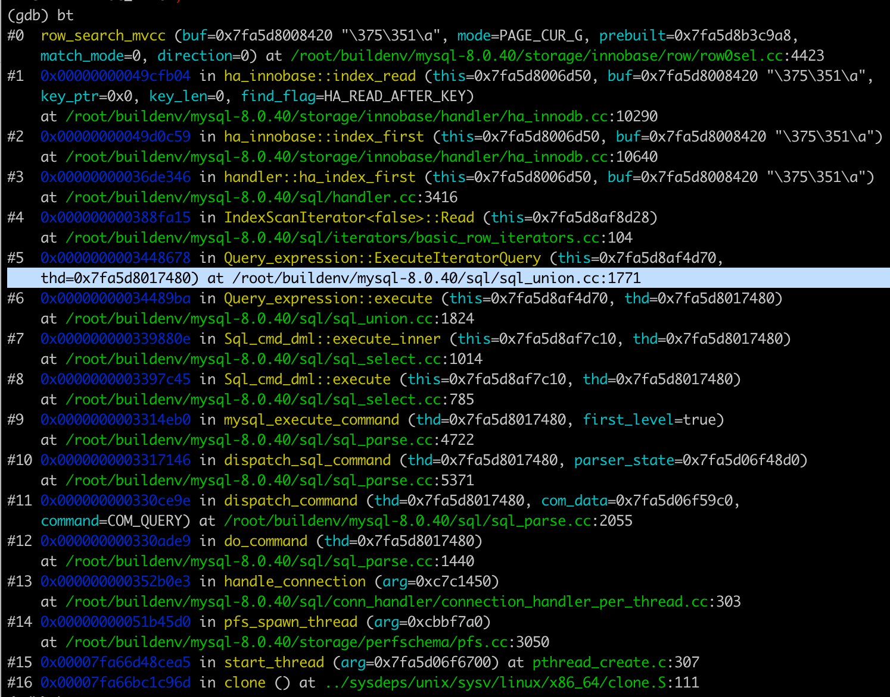

经过一些分析，发现 sql_union.cc 的 1771 行可能有我们感兴趣的代码。

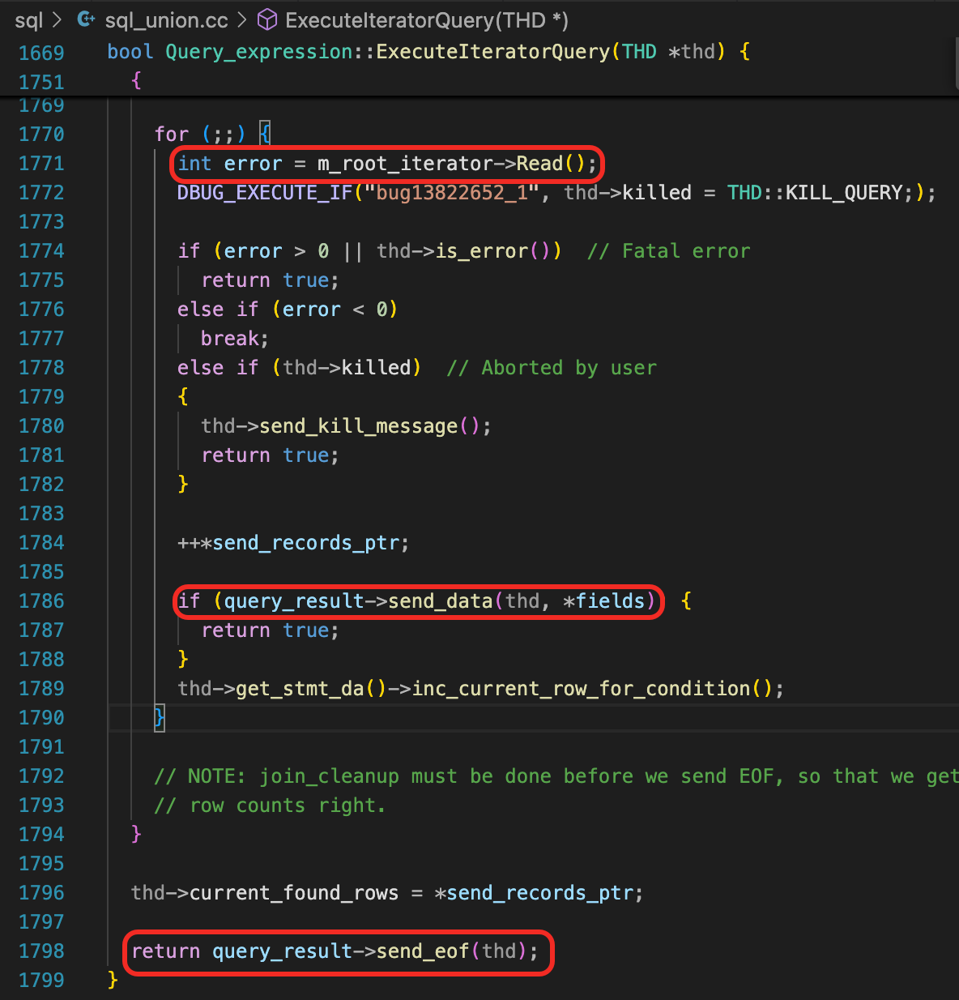

在函数 ExecuteIteratorQuery 中，可以看到 SQL 引擎的一个基本执行过程。

- 1771 行，调用存储引擎接口，获取数据。

- 1774 行，判断存储引擎的返回码，如果数据取完了，就退出 for 循环。如果有异常，直接返回。

- 1786 行，调用 send_data，将数据发送给客户端。

- 1798 行，数据取完了，发送一个结束标记给客户端。

但是，再仔细观察一下，你可能会有一个疑惑，存储引擎中获取的记录，是怎么传递给send_data 函数的呢？从函数的返回值、参数中都看不出来。

回到前面这个调用栈，可以发现一些线索。

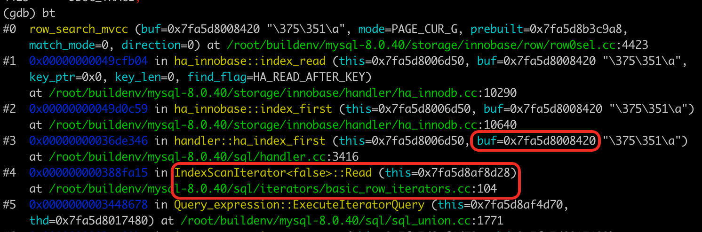

handler::ha_index_first 有一个 buf 参数，分析代码（row_search_mvcc）后可以知道，InnoDB 是将查到的记录写到了这个 buf 中。

这个参数是 IndexScanIterator::Read 中传入的。

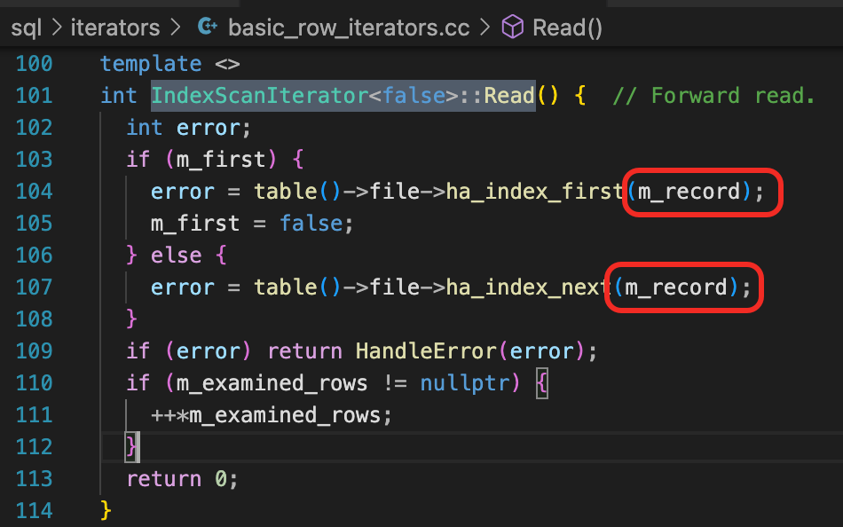

这个 m_record 又是从哪里来的呢？这是 IndexScanIterator 类的一个成员，在构造函数中初始化成 table->record[0]。

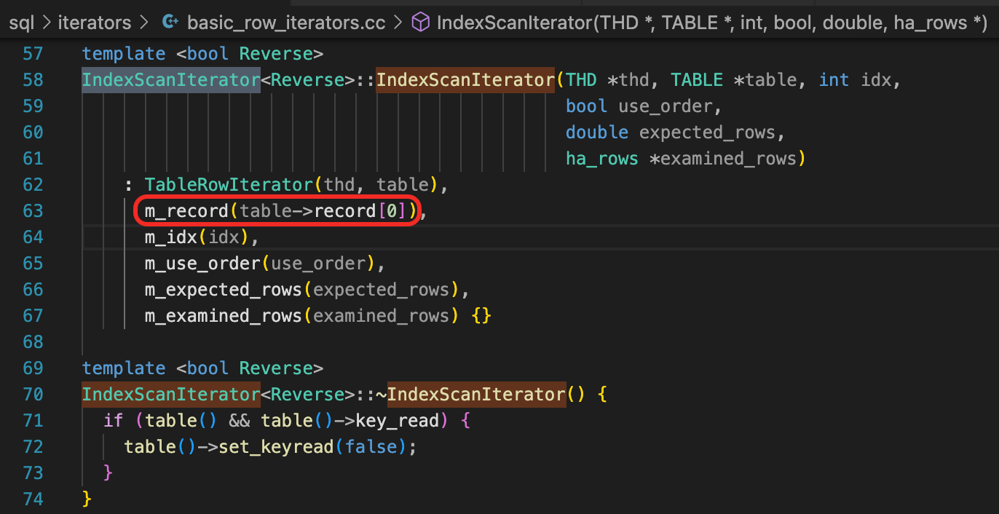

我们可以在 IndexScanIterator 的构造函数上加一个断点。

```
(gdb) break IndexScanIterator<true>::IndexScanIterator
Breakpoint 4 at 0x389096e: file /root/buildenv/mysql-8.0.40/sql/iterators/basic_r
(gdb) break IndexScanIterator<false>::IndexScanIterator
Breakpoint 5 at 0x3890bd8: file /root/buildenv/mysql-8.0.40/sql/iterators/basic_r
(gdb) c
Continuing.
Thread 44 "connection" hit Breakpoint 5, IndexScanIterator<false>::IndexScanItera
   examined_rows=0x7fa5d8af7ea0) at /root/buildenv/mysql-8.0.40/sql/iterators/ba
67        m_examined_rows(examined_rows) {}
```

就可以看到这样的调用栈，看起来是在优化 SQL 的时候传进来的 table 变量。

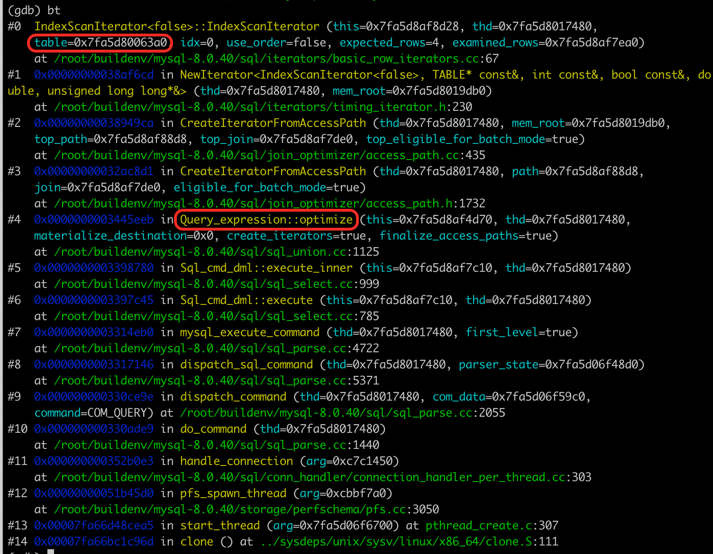

这里的 table 是一个重要的结构，我们说的 Open table cache 里缓存的，是不是就是这个table 结构呢？

可以用 print 命令查看变量 table 的值。

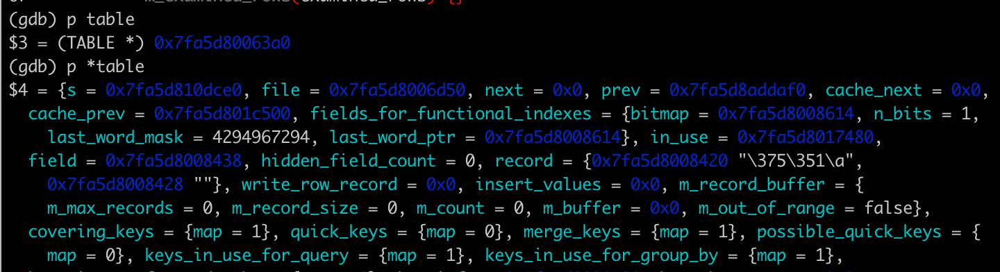

好了，这个调试案例就先到这儿。借助 GDB，我们分析了一个简单的 SELECT 语句执行的基本步骤，我们还知道了 MySQL Server 层和 InnoDB 存储引擎之间，是通过 TABLE 结构体的record buffer 来传递数据的。

### 数据库启动流程分析

上一个案例中，我们使用 gdb attach 到一个运行中的 mysqld 进程上进行调试。如果要调试MySQL 的启动过程，就要在 gdb 中启动 MySQL。

我们先看一下当前 mysqld 进程的运行参数。

```
# ps -elf | grep mysqld
... /opt/mysql8.0/bin/mysqld --defaults-file=/data/mysql8.0/my.cnf --basedir=/opt
```

启动 gdb，加载 mysqld。

```
# gdb /opt/mysql8.0/bin/mysqld
GNU gdb (GDB) Red Hat Enterprise Linux 10.2-6.el7
```

设置断点，比如在崩溃恢复的一些函数上设置断点。

```
(gdb) break trx_sys_init_at_db_start
Breakpoint 1 at 0x4d3627f: file /root/buildenv/mysql-8.0.40/storage/innobase/trx/
(gdb) break open_binlog
Breakpoint 2 at 0x44e2953: open_binlog. (2 locations)
(gdb) break recv_recovery_from_checkpoint_start
Breakpoint 3 at 0x4b5afee: file /root/buildenv/mysql-8.0.40/storage/innobase/log/
(gdb) break do_command
```

然后用 run 命令，启动 MySQL。

```
(gdb) run --defaults-file=/data/mysql8.0/my.cnf --basedir=/opt/mysql8.0 --datadir
```

会先运行 Redo 恢复。

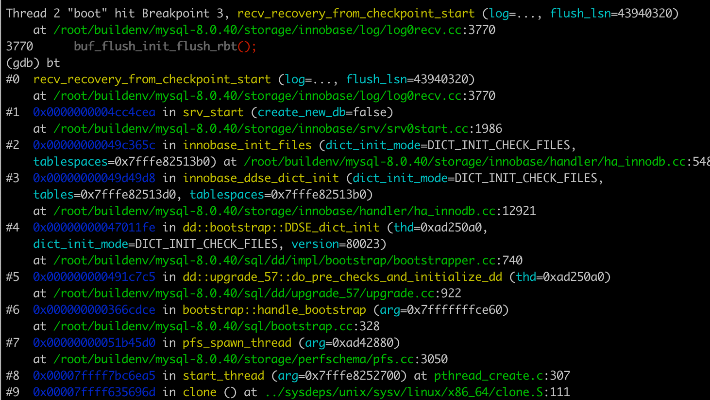

运行 fininish 命令，执行完 recv_recovery_from_checkpoint_start 后，可以接着调试。

```
(gdb) fin
Run till exit from #0  recv_recovery_from_checkpoint_start (log=..., flush_lsn=43
   at /root/buildenv/mysql-8.0.40/storage/innobase/log/log0recv.cc:3770
0x0000000004cc4cea in srv_start (create_new_db=false)
   at /root/buildenv/mysql-8.0.40/storage/innobase/srv/srv0start.cc:1986
1986      err = recv_recovery_from_checkpoint_start(*log_sys, flushed_lsn);
Value returned is $1 = DB_SUCCESS
```

你会发现接下来先运行到 trx_sys_init_at_db_start 处的断点，然后再运行到 open_binlog。在一些关键的代码点上设置断点，可以观察到一些代码的运行顺序。比如数据库启动时，先执行Redo，再执行 Undo。

### GDB 命令参考

gdb 的功能很强大，我把一些基本的命令整理到了下面这个表格中。可以使用命令的简称，比如执行 c 就是执行 continue 命令。

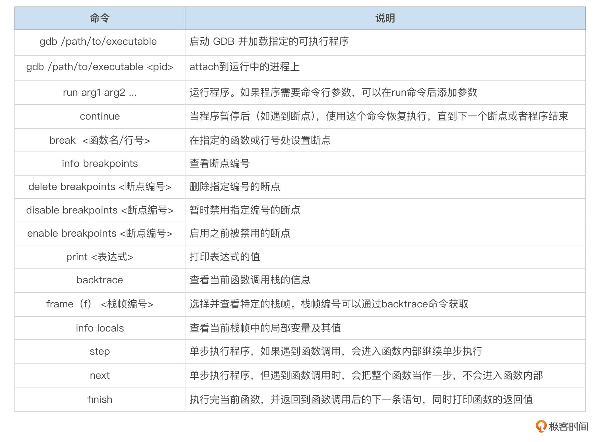

## 总结

MySQL 使用 C/C++ 编写，因此理论上，你只要熟悉 C/C++，就能看懂 MySQL 的实现。当然，由于 MySQL 的代码量比较多，分析这些代码需要花比较多的时间。这一讲中提到的一些方法，可以供你参考，更重要的其实是花大量的时间去尝试。

## 思考题

MySQL 是一个多线程的服务器，代码运行到一个断点时，所有线程都会暂停运行。有些情况下，我们可能只想调试其中一个线程，调试过程中，其他线程要保持运行状态。使用 GDB，怎么实现这一点呢？

期待你的思考，欢迎在留言区中与我交流。如果今天的课程让你有所收获，也欢迎转发给有需要的朋友。我们下节课再见。
