# InnoDB存储引擎篇 | 课后题答疑

你好，我是俊达。今天我们继续看第三章的思考题。

## 第 25 讲

问题：我们都知道 InnoDB 中每个索引都由 2 个段（Segment）组成，每个段由一系列区（Extent）组成，每个区的大小为 1M。类似我们测试中的这个表，只写入了几行数据，那么为这个表分配一个区，是不是会有大量的空间浪费？MySQL 是怎么解决这个问题的？

@叶明 在评论区提供了这个问题的解答。

第 26 讲中对这个问题也有解释。InnoDB 每个索引都有 2 个段组成。每个段都有一个对应的Inode 结构，用来跟踪一个段由哪些页面组成。

Inode 中，有一个碎片页数组，可以记录 32 个页面的编号。

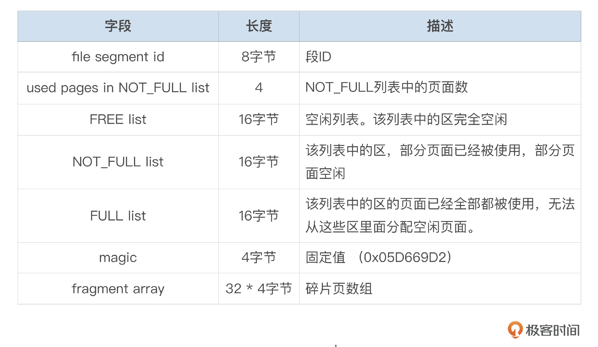

在给一个段分配空间时，会先以 1 个页面为单位分配，只有当 32 个碎片页都分配后，才会按1 个区为单位，分配空间。

一个表刚创建时，表里还没有写入任何数据。InnoDB 会给每个索引分配一个 Root 页面，而每个索引对应的 2 个段，此时只有 1 个段分配了页面，另外一个段里暂时还没有任何页面。

创建一个空的表，会占用多少磁盘空间呢？这跟表上的索引个数有关，因为要给每个索引分配一个 Root 页面。MySQL 最多可以建 64 个索引（包括主键索引），你可以测试下，建一个有64 个索引的空表，看一下 ibd 文件的大小。我测试下来，建一个有 64 个索引的空表，ibd 文件是 8 兆。

MySQL 8.0 中，每个表的 ibd 文件中，前面几个页面有特殊的作用。Page 0 是 FSP 头，Page 1 是 ibuf 位图页，Page 2 是 Inode 页面，Page 3 是 SDI 页面，Page 4 是聚簇索引的Root 页面。如果建一个没有任何索引的空表，ibd 的大小是 112K，也就是 7 个 16K 的页面，除了这里提到的 5 个页面，还有 2 个空闲的页面。

## 第 26 讲

问题：我们知道，在 B+ 树中检索数据时，要先从根页面开始，数据字典表 mysql.indexes 记录了每个索引的根页面。但是 indexes 本身也是一个 InnoDB 表，因此从 indexes 表检索数据时，需要先知道这个表的根页面编号，那么 MySQL 怎么知道 indexes 表的根页面编号是什么呢？

MySQL 8.0 中，数据字典存储在了 InnoDB 表中。数据字典表中存储了每个表的定义，包括表里有哪些字段、每个字段的数据类型是什么、表上有哪些索引等等。

但是数据字典表本身也是一个 InnoDB 表，怎么知道每个数据字典表的表结构呢？虽然数据字典表里也存储了每个数据字典表的元数据，但是查询数据字典表的前提，是先要知道这些表的元数据。这里是不是有一点“鸡生蛋还是蛋生鸡”的意思了？

首先数据字典表的结构，是在源代码中定义了的，比如下面是 tables 表的部分定义。

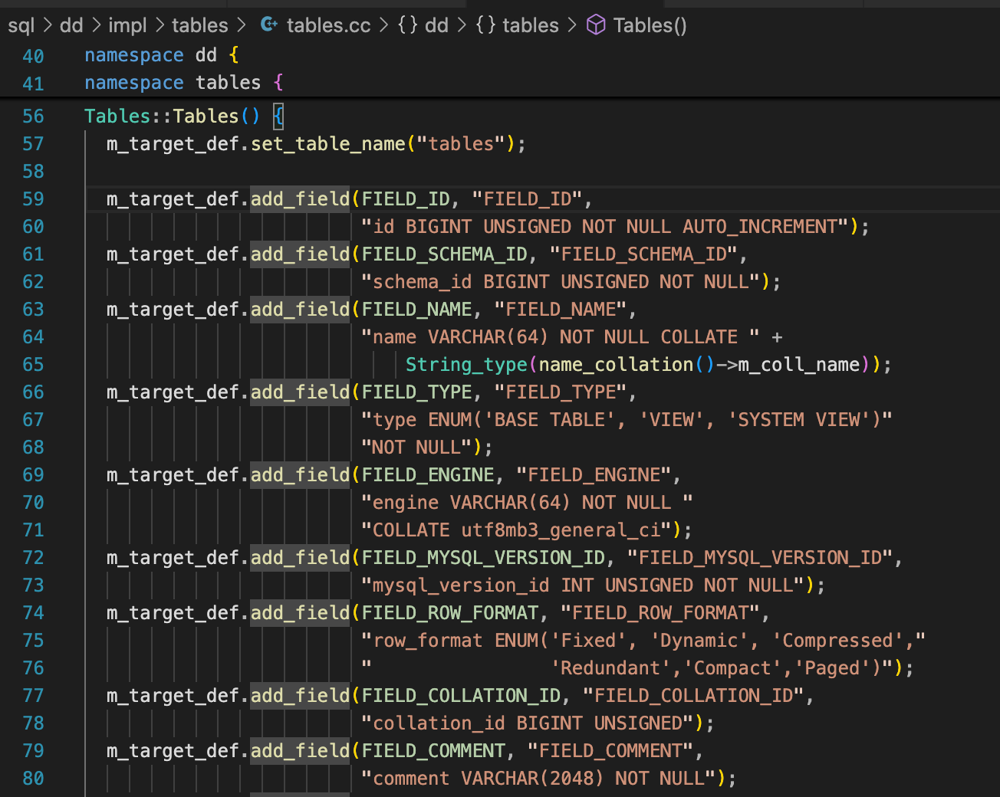

数据字典表存储在 mysql.ibd 文件中，这个文件会在数据库首次初始化（mysqld --initialize）或从 5.7 版本升级上来时创建。

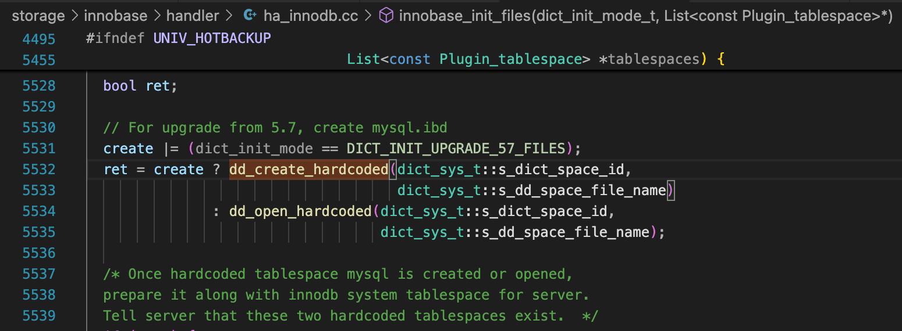

这个表空间的 ID、表空间名称、IBD 文件都是代码中硬编码的。

```javascript
/* Dictionary system struct */
struct dict_sys_t {  /** The data dictionary tablespace ID. */
 static constexpr space_id_t s_dict_space_id = 0xFFFFFFFE;
 /** The name of the data dictionary tablespace. */
 const char *dict_sys_t::s_dd_space_name = "mysql";
 /** The file name of the data dictionary tablespace */
 const char *dict_sys_t::s_dd_space_file_name = "mysql.ibd";
......
```

数据库初始化时，按一定的顺序，创建数据字典表，第一个创建的是 DD_PROPERTIES 表。

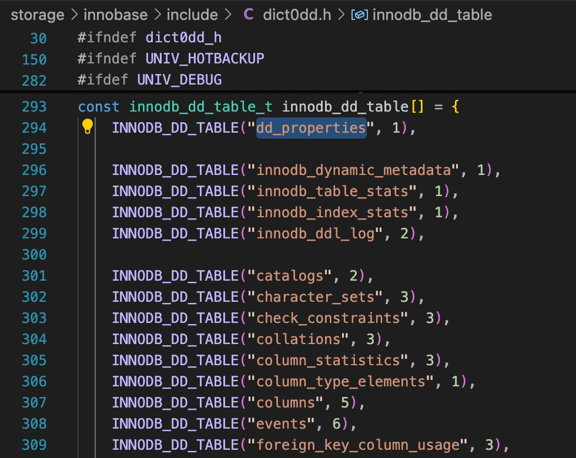

创建数据字典表时，按顺序分配这些表的索引的 ROOT 页面，这个逻辑可以在函数ha_innobase::get_se_private_data 看到。第一个索引的 ROOT 是页面 4，后面的索引 ROOT页面依次加 1。为什么从 Page Number 4 开始分配 Root 页面？参考前面一个思考题的解答。注意到，这里 n_pages 是一个 static 变量。

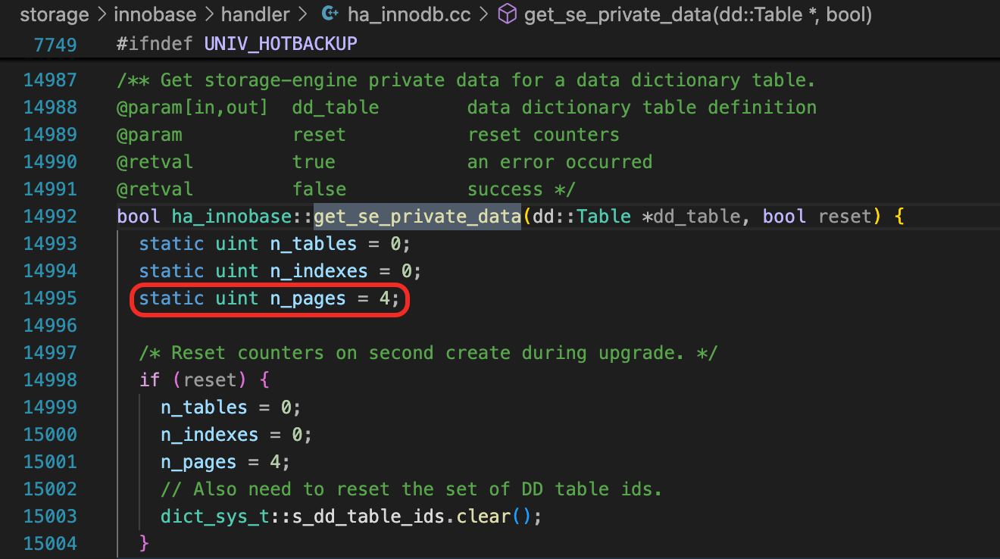

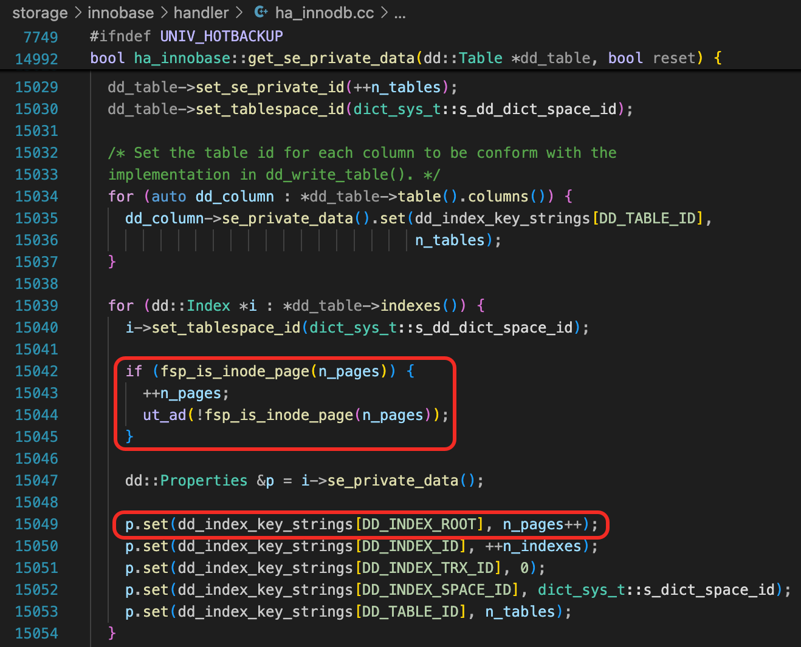

从数据字典表中，也可以确认，数据字典表的索引的 Root 页面就是这样分配的。

```sql
mysql> SET SESSION debug='+d,skip_dd_table_access_check';
Query OK, 0 rows affected (0.00 sec)
mysql> select t1.name as table_name, t2.name as index_name, t2.se_private_data
   from mysql.tables t1, mysql.indexes t2
   where t1.id = t2.table_id
   order by t1.id, t2.id
   limit 20;
+-------------------------+----------------------+-------------------------------
| table_name              | index_name           | se_private_data
+-------------------------+----------------------+-------------------------------
| dd_properties           | PRIMARY              | id=1;root=4;space_id=429496729
| innodb_dynamic_metadata | PRIMARY              | id=2;root=5;space_id=429496729
| innodb_table_stats      | PRIMARY              | id=3;root=6;space_id=429496729
| innodb_index_stats      | PRIMARY              | id=4;root=7;space_id=429496729
| innodb_ddl_log          | PRIMARY              | id=5;root=8;space_id=429496729
| innodb_ddl_log          | thread_id            | id=6;root=9;space_id=429496729
| catalogs                | PRIMARY              | id=7;root=10;space_id=42949672
| catalogs                | name                 | id=8;root=11;space_id=42949672
| character_sets          | PRIMARY              | id=9;root=12;space_id=42949672
| character_sets          | name                 | id=10;root=13;space_id=4294967
| character_sets          | default_collation_id | id=11;root=14;space_id=4294967
| check_constraints       | PRIMARY              | id=12;root=15;space_id=4294967
| check_constraints       | schema_id            | id=13;root=16;space_id=4294967
| check_constraints       | table_id             | id=14;root=17;space_id=4294967
| collations              | PRIMARY              | id=15;root=18;space_id=4294967
| collations              | name                 | id=16;root=19;space_id=4294967
| collations              | character_set_id     | id=17;root=20;space_id=4294967
| column_statistics       | PRIMARY              | id=18;root=21;space_id=4294967
| column_statistics       | catalog_id           | id=19;root=22;space_id=4294967
| column_statistics       | catalog_id_2         | id=20;root=23;space_id=4294967
+-------------------------+----------------------+-------------------------------
```

数据库初始化之后，会将数据字典表的属性保存到 DD_PROPERTIES 表。下次数据库启动时，DD_PROPERTIES 表的 Root 页面编号固定为 4，其他索引的 Root 页面编号，从DD_PROPERTIES 表里读取。

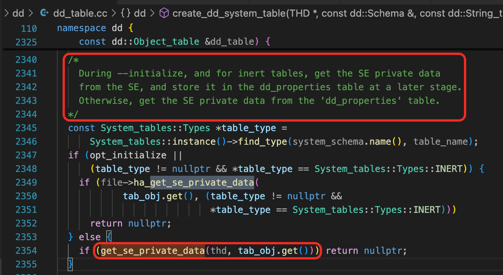

可以看一下 DD_PROPERTIES 表里存了什么。这里存了相关的版本信息，启动时根据这里的版本和二进制的版本，来判断是不是需要升级或降级。LCTN 是 lower_case_table_names 的简称，如果 LCTN 的值和参数 lower_case_table_names 的设置不一致，启动会报错。SYSTEM_TABLES 中存储了数据字典表的属性，这里就包括了索引的 Root 页面编号。

```sql
SET SESSION debug='+d,skip_dd_table_access_check';
select replace(cast(properties as char),'\\', '') from dd_properties\G
```

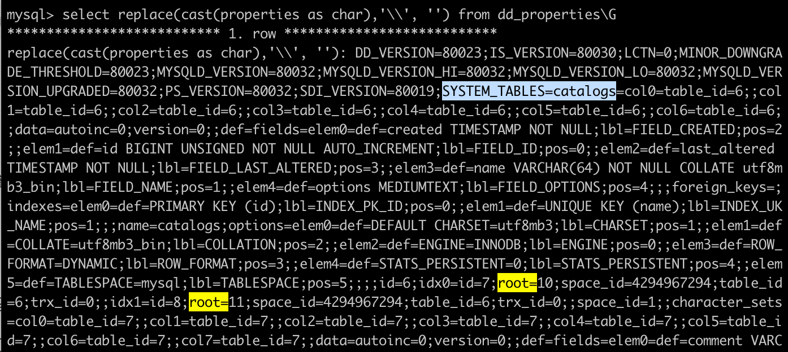

这里的格式好像有点奇怪，如果想了解这里的数据具体是怎么解析的，可以分析下函数dd::get_se_private_data 的代码。

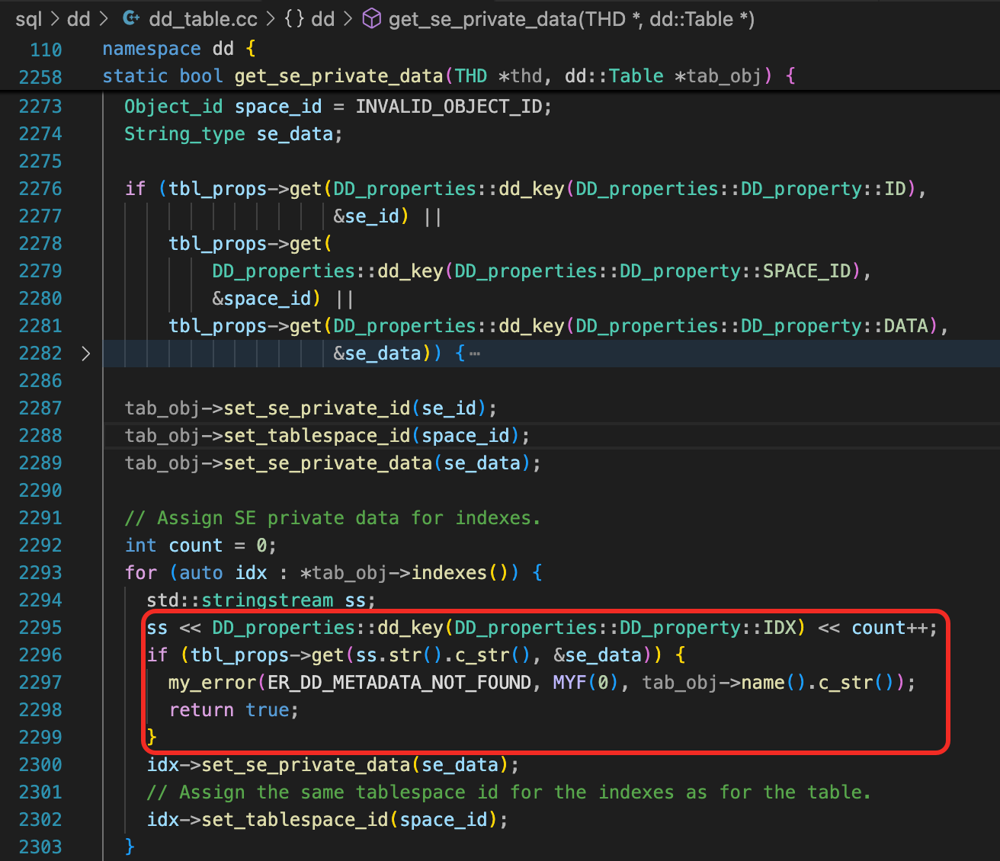

所以总结起来，MySQL 数据字典表索引的 Root 页面编号，存在 dd_properties 表里，而dd_properties 表主键的 Root 页面编号固定为 4，这些索引都存在 mysql.ibd 文件中。

## 第 27 讲

问题：读写 InnoDB 表时，会先把数据页缓存到 Buffer Pool 中，那么删除表和索引时，表和索引中已经缓存在 Buffer Pool 中的页面要怎么处理？是不是需要释放这些缓存页？如果有脏页，需要先刷新脏页吗？如果不对这些页面做任何处理，会有什么问题吗？

@binzhang 在评论区对这个问题进行了一些分析。

实际上 DROP Table/Truncate Table 的处理逻辑，和 MySQL 的版本有比较大的关系。MySQL5.7 的处理逻辑和 MySQL 8.0 的处理逻辑可能会有一些差别。MySQL 8.0 的一系列版本中，8.0.23 在这一块做了比较大的优化，第 28 讲对这个问题做了一些分析。

MySQL 8.0.23 的Release Notes中对这个问题也有一些描述。

- InnoDB: Performance was improved for the following operations:

- Dropping a large tablespace on a MySQL instance with a large buffer pool (>32GBs).

- Dropping a tablespace with a significant number of pages referenced from the adaptivehash index.

- Truncating temporary tablespaces.

The pages of dropped or truncated tablespaces and associated AHI entries are nowremoved from the buffer pool passively as pages are encountered during normal operations.Previously, dropping or truncating tablespaces initiated a full list scan to remove pages fromthe buffer pool immediately, which negatively impacted performance. (Bug #31008942, Bug#98869, WL #14100)

Worklog 14100中对这个问题有更详细的解释。

这里有几点需要注意。

- 删除普通表和临时表的处理逻辑有一些区别。

- 删除索引和删除表的处理也有区别。删除表时，会把整个 ibd 文件也删掉。删除索引时，ibd 文件还在，索引占用的空间要释放出来。

删除表时，有一个关键的步骤，调用函数 row_drop_table_from_cache。

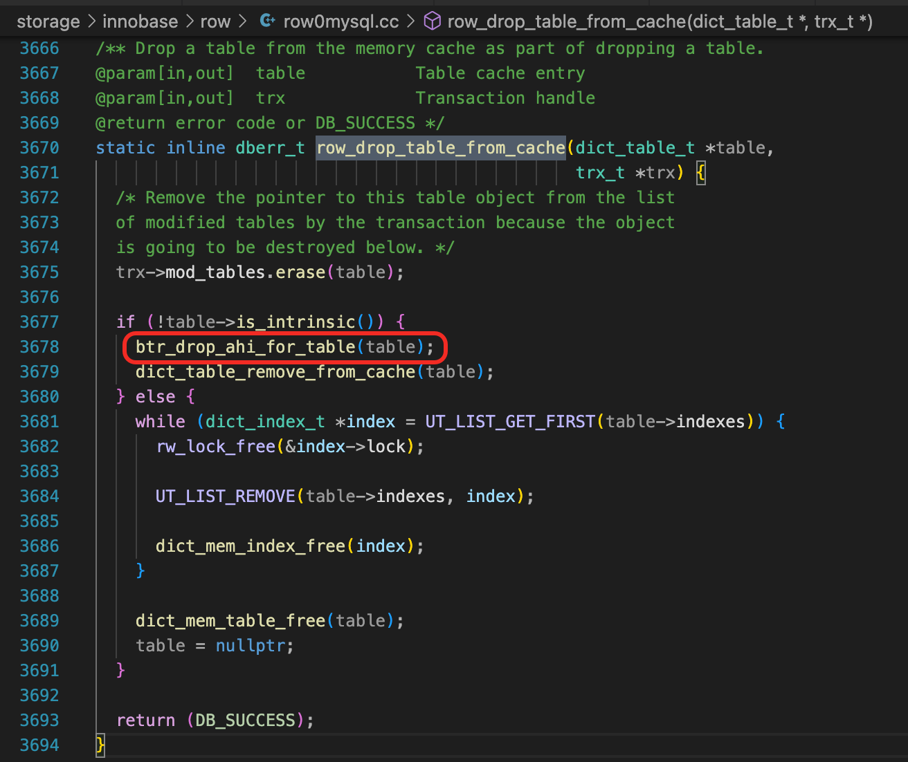

这里有一个步骤是删除表上所有索引的 AHI 条目。

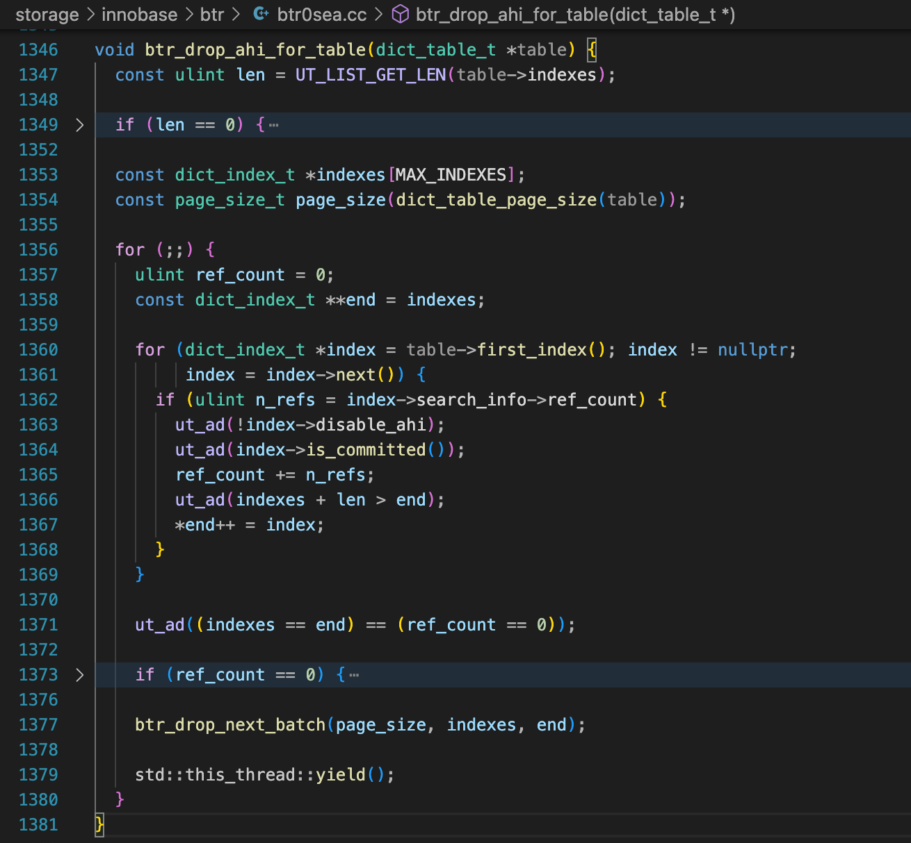

删除 ahi 条目时，要搜索 LRU 链表，这个过程中会持有 LRU_LIST_mutex。

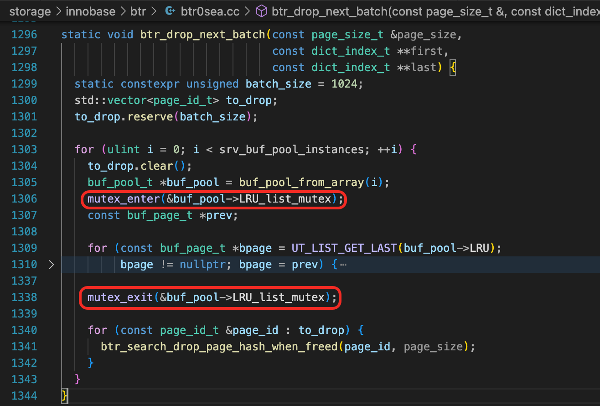

Drop 的另一个操作是要删除 ibd 文件。函数 row_drop_tablespace 中，调用fil_delete_tablespace。

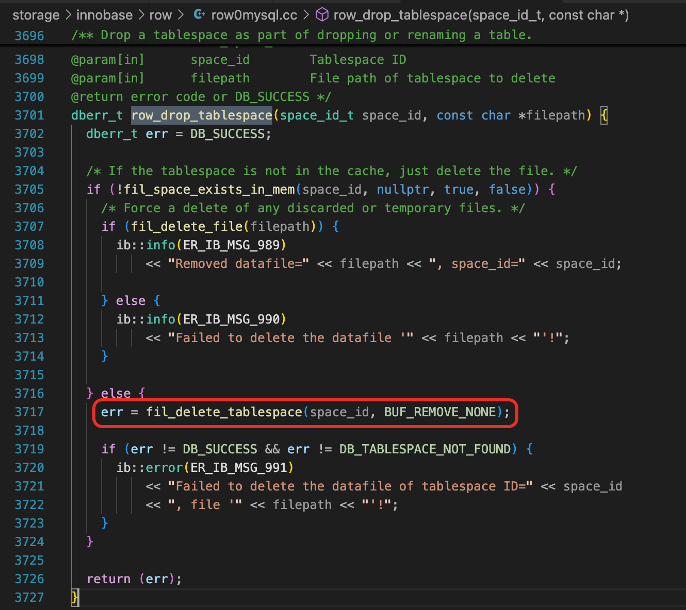

fil_delete_tablespace 最终会调用 space_delete 函数，如果 buf_remove 参数不是BUF_REMOVE_NONE，根据 buf_remove 的不同取值，这里会刷新脏页，或者将页面从Flush 链表移除，或将页面从 LRU 链表中移除。

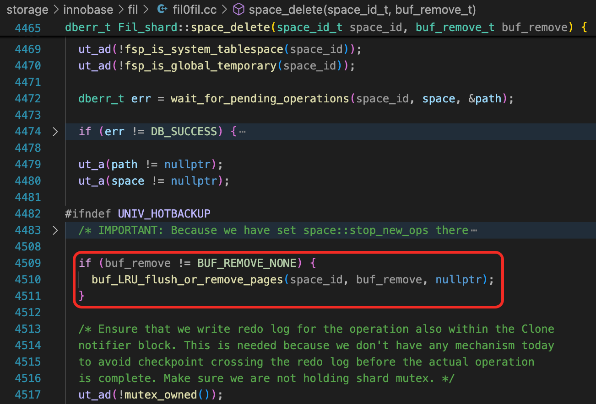

在 8.0.23 之前的版本中，参数 buf_remove 是 BUF_REMOVE_FLUSH_NO_WRITE。

另外 space_truncate 函数中还会调用 buf_LRU_flush_or_remove_pages（BUF_REMOVE_ALL_NO_WRITE），将页面从 LRU 链表中移走。

（下面两段代码来自 mysql 8.0.16 版本。）

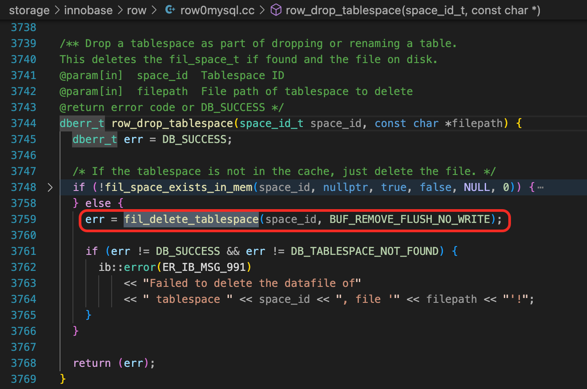

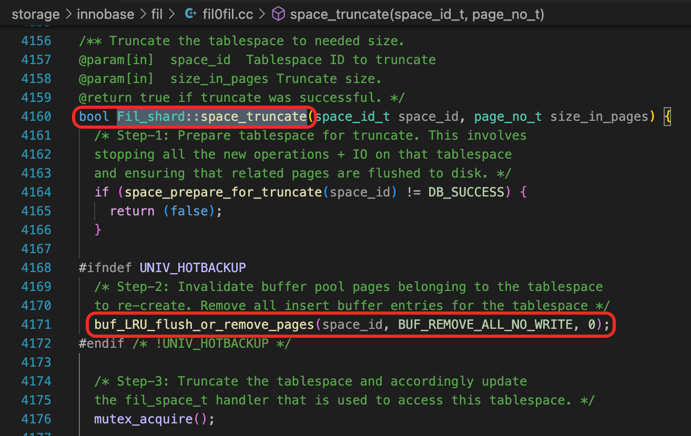

回到这个问题，如果版本不低于 8.0.23，并且不使用自适应 Hash 索引，那么删表、删索引的影响应该还好。不然，如果 InnoDB Buffer 比较大（按官方文档的描述是超过 32G）、脏页的数量比较多、表上的索引有大量的页面被 AHI 引用、实例的并发访问量比较高，那么删除表、删除索引操作还是可能会影响业务，所以 DDL 还是建议放在业务低峰期执行。

## 第 28 讲

问题：MySQL 8.4 中，默认关闭了 Change Buffer 和自适应 Hash 索引，具体可以参考官方文档。MySQL 这么做可能的原因是什么？关闭 Change Buffer 和自适应 Hash 索引对性能会产生哪些影响？

@叶明 在评论区对这个问题做了比较完整的解答。

Change Buffer 的主要作用，是在向（非唯一）二级索引添加或删除记录时，如果索引页面没有缓存，先不从磁盘读取二级索引的页面，而是把插入或删除操作记到 Change Buffer 中，以此来减少随机 IO。

AHI 的主要作用，是把频繁访问的 B+ 树的页面中的记录，加到 Hash 索引中，从而查询这些热点记录时，可以通过 Hash 表直接定位到记录在 Leaf 页面中的位置，而不需要通过 B+ 树依次从 Root 页面、Branch 页面中查找，最终定位到 Leaf 页面。

MySQL 8.4 默认关闭 Change Buffer 和自适应 Hash 索引的原因，我猜测也是因为现在 SSD的性能比传统的机械磁盘有了数量级的提升。

另外，Change Buffer 和 AHI 本身也需要维护，也会消耗一定的 CPU 资源，也会占用一定的内存资源。Change Buffer 占用的最大内存由参数 innodb_change_buffer_max_size 控制，默认是 Buffer Pool 的 25%。关闭 Change Buffer 和 AHI，可以节省维护这些结构消耗的 CPU资源，节省下来的内存可以缓存更多的数据页面。

当然，在具体的业务场景、机器配置下，开启 Change Buffer 和 AHI 到底是提升了性能，还是降低了性能，可以通过一些性能测试来进行评估。

## 第 29 讲

问题：这节课我们介绍了一些 REDO 日志的格式，比如 insert、update、delete 的 REDO 格式。那么事务提交时（commit），REDO 的格式是怎样的？数据库启动时，怎么知道一个事务已经提交了？

如果你去查看有哪些 Redo 日志类型，会发现并没有 COMMIT 类型的 Redo。

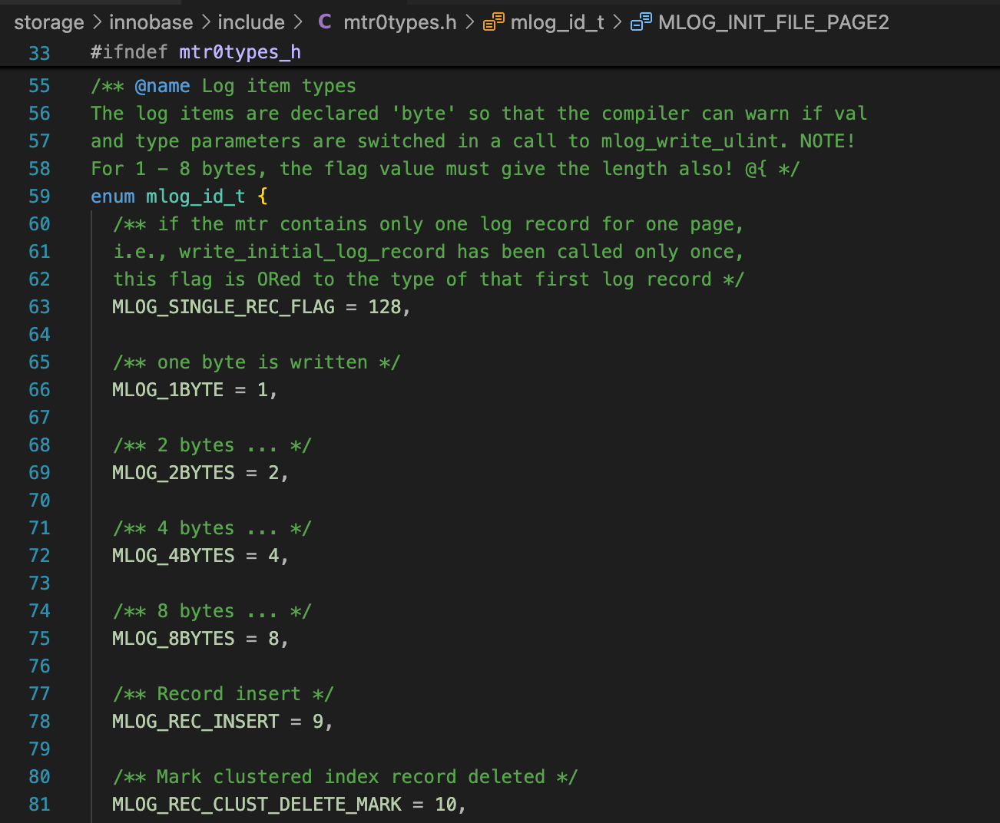

在第 30 讲和第 31 讲中，我们知道 Undo 段头中记录了 Undo State，代表了事务的状态。事务提交（或回滚）时，会设置 Undo State。

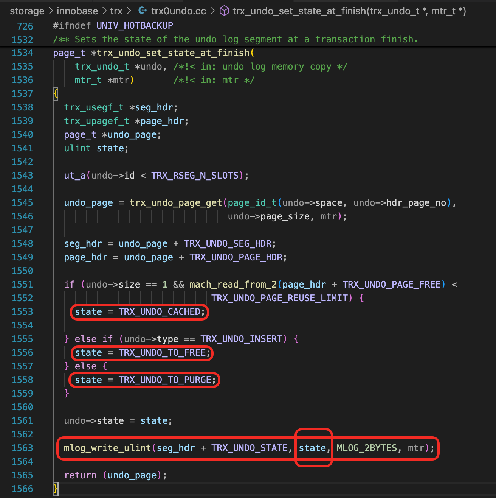

函数 trx_undo_set_state_at_finish 中，调用 mlog_write_ulint，设置 Undo State。mlog_write_ulint 中，除了修改 Undo State，还会生成 Redo 日志，写到 mtr buffer 中。

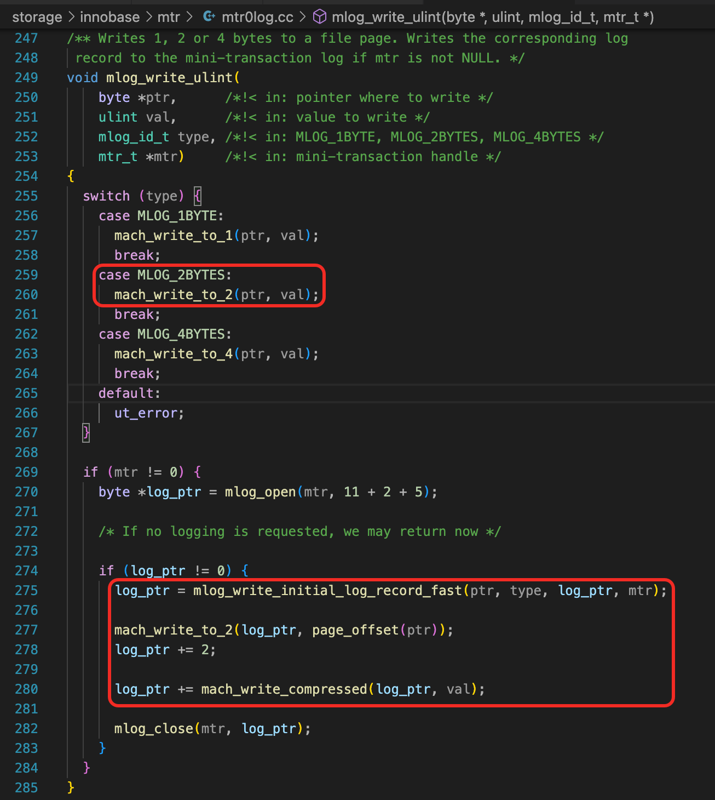

只要 Redo 日志刷新到磁盘，就算数据库异常重启了，也会把 Undo 段的状态恢复到正确的值。

## 第 30 讲

问题：早期的版本中，Undo 存储在系统表空间中，有时会遇到一个问题，就是 History 列表持续增长，导致系统表空间占用的文件很大。后续即使清理了 Undo，但是系统表空间无法收缩。在 8.0 中，如果遇到类似的问题，Undo 表空间增长得很大，有办法缩减 Undo 表空间吗？

这个问题在官方文档中有很详细的说明。

一种方法是使用 Undo 表空间的自动收缩（Automated Truncation）功能。要使用 Undo 自动收缩功能，参数 innodb_undo_log_truncate 要设置为 ON，参数 innodb_max_undo_log_size设置了触发 Undo 表空间自动收缩的阈值，如果 Undo 表空间超过了这个设置，就可以被标记为可收缩。

自动收缩大概分为几个步骤。

- 回滚段被标记为 inactive，这样就不会给这些回滚段分配新的事务了。已经用了这些回滚段的事务可以继续运行，直到提交或回滚。

- Purge 系统自动清理 Undo 段。

- 当所有回滚段中的 Undo 段都清理掉之后，收缩文件空间。

- 回滚段重新设置为 active 状态，可以分配新的事务。

还有一种方法是手动回收空间。你需要创建一个或多个新的 Undo 表空间。如果你想回收某个Undo 表空间占用的空间，就执行命令，将表空间状态设置为 inactive。

```
alter undo tablespace innodb_undo_001 set inactive;
```

当 Purge 系统处理完 Undo 表空间中的 Undo 段后，表空间状态变成 empty。空间也会收缩成初始大小。

```sql
mysql> select *
 from information_schema.innodb_tablespaces
 where row_format='Undo';
+------------+-----------------+------------+------------+----------+--------+
| SPACE      | NAME            | ROW_FORMAT | SPACE_TYPE |FILE_SIZE | STATE  |
+------------+-----------------+------------+------------+----------+--------+
| 4294967152 | innodb_undo_001 | Undo       | Undo       | 16777216 | empty  |
| 4294967278 | innodb_undo_002 | Undo       | Undo       |100663296 | active |
| 4294967277 | undo_x001       | Undo       | Undo       | 67108864 | active |
+------------+-----------------+------------+------------+----------+--------+
```

收缩完成后，再把 Undo 表空间设置为 active 状态。

```
alter undo tablespace innodb_undo_001 set active;
```

使用手动收缩时，需要至少 3 个 Undo 表空间，因为同一时间最小要有 2 个 Undo 表空间处于active 状态，否则 alter undo tablespace 命令会报错。

## 第 31 讲

问题：MySQL 中，提交一个事务通常是非常快的，因为提交事务时，不需要等待脏页刷新，只需要将事务生成的 Redo 日志刷新到磁盘就可以了。但是回滚一个事务，成本就比较大了，特别是当你在事务中修改了大量数据后再回滚。

考虑这么一个场景，你对一个大表执行了不带 where 条件的 delete 语句，执行了很长一段时间后，你发现 delete 还没有完成，而且数据库卡死了，为了尽快恢复业务，你选择了重新启动数据库。在数据库启动时，MySQL 会怎么处理这个被中断的 delete 操作？

第 45 讲中简单提到过，MySQL 启动过程中，会创建一个回滚线程（trx_recovery_rollback_thread），用来回滚停库时还是活动状态的事务。

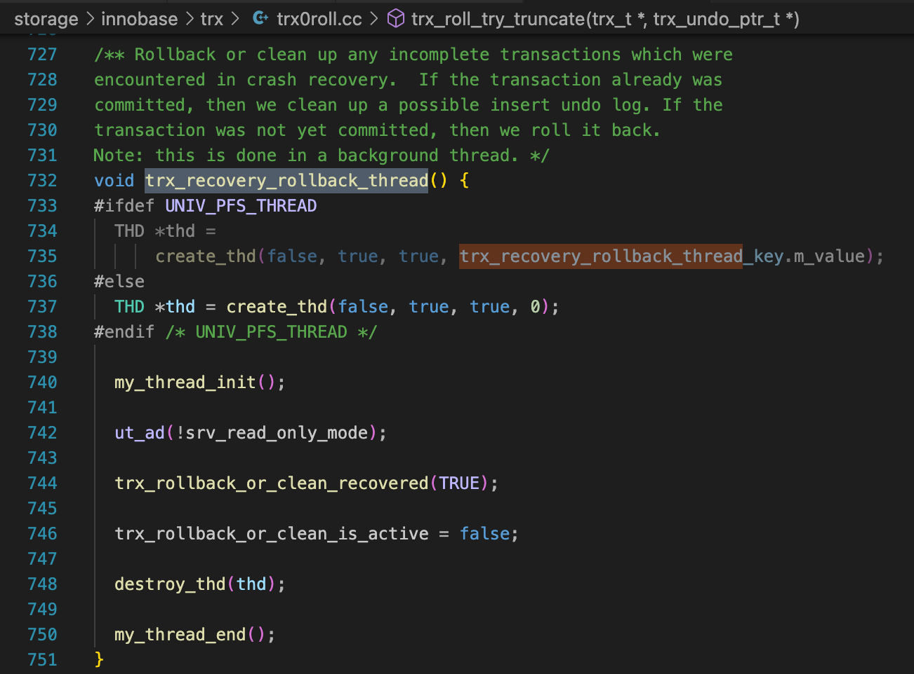

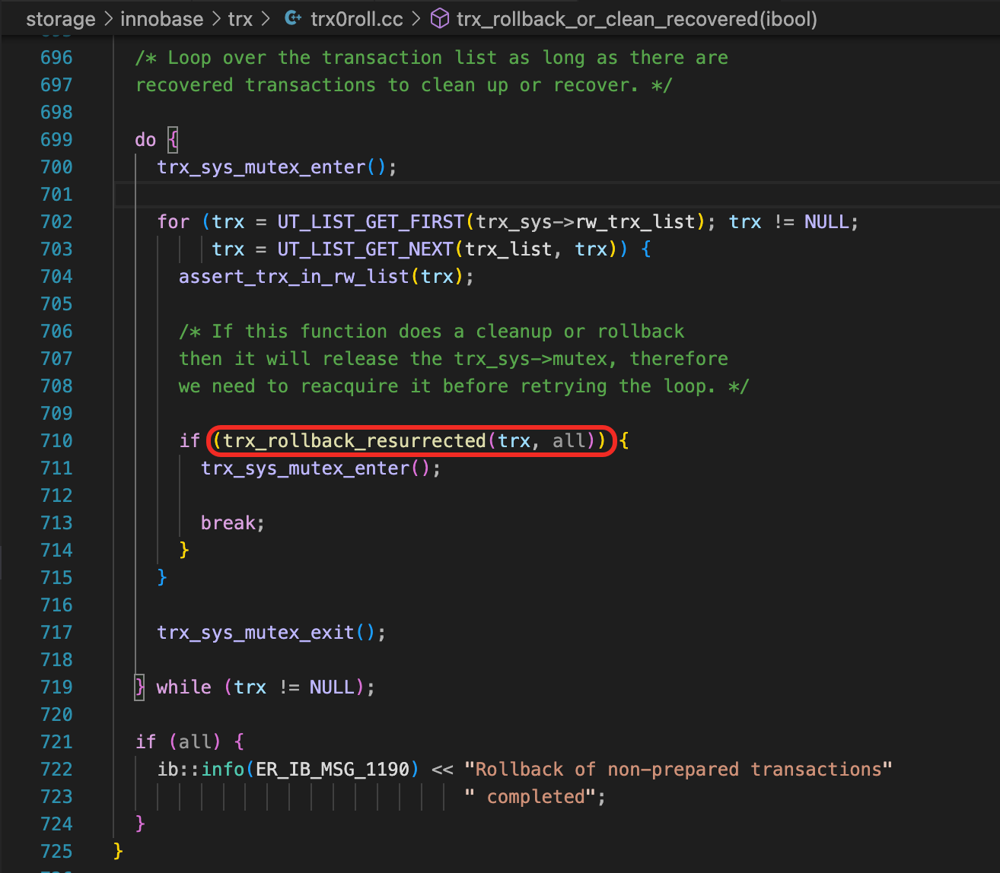

在这个回滚的过程中，数据库已经启动完成，其他会话可以正常访问数据库。对于正在回滚的这个大事务，修改过的记录上的锁还没有释放，其他会话如果要修改这些记录，就要等待锁。如果回滚的时间很长，那么业务就会有很长一段时间不能修改这些记录。这种情况下，如果要尽快恢复业务，最好的办法是将业务切到备库上。

这里再来思考一个相关的问题，这个大事务回滚到一半的时候，又重启了数据库，那么数据库重新启动时，会从哪里开始回滚这个事务？是从头开始回滚呢，还是从上次已经回滚到的地方开始回滚？已经应用过的 Undo 日志还需要重新应用吗？

函数 trx_roll_pop_top_rec_of_trx_low 中有一些处理逻辑，当应用完一个 Undo 页面中所有的Undo 记录后，会把这个 Undo 页面释放掉。释放一个 Undo 页面时，会记录相应的 Redo 日志。因此如果在回滚的过程中数据库又发生了重启，已经释放掉的 Undo 记录就不需要重复应用了。

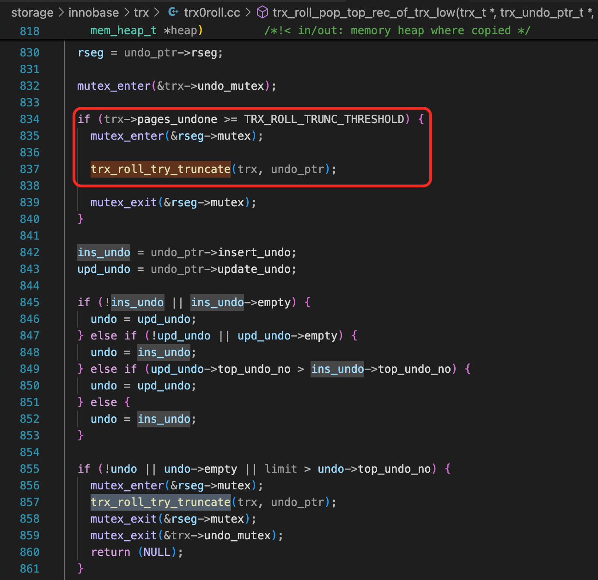

## 第 32 讲

问题：InnoDB Purge 线程会定期清理 Undo 日志，但是有些情况下，清理可能会有比较大的延迟，导致 Undo 表空间持续增长。如何查看系统中有多少 Undo 日志没有被清理？有哪些原因会导致 Undo 日志没有及时清理，如何分析？

show engine innodb status 输出中的 TRANSACTIONS 部分，提供了 Undo Purge 的相关信息。History list length 是所有还没有 purge 的 Update Undo 段的总数。“Purge done for trx’sn:o < N ”提供了已经被 purge 的 Undo 段的 trx no 的上限，Trx id counter 提供了下一个事务的 trx id。

“LIST OF TRANSACTIONS FOR EACH SESSION”中提供了事务列表，这个例子中有一个事务开启了一个 Read View，“Trx read view will not see trx with id >= 397037, sees <397037”，是这个例子中的 Undo 不能被 Purge 原因。

```
------------
TRANSACTIONS
------------
Trx id counter 397092
Purge done for trx's n:o < 397040 undo n:o < 0 state: running but idle
History list length 22
Total number of lock structs in row lock hash table 1
LIST OF TRANSACTIONS FOR EACH SESSION:
......
---TRANSACTION 396979, ACTIVE 553 sec
2 lock struct(s), heap size 1192, 3 row lock(s), undo log entries 2
MySQL thread id 38, OS thread handle 140268065990400, query id 2867 localhost 127
Trx read view will not see trx with id >= 397037, sees < 397037
```

## 第 33 讲

问题：长时间的锁等待会严重影响数据库的性能，频繁的死锁也会影响业务，怎么监控数据库中的锁等待和死锁呢？

首先可以通过 show global status 查看状态变量，里面有几个锁相关的指标，一般的监控系统都会采集这些指标，可以很方便地用来配置告警。

```
mysql> show global status like '%row_lock%';
+-------------------------------+-------+
| Variable_name                 | Value |
+-------------------------------+-------+
| Innodb_row_lock_current_waits | 1     |
| Innodb_row_lock_time          | 50446 |
| Innodb_row_lock_time_avg      | 25223 |
| Innodb_row_lock_time_max      | 50446 |
| Innodb_row_lock_waits         | 2     |
+-------------------------------+-------+
```

- Innodb_row_lock_current_waits 是当前处于等待状态的行锁数量。

- Innodb_row_lock_waits 是发生过行锁等待的操作的数量。发生锁等待时，这个指标就会立刻加 1。

- Innodb_row_lock_time 是等待行锁的总时间，单位时毫秒。这个指标会在获取到行锁或锁超时后增加。

- Innodb_row_lock_time_avg 是平均的行锁等待时间，是Innodb_row_lock_time/Innodb_row_lock_waits。

performance_schema.data_lock_waits 表可以查看行锁等待关系。查询这个表有一点需要注意，就是如果有 N 个会话都在等待同一个锁，被某个会话阻塞了，那么这里会有 N*(N-1) 条行锁等待记录。

```sql
mysql> select  REQUESTING_THREAD_ID as thread_id,
   BLOCKING_ENGINE_LOCK_ID,
   BLOCKING_THREAD_ID
 from data_lock_waits;
+----------+-----------------------------------------+--------------------+
|THREAD_ID | BLOCKING_ENGINE_LOCK_ID                 | BLOCKING_THREAD_ID |
+----------+-----------------------------------------+--------------------+
|      109 | 140269162988456:379:7:2:140269068568208 |                104 |
|      106 | 140269162988456:379:7:2:140269068568208 |                104 |
|      106 | 140269162992488:379:7:2:140269068593632 |                109 |
|      108 | 140269162988456:379:7:2:140269068568208 |                104 |
|      108 | 140269162990472:379:7:2:140269068581920 |                106 |
|      108 | 140269162992488:379:7:2:140269068593632 |                109 |
+----------+-----------------------------------------+--------------------+
```

global status 中没有 deadlock 相关的指标，但是在 show engine innodb status 中有 deadlock的信息，这里记录了最新的死锁的发生时间，以及死锁的其他信息。监控程序可以解析这里的信息。

```sql
------------------------
LATEST DETECTED DEADLOCK
------------------------
2024-12-13 17:11:46 140267508193024
*** (1) TRANSACTION:
TRANSACTION 397306, ACTIVE 22 sec starting index read
mysql tables in use 1, locked 1
LOCK WAIT 3 lock struct(s), heap size 1192, 2 row lock(s), undo log entries 1
MySQL thread id 43, OS thread handle 140268063876864, query id 3656 localhost 127
update stat_item_detail set sold = sold + 1 where id = 1
```

如果把死锁信息记录到了错误日志中，也可以把错误日志监控起来。

information_schema.INNODB_METRICS 表里也能查到一些死锁的信息。可以在监控系统中把这里的数据也采集起来。

```sql
mysql> select * from information_schema.INNODB_METRICS
 where name = 'lock_deadlocks'\G
*************************** 1. row ***************************
          NAME: lock_deadlocks
     SUBSYSTEM: lock
         COUNT: 1
     MAX_COUNT: 1
     MIN_COUNT: NULL
     AVG_COUNT: 0.0000028070993059588876
   COUNT_RESET: 1
MAX_COUNT_RESET: 1
MIN_COUNT_RESET: NULL
AVG_COUNT_RESET: NULL
  TIME_ENABLED: 2024-12-09 14:19:50
 TIME_DISABLED: NULL
  TIME_ELAPSED: 356240
    TIME_RESET: NULL
        STATUS: enabled
          TYPE: counter
       COMMENT: Number of deadlocks
```
